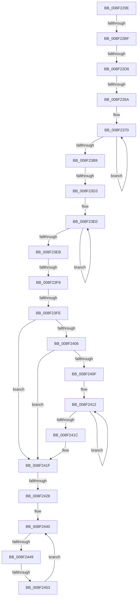

# sub_008F229E

- RVA: `0x008F229E`–`0x008F245F` (길이 `449` bytes)
- VA: `0x00000001408F229E`
- 실행 섹션: `PAGE`
- PDB 이름 있음: `아니요`; PDB Function 태그: `아니요`
- unwind 정보 RVA: `0x00087464`
- 디코드: `117`개 명령, `449/449` bytes 표시
- 미해석 바이트: `0` (있으면 어셈블리에 `.byte`로 보존)

> 이 문서는 커널 이미지의 기계어와 PDB 기호를 분석해 생성했습니다. 4번과 5번은 함수 원형과 자료형을 바이너리 사용 방식에서 추정한 C 해석이며 원본 소스 복구 결과는 아닙니다.

## 1. Dependencies

- 직접 호출 지점: **3**; 고유 호출 대상: **3**
- 직접 호출자로 확인된 함수: **0**
- RIP 상대 이미지 참조: **1**

### Outgoing calls
- `0x008F22C7` → [RtlInitUnicodeStringEx](../../text/46/RtlInitUnicodeStringEx_function_00463960.md) (function, `0x00463960`)
- `0x008F234C` → [ScanHexFormat](ScanHexFormat_function_008F29C0.md) (function, `0x008F29C0`)
- `0x008F23C2` → [wcschr](../../text/50/wcschr_function_00501A60.md) (function, `0x00501A60`)

### Direct callers
- 이 함수 시작 RVA로 연결되는 직접 call은 확인되지 않았습니다. 간접 호출은 완전히 역산할 수 없습니다.

### Static image references
- `0x008F22EB` → RVA `0x00B4D0B0` (`GuidFormat`; read)

## 2. Other-region calls and transfers

- 다른 실행 섹션으로 향하는 call: **2**
  - `0x008F22C7` → [RtlInitUnicodeStringEx](../../text/46/RtlInitUnicodeStringEx_function_00463960.md) (`PAGE` → `.text`)
  - `0x008F23C2` → [wcschr](../../text/50/wcschr_function_00501A60.md) (`PAGE` → `.text`)
- call이 아닌 외부 분기/꼬리 이동: **9**
  - `0x008F22B9` → [sub_008F2936](Unknown_function_008F2936.md) (`tail-transfer`)
  - `0x008F22D0` → [sub_008F21BF + 0x5](Unknown_function_008F21BF.md) (`tail-transfer`)
  - `0x008F2354` → [sub_008F246A](Unknown_function_008F246A.md) (`tail-transfer`)
  - `0x008F23CD` → [sub_008F246A + 0xFD](Unknown_function_008F246A.md) (`tail-transfer`)
  - `0x008F23F3` → [sub_008F21BF](Unknown_function_008F21BF.md) (`tail-transfer`)
  - `0x008F23FC` → [sub_008F246A](Unknown_function_008F246A.md) (`tail-transfer`)
  - `0x008F2422` → [sub_008F21BF](Unknown_function_008F21BF.md) (`tail-transfer`)
  - `0x008F2447` → [sub_008F246A + 0xA](Unknown_function_008F246A.md) (`tail-transfer`)
  - `0x008F2451` → [sub_008F246A + 0xA](Unknown_function_008F246A.md) (`tail-transfer`)

## 3. Assembly (complete function range)

```asm
008F229E  4D 85 C0                        test r8, r8
008F22A1  48 8D 41 FE                     lea rax, [rcx - 2]
008F22A5  BB 05 00 00 80                  mov ebx, 0x80000005
008F22AA  48 0F 45 C1                     cmovne rax, rcx
008F22AE  33 FF                           xor edi, edi
008F22B0  4D 85 C0                        test r8, r8
008F22B3  0F 45 DF                        cmovne ebx, edi
008F22B6  66 89 38                        mov word ptr [rax], di
008F22B9  0F 84 77 06 00 00               je 0x1408f2936
008F22BF  48 8D 55 60                     lea rdx, [rbp + 0x60]
008F22C3  48 8D 4D 88                     lea rcx, [rbp - 0x78]
008F22C7  E8 94 16 B7 FF                  call 0x140463960
008F22CC  8B D8                           mov ebx, eax
008F22CE  85 C0                           test eax, eax
008F22D0  0F 88 EE FE FF FF               js 0x1408f21c4
008F22D6  0F B7 55 88                     movzx edx, word ptr [rbp - 0x78]
008F22DA  48 8D 45 06                     lea rax, [rbp + 6]
008F22DE  48 8B 4D 90                     mov rcx, qword ptr [rbp - 0x70]
008F22E2  4C 8D 4D D8                     lea r9, [rbp - 0x28]
008F22E6  48 89 44 24 68                  mov qword ptr [rsp + 0x68], rax
008F22EB  4C 8D 05 BE AD 25 00            lea r8, [rip + 0x25adbe]
008F22F2  48 8D 45 04                     lea rax, [rbp + 4]
008F22F6  D1 EA                           shr edx, 1
008F22F8  48 89 44 24 60                  mov qword ptr [rsp + 0x60], rax
008F22FD  0F 57 C0                        xorps xmm0, xmm0
008F2300  48 8D 45 02                     lea rax, [rbp + 2]
008F2304  48 89 44 24 58                  mov qword ptr [rsp + 0x58], rax
008F2309  48 8D 45 00                     lea rax, [rbp]
008F230D  48 89 44 24 50                  mov qword ptr [rsp + 0x50], rax
008F2312  48 8D 45 FE                     lea rax, [rbp - 2]
008F2316  48 89 44 24 48                  mov qword ptr [rsp + 0x48], rax
008F231B  48 8D 45 FC                     lea rax, [rbp - 4]
008F231F  48 89 44 24 40                  mov qword ptr [rsp + 0x40], rax
008F2324  48 8D 45 FA                     lea rax, [rbp - 6]
008F2328  48 89 44 24 38                  mov qword ptr [rsp + 0x38], rax
008F232D  48 8D 45 F8                     lea rax, [rbp - 8]
008F2331  48 89 44 24 30                  mov qword ptr [rsp + 0x30], rax
008F2336  48 8D 45 DE                     lea rax, [rbp - 0x22]
008F233A  48 89 44 24 28                  mov qword ptr [rsp + 0x28], rax
008F233F  48 8D 45 DC                     lea rax, [rbp - 0x24]
008F2343  48 89 44 24 20                  mov qword ptr [rsp + 0x20], rax
008F2348  0F 11 45 F8                     movups xmmword ptr [rbp - 8], xmm0
008F234C  E8 6F 06 00 00                  call 0x1408f29c0
008F2351  41 3B C4                        cmp eax, r12d
008F2354  0F 84 10 01 00 00               je 0x1408f246a
008F235A  44 8B C7                        mov r8d, edi
008F235D  48 8D 4D E1                     lea rcx, [rbp - 0x1f]
008F2361  48 8D 55 FA                     lea rdx, [rbp - 6]
008F2365  66 66 66 0F 1F 84 00 00 00 00 00  nop word ptr [rax + rax]
008F2370  0F B6 42 FE                     movzx eax, byte ptr [rdx - 2]
008F2374  41 83 C0 08                     add r8d, 8
008F2378  88 41 FF                        mov byte ptr [rcx - 1], al
008F237B  48 8D 49 08                     lea rcx, [rcx + 8]
008F237F  0F B6 02                        movzx eax, byte ptr [rdx]
008F2382  48 8D 52 10                     lea rdx, [rdx + 0x10]
008F2386  88 41 F8                        mov byte ptr [rcx - 8], al
008F2389  0F B6 42 F2                     movzx eax, byte ptr [rdx - 0xe]
008F238D  88 41 F9                        mov byte ptr [rcx - 7], al
008F2390  0F B6 42 F4                     movzx eax, byte ptr [rdx - 0xc]
008F2394  88 41 FA                        mov byte ptr [rcx - 6], al
008F2397  0F B6 42 F6                     movzx eax, byte ptr [rdx - 0xa]
008F239B  88 41 FB                        mov byte ptr [rcx - 5], al
008F239E  0F B6 42 F8                     movzx eax, byte ptr [rdx - 8]
008F23A2  88 41 FC                        mov byte ptr [rcx - 4], al
008F23A5  0F B6 42 FA                     movzx eax, byte ptr [rdx - 6]
008F23A9  88 41 FD                        mov byte ptr [rcx - 3], al
008F23AC  0F B6 42 FC                     movzx eax, byte ptr [rdx - 4]
008F23B0  88 41 FE                        mov byte ptr [rcx - 2], al
008F23B3  41 83 F8 08                     cmp r8d, 8
008F23B7  72 B7                           jb 0x1408f2370
008F23B9  BA 5C 00 00 00                  mov edx, 0x5c
008F23BE  49 8D 4D 08                     lea rcx, [r13 + 8]
008F23C2  E8 99 F6 C0 FF                  call 0x140501a60
008F23C7  48 8B C8                        mov rcx, rax
008F23CA  48 85 C0                        test rax, rax
008F23CD  0F 85 94 01 00 00               jne 0x1408f2567
008F23D3  48 8B F7                        mov rsi, rdi
008F23D6  49 8B CC                        mov rcx, r12
008F23D9  0F 1F 80 00 00 00 00            nop dword ptr [rax]
008F23E0  48 FF C1                        inc rcx
008F23E3  66 41 39 7C 4D 00               cmp word ptr [r13 + rcx*2], di
008F23E9  75 F5                           jne 0x1408f23e0
008F23EB  BA FF FF FF FF                  mov edx, 0xffffffff
008F23F0  48 3B CA                        cmp rcx, rdx
008F23F3  0F 87 C6 FD FF FF               ja 0x1408f21bf
008F23F9  83 F9 30                        cmp ecx, 0x30
008F23FC  72 6C                           jb 0x1408f246a
008F23FE  8D 79 01                        lea edi, [rcx + 1]
008F2401  45 84 F6                        test r14b, r14b
008F2404  74 19                           je 0x1408f241f
008F2406  48 83 C7 02                     add rdi, 2
008F240A  48 85 F6                        test rsi, rsi
008F240D  74 10                           je 0x1408f241f
008F240F  49 8B C4                        mov rax, r12
008F2412  48 FF C0                        inc rax
008F2415  66 83 3C 46 00                  cmp word ptr [rsi + rax*2], 0
008F241A  75 F6                           jne 0x1408f2412
008F241C  48 03 F8                        add rdi, rax
008F241F  48 3B FA                        cmp rdi, rdx
008F2422  0F 87 97 FD FF FF               ja 0x1408f21bf
008F2428  44 8B F1                        mov r14d, ecx
008F242B  4D 8D 45 B4                     lea r8, [r13 - 0x4c]
008F242F  48 8D 45 10                     lea rax, [rbp + 0x10]
008F2433  48 8D 4D 10                     lea rcx, [rbp + 0x10]
008F2437  4F 8D 04 70                     lea r8, [r8 + r14*2]
008F243B  4C 2B C0                        sub r8, rax
008F243E  66 90                           nop
008F2440  49 8D 57 FF                     lea rdx, [r15 - 1]
008F2444  48 85 D2                        test rdx, rdx
008F2447  74 2B                           je 0x1408f2474
008F2449  41 0F B7 04 08                  movzx eax, word ptr [r8 + rcx]
008F244E  66 85 C0                        test ax, ax
008F2451  74 21                           je 0x1408f2474
008F2453  66 89 01                        mov word ptr [rcx], ax
008F2456  4C 8B FA                        mov r15, rdx
008F2459  48 83 C1 02                     add rcx, 2
008F245D  EB E1                           jmp 0x1408f2440
```

## 4. C-style interpretation (structured pseudocode)

```c
__int64 __fastcall sub_008F229E(__int64 a1, __int64 a2, __int64 a3)
{
    __int64 result;
    __int64 v_rbx;
    __int64 v_rdi;
    unsigned __int64 v_stack_p20;
    unsigned __int64 v_stack_p28;
    unsigned __int64 v_stack_p30;
    unsigned __int64 v_stack_p38;
    unsigned __int64 v_stack_p40;
    unsigned __int64 v_stack_p48;
    unsigned __int64 v_stack_p50;
    unsigned __int64 v_stack_p58;
    unsigned __int64 v_stack_p60;
    unsigned __int64 v_stack_p68;

    result = a1 - 2;
    if (a3 != 0) { result = a1; }
    v_rdi = 0;
    v_rbx = (unsigned int)(0x80000005ULL);
    if (a3 != 0) { v_rbx = 0; }
    *(unsigned __int16 *)(result) = 0;
    result = RtlInitUnicodeStringEx(v_rbp - 120, v_rbp + 96, a3, a4);
    v_stack_p68 = v_rbp + 6;
    a2 = (unsigned int)((*(unsigned __int16 *)(v_rbp - 120)) >> (1));
    v_stack_p60 = v_rbp + 4;
    v_stack_p58 = v_rbp + 2;
    v_stack_p50 = v_rbp;
    v_stack_p48 = v_rbp - 2;
    v_stack_p40 = v_rbp - 4;
    v_stack_p38 = v_rbp - 6;
    v_stack_p30 = v_rbp - 8;
    v_stack_p28 = v_rbp - 34;
    v_stack_p20 = v_rbp - 36;
    *(unsigned __int64 *)(v_rbp - 8) = v_xmm0;
    result = ScanHexFormat(*(unsigned __int64 *)(v_rbp - 112), a2, v_rip + 2469310, v_rbp - 40);
loc_008F2370:
    a3 = (unsigned int)((0) + (8));
    *(unsigned __int8 *)(v_rbp - 31 - 1) = (unsigned __int8)(*(unsigned __int8 *)(v_rbp - 6 - 2));
    *(unsigned __int8 *)(v_rbp - 31 + 8 - 8) = (unsigned __int8)(*(unsigned __int8 *)(v_rbp - 6));
    *(unsigned __int8 *)(v_rbp - 31 + 8 - 7) = (unsigned __int8)(*(unsigned __int8 *)(v_rbp - 6 + 16 - 14));
    *(unsigned __int8 *)(v_rbp - 31 + 8 - 6) = (unsigned __int8)(*(unsigned __int8 *)(v_rbp - 6 + 16 - 12));
    *(unsigned __int8 *)(v_rbp - 31 + 8 - 5) = (unsigned __int8)(*(unsigned __int8 *)(v_rbp - 6 + 16 - 10));
    *(unsigned __int8 *)(v_rbp - 31 + 8 - 4) = (unsigned __int8)(*(unsigned __int8 *)(v_rbp - 6 + 16 - 8));
    *(unsigned __int8 *)(v_rbp - 31 + 8 - 3) = (unsigned __int8)(*(unsigned __int8 *)(v_rbp - 6 + 16 - 6));
    *(unsigned __int8 *)(v_rbp - 31 + 8 - 2) = (unsigned __int8)(*(unsigned __int8 *)(v_rbp - 6 + 16 - 4));
    if (((unsigned int)(a3)) < 8) goto loc_008F2370;
    result = wcschr(v_r13 + 8, 92, a3, v_rbp - 40);
loc_008F23E0:
    a1 = (v_r12) + 1;
    if ((*(unsigned __int16 *)(v_r13 + a1 * 2)) != 0) goto loc_008F23E0;
    if ((unsigned __int8)(v_r14) == 0) goto loc_008F241F;
    v_rdi = (a1 + 1) + (2);
    if (0 == 0) goto loc_008F241F;
loc_008F2412:
    result = (v_r12) + 1;
    if ((*(unsigned __int16 *)(0 + result * 2)) != 0) goto loc_008F2412;
    v_rdi = (v_rdi) + (result);
loc_008F241F:
    a3 = (v_r13 - 76 + (unsigned int)((unsigned int)(a1)) * 2) - (v_rbp + 16);
loc_008F2440:
    *(unsigned __int16 *)(v_rbp + 16) = (unsigned __int16)(*(unsigned __int16 *)(a3 + v_rbp + 16 * 1));
    a1 = (v_rbp + 16) + (2);
    goto loc_008F2440;
}
```

## 5. (Beta) C Style

```c
int64_t sub_008F229E(void *Arg1, int64_t Arg2, int64_t Arg3)
{
    uint8_t *arg1 = (uint8_t *)Arg1;

    int64_t result;
    int64_t local_rbx;
    int64_t local_rdi;
    uint64_t v_stack_p20;
    uint64_t v_stack_p28;
    uint64_t v_stack_p30;
    uint64_t v_stack_p38;
    uint64_t v_stack_p40;
    uint64_t v_stack_p48;
    uint64_t v_stack_p50;
    uint64_t v_stack_p58;
    uint64_t v_stack_p60;
    uint64_t v_stack_p68;

    result = Arg1 - 2;
    if (Arg3 != 0) { result = Arg1; }
    local_rdi = 0;
    local_rbx = (uint32_t)(0x80000005ULL);
    if (Arg3 != 0) { local_rbx = 0; }
    *(uint16_t *)(result) = 0;
    result = RtlInitUnicodeStringEx(local_rbp - 120, local_rbp + 96, Arg3, a4);
    v_stack_p68 = local_rbp + 6;
    Arg2 = (uint32_t)((*(uint16_t *)(local_rbp - 0x78)) >> (1));
    v_stack_p60 = local_rbp + 4;
    v_stack_p58 = local_rbp + 2;
    v_stack_p50 = local_rbp;
    v_stack_p48 = local_rbp - 2;
    v_stack_p40 = local_rbp - 4;
    v_stack_p38 = local_rbp - 6;
    v_stack_p30 = local_rbp - 8;
    v_stack_p28 = local_rbp - 34;
    v_stack_p20 = local_rbp - 36;
    *(uint64_t *)(local_rbp - 0x8) = v_xmm0;
    result = ScanHexFormat(*(uint64_t *)(local_rbp - 0x70), Arg2, v_rip + 2469310, local_rbp - 40);
loc_008F2370:
    Arg3 = (uint32_t)((0) + (8));
    *(uint8_t *)(local_rbp - 0x1F - 0x1) = (uint8_t)(*(uint8_t *)(local_rbp - 0x6 - 0x2));
    *(uint8_t *)(local_rbp - 0x1F + 0x8 - 0x8) = (uint8_t)(*(uint8_t *)(local_rbp - 0x6));
    *(uint8_t *)(local_rbp - 0x1F + 0x8 - 0x7) = (uint8_t)(*(uint8_t *)(local_rbp - 0x6 + 0x10 - 0xE));
    *(uint8_t *)(local_rbp - 0x1F + 0x8 - 0x6) = (uint8_t)(*(uint8_t *)(local_rbp - 0x6 + 0x10 - 0xC));
    *(uint8_t *)(local_rbp - 0x1F + 0x8 - 0x5) = (uint8_t)(*(uint8_t *)(local_rbp - 0x6 + 0x10 - 0xA));
    *(uint8_t *)(local_rbp - 0x1F + 0x8 - 0x4) = (uint8_t)(*(uint8_t *)(local_rbp - 0x6 + 0x10 - 0x8));
    *(uint8_t *)(local_rbp - 0x1F + 0x8 - 0x3) = (uint8_t)(*(uint8_t *)(local_rbp - 0x6 + 0x10 - 0x6));
    *(uint8_t *)(local_rbp - 0x1F + 0x8 - 0x2) = (uint8_t)(*(uint8_t *)(local_rbp - 0x6 + 0x10 - 0x4));
    if (((uint32_t)(Arg3)) < 8) goto loc_008F2370;
    result = wcschr(local_r13 + 8, 92, Arg3, local_rbp - 40);
loc_008F23E0:
    Arg1 = (local_r12) + 1;
    if ((*(uint16_t *)(local_r13 + arg1 * 2)) != 0) goto loc_008F23E0;
    if ((uint8_t)(local_r14) == 0) goto loc_008F241F;
    local_rdi = (Arg1 + 1) + (2);
    if (0 == 0) goto loc_008F241F;
loc_008F2412:
    result = (local_r12) + 1;
    if ((*(uint16_t *)(0 + result * 2)) != 0) goto loc_008F2412;
    local_rdi = (local_rdi) + (result);
loc_008F241F:
    Arg3 = (local_r13 - 76 + (uint32_t)((uint32_t)(Arg1)) * 2) - (local_rbp + 16);
loc_008F2440:
    *(uint16_t *)(local_rbp + 0x10) = (uint16_t)(*(uint16_t *)(Arg3 + local_rbp + 0x10 * 1));
    Arg1 = (local_rbp + 16) + (2);
    goto loc_008F2440;
}
```

### 관측된 메모리 오프셋

구조체 형식이 확인되지 않은 접근은 인자 기준의 오프셋으로만 기록했습니다.

| 기준 인자 | 오프셋 표현 | 폭 (bit) | 접근 |
|---|---:|---:|---|
| `Arg1` | `- 0x2` | `64` | `R` |

## 6. Execution-region graph

[열기: 2D/3D 그래프와 함수 탐색 컨트롤 패널](../../../control-panel.html?section=page&rva=0x008F229E&view=graph)

- 2D 그래프는 위에서 아래로 흐르고, 3D 그래프는 빈 공간을 드래그해 회전합니다. Shift+드래그는 이동, 휠은 확대·축소, 함수 노드 선택은 대상 보고서 이동입니다.

### Static fallback


