# sub_008F246A

- RVA: `0x008F246A`–`0x008F285D` (길이 `1,011` bytes)
- VA: `0x00000001408F246A`
- 실행 섹션: `PAGE`
- PDB 이름 있음: `아니요`; PDB Function 태그: `아니요`
- unwind 정보 RVA: `0x00087488`
- 디코드: `255`개 명령, `1,011/1,011` bytes 표시
- 미해석 바이트: `0` (있으면 어셈블리에 `.byte`로 보존)

> 이 문서는 커널 이미지의 기계어와 PDB 기호를 분석해 생성했습니다. 4번과 5번은 함수 원형과 자료형을 바이너리 사용 방식에서 추정한 C 해석이며 원본 소스 복구 결과는 아닙니다.

## 1. Dependencies

- 직접 호출 지점: **6**; 고유 호출 대상: **5**
- 직접 호출자로 확인된 함수: **0**
- RIP 상대 이미지 참조: **5**

### Outgoing calls
- `0x008F249D` → [RtlInitUnicodeStringEx](../../text/46/RtlInitUnicodeStringEx_function_00463960.md) (function, `0x00463960`)
- `0x008F24B4` → [RtlGUIDFromString](RtlGUIDFromString_function_008F1EF0.md) (function, `0x008F1EF0`)
- `0x008F25A9` → [RtlStringExHandleOtherFlagsW](../../text/41/RtlStringExHandleOtherFlagsW_function_0041E3F0.md) (function, `0x0041E3F0`)
- `0x008F26A3` → [RtlStringCchPrintfExW](../../text/42/RtlStringCchPrintfExW_function_0042B390.md) (function, `0x0042B390`)
- `0x008F26C9` → [RtlStringCchCatExW](../../text/48/RtlStringCchCatExW_function_00485910.md) (function, `0x00485910`)
- `0x008F26E5` → [RtlStringCchCatExW](../../text/48/RtlStringCchCatExW_function_00485910.md) (function, `0x00485910`)

### Direct callers
- 이 함수 시작 RVA로 연결되는 직접 call은 확인되지 않았습니다. 간접 호출은 완전히 역산할 수 없습니다.

### Static image references
- `0x008F267B` → RVA `0x00B0D400` (` ?? ::NNGAKEGL::`string'`; read)
- `0x008F268C` → RVA `0x00AFDE50` (` ?? ::NNGAKEGL::`string'`; read)
- `0x008F26BC` → RVA `0x00AFC990` (` ?? ::NNGAKEGL::`string'`; read)
- `0x008F26D8` → RVA `0x00B0D340` (` ?? ::NNGAKEGL::`string'`; read)
- `0x008F272F` → RVA `0x00B0D4D0` (` ?? ::NNGAKEGL::`string'`; read)

## 2. Other-region calls and transfers

- 다른 실행 섹션으로 향하는 call: **5**
  - `0x008F249D` → [RtlInitUnicodeStringEx](../../text/46/RtlInitUnicodeStringEx_function_00463960.md) (`PAGE` → `.text`)
  - `0x008F25A9` → [RtlStringExHandleOtherFlagsW](../../text/41/RtlStringExHandleOtherFlagsW_function_0041E3F0.md) (`PAGE` → `.text`)
  - `0x008F26A3` → [RtlStringCchPrintfExW](../../text/42/RtlStringCchPrintfExW_function_0042B390.md) (`PAGE` → `.text`)
  - `0x008F26C9` → [RtlStringCchCatExW](../../text/48/RtlStringCchCatExW_function_00485910.md) (`PAGE` → `.text`)
  - `0x008F26E5` → [RtlStringCchCatExW](../../text/48/RtlStringCchCatExW_function_00485910.md) (`PAGE` → `.text`)
- call이 아닌 외부 분기/꼬리 이동: **20**
  - `0x008F246F` → [sub_008F21BF + 0x5](Unknown_function_008F21BF.md) (`tail-transfer`)
  - `0x008F248F` → [sub_008F2936 + 0x23](Unknown_function_008F2936.md) (`tail-transfer`)
  - `0x008F24A6` → [sub_008F286E + 0x59](Unknown_function_008F286E.md) (`tail-transfer`)
  - `0x008F24BD` → [sub_008F286E + 0x59](Unknown_function_008F286E.md) (`tail-transfer`)
  - `0x008F24D4` → [sub_008F2936 + 0x46](Unknown_function_008F2936.md) (`tail-transfer`)
  - `0x008F2571` → [sub_008F229E + 0x14D](Unknown_function_008F229E.md) (`tail-transfer`)
  - `0x008F257B` → [sub_008F21BF + 0x5](Unknown_function_008F21BF.md) (`tail-transfer`)
  - `0x008F25B7` → [sub_008F2936 + 0x50](Unknown_function_008F2936.md) (`tail-transfer`)
  - `0x008F25D1` → [sub_008F21BF + 0x5](Unknown_function_008F21BF.md) (`tail-transfer`)
  - `0x008F25E0` → [sub_008F2936 + 0x5D](Unknown_function_008F2936.md) (`tail-transfer`)
  - `0x008F2637` → [sub_008F21BF](Unknown_function_008F21BF.md) (`tail-transfer`)
  - `0x008F2664` → [sub_008F286E](Unknown_function_008F286E.md) (`tail-transfer`)
  - `0x008F26AC` → [sub_008F21BF + 0xA](Unknown_function_008F21BF.md) (`tail-transfer`)
  - `0x008F26B6` → [sub_008F21BF + 0xA](Unknown_function_008F21BF.md) (`tail-transfer`)
  - `0x008F26D2` → [sub_008F21BF + 0xA](Unknown_function_008F21BF.md) (`tail-transfer`)
  - `0x008F26EC` → [sub_008F21BF + 0xA](Unknown_function_008F21BF.md) (`tail-transfer`)
  - `0x008F2720` → [sub_008F286E + 0x7E](Unknown_function_008F286E.md) (`tail-transfer`)
  - `0x008F2793` → [sub_008F286E + 0x63](Unknown_function_008F286E.md) (`tail-transfer`)
  - `0x008F27C8` → [sub_008F286E + 0x9A](Unknown_function_008F286E.md) (`tail-transfer`)
  - `0x008F284E` → [sub_008F2936 + 0x46](Unknown_function_008F2936.md) (`tail-transfer`)

## 3. Assembly (complete function range)

```asm
008F246A  BB 33 00 00 C0                  mov ebx, 0xc0000033
008F246F  E9 50 FD FF FF                  jmp 0x1408f21c4
008F2474  4D 85 FF                        test r15, r15
008F2477  48 8D 41 FE                     lea rax, [rcx - 2]
008F247B  BB 05 00 00 80                  mov ebx, 0x80000005
008F2480  48 0F 45 C1                     cmovne rax, rcx
008F2484  33 C9                           xor ecx, ecx
008F2486  4D 85 FF                        test r15, r15
008F2489  0F 45 D9                        cmovne ebx, ecx
008F248C  66 89 08                        mov word ptr [rax], cx
008F248F  0F 84 C4 04 00 00               je 0x1408f2959
008F2495  48 8D 55 10                     lea rdx, [rbp + 0x10]
008F2499  48 8D 4D C8                     lea rcx, [rbp - 0x38]
008F249D  E8 BE 14 B7 FF                  call 0x140463960
008F24A2  8B D8                           mov ebx, eax
008F24A4  85 C0                           test eax, eax
008F24A6  0F 88 1B 04 00 00               js 0x1408f28c7
008F24AC  48 8D 55 E8                     lea rdx, [rbp - 0x18]
008F24B0  48 8D 4D C8                     lea rcx, [rbp - 0x38]
008F24B4  E8 37 FA FF FF                  call 0x1408f1ef0
008F24B9  8B D8                           mov ebx, eax
008F24BB  85 C0                           test eax, eax
008F24BD  0F 88 04 04 00 00               js 0x1408f28c7
008F24C3  48 8B 45 98                     mov rax, qword ptr [rbp - 0x68]
008F24C7  3B F8                           cmp edi, eax
008F24C9  0F 87 A7 00 00 00               ja 0x1408f2576
008F24CF  44 8B C8                        mov r9d, eax
008F24D2  85 C0                           test eax, eax
008F24D4  0F 84 A2 04 00 00               je 0x1408f297c
008F24DA  48 8B 7C 24 70                  mov rdi, qword ptr [rsp + 0x70]
008F24DF  45 33 D2                        xor r10d, r10d
008F24E2  48 89 7D 88                     mov qword ptr [rbp - 0x78], rdi
008F24E6  4C 89 4D 98                     mov qword ptr [rbp - 0x68], r9
008F24EA  49 81 FE FF FF FF 7F            cmp r14, 0x7fffffff
008F24F1  0F 83 89 00 00 00               jae 0x1408f2580
008F24F7  4D 2B F1                        sub r14, r9
008F24FA  41 8B C9                        mov ecx, r9d
008F24FD  4C 2B EF                        sub r13, rdi
008F2500  48 8B D7                        mov rdx, rdi
008F2503  45 8B C2                        mov r8d, r10d
008F2506  49 8D 04 0E                     lea rax, [r14 + rcx]
008F250A  48 85 C0                        test rax, rax
008F250D  74 1A                           je 0x1408f2529
008F250F  42 0F B7 04 2A                  movzx eax, word ptr [rdx + r13]
008F2514  66 85 C0                        test ax, ax
008F2517  74 10                           je 0x1408f2529
008F2519  66 89 02                        mov word ptr [rdx], ax
008F251C  49 FF C0                        inc r8
008F251F  48 83 C2 02                     add rdx, 2
008F2523  48 83 E9 01                     sub rcx, 1
008F2527  75 DD                           jne 0x1408f2506
008F2529  48 85 C9                        test rcx, rcx
008F252C  48 8D 42 FE                     lea rax, [rdx - 2]
008F2530  BB 05 00 00 80                  mov ebx, 0x80000005
008F2535  49 8B C9                        mov rcx, r9
008F2538  48 0F 45 C2                     cmovne rax, rdx
008F253C  41 0F 45 DA                     cmovne ebx, r10d
008F2540  66 44 89 10                     mov word ptr [rax], r10w
008F2544  49 8D 40 FF                     lea rax, [r8 - 1]
008F2548  49 0F 45 C0                     cmovne rax, r8
008F254C  48 2B C8                        sub rcx, rax
008F254F  48 89 4D 98                     mov qword ptr [rbp - 0x68], rcx
008F2553  48 8D 14 47                     lea rdx, [rdi + rax*2]
008F2557  48 89 55 88                     mov qword ptr [rbp - 0x78], rdx
008F255B  85 DB                           test ebx, ebx
008F255D  78 2E                           js 0x1408f258d
008F255F  4C 8B FA                        mov r15, rdx
008F2562  4C 8B F1                        mov r14, rcx
008F2565  EB 5D                           jmp 0x1408f25c4
008F2567  49 2B CD                        sub rcx, r13
008F256A  48 8D 70 02                     lea rsi, [rax + 2]
008F256E  48 D1 F9                        sar rcx, 1
008F2571  E9 75 FE FF FF                  jmp 0x1408f23eb
008F2576  BB 23 00 00 C0                  mov ebx, 0xc0000023
008F257B  E9 44 FC FF FF                  jmp 0x1408f21c4
008F2580  BB 0D 00 00 C0                  mov ebx, 0xc000000d
008F2585  66 44 89 17                     mov word ptr [rdi], r10w
008F2589  41 0F 42 DA                     cmovb ebx, r10d
008F258D  4B 8D 14 09                     lea rdx, [r9 + r9]
008F2591  C7 44 24 28 00 08 00 00         mov dword ptr [rsp + 0x28], 0x800
008F2599  48 8D 45 98                     lea rax, [rbp - 0x68]
008F259D  48 8B CF                        mov rcx, rdi
008F25A0  4C 8D 4D 88                     lea r9, [rbp - 0x78]
008F25A4  48 89 44 24 20                  mov qword ptr [rsp + 0x20], rax
008F25A9  E8 42 BE B2 FF                  call 0x14041e3f0
008F25AE  45 33 D2                        xor r10d, r10d
008F25B1  81 FB 05 00 00 80               cmp ebx, 0x80000005
008F25B7  0F 84 C9 03 00 00               je 0x1408f2986
008F25BD  4C 8B 75 C0                     mov r14, qword ptr [rbp - 0x40]
008F25C1  4D 8B FE                        mov r15, r14
008F25C4  85 DB                           test ebx, ebx
008F25C6  0F 89 25 01 00 00               jns 0x1408f26f1
008F25CC  45 33 D2                        xor r10d, r10d
008F25CF  85 DB                           test ebx, ebx
008F25D1  0F 88 ED FB FF FF               js 0x1408f21c4
008F25D7  8B 55 B0                        mov edx, dword ptr [rbp - 0x50]
008F25DA  81 E2 00 02 00 00               and edx, 0x200
008F25E0  0F 85 AD 03 00 00               jne 0x1408f2993
008F25E6  48 8D 4D 10                     lea rcx, [rbp + 0x10]
008F25EA  49 8B C4                        mov rax, r12
008F25ED  0F 1F 00                        nop dword ptr [rax]
008F25F0  48 FF C0                        inc rax
008F25F3  66 83 3C 41 00                  cmp word ptr [rcx + rax*2], 0
008F25F8  75 F6                           jne 0x1408f25f0
008F25FA  44 8B 44 24 7C                  mov r8d, dword ptr [rsp + 0x7c]
008F25FF  48 83 C0 30                     add rax, 0x30
008F2603  41 B9 FF FF FF FF               mov r9d, 0xffffffff
008F2609  0F 1F 80 00 00 00 00            nop dword ptr [rax]
008F2610  66 42 83 7C 67 02 00            cmp word ptr [rdi + r12*2 + 2], 0
008F2617  4D 8D 64 24 01                  lea r12, [r12 + 1]
008F261C  75 F2                           jne 0x1408f2610
008F261E  44 8B 75 84                     mov r14d, dword ptr [rbp - 0x7c]
008F2622  49 8D 4C 24 01                  lea rcx, [r12 + 1]
008F2627  48 03 C8                        add rcx, rax
008F262A  41 83 FE 31                     cmp r14d, 0x31
008F262E  0F 85 0C 02 00 00               jne 0x1408f2840
008F2634  49 3B C9                        cmp rcx, r9
008F2637  0F 87 82 FB FF FF               ja 0x1408f21bf
008F263D  48 8B 45 B8                     mov rax, qword ptr [rbp - 0x48]
008F2641  41 8B DA                        mov ebx, r10d
008F2644  48 85 C0                        test rax, rax
008F2647  74 02                           je 0x1408f264b
008F2649  89 08                           mov dword ptr [rax], ecx
008F264B  8B BD 30 01 00 00               mov edi, dword ptr [rbp + 0x130]
008F2651  3B CF                           cmp ecx, edi
008F2653  0F 87 1D FF FF FF               ja 0x1408f2576
008F2659  48 8B 74 24 70                  mov rsi, qword ptr [rsp + 0x70]
008F265E  4C 8B 7D A0                     mov r15, qword ptr [rbp - 0x60]
008F2662  85 D2                           test edx, edx
008F2664  0F 85 04 02 00 00               jne 0x1408f286e
008F266A  48 89 74 24 40                  mov qword ptr [rsp + 0x40], rsi
008F266F  48 8D 45 10                     lea rax, [rbp + 0x10]
008F2673  48 89 44 24 38                  mov qword ptr [rsp + 0x38], rax
008F2678  45 33 C9                        xor r9d, r9d
008F267B  48 8D 05 7E AD 21 00            lea rax, [rip + 0x21ad7e]
008F2682  45 33 C0                        xor r8d, r8d
008F2685  48 89 44 24 30                  mov qword ptr [rsp + 0x30], rax
008F268A  8B D7                           mov edx, edi
008F268C  48 8D 05 BD B7 20 00            lea rax, [rip + 0x20b7bd]
008F2693  49 8B CF                        mov rcx, r15
008F2696  48 89 44 24 28                  mov qword ptr [rsp + 0x28], rax
008F269B  C7 44 24 20 00 08 00 00         mov dword ptr [rsp + 0x20], 0x800
008F26A3  E8 E8 8C B3 FF                  call 0x14042b390
008F26A8  8B D8                           mov ebx, eax
008F26AA  85 DB                           test ebx, ebx
008F26AC  0F 88 17 FB FF FF               js 0x1408f21c9
008F26B2  41 83 FE 32                     cmp r14d, 0x32
008F26B6  0F 85 0D FB FF FF               jne 0x1408f21c9
008F26BC  4C 8D 05 CD A2 20 00            lea r8, [rip + 0x20a2cd]
008F26C3  48 8B D7                        mov rdx, rdi
008F26C6  49 8B CF                        mov rcx, r15
008F26C9  E8 42 32 B9 FF                  call 0x140485910
008F26CE  8B D8                           mov ebx, eax
008F26D0  85 C0                           test eax, eax
008F26D2  0F 88 F1 FA FF FF               js 0x1408f21c9
008F26D8  4C 8D 05 61 AC 21 00            lea r8, [rip + 0x21ac61]
008F26DF  48 8B D7                        mov rdx, rdi
008F26E2  49 8B CF                        mov rcx, r15
008F26E5  E8 26 32 B9 FF                  call 0x140485910
008F26EA  8B D8                           mov ebx, eax
008F26EC  E9 D8 FA FF FF                  jmp 0x1408f21c9
008F26F1  80 7C 24 78 00                  cmp byte ptr [rsp + 0x78], 0
008F26F6  48 B8 23 00 23 00 3F 00 23 00   movabs rax, 0x23003f00230023
008F2700  48 89 07                        mov qword ptr [rdi], rax
008F2703  0F 84 C3 FE FF FF               je 0x1408f25cc
008F2709  49 8D 46 FF                     lea rax, [r14 - 1]
008F270D  41 BB FE FF FF 7F               mov r11d, 0x7ffffffe
008F2713  49 BD FF FF FF FF FF FF FF 7F   movabs r13, 0x7fffffffffffffff
008F271D  49 3B C3                        cmp rax, r11
008F2720  0F 87 C6 01 00 00               ja 0x1408f28ec
008F2726  4D 8B C2                        mov r8, r10
008F2729  45 8B CB                        mov r9d, r11d
008F272C  4D 2B CE                        sub r9, r14
008F272F  4C 8D 15 9A AD 21 00            lea r10, [rip + 0x21ad9a]
008F2736  4D 2B D7                        sub r10, r15
008F2739  49 8B CE                        mov rcx, r14
008F273C  49 8B D7                        mov rdx, r15
008F273F  90                              nop
008F2740  49 8D 04 09                     lea rax, [r9 + rcx]
008F2744  48 85 C0                        test rax, rax
008F2747  74 1A                           je 0x1408f2763
008F2749  41 0F B7 04 12                  movzx eax, word ptr [r10 + rdx]
008F274E  66 85 C0                        test ax, ax
008F2751  74 10                           je 0x1408f2763
008F2753  66 89 02                        mov word ptr [rdx], ax
008F2756  49 FF C0                        inc r8
008F2759  48 83 C2 02                     add rdx, 2
008F275D  48 83 E9 01                     sub rcx, 1
008F2761  75 DD                           jne 0x1408f2740
008F2763  48 85 C9                        test rcx, rcx
008F2766  48 8D 42 FE                     lea rax, [rdx - 2]
008F276A  48 0F 45 C2                     cmovne rax, rdx
008F276E  33 DB                           xor ebx, ebx
008F2770  48 85 C9                        test rcx, rcx
008F2773  BA 05 00 00 80                  mov edx, 0x80000005
008F2778  0F 45 D3                        cmovne edx, ebx
008F277B  66 89 18                        mov word ptr [rax], bx
008F277E  49 8D 40 FF                     lea rax, [r8 - 1]
008F2782  49 0F 45 C0                     cmovne rax, r8
008F2786  4D 8B C6                        mov r8, r14
008F2789  4C 2B C0                        sub r8, rax
008F278C  4D 8D 0C 47                     lea r9, [r15 + rax*2]
008F2790  48 85 C9                        test rcx, rcx
008F2793  0F 84 38 01 00 00               je 0x1408f28d1
008F2799  8B C2                           mov eax, edx
008F279B  85 D2                           test edx, edx
008F279D  0F 89 92 00 00 00               jns 0x1408f2835
008F27A3  3D 05 00 00 80                  cmp eax, 0x80000005
008F27A8  0F 84 87 00 00 00               je 0x1408f2835
008F27AE  8B DA                           mov ebx, edx
008F27B0  85 D2                           test edx, edx
008F27B2  0F 88 14 FE FF FF               js 0x1408f25cc
008F27B8  48 85 F6                        test rsi, rsi
008F27BB  0F 84 0B FE FF FF               je 0x1408f25cc
008F27C1  49 8D 46 FF                     lea rax, [r14 - 1]
008F27C5  49 3B C3                        cmp rax, r11
008F27C8  0F 87 3A 01 00 00               ja 0x1408f2908
008F27CE  4D 2B DE                        sub r11, r14
008F27D1  49 8B D6                        mov rdx, r14
008F27D4  49 2B F7                        sub rsi, r15
008F27D7  49 8B CF                        mov rcx, r15
008F27DA  66 0F 1F 44 00 00               nop word ptr [rax + rax]
008F27E0  49 8D 04 13                     lea rax, [r11 + rdx]
008F27E4  48 85 C0                        test rax, rax
008F27E7  74 16                           je 0x1408f27ff
008F27E9  0F B7 04 0E                     movzx eax, word ptr [rsi + rcx]
008F27ED  66 85 C0                        test ax, ax
008F27F0  74 0D                           je 0x1408f27ff
008F27F2  66 89 01                        mov word ptr [rcx], ax
008F27F5  48 83 C1 02                     add rcx, 2
008F27F9  48 83 EA 01                     sub rdx, 1
008F27FD  75 E1                           jne 0x1408f27e0
008F27FF  48 85 D2                        test rdx, rdx
008F2802  48 8D 41 FE                     lea rax, [rcx - 2]
008F2806  BB 05 00 00 80                  mov ebx, 0x80000005
008F280B  48 0F 45 C1                     cmovne rax, rcx
008F280F  33 C9                           xor ecx, ecx
008F2811  48 85 D2                        test rdx, rdx
008F2814  0F 45 D9                        cmovne ebx, ecx
008F2817  66 89 08                        mov word ptr [rax], cx
008F281A  0F 85 AC FD FF FF               jne 0x1408f25cc
008F2820  45 33 D2                        xor r10d, r10d
008F2823  4D 85 F5                        test r13, r14
008F2826  0F 86 A3 FD FF FF               jbe 0x1408f25cf
008F282C  66 41 89 0F                     mov word ptr [r15], cx
008F2830  E9 9A FD FF FF                  jmp 0x1408f25cf
008F2835  4D 8B F9                        mov r15, r9
008F2838  4D 8B F0                        mov r14, r8
008F283B  E9 6E FF FF FF                  jmp 0x1408f27ae
008F2840  41 83 FE 30                     cmp r14d, 0x30
008F2844  0F 84 EA FD FF FF               je 0x1408f2634
008F284A  41 83 FE 32                     cmp r14d, 0x32
008F284E  0F 85 28 01 00 00               jne 0x1408f297c
008F2854  48 83 C1 12                     add rcx, 0x12
008F2858  E9 D7 FD FF FF                  jmp 0x1408f2634
```

## 4. C-style interpretation (structured pseudocode)

```c
__int64 __fastcall sub_008F246A(__int64 a1)
{
    unsigned __int64 v_stack_p20;
    unsigned int v_stack_p28;
    unsigned __int64 v_stack_p30;
    unsigned __int64 v_stack_p38;
    unsigned __int64 v_stack_p40;
    unsigned __int64 v_stack_p70;
    unsigned __int8 v_stack_p78;
    unsigned int v_stack_p7C;
}
```

## 5. (Beta) C Style

```c
int64_t sub_008F246A(int64_t Arg1)
{
    uint64_t v_stack_p20;
    uint32_t v_stack_p28;
    uint64_t v_stack_p30;
    uint64_t v_stack_p38;
    uint64_t v_stack_p40;
    uint64_t v_stack_p70;
    uint8_t v_stack_p78;
    uint32_t v_stack_p7C;
}
```

## 6. Execution-region graph

[열기: 2D/3D 그래프와 함수 탐색 컨트롤 패널](../../../control-panel.html?section=page&rva=0x008F246A&view=graph)

- 2D 그래프는 위에서 아래로 흐르고, 3D 그래프는 빈 공간을 드래그해 회전합니다. Shift+드래그는 이동, 휠은 확대·축소, 함수 노드 선택은 대상 보고서 이동입니다.

### Static fallback

```mermaid
flowchart TD
  bb_008F246A[BB_008F246A]
  bb_008F2474[BB_008F2474]
  bb_008F2495[BB_008F2495]
  bb_008F24AC[BB_008F24AC]
  bb_008F24C3[BB_008F24C3]
  bb_008F24CF[BB_008F24CF]
  bb_008F24DA[BB_008F24DA]
  bb_008F24F7[BB_008F24F7]
  bb_008F2506[BB_008F2506]
  bb_008F250F[BB_008F250F]
  bb_008F2519[BB_008F2519]
  bb_008F2529[BB_008F2529]
  bb_008F255F[BB_008F255F]
  bb_008F2567[BB_008F2567]
  bb_008F2576[BB_008F2576]
  bb_008F2580[BB_008F2580]
  bb_008F258D[BB_008F258D]
  bb_008F25BD[BB_008F25BD]
  bb_008F25C4[BB_008F25C4]
  bb_008F25CC[BB_008F25CC]
  bb_008F25CF[BB_008F25CF]
  bb_008F25D7[BB_008F25D7]
  bb_008F25E6[BB_008F25E6]
  bb_008F25F0[BB_008F25F0]
  bb_008F25FA[BB_008F25FA]
  bb_008F2610[BB_008F2610]
  bb_008F261E[BB_008F261E]
  bb_008F2634[BB_008F2634]
  bb_008F263D[BB_008F263D]
  bb_008F2649[BB_008F2649]
  bb_008F264B[BB_008F264B]
  bb_008F2659[BB_008F2659]
  bb_008F266A[BB_008F266A]
  bb_008F26B2[BB_008F26B2]
  bb_008F26BC[BB_008F26BC]
  bb_008F26D8[BB_008F26D8]
  bb_008F26F1[BB_008F26F1]
  bb_008F2709[BB_008F2709]
  bb_008F2726[BB_008F2726]
  bb_008F2740[BB_008F2740]
  bb_008F2749[BB_008F2749]
  bb_008F2753[BB_008F2753]
  bb_008F2763[BB_008F2763]
  bb_008F2799[BB_008F2799]
  bb_008F27A3[BB_008F27A3]
  bb_008F27AE[BB_008F27AE]
  bb_008F27B8[BB_008F27B8]
  bb_008F27C1[BB_008F27C1]
  bb_008F27CE[BB_008F27CE]
  bb_008F27E0[BB_008F27E0]
  bb_008F27E9[BB_008F27E9]
  bb_008F27F2[BB_008F27F2]
  bb_008F27FF[BB_008F27FF]
  bb_008F2820[BB_008F2820]
  bb_008F282C[BB_008F282C]
  bb_008F2835[BB_008F2835]
  bb_008F2840[BB_008F2840]
  bb_008F284A[BB_008F284A]
  bb_008F2854[BB_008F2854]
  bb_008F2474 -->|fallthrough| bb_008F2495
  bb_008F2495 -->|fallthrough| bb_008F24AC
  bb_008F24AC -->|fallthrough| bb_008F24C3
  bb_008F24C3 -->|branch| bb_008F2576
  bb_008F24C3 -->|fallthrough| bb_008F24CF
  bb_008F24CF -->|fallthrough| bb_008F24DA
  bb_008F24DA -->|branch| bb_008F2580
  bb_008F24DA -->|fallthrough| bb_008F24F7
  bb_008F24F7 -->|flow| bb_008F2506
  bb_008F2506 -->|branch| bb_008F2529
  bb_008F2506 -->|fallthrough| bb_008F250F
  bb_008F250F -->|branch| bb_008F2529
  bb_008F250F -->|fallthrough| bb_008F2519
  bb_008F2519 -->|branch| bb_008F2506
  bb_008F2519 -->|fallthrough| bb_008F2529
  bb_008F2529 -->|branch| bb_008F258D
  bb_008F2529 -->|fallthrough| bb_008F255F
  bb_008F255F -->|branch| bb_008F25C4
  bb_008F2580 -->|flow| bb_008F258D
  bb_008F258D -->|fallthrough| bb_008F25BD
  bb_008F25BD -->|flow| bb_008F25C4
  bb_008F25C4 -->|branch| bb_008F26F1
  bb_008F25C4 -->|fallthrough| bb_008F25CC
  bb_008F25CC -->|flow| bb_008F25CF
  bb_008F25CF -->|fallthrough| bb_008F25D7
  bb_008F25D7 -->|fallthrough| bb_008F25E6
  bb_008F25E6 -->|flow| bb_008F25F0
  bb_008F25F0 -->|branch| bb_008F25F0
  bb_008F25F0 -->|fallthrough| bb_008F25FA
  bb_008F25FA -->|flow| bb_008F2610
  bb_008F2610 -->|branch| bb_008F2610
  bb_008F2610 -->|fallthrough| bb_008F261E
  bb_008F261E -->|branch| bb_008F2840
  bb_008F261E -->|fallthrough| bb_008F2634
  bb_008F2634 -->|fallthrough| bb_008F263D
  bb_008F263D -->|branch| bb_008F264B
  bb_008F263D -->|fallthrough| bb_008F2649
  bb_008F2649 -->|flow| bb_008F264B
  bb_008F264B -->|branch| bb_008F2576
  bb_008F264B -->|fallthrough| bb_008F2659
  bb_008F2659 -->|fallthrough| bb_008F266A
  bb_008F266A -->|fallthrough| bb_008F26B2
  bb_008F26B2 -->|fallthrough| bb_008F26BC
  bb_008F26BC -->|fallthrough| bb_008F26D8
  bb_008F26F1 -->|branch| bb_008F25CC
  bb_008F26F1 -->|fallthrough| bb_008F2709
  bb_008F2709 -->|fallthrough| bb_008F2726
  bb_008F2726 -->|flow| bb_008F2740
  bb_008F2740 -->|branch| bb_008F2763
  bb_008F2740 -->|fallthrough| bb_008F2749
  bb_008F2749 -->|branch| bb_008F2763
  bb_008F2749 -->|fallthrough| bb_008F2753
  bb_008F2753 -->|branch| bb_008F2740
  bb_008F2753 -->|fallthrough| bb_008F2763
  bb_008F2763 -->|fallthrough| bb_008F2799
  bb_008F2799 -->|branch| bb_008F2835
  bb_008F2799 -->|fallthrough| bb_008F27A3
  bb_008F27A3 -->|branch| bb_008F2835
  bb_008F27A3 -->|fallthrough| bb_008F27AE
  bb_008F27AE -->|branch| bb_008F25CC
  bb_008F27AE -->|fallthrough| bb_008F27B8
  bb_008F27B8 -->|branch| bb_008F25CC
  bb_008F27B8 -->|fallthrough| bb_008F27C1
  bb_008F27C1 -->|fallthrough| bb_008F27CE
  bb_008F27CE -->|flow| bb_008F27E0
  bb_008F27E0 -->|branch| bb_008F27FF
  bb_008F27E0 -->|fallthrough| bb_008F27E9
  bb_008F27E9 -->|branch| bb_008F27FF
  bb_008F27E9 -->|fallthrough| bb_008F27F2
  bb_008F27F2 -->|branch| bb_008F27E0
  bb_008F27F2 -->|fallthrough| bb_008F27FF
  bb_008F27FF -->|branch| bb_008F25CC
  bb_008F27FF -->|fallthrough| bb_008F2820
  bb_008F2820 -->|branch| bb_008F25CF
  bb_008F2820 -->|fallthrough| bb_008F282C
  bb_008F282C -->|branch| bb_008F25CF
  bb_008F2835 -->|branch| bb_008F27AE
  bb_008F2840 -->|branch| bb_008F2634
  bb_008F2840 -->|fallthrough| bb_008F284A
  bb_008F284A -->|fallthrough| bb_008F2854
  bb_008F2854 -->|branch| bb_008F2634
```


