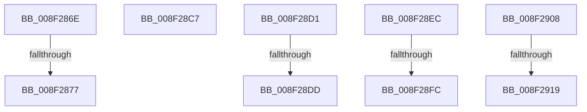

# sub_008F286E

- RVA: `0x008F286E`–`0x008F2922` (길이 `180` bytes)
- VA: `0x00000001408F286E`
- 실행 섹션: `PAGE`
- PDB 이름 있음: `아니요`; PDB Function 태그: `아니요`
- unwind 정보 RVA: `0x000874B0`
- 디코드: `40`개 명령, `180/180` bytes 표시
- 미해석 바이트: `0` (있으면 어셈블리에 `.byte`로 보존)

> 이 문서는 커널 이미지의 기계어와 PDB 기호를 분석해 생성했습니다. 4번과 5번은 함수 원형과 자료형을 바이너리 사용 방식에서 추정한 C 해석이며 원본 소스 복구 결과는 아닙니다.

## 1. Dependencies

- 직접 호출 지점: **1**; 고유 호출 대상: **1**
- 직접 호출자로 확인된 함수: **0**
- RIP 상대 이미지 참조: **3**

### Outgoing calls
- `0x008F28BD` → [RtlStringCchPrintfExW](../../text/42/RtlStringCchPrintfExW_function_0042B390.md) (function, `0x0042B390`)

### Direct callers
- 이 함수 시작 RVA로 연결되는 직접 call은 확인되지 않았습니다. 간접 호출은 완전히 역산할 수 없습니다.

### Static image references
- `0x008F2888` → RVA `0x00B0D400` (` ?? ::NNGAKEGL::`string'`; read)
- `0x008F289A` → RVA `0x00B0D590` (` ?? ::NNGAKEGL::`string'`; read)
- `0x008F28A9` → RVA `0x00B0D600` (` ?? ::NNGAKEGL::`string'`; read)

## 2. Other-region calls and transfers

- 다른 실행 섹션으로 향하는 call: **1**
  - `0x008F28BD` → [RtlStringCchPrintfExW](../../text/42/RtlStringCchPrintfExW_function_0042B390.md) (`PAGE` → `.text`)
- call이 아닌 외부 분기/꼬리 이동: **9**
  - `0x008F2871` → [sub_00B1E83A + 0x3C](../B1/Unknown_function_00B1E83A.md) (`tail-transfer`)
  - `0x008F28C2` → [sub_008F246A + 0x23E](Unknown_function_008F246A.md) (`tail-transfer`)
  - `0x008F28CC` → [sub_008F246A + 0x162](Unknown_function_008F246A.md) (`tail-transfer`)
  - `0x008F28D7` → [sub_008F246A + 0x32F](Unknown_function_008F246A.md) (`tail-transfer`)
  - `0x008F28E7` → [sub_008F246A + 0x32F](Unknown_function_008F246A.md) (`tail-transfer`)
  - `0x008F28F6` → [sub_008F246A + 0x344](Unknown_function_008F246A.md) (`tail-transfer`)
  - `0x008F2903` → [sub_008F21BF + 0xA](Unknown_function_008F21BF.md) (`tail-transfer`)
  - `0x008F2913` → [sub_008F246A + 0x165](Unknown_function_008F246A.md) (`tail-transfer`)
  - `0x008F291D` → [sub_008F246A + 0x165](Unknown_function_008F246A.md) (`tail-transfer`)

## 3. Assembly (complete function range)

```asm
008F286E  45 85 C0                        test r8d, r8d
008F2871  0F 85 FF BF 22 00               jne 0x140b1e876
008F2877  48 89 74 24 48                  mov qword ptr [rsp + 0x48], rsi
008F287C  48 8D 45 10                     lea rax, [rbp + 0x10]
008F2880  48 89 44 24 40                  mov qword ptr [rsp + 0x40], rax
008F2885  48 8B D7                        mov rdx, rdi
008F2888  48 8D 05 71 AB 21 00            lea rax, [rip + 0x21ab71]
008F288F  45 33 C9                        xor r9d, r9d
008F2892  48 89 44 24 38                  mov qword ptr [rsp + 0x38], rax
008F2897  45 33 C0                        xor r8d, r8d
008F289A  48 8D 05 EF AC 21 00            lea rax, [rip + 0x21acef]
008F28A1  49 8B CF                        mov rcx, r15
008F28A4  48 89 44 24 30                  mov qword ptr [rsp + 0x30], rax
008F28A9  48 8D 05 50 AD 21 00            lea rax, [rip + 0x21ad50]
008F28B0  48 89 44 24 28                  mov qword ptr [rsp + 0x28], rax
008F28B5  C7 44 24 20 00 08 00 00         mov dword ptr [rsp + 0x20], 0x800
008F28BD  E8 CE 8A B3 FF                  call 0x14042b390
008F28C2  E9 E1 FD FF FF                  jmp 0x1408f26a8
008F28C7  48 8B 7C 24 70                  mov rdi, qword ptr [rsp + 0x70]
008F28CC  E9 FB FC FF FF                  jmp 0x1408f25cc
008F28D1  49 8B C6                        mov rax, r14
008F28D4  49 23 C5                        and rax, r13
008F28D7  0F 86 BC FE FF FF               jbe 0x1408f2799
008F28DD  4D 8B CF                        mov r9, r15
008F28E0  66 41 89 1F                     mov word ptr [r15], bx
008F28E4  4C 8B C0                        mov r8, rax
008F28E7  E9 AD FE FF FF                  jmp 0x1408f2799
008F28EC  BA 0D 00 00 C0                  mov edx, 0xc000000d
008F28F1  8B DA                           mov ebx, edx
008F28F3  4D 85 F6                        test r14, r14
008F28F6  0F 84 B2 FE FF FF               je 0x1408f27ae
008F28FC  66 45 89 17                     mov word ptr [r15], r10w
008F2900  48 8B F7                        mov rsi, rdi
008F2903  E9 C1 F8 FF FF                  jmp 0x1408f21c9
008F2908  45 33 D2                        xor r10d, r10d
008F290B  BB 0D 00 00 C0                  mov ebx, 0xc000000d
008F2910  4D 85 F6                        test r14, r14
008F2913  0F 84 B6 FC FF FF               je 0x1408f25cf
008F2919  66 45 89 17                     mov word ptr [r15], r10w
008F291D  E9 AD FC FF FF                  jmp 0x1408f25cf
```

## 4. C-style interpretation (structured pseudocode)

```c
__int64 __fastcall sub_008F286E(__int64 a1, __int64 a2, int a3, int a4)
{
    __int64 result;
    unsigned int v_stack_p20;
    unsigned __int64 v_stack_p28;
    unsigned __int64 v_stack_p30;
    unsigned __int64 v_stack_p38;
    unsigned __int64 v_stack_p40;
    unsigned __int64 v_stack_p48;
    unsigned __int64 v_stack_p70;

    v_stack_p48 = v_rsi;
    v_stack_p40 = v_rbp + 16;
    a4 = 0;
    v_stack_p38 = v_rip + 2206577;
    a3 = 0;
    v_stack_p30 = v_rip + 2206959;
    v_stack_p28 = v_rip + 2207056;
    v_stack_p20 = 0x800ULL;
    result = RtlStringCchPrintfExW(v_r15, v_rdi, a3, a4);
}
```

## 5. (Beta) C Style

```c
int64_t sub_008F286E(int64_t Arg1, int64_t Arg2, int32_t Arg3, int32_t Arg4)
{
    int64_t result;
    uint32_t v_stack_p20;
    uint64_t v_stack_p28;
    uint64_t v_stack_p30;
    uint64_t v_stack_p38;
    uint64_t v_stack_p40;
    uint64_t v_stack_p48;
    uint64_t v_stack_p70;

    v_stack_p48 = local_rsi;
    v_stack_p40 = local_rbp + 16;
    Arg4 = 0;
    v_stack_p38 = v_rip + 2206577;
    Arg3 = 0;
    v_stack_p30 = v_rip + 2206959;
    v_stack_p28 = v_rip + 2207056;
    v_stack_p20 = 0x800ULL;
    result = RtlStringCchPrintfExW(local_r15, local_rdi, Arg3, Arg4);
}
```

## 6. Execution-region graph

[열기: 2D/3D 그래프와 함수 탐색 컨트롤 패널](../../../control-panel.html?section=page&rva=0x008F286E&view=graph)

- 2D 그래프는 위에서 아래로 흐르고, 3D 그래프는 빈 공간을 드래그해 회전합니다. Shift+드래그는 이동, 휠은 확대·축소, 함수 노드 선택은 대상 보고서 이동입니다.

### Static fallback


