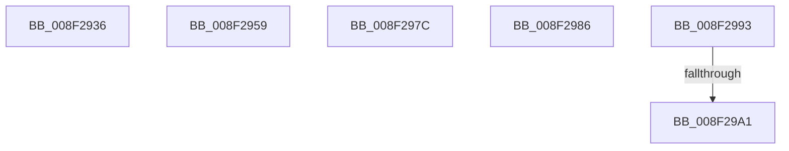

# sub_008F2936

- RVA: `0x008F2936`–`0x008F29AD` (길이 `119` bytes)
- VA: `0x00000001408F2936`
- 실행 섹션: `PAGE`
- PDB 이름 있음: `아니요`; PDB Function 태그: `아니요`
- unwind 정보 RVA: `0x0008750C`
- 디코드: `25`개 명령, `119/119` bytes 표시
- 미해석 바이트: `0` (있으면 어셈블리에 `.byte`로 보존)

> 이 문서는 커널 이미지의 기계어와 PDB 기호를 분석해 생성했습니다. 4번과 5번은 함수 원형과 자료형을 바이너리 사용 방식에서 추정한 C 해석이며 원본 소스 복구 결과는 아닙니다.

## 1. Dependencies

- 직접 호출 지점: **0**; 고유 호출 대상: **0**
- 직접 호출자로 확인된 함수: **0**
- RIP 상대 이미지 참조: **0**

### Outgoing calls
- 직접 디코드된 call 명령이 없습니다.

### Direct callers
- 이 함수 시작 RVA로 연결되는 직접 call은 확인되지 않았습니다. 간접 호출은 완전히 역산할 수 없습니다.

### Static image references
- 디코드된 RIP-relative 메모리 참조가 없습니다.

## 2. Other-region calls and transfers

- 다른 실행 섹션으로 향하는 call: **0**
- call이 아닌 외부 분기/꼬리 이동: **6**
  - `0x008F2954` → [sub_00B1E83A + 0x9B](../B1/Unknown_function_00B1E83A.md) (`tail-transfer`)
  - `0x008F2977` → [sub_00B1E83A + 0x9B](../B1/Unknown_function_00B1E83A.md) (`tail-transfer`)
  - `0x008F2981` → [sub_008F21BF + 0x5](Unknown_function_008F21BF.md) (`tail-transfer`)
  - `0x008F298E` → [sub_008F246A + 0xF5](Unknown_function_008F246A.md) (`tail-transfer`)
  - `0x008F299B` → [sub_00B1E83A + 0x13](../B1/Unknown_function_00B1E83A.md) (`tail-transfer`)
  - `0x008F29A8` → [sub_00B1E83A](../B1/Unknown_function_00B1E83A.md) (`tail-transfer`)

## 3. Assembly (complete function range)

```asm
008F2936  48 8D 45 B8                     lea rax, [rbp - 0x48]
008F293A  C7 44 24 28 00 08 00 00         mov dword ptr [rsp + 0x28], 0x800
008F2942  48 89 44 24 20                  mov qword ptr [rsp + 0x20], rax
008F2947  4C 8D 4D A8                     lea r9, [rbp - 0x58]
008F294B  BA 4E 00 00 00                  mov edx, 0x4e
008F2950  48 8D 4D 60                     lea rcx, [rbp + 0x60]
008F2954  E9 7C BF 22 00                  jmp 0x140b1e8d5
008F2959  48 8D 45 B8                     lea rax, [rbp - 0x48]
008F295D  C7 44 24 28 00 08 00 00         mov dword ptr [rsp + 0x28], 0x800
008F2965  48 89 44 24 20                  mov qword ptr [rsp + 0x20], rax
008F296A  4C 8D 4D A8                     lea r9, [rbp - 0x58]
008F296E  BA 4E 00 00 00                  mov edx, 0x4e
008F2973  48 8D 4D 10                     lea rcx, [rbp + 0x10]
008F2977  E9 59 BF 22 00                  jmp 0x140b1e8d5
008F297C  BB 0D 00 00 C0                  mov ebx, 0xc000000d
008F2981  E9 3E F8 FF FF                  jmp 0x1408f21c4
008F2986  48 8B 55 88                     mov rdx, qword ptr [rbp - 0x78]
008F298A  48 8B 4D 98                     mov rcx, qword ptr [rbp - 0x68]
008F298E  E9 CC FB FF FF                  jmp 0x1408f255f
008F2993  44 8B 44 24 7C                  mov r8d, dword ptr [rsp + 0x7c]
008F2998  45 85 C0                        test r8d, r8d
008F299B  0F 85 AC BE 22 00               jne 0x140b1e84d
008F29A1  48 8D 4D 10                     lea rcx, [rbp + 0x10]
008F29A5  49 8B C4                        mov rax, r12
008F29A8  E9 8D BE 22 00                  jmp 0x140b1e83a
```

## 4. C-style interpretation (structured pseudocode)

```c
__int64 __fastcall sub_008F2936(void)
{
    unsigned __int64 v_stack_p20;
    unsigned int v_stack_p28;
    unsigned int v_stack_p7C;

    v_stack_p28 = 0x800ULL;
    v_stack_p20 = v_rbp - 72;
}
```

## 5. (Beta) C Style

```c
void sub_008F2936(void)
{
    uint64_t v_stack_p20;
    uint32_t v_stack_p28;
    uint32_t v_stack_p7C;

    v_stack_p28 = 0x800ULL;
    v_stack_p20 = local_rbp - 72;
}
```

## 6. Execution-region graph

[열기: 2D/3D 그래프와 함수 탐색 컨트롤 패널](../../../control-panel.html?section=page&rva=0x008F2936&view=graph)

- 2D 그래프는 위에서 아래로 흐르고, 3D 그래프는 빈 공간을 드래그해 회전합니다. Shift+드래그는 이동, 휠은 확대·축소, 함수 노드 선택은 대상 보고서 이동입니다.

### Static fallback


