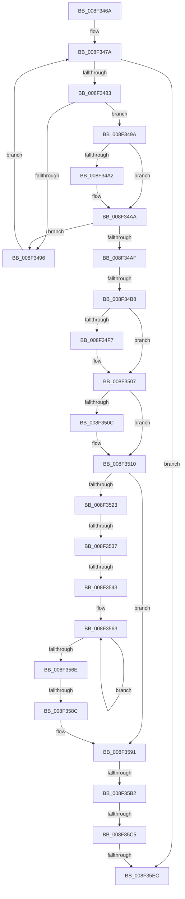

# sub_008F346A

- RVA: `0x008F346A`–`0x008F3604` (길이 `410` bytes)
- VA: `0x00000001408F346A`
- 실행 섹션: `PAGE`
- PDB 이름 있음: `아니요`; PDB Function 태그: `아니요`
- unwind 정보 RVA: `0x00087610`
- 디코드: `102`개 명령, `410/410` bytes 표시
- 미해석 바이트: `0` (있으면 어셈블리에 `.byte`로 보존)

> 이 문서는 커널 이미지의 기계어와 PDB 기호를 분석해 생성했습니다. 4번과 5번은 함수 원형과 자료형을 바이너리 사용 방식에서 추정한 C 해석이며 원본 소스 복구 결과는 아닙니다.

## 1. Dependencies

- 직접 호출 지점: **4**; 고유 호출 대상: **4**
- 직접 호출자로 확인된 함수: **0**
- RIP 상대 이미지 참조: **0**

### Outgoing calls
- `0x008F34D9` → [KeAbPreAcquire](../../text/21/KeAbPreAcquire_function_00210230.md) (function, `0x00210230`)
- `0x008F3502` → [ExfAcquirePushLockSharedEx](../../text/21/ExfAcquirePushLockSharedEx_function_0021044C.md) (function, `0x0021044C`)
- `0x008F35D0` → [KeAbPostRelease](../../text/2E/KeAbPostRelease_function_002E1600.md) (function, `0x002E1600`)
- `0x008F35DE` → [KeLeaveCriticalRegionThread](../../text/25/KeLeaveCriticalRegionThread_function_0025EFF0.md) (function, `0x0025EFF0`)

### Direct callers
- 이 함수 시작 RVA로 연결되는 직접 call은 확인되지 않았습니다. 간접 호출은 완전히 역산할 수 없습니다.

### Static image references
- 디코드된 RIP-relative 메모리 참조가 없습니다.

## 2. Other-region calls and transfers

- 다른 실행 섹션으로 향하는 call: **4**
  - `0x008F34D9` → [KeAbPreAcquire](../../text/21/KeAbPreAcquire_function_00210230.md) (`PAGE` → `.text`)
  - `0x008F3502` → [ExfAcquirePushLockSharedEx](../../text/21/ExfAcquirePushLockSharedEx_function_0021044C.md) (`PAGE` → `.text`)
  - `0x008F35D0` → [KeAbPostRelease](../../text/2E/KeAbPostRelease_function_002E1600.md) (`PAGE` → `.text`)
  - `0x008F35DE` → [KeLeaveCriticalRegionThread](../../text/25/KeLeaveCriticalRegionThread_function_0025EFF0.md) (`PAGE` → `.text`)
- call이 아닌 외부 분기/꼬리 이동: **7**
  - `0x008F34B2` → [sub_008F36E5 + 0x52](Unknown_function_008F36E5.md) (`tail-transfer`)
  - `0x008F3531` → [sub_008F3634](Unknown_function_008F3634.md) (`tail-transfer`)
  - `0x008F353D` → [sub_008F3634 + 0x2E](Unknown_function_008F3634.md) (`tail-transfer`)
  - `0x008F3586` → [sub_008F3634 + 0x13](Unknown_function_008F3634.md) (`tail-transfer`)
  - `0x008F35AC` → [sub_008F3634 + 0x8A](Unknown_function_008F3634.md) (`tail-transfer`)
  - `0x008F35BF` → [sub_008F3634 + 0x8A](Unknown_function_008F3634.md) (`tail-transfer`)
  - `0x008F35E6` → [sub_008F36E5](Unknown_function_008F36E5.md) (`tail-transfer`)

## 3. Assembly (complete function range)

```asm
008F346A  48 89 7C 24 70                  mov qword ptr [rsp + 0x70], rdi
008F346F  4C 89 64 24 78                  mov qword ptr [rsp + 0x78], r12
008F3474  45 33 E4                        xor r12d, r12d
008F3477  41 8B FC                        mov edi, r12d
008F347A  41 3B FB                        cmp edi, r11d
008F347D  0F 83 69 01 00 00               jae 0x1408f35ec
008F3483  8B C7                           mov eax, edi
008F3485  48 8D 0C 40                     lea rcx, [rax + rax*2]
008F3489  48 8B 14 CB                     mov rdx, qword ptr [rbx + rcx*8]
008F348D  8B 42 10                        mov eax, dword ptr [rdx + 0x10]
008F3490  41 39 41 10                     cmp dword ptr [r9 + 0x10], eax
008F3494  74 04                           je 0x1408f349a
008F3496  FF C7                           inc edi
008F3498  EB E0                           jmp 0x1408f347a
008F349A  49 8B 09                        mov rcx, qword ptr [r9]
008F349D  48 2B 0A                        sub rcx, qword ptr [rdx]
008F34A0  75 08                           jne 0x1408f34aa
008F34A2  49 8B 49 08                     mov rcx, qword ptr [r9 + 8]
008F34A6  48 2B 4A 08                     sub rcx, qword ptr [rdx + 8]
008F34AA  48 85 C9                        test rcx, rcx
008F34AD  75 E7                           jne 0x1408f3496
008F34AF  4D 85 C0                        test r8, r8
008F34B2  0F 84 7F 02 00 00               je 0x1408f3737
008F34B8  65 48 8B 04 25 88 01 00 00      mov rax, qword ptr gs:[0x188]
008F34C1  45 33 C0                        xor r8d, r8d
008F34C4  48 8B 9C 24 80 00 00 00         mov rbx, qword ptr [rsp + 0x80]
008F34CC  33 D2                           xor edx, edx
008F34CE  48 8B CB                        mov rcx, rbx
008F34D1  66 FF 88 E4 01 00 00            dec word ptr [rax + 0x1e4]
008F34D8  90                              nop
008F34D9  E8 52 CD 91 FF                  call 0x140210230
008F34DE  48 8B E8                        mov rbp, rax
008F34E1  B9 11 00 00 00                  mov ecx, 0x11
008F34E6  33 C0                           xor eax, eax
008F34E8  F0 48 0F B1 0B                  lock cmpxchg qword ptr [rbx], rcx
008F34ED  48 8B 9C 24 80 00 00 00         mov rbx, qword ptr [rsp + 0x80]
008F34F5  74 10                           je 0x1408f3507
008F34F7  4C 8B CB                        mov r9, rbx
008F34FA  4C 8B C5                        mov r8, rbp
008F34FD  33 D2                           xor edx, edx
008F34FF  48 8B CB                        mov rcx, rbx
008F3502  E8 45 CF 91 FF                  call 0x14021044c
008F3507  48 85 ED                        test rbp, rbp
008F350A  74 04                           je 0x1408f3510
008F350C  C6 45 0A 01                     mov byte ptr [rbp + 0xa], 1
008F3510  8B C7                           mov eax, edi
008F3512  48 8D 0C 40                     lea rcx, [rax + rax*2]
008F3516  48 8D 14 CB                     lea rdx, [rbx + rcx*8]
008F351A  8B 4C CB 70                     mov ecx, dword ptr [rbx + rcx*8 + 0x70]
008F351E  83 F9 01                        cmp ecx, 1
008F3521  76 6E                           jbe 0x1408f3591
008F3523  0F 57 C0                        xorps xmm0, xmm0
008F3526  41 8B F4                        mov esi, r12d
008F3529  0F 11 44 24 28                  movups xmmword ptr [rsp + 0x28], xmm0
008F352E  83 F9 06                        cmp ecx, 6
008F3531  0F 85 FD 00 00 00               jne 0x1408f3634
008F3537  8B 42 78                        mov eax, dword ptr [rdx + 0x78]
008F353A  83 F8 12                        cmp eax, 0x12
008F353D  0F 85 1F 01 00 00               jne 0x1408f3662
008F3543  48 8B 84 24 90 00 00 00         mov rax, qword ptr [rsp + 0x90]
008F354B  C7 00 12 00 00 00               mov dword ptr [rax], 0x12
008F3551  48 8B 82 80 00 00 00            mov rax, qword ptr [rdx + 0x80]
008F3558  48 8B 48 10                     mov rcx, qword ptr [rax + 0x10]
008F355C  48 C7 C0 FF FF FF FF            mov rax, 0xffffffffffffffff
008F3563  66 39 74 41 02                  cmp word ptr [rcx + rax*2 + 2], si
008F3568  48 8D 40 01                     lea rax, [rax + 1]
008F356C  75 F5                           jne 0x1408f3563
008F356E  8D 0C 45 02 00 00 00            lea ecx, [rax*2 + 2]
008F3575  48 8B 84 24 A8 00 00 00         mov rax, qword ptr [rsp + 0xa8]
008F357D  89 08                           mov dword ptr [rax], ecx
008F357F  39 8C 24 A0 00 00 00            cmp dword ptr [rsp + 0xa0], ecx
008F3586  0F 83 BB 00 00 00               jae 0x1408f3647
008F358C  BE 23 00 00 C0                  mov esi, 0xc0000023
008F3591  0F 0D 0B                        prefetchw byte ptr [rbx]
008F3594  48 8B 03                        mov rax, qword ptr [rbx]
008F3597  48 8B C8                        mov rcx, rax
008F359A  48 83 E1 F0                     and rcx, 0xfffffffffffffff0
008F359E  48 83 F9 10                     cmp rcx, 0x10
008F35A2  48 8D 50 F0                     lea rdx, [rax - 0x10]
008F35A6  49 0F 46 D4                     cmovbe rdx, r12
008F35AA  A8 02                           test al, 2
008F35AC  0F 85 0C 01 00 00               jne 0x1408f36be
008F35B2  48 8B 8C 24 80 00 00 00         mov rcx, qword ptr [rsp + 0x80]
008F35BA  F0 48 0F B1 11                  lock cmpxchg qword ptr [rcx], rdx
008F35BF  0F 85 F9 00 00 00               jne 0x1408f36be
008F35C5  48 8B 9C 24 80 00 00 00         mov rbx, qword ptr [rsp + 0x80]
008F35CD  48 8B CB                        mov rcx, rbx
008F35D0  E8 2B E0 9E FF                  call 0x1402e1600
008F35D5  65 48 8B 0C 25 88 01 00 00      mov rcx, qword ptr gs:[0x188]
008F35DE  E8 0D BA 96 FF                  call 0x14025eff0
008F35E3  45 84 F6                        test r14b, r14b
008F35E6  0F 85 F9 00 00 00               jne 0x1408f36e5
008F35EC  8B C6                           mov eax, esi
008F35EE  48 8B 7C 24 70                  mov rdi, qword ptr [rsp + 0x70]
008F35F3  4C 8B 64 24 78                  mov r12, qword ptr [rsp + 0x78]
008F35F8  48 83 C4 40                     add rsp, 0x40
008F35FC  41 5F                           pop r15
008F35FE  41 5E                           pop r14
008F3600  5E                              pop rsi
008F3601  5D                              pop rbp
008F3602  5B                              pop rbx
008F3603  C3                              ret
```

## 4. C-style interpretation (structured pseudocode)

```c
__int64 __fastcall sub_008F346A(__int64 a1, __int64 a2, __int64 a3, __int64 a4, __int64 a5, __int64 a6, __int64 a7, __int64 a8, __int64 a9, __int64 a10, __int64 a11, __int64 a12, __int64 a13, __int64 a14, __int64 a15, __int64 a16, __int64 a17, __int64 a18, __int64 a19, unsigned int a20, __int64 a21)
{
    __int64 result;
    __int64 v_r12;
    __int64 v_rdi;
    __int64 v_rsp;
    unsigned __int64 v_stack_p70;
    unsigned __int64 v_stack_p78;

    v_stack_p70 = v_rdi;
    v_stack_p78 = v_r12;
    v_r12 = 0;
loc_008F347A:
    if (0 >= ((unsigned int)(v_r11))) goto loc_008F35EC;
    if ((*(unsigned int *)(a4 + 16)) == ((unsigned int)((unsigned int)(*(unsigned int *)(*(unsigned __int64 *)(v_rbx + 0 + 0 * 2 * 8) + 16))))) goto loc_008F349A;
loc_008F3496:
    v_rdi = (unsigned int)((0) + 1);
    goto loc_008F347A;
loc_008F349A:
    a1 = (*(unsigned __int64 *)(a4)) - (*(unsigned __int64 *)(*(unsigned __int64 *)(v_rbx + 0 + 0 * 2 * 8)));
    if (!(condition_is_not_equal)) {
        a1 = *(unsigned __int64 *)(a4 + 8);
        a1 = (a1) - (*(unsigned __int64 *)(*(unsigned __int64 *)(v_rbx + 0 + 0 * 2 * 8) + 8));
    }
    if (a1 != 0) goto loc_008F3496;
    a3 = 0;
    a2 = 0;
    result = KeAbPreAcquire(a16, a2, a3, a4);
    result = 0;
    if (!(condition_is_equal)) {
        a4 = a16;
        a3 = 0;
        a2 = 0;
        a1 = a16;
        result = ExfAcquirePushLockSharedEx(a1, a2, a3, a4);
    }
    if (result != 0) {
        *(unsigned __int8 *)(result + 10) = 1;
    }
    if (((unsigned int)((unsigned int)(*(unsigned int *)(a16 + (unsigned int)((unsigned int)(v_rdi)) + (unsigned int)((unsigned int)(v_rdi)) * 2 * 8 + 112)))) <= 1) goto loc_008F3591;
    a5 = v_xmm0;
    *(unsigned int *)(a18) = 18;
loc_008F3563:
    if ((*(unsigned __int16 *)(*(unsigned __int64 *)(*(unsigned __int64 *)(a16 + (unsigned int)((unsigned int)(v_rdi)) + (unsigned int)((unsigned int)(v_rdi)) * 2 * 8 + 128) + 16) + -1 * 2 + 2)) != 0) goto loc_008F3563;
    *(unsigned int *)(a21) = (unsigned int)(-1 + 1 * 2 + 2);
loc_008F3591:
    a1 = (*(unsigned __int64 *)(a16)) & (-16);
    a2 = *(unsigned __int64 *)(a16) - 16;
    if (a1 <= 16) { a2 = 0; }
    result = KeAbPostRelease(a16, a2, a3, a4);
    result = KeLeaveCriticalRegionThread(*(unsigned __int64 *)(gs_base + (0 + 392)), a2, a3, a4);
loc_008F35EC:
    v_rsp = (v_rsp) + (64);
    return (unsigned int)((unsigned int)((unsigned int)(0xC0000023ULL)));
}
```

## 5. (Beta) C Style

```c
int64_t sub_008F346A(int64_t Arg1, int64_t Arg2, int64_t Arg3, void *Arg4, int64_t Arg5, uint64_t Arg6, uint64_t Arg7, uint64_t Arg8, uint64_t Arg9, uint64_t Arg10, uint64_t Arg11, uint64_t Arg12, uint64_t Arg13, int64_t Arg14, int64_t Arg15, void *Arg16, uint64_t Arg17, void *Arg18, uint64_t Arg19, uint32_t Arg20, void *Arg21)
{
    uint8_t *arg4 = (uint8_t *)Arg4;
    uint8_t *arg16 = (uint8_t *)Arg16;
    uint8_t *arg18 = (uint8_t *)Arg18;
    uint8_t *arg21 = (uint8_t *)Arg21;

    int64_t result;
    int64_t local_r12;
    int64_t local_rdi;
    int64_t local_rsp;
    uint64_t v_stack_p70;
    uint64_t v_stack_p78;

    v_stack_p70 = local_rdi;
    v_stack_p78 = local_r12;
    local_r12 = 0;
loc_008F347A:
    if (0 >= ((uint32_t)(local_r11))) goto loc_008F35EC;
    if ((*(uint32_t *)(arg4 + 0x10)) == ((uint32_t)((uint32_t)(*(uint32_t *)(*(uint64_t *)(local_rbx + 0x0 + 0x0 * 2 * 8) + 0x10))))) goto loc_008F349A;
loc_008F3496:
    local_rdi = (uint32_t)((0) + 1);
    goto loc_008F347A;
loc_008F349A:
    Arg1 = (*(uint64_t *)(arg4)) - (*(uint64_t *)(*(uint64_t *)(local_rbx + 0x0 + 0x0 * 2 * 8)));
    if (!(condition_is_not_equal)) {
        Arg1 = *(uint64_t *)(arg4 + 0x8);
        Arg1 = (Arg1) - (*(uint64_t *)(*(uint64_t *)(local_rbx + 0x0 + 0x0 * 2 * 8) + 0x8));
    }
    if (Arg1 != 0) goto loc_008F3496;
    Arg3 = 0;
    Arg2 = 0;
    result = KeAbPreAcquire(Arg16, Arg2, Arg3, Arg4);
    result = 0;
    if (!(condition_is_equal)) {
        Arg4 = Arg16;
        Arg3 = 0;
        Arg2 = 0;
        Arg1 = Arg16;
        result = ExfAcquirePushLockSharedEx(Arg1, Arg2, Arg3, Arg4);
    }
    if (result != 0) {
        *(uint8_t *)(result + 0xA) = 1;
    }
    if (((uint32_t)((uint32_t)(*(uint32_t *)(arg16 + (uint32_t)((uint32_t)(local_rdi)) + (uint32_t)((uint32_t)(local_rdi)) * 2 * 8 + 0x70)))) <= 1) goto loc_008F3591;
    Arg5 = v_xmm0;
    *(uint32_t *)(arg18) = 18;
loc_008F3563:
    if ((*(uint16_t *)(*(uint64_t *)(*(uint64_t *)(arg16 + (uint32_t)((uint32_t)(local_rdi)) + (uint32_t)((uint32_t)(local_rdi)) * 2 * 8 + 0x80) + 0x10) + - 0x1 * 2 + 0x2)) != 0) goto loc_008F3563;
    *(uint32_t *)(arg21) = (uint32_t)(-1 + 1 * 2 + 2);
loc_008F3591:
    Arg1 = (*(uint64_t *)(arg16)) & (-16);
    Arg2 = *(uint64_t *)(arg16) - 16;
    if (Arg1 <= 16) { Arg2 = 0; }
    result = KeAbPostRelease(Arg16, Arg2, Arg3, Arg4);
    result = KeLeaveCriticalRegionThread(*(uint64_t *)(gs_base + (0 + 0x188)), Arg2, Arg3, Arg4);
loc_008F35EC:
    local_rsp = (local_rsp) + (64);
    return (uint32_t)((uint32_t)((uint32_t)(0xC0000023ULL)));
}
```

### 관측된 메모리 오프셋

구조체 형식이 확인되지 않은 접근은 인자 기준의 오프셋으로만 기록했습니다.

| 기준 인자 | 오프셋 표현 | 폭 (bit) | 접근 |
|---|---:|---:|---|
| `Arg4` | `+ 0x0` | `64` | `R` |
| `Arg4` | `+ 0x8` | `64` | `R` |
| `Arg4` | `+ 0x10` | `32` | `R` |
| `Arg16` | `+ 0x0` | `8` | `R` |
| `Arg16` | `+ 0x0` | `64` | `R` |
| `Arg16` | `+ 0x0 + rcx*8` | `64` | `R` |
| `Arg16` | `+ 0x70 + rcx*8` | `32` | `R` |
| `Arg16` | `+ 0x78` | `32` | `R` |
| `Arg16` | `+ 0x80` | `64` | `R` |
| `Arg18` | `+ 0x0` | `32` | `W` |
| `Arg21` | `+ 0x0` | `32` | `W` |

## 6. Execution-region graph

[열기: 2D/3D 그래프와 함수 탐색 컨트롤 패널](../../../control-panel.html?section=page&rva=0x008F346A&view=graph)

- 2D 그래프는 위에서 아래로 흐르고, 3D 그래프는 빈 공간을 드래그해 회전합니다. Shift+드래그는 이동, 휠은 확대·축소, 함수 노드 선택은 대상 보고서 이동입니다.

### Static fallback


