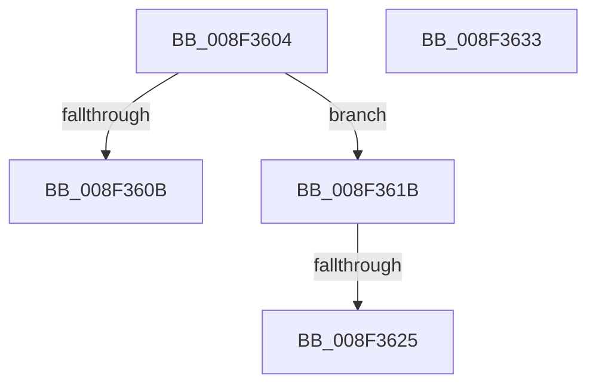

# sub_008F3604

- RVA: `0x008F3604`–`0x008F3634` (길이 `48` bytes)
- VA: `0x00000001408F3604`
- 실행 섹션: `PAGE`
- PDB 이름 있음: `아니요`; PDB Function 태그: `아니요`
- unwind 정보 RVA: `0x0008762C`
- 디코드: `17`개 명령, `48/48` bytes 표시
- 미해석 바이트: `0` (있으면 어셈블리에 `.byte`로 보존)

> 이 문서는 커널 이미지의 기계어와 PDB 기호를 분석해 생성했습니다. 4번과 5번은 함수 원형과 자료형을 바이너리 사용 방식에서 추정한 C 해석이며 원본 소스 복구 결과는 아닙니다.

## 1. Dependencies

- 직접 호출 지점: **0**; 고유 호출 대상: **0**
- 직접 호출자로 확인된 함수: **0**
- RIP 상대 이미지 참조: **1**

### Outgoing calls
- 직접 디코드된 call 명령이 없습니다.

### Direct callers
- 이 함수 시작 RVA로 연결되는 직접 call은 확인되지 않았습니다. 간접 호출은 완전히 역산할 수 없습니다.

### Static image references
- `0x008F360B` → RVA `0x00001B60` (`.rdata`; read)

## 2. Other-region calls and transfers

- 다른 실행 섹션으로 향하는 call: **0**
- call이 아닌 외부 분기/꼬리 이동: **2**
  - `0x008F3616` → [sub_008F346A](Unknown_function_008F346A.md) (`tail-transfer`)
  - `0x008F361F` → [sub_008F36D3](Unknown_function_008F36D3.md) (`tail-transfer`)

## 3. Assembly (complete function range)

```asm
008F3604  CC                              int3
008F3605  41 83 FA 03                     cmp r10d, 3
008F3609  75 10                           jne 0x1408f361b
008F360B  48 8D 1D 4E E5 70 FF            lea rbx, [rip - 0x8f1ab2]
008F3612  45 8D 5A FE                     lea r11d, [r10 - 2]
008F3616  E9 4F FE FF FF                  jmp 0x1408f346a
008F361B  41 83 FA 05                     cmp r10d, 5
008F361F  0F 84 AE 00 00 00               je 0x1408f36d3
008F3625  8B C6                           mov eax, esi
008F3627  48 83 C4 40                     add rsp, 0x40
008F362B  41 5F                           pop r15
008F362D  41 5E                           pop r14
008F362F  5E                              pop rsi
008F3630  5D                              pop rbp
008F3631  5B                              pop rbx
008F3632  C3                              ret
008F3633  CC                              int3
```

## 4. C-style interpretation (structured pseudocode)

```c
__int64 __fastcall sub_008F3604(void)
{
    __int64 v_rsp;

    if (((unsigned int)(v_r10)) != 3) goto loc_008F361B;
loc_008F361B:
    v_rsp = (v_rsp) + (64);
    return (unsigned int)((unsigned int)(v_rsi));
}
```

## 5. (Beta) C Style

```c
void sub_008F3604(void)
{
    int64_t local_rsp;

    if (((uint32_t)(local_r10)) != 3) goto loc_008F361B;
loc_008F361B:
    local_rsp = (local_rsp) + (64);
    return (uint32_t)((uint32_t)(local_rsi));
}
```

## 6. Execution-region graph

[열기: 2D/3D 그래프와 함수 탐색 컨트롤 패널](../../../control-panel.html?section=page&rva=0x008F3604&view=graph)

- 2D 그래프는 위에서 아래로 흐르고, 3D 그래프는 빈 공간을 드래그해 회전합니다. Shift+드래그는 이동, 휠은 확대·축소, 함수 노드 선택은 대상 보고서 이동입니다.

### Static fallback


