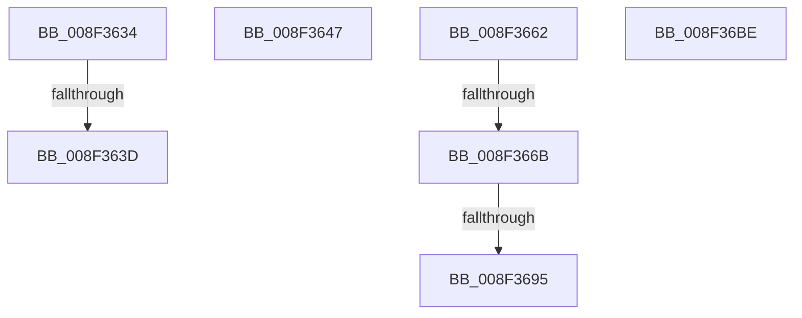

# sub_008F3634

- RVA: `0x008F3634`–`0x008F36D3` (길이 `159` bytes)
- VA: `0x00000001408F3634`
- 실행 섹션: `PAGE`
- PDB 이름 있음: `아니요`; PDB Function 태그: `아니요`
- unwind 정보 RVA: `0x00087640`
- 디코드: `31`개 명령, `159/159` bytes 표시
- 미해석 바이트: `0` (있으면 어셈블리에 `.byte`로 보존)

> 이 문서는 커널 이미지의 기계어와 PDB 기호를 분석해 생성했습니다. 4번과 5번은 함수 원형과 자료형을 바이너리 사용 방식에서 추정한 C 해석이며 원본 소스 복구 결과는 아닙니다.

## 1. Dependencies

- 직접 호출 지점: **4**; 고유 호출 대상: **4**
- 직접 호출자로 확인된 함수: **0**
- RIP 상대 이미지 참조: **0**

### Outgoing calls
- `0x008F3658` → [memcpy](../../text/6C/memcpy_function_006C6840.md) (function, `0x006C6840`)
- `0x008F36A5` → [RtlInitUnicodeString](../../text/42/RtlInitUnicodeString_function_0042A780.md) (function, `0x0042A780`)
- `0x008F36B2` → [RtlGUIDFromString](RtlGUIDFromString_function_008F1EF0.md) (function, `0x008F1EF0`)
- `0x008F36C9` → [ExfReleasePushLock](../../text/26/ExfReleasePushLock_function_002638D0.md) (function, `0x002638D0`)

### Direct callers
- 이 함수 시작 RVA로 연결되는 직접 call은 확인되지 않았습니다. 간접 호출은 완전히 역산할 수 없습니다.

### Static image references
- 디코드된 RIP-relative 메모리 참조가 없습니다.

## 2. Other-region calls and transfers

- 다른 실행 섹션으로 향하는 call: **3**
  - `0x008F3658` → [memcpy](../../text/6C/memcpy_function_006C6840.md) (`PAGE` → `.text`)
  - `0x008F36A5` → [RtlInitUnicodeString](../../text/42/RtlInitUnicodeString_function_0042A780.md) (`PAGE` → `.text`)
  - `0x008F36C9` → [ExfReleasePushLock](../../text/26/ExfReleasePushLock_function_002638D0.md) (`PAGE` → `.text`)
- call이 아닌 외부 분기/꼬리 이동: **7**
  - `0x008F3637` → [sub_008F36E5 + 0x12](Unknown_function_008F36E5.md) (`tail-transfer`)
  - `0x008F3642` → [sub_008F346A + 0x127](Unknown_function_008F346A.md) (`tail-transfer`)
  - `0x008F365D` → [sub_008F346A + 0x127](Unknown_function_008F346A.md) (`tail-transfer`)
  - `0x008F3665` → [sub_008F36E5 + 0x100](Unknown_function_008F36E5.md) (`tail-transfer`)
  - `0x008F368F` → [sub_008F346A + 0x122](Unknown_function_008F346A.md) (`tail-transfer`)
  - `0x008F36B9` → [sub_008F346A + 0x127](Unknown_function_008F346A.md) (`tail-transfer`)
  - `0x008F36CE` → [sub_008F346A + 0x163](Unknown_function_008F346A.md) (`tail-transfer`)

## 3. Assembly (complete function range)

```asm
008F3634  83 E9 02                        sub ecx, 2
008F3637  0F 85 BA 00 00 00               jne 0x1408f36f7
008F363D  BE 25 02 00 C0                  mov esi, 0xc0000225
008F3642  E9 4A FF FF FF                  jmp 0x1408f3591
008F3647  48 8B 92 80 00 00 00            mov rdx, qword ptr [rdx + 0x80]
008F364E  44 8B C1                        mov r8d, ecx
008F3651  49 8B CF                        mov rcx, r15
008F3654  48 8B 52 10                     mov rdx, qword ptr [rdx + 0x10]
008F3658  E8 E3 31 DD FF                  call 0x1406c6840
008F365D  E9 2F FF FF FF                  jmp 0x1408f3591
008F3662  83 F8 0D                        cmp eax, 0xd
008F3665  0F 85 7A 01 00 00               jne 0x1408f37e5
008F366B  83 BC 24 A0 00 00 00 10         cmp dword ptr [rsp + 0xa0], 0x10
008F3673  48 8B 84 24 90 00 00 00         mov rax, qword ptr [rsp + 0x90]
008F367B  C7 00 0D 00 00 00               mov dword ptr [rax], 0xd
008F3681  48 8B 84 24 A8 00 00 00         mov rax, qword ptr [rsp + 0xa8]
008F3689  C7 00 10 00 00 00               mov dword ptr [rax], 0x10
008F368F  0F 82 F7 FE FF FF               jb 0x1408f358c
008F3695  48 8B 92 80 00 00 00            mov rdx, qword ptr [rdx + 0x80]
008F369C  48 8D 4C 24 28                  lea rcx, [rsp + 0x28]
008F36A1  48 8B 52 10                     mov rdx, qword ptr [rdx + 0x10]
008F36A5  E8 D6 70 B3 FF                  call 0x14042a780
008F36AA  49 8B D7                        mov rdx, r15
008F36AD  48 8D 4C 24 28                  lea rcx, [rsp + 0x28]
008F36B2  E8 39 E8 FF FF                  call 0x1408f1ef0
008F36B7  8B F0                           mov esi, eax
008F36B9  E9 D3 FE FF FF                  jmp 0x1408f3591
008F36BE  48 8B 9C 24 80 00 00 00         mov rbx, qword ptr [rsp + 0x80]
008F36C6  48 8B CB                        mov rcx, rbx
008F36C9  E8 02 02 97 FF                  call 0x1402638d0
008F36CE  E9 FA FE FF FF                  jmp 0x1408f35cd
```

## 4. C-style interpretation (structured pseudocode)

```c
__int64 __fastcall sub_008F3634(int a1, __int64 a2)
{
    unsigned __int64 v_stack_p28;
    unsigned __int64 v_stack_p80;
    unsigned __int64 v_stack_p90;
    unsigned int v_stack_pA0;
    unsigned __int64 v_stack_pA8;

    a1 = (unsigned int)((a1) - (2));
}
```

## 5. (Beta) C Style

```c
int64_t sub_008F3634(int32_t Arg1, int64_t Arg2)
{
    uint64_t v_stack_p28;
    uint64_t v_stack_p80;
    uint64_t v_stack_p90;
    uint32_t v_stack_pA0;
    uint64_t v_stack_pA8;

    Arg1 = (uint32_t)((Arg1) - (2));
}
```

## 6. Execution-region graph

[열기: 2D/3D 그래프와 함수 탐색 컨트롤 패널](../../../control-panel.html?section=page&rva=0x008F3634&view=graph)

- 2D 그래프는 위에서 아래로 흐르고, 3D 그래프는 빈 공간을 드래그해 회전합니다. Shift+드래그는 이동, 휠은 확대·축소, 함수 노드 선택은 대상 보고서 이동입니다.

### Static fallback


