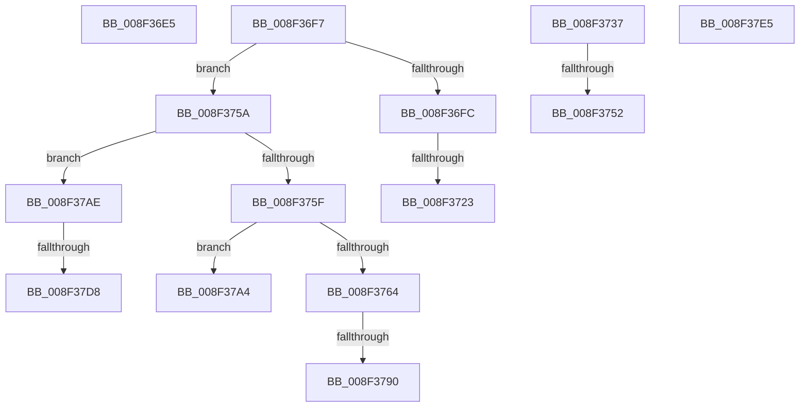

# sub_008F36E5

- RVA: `0x008F36E5`–`0x008F37EF` (길이 `266` bytes)
- VA: `0x00000001408F36E5`
- 실행 섹션: `PAGE`
- PDB 이름 있음: `아니요`; PDB Function 태그: `아니요`
- unwind 정보 RVA: `0x00087668`
- 디코드: `55`개 명령, `266/266` bytes 표시
- 미해석 바이트: `0` (있으면 어셈블리에 `.byte`로 보존)

> 이 문서는 커널 이미지의 기계어와 PDB 기호를 분석해 생성했습니다. 4번과 5번은 함수 원형과 자료형을 바이너리 사용 방식에서 추정한 C 해석이며 원본 소스 복구 결과는 아닙니다.

## 1. Dependencies

- 직접 호출 지점: **4**; 고유 호출 대상: **3**
- 직접 호출자로 확인된 함수: **0**
- RIP 상대 이미지 참조: **0**

### Outgoing calls
- `0x008F36ED` → [PiDmObjectRelease](../8E/PiDmObjectRelease_function_008E4F70.md) (function, `0x008E4F70`)
- `0x008F372D` → [memcpy](../../text/6C/memcpy_function_006C6840.md) (function, `0x006C6840`)
- `0x008F3745` → [PiDmGetObject](../8D/PiDmGetObject_function_008DFAE0.md) (function, `0x008DFAE0`)
- `0x008F379A` → [memcpy](../../text/6C/memcpy_function_006C6840.md) (function, `0x006C6840`)

### Direct callers
- 이 함수 시작 RVA로 연결되는 직접 call은 확인되지 않았습니다. 간접 호출은 완전히 역산할 수 없습니다.

### Static image references
- 디코드된 RIP-relative 메모리 참조가 없습니다.

## 2. Other-region calls and transfers

- 다른 실행 섹션으로 향하는 call: **2**
  - `0x008F372D` → [memcpy](../../text/6C/memcpy_function_006C6840.md) (`PAGE` → `.text`)
  - `0x008F379A` → [memcpy](../../text/6C/memcpy_function_006C6840.md) (`PAGE` → `.text`)
- call이 아닌 외부 분기/꼬리 이동: **11**
  - `0x008F36F2` → [sub_008F346A + 0x182](Unknown_function_008F346A.md) (`tail-transfer`)
  - `0x008F371D` → [sub_008F346A + 0x122](Unknown_function_008F346A.md) (`tail-transfer`)
  - `0x008F3732` → [sub_008F346A + 0x127](Unknown_function_008F346A.md) (`tail-transfer`)
  - `0x008F374C` → [sub_008F346A + 0x184](Unknown_function_008F346A.md) (`tail-transfer`)
  - `0x008F3755` → [sub_008F346A + 0x4E](Unknown_function_008F346A.md) (`tail-transfer`)
  - `0x008F378A` → [sub_008F346A + 0x122](Unknown_function_008F346A.md) (`tail-transfer`)
  - `0x008F379F` → [sub_008F346A + 0x127](Unknown_function_008F346A.md) (`tail-transfer`)
  - `0x008F37A9` → [sub_008F346A + 0x127](Unknown_function_008F346A.md) (`tail-transfer`)
  - `0x008F37D2` → [sub_008F346A + 0x122](Unknown_function_008F346A.md) (`tail-transfer`)
  - `0x008F37E0` → [sub_008F346A + 0x127](Unknown_function_008F346A.md) (`tail-transfer`)
  - `0x008F37EA` → [sub_008F346A + 0x127](Unknown_function_008F346A.md) (`tail-transfer`)

## 3. Assembly (complete function range)

```asm
008F36E5  48 8B 8C 24 80 00 00 00         mov rcx, qword ptr [rsp + 0x80]
008F36ED  E8 7E 18 FF FF                  call 0x1408e4f70
008F36F2  E9 F5 FE FF FF                  jmp 0x1408f35ec
008F36F7  83 E9 01                        sub ecx, 1
008F36FA  75 5E                           jne 0x1408f375a
008F36FC  8B 4A 78                        mov ecx, dword ptr [rdx + 0x78]
008F36FF  48 8B 84 24 90 00 00 00         mov rax, qword ptr [rsp + 0x90]
008F3707  89 08                           mov dword ptr [rax], ecx
008F3709  8B 4A 7C                        mov ecx, dword ptr [rdx + 0x7c]
008F370C  48 8B 84 24 A8 00 00 00         mov rax, qword ptr [rsp + 0xa8]
008F3714  89 08                           mov dword ptr [rax], ecx
008F3716  39 8C 24 A0 00 00 00            cmp dword ptr [rsp + 0xa0], ecx
008F371D  0F 82 69 FE FF FF               jb 0x1408f358c
008F3723  44 8B C1                        mov r8d, ecx
008F3726  48 83 EA 80                     sub rdx, -0x80
008F372A  49 8B CF                        mov rcx, r15
008F372D  E8 0E 31 DD FF                  call 0x1406c6840
008F3732  E9 5A FE FF FF                  jmp 0x1408f3591
008F3737  4C 8D 84 24 80 00 00 00         lea r8, [rsp + 0x80]
008F373F  48 8B D5                        mov rdx, rbp
008F3742  41 8B CA                        mov ecx, r10d
008F3745  E8 96 C3 FE FF                  call 0x1408dfae0
008F374A  85 C0                           test eax, eax
008F374C  0F 88 9C FE FF FF               js 0x1408f35ee
008F3752  41 B6 01                        mov r14b, 1
008F3755  E9 5E FD FF FF                  jmp 0x1408f34b8
008F375A  83 E9 01                        sub ecx, 1
008F375D  74 4F                           je 0x1408f37ae
008F375F  83 F9 01                        cmp ecx, 1
008F3762  75 40                           jne 0x1408f37a4
008F3764  44 8B 42 78                     mov r8d, dword ptr [rdx + 0x78]
008F3768  48 8B 84 24 90 00 00 00         mov rax, qword ptr [rsp + 0x90]
008F3770  44 89 00                        mov dword ptr [rax], r8d
008F3773  44 8B 42 7C                     mov r8d, dword ptr [rdx + 0x7c]
008F3777  48 8B 84 24 A8 00 00 00         mov rax, qword ptr [rsp + 0xa8]
008F377F  44 89 00                        mov dword ptr [rax], r8d
008F3782  44 39 84 24 A0 00 00 00         cmp dword ptr [rsp + 0xa0], r8d
008F378A  0F 82 FC FD FF FF               jb 0x1408f358c
008F3790  48 8B 92 80 00 00 00            mov rdx, qword ptr [rdx + 0x80]
008F3797  49 8B CF                        mov rcx, r15
008F379A  E8 A1 30 DD FF                  call 0x1406c6840
008F379F  E9 ED FD FF FF                  jmp 0x1408f3591
008F37A4  BE E5 00 00 C0                  mov esi, 0xc00000e5
008F37A9  E9 E3 FD FF FF                  jmp 0x1408f3591
008F37AE  83 BC 24 A0 00 00 00 10         cmp dword ptr [rsp + 0xa0], 0x10
008F37B6  48 8B 84 24 90 00 00 00         mov rax, qword ptr [rsp + 0x90]
008F37BE  C7 00 0D 00 00 00               mov dword ptr [rax], 0xd
008F37C4  48 8B 84 24 A8 00 00 00         mov rax, qword ptr [rsp + 0xa8]
008F37CC  C7 00 10 00 00 00               mov dword ptr [rax], 0x10
008F37D2  0F 82 B4 FD FF FF               jb 0x1408f358c
008F37D8  0F 10 42 78                     movups xmm0, xmmword ptr [rdx + 0x78]
008F37DC  41 0F 11 07                     movups xmmword ptr [r15], xmm0
008F37E0  E9 AC FD FF FF                  jmp 0x1408f3591
008F37E5  BE E5 00 00 C0                  mov esi, 0xc00000e5
008F37EA  E9 A2 FD FF FF                  jmp 0x1408f3591
```

## 4. C-style interpretation (structured pseudocode)

```c
__int64 __fastcall sub_008F36E5(__int64 a1, __int64 a2, __int64 a3, __int64 a4, __int64 a5, __int64 a6, __int64 a7, __int64 a8, __int64 a9, __int64 a10, __int64 a11, __int64 a12, __int64 a13, __int64 a14, __int64 a15, __int64 a16)
{
    __int64 result;
    unsigned __int64 v_stack_p80;
    unsigned __int64 v_stack_p90;
    unsigned int v_stack_pA0;
    unsigned __int64 v_stack_pA8;

    result = PiDmObjectRelease(a16, a2, a3, a4);
}
```

## 5. (Beta) C Style

```c
int64_t sub_008F36E5(int64_t Arg1, int64_t Arg2, int64_t Arg3, int64_t Arg4, uint64_t Arg5, uint64_t Arg6, uint64_t Arg7, uint64_t Arg8, uint64_t Arg9, uint64_t Arg10, uint64_t Arg11, uint64_t Arg12, uint64_t Arg13, uint64_t Arg14, uint64_t Arg15, int64_t Arg16)
{
    int64_t result;
    uint64_t v_stack_p80;
    uint64_t v_stack_p90;
    uint32_t v_stack_pA0;
    uint64_t v_stack_pA8;

    result = PiDmObjectRelease(Arg16, Arg2, Arg3, Arg4);
}
```

## 6. Execution-region graph

[열기: 2D/3D 그래프와 함수 탐색 컨트롤 패널](../../../control-panel.html?section=page&rva=0x008F36E5&view=graph)

- 2D 그래프는 위에서 아래로 흐르고, 3D 그래프는 빈 공간을 드래그해 회전합니다. Shift+드래그는 이동, 휠은 확대·축소, 함수 노드 선택은 대상 보고서 이동입니다.

### Static fallback


