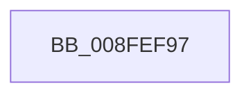

# sub_008FEF97

- RVA: `0x008FEF97`–`0x008FEFF4` (길이 `93` bytes)
- VA: `0x00000001408FEF97`
- 실행 섹션: `PAGE`
- PDB 이름 있음: `아니요`; PDB Function 태그: `아니요`
- unwind 정보 RVA: `0x000882EC`
- 디코드: `17`개 명령, `93/93` bytes 표시
- 미해석 바이트: `0` (있으면 어셈블리에 `.byte`로 보존)

> 이 문서는 커널 이미지의 기계어와 PDB 기호를 분석해 생성했습니다. 4번과 5번은 함수 원형과 자료형을 바이너리 사용 방식에서 추정한 C 해석이며 원본 소스 복구 결과는 아닙니다.

## 1. Dependencies

- 직접 호출 지점: **1**; 고유 호출 대상: **1**
- 직접 호출자로 확인된 함수: **0**
- RIP 상대 이미지 참조: **1**

### Outgoing calls
- `0x008FEFD5` → [RtlStringCchPrintfExW](../../text/42/RtlStringCchPrintfExW_function_0042B390.md) (function, `0x0042B390`)

### Direct callers
- 이 함수 시작 RVA로 연결되는 직접 call은 확인되지 않았습니다. 간접 호출은 완전히 역산할 수 없습니다.

### Static image references
- `0x008FEFC1` → RVA `0x00AFDD40` (` ?? ::NNGAKEGL::`string'`; read)

## 2. Other-region calls and transfers

- 다른 실행 섹션으로 향하는 call: **1**
  - `0x008FEFD5` → [RtlStringCchPrintfExW](../../text/42/RtlStringCchPrintfExW_function_0042B390.md) (`PAGE` → `.text`)
- call이 아닌 외부 분기/꼬리 이동: **1**
  - `0x008FEFEE` → [PiDmObjectGetCachedCmProperty + 0x57](PiDmObjectGetCachedCmProperty_function_008FEE70.md) (`tail-transfer`)

## 3. Assembly (complete function range)

```asm
008FEF97  48 89 B4 24 30 01 00 00         mov qword ptr [rsp + 0x130], rsi
008FEF9F  41 8D 51 27                     lea edx, [r9 + 0x27]
008FEFA3  0F B7 75 8E                     movzx esi, word ptr [rbp - 0x72]
008FEFA7  89 74 24 40                     mov dword ptr [rsp + 0x40], esi
008FEFAB  4C 89 B4 24 40 01 00 00         mov qword ptr [rsp + 0x140], r14
008FEFB3  44 0F B7 75 8C                  movzx r14d, word ptr [rbp - 0x74]
008FEFB8  44 89 74 24 38                  mov dword ptr [rsp + 0x38], r14d
008FEFBD  89 44 24 30                     mov dword ptr [rsp + 0x30], eax
008FEFC1  48 8D 05 78 ED 1F 00            lea rax, [rip + 0x1fed78]
008FEFC8  48 89 44 24 28                  mov qword ptr [rsp + 0x28], rax
008FEFCD  C7 44 24 20 00 08 00 00         mov dword ptr [rsp + 0x20], 0x800
008FEFD5  E8 B6 C3 B2 FF                  call 0x14042b390
008FEFDA  4C 8B B4 24 40 01 00 00         mov r14, qword ptr [rsp + 0x140]
008FEFE2  8B C8                           mov ecx, eax
008FEFE4  48 8B B4 24 30 01 00 00         mov rsi, qword ptr [rsp + 0x130]
008FEFEC  85 C0                           test eax, eax
008FEFEE  0F 88 D3 FE FF FF               js 0x1408feec7
```

## 4. C-style interpretation (structured pseudocode)

```c
__int64 __fastcall sub_008FEF97(__int64 a1, __int64 a2, __int64 a3, __int64 a4, __int64 a5, __int64 a6, __int64 a7, __int64 a8, __int64 a9, __int64 a10, __int64 a11, __int64 a12, __int64 a13, __int64 a14, __int64 a15, __int64 a16, __int64 a17, __int64 a18, __int64 a19, __int64 a20, __int64 a21, __int64 a22, __int64 a23, __int64 a24, __int64 a25, __int64 a26, __int64 a27, __int64 a28, __int64 a29, __int64 a30, __int64 a31, __int64 a32, __int64 a33, __int64 a34, __int64 a35, __int64 a36, __int64 a37, __int64 a38, __int64 a39, __int64 a40)
{
    __int64 result;
    unsigned __int64 v_stack_p130;
    unsigned __int64 v_stack_p140;
    unsigned int v_stack_p20;
    unsigned __int64 v_stack_p28;
    unsigned int v_stack_p30;
    unsigned int v_stack_p38;
    unsigned int v_stack_p40;

    v_stack_p130 = v_rsi;
    v_stack_p40 = (unsigned int)(*(unsigned __int16 *)(v_rbp - 114));
    v_stack_p140 = v_r14;
    v_stack_p38 = (unsigned int)(*(unsigned __int16 *)(v_rbp - 116));
    v_stack_p30 = (unsigned int)(result);
    v_stack_p28 = v_rip + 2092408;
    v_stack_p20 = 0x800ULL;
    result = RtlStringCchPrintfExW(a1, a4 + 39, a3, a4);
}
```

## 5. (Beta) C Style

```c
int64_t sub_008FEF97(int64_t Arg1, int64_t Arg2, int64_t Arg3, void *Arg4, uint64_t Arg5, uint64_t Arg6, uint64_t Arg7, uint64_t Arg8, uint64_t Arg9, uint64_t Arg10, uint64_t Arg11, uint64_t Arg12, uint64_t Arg13, uint64_t Arg14, uint64_t Arg15, uint64_t Arg16, uint64_t Arg17, uint64_t Arg18, uint64_t Arg19, uint64_t Arg20, uint64_t Arg21, uint64_t Arg22, uint64_t Arg23, uint64_t Arg24, uint64_t Arg25, uint64_t Arg26, uint64_t Arg27, uint64_t Arg28, uint64_t Arg29, uint64_t Arg30, uint64_t Arg31, uint64_t Arg32, uint64_t Arg33, uint64_t Arg34, uint64_t Arg35, uint64_t Arg36, uint64_t Arg37, int64_t Arg38, uint64_t Arg39, int64_t Arg40)
{
    uint8_t *arg4 = (uint8_t *)Arg4;

    int64_t result;
    uint64_t v_stack_p130;
    uint64_t v_stack_p140;
    uint32_t v_stack_p20;
    uint64_t v_stack_p28;
    uint32_t v_stack_p30;
    uint32_t v_stack_p38;
    uint32_t v_stack_p40;

    v_stack_p130 = local_rsi;
    v_stack_p40 = (uint32_t)(*(uint16_t *)(local_rbp - 0x72));
    v_stack_p140 = local_r14;
    v_stack_p38 = (uint32_t)(*(uint16_t *)(local_rbp - 0x74));
    v_stack_p30 = (uint32_t)(result);
    v_stack_p28 = v_rip + 2092408;
    v_stack_p20 = 0x800ULL;
    result = RtlStringCchPrintfExW(Arg1, Arg4 + 39, Arg3, Arg4);
}
```

### 관측된 메모리 오프셋

구조체 형식이 확인되지 않은 접근은 인자 기준의 오프셋으로만 기록했습니다.

| 기준 인자 | 오프셋 표현 | 폭 (bit) | 접근 |
|---|---:|---:|---|
| `Arg4` | `+ 0x27` | `32` | `R` |

## 6. Execution-region graph

[열기: 2D/3D 그래프와 함수 탐색 컨트롤 패널](../../../control-panel.html?section=page&rva=0x008FEF97&view=graph)

- 2D 그래프는 위에서 아래로 흐르고, 3D 그래프는 빈 공간을 드래그해 회전합니다. Shift+드래그는 이동, 휠은 확대·축소, 함수 노드 선택은 대상 보고서 이동입니다.

### Static fallback


