# _CmAddDeviceToContainerWorker

- RVA: `0x008FF2EC`–`0x008FF712` (길이 `1,062` bytes)
- VA: `0x00000001408FF2EC`
- 실행 섹션: `PAGE`
- PDB 이름 있음: `예`; PDB Function 태그: `예`
- unwind 정보 RVA: `0x00088338`
- 디코드: `272`개 명령, `1,062/1,062` bytes 표시
- 미해석 바이트: `0` (있으면 어셈블리에 `.byte`로 보존)

> 이 문서는 커널 이미지의 기계어와 PDB 기호를 분석해 생성했습니다. 4번과 5번은 함수 원형과 자료형을 바이너리 사용 방식에서 추정한 C 해석이며 원본 소스 복구 결과는 아닙니다.

## 1. Dependencies

- 직접 호출 지점: **20**; 고유 호출 대상: **11**
- 직접 호출자로 확인된 함수: **1**
- RIP 상대 이미지 참조: **2**

### Outgoing calls
- `0x008FF34C` → [CmCreateDeviceContainer](CmCreateDeviceContainer_function_008FF718.md) (function, `0x008FF718`)
- `0x008FF391` → [ZwClose](../../text/6A/ZwClose_function_006AD2B0.md) (function, `0x006AD2B0`)
- `0x008FF40F` → [RegRtlCreateKeyTransacted](../93/RegRtlCreateKeyTransacted_function_0093207C.md) (function, `0x0093207C`)
- `0x008FF471` → [RegRtlCreateKeyTransacted](../93/RegRtlCreateKeyTransacted_function_0093207C.md) (function, `0x0093207C`)
- `0x008FF4A7` → [RegRtlSetValue](../99/RegRtlSetValue_function_00991B28.md) (function, `0x00991B28`)
- `0x008FF4F0` → [PnpDeviceRaisePropertyChangeEventWorker](PnpDeviceRaisePropertyChangeEventWorker_function_008F80E0.md) (function, `0x008F80E0`)
- `0x008FF519` → [RegRtlIsPredefinedKey](../93/RegRtlIsPredefinedKey_function_009321CC.md) (function, `0x009321CC`)
- `0x008FF531` → [RtlInitUnicodeStringEx](../../text/46/RtlInitUnicodeStringEx_function_00463960.md) (function, `0x00463960`)
- `0x008FF58D` → [ZwCreateKey](../../text/6A/ZwCreateKey_function_006AD470.md) (function, `0x006AD470`)
- `0x008FF5A1` → [ZwClose](../../text/6A/ZwClose_function_006AD2B0.md) (function, `0x006AD2B0`)
- `0x008FF5CA` → [RegRtlIsPredefinedKey](../93/RegRtlIsPredefinedKey_function_009321CC.md) (function, `0x009321CC`)
- `0x008FF5DE` → [RtlInitUnicodeStringEx](../../text/46/RtlInitUnicodeStringEx_function_00463960.md) (function, `0x00463960`)
- `0x008FF63C` → [ZwCreateKey](../../text/6A/ZwCreateKey_function_006AD470.md) (function, `0x006AD470`)
- `0x008FF650` → [ZwClose](../../text/6A/ZwClose_function_006AD2B0.md) (function, `0x006AD2B0`)
- `0x008FF65A` → [ZwClose](../../text/6A/ZwClose_function_006AD2B0.md) (function, `0x006AD2B0`)
- `0x008FF67F` → [PnpCtxRegQueryValue](../99/PnpCtxRegQueryValue_function_009940FC.md) (function, `0x009940FC`)
- `0x008FF6AB` → [RegRtlOpenPredefinedKey](../83/RegRtlOpenPredefinedKey_function_00832A14.md) (function, `0x00832A14`)
- `0x008FF6C3` → [RegRtlOpenPredefinedKey](../83/RegRtlOpenPredefinedKey_function_00832A14.md) (function, `0x00832A14`)
- `0x008FF6FD` → [PnpCtxRegDeleteKey](../96/PnpCtxRegDeleteKey_function_00965EC8.md) (function, `0x00965EC8`)
- `0x008FF708` → [ZwClose](../../text/6A/ZwClose_function_006AD2B0.md) (function, `0x006AD2B0`)

### Direct callers
- [CmAddDeviceToContainer](CmAddDeviceToContainer_function_008FF190.md) at `0x008FF23A`

### Static image references
- `0x008FF3D7` → RVA `0x00B0D7D0` (` ?? ::NNGAKEGL::`string'`; read)
- `0x008FF4DB` → RVA `0x00011568` (`.rdata`; read)

## 2. Other-region calls and transfers

- 다른 실행 섹션으로 향하는 call: **9**
  - `0x008FF391` → [ZwClose](../../text/6A/ZwClose_function_006AD2B0.md) (`PAGE` → `.text`)
  - `0x008FF531` → [RtlInitUnicodeStringEx](../../text/46/RtlInitUnicodeStringEx_function_00463960.md) (`PAGE` → `.text`)
  - `0x008FF58D` → [ZwCreateKey](../../text/6A/ZwCreateKey_function_006AD470.md) (`PAGE` → `.text`)
  - `0x008FF5A1` → [ZwClose](../../text/6A/ZwClose_function_006AD2B0.md) (`PAGE` → `.text`)
  - `0x008FF5DE` → [RtlInitUnicodeStringEx](../../text/46/RtlInitUnicodeStringEx_function_00463960.md) (`PAGE` → `.text`)
  - `0x008FF63C` → [ZwCreateKey](../../text/6A/ZwCreateKey_function_006AD470.md) (`PAGE` → `.text`)
  - `0x008FF650` → [ZwClose](../../text/6A/ZwClose_function_006AD2B0.md) (`PAGE` → `.text`)
  - `0x008FF65A` → [ZwClose](../../text/6A/ZwClose_function_006AD2B0.md) (`PAGE` → `.text`)
  - `0x008FF708` → [ZwClose](../../text/6A/ZwClose_function_006AD2B0.md) (`PAGE` → `.text`)
- call이 아닌 외부 분기/꼬리 이동: **2**
  - `0x008FF6ED` → [sub_00B1FF8C](../B1/Unknown_function_00B1FF8C.md) (`tail-transfer`)
  - `0x008FF703` → [sub_00B1FF8C](../B1/Unknown_function_00B1FF8C.md) (`tail-transfer`)

## 3. Assembly (complete function range)

```asm
008FF2EC  48 8B C4                        mov rax, rsp
008FF2EF  48 89 58 08                     mov qword ptr [rax + 8], rbx
008FF2F3  48 89 70 18                     mov qword ptr [rax + 0x18], rsi
008FF2F7  48 89 78 20                     mov qword ptr [rax + 0x20], rdi
008FF2FB  48 89 50 10                     mov qword ptr [rax + 0x10], rdx
008FF2FF  55                              push rbp
008FF300  41 54                           push r12
008FF302  41 55                           push r13
008FF304  41 56                           push r14
008FF306  41 57                           push r15
008FF308  48 8D 68 A9                     lea rbp, [rax - 0x57]
008FF30C  48 81 EC C0 00 00 00            sub rsp, 0xc0
008FF313  4C 8B 65 7F                     mov r12, qword ptr [rbp + 0x7f]
008FF317  33 F6                           xor esi, esi
008FF319  48 8B F9                        mov rdi, rcx
008FF31C  48 89 75 DF                     mov qword ptr [rbp - 0x21], rsi
008FF320  48 8D 4D BF                     lea rcx, [rbp - 0x41]
008FF324  48 89 75 D7                     mov qword ptr [rbp - 0x29], rsi
008FF328  48 89 4C 24 20                  mov qword ptr [rsp + 0x20], rcx
008FF32D  4D 8B E9                        mov r13, r9
008FF330  48 8B CF                        mov rcx, rdi
008FF333  41 88 34 24                     mov byte ptr [r12], sil
008FF337  4C 8D 4D DF                     lea r9, [rbp - 0x21]
008FF33B  48 89 75 CF                     mov qword ptr [rbp - 0x31], rsi
008FF33F  4D 8B F8                        mov r15, r8
008FF342  40 88 75 BF                     mov byte ptr [rbp - 0x41], sil
008FF346  89 75 C7                        mov dword ptr [rbp - 0x39], esi
008FF349  89 75 C3                        mov dword ptr [rbp - 0x3d], esi
008FF34C  E8 C7 03 00 00                  call 0x1408ff718
008FF351  4C 8B 75 DF                     mov r14, qword ptr [rbp - 0x21]
008FF355  8B D8                           mov ebx, eax
008FF357  85 C0                           test eax, eax
008FF359  79 5F                           jns 0x1408ff3ba
008FF35B  81 FB 7C 01 00 C0               cmp ebx, 0xc000017c
008FF361  0F 84 7D 03 00 00               je 0x1408ff6e4
008FF367  85 DB                           test ebx, ebx
008FF369  0F 88 7A 03 00 00               js 0x1408ff6e9
008FF36F  48 8B 4D CF                     mov rcx, qword ptr [rbp - 0x31]
008FF373  48 85 C9                        test rcx, rcx
008FF376  0F 85 8C 03 00 00               jne 0x1408ff708
008FF37C  48 8B 4D D7                     mov rcx, qword ptr [rbp - 0x29]
008FF380  48 85 C9                        test rcx, rcx
008FF383  0F 85 D1 02 00 00               jne 0x1408ff65a
008FF389  4D 85 F6                        test r14, r14
008FF38C  74 08                           je 0x1408ff396
008FF38E  49 8B CE                        mov rcx, r14
008FF391  E8 1A DF DA FF                  call 0x1406ad2b0
008FF396  4C 8D 9C 24 C0 00 00 00         lea r11, [rsp + 0xc0]
008FF39E  8B C3                           mov eax, ebx
008FF3A0  49 8B 5B 30                     mov rbx, qword ptr [r11 + 0x30]
008FF3A4  49 8B 73 40                     mov rsi, qword ptr [r11 + 0x40]
008FF3A8  49 8B 7B 48                     mov rdi, qword ptr [r11 + 0x48]
008FF3AC  49 8B E3                        mov rsp, r11
008FF3AF  41 5F                           pop r15
008FF3B1  41 5E                           pop r14
008FF3B3  41 5D                           pop r13
008FF3B5  41 5C                           pop r12
008FF3B7  5D                              pop rbp
008FF3B8  C3                              ret
008FF3B9  CC                              int3
008FF3BA  48 85 FF                        test rdi, rdi
008FF3BD  0F 84 37 01 00 00               je 0x1408ff4fa
008FF3C3  48 8B 87 E0 00 00 00            mov rax, qword ptr [rdi + 0xe0]
008FF3CA  48 85 C0                        test rax, rax
008FF3CD  0F 84 27 01 00 00               je 0x1408ff4fa
008FF3D3  48 8B 48 08                     mov rcx, qword ptr [rax + 8]
008FF3D7  48 8D 15 F2 E3 20 00            lea rdx, [rip + 0x20e3f2]
008FF3DE  48 89 4C 24 40                  mov qword ptr [rsp + 0x40], rcx
008FF3E3  45 33 C0                        xor r8d, r8d
008FF3E6  40 38 70 10                     cmp byte ptr [rax + 0x10], sil
008FF3EA  41 B9 04 00 00 00               mov r9d, 4
008FF3F0  48 8D 45 C7                     lea rax, [rbp - 0x39]
008FF3F4  49 8B CE                        mov rcx, r14
008FF3F7  48 89 44 24 38                  mov qword ptr [rsp + 0x38], rax
008FF3FC  48 8D 45 D7                     lea rax, [rbp - 0x29]
008FF400  48 89 44 24 30                  mov qword ptr [rsp + 0x30], rax
008FF405  40 88 74 24 28                  mov byte ptr [rsp + 0x28], sil
008FF40A  48 89 74 24 20                  mov qword ptr [rsp + 0x20], rsi
008FF40F  E8 68 2C 03 00                  call 0x14093207c
008FF414  8B D8                           mov ebx, eax
008FF416  85 DB                           test ebx, ebx
008FF418  0F 88 3D FF FF FF               js 0x1408ff35b
008FF41E  48 8B 75 D7                     mov rsi, qword ptr [rbp - 0x29]
008FF422  33 D2                           xor edx, edx
008FF424  48 85 FF                        test rdi, rdi
008FF427  0F 84 7E 01 00 00               je 0x1408ff5ab
008FF42D  48 8B 87 E0 00 00 00            mov rax, qword ptr [rdi + 0xe0]
008FF434  48 85 C0                        test rax, rax
008FF437  0F 84 6E 01 00 00               je 0x1408ff5ab
008FF43D  48 8B 48 08                     mov rcx, qword ptr [rax + 8]
008FF441  44 8D 4A 03                     lea r9d, [rdx + 3]
008FF445  48 89 4C 24 40                  mov qword ptr [rsp + 0x40], rcx
008FF44A  45 33 C0                        xor r8d, r8d
008FF44D  38 50 10                        cmp byte ptr [rax + 0x10], dl
008FF450  48 8B CE                        mov rcx, rsi
008FF453  48 8D 45 C3                     lea rax, [rbp - 0x3d]
008FF457  48 89 44 24 38                  mov qword ptr [rsp + 0x38], rax
008FF45C  48 8D 45 CF                     lea rax, [rbp - 0x31]
008FF460  48 89 44 24 30                  mov qword ptr [rsp + 0x30], rax
008FF465  88 54 24 28                     mov byte ptr [rsp + 0x28], dl
008FF469  48 89 54 24 20                  mov qword ptr [rsp + 0x20], rdx
008FF46E  49 8B D7                        mov rdx, r15
008FF471  E8 06 2C 03 00                  call 0x14093207c
008FF476  8B D8                           mov ebx, eax
008FF478  33 F6                           xor esi, esi
008FF47A  85 DB                           test ebx, ebx
008FF47C  0F 88 D9 FE FF FF               js 0x1408ff35b
008FF482  83 7D C3 02                     cmp dword ptr [rbp - 0x3d], 2
008FF486  0F 84 D8 01 00 00               je 0x1408ff664
008FF48C  41 38 34 24                     cmp byte ptr [r12], sil
008FF490  0F 85 D1 FE FF FF               jne 0x1408ff367
008FF496  48 8B 4D CF                     mov rcx, qword ptr [rbp - 0x31]
008FF49A  45 33 C9                        xor r9d, r9d
008FF49D  45 33 C0                        xor r8d, r8d
008FF4A0  89 74 24 20                     mov dword ptr [rsp + 0x20], esi
008FF4A4  49 8B D5                        mov rdx, r13
008FF4A7  E8 7C 26 09 00                  call 0x140991b28
008FF4AC  8B D8                           mov ebx, eax
008FF4AE  85 C0                           test eax, eax
008FF4B0  0F 88 A5 FE FF FF               js 0x1408ff35b
008FF4B6  33 C0                           xor eax, eax
008FF4B8  0F 57 C0                        xorps xmm0, xmm0
008FF4BB  48 89 45 EF                     mov qword ptr [rbp - 0x11], rax
008FF4BF  48 8B 87 F0 01 00 00            mov rax, qword ptr [rdi + 0x1f0]
008FF4C6  0F 11 45 DF                     movups xmmword ptr [rbp - 0x21], xmm0
008FF4CA  48 85 C0                        test rax, rax
008FF4CD  0F 84 9C FE FF FF               je 0x1408ff36f
008FF4D3  48 89 44 24 28                  mov qword ptr [rsp + 0x28], rax
008FF4D8  45 33 C9                        xor r9d, r9d
008FF4DB  48 8D 05 86 20 71 FF            lea rax, [rip - 0x8edf7a]
008FF4E2  45 33 C0                        xor r8d, r8d
008FF4E5  49 8B D5                        mov rdx, r13
008FF4E8  48 89 44 24 20                  mov qword ptr [rsp + 0x20], rax
008FF4ED  48 8B CF                        mov rcx, rdi
008FF4F0  E8 EB 8B FF FF                  call 0x1408f80e0
008FF4F5  E9 75 FE FF FF                  jmp 0x1408ff36f
008FF4FA  33 C0                           xor eax, eax
008FF4FC  48 89 75 7F                     mov qword ptr [rbp + 0x7f], rsi
008FF500  0F 57 C0                        xorps xmm0, xmm0
008FF503  48 89 45 17                     mov qword ptr [rbp + 0x17], rax
008FF507  49 8B CE                        mov rcx, r14
008FF50A  89 45 1F                        mov dword ptr [rbp + 0x1f], eax
008FF50D  0F 11 45 F7                     movups xmmword ptr [rbp - 9], xmm0
008FF511  0F 11 45 07                     movups xmmword ptr [rbp + 7], xmm0
008FF515  0F 11 45 DF                     movups xmmword ptr [rbp - 0x21], xmm0
008FF519  E8 AE 2C 03 00                  call 0x1409321cc
008FF51E  84 C0                           test al, al
008FF520  0F 85 81 01 00 00               jne 0x1408ff6a7
008FF526  48 8D 15 A3 E2 20 00            lea rdx, [rip + 0x20e2a3]
008FF52D  48 8D 4D DF                     lea rcx, [rbp - 0x21]
008FF531  E8 2A 44 B6 FF                  call 0x140463960
008FF536  8B D8                           mov ebx, eax
008FF538  85 C0                           test eax, eax
008FF53A  78 58                           js 0x1408ff594
008FF53C  48 8B 45 7F                     mov rax, qword ptr [rbp + 0x7f]
008FF540  4C 8D 45 F7                     lea r8, [rbp - 9]
008FF544  48 85 C0                        test rax, rax
008FF547  C7 45 F7 30 00 00 00            mov dword ptr [rbp - 9], 0x30
008FF54E  0F 57 C0                        xorps xmm0, xmm0
008FF551  C7 45 0F C0 02 00 00            mov dword ptr [rbp + 0xf], 0x2c0
008FF558  49 8B CE                        mov rcx, r14
008FF55B  48 0F 45 C8                     cmovne rcx, rax
008FF55F  48 8D 45 DF                     lea rax, [rbp - 0x21]
008FF563  45 33 C9                        xor r9d, r9d
008FF566  48 89 45 07                     mov qword ptr [rbp + 7], rax
008FF56A  48 8D 45 C7                     lea rax, [rbp - 0x39]
008FF56E  48 89 4D FF                     mov qword ptr [rbp - 1], rcx
008FF572  48 89 44 24 30                  mov qword ptr [rsp + 0x30], rax
008FF577  48 8D 4D D7                     lea rcx, [rbp - 0x29]
008FF57B  89 74 24 28                     mov dword ptr [rsp + 0x28], esi
008FF57F  41 8D 51 04                     lea edx, [r9 + 4]
008FF583  48 89 74 24 20                  mov qword ptr [rsp + 0x20], rsi
008FF588  F3 0F 7F 45 17                  movdqu xmmword ptr [rbp + 0x17], xmm0
008FF58D  E8 DE DE DA FF                  call 0x1406ad470
008FF592  8B D8                           mov ebx, eax
008FF594  48 8B 4D 7F                     mov rcx, qword ptr [rbp + 0x7f]
008FF598  48 85 C9                        test rcx, rcx
008FF59B  0F 84 75 FE FF FF               je 0x1408ff416
008FF5A1  E8 0A DD DA FF                  call 0x1406ad2b0
008FF5A6  E9 6B FE FF FF                  jmp 0x1408ff416
008FF5AB  33 C0                           xor eax, eax
008FF5AD  48 89 55 7F                     mov qword ptr [rbp + 0x7f], rdx
008FF5B1  0F 57 C0                        xorps xmm0, xmm0
008FF5B4  48 89 45 17                     mov qword ptr [rbp + 0x17], rax
008FF5B8  48 8B CE                        mov rcx, rsi
008FF5BB  89 45 1F                        mov dword ptr [rbp + 0x1f], eax
008FF5BE  0F 11 45 F7                     movups xmmword ptr [rbp - 9], xmm0
008FF5C2  0F 11 45 07                     movups xmmword ptr [rbp + 7], xmm0
008FF5C6  0F 11 45 DF                     movups xmmword ptr [rbp - 0x21], xmm0
008FF5CA  E8 FD 2B 03 00                  call 0x1409321cc
008FF5CF  84 C0                           test al, al
008FF5D1  0F 85 E8 00 00 00               jne 0x1408ff6bf
008FF5D7  49 8B D7                        mov rdx, r15
008FF5DA  48 8D 4D DF                     lea rcx, [rbp - 0x21]
008FF5DE  E8 7D 43 B6 FF                  call 0x140463960
008FF5E3  8B D8                           mov ebx, eax
008FF5E5  85 C0                           test eax, eax
008FF5E7  0F 88 B6 00 00 00               js 0x1408ff6a3
008FF5ED  48 8B 45 7F                     mov rax, qword ptr [rbp + 0x7f]
008FF5F1  4C 8D 45 F7                     lea r8, [rbp - 9]
008FF5F5  48 85 C0                        test rax, rax
008FF5F8  C7 45 F7 30 00 00 00            mov dword ptr [rbp - 9], 0x30
008FF5FF  0F 57 C0                        xorps xmm0, xmm0
008FF602  C7 45 0F C0 02 00 00            mov dword ptr [rbp + 0xf], 0x2c0
008FF609  48 0F 45 F0                     cmovne rsi, rax
008FF60D  48 8D 4D CF                     lea rcx, [rbp - 0x31]
008FF611  48 89 75 FF                     mov qword ptr [rbp - 1], rsi
008FF615  48 8D 45 DF                     lea rax, [rbp - 0x21]
008FF619  33 F6                           xor esi, esi
008FF61B  48 89 45 07                     mov qword ptr [rbp + 7], rax
008FF61F  48 8D 45 C3                     lea rax, [rbp - 0x3d]
008FF623  45 33 C9                        xor r9d, r9d
008FF626  48 89 44 24 30                  mov qword ptr [rsp + 0x30], rax
008FF62B  89 74 24 28                     mov dword ptr [rsp + 0x28], esi
008FF62F  8D 56 03                        lea edx, [rsi + 3]
008FF632  48 89 74 24 20                  mov qword ptr [rsp + 0x20], rsi
008FF637  F3 0F 7F 45 17                  movdqu xmmword ptr [rbp + 0x17], xmm0
008FF63C  E8 2F DE DA FF                  call 0x1406ad470
008FF641  8B D8                           mov ebx, eax
008FF643  48 8B 4D 7F                     mov rcx, qword ptr [rbp + 0x7f]
008FF647  48 85 C9                        test rcx, rcx
008FF64A  0F 84 2A FE FF FF               je 0x1408ff47a
008FF650  E8 5B DC DA FF                  call 0x1406ad2b0
008FF655  E9 20 FE FF FF                  jmp 0x1408ff47a
008FF65A  E8 51 DC DA FF                  call 0x1406ad2b0
008FF65F  E9 25 FD FF FF                  jmp 0x1408ff389
008FF664  48 8B 55 CF                     mov rdx, qword ptr [rbp - 0x31]
008FF668  48 8D 45 7F                     lea rax, [rbp + 0x7f]
008FF66C  48 89 44 24 28                  mov qword ptr [rsp + 0x28], rax
008FF671  45 33 C9                        xor r9d, r9d
008FF674  4D 8B C5                        mov r8, r13
008FF677  48 89 74 24 20                  mov qword ptr [rsp + 0x20], rsi
008FF67C  89 75 7F                        mov dword ptr [rbp + 0x7f], esi
008FF67F  E8 78 4A 09 00                  call 0x1409940fc
008FF684  8B D8                           mov ebx, eax
008FF686  3D 34 00 00 C0                  cmp eax, 0xc0000034
008FF68B  74 50                           je 0x1408ff6dd
008FF68D  3D 7C 01 00 C0                  cmp eax, 0xc000017c
008FF692  74 49                           je 0x1408ff6dd
008FF694  85 C0                           test eax, eax
008FF696  74 3B                           je 0x1408ff6d3
008FF698  0F 89 EE FD FF FF               jns 0x1408ff48c
008FF69E  E9 C4 FC FF FF                  jmp 0x1408ff367
008FF6A3  33 F6                           xor esi, esi
008FF6A5  EB 9C                           jmp 0x1408ff643
008FF6A7  48 8D 55 7F                     lea rdx, [rbp + 0x7f]
008FF6AB  E8 64 33 F3 FF                  call 0x140832a14
008FF6B0  8B D8                           mov ebx, eax
008FF6B2  85 C0                           test eax, eax
008FF6B4  0F 88 DA FE FF FF               js 0x1408ff594
008FF6BA  E9 67 FE FF FF                  jmp 0x1408ff526
008FF6BF  48 8D 55 7F                     lea rdx, [rbp + 0x7f]
008FF6C3  E8 4C 33 F3 FF                  call 0x140832a14
008FF6C8  8B D8                           mov ebx, eax
008FF6CA  85 C0                           test eax, eax
008FF6CC  78 D5                           js 0x1408ff6a3
008FF6CE  E9 04 FF FF FF                  jmp 0x1408ff5d7
008FF6D3  41 C6 04 24 01                  mov byte ptr [r12], 1
008FF6D8  E9 AF FD FF FF                  jmp 0x1408ff48c
008FF6DD  8B DE                           mov ebx, esi
008FF6DF  E9 A8 FD FF FF                  jmp 0x1408ff48c
008FF6E4  BB 34 00 00 C0                  mov ebx, 0xc0000034
008FF6E9  83 7D C3 01                     cmp dword ptr [rbp - 0x3d], 1
008FF6ED  0F 85 99 08 22 00               jne 0x140b1ff8c
008FF6F3  48 8B 55 CF                     mov rdx, qword ptr [rbp - 0x31]
008FF6F7  45 33 C0                        xor r8d, r8d
008FF6FA  48 8B CF                        mov rcx, rdi
008FF6FD  E8 C6 67 06 00                  call 0x140965ec8
008FF702  90                              nop
008FF703  E9 84 08 22 00                  jmp 0x140b1ff8c
008FF708  E8 A3 DB DA FF                  call 0x1406ad2b0
008FF70D  E9 6A FC FF FF                  jmp 0x1408ff37c
```

## 4. C-style interpretation (structured pseudocode)

```c
__int64 __fastcall _CmAddDeviceToContainerWorker(__int64 a1, __int64 a2, __int64 a3, __int64 a4)
{
    __int64 result;
    __int64 v_rbx;
    __int64 v_rsi;
    __int64 v_rsp;
    unsigned __int64 v_stack_m28;
    unsigned __int64 v_stack_m80;
    unsigned __int64 v_stack_m88;
    unsigned __int64 v_stack_m90;
    unsigned __int8 v_stack_m98;
    unsigned __int64 v_stack_mA0;
    unsigned __int64 v_stack_mC8;

    *(unsigned __int64 *)(v_rsp + 8) = v_rbx;
    *(unsigned __int64 *)(v_rsp + 24) = v_rsi;
    *(unsigned __int64 *)(v_rsp + 32) = v_rdi;
    *(unsigned __int64 *)(v_rsp + 16) = a2;
    v_rsp = (v_rsp) - (192);
    v_rsi = 0;
    *(unsigned __int64 *)(v_rsp - 87 - 33) = 0;
    *(unsigned __int64 *)(v_rsp - 87 - 41) = 0;
    v_stack_mC8 = v_rsp - 87 - 65;
    *(unsigned __int8 *)(*(unsigned __int64 *)(v_rsp - 87 + 127)) = 0;
    *(unsigned __int64 *)(v_rsp - 87 - 49) = 0;
    *(unsigned __int8 *)(v_rsp - 87 - 65) = 0;
    *(unsigned int *)(v_rsp - 87 - 57) = 0;
    *(unsigned int *)(v_rsp - 87 - 61) = 0;
    result = CmCreateDeviceContainer(a1, a2, a3, v_rsp - 87 - 33);
    if (!sign_flag) goto loc_008FF3BA;
loc_008FF35B:
    if (((unsigned int)((unsigned int)((unsigned int)(result)))) == 0xC000017CULL) goto loc_008FF6E4;
loc_008FF367:
    if (sign_flag) goto loc_008FF6E9;
loc_008FF36F:
    if (*(unsigned __int64 *)(v_rsp - 87 - 49) != 0) goto loc_008FF708;
loc_008FF37C:
    if (*(unsigned __int64 *)(v_rsp - 87 - 41) != 0) goto loc_008FF65A;
loc_008FF389:
    if (*(unsigned __int64 *)(v_rsp - 87 - 33) != 0) {
        a1 = *(unsigned __int64 *)(v_rsp - 87 - 33);
        result = ZwClose(a1, a2, a3, v_rsp - 87 - 33);
    }
    return (unsigned int)((unsigned int)((unsigned int)((unsigned int)(result))));
loc_008FF3BA:
    if (*(unsigned __int64 *)(v_stack_m28 + 72) == 0) goto loc_008FF4FA;
    if (*(unsigned __int64 *)(*(unsigned __int64 *)(v_stack_m28 + 72) + 224) == 0) goto loc_008FF4FA;
    v_stack_m80 = *(unsigned __int64 *)(*(unsigned __int64 *)(*(unsigned __int64 *)(v_stack_m28 + 72) + 224) + 8);
    a3 = 0;
    v_stack_m88 = v_rsp - 87 - 57;
    v_stack_m90 = v_rsp - 87 - 41;
    v_stack_m98 = (unsigned __int8)(*(unsigned __int64 *)(v_stack_m28 + 64));
    v_stack_mA0 = *(unsigned __int64 *)(v_stack_m28 + 64);
    result = RegRtlCreateKeyTransacted(*(unsigned __int64 *)(v_rsp - 87 - 33), v_rip + 2155506, a3, 4);
loc_008FF416:
    if (sign_flag) goto loc_008FF35B;
    a2 = 0;
    if (*(unsigned __int64 *)(v_stack_m28 + 72) == 0) goto loc_008FF5AB;
    if (*(unsigned __int64 *)(*(unsigned __int64 *)(v_stack_m28 + 72) + 224) == 0) goto loc_008FF5AB;
    v_stack_m80 = *(unsigned __int64 *)(*(unsigned __int64 *)(*(unsigned __int64 *)(v_stack_m28 + 72) + 224) + 8);
    a3 = 0;
    v_stack_m88 = v_rsp - 87 - 61;
    v_stack_m90 = v_rsp - 87 - 49;
    v_stack_m98 = 0;
    v_stack_mA0 = 0;
    result = RegRtlCreateKeyTransacted(*(unsigned __int64 *)(v_rsp - 87 - 41), 0, a3, a2 + 3);
    v_rsi = 0;
loc_008FF47A:
    if (sign_flag) goto loc_008FF35B;
    if ((*(unsigned int *)(v_rsp - 87 - 61)) == 2) goto loc_008FF664;
loc_008FF48C:
    if ((*(unsigned __int8 *)(*(unsigned __int64 *)(v_rsp - 87 + 127))) != 0) goto loc_008FF367;
    a4 = 0;
    a3 = 0;
    v_stack_mA0 = 0;
    result = RegRtlSetValue(*(unsigned __int64 *)(v_rsp - 87 - 49), 0, a3, a4);
    if (sign_flag) goto loc_008FF35B;
    result = 0;
    *(unsigned __int64 *)(v_rsp - 87 - 17) = 0;
    *(unsigned __int64 *)(v_rsp - 87 - 33) = v_xmm0;
    if (*(unsigned __int64 *)(*(unsigned __int64 *)(v_stack_m28 + 72) + 496) == 0) goto loc_008FF36F;
    v_stack_m98 = *(unsigned __int64 *)(*(unsigned __int64 *)(v_stack_m28 + 72) + 496);
    a4 = 0;
    a3 = 0;
    v_stack_mA0 = v_rip - 9363322;
    result = PnpDeviceRaisePropertyChangeEventWorker(*(unsigned __int64 *)(v_stack_m28 + 72), 0, a3, a4);
    goto loc_008FF36F;
loc_008FF4FA:
    result = 0;
    *(unsigned __int64 *)(v_rsp - 87 + 127) = 0;
    *(unsigned __int64 *)(v_rsp - 87 + 23) = 0;
    *(unsigned int *)(v_rsp - 87 + 31) = 0;
    *(unsigned __int64 *)(v_rsp - 87 - 9) = v_xmm0;
    *(unsigned __int64 *)(v_rsp - 87 + 7) = v_xmm0;
    *(unsigned __int64 *)(v_rsp - 87 - 33) = v_xmm0;
    result = RegRtlIsPredefinedKey(*(unsigned __int64 *)(v_rsp - 87 - 33), 0, a3, a4);
    if ((unsigned __int8)(result) != 0) goto loc_008FF6A7;
loc_008FF526:
    result = RtlInitUnicodeStringEx(v_rsp - 87 - 33, v_rip + 2155171, a3, a4);
    v_rbx = (unsigned int)((unsigned int)(result));
    if (!(sign_flag)) {
        result = *(unsigned __int64 *)(v_rsp - 87 + 127);
        a3 = v_rsp - 87 - 9;
        *(unsigned int *)(v_rsp - 87 - 9) = 48;
        *(unsigned int *)(v_rsp - 87 + 15) = 704;
        a1 = *(unsigned __int64 *)(v_rsp - 87 - 33);
        if (result != 0) { a1 = result; }
        result = v_rsp - 87 - 33;
        a4 = 0;
        *(unsigned __int64 *)(v_rsp - 87 + 7) = result;
        result = v_rsp - 87 - 57;
        *(unsigned __int64 *)(v_rsp - 87 - 1) = a1;
        v_stack_m90 = result;
        a1 = v_rsp - 87 - 41;
        v_stack_m98 = 0;
        a2 = a4 + 4;
        v_stack_mA0 = 0;
        *(unsigned __int64 *)(v_rsp - 87 + 23) = v_xmm0;
        result = ZwCreateKey(a1, a2, a3, a4);
        v_rbx = (unsigned int)(result);
    }
    if (*(unsigned __int64 *)(v_rsp - 87 + 127) == 0) goto loc_008FF416;
    result = ZwClose(*(unsigned __int64 *)(v_rsp - 87 + 127), a2, a3, a4);
    goto loc_008FF416;
loc_008FF5AB:
    result = 0;
    *(unsigned __int64 *)(v_rsp - 87 + 127) = a2;
    *(unsigned __int64 *)(v_rsp - 87 + 23) = 0;
    *(unsigned int *)(v_rsp - 87 + 31) = 0;
    *(unsigned __int64 *)(v_rsp - 87 - 9) = v_xmm0;
    *(unsigned __int64 *)(v_rsp - 87 + 7) = v_xmm0;
    *(unsigned __int64 *)(v_rsp - 87 - 33) = v_xmm0;
    result = RegRtlIsPredefinedKey(0, a2, a3, a4);
    if ((unsigned __int8)(result) != 0) goto loc_008FF6BF;
loc_008FF5D7:
    result = RtlInitUnicodeStringEx(v_rsp - 87 - 33, a3, a3, a4);
    if (sign_flag) goto loc_008FF6A3;
    *(unsigned int *)(v_rsp - 87 - 9) = 48;
    *(unsigned int *)(v_rsp - 87 + 15) = 704;
    if (*(unsigned __int64 *)(v_rsp - 87 + 127) != 0) { v_rsi = *(unsigned __int64 *)(v_rsp - 87 + 127); }
    *(unsigned __int64 *)(v_rsp - 87 - 1) = v_rsi;
    v_rsi = 0;
    *(unsigned __int64 *)(v_rsp - 87 + 7) = v_rsp - 87 - 33;
    a4 = 0;
    v_stack_m90 = v_rsp - 87 - 61;
    v_stack_m98 = 0;
    v_stack_mA0 = 0;
    *(unsigned __int64 *)(v_rsp - 87 + 23) = v_xmm0;
    result = ZwCreateKey(v_rsp - 87 - 49, v_rsi + 3, v_rsp - 87 - 9, a4);
loc_008FF643:
    if (*(unsigned __int64 *)(v_rsp - 87 + 127) == 0) goto loc_008FF47A;
    result = ZwClose(*(unsigned __int64 *)(v_rsp - 87 + 127), v_rsi + 3, v_rsp - 87 - 9, a4);
    goto loc_008FF47A;
loc_008FF65A:
    result = ZwClose(*(unsigned __int64 *)(v_rsp - 87 + 127), v_rsi + 3, v_rsp - 87 - 9, a4);
    goto loc_008FF389;
loc_008FF664:
    v_stack_m98 = v_rsp - 87 + 127;
    a4 = 0;
    v_stack_mA0 = 0;
    *(unsigned int *)(v_rsp - 87 + 127) = 0;
    result = PnpCtxRegQueryValue(*(unsigned __int64 *)(v_rsp - 87 + 127), *(unsigned __int64 *)(v_rsp - 87 - 49), 0, a4);
    if (((unsigned int)(result)) == 0xC0000034ULL) goto loc_008FF6DD;
    if (((unsigned int)(result)) == 0xC000017CULL) goto loc_008FF6DD;
    if ((unsigned int)(result) == 0) goto loc_008FF6D3;
    if (!sign_flag) goto loc_008FF48C;
    goto loc_008FF367;
loc_008FF6A3:
    v_rsi = 0;
    goto loc_008FF643;
loc_008FF6A7:
    result = RegRtlOpenPredefinedKey(*(unsigned __int64 *)(v_rsp - 87 + 127), v_rsp - 87 + 127, 0, a4);
    if (sign_flag) goto loc_008FF594;
    goto loc_008FF526;
loc_008FF6BF:
    result = RegRtlOpenPredefinedKey(*(unsigned __int64 *)(v_rsp - 87 + 127), v_rsp - 87 + 127, 0, a4);
    if (sign_flag) goto loc_008FF6A3;
    goto loc_008FF5D7;
loc_008FF6D3:
    *(unsigned __int8 *)(*(unsigned __int64 *)(v_rsp - 87 + 127)) = 1;
    goto loc_008FF48C;
loc_008FF6DD:
    goto loc_008FF48C;
loc_008FF6E4:
loc_008FF6E9:
    a3 = 0;
    result = PnpCtxRegDeleteKey(*(unsigned __int64 *)(v_stack_m28 + 72), *(unsigned __int64 *)(v_rsp - 87 - 49), a3, a4);
loc_008FF708:
    result = ZwClose(*(unsigned __int64 *)(v_stack_m28 + 72), *(unsigned __int64 *)(v_rsp - 87 - 49), a3, a4);
    goto loc_008FF37C;
}
```

## 5. (Beta) C Style

```c
int64_t _CmAddDeviceToContainerWorker(int64_t Arg1, int64_t Arg2, int64_t Arg3, int64_t Arg4)
{
    int64_t result;
    int64_t local_rbx;
    int64_t local_rsi;
    int64_t local_rsp;
    uint64_t v_stack_m28;
    uint64_t v_stack_m80;
    uint64_t v_stack_m88;
    uint64_t v_stack_m90;
    uint8_t v_stack_m98;
    uint64_t v_stack_mA0;
    uint64_t v_stack_mC8;

    *(uint64_t *)(local_rsp + 0x8) = local_rbx;
    *(uint64_t *)(local_rsp + 0x18) = local_rsi;
    *(uint64_t *)(local_rsp + 0x20) = local_rdi;
    *(uint64_t *)(local_rsp + 0x10) = Arg2;
    local_rsp = (local_rsp) - (192);
    local_rsi = 0;
    *(uint64_t *)(local_rsp - 0x57 - 0x21) = 0;
    *(uint64_t *)(local_rsp - 0x57 - 0x29) = 0;
    v_stack_mC8 = local_rsp - 87 - 65;
    *(uint8_t *)(*(uint64_t *)(local_rsp - 0x57 + 0x7F)) = 0;
    *(uint64_t *)(local_rsp - 0x57 - 0x31) = 0;
    *(uint8_t *)(local_rsp - 0x57 - 0x41) = 0;
    *(uint32_t *)(local_rsp - 0x57 - 0x39) = 0;
    *(uint32_t *)(local_rsp - 0x57 - 0x3D) = 0;
    result = CmCreateDeviceContainer(Arg1, Arg2, Arg3, local_rsp - 87 - 33);
    if (!sign_flag) goto loc_008FF3BA;
loc_008FF35B:
    if (((uint32_t)((uint32_t)((uint32_t)(result)))) == 0xC000017CULL) goto loc_008FF6E4;
loc_008FF367:
    if (sign_flag) goto loc_008FF6E9;
loc_008FF36F:
    if (*(uint64_t *)(local_rsp - 0x57 - 0x31) != 0) goto loc_008FF708;
loc_008FF37C:
    if (*(uint64_t *)(local_rsp - 0x57 - 0x29) != 0) goto loc_008FF65A;
loc_008FF389:
    if (*(uint64_t *)(local_rsp - 0x57 - 0x21) != 0) {
        Arg1 = *(uint64_t *)(local_rsp - 0x57 - 0x21);
        result = ZwClose(Arg1, Arg2, Arg3, local_rsp - 87 - 33);
    }
    return (uint32_t)((uint32_t)((uint32_t)((uint32_t)(result))));
loc_008FF3BA:
    if (*(uint64_t *)(v_stack_m28 + 0x48) == 0) goto loc_008FF4FA;
    if (*(uint64_t *)(*(uint64_t *)(v_stack_m28 + 0x48) + 0xE0) == 0) goto loc_008FF4FA;
    v_stack_m80 = *(uint64_t *)(*(uint64_t *)(*(uint64_t *)(v_stack_m28 + 0x48) + 0xE0) + 0x8);
    Arg3 = 0;
    v_stack_m88 = local_rsp - 87 - 57;
    v_stack_m90 = local_rsp - 87 - 41;
    v_stack_m98 = (uint8_t)(*(uint64_t *)(v_stack_m28 + 0x40));
    v_stack_mA0 = *(uint64_t *)(v_stack_m28 + 0x40);
    result = RegRtlCreateKeyTransacted(*(uint64_t *)(local_rsp - 0x57 - 0x21), v_rip + 2155506, Arg3, 4);
loc_008FF416:
    if (sign_flag) goto loc_008FF35B;
    Arg2 = 0;
    if (*(uint64_t *)(v_stack_m28 + 0x48) == 0) goto loc_008FF5AB;
    if (*(uint64_t *)(*(uint64_t *)(v_stack_m28 + 0x48) + 0xE0) == 0) goto loc_008FF5AB;
    v_stack_m80 = *(uint64_t *)(*(uint64_t *)(*(uint64_t *)(v_stack_m28 + 0x48) + 0xE0) + 0x8);
    Arg3 = 0;
    v_stack_m88 = local_rsp - 87 - 61;
    v_stack_m90 = local_rsp - 87 - 49;
    v_stack_m98 = 0;
    v_stack_mA0 = 0;
    result = RegRtlCreateKeyTransacted(*(uint64_t *)(local_rsp - 0x57 - 0x29), 0, Arg3, Arg2 + 3);
    local_rsi = 0;
loc_008FF47A:
    if (sign_flag) goto loc_008FF35B;
    if ((*(uint32_t *)(local_rsp - 0x57 - 0x3D)) == 2) goto loc_008FF664;
loc_008FF48C:
    if ((*(uint8_t *)(*(uint64_t *)(local_rsp - 0x57 + 0x7F))) != 0) goto loc_008FF367;
    Arg4 = 0;
    Arg3 = 0;
    v_stack_mA0 = 0;
    result = RegRtlSetValue(*(uint64_t *)(local_rsp - 0x57 - 0x31), 0, Arg3, Arg4);
    if (sign_flag) goto loc_008FF35B;
    result = 0;
    *(uint64_t *)(local_rsp - 0x57 - 0x11) = 0;
    *(uint64_t *)(local_rsp - 0x57 - 0x21) = v_xmm0;
    if (*(uint64_t *)(*(uint64_t *)(v_stack_m28 + 0x48) + 0x1F0) == 0) goto loc_008FF36F;
    v_stack_m98 = *(uint64_t *)(*(uint64_t *)(v_stack_m28 + 0x48) + 0x1F0);
    Arg4 = 0;
    Arg3 = 0;
    v_stack_mA0 = v_rip - 9363322;
    result = PnpDeviceRaisePropertyChangeEventWorker(*(uint64_t *)(v_stack_m28 + 0x48), 0, Arg3, Arg4);
    goto loc_008FF36F;
loc_008FF4FA:
    result = 0;
    *(uint64_t *)(local_rsp - 0x57 + 0x7F) = 0;
    *(uint64_t *)(local_rsp - 0x57 + 0x17) = 0;
    *(uint32_t *)(local_rsp - 0x57 + 0x1F) = 0;
    *(uint64_t *)(local_rsp - 0x57 - 0x9) = v_xmm0;
    *(uint64_t *)(local_rsp - 0x57 + 0x7) = v_xmm0;
    *(uint64_t *)(local_rsp - 0x57 - 0x21) = v_xmm0;
    result = RegRtlIsPredefinedKey(*(uint64_t *)(local_rsp - 0x57 - 0x21), 0, Arg3, Arg4);
    if ((uint8_t)(result) != 0) goto loc_008FF6A7;
loc_008FF526:
    result = RtlInitUnicodeStringEx(local_rsp - 87 - 33, v_rip + 2155171, Arg3, Arg4);
    local_rbx = (uint32_t)((uint32_t)(result));
    if (!(sign_flag)) {
        result = *(uint64_t *)(local_rsp - 0x57 + 0x7F);
        Arg3 = local_rsp - 87 - 9;
        *(uint32_t *)(local_rsp - 0x57 - 0x9) = 48;
        *(uint32_t *)(local_rsp - 0x57 + 0xF) = 704;
        Arg1 = *(uint64_t *)(local_rsp - 0x57 - 0x21);
        if (result != 0) { Arg1 = result; }
        result = local_rsp - 87 - 33;
        Arg4 = 0;
        *(uint64_t *)(local_rsp - 0x57 + 0x7) = result;
        result = local_rsp - 87 - 57;
        *(uint64_t *)(local_rsp - 0x57 - 0x1) = Arg1;
        v_stack_m90 = result;
        Arg1 = local_rsp - 87 - 41;
        v_stack_m98 = 0;
        Arg2 = Arg4 + 4;
        v_stack_mA0 = 0;
        *(uint64_t *)(local_rsp - 0x57 + 0x17) = v_xmm0;
        result = ZwCreateKey(Arg1, Arg2, Arg3, Arg4);
        local_rbx = (uint32_t)(result);
    }
    if (*(uint64_t *)(local_rsp - 0x57 + 0x7F) == 0) goto loc_008FF416;
    result = ZwClose(*(uint64_t *)(local_rsp - 0x57 + 0x7F), Arg2, Arg3, Arg4);
    goto loc_008FF416;
loc_008FF5AB:
    result = 0;
    *(uint64_t *)(local_rsp - 0x57 + 0x7F) = Arg2;
    *(uint64_t *)(local_rsp - 0x57 + 0x17) = 0;
    *(uint32_t *)(local_rsp - 0x57 + 0x1F) = 0;
    *(uint64_t *)(local_rsp - 0x57 - 0x9) = v_xmm0;
    *(uint64_t *)(local_rsp - 0x57 + 0x7) = v_xmm0;
    *(uint64_t *)(local_rsp - 0x57 - 0x21) = v_xmm0;
    result = RegRtlIsPredefinedKey(0, Arg2, Arg3, Arg4);
    if ((uint8_t)(result) != 0) goto loc_008FF6BF;
loc_008FF5D7:
    result = RtlInitUnicodeStringEx(local_rsp - 87 - 33, Arg3, Arg3, Arg4);
    if (sign_flag) goto loc_008FF6A3;
    *(uint32_t *)(local_rsp - 0x57 - 0x9) = 48;
    *(uint32_t *)(local_rsp - 0x57 + 0xF) = 704;
    if (*(uint64_t *)(local_rsp - 0x57 + 0x7F) != 0) { local_rsi = *(uint64_t *)(local_rsp - 0x57 + 0x7F); }
    *(uint64_t *)(local_rsp - 0x57 - 0x1) = local_rsi;
    local_rsi = 0;
    *(uint64_t *)(local_rsp - 0x57 + 0x7) = local_rsp - 87 - 33;
    Arg4 = 0;
    v_stack_m90 = local_rsp - 87 - 61;
    v_stack_m98 = 0;
    v_stack_mA0 = 0;
    *(uint64_t *)(local_rsp - 0x57 + 0x17) = v_xmm0;
    result = ZwCreateKey(local_rsp - 87 - 49, local_rsi + 3, local_rsp - 87 - 9, Arg4);
loc_008FF643:
    if (*(uint64_t *)(local_rsp - 0x57 + 0x7F) == 0) goto loc_008FF47A;
    result = ZwClose(*(uint64_t *)(local_rsp - 0x57 + 0x7F), local_rsi + 3, local_rsp - 87 - 9, Arg4);
    goto loc_008FF47A;
loc_008FF65A:
    result = ZwClose(*(uint64_t *)(local_rsp - 0x57 + 0x7F), local_rsi + 3, local_rsp - 87 - 9, Arg4);
    goto loc_008FF389;
loc_008FF664:
    v_stack_m98 = local_rsp - 87 + 127;
    Arg4 = 0;
    v_stack_mA0 = 0;
    *(uint32_t *)(local_rsp - 0x57 + 0x7F) = 0;
    result = PnpCtxRegQueryValue(*(uint64_t *)(local_rsp - 0x57 + 0x7F), *(uint64_t *)(local_rsp - 0x57 - 0x31), 0, Arg4);
    if (((uint32_t)(result)) == 0xC0000034ULL) goto loc_008FF6DD;
    if (((uint32_t)(result)) == 0xC000017CULL) goto loc_008FF6DD;
    if ((uint32_t)(result) == 0) goto loc_008FF6D3;
    if (!sign_flag) goto loc_008FF48C;
    goto loc_008FF367;
loc_008FF6A3:
    local_rsi = 0;
    goto loc_008FF643;
loc_008FF6A7:
    result = RegRtlOpenPredefinedKey(*(uint64_t *)(local_rsp - 0x57 + 0x7F), local_rsp - 87 + 127, 0, Arg4);
    if (sign_flag) goto loc_008FF594;
    goto loc_008FF526;
loc_008FF6BF:
    result = RegRtlOpenPredefinedKey(*(uint64_t *)(local_rsp - 0x57 + 0x7F), local_rsp - 87 + 127, 0, Arg4);
    if (sign_flag) goto loc_008FF6A3;
    goto loc_008FF5D7;
loc_008FF6D3:
    *(uint8_t *)(*(uint64_t *)(local_rsp - 0x57 + 0x7F)) = 1;
    goto loc_008FF48C;
loc_008FF6DD:
    goto loc_008FF48C;
loc_008FF6E4:
loc_008FF6E9:
    Arg3 = 0;
    result = PnpCtxRegDeleteKey(*(uint64_t *)(v_stack_m28 + 0x48), *(uint64_t *)(local_rsp - 0x57 - 0x31), Arg3, Arg4);
loc_008FF708:
    result = ZwClose(*(uint64_t *)(v_stack_m28 + 0x48), *(uint64_t *)(local_rsp - 0x57 - 0x31), Arg3, Arg4);
    goto loc_008FF37C;
}
```

## 6. Execution-region graph

[열기: 2D/3D 그래프와 함수 탐색 컨트롤 패널](../../../control-panel.html?section=page&rva=0x008FF2EC&view=graph)

- 2D 그래프는 위에서 아래로 흐르고, 3D 그래프는 빈 공간을 드래그해 회전합니다. Shift+드래그는 이동, 휠은 확대·축소, 함수 노드 선택은 대상 보고서 이동입니다.

### Static fallback

```mermaid
flowchart TD
  bb_008FF2EC[BB_008FF2EC]
  bb_008FF35B[BB_008FF35B]
  bb_008FF367[BB_008FF367]
  bb_008FF36F[BB_008FF36F]
  bb_008FF37C[BB_008FF37C]
  bb_008FF389[BB_008FF389]
  bb_008FF38E[BB_008FF38E]
  bb_008FF396[BB_008FF396]
  bb_008FF3B9[BB_008FF3B9]
  bb_008FF3BA[BB_008FF3BA]
  bb_008FF3C3[BB_008FF3C3]
  bb_008FF3D3[BB_008FF3D3]
  bb_008FF416[BB_008FF416]
  bb_008FF41E[BB_008FF41E]
  bb_008FF42D[BB_008FF42D]
  bb_008FF43D[BB_008FF43D]
  bb_008FF47A[BB_008FF47A]
  bb_008FF482[BB_008FF482]
  bb_008FF48C[BB_008FF48C]
  bb_008FF496[BB_008FF496]
  bb_008FF4B6[BB_008FF4B6]
  bb_008FF4D3[BB_008FF4D3]
  bb_008FF4FA[BB_008FF4FA]
  bb_008FF526[BB_008FF526]
  bb_008FF53C[BB_008FF53C]
  bb_008FF594[BB_008FF594]
  bb_008FF5A1[BB_008FF5A1]
  bb_008FF5AB[BB_008FF5AB]
  bb_008FF5D7[BB_008FF5D7]
  bb_008FF5ED[BB_008FF5ED]
  bb_008FF643[BB_008FF643]
  bb_008FF650[BB_008FF650]
  bb_008FF65A[BB_008FF65A]
  bb_008FF664[BB_008FF664]
  bb_008FF68D[BB_008FF68D]
  bb_008FF694[BB_008FF694]
  bb_008FF698[BB_008FF698]
  bb_008FF69E[BB_008FF69E]
  bb_008FF6A3[BB_008FF6A3]
  bb_008FF6A7[BB_008FF6A7]
  bb_008FF6BA[BB_008FF6BA]
  bb_008FF6BF[BB_008FF6BF]
  bb_008FF6CE[BB_008FF6CE]
  bb_008FF6D3[BB_008FF6D3]
  bb_008FF6DD[BB_008FF6DD]
  bb_008FF6E4[BB_008FF6E4]
  bb_008FF6E9[BB_008FF6E9]
  bb_008FF6F3[BB_008FF6F3]
  bb_008FF708[BB_008FF708]
  bb_008FF2EC -->|branch| bb_008FF3BA
  bb_008FF2EC -->|fallthrough| bb_008FF35B
  bb_008FF35B -->|branch| bb_008FF6E4
  bb_008FF35B -->|fallthrough| bb_008FF367
  bb_008FF367 -->|branch| bb_008FF6E9
  bb_008FF367 -->|fallthrough| bb_008FF36F
  bb_008FF36F -->|branch| bb_008FF708
  bb_008FF36F -->|fallthrough| bb_008FF37C
  bb_008FF37C -->|branch| bb_008FF65A
  bb_008FF37C -->|fallthrough| bb_008FF389
  bb_008FF389 -->|branch| bb_008FF396
  bb_008FF389 -->|fallthrough| bb_008FF38E
  bb_008FF38E -->|flow| bb_008FF396
  bb_008FF3B9 -->|flow| bb_008FF3BA
  bb_008FF3BA -->|branch| bb_008FF4FA
  bb_008FF3BA -->|fallthrough| bb_008FF3C3
  bb_008FF3C3 -->|branch| bb_008FF4FA
  bb_008FF3C3 -->|fallthrough| bb_008FF3D3
  bb_008FF3D3 -->|flow| bb_008FF416
  bb_008FF416 -->|branch| bb_008FF35B
  bb_008FF416 -->|fallthrough| bb_008FF41E
  bb_008FF41E -->|branch| bb_008FF5AB
  bb_008FF41E -->|fallthrough| bb_008FF42D
  bb_008FF42D -->|branch| bb_008FF5AB
  bb_008FF42D -->|fallthrough| bb_008FF43D
  bb_008FF43D -->|flow| bb_008FF47A
  bb_008FF47A -->|branch| bb_008FF35B
  bb_008FF47A -->|fallthrough| bb_008FF482
  bb_008FF482 -->|branch| bb_008FF664
  bb_008FF482 -->|fallthrough| bb_008FF48C
  bb_008FF48C -->|branch| bb_008FF367
  bb_008FF48C -->|fallthrough| bb_008FF496
  bb_008FF496 -->|branch| bb_008FF35B
  bb_008FF496 -->|fallthrough| bb_008FF4B6
  bb_008FF4B6 -->|branch| bb_008FF36F
  bb_008FF4B6 -->|fallthrough| bb_008FF4D3
  bb_008FF4D3 -->|branch| bb_008FF36F
  bb_008FF4FA -->|branch| bb_008FF6A7
  bb_008FF4FA -->|fallthrough| bb_008FF526
  bb_008FF526 -->|branch| bb_008FF594
  bb_008FF526 -->|fallthrough| bb_008FF53C
  bb_008FF53C -->|flow| bb_008FF594
  bb_008FF594 -->|branch| bb_008FF416
  bb_008FF594 -->|fallthrough| bb_008FF5A1
  bb_008FF5A1 -->|branch| bb_008FF416
  bb_008FF5AB -->|branch| bb_008FF6BF
  bb_008FF5AB -->|fallthrough| bb_008FF5D7
  bb_008FF5D7 -->|branch| bb_008FF6A3
  bb_008FF5D7 -->|fallthrough| bb_008FF5ED
  bb_008FF5ED -->|flow| bb_008FF643
  bb_008FF643 -->|branch| bb_008FF47A
  bb_008FF643 -->|fallthrough| bb_008FF650
  bb_008FF650 -->|branch| bb_008FF47A
  bb_008FF65A -->|branch| bb_008FF389
  bb_008FF664 -->|branch| bb_008FF6DD
  bb_008FF664 -->|fallthrough| bb_008FF68D
  bb_008FF68D -->|branch| bb_008FF6DD
  bb_008FF68D -->|fallthrough| bb_008FF694
  bb_008FF694 -->|branch| bb_008FF6D3
  bb_008FF694 -->|fallthrough| bb_008FF698
  bb_008FF698 -->|branch| bb_008FF48C
  bb_008FF698 -->|fallthrough| bb_008FF69E
  bb_008FF69E -->|branch| bb_008FF367
  bb_008FF6A3 -->|branch| bb_008FF643
  bb_008FF6A7 -->|branch| bb_008FF594
  bb_008FF6A7 -->|fallthrough| bb_008FF6BA
  bb_008FF6BA -->|branch| bb_008FF526
  bb_008FF6BF -->|branch| bb_008FF6A3
  bb_008FF6BF -->|fallthrough| bb_008FF6CE
  bb_008FF6CE -->|branch| bb_008FF5D7
  bb_008FF6D3 -->|branch| bb_008FF48C
  bb_008FF6DD -->|branch| bb_008FF48C
  bb_008FF6E4 -->|flow| bb_008FF6E9
  bb_008FF6E9 -->|fallthrough| bb_008FF6F3
  bb_008FF708 -->|branch| bb_008FF37C
```


