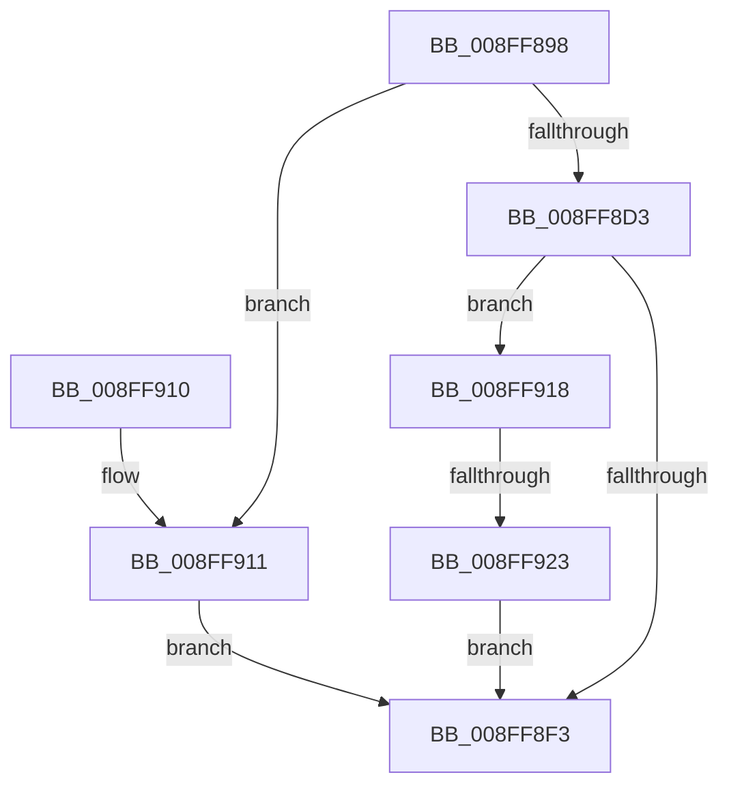

# _CmCreateDeviceContainerWorker

- RVA: `0x008FF898`–`0x008FF93C` (길이 `164` bytes)
- VA: `0x00000001408FF898`
- 실행 섹션: `PAGE`
- PDB 이름 있음: `예`; PDB Function 태그: `예`
- unwind 정보 RVA: `0x00088390`
- 디코드: `44`개 명령, `164/164` bytes 표시
- 미해석 바이트: `0` (있으면 어셈블리에 `.byte`로 보존)

> 이 문서는 커널 이미지의 기계어와 PDB 기호를 분석해 생성했습니다. 4번과 5번은 함수 원형과 자료형을 바이너리 사용 방식에서 추정한 C 해석이며 원본 소스 복구 결과는 아닙니다.

## 1. Dependencies

- 직접 호출 지점: **2**; 고유 호출 대상: **2**
- 직접 호출자로 확인된 함수: **1**
- RIP 상대 이미지 참조: **0**

### Outgoing calls
- `0x008FF8E8` → [_CmOpenDeviceContainerRegKey](_CmOpenDeviceContainerRegKey_function_008F5C80.md) (function, `0x008F5C80`)
- `0x008FF935` → [CmRaiseCreateEvent](CmRaiseCreateEvent_function_008FF944.md) (function, `0x008FF944`)

### Direct callers
- [CmCreateDeviceContainer](CmCreateDeviceContainer_function_008FF718.md) at `0x008FF7D5`

### Static image references
- 디코드된 RIP-relative 메모리 참조가 없습니다.

## 2. Other-region calls and transfers

- 다른 실행 섹션으로 향하는 call: **0**
- call이 아닌 외부 분기/꼬리 이동: **1**
  - `0x008FF91D` → [sub_00B1FFBE](../B1/Unknown_function_00B1FFBE.md) (`tail-transfer`)

## 3. Assembly (complete function range)

```asm
008FF898  4C 8B DC                        mov r11, rsp
008FF89B  49 89 5B 08                     mov qword ptr [r11 + 8], rbx
008FF89F  49 89 6B 10                     mov qword ptr [r11 + 0x10], rbp
008FF8A3  49 89 73 18                     mov qword ptr [r11 + 0x18], rsi
008FF8A7  49 89 7B 20                     mov qword ptr [r11 + 0x20], rdi
008FF8AB  41 56                           push r14
008FF8AD  48 83 EC 50                     sub rsp, 0x50
008FF8B1  83 64 24 40 00                  and dword ptr [rsp + 0x40], 0
008FF8B6  49 8B F1                        mov rsi, r9
008FF8B9  0F B7 84 24 88 00 00 00         movzx eax, word ptr [rsp + 0x88]
008FF8C1  48 8B EA                        mov rbp, rdx
008FF8C4  48 8B BC 24 80 00 00 00         mov rdi, qword ptr [rsp + 0x80]
008FF8CC  4C 8B F1                        mov r14, rcx
008FF8CF  85 C0                           test eax, eax
008FF8D1  75 3E                           jne 0x1408ff911
008FF8D3  49 8D 43 E8                     lea rax, [r11 - 0x18]
008FF8D7  49 89 43 E0                     mov qword ptr [r11 - 0x20], rax
008FF8DB  4D 89 4B D8                     mov qword ptr [r11 - 0x28], r9
008FF8DF  C6 44 24 28 01                  mov byte ptr [rsp + 0x28], 1
008FF8E4  45 89 43 C8                     mov dword ptr [r11 - 0x38], r8d
008FF8E8  E8 93 63 FF FF                  call 0x1408f5c80
008FF8ED  8B D8                           mov ebx, eax
008FF8EF  85 C0                           test eax, eax
008FF8F1  79 25                           jns 0x1408ff918
008FF8F3  48 8B 6C 24 68                  mov rbp, qword ptr [rsp + 0x68]
008FF8F8  8B C3                           mov eax, ebx
008FF8FA  48 8B 5C 24 60                  mov rbx, qword ptr [rsp + 0x60]
008FF8FF  48 8B 74 24 70                  mov rsi, qword ptr [rsp + 0x70]
008FF904  48 8B 7C 24 78                  mov rdi, qword ptr [rsp + 0x78]
008FF909  48 83 C4 50                     add rsp, 0x50
008FF90D  41 5E                           pop r14
008FF90F  C3                              ret
008FF910  CC                              int3
008FF911  BB 0D 00 00 C0                  mov ebx, 0xc000000d
008FF916  EB DB                           jmp 0x1408ff8f3
008FF918  83 7C 24 40 01                  cmp dword ptr [rsp + 0x40], 1
008FF91D  0F 85 9B 06 22 00               jne 0x140b1ffbe
008FF923  C6 07 01                        mov byte ptr [rdi], 1
008FF926  41 B8 05 00 00 00               mov r8d, 5
008FF92C  4C 8B 0E                        mov r9, qword ptr [rsi]
008FF92F  48 8B D5                        mov rdx, rbp
008FF932  49 8B CE                        mov rcx, r14
008FF935  E8 0A 00 00 00                  call 0x1408ff944
008FF93A  EB B7                           jmp 0x1408ff8f3
```

## 4. C-style interpretation (structured pseudocode)

```c
__int64 __fastcall _CmCreateDeviceContainerWorker(__int64 a1, __int64 a2, int a3, __int64 a4, __int64 a5, unsigned __int16 a6)
{
    __int64 result;
    __int64 v_rsp;
    unsigned int v_stack_m18;
    unsigned __int8 v_stack_m30;
    unsigned __int64 v_stack_p10;
    unsigned __int64 v_stack_p18;
    unsigned __int64 v_stack_p20;
    unsigned int v_stack_p40;
    unsigned __int64 v_stack_p8;

    *(unsigned __int64 *)(v_rsp + 8) = v_rbx;
    *(unsigned __int64 *)(v_rsp + 16) = v_rbp;
    *(unsigned __int64 *)(v_rsp + 24) = v_rsi;
    *(unsigned __int64 *)(v_rsp + 32) = v_rdi;
    v_rsp = (v_rsp) - (80);
    if (a6 != 0) goto loc_008FF911;
    *(unsigned __int64 *)(v_rsp - 32) = v_rsp - 24;
    *(unsigned __int64 *)(v_rsp - 40) = a4;
    v_stack_m30 = 1;
    *(unsigned int *)(v_rsp - 56) = a3;
    result = _CmOpenDeviceContainerRegKey(a1, a2, a3, a4);
    if (!sign_flag) goto loc_008FF918;
loc_008FF8F3:
    v_rsp = (v_rsp) + (80);
    return (unsigned int)((unsigned int)((unsigned int)((unsigned int)(result))));
loc_008FF911:
    goto loc_008FF8F3;
loc_008FF918:
    *(unsigned __int8 *)(v_stack_p20) = 1;
    result = CmRaiseCreateEvent(a1, v_stack_p10, 5, *(unsigned __int64 *)(v_stack_p18));
    goto loc_008FF8F3;
}
```

## 5. (Beta) C Style

```c
int64_t _CmCreateDeviceContainerWorker(int64_t Arg1, int64_t Arg2, int32_t Arg3, void *Arg4, void *Arg5, uint16_t Arg6)
{
    uint8_t *arg4 = (uint8_t *)Arg4;
    uint8_t *arg5 = (uint8_t *)Arg5;

    int64_t result;
    int64_t local_rsp;
    uint32_t v_stack_m18;
    uint8_t v_stack_m30;
    uint64_t v_stack_p10;
    uint64_t v_stack_p18;
    uint64_t v_stack_p20;
    uint32_t v_stack_p40;
    uint64_t v_stack_p8;

    *(uint64_t *)(local_rsp + 0x8) = local_rbx;
    *(uint64_t *)(local_rsp + 0x10) = local_rbp;
    *(uint64_t *)(local_rsp + 0x18) = local_rsi;
    *(uint64_t *)(local_rsp + 0x20) = local_rdi;
    local_rsp = (local_rsp) - (80);
    if (Arg6 != 0) goto loc_008FF911;
    *(uint64_t *)(local_rsp - 0x20) = local_rsp - 24;
    *(void **)(local_rsp - 0x28) = Arg4;
    v_stack_m30 = 1;
    *(uint32_t *)(local_rsp - 0x38) = Arg3;
    result = _CmOpenDeviceContainerRegKey(Arg1, Arg2, Arg3, Arg4);
    if (!sign_flag) goto loc_008FF918;
loc_008FF8F3:
    local_rsp = (local_rsp) + (80);
    return (uint32_t)((uint32_t)((uint32_t)((uint32_t)(result))));
loc_008FF911:
    goto loc_008FF8F3;
loc_008FF918:
    *(uint8_t *)(v_stack_p20) = 1;
    result = CmRaiseCreateEvent(Arg1, v_stack_p10, 5, *(uint64_t *)(v_stack_p18));
    goto loc_008FF8F3;
}
```

### 관측된 메모리 오프셋

구조체 형식이 확인되지 않은 접근은 인자 기준의 오프셋으로만 기록했습니다.

| 기준 인자 | 오프셋 표현 | 폭 (bit) | 접근 |
|---|---:|---:|---|
| `Arg4` | `+ 0x0` | `64` | `R` |
| `Arg5` | `+ 0x0` | `8` | `W` |

## 6. Execution-region graph

[열기: 2D/3D 그래프와 함수 탐색 컨트롤 패널](../../../control-panel.html?section=page&rva=0x008FF898&view=graph)

- 2D 그래프는 위에서 아래로 흐르고, 3D 그래프는 빈 공간을 드래그해 회전합니다. Shift+드래그는 이동, 휠은 확대·축소, 함수 노드 선택은 대상 보고서 이동입니다.

### Static fallback


