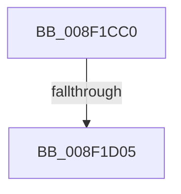

# _CmGetCommonClassRegKeyPath

- RVA: `0x008F1CC0`–`0x008F1D09` (길이 `73` bytes)
- VA: `0x00000001408F1CC0`
- 실행 섹션: `PAGE`
- PDB 이름 있음: `예`; PDB Function 태그: `예`
- unwind 정보 RVA: `0x000872B0`
- 디코드: `19`개 명령, `73/73` bytes 표시
- 미해석 바이트: `0` (있으면 어셈블리에 `.byte`로 보존)

> 이 문서는 커널 이미지의 기계어와 PDB 기호를 분석해 생성했습니다. 4번과 5번은 함수 원형과 자료형을 바이너리 사용 방식에서 추정한 C 해석이며 원본 소스 복구 결과는 아닙니다.

## 1. Dependencies

- 직접 호출 지점: **0**; 고유 호출 대상: **0**
- 직접 호출자로 확인된 함수: **3**
- RIP 상대 이미지 참조: **1**

### Outgoing calls
- 직접 디코드된 call 명령이 없습니다.

### Direct callers
- [CmDeleteCommonClassRegKeyWorker](../82/CmDeleteCommonClassRegKeyWorker_function_008298F8.md) at `0x0082998A`
- [_CmOpenCommonClassRegKeyWorker](_CmOpenCommonClassRegKeyWorker_function_008F0A1C.md) at `0x008F0AAE`
- [PiDqGetRelativeObjectRegPath](../99/PiDqGetRelativeObjectRegPath_function_00990B6C.md) at `0x00990CA3`

### Static image references
- `0x008F1CCF` → RVA `0x00E0A740` (`.data`; read)

## 2. Other-region calls and transfers

- 다른 실행 섹션으로 향하는 call: **0**
- call이 아닌 외부 분기/꼬리 이동: **1**
  - `0x008F1CFF` → [sub_008F1E98](Unknown_function_008F1E98.md) (`tail-transfer`)

## 3. Assembly (complete function range)

```asm
008F1CC0  40 53                           push rbx
008F1CC2  55                              push rbp
008F1CC3  57                              push rdi
008F1CC4  41 56                           push r14
008F1CC6  41 57                           push r15
008F1CC8  48 81 EC 80 00 00 00            sub rsp, 0x80
008F1CCF  48 8B 05 6A 8A 51 00            mov rax, qword ptr [rip + 0x518a6a]
008F1CD6  48 33 C4                        xor rax, rsp
008F1CD9  48 89 44 24 70                  mov qword ptr [rsp + 0x70], rax
008F1CDE  4C 8B BC 24 D8 00 00 00         mov r15, qword ptr [rsp + 0xd8]
008F1CE6  41 8B C0                        mov eax, r8d
008F1CE9  4C 8B B4 24 E8 00 00 00         mov r14, qword ptr [rsp + 0xe8]
008F1CF1  83 E0 60                        and eax, 0x60
008F1CF4  41 8B E9                        mov ebp, r9d
008F1CF7  41 8B F8                        mov edi, r8d
008F1CFA  48 8B DA                        mov rbx, rdx
008F1CFD  3C 60                           cmp al, 0x60
008F1CFF  0F 84 93 01 00 00               je 0x1408f1e98
008F1D05  40 0F B6 C7                     movzx eax, dil
```

## 4. C-style interpretation (structured pseudocode)

```c
__int64 __fastcall _CmGetCommonClassRegKeyPath(__int64 a1, __int64 a2, int a3, int a4, __int64 a5, __int64 a6, __int64 a7, __int64 a8)
{
    __int64 result;
    __int64 v_rsp;
    unsigned __int64 v_stack_m38;

    v_rsp = (v_rsp) - (128);
    result = (*(unsigned __int64 *)(v_rip + 5343850)) ^ (v_rsp);
    v_stack_m38 = result;
    result = (unsigned int)(((unsigned int)(a3)) & (96));
    return (unsigned __int8)((unsigned int)(a3));
}
```

## 5. (Beta) C Style

```c
int64_t _CmGetCommonClassRegKeyPath(int64_t Arg1, int64_t Arg2, int32_t Arg3, int32_t Arg4, uint64_t Arg5, int64_t Arg6, uint64_t Arg7, int64_t Arg8)
{
    int64_t result;
    int64_t local_rsp;
    uint64_t v_stack_m38;

    local_rsp = (local_rsp) - (128);
    result = (*(uint64_t *)(v_rip + 0x518A6A)) ^ (local_rsp);
    v_stack_m38 = result;
    result = (uint32_t)(((uint32_t)(Arg3)) & (96));
    return (uint8_t)((uint32_t)(Arg3));
}
```

## 6. Execution-region graph

[열기: 2D/3D 그래프와 함수 탐색 컨트롤 패널](../../../control-panel.html?section=page&rva=0x008F1CC0&view=graph)

- 2D 그래프는 위에서 아래로 흐르고, 3D 그래프는 빈 공간을 드래그해 회전합니다. Shift+드래그는 이동, 휠은 확대·축소, 함수 노드 선택은 대상 보고서 이동입니다.

### Static fallback


