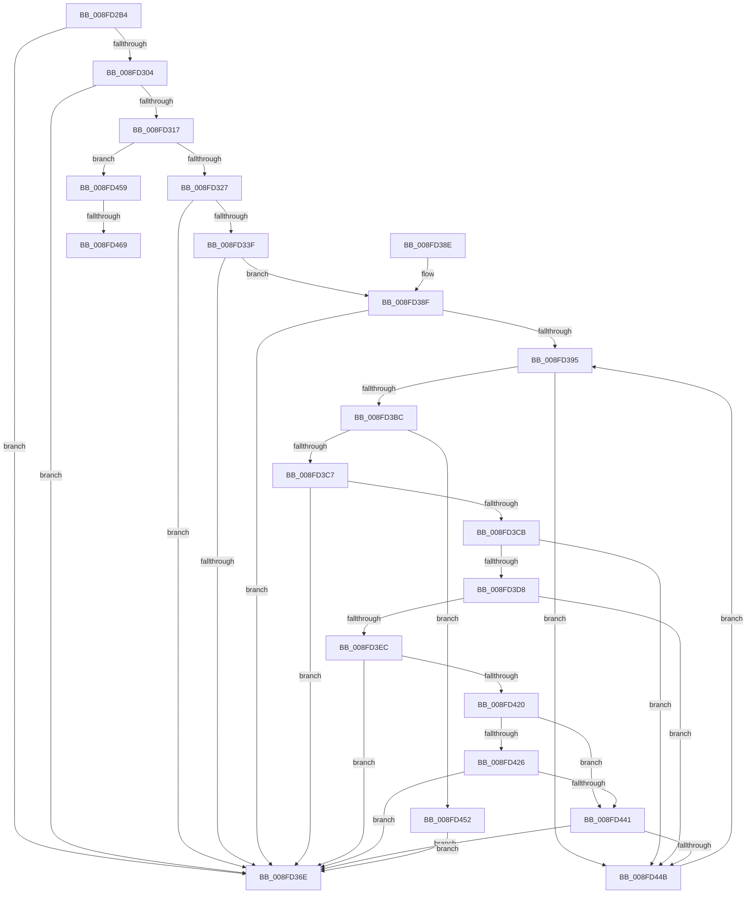

# _CmGetDeviceContainerIdFromBase

- RVA: `0x008FD2B4`–`0x008FD472` (길이 `446` bytes)
- VA: `0x00000001408FD2B4`
- 실행 섹션: `PAGE`
- PDB 이름 있음: `예`; PDB Function 태그: `예`
- unwind 정보 RVA: `0x000880B4`
- 디코드: `126`개 명령, `446/446` bytes 표시
- 미해석 바이트: `0` (있으면 어셈블리에 `.byte`로 보존)

> 이 문서는 커널 이미지의 기계어와 PDB 기호를 분석해 생성했습니다. 4번과 5번은 함수 원형과 자료형을 바이너리 사용 방식에서 추정한 C 해석이며 원본 소스 복구 결과는 아닙니다.

## 1. Dependencies

- 직접 호출 지점: **10**; 고유 호출 대상: **7**
- 직접 호출자로 확인된 함수: **4**
- RIP 상대 이미지 참조: **2**

### Outgoing calls
- `0x008FD2F9` → [RtlStringCchCopyW](../../text/26/RtlStringCchCopyW_function_0026E9A4.md) (function, `0x0026E9A4`)
- `0x008FD30E` → [wcscmp](../../text/50/wcscmp_function_00501AF0.md) (function, `0x00501AF0`)
- `0x008FD334` → [_PnpCtxGetCachedNodeBaseKey](../8E/_PnpCtxGetCachedNodeBaseKey_function_008EF9C0.md) (function, `0x008EF9C0`)
- `0x008FD363` → [CmIsDeviceInContainer](CmIsDeviceInContainer_function_008FDC44.md) (function, `0x008FDC44`)
- `0x008FD377` → [_security_check_cookie](../../text/6A/_security_check_cookie_function_006AC640.md) (function, `0x006AC640`)
- `0x008FD3AA` → [RegRtlEnumKey](../99/RegRtlEnumKey_function_00992C00.md) (function, `0x00992C00`)
- `0x008FD3CF` → [PnpIsValidGuidString](PnpIsValidGuidString_function_008F37F8.md) (function, `0x008F37F8`)
- `0x008FD3E3` → [wcscmp](../../text/50/wcscmp_function_00501AF0.md) (function, `0x00501AF0`)
- `0x008FD411` → [CmIsDeviceInContainer](CmIsDeviceInContainer_function_008FDC44.md) (function, `0x008FDC44`)
- `0x008FD432` → [RtlStringCchCopyW](../../text/26/RtlStringCchCopyW_function_0026E9A4.md) (function, `0x0026E9A4`)

### Direct callers
- [PiDcUpdateDeviceContainerMembership](PiDcUpdateDeviceContainerMembership_function_008FD0A8.md) at `0x008FD165`
- [PiDcUpdateDeviceContainerMembership](PiDcUpdateDeviceContainerMembership_function_008FD0A8.md) at `0x008FD260`
- [_CmGetDeviceMappedPropertyFromComposite](../9D/_CmGetDeviceMappedPropertyFromComposite_function_009D1684.md) at `0x009D2961`
- [_CmDeleteDeviceWorker](../A0/_CmDeleteDeviceWorker_function_00A08F48.md) at `0x00A0932D`
- [sub_00B266CA](../B2/Unknown_function_00B266CA.md) at `0x00B267B0`
- [sub_00B266CA](../B2/Unknown_function_00B266CA.md) at `0x00B26890`

### Static image references
- `0x008FD2CB` → RVA `0x00E0A740` (`.data`; read)
- `0x008FD307` → RVA `0x00AFDCF0` (` ?? ::NNGAKEGL::`string'`; read)

## 2. Other-region calls and transfers

- 다른 실행 섹션으로 향하는 call: **5**
  - `0x008FD2F9` → [RtlStringCchCopyW](../../text/26/RtlStringCchCopyW_function_0026E9A4.md) (`PAGE` → `.text`)
  - `0x008FD30E` → [wcscmp](../../text/50/wcscmp_function_00501AF0.md) (`PAGE` → `.text`)
  - `0x008FD377` → [_security_check_cookie](../../text/6A/_security_check_cookie_function_006AC640.md) (`PAGE` → `.text`)
  - `0x008FD3E3` → [wcscmp](../../text/50/wcscmp_function_00501AF0.md) (`PAGE` → `.text`)
  - `0x008FD432` → [RtlStringCchCopyW](../../text/26/RtlStringCchCopyW_function_0026E9A4.md) (`PAGE` → `.text`)
- call이 아닌 외부 분기/꼬리 이동: **2**
  - `0x008FD463` → [sub_00B1FCFC](../B1/Unknown_function_00B1FCFC.md) (`tail-transfer`)
  - `0x008FD46D` → [sub_00B1FCFC + 0x4](../B1/Unknown_function_00B1FCFC.md) (`tail-transfer`)

## 3. Assembly (complete function range)

```asm
008FD2B4  40 55                           push rbp
008FD2B6  53                              push rbx
008FD2B7  56                              push rsi
008FD2B8  57                              push rdi
008FD2B9  41 54                           push r12
008FD2BB  41 55                           push r13
008FD2BD  41 56                           push r14
008FD2BF  48 8D 6C 24 E1                  lea rbp, [rsp - 0x1f]
008FD2C4  48 81 EC B0 00 00 00            sub rsp, 0xb0
008FD2CB  48 8B 05 6E D4 50 00            mov rax, qword ptr [rip + 0x50d46e]
008FD2D2  48 33 C4                        xor rax, rsp
008FD2D5  48 89 45 0F                     mov qword ptr [rbp + 0xf], rax
008FD2D9  33 F6                           xor esi, esi
008FD2DB  4C 8B E2                        mov r12, rdx
008FD2DE  48 8B F9                        mov rdi, rcx
008FD2E1  48 89 75 B7                     mov qword ptr [rbp - 0x49], rsi
008FD2E5  49 8B C9                        mov rcx, r9
008FD2E8  40 88 75 B0                     mov byte ptr [rbp - 0x50], sil
008FD2EC  4D 8B E9                        mov r13, r9
008FD2EF  40 88 75 AF                     mov byte ptr [rbp - 0x51], sil
008FD2F3  8D 56 27                        lea edx, [rsi + 0x27]
008FD2F6  4D 8B F0                        mov r14, r8
008FD2F9  E8 A6 16 97 FF                  call 0x14026e9a4
008FD2FE  8B D8                           mov ebx, eax
008FD300  85 C0                           test eax, eax
008FD302  78 6A                           js 0x1408fd36e
008FD304  49 8B D6                        mov rdx, r14
008FD307  48 8D 0D E2 09 20 00            lea rcx, [rip + 0x2009e2]
008FD30E  E8 DD 47 C0 FF                  call 0x140501af0
008FD313  85 C0                           test eax, eax
008FD315  74 57                           je 0x1408fd36e
008FD317  48 8B 97 B0 00 00 00            mov rdx, qword ptr [rdi + 0xb0]
008FD31E  48 85 D2                        test rdx, rdx
008FD321  0F 84 32 01 00 00               je 0x1408fd459
008FD327  4C 8D 4D B7                     lea r9, [rbp - 0x49]
008FD32B  41 B8 0A 00 00 00               mov r8d, 0xa
008FD331  48 8B CF                        mov rcx, rdi
008FD334  E8 87 26 FF FF                  call 0x1408ef9c0
008FD339  8B D8                           mov ebx, eax
008FD33B  85 C0                           test eax, eax
008FD33D  78 2F                           js 0x1408fd36e
008FD33F  48 8B 55 B7                     mov rdx, qword ptr [rbp - 0x49]
008FD343  48 8D 45 AF                     lea rax, [rbp - 0x51]
008FD347  48 89 44 24 30                  mov qword ptr [rsp + 0x30], rax
008FD34C  4D 8B CE                        mov r9, r14
008FD34F  48 8D 45 B0                     lea rax, [rbp - 0x50]
008FD353  4D 8B C6                        mov r8, r14
008FD356  48 89 44 24 28                  mov qword ptr [rsp + 0x28], rax
008FD35B  48 8B CF                        mov rcx, rdi
008FD35E  4C 89 64 24 20                  mov qword ptr [rsp + 0x20], r12
008FD363  E8 DC 08 00 00                  call 0x1408fdc44
008FD368  8B D8                           mov ebx, eax
008FD36A  85 C0                           test eax, eax
008FD36C  79 21                           jns 0x1408fd38f
008FD36E  8B C3                           mov eax, ebx
008FD370  48 8B 4D 0F                     mov rcx, qword ptr [rbp + 0xf]
008FD374  48 33 CC                        xor rcx, rsp
008FD377  E8 C4 F2 DA FF                  call 0x1406ac640
008FD37C  48 81 C4 B0 00 00 00            add rsp, 0xb0
008FD383  41 5E                           pop r14
008FD385  41 5D                           pop r13
008FD387  41 5C                           pop r12
008FD389  5F                              pop rdi
008FD38A  5E                              pop rsi
008FD38B  5B                              pop rbx
008FD38C  5D                              pop rbp
008FD38D  C3                              ret
008FD38E  CC                              int3
008FD38F  40 38 75 AF                     cmp byte ptr [rbp - 0x51], sil
008FD393  75 D9                           jne 0x1408fd36e
008FD395  48 8B 4D B7                     mov rcx, qword ptr [rbp - 0x49]
008FD399  4C 8D 4D B3                     lea r9, [rbp - 0x4d]
008FD39D  4C 8D 45 BF                     lea r8, [rbp - 0x41]
008FD3A1  C7 45 B3 27 00 00 00            mov dword ptr [rbp - 0x4d], 0x27
008FD3A8  8B D6                           mov edx, esi
008FD3AA  E8 51 58 09 00                  call 0x140992c00
008FD3AF  8B D8                           mov ebx, eax
008FD3B1  3D 23 00 00 C0                  cmp eax, 0xc0000023
008FD3B6  0F 84 8F 00 00 00               je 0x1408fd44b
008FD3BC  3D 1A 00 00 80                  cmp eax, 0x8000001a
008FD3C1  0F 84 8B 00 00 00               je 0x1408fd452
008FD3C7  85 C0                           test eax, eax
008FD3C9  78 A3                           js 0x1408fd36e
008FD3CB  48 8D 4D BF                     lea rcx, [rbp - 0x41]
008FD3CF  E8 24 64 FF FF                  call 0x1408f37f8
008FD3D4  84 C0                           test al, al
008FD3D6  74 73                           je 0x1408fd44b
008FD3D8  48 8D 55 BF                     lea rdx, [rbp - 0x41]
008FD3DC  48 8D 0D 0D 09 20 00            lea rcx, [rip + 0x20090d]
008FD3E3  E8 08 47 C0 FF                  call 0x140501af0
008FD3E8  85 C0                           test eax, eax
008FD3EA  74 5F                           je 0x1408fd44b
008FD3EC  48 8B 55 B7                     mov rdx, qword ptr [rbp - 0x49]
008FD3F0  48 8D 45 AF                     lea rax, [rbp - 0x51]
008FD3F4  48 89 44 24 30                  mov qword ptr [rsp + 0x30], rax
008FD3F9  4C 8D 45 BF                     lea r8, [rbp - 0x41]
008FD3FD  48 8D 45 B0                     lea rax, [rbp - 0x50]
008FD401  4D 8B CE                        mov r9, r14
008FD404  48 89 44 24 28                  mov qword ptr [rsp + 0x28], rax
008FD409  48 8B CF                        mov rcx, rdi
008FD40C  4C 89 64 24 20                  mov qword ptr [rsp + 0x20], r12
008FD411  E8 2E 08 00 00                  call 0x1408fdc44
008FD416  8B D8                           mov ebx, eax
008FD418  85 C0                           test eax, eax
008FD41A  0F 88 4E FF FF FF               js 0x1408fd36e
008FD420  80 7D B0 00                     cmp byte ptr [rbp - 0x50], 0
008FD424  74 1B                           je 0x1408fd441
008FD426  4C 8D 45 BF                     lea r8, [rbp - 0x41]
008FD42A  BA 27 00 00 00                  mov edx, 0x27
008FD42F  49 8B CD                        mov rcx, r13
008FD432  E8 6D 15 97 FF                  call 0x14026e9a4
008FD437  8B D8                           mov ebx, eax
008FD439  85 C0                           test eax, eax
008FD43B  0F 88 2D FF FF FF               js 0x1408fd36e
008FD441  80 7D AF 00                     cmp byte ptr [rbp - 0x51], 0
008FD445  0F 85 23 FF FF FF               jne 0x1408fd36e
008FD44B  FF C6                           inc esi
008FD44D  E9 43 FF FF FF                  jmp 0x1408fd395
008FD452  33 DB                           xor ebx, ebx
008FD454  E9 15 FF FF FF                  jmp 0x1408fd36e
008FD459  48 8D 47 38                     lea rax, [rdi + 0x38]
008FD45D  48 8B 10                        mov rdx, qword ptr [rax]
008FD460  48 3B D0                        cmp rdx, rax
008FD463  0F 85 93 28 22 00               jne 0x140b1fcfc
008FD469  48 8B 57 58                     mov rdx, qword ptr [rdi + 0x58]
008FD46D  E9 8E 28 22 00                  jmp 0x140b1fd00
```

## 4. C-style interpretation (structured pseudocode)

```c
__int64 __fastcall _CmGetDeviceContainerIdFromBase(__int64 a1, __int64 a2, __int64 a3, __int64 a4)
{
    __int64 result;
    __int64 v_rbx;
    __int64 v_rsi;
    __int64 v_rsp;
    unsigned __int64 v_stack_m48;
    unsigned __int64 v_stack_m57;
    unsigned __int64 v_stack_m98;
    unsigned __int64 v_stack_mA0;
    unsigned __int64 v_stack_mA4;
    unsigned __int8 v_stack_mA7;
    unsigned __int8 v_stack_mA8;
    unsigned __int64 v_stack_mB8;
    unsigned __int64 v_stack_mC0;
    unsigned __int64 v_stack_mC8;
    unsigned __int64 v_stack_p20;
    unsigned __int64 v_stack_p28;
    unsigned __int64 v_stack_p30;

    v_rsp = (v_rsp) - (176);
    result = (*(unsigned __int64 *)(v_rip + 5297262)) ^ (v_rsp);
    v_stack_m48 = result;
    v_rsi = 0;
    v_stack_mA0 = 0;
    v_stack_mA7 = 0;
    v_stack_mA8 = 0;
    result = RtlStringCchCopyW(a4, v_rsi + 39, a3, a4);
    if (sign_flag) goto loc_008FD36E;
    result = wcscmp(v_rip + 2099682, a3, a3, a4);
    if ((unsigned int)(result) == 0) goto loc_008FD36E;
    if (*(unsigned __int64 *)(a1 + 176) == 0) goto loc_008FD459;
    result = _PnpCtxGetCachedNodeBaseKey(a1, *(unsigned __int64 *)(a1 + 176), 10, v_stack_mA0);
    if (sign_flag) goto loc_008FD36E;
    v_stack_mB8 = v_stack_mA8;
    v_stack_mC0 = v_stack_mA7;
    v_stack_mC8 = a2;
    result = CmIsDeviceInContainer(a1, v_stack_mA0, a3, a3);
    if (!sign_flag) goto loc_008FD38F;
loc_008FD36E:
    a1 = (v_stack_m48) ^ (v_rsp);
    result = _security_check_cookie(a1, v_stack_mA0, a3, a3);
    v_rsp = (v_rsp) + (176);
    return result;
loc_008FD38F:
    if (v_stack_mA8 != 0) goto loc_008FD36E;
loc_008FD395:
    v_stack_mA4 = 39;
    result = RegRtlEnumKey(v_stack_mA0, 0, v_stack_m98, v_stack_mA4);
    if (((unsigned int)(result)) == 0xC0000023ULL) goto loc_008FD44B;
    if (((unsigned int)(result)) == 0x8000001AULL) goto loc_008FD452;
    if (sign_flag) goto loc_008FD36E;
    result = PnpIsValidGuidString(v_stack_m98, 0, v_stack_m98, v_stack_mA4);
    if ((unsigned __int8)(result) == 0) goto loc_008FD44B;
    result = wcscmp(v_rip + 2099469, v_stack_m98, v_stack_m98, v_stack_mA4);
    if ((unsigned int)(result) == 0) goto loc_008FD44B;
    v_stack_p30 = v_stack_mA8;
    v_stack_p28 = v_stack_mA7;
    v_stack_p20 = a2;
    result = CmIsDeviceInContainer(a1, v_stack_mA0, v_stack_m98, a3);
    if (sign_flag) goto loc_008FD36E;
    if (v_stack_mA7 == 0) goto loc_008FD441;
    result = RtlStringCchCopyW(a4, 39, v_stack_m98, a3);
    if (sign_flag) goto loc_008FD36E;
loc_008FD441:
    if (v_stack_mA8 != 0) goto loc_008FD36E;
loc_008FD44B:
    v_rsi = (unsigned int)((v_rsi) + 1);
    goto loc_008FD395;
loc_008FD452:
    v_rbx = 0;
    goto loc_008FD36E;
loc_008FD459:
}
```

## 5. (Beta) C Style

```c
int64_t _CmGetDeviceContainerIdFromBase(void *Arg1, int64_t Arg2, int64_t Arg3, int64_t Arg4)
{
    uint8_t *arg1 = (uint8_t *)Arg1;

    int64_t result;
    int64_t local_rbx;
    int64_t local_rsi;
    int64_t local_rsp;
    uint64_t v_stack_m48;
    uint64_t v_stack_m57;
    uint64_t v_stack_m98;
    uint64_t v_stack_mA0;
    uint64_t v_stack_mA4;
    uint8_t v_stack_mA7;
    uint8_t v_stack_mA8;
    uint64_t v_stack_mB8;
    uint64_t v_stack_mC0;
    uint64_t v_stack_mC8;
    uint64_t v_stack_p20;
    uint64_t v_stack_p28;
    uint64_t v_stack_p30;

    local_rsp = (local_rsp) - (176);
    result = (*(uint64_t *)(v_rip + 0x50D46E)) ^ (local_rsp);
    v_stack_m48 = result;
    local_rsi = 0;
    v_stack_mA0 = 0;
    v_stack_mA7 = 0;
    v_stack_mA8 = 0;
    result = RtlStringCchCopyW(Arg4, local_rsi + 39, Arg3, Arg4);
    if (sign_flag) goto loc_008FD36E;
    result = wcscmp(v_rip + 2099682, Arg3, Arg3, Arg4);
    if ((uint32_t)(result) == 0) goto loc_008FD36E;
    if (*(uint64_t *)(arg1 + 0xB0) == 0) goto loc_008FD459;
    result = _PnpCtxGetCachedNodeBaseKey(Arg1, *(uint64_t *)(arg1 + 0xB0), 10, v_stack_mA0);
    if (sign_flag) goto loc_008FD36E;
    v_stack_mB8 = v_stack_mA8;
    v_stack_mC0 = v_stack_mA7;
    v_stack_mC8 = Arg2;
    result = CmIsDeviceInContainer(Arg1, v_stack_mA0, Arg3, Arg3);
    if (!sign_flag) goto loc_008FD38F;
loc_008FD36E:
    Arg1 = (v_stack_m48) ^ (local_rsp);
    result = _security_check_cookie(Arg1, v_stack_mA0, Arg3, Arg3);
    local_rsp = (local_rsp) + (176);
    return result;
loc_008FD38F:
    if (v_stack_mA8 != 0) goto loc_008FD36E;
loc_008FD395:
    v_stack_mA4 = 39;
    result = RegRtlEnumKey(v_stack_mA0, 0, v_stack_m98, v_stack_mA4);
    if (((uint32_t)(result)) == 0xC0000023ULL) goto loc_008FD44B;
    if (((uint32_t)(result)) == 0x8000001AULL) goto loc_008FD452;
    if (sign_flag) goto loc_008FD36E;
    result = PnpIsValidGuidString(v_stack_m98, 0, v_stack_m98, v_stack_mA4);
    if ((uint8_t)(result) == 0) goto loc_008FD44B;
    result = wcscmp(v_rip + 2099469, v_stack_m98, v_stack_m98, v_stack_mA4);
    if ((uint32_t)(result) == 0) goto loc_008FD44B;
    v_stack_p30 = v_stack_mA8;
    v_stack_p28 = v_stack_mA7;
    v_stack_p20 = Arg2;
    result = CmIsDeviceInContainer(Arg1, v_stack_mA0, v_stack_m98, Arg3);
    if (sign_flag) goto loc_008FD36E;
    if (v_stack_mA7 == 0) goto loc_008FD441;
    result = RtlStringCchCopyW(Arg4, 39, v_stack_m98, Arg3);
    if (sign_flag) goto loc_008FD36E;
loc_008FD441:
    if (v_stack_mA8 != 0) goto loc_008FD36E;
loc_008FD44B:
    local_rsi = (uint32_t)((local_rsi) + 1);
    goto loc_008FD395;
loc_008FD452:
    local_rbx = 0;
    goto loc_008FD36E;
loc_008FD459:
}
```

### 관측된 메모리 오프셋

구조체 형식이 확인되지 않은 접근은 인자 기준의 오프셋으로만 기록했습니다.

| 기준 인자 | 오프셋 표현 | 폭 (bit) | 접근 |
|---|---:|---:|---|
| `Arg1` | `+ 0x0` | `64` | `R` |
| `Arg1` | `+ 0x38` | `64` | `R` |
| `Arg1` | `+ 0x58` | `64` | `R` |
| `Arg1` | `+ 0xB0` | `64` | `R` |

## 6. Execution-region graph

[열기: 2D/3D 그래프와 함수 탐색 컨트롤 패널](../../../control-panel.html?section=page&rva=0x008FD2B4&view=graph)

- 2D 그래프는 위에서 아래로 흐르고, 3D 그래프는 빈 공간을 드래그해 회전합니다. Shift+드래그는 이동, 휠은 확대·축소, 함수 노드 선택은 대상 보고서 이동입니다.

### Static fallback


