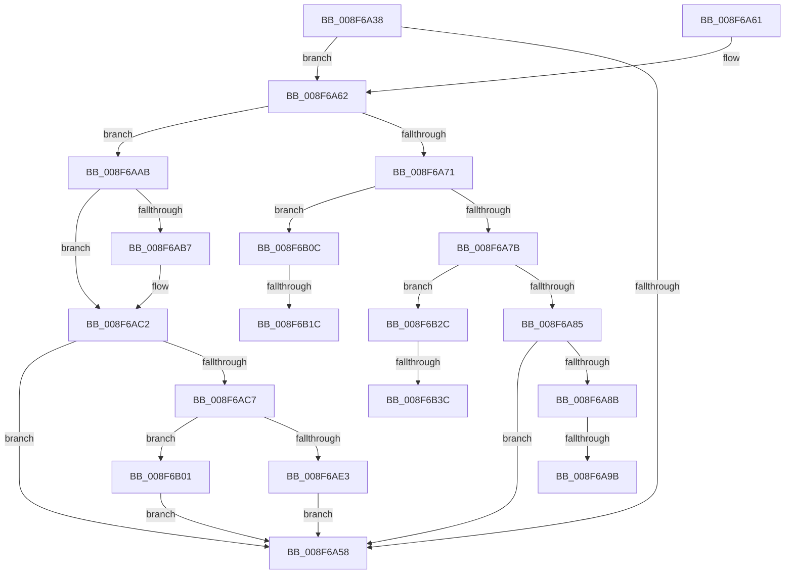

# _CmGetDeviceContainerMappedProperty

- RVA: `0x008F6A38`–`0x008F6B4C` (길이 `276` bytes)
- VA: `0x00000001408F6A38`
- 실행 섹션: `PAGE`
- PDB 이름 있음: `예`; PDB Function 태그: `예`
- unwind 정보 RVA: `0x0008799C`
- 디코드: `63`개 명령, `276/276` bytes 표시
- 미해석 바이트: `0` (있으면 어셈블리에 `.byte`로 보존)

> 이 문서는 커널 이미지의 기계어와 PDB 기호를 분석해 생성했습니다. 4번과 5번은 함수 원형과 자료형을 바이너리 사용 방식에서 추정한 C 해석이며 원본 소스 복구 결과는 아닙니다.

## 1. Dependencies

- 직접 호출 지점: **1**; 고유 호출 대상: **1**
- 직접 호출자로 확인된 함수: **1**
- RIP 상대 이미지 참조: **8**

### Outgoing calls
- `0x008F6AE6` → [CmIsLocalMachineContainer](../A8/CmIsLocalMachineContainer_function_00A8EA34.md) (function, `0x00A8EA34`)

### Direct callers
- [_PnpDispatchDeviceContainer](_PnpDispatchDeviceContainer_function_008F6880.md) at `0x008F6925`

### Static image references
- `0x008F6A8E` → RVA `0x0001E160` (`.rdata`; read)
- `0x008F6A9F` → RVA `0x0001E168` (`.rdata`; read)
- `0x008F6AAE` → RVA `0x000115D0` (`.rdata`; read)
- `0x008F6ABB` → RVA `0x000115D8` (`.rdata`; read)
- `0x008F6B0F` → RVA `0x0001E148` (`.rdata`; read)
- `0x008F6B20` → RVA `0x0001E150` (`.rdata`; read)
- `0x008F6B2F` → RVA `0x0001A660` (`.rdata`; read)
- `0x008F6B40` → RVA `0x0001A668` (`.rdata`; read)

## 2. Other-region calls and transfers

- 다른 실행 섹션으로 향하는 call: **0**
- call이 아닌 외부 분기/꼬리 이동: **6**
  - `0x008F6A95` → [sub_00B1EF30 + 0x24](../B1/Unknown_function_00B1EF30.md) (`tail-transfer`)
  - `0x008F6AA6` → [sub_00B1EF30 + 0x24](../B1/Unknown_function_00B1EF30.md) (`tail-transfer`)
  - `0x008F6B16` → [sub_00B1EF30](../B1/Unknown_function_00B1EF30.md) (`tail-transfer`)
  - `0x008F6B27` → [sub_00B1EF30](../B1/Unknown_function_00B1EF30.md) (`tail-transfer`)
  - `0x008F6B36` → [sub_00B1EF30 + 0x12](../B1/Unknown_function_00B1EF30.md) (`tail-transfer`)
  - `0x008F6B47` → [sub_00B1EF30 + 0x12](../B1/Unknown_function_00B1EF30.md) (`tail-transfer`)

## 3. Assembly (complete function range)

```asm
008F6A38  40 53                           push rbx
008F6A3A  48 83 EC 40                     sub rsp, 0x40
008F6A3E  4C 8B 9C 24 90 00 00 00         mov r11, qword ptr [rsp + 0x90]
008F6A46  48 8B D9                        mov rbx, rcx
008F6A49  41 BA 16 00 00 C0               mov r10d, 0xc0000016
008F6A4F  41 83 23 00                     and dword ptr [r11], 0
008F6A53  4D 85 C9                        test r9, r9
008F6A56  74 0A                           je 0x1408f6a62
008F6A58  41 8B C2                        mov eax, r10d
008F6A5B  48 83 C4 40                     add rsp, 0x40
008F6A5F  5B                              pop rbx
008F6A60  C3                              ret
008F6A61  CC                              int3
008F6A62  48 8B 44 24 70                  mov rax, qword ptr [rsp + 0x70]
008F6A67  44 8B 48 10                     mov r9d, dword ptr [rax + 0x10]
008F6A6B  41 83 F9 46                     cmp r9d, 0x46
008F6A6F  74 3A                           je 0x1408f6aab
008F6A71  41 83 F9 53                     cmp r9d, 0x53
008F6A75  0F 84 91 00 00 00               je 0x1408f6b0c
008F6A7B  41 83 F9 37                     cmp r9d, 0x37
008F6A7F  0F 84 A7 00 00 00               je 0x1408f6b2c
008F6A85  41 83 F9 6C                     cmp r9d, 0x6c
008F6A89  75 CD                           jne 0x1408f6a58
008F6A8B  48 8B 08                        mov rcx, qword ptr [rax]
008F6A8E  48 2B 0D CB 76 72 FF            sub rcx, qword ptr [rip - 0x8d8935]
008F6A95  0F 85 B9 84 22 00               jne 0x140b1ef54
008F6A9B  48 8B 48 08                     mov rcx, qword ptr [rax + 8]
008F6A9F  48 2B 0D C2 76 72 FF            sub rcx, qword ptr [rip - 0x8d893e]
008F6AA6  E9 A9 84 22 00                  jmp 0x140b1ef54
008F6AAB  48 8B 08                        mov rcx, qword ptr [rax]
008F6AAE  48 2B 0D 1B AB 71 FF            sub rcx, qword ptr [rip - 0x8e54e5]
008F6AB5  75 0B                           jne 0x1408f6ac2
008F6AB7  48 8B 48 08                     mov rcx, qword ptr [rax + 8]
008F6ABB  48 2B 0D 16 AB 71 FF            sub rcx, qword ptr [rip - 0x8e54ea]
008F6AC2  48 85 C9                        test rcx, rcx
008F6AC5  75 91                           jne 0x1408f6a58
008F6AC7  83 BC 24 88 00 00 00 01         cmp dword ptr [rsp + 0x88], 1
008F6ACF  48 8B 44 24 78                  mov rax, qword ptr [rsp + 0x78]
008F6AD4  C7 00 11 00 00 00               mov dword ptr [rax], 0x11
008F6ADA  41 C7 03 01 00 00 00            mov dword ptr [r11], 1
008F6AE1  72 1E                           jb 0x1408f6b01
008F6AE3  48 8B CB                        mov rcx, rbx
008F6AE6  E8 49 7F 19 00                  call 0x140a8ea34
008F6AEB  F6 D8                           neg al
008F6AED  48 8B 84 24 80 00 00 00         mov rax, qword ptr [rsp + 0x80]
008F6AF5  1A C9                           sbb cl, cl
008F6AF7  45 33 D2                        xor r10d, r10d
008F6AFA  88 08                           mov byte ptr [rax], cl
008F6AFC  E9 57 FF FF FF                  jmp 0x1408f6a58
008F6B01  41 BA 23 00 00 C0               mov r10d, 0xc0000023
008F6B07  E9 4C FF FF FF                  jmp 0x1408f6a58
008F6B0C  48 8B 08                        mov rcx, qword ptr [rax]
008F6B0F  48 2B 0D 32 76 72 FF            sub rcx, qword ptr [rip - 0x8d89ce]
008F6B16  0F 85 14 84 22 00               jne 0x140b1ef30
008F6B1C  48 8B 48 08                     mov rcx, qword ptr [rax + 8]
008F6B20  48 2B 0D 29 76 72 FF            sub rcx, qword ptr [rip - 0x8d89d7]
008F6B27  E9 04 84 22 00                  jmp 0x140b1ef30
008F6B2C  48 8B 08                        mov rcx, qword ptr [rax]
008F6B2F  48 2B 0D 2A 3B 72 FF            sub rcx, qword ptr [rip - 0x8dc4d6]
008F6B36  0F 85 06 84 22 00               jne 0x140b1ef42
008F6B3C  48 8B 48 08                     mov rcx, qword ptr [rax + 8]
008F6B40  48 2B 0D 21 3B 72 FF            sub rcx, qword ptr [rip - 0x8dc4df]
008F6B47  E9 F6 83 22 00                  jmp 0x140b1ef42
```

## 4. C-style interpretation (structured pseudocode)

```c
__int64 __fastcall _CmGetDeviceContainerMappedProperty(__int64 a1, __int64 a2, __int64 a3, __int64 a4, __int64 a5, __int64 a6, __int64 a7, unsigned int a8, __int64 a9)
{
    __int64 result;
    __int64 v_r10;
    __int64 v_rsp;

    v_rsp = (v_rsp) - (64);
    if (a4 == 0) goto loc_008F6A62;
loc_008F6A58:
    v_rsp = (v_rsp) + (64);
    return (unsigned int)((unsigned int)((unsigned int)(0xC0000016ULL)));
loc_008F6A62:
    if (((unsigned int)((unsigned int)(*(unsigned int *)(a5 + 16)))) == 70) goto loc_008F6AAB;
    if (((unsigned int)((unsigned int)(*(unsigned int *)(a5 + 16)))) == 83) goto loc_008F6B0C;
    if (((unsigned int)((unsigned int)(*(unsigned int *)(a5 + 16)))) == 55) goto loc_008F6B2C;
    if (((unsigned int)((unsigned int)(*(unsigned int *)(a5 + 16)))) != 108) goto loc_008F6A58;
    a1 = (*(unsigned __int64 *)(a5)) - (*(unsigned __int64 *)(v_rip - 9275701));
    a1 = (*(unsigned __int64 *)(a5 + 8)) - (*(unsigned __int64 *)(v_rip - 9275710));
loc_008F6AAB:
    a1 = (*(unsigned __int64 *)(a5)) - (*(unsigned __int64 *)(v_rip - 9327845));
    if (!(condition_is_not_equal)) {
        a1 = *(unsigned __int64 *)(a5 + 8);
        a1 = (a1) - (*(unsigned __int64 *)(v_rip - 9327850));
    }
    if (a1 != 0) goto loc_008F6A58;
    *(unsigned int *)(a6) = 17;
    *(unsigned int *)(a9) = 1;
    if (a8 < 1) goto loc_008F6B01;
    result = CmIsLocalMachineContainer(a1, a2, a3, (unsigned int)(*(unsigned int *)(a5 + 16)));
    result = (unsigned __int8)(-(result));
    v_r10 = 0;
    *(unsigned __int8 *)(a7) = (unsigned __int8)(a1);
    goto loc_008F6A58;
loc_008F6B01:
    goto loc_008F6A58;
loc_008F6B0C:
    a1 = (*(unsigned __int64 *)(a7)) - (*(unsigned __int64 *)(v_rip - 9275854));
    a1 = (*(unsigned __int64 *)(a7 + 8)) - (*(unsigned __int64 *)(v_rip - 9275863));
loc_008F6B2C:
    a1 = (*(unsigned __int64 *)(a7)) - (*(unsigned __int64 *)(v_rip - 9290966));
    a1 = (*(unsigned __int64 *)(a7 + 8)) - (*(unsigned __int64 *)(v_rip - 9290975));
}
```

## 5. (Beta) C Style

```c
int64_t _CmGetDeviceContainerMappedProperty(int64_t Arg1, int64_t Arg2, int64_t Arg3, int64_t Arg4, void *Arg5, void *Arg6, void *Arg7, uint32_t Arg8, void *Arg9)
{
    uint8_t *arg5 = (uint8_t *)Arg5;
    uint8_t *arg6 = (uint8_t *)Arg6;
    uint8_t *arg7 = (uint8_t *)Arg7;
    uint8_t *arg9 = (uint8_t *)Arg9;

    int64_t result;
    int64_t local_r10;
    int64_t local_rsp;

    local_rsp = (local_rsp) - (64);
    if (Arg4 == 0) goto loc_008F6A62;
loc_008F6A58:
    local_rsp = (local_rsp) + (64);
    return (uint32_t)((uint32_t)((uint32_t)(0xC0000016ULL)));
loc_008F6A62:
    if (((uint32_t)((uint32_t)(*(uint32_t *)(arg5 + 0x10)))) == 70) goto loc_008F6AAB;
    if (((uint32_t)((uint32_t)(*(uint32_t *)(arg5 + 0x10)))) == 83) goto loc_008F6B0C;
    if (((uint32_t)((uint32_t)(*(uint32_t *)(arg5 + 0x10)))) == 55) goto loc_008F6B2C;
    if (((uint32_t)((uint32_t)(*(uint32_t *)(arg5 + 0x10)))) != 108) goto loc_008F6A58;
    Arg1 = (*(uint64_t *)(arg5)) - (*(uint64_t *)(v_rip - 0x8D8935));
    Arg1 = (*(uint64_t *)(arg5 + 0x8)) - (*(uint64_t *)(v_rip - 0x8D893E));
loc_008F6AAB:
    Arg1 = (*(uint64_t *)(arg5)) - (*(uint64_t *)(v_rip - 0x8E54E5));
    if (!(condition_is_not_equal)) {
        Arg1 = *(uint64_t *)(arg5 + 0x8);
        Arg1 = (Arg1) - (*(uint64_t *)(v_rip - 0x8E54EA));
    }
    if (Arg1 != 0) goto loc_008F6A58;
    *(uint32_t *)(arg6) = 17;
    *(uint32_t *)(arg9) = 1;
    if (Arg8 < 1) goto loc_008F6B01;
    result = CmIsLocalMachineContainer(Arg1, Arg2, Arg3, (uint32_t)(*(uint32_t *)(arg5 + 0x10)));
    result = (uint8_t)(-(result));
    local_r10 = 0;
    *(uint8_t *)(arg7) = (uint8_t)(Arg1);
    goto loc_008F6A58;
loc_008F6B01:
    goto loc_008F6A58;
loc_008F6B0C:
    Arg1 = (*(uint64_t *)(arg7)) - (*(uint64_t *)(v_rip - 0x8D89CE));
    Arg1 = (*(uint64_t *)(arg7 + 0x8)) - (*(uint64_t *)(v_rip - 0x8D89D7));
loc_008F6B2C:
    Arg1 = (*(uint64_t *)(arg7)) - (*(uint64_t *)(v_rip - 0x8DC4D6));
    Arg1 = (*(uint64_t *)(arg7 + 0x8)) - (*(uint64_t *)(v_rip - 0x8DC4DF));
}
```

### 관측된 메모리 오프셋

구조체 형식이 확인되지 않은 접근은 인자 기준의 오프셋으로만 기록했습니다.

| 기준 인자 | 오프셋 표현 | 폭 (bit) | 접근 |
|---|---:|---:|---|
| `Arg5` | `+ 0x0` | `64` | `R` |
| `Arg5` | `+ 0x8` | `64` | `R` |
| `Arg5` | `+ 0x10` | `32` | `R` |
| `Arg6` | `+ 0x0` | `32` | `W` |
| `Arg7` | `+ 0x0` | `8` | `W` |
| `Arg9` | `+ 0x0` | `32` | `R/W` |
| `Arg9` | `+ 0x0` | `32` | `W` |

## 6. Execution-region graph

[열기: 2D/3D 그래프와 함수 탐색 컨트롤 패널](../../../control-panel.html?section=page&rva=0x008F6A38&view=graph)

- 2D 그래프는 위에서 아래로 흐르고, 3D 그래프는 빈 공간을 드래그해 회전합니다. Shift+드래그는 이동, 휠은 확대·축소, 함수 노드 선택은 대상 보고서 이동입니다.

### Static fallback


