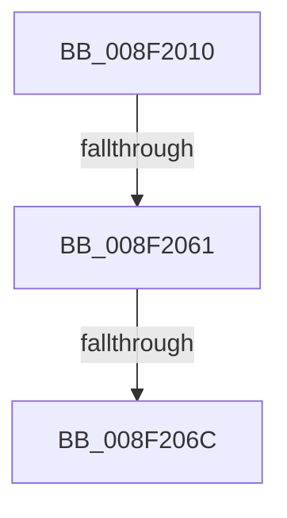

# _CmGetDeviceInterfaceRegKeyPath

- RVA: `0x008F2010`–`0x008F206F` (길이 `95` bytes)
- VA: `0x00000001408F2010`
- 실행 섹션: `PAGE`
- PDB 이름 있음: `예`; PDB Function 태그: `예`
- unwind 정보 RVA: `0x00087354`
- 디코드: `20`개 명령, `95/95` bytes 표시
- 미해석 바이트: `0` (있으면 어셈블리에 `.byte`로 보존)

> 이 문서는 커널 이미지의 기계어와 PDB 기호를 분석해 생성했습니다. 4번과 5번은 함수 원형과 자료형을 바이너리 사용 방식에서 추정한 C 해석이며 원본 소스 복구 결과는 아닙니다.

## 1. Dependencies

- 직접 호출 지점: **0**; 고유 호출 대상: **0**
- 직접 호출자로 확인된 함수: **3**
- RIP 상대 이미지 참조: **1**

### Outgoing calls
- 직접 디코드된 call 명령이 없습니다.

### Direct callers
- [CmDeleteDeviceInterfaceRegKeyWorker](../82/CmDeleteDeviceInterfaceRegKeyWorker_function_00829E1C.md) at `0x00829ECA`
- [_CmOpenDeviceInterfaceRegKeyWorker](_CmOpenDeviceInterfaceRegKeyWorker_function_008F2B48.md) at `0x008F2C0E`
- [PiDqGetRelativeObjectRegPath](../99/PiDqGetRelativeObjectRegPath_function_00990B6C.md) at `0x00990C1A`

### Static image references
- `0x008F2023` → RVA `0x00E0A740` (`.data`; read)

## 2. Other-region calls and transfers

- 다른 실행 섹션으로 향하는 call: **0**
- call이 아닌 외부 분기/꼬리 이동: **2**
  - `0x008F205B` → [sub_008F29AD](Unknown_function_008F29AD.md) (`tail-transfer`)
  - `0x008F2066` → [sub_008F29AD](Unknown_function_008F29AD.md) (`tail-transfer`)

## 3. Assembly (complete function range)

```asm
008F2010  40 55                           push rbp
008F2012  41 55                           push r13
008F2014  48 8D AC 24 18 FF FF FF         lea rbp, [rsp - 0xe8]
008F201C  48 81 EC E8 01 00 00            sub rsp, 0x1e8
008F2023  48 8B 05 16 87 51 00            mov rax, qword ptr [rip + 0x518716]
008F202A  48 33 C4                        xor rax, rsp
008F202D  48 89 85 B0 00 00 00            mov qword ptr [rbp + 0xb0], rax
008F2034  48 8B 8D 28 01 00 00            mov rcx, qword ptr [rbp + 0x128]
008F203B  41 8B C0                        mov eax, r8d
008F203E  48 89 4D A0                     mov qword ptr [rbp - 0x60], rcx
008F2042  4C 8B EA                        mov r13, rdx
008F2045  48 8B 8D 38 01 00 00            mov rcx, qword ptr [rbp + 0x138]
008F204C  48 89 4D B8                     mov qword ptr [rbp - 0x48], rcx
008F2050  44 89 4C 24 7C                  mov dword ptr [rsp + 0x7c], r9d
008F2055  89 45 B0                        mov dword ptr [rbp - 0x50], eax
008F2058  45 85 C0                        test r8d, r8d
008F205B  0F 84 4C 09 00 00               je 0x1408f29ad
008F2061  A9 CC FC FF FF                  test eax, 0xfffffccc
008F2066  0F 85 41 09 00 00               jne 0x1408f29ad
008F206C  0F B6 C8                        movzx ecx, al
```

## 4. C-style interpretation (structured pseudocode)

```c
__int64 __fastcall _CmGetDeviceInterfaceRegKeyPath(__int64 a1, __int64 a2, int a3, int a4, __int64 a5, __int64 a6, __int64 a7, __int64 a8)
{
    __int64 result;
    __int64 v_rsp;
    unsigned __int64 v_stack_m140;
    unsigned int v_stack_m148;
    unsigned __int64 v_stack_m158;
    unsigned int v_stack_m17C;
    unsigned __int64 v_stack_m48;
    unsigned __int64 v_stack_mF8;

    v_rsp = (v_rsp) - (488);
    result = (*(unsigned __int64 *)(v_rip + 5342998)) ^ (v_rsp);
    v_stack_m48 = result;
    v_stack_m158 = a6;
    v_stack_m140 = a8;
    v_stack_m17C = a4;
    v_stack_m148 = (unsigned int)((unsigned int)(a3));
    return (unsigned int)(a3);
}
```

## 5. (Beta) C Style

```c
int64_t _CmGetDeviceInterfaceRegKeyPath(int64_t Arg1, int64_t Arg2, int32_t Arg3, int32_t Arg4, uint64_t Arg5, int64_t Arg6, uint64_t Arg7, int64_t Arg8)
{
    int64_t result;
    int64_t local_rsp;
    uint64_t v_stack_m140;
    uint32_t v_stack_m148;
    uint64_t v_stack_m158;
    uint32_t v_stack_m17C;
    uint64_t v_stack_m48;
    uint64_t v_stack_mF8;

    local_rsp = (local_rsp) - (488);
    result = (*(uint64_t *)(v_rip + 0x518716)) ^ (local_rsp);
    v_stack_m48 = result;
    v_stack_m158 = Arg6;
    v_stack_m140 = Arg8;
    v_stack_m17C = Arg4;
    v_stack_m148 = (uint32_t)((uint32_t)(Arg3));
    return (uint32_t)(Arg3);
}
```

## 6. Execution-region graph

[열기: 2D/3D 그래프와 함수 탐색 컨트롤 패널](../../../control-panel.html?section=page&rva=0x008F2010&view=graph)

- 2D 그래프는 위에서 아래로 흐르고, 3D 그래프는 빈 공간을 드래그해 회전합니다. Shift+드래그는 이동, 휠은 확대·축소, 함수 노드 선택은 대상 보고서 이동입니다.

### Static fallback


