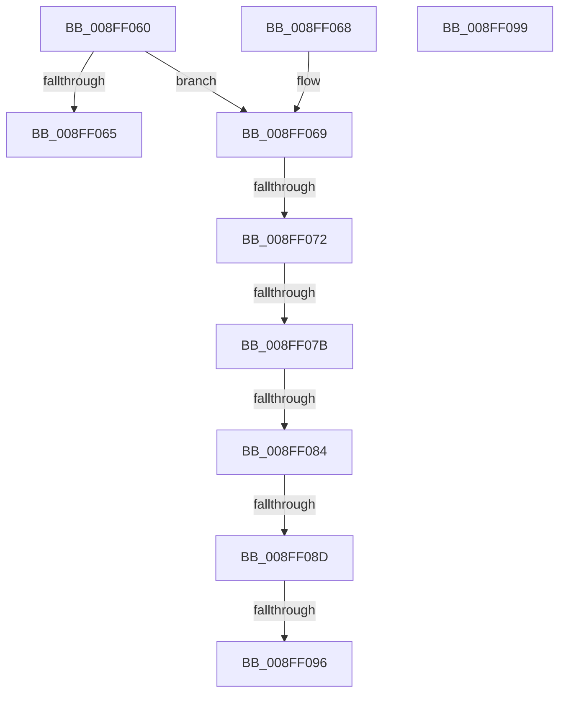

# _CmMapCmObjectTypeToPnpObjectType

- RVA: `0x008FF060`–`0x008FF09A` (길이 `58` bytes)
- VA: `0x00000001408FF060`
- 실행 섹션: `PAGE`
- PDB 이름 있음: `예`; PDB Function 태그: `예`
- unwind 정보 RVA: `0x000DB714`
- 디코드: `18`개 명령, `58/58` bytes 표시
- 미해석 바이트: `0` (있으면 어셈블리에 `.byte`로 보존)

> 이 문서는 커널 이미지의 기계어와 PDB 기호를 분석해 생성했습니다. 4번과 5번은 함수 원형과 자료형을 바이너리 사용 방식에서 추정한 C 해석이며 원본 소스 복구 결과는 아닙니다.

## 1. Dependencies

- 직접 호출 지점: **0**; 고유 호출 대상: **0**
- 직접 호출자로 확인된 함수: **9**
- RIP 상대 이미지 참조: **0**

### Outgoing calls
- 직접 디코드된 call 명령이 없습니다.

### Direct callers
- [CmRaiseDeleteEvent](../82/CmRaiseDeleteEvent_function_0082DBE0.md) at `0x0082DC01`
- [PnpCmMatchCallbackRoutine](../83/PnpCmMatchCallbackRoutine_function_008317F0.md) at `0x008317FA`
- [PiPnpRtlCmActionCallback](../8E/PiPnpRtlCmActionCallback_function_008EF110.md) at `0x008EF205`
- [PiPnpRtlCmActionCallback](../8E/PiPnpRtlCmActionCallback_function_008EF110.md) at `0x008EF415`
- [PiPnpRtlCmActionCallback](../8E/PiPnpRtlCmActionCallback_function_008EF110.md) at `0x008EF5DB`
- [PiPnpRtlCmActionCallback](../8E/PiPnpRtlCmActionCallback_function_008EF110.md) at `0x008EF691`
- [CmRaisePropertyChangeEvent](CmRaisePropertyChangeEvent_function_008FE93C.md) at `0x008FE97F`
- [PiDmGetCmObjectListFromCache](PiDmGetCmObjectListFromCache_function_008FEE14.md) at `0x008FEE2A`
- [PiDmObjectGetCachedCmProperty](PiDmObjectGetCachedCmProperty_function_008FEE70.md) at `0x008FEEED`
- [CmRaiseCreateEvent](CmRaiseCreateEvent_function_008FF944.md) at `0x008FF96C`
- [PiDmObjectUpdateCachedCmProperty](PiDmObjectUpdateCachedCmProperty_function_008FFCF0.md) at `0x008FFD4C`
- [PiDmObjectUpdateCachedCmProperty](PiDmObjectUpdateCachedCmProperty_function_008FFCF0.md) at `0x008FFDAD`
- [sub_00B1DC0E](../B1/Unknown_function_00B1DC0E.md) at `0x00B1DE7A`

### Static image references
- 디코드된 RIP-relative 메모리 참조가 없습니다.

## 2. Other-region calls and transfers

- 다른 실행 섹션으로 향하는 call: **0**
- call이 아닌 외부 분기/꼬리 이동: **5**
  - `0x008FF06C` → `0x00B1FF84` (`tail-transfer`)
  - `0x008FF075` → `0x00B1FF7D` (`tail-transfer`)
  - `0x008FF07E` → `0x00B1FF76` (`tail-transfer`)
  - `0x008FF087` → `0x00B1FF6F` (`tail-transfer`)
  - `0x008FF090` → `0x00B1FF68` (`tail-transfer`)

## 3. Assembly (complete function range)

```asm
008FF060  83 F9 03                        cmp ecx, 3
008FF063  75 04                           jne 0x1408ff069
008FF065  8B C1                           mov eax, ecx
008FF067  C3                              ret
008FF068  CC                              int3
008FF069  83 E9 01                        sub ecx, 1
008FF06C  0F 84 12 0F 22 00               je 0x140b1ff84
008FF072  83 E9 01                        sub ecx, 1
008FF075  0F 84 02 0F 22 00               je 0x140b1ff7d
008FF07B  83 E9 02                        sub ecx, 2
008FF07E  0F 84 F2 0E 22 00               je 0x140b1ff76
008FF084  83 E9 01                        sub ecx, 1
008FF087  0F 84 E2 0E 22 00               je 0x140b1ff6f
008FF08D  83 F9 01                        cmp ecx, 1
008FF090  0F 84 D2 0E 22 00               je 0x140b1ff68
008FF096  33 C0                           xor eax, eax
008FF098  C3                              ret
008FF099  CC                              int3
```

## 4. C-style interpretation (structured pseudocode)

```c
__int64 __fastcall _CmMapCmObjectTypeToPnpObjectType(int a1)
{
    __int64 result;

    if (a1 != 3) goto loc_008FF069;
    return (unsigned int)(a1);
loc_008FF069:
    a1 = (unsigned int)((a1) - (1));
    a1 = (unsigned int)((a1) - (1));
    a1 = (unsigned int)((a1) - (2));
    a1 = (unsigned int)((a1) - (1));
    result = 0;
    return result;
}
```

## 5. (Beta) C Style

```c
int64_t _CmMapCmObjectTypeToPnpObjectType(int32_t Arg1)
{
    int64_t result;

    if (Arg1 != 3) goto loc_008FF069;
    return (uint32_t)(Arg1);
loc_008FF069:
    Arg1 = (uint32_t)((Arg1) - (1));
    Arg1 = (uint32_t)((Arg1) - (1));
    Arg1 = (uint32_t)((Arg1) - (2));
    Arg1 = (uint32_t)((Arg1) - (1));
    result = 0;
    return result;
}
```

## 6. Execution-region graph

[열기: 2D/3D 그래프와 함수 탐색 컨트롤 패널](../../../control-panel.html?section=page&rva=0x008FF060&view=graph)

- 2D 그래프는 위에서 아래로 흐르고, 3D 그래프는 빈 공간을 드래그해 회전합니다. Shift+드래그는 이동, 휠은 확대·축소, 함수 노드 선택은 대상 보고서 이동입니다.

### Static fallback


