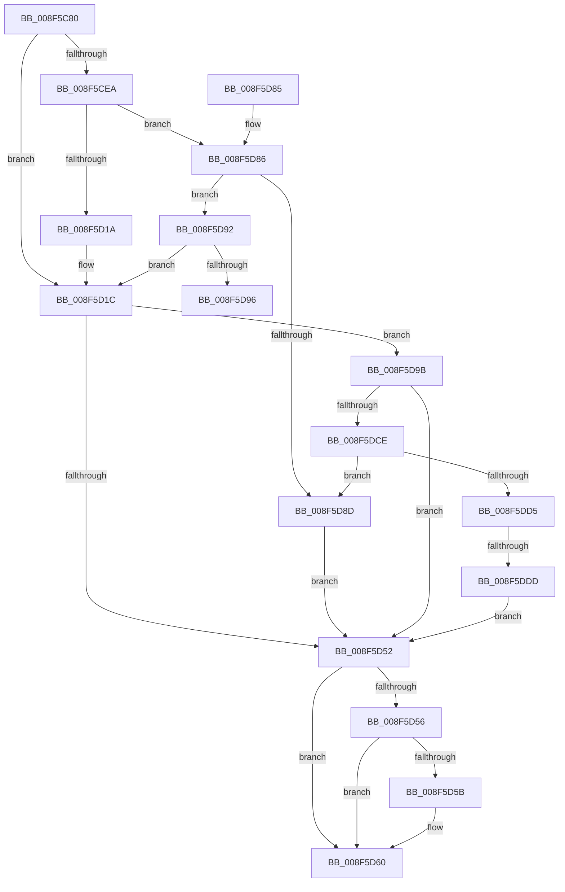

# _CmOpenDeviceContainerRegKey

- RVA: `0x008F5C80`–`0x008F5DE2` (길이 `354` bytes)
- VA: `0x00000001408F5C80`
- 실행 섹션: `PAGE`
- PDB 이름 있음: `예`; PDB Function 태그: `예`
- unwind 정보 RVA: `0x00087868`
- 디코드: `99`개 명령, `354/354` bytes 표시
- 미해석 바이트: `0` (있으면 어셈블리에 `.byte`로 보존)

> 이 문서는 커널 이미지의 기계어와 PDB 기호를 분석해 생성했습니다. 4번과 5번은 함수 원형과 자료형을 바이너리 사용 방식에서 추정한 C 해석이며 원본 소스 복구 결과는 아닙니다.

## 1. Dependencies

- 직접 호출 지점: **5**; 고유 호출 대상: **4**
- 직접 호출자로 확인된 함수: **2**
- RIP 상대 이미지 참조: **1**

### Outgoing calls
- `0x008F5CBE` → [memset](../../text/6C/memset_function_006C6C40.md) (function, `0x006C6C40`)
- `0x008F5D0E` → [guard_dispatch_icall](../../text/6B/guard_dispatch_icall_function_006BAAD0.md) (function, `0x006BAAD0`)
- `0x008F5D46` → [CmOpenDeviceContainerRegKeyWorker](CmOpenDeviceContainerRegKeyWorker_function_008F4904.md) (function, `0x008F4904`)
- `0x008F5D69` → [_security_check_cookie](../../text/6A/_security_check_cookie_function_006AC640.md) (function, `0x006AC640`)
- `0x008F5DC2` → [guard_dispatch_icall](../../text/6B/guard_dispatch_icall_function_006BAAD0.md) (function, `0x006BAAD0`)

### Direct callers
- [_PnpDispatchDeviceContainer](_PnpDispatchDeviceContainer_function_008F6880.md) at `0x008F695D`
- [_CmCreateDeviceContainerWorker](_CmCreateDeviceContainerWorker_function_008FF898.md) at `0x008FF8E8`

### Static image references
- `0x008F5C98` → RVA `0x00E0A740` (`.data`; read)

## 2. Other-region calls and transfers

- 다른 실행 섹션으로 향하는 call: **4**
  - `0x008F5CBE` → [memset](../../text/6C/memset_function_006C6C40.md) (`PAGE` → `.text`)
  - `0x008F5D0E` → [guard_dispatch_icall](../../text/6B/guard_dispatch_icall_function_006BAAD0.md) (`PAGE` → `.text`)
  - `0x008F5D69` → [_security_check_cookie](../../text/6A/_security_check_cookie_function_006AC640.md) (`PAGE` → `.text`)
  - `0x008F5DC2` → [guard_dispatch_icall](../../text/6B/guard_dispatch_icall_function_006BAAD0.md) (`PAGE` → `.text`)
- call이 아닌 외부 분기/꼬리 이동: **2**
  - `0x008F5D96` → [sub_00B1EB0E](../B1/Unknown_function_00B1EB0E.md) (`tail-transfer`)
  - `0x008F5DD7` → [sub_00B1EB0E](../B1/Unknown_function_00B1EB0E.md) (`tail-transfer`)

## 3. Assembly (complete function range)

```asm
008F5C80  48 89 5C 24 18                  mov qword ptr [rsp + 0x18], rbx
008F5C85  55                              push rbp
008F5C86  56                              push rsi
008F5C87  57                              push rdi
008F5C88  41 56                           push r14
008F5C8A  41 57                           push r15
008F5C8C  48 8D 6C 24 E9                  lea rbp, [rsp - 0x17]
008F5C91  48 81 EC B0 00 00 00            sub rsp, 0xb0
008F5C98  48 8B 05 A1 4A 51 00            mov rax, qword ptr [rip + 0x514aa1]
008F5C9F  48 33 C4                        xor rax, rsp
008F5CA2  48 89 45 07                     mov qword ptr [rbp + 7], rax
008F5CA6  48 8B 5D 77                     mov rbx, qword ptr [rbp + 0x77]
008F5CAA  4C 8B FA                        mov r15, rdx
008F5CAD  48 8B 75 7F                     mov rsi, qword ptr [rbp + 0x7f]
008F5CB1  33 D2                           xor edx, edx
008F5CB3  4C 8B F1                        mov r14, rcx
008F5CB6  48 8D 4D A7                     lea rcx, [rbp - 0x59]
008F5CBA  44 8D 42 58                     lea r8d, [rdx + 0x58]
008F5CBE  E8 7D 0F DD FF                  call 0x1406c6c40
008F5CC3  8B 45 67                        mov eax, dword ptr [rbp + 0x67]
008F5CC6  49 8B BE F8 01 00 00            mov rdi, qword ptr [r14 + 0x1f8]
008F5CCD  83 65 BB 00                     and dword ptr [rbp - 0x45], 0
008F5CD1  89 45 BF                        mov dword ptr [rbp - 0x41], eax
008F5CD4  8A 45 6F                        mov al, byte ptr [rbp + 0x6f]
008F5CD7  88 45 C3                        mov byte ptr [rbp - 0x3d], al
008F5CDA  C7 45 B7 50 00 00 00            mov dword ptr [rbp - 0x49], 0x50
008F5CE1  48 89 5D C7                     mov qword ptr [rbp - 0x39], rbx
008F5CE5  48 85 FF                        test rdi, rdi
008F5CE8  74 32                           je 0x1408f5d1c
008F5CEA  41 B9 0B 00 00 00               mov r9d, 0xb
008F5CF0  48 8D 45 A7                     lea rax, [rbp - 0x59]
008F5CF4  48 89 44 24 28                  mov qword ptr [rsp + 0x28], rax
008F5CF9  49 8B D7                        mov rdx, r15
008F5CFC  49 8B CE                        mov rcx, r14
008F5CFF  C7 44 24 20 01 00 00 00         mov dword ptr [rsp + 0x20], 1
008F5D07  48 8B C7                        mov rax, rdi
008F5D0A  45 8D 41 FA                     lea r8d, [r9 - 6]
008F5D0E  E8 BD 4D DC FF                  call 0x1406baad0
008F5D13  3D 02 00 00 C0                  cmp eax, 0xc0000002
008F5D18  75 6C                           jne 0x1408f5d86
008F5D1A  33 FF                           xor edi, edi
008F5D1C  44 8B 45 B7                     mov r8d, dword ptr [rbp - 0x49]
008F5D20  48 8D 45 CF                     lea rax, [rbp - 0x31]
008F5D24  48 89 44 24 38                  mov qword ptr [rsp + 0x38], rax
008F5D29  49 8B D7                        mov rdx, r15
008F5D2C  48 8B 45 C7                     mov rax, qword ptr [rbp - 0x39]
008F5D30  49 8B CE                        mov rcx, r14
008F5D33  48 89 44 24 30                  mov qword ptr [rsp + 0x30], rax
008F5D38  8A 45 C3                        mov al, byte ptr [rbp - 0x3d]
008F5D3B  88 44 24 28                     mov byte ptr [rsp + 0x28], al
008F5D3F  8B 45 BF                        mov eax, dword ptr [rbp - 0x41]
008F5D42  89 44 24 20                     mov dword ptr [rsp + 0x20], eax
008F5D46  E8 B9 EB FF FF                  call 0x1408f4904
008F5D4B  8B D8                           mov ebx, eax
008F5D4D  48 85 FF                        test rdi, rdi
008F5D50  75 49                           jne 0x1408f5d9b
008F5D52  85 DB                           test ebx, ebx
008F5D54  78 0A                           js 0x1408f5d60
008F5D56  48 85 F6                        test rsi, rsi
008F5D59  74 05                           je 0x1408f5d60
008F5D5B  8B 45 CF                        mov eax, dword ptr [rbp - 0x31]
008F5D5E  89 06                           mov dword ptr [rsi], eax
008F5D60  8B C3                           mov eax, ebx
008F5D62  48 8B 4D 07                     mov rcx, qword ptr [rbp + 7]
008F5D66  48 33 CC                        xor rcx, rsp
008F5D69  E8 D2 68 DB FF                  call 0x1406ac640
008F5D6E  48 8B 9C 24 F0 00 00 00         mov rbx, qword ptr [rsp + 0xf0]
008F5D76  48 81 C4 B0 00 00 00            add rsp, 0xb0
008F5D7D  41 5F                           pop r15
008F5D7F  41 5E                           pop r14
008F5D81  5F                              pop rdi
008F5D82  5E                              pop rsi
008F5D83  5D                              pop rbp
008F5D84  C3                              ret
008F5D85  CC                              int3
008F5D86  3D 20 01 00 C0                  cmp eax, 0xc0000120
008F5D8B  75 05                           jne 0x1408f5d92
008F5D8D  8B 5D A7                        mov ebx, dword ptr [rbp - 0x59]
008F5D90  EB C0                           jmp 0x1408f5d52
008F5D92  85 C0                           test eax, eax
008F5D94  74 86                           je 0x1408f5d1c
008F5D96  E9 73 8D 22 00                  jmp 0x140b1eb0e
008F5D9B  89 45 A7                        mov dword ptr [rbp - 0x59], eax
008F5D9E  41 B9 0B 00 00 00               mov r9d, 0xb
008F5DA4  48 8D 45 A7                     lea rax, [rbp - 0x59]
008F5DA8  49 8B D7                        mov rdx, r15
008F5DAB  48 89 44 24 28                  mov qword ptr [rsp + 0x28], rax
008F5DB0  49 8B CE                        mov rcx, r14
008F5DB3  48 8B C7                        mov rax, rdi
008F5DB6  C7 44 24 20 02 00 00 00         mov dword ptr [rsp + 0x20], 2
008F5DBE  45 8D 41 FA                     lea r8d, [r9 - 6]
008F5DC2  E8 09 4D DC FF                  call 0x1406baad0
008F5DC7  3D 02 00 00 C0                  cmp eax, 0xc0000002
008F5DCC  74 84                           je 0x1408f5d52
008F5DCE  3D 20 01 00 C0                  cmp eax, 0xc0000120
008F5DD3  74 B8                           je 0x1408f5d8d
008F5DD5  85 C0                           test eax, eax
008F5DD7  0F 85 31 8D 22 00               jne 0x140b1eb0e
008F5DDD  E9 70 FF FF FF                  jmp 0x1408f5d52
```

## 4. C-style interpretation (structured pseudocode)

```c
__int64 __fastcall _CmOpenDeviceContainerRegKey(__int64 a1, __int64 a2, __int64 a3, __int64 a4, unsigned int a5, unsigned __int8 a6, __int64 a7, __int64 a8)
{
    __int64 result;
    __int64 v_rdi;
    __int64 v_rsp;
    unsigned __int64 v_stack_m38;
    unsigned __int64 v_stack_m3F;
    unsigned __int64 v_stack_m70;
    unsigned __int64 v_stack_m78;
    unsigned __int8 v_stack_m7C;
    unsigned int v_stack_m80;
    unsigned int v_stack_m84;
    unsigned int v_stack_m88;
    unsigned __int64 v_stack_m98;
    unsigned __int64 v_stack_mA0;
    unsigned __int64 v_stack_mA8;
    unsigned __int64 v_stack_mB0;
    unsigned int v_stack_mB8;
    unsigned __int64 v_stack_p18;
    unsigned int v_stack_p20;
    unsigned __int64 v_stack_p28;

    v_stack_p18 = v_rbx;
    v_rsp = (v_rsp) - (176);
    result = (*(unsigned __int64 *)(v_rip + 5327521)) ^ (v_rsp);
    v_stack_m38 = result;
    a2 = 0;
    result = memset(v_stack_m98, a2, a2 + 88, a4);
    v_stack_m80 = (unsigned int)((unsigned int)(a5));
    v_stack_m7C = a6;
    v_stack_m88 = 80;
    v_stack_m78 = a7;
    if (*(unsigned __int64 *)(a1 + 504) == 0) goto loc_008F5D1C;
    v_stack_mB0 = v_stack_m98;
    v_stack_mB8 = 1;
    result = guard_dispatch_icall(a1, 0, 11 - 6, 11);
    if (((unsigned int)(result)) != 0xC0000002ULL) goto loc_008F5D86;
    v_rdi = 0;
loc_008F5D1C:
    v_stack_mA0 = v_stack_m70;
    v_stack_mA8 = v_stack_m78;
    v_stack_mB0 = (unsigned __int8)(v_stack_m7C);
    v_stack_mB8 = (unsigned int)((unsigned int)(v_stack_m80));
    result = CmOpenDeviceContainerRegKeyWorker(a1, 0, (unsigned int)(v_stack_m88), 11);
    if (0 != 0) goto loc_008F5D9B;
loc_008F5D52:
    if (sign_flag) goto loc_008F5D60;
    if (a8 != 0) {
        result = v_stack_m70;
        *(unsigned int *)(a8) = (unsigned int)(result);
    }
    a1 = (v_stack_m38) ^ (v_rsp);
    result = _security_check_cookie(a1, 0, (unsigned int)(v_stack_m88), 11);
    v_rsp = (v_rsp) + (176);
    return result;
loc_008F5D86:
    if (((unsigned int)(result)) != 0xC0000120ULL) goto loc_008F5D92;
loc_008F5D8D:
    goto loc_008F5D52;
loc_008F5D92:
    if ((unsigned int)(result) == 0) goto loc_008F5D1C;
loc_008F5D9B:
    v_stack_m98 = (unsigned int)(result);
    v_stack_p28 = v_stack_m98;
    v_stack_p20 = 2;
    result = guard_dispatch_icall(a1, 0, 11 - 6, 11);
    if (((unsigned int)(result)) == 0xC0000002ULL) goto loc_008F5D52;
    if (((unsigned int)(result)) == 0xC0000120ULL) goto loc_008F5D8D;
    goto loc_008F5D52;
}
```

## 5. (Beta) C Style

```c
int64_t _CmOpenDeviceContainerRegKey(void *Arg1, int64_t Arg2, int64_t Arg3, int64_t Arg4, uint32_t Arg5, uint8_t Arg6, int64_t Arg7, int64_t Arg8)
{
    uint8_t *arg1 = (uint8_t *)Arg1;

    int64_t result;
    int64_t local_rdi;
    int64_t local_rsp;
    uint64_t v_stack_m38;
    uint64_t v_stack_m3F;
    uint64_t v_stack_m70;
    uint64_t v_stack_m78;
    uint8_t v_stack_m7C;
    uint32_t v_stack_m80;
    uint32_t v_stack_m84;
    uint32_t v_stack_m88;
    uint64_t v_stack_m98;
    uint64_t v_stack_mA0;
    uint64_t v_stack_mA8;
    uint64_t v_stack_mB0;
    uint32_t v_stack_mB8;
    uint64_t v_stack_p18;
    uint32_t v_stack_p20;
    uint64_t v_stack_p28;

    v_stack_p18 = local_rbx;
    local_rsp = (local_rsp) - (176);
    result = (*(uint64_t *)(v_rip + 0x514AA1)) ^ (local_rsp);
    v_stack_m38 = result;
    Arg2 = 0;
    result = memset(v_stack_m98, Arg2, Arg2 + 88, Arg4);
    v_stack_m80 = (uint32_t)((uint32_t)(Arg5));
    v_stack_m7C = Arg6;
    v_stack_m88 = 80;
    v_stack_m78 = Arg7;
    if (*(uint64_t *)(arg1 + 0x1F8) == 0) goto loc_008F5D1C;
    v_stack_mB0 = v_stack_m98;
    v_stack_mB8 = 1;
    result = guard_dispatch_icall(Arg1, 0, 11 - 6, 11);
    if (((uint32_t)(result)) != 0xC0000002ULL) goto loc_008F5D86;
    local_rdi = 0;
loc_008F5D1C:
    v_stack_mA0 = v_stack_m70;
    v_stack_mA8 = v_stack_m78;
    v_stack_mB0 = (uint8_t)(v_stack_m7C);
    v_stack_mB8 = (uint32_t)((uint32_t)(v_stack_m80));
    result = CmOpenDeviceContainerRegKeyWorker(Arg1, 0, (uint32_t)(v_stack_m88), 11);
    if (0 != 0) goto loc_008F5D9B;
loc_008F5D52:
    if (sign_flag) goto loc_008F5D60;
    if (Arg8 != 0) {
        result = v_stack_m70;
        *(uint32_t *)(Arg8) = (uint32_t)(result);
    }
    Arg1 = (v_stack_m38) ^ (local_rsp);
    result = _security_check_cookie(Arg1, 0, (uint32_t)(v_stack_m88), 11);
    local_rsp = (local_rsp) + (176);
    return result;
loc_008F5D86:
    if (((uint32_t)(result)) != 0xC0000120ULL) goto loc_008F5D92;
loc_008F5D8D:
    goto loc_008F5D52;
loc_008F5D92:
    if ((uint32_t)(result) == 0) goto loc_008F5D1C;
loc_008F5D9B:
    v_stack_m98 = (uint32_t)(result);
    v_stack_p28 = v_stack_m98;
    v_stack_p20 = 2;
    result = guard_dispatch_icall(Arg1, 0, 11 - 6, 11);
    if (((uint32_t)(result)) == 0xC0000002ULL) goto loc_008F5D52;
    if (((uint32_t)(result)) == 0xC0000120ULL) goto loc_008F5D8D;
    goto loc_008F5D52;
}
```

### 관측된 메모리 오프셋

구조체 형식이 확인되지 않은 접근은 인자 기준의 오프셋으로만 기록했습니다.

| 기준 인자 | 오프셋 표현 | 폭 (bit) | 접근 |
|---|---:|---:|---|
| `Arg1` | `+ 0x1F8` | `64` | `R` |

## 6. Execution-region graph

[열기: 2D/3D 그래프와 함수 탐색 컨트롤 패널](../../../control-panel.html?section=page&rva=0x008F5C80&view=graph)

- 2D 그래프는 위에서 아래로 흐르고, 3D 그래프는 빈 공간을 드래그해 회전합니다. Shift+드래그는 이동, 휠은 확대·축소, 함수 노드 선택은 대상 보고서 이동입니다.

### Static fallback


