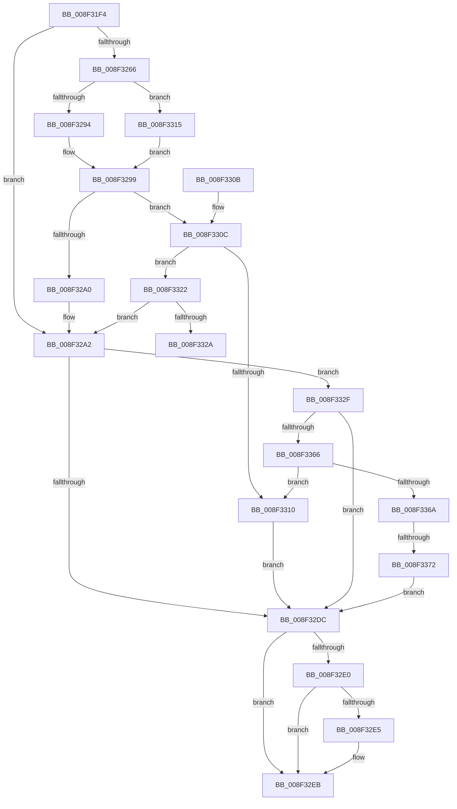

# _CmOpenDeviceInterfaceRegKey

- RVA: `0x008F31F4`–`0x008F3377` (길이 `387` bytes)
- VA: `0x00000001408F31F4`
- 실행 섹션: `PAGE`
- PDB 이름 있음: `예`; PDB Function 태그: `예`
- unwind 정보 RVA: `0x000875B0`
- 디코드: `110`개 명령, `387/387` bytes 표시
- 미해석 바이트: `0` (있으면 어셈블리에 `.byte`로 보존)

> 이 문서는 커널 이미지의 기계어와 PDB 기호를 분석해 생성했습니다. 4번과 5번은 함수 원형과 자료형을 바이너리 사용 방식에서 추정한 C 해석이며 원본 소스 복구 결과는 아닙니다.

## 1. Dependencies

- 직접 호출 지점: **6**; 고유 호출 대상: **5**
- 직접 호출자로 확인된 함수: **13**
- RIP 상대 이미지 참조: **2**

### Outgoing calls
- `0x008F3234` → [memset](../../text/6C/memset_function_006C6C40.md) (function, `0x006C6C40`)
- `0x008F3294` → [PiPnpRtlCmActionCallback](../8E/PiPnpRtlCmActionCallback_function_008EF110.md) (function, `0x008EF110`)
- `0x008F32D0` → [_CmOpenDeviceInterfaceRegKeyWorker](_CmOpenDeviceInterfaceRegKeyWorker_function_008F2B48.md) (function, `0x008F2B48`)
- `0x008F32F4` → [_security_check_cookie](../../text/6A/_security_check_cookie_function_006AC640.md) (function, `0x006AC640`)
- `0x008F3318` → [guard_dispatch_icall](../../text/6B/guard_dispatch_icall_function_006BAAD0.md) (function, `0x006BAAD0`)
- `0x008F3356` → [guard_dispatch_icall](../../text/6B/guard_dispatch_icall_function_006BAAD0.md) (function, `0x006BAAD0`)

### Direct callers
- [CmDeleteDeviceInterfaceRegKeyWorker](../82/CmDeleteDeviceInterfaceRegKeyWorker_function_00829E1C.md) at `0x0082A020`
- [_PnpDispatchDeviceInterface](../8E/_PnpDispatchDeviceInterface_function_008E0DB0.md) at `0x008E0EC9`
- [_CmOpenDeviceInterfaceRegKeyWorker](_CmOpenDeviceInterfaceRegKeyWorker_function_008F2B48.md) at `0x008F3174`
- [CmGetDeviceInterfaceMappedPropertyFromRegValue](CmGetDeviceInterfaceMappedPropertyFromRegValue_function_008F40BC.md) at `0x008F43C2`
- [CmGetDeviceInterfaceMappedPropertyFromRegValue](CmGetDeviceInterfaceMappedPropertyFromRegValue_function_008F40BC.md) at `0x008F442C`
- [IoGetDeviceInterfaceAlias](IoGetDeviceInterfaceAlias_function_008F5570.md) at `0x008F58B7`
- [CmCreateDeviceInterfaceWorker](../90/CmCreateDeviceInterfaceWorker_function_009016E4.md) at `0x009017B5`
- [PiCMOpenDeviceInterfaceKey](../96/PiCMOpenDeviceInterfaceKey_function_00961A3C.md) at `0x00961B0C`
- [PiDevCfgConfigureDeviceInterface](../96/PiDevCfgConfigureDeviceInterface_function_00963C18.md) at `0x00963D24`
- [PiDevCfgConfigureDeviceInterface](../96/PiDevCfgConfigureDeviceInterface_function_00963C18.md) at `0x00963DD5`
- [_CmSetDeviceInterfaceMappedPropertyFromRegValue](../A7/_CmSetDeviceInterfaceMappedPropertyFromRegValue_function_00A729E4.md) at `0x00A72AFF`
- [_CmSetDeviceInterfaceMappedPropertyFromRegValue](../A7/_CmSetDeviceInterfaceMappedPropertyFromRegValue_function_00A729E4.md) at `0x00A72D31`
- [CmDeleteDeviceInterfaceMappedPropertyFromRegValue](../A7/CmDeleteDeviceInterfaceMappedPropertyFromRegValue_function_00A72DA8.md) at `0x00A72E4F`
- [IoOpenDeviceInterfaceRegistryKey](../AC/IoOpenDeviceInterfaceRegistryKey_function_00AC5C60.md) at `0x00AC5D00`
- [sub_00B1E436](../B1/Unknown_function_00B1E436.md) at `0x00B1E47E`
- [sub_00B27F26](../B2/Unknown_function_00B27F26.md) at `0x00B27F4F`

### Static image references
- `0x008F320B` → RVA `0x00E0A740` (`.data`; read)
- `0x008F3266` → RVA `0x008EF110` (`PiPnpRtlCmActionCallback`; read)

## 2. Other-region calls and transfers

- 다른 실행 섹션으로 향하는 call: **4**
  - `0x008F3234` → [memset](../../text/6C/memset_function_006C6C40.md) (`PAGE` → `.text`)
  - `0x008F32F4` → [_security_check_cookie](../../text/6A/_security_check_cookie_function_006AC640.md) (`PAGE` → `.text`)
  - `0x008F3318` → [guard_dispatch_icall](../../text/6B/guard_dispatch_icall_function_006BAAD0.md) (`PAGE` → `.text`)
  - `0x008F3356` → [guard_dispatch_icall](../../text/6B/guard_dispatch_icall_function_006BAAD0.md) (`PAGE` → `.text`)
- call이 아닌 외부 분기/꼬리 이동: **2**
  - `0x008F332A` → [sub_00B1E930](../B1/Unknown_function_00B1E930.md) (`tail-transfer`)
  - `0x008F336C` → [sub_00B1E930](../B1/Unknown_function_00B1E930.md) (`tail-transfer`)

## 3. Assembly (complete function range)

```asm
008F31F4  40 55                           push rbp
008F31F6  53                              push rbx
008F31F7  56                              push rsi
008F31F8  57                              push rdi
008F31F9  41 54                           push r12
008F31FB  41 56                           push r14
008F31FD  41 57                           push r15
008F31FF  48 8D 6C 24 F9                  lea rbp, [rsp - 7]
008F3204  48 81 EC B0 00 00 00            sub rsp, 0xb0
008F320B  48 8B 05 2E 75 51 00            mov rax, qword ptr [rip + 0x51752e]
008F3212  48 33 C4                        xor rax, rsp
008F3215  48 89 45 F7                     mov qword ptr [rbp - 9], rax
008F3219  48 8B 5D 77                     mov rbx, qword ptr [rbp + 0x77]
008F321D  4C 8B E2                        mov r12, rdx
008F3220  4C 8B 75 7F                     mov r14, qword ptr [rbp + 0x7f]
008F3224  33 D2                           xor edx, edx
008F3226  41 8B F8                        mov edi, r8d
008F3229  4C 8B F9                        mov r15, rcx
008F322C  48 8D 4D 97                     lea rcx, [rbp - 0x69]
008F3230  44 8D 42 58                     lea r8d, [rdx + 0x58]
008F3234  E8 07 3A DD FF                  call 0x1406c6c40
008F3239  8B 45 67                        mov eax, dword ptr [rbp + 0x67]
008F323C  B9 03 00 00 00                  mov ecx, 3
008F3241  49 8B B7 F8 01 00 00            mov rsi, qword ptr [r15 + 0x1f8]
008F3248  83 65 AB 00                     and dword ptr [rbp - 0x55], 0
008F324C  89 45 AF                        mov dword ptr [rbp - 0x51], eax
008F324F  8A 45 6F                        mov al, byte ptr [rbp + 0x6f]
008F3252  89 7D A7                        mov dword ptr [rbp - 0x59], edi
008F3255  BF 20 01 00 C0                  mov edi, 0xc0000120
008F325A  88 45 B3                        mov byte ptr [rbp - 0x4d], al
008F325D  48 89 5D B7                     mov qword ptr [rbp - 0x49], rbx
008F3261  48 85 F6                        test rsi, rsi
008F3264  74 3C                           je 0x1408f32a2
008F3266  48 8D 05 A3 BE FF FF            lea rax, [rip - 0x415d]
008F326D  44 8B C1                        mov r8d, ecx
008F3270  48 3B F0                        cmp rsi, rax
008F3273  44 8D 49 08                     lea r9d, [rcx + 8]
008F3277  48 8D 45 97                     lea rax, [rbp - 0x69]
008F327B  49 8B D4                        mov rdx, r12
008F327E  48 89 44 24 28                  mov qword ptr [rsp + 0x28], rax
008F3283  49 8B CF                        mov rcx, r15
008F3286  C7 44 24 20 01 00 00 00         mov dword ptr [rsp + 0x20], 1
008F328E  0F 85 81 00 00 00               jne 0x1408f3315
008F3294  E8 77 BE FF FF                  call 0x1408ef110
008F3299  3D 02 00 00 C0                  cmp eax, 0xc0000002
008F329E  75 6C                           jne 0x1408f330c
008F32A0  33 F6                           xor esi, esi
008F32A2  44 8B 4D AB                     mov r9d, dword ptr [rbp - 0x55]
008F32A6  48 8D 45 BF                     lea rax, [rbp - 0x41]
008F32AA  44 8B 45 A7                     mov r8d, dword ptr [rbp - 0x59]
008F32AE  49 8B D4                        mov rdx, r12
008F32B1  48 89 44 24 38                  mov qword ptr [rsp + 0x38], rax
008F32B6  49 8B CF                        mov rcx, r15
008F32B9  48 8B 45 B7                     mov rax, qword ptr [rbp - 0x49]
008F32BD  48 89 44 24 30                  mov qword ptr [rsp + 0x30], rax
008F32C2  8A 45 B3                        mov al, byte ptr [rbp - 0x4d]
008F32C5  88 44 24 28                     mov byte ptr [rsp + 0x28], al
008F32C9  8B 45 AF                        mov eax, dword ptr [rbp - 0x51]
008F32CC  89 44 24 20                     mov dword ptr [rsp + 0x20], eax
008F32D0  E8 73 F8 FF FF                  call 0x1408f2b48
008F32D5  8B D8                           mov ebx, eax
008F32D7  48 85 F6                        test rsi, rsi
008F32DA  75 53                           jne 0x1408f332f
008F32DC  85 DB                           test ebx, ebx
008F32DE  78 0B                           js 0x1408f32eb
008F32E0  4D 85 F6                        test r14, r14
008F32E3  74 06                           je 0x1408f32eb
008F32E5  8B 45 BF                        mov eax, dword ptr [rbp - 0x41]
008F32E8  41 89 06                        mov dword ptr [r14], eax
008F32EB  8B C3                           mov eax, ebx
008F32ED  48 8B 4D F7                     mov rcx, qword ptr [rbp - 9]
008F32F1  48 33 CC                        xor rcx, rsp
008F32F4  E8 47 93 DB FF                  call 0x1406ac640
008F32F9  48 81 C4 B0 00 00 00            add rsp, 0xb0
008F3300  41 5F                           pop r15
008F3302  41 5E                           pop r14
008F3304  41 5C                           pop r12
008F3306  5F                              pop rdi
008F3307  5E                              pop rsi
008F3308  5B                              pop rbx
008F3309  5D                              pop rbp
008F330A  C3                              ret
008F330B  CC                              int3
008F330C  3B C7                           cmp eax, edi
008F330E  75 12                           jne 0x1408f3322
008F3310  8B 5D 97                        mov ebx, dword ptr [rbp - 0x69]
008F3313  EB C7                           jmp 0x1408f32dc
008F3315  48 8B C6                        mov rax, rsi
008F3318  E8 B3 77 DC FF                  call 0x1406baad0
008F331D  E9 77 FF FF FF                  jmp 0x1408f3299
008F3322  85 C0                           test eax, eax
008F3324  0F 84 78 FF FF FF               je 0x1408f32a2
008F332A  E9 01 B6 22 00                  jmp 0x140b1e930
008F332F  89 45 97                        mov dword ptr [rbp - 0x69], eax
008F3332  41 B9 0B 00 00 00               mov r9d, 0xb
008F3338  48 8D 45 97                     lea rax, [rbp - 0x69]
008F333C  49 8B D4                        mov rdx, r12
008F333F  48 89 44 24 28                  mov qword ptr [rsp + 0x28], rax
008F3344  49 8B CF                        mov rcx, r15
008F3347  48 8B C6                        mov rax, rsi
008F334A  C7 44 24 20 02 00 00 00         mov dword ptr [rsp + 0x20], 2
008F3352  45 8D 41 F8                     lea r8d, [r9 - 8]
008F3356  E8 75 77 DC FF                  call 0x1406baad0
008F335B  3D 02 00 00 C0                  cmp eax, 0xc0000002
008F3360  0F 84 76 FF FF FF               je 0x1408f32dc
008F3366  3B C7                           cmp eax, edi
008F3368  74 A6                           je 0x1408f3310
008F336A  85 C0                           test eax, eax
008F336C  0F 85 BE B5 22 00               jne 0x140b1e930
008F3372  E9 65 FF FF FF                  jmp 0x1408f32dc
```

## 4. C-style interpretation (structured pseudocode)

```c
__int64 __fastcall _CmOpenDeviceInterfaceRegKey(__int64 a1, __int64 a2, int a3, __int64 a4, unsigned int a5, unsigned __int8 a6, __int64 a7, __int64 a8)
{
    __int64 result;
    __int64 v_rsi;
    __int64 v_rsp;
    unsigned __int64 v_stack_m3F;
    unsigned __int64 v_stack_m48;
    unsigned __int64 v_stack_m80;
    unsigned __int64 v_stack_m88;
    unsigned __int8 v_stack_m8C;
    unsigned int v_stack_m90;
    unsigned int v_stack_m94;
    unsigned int v_stack_m98;
    unsigned __int64 v_stack_mA8;
    unsigned __int64 v_stack_mB0;
    unsigned __int64 v_stack_mB8;
    unsigned __int64 v_stack_mC0;
    unsigned int v_stack_mC8;
    unsigned int v_stack_p20;
    unsigned __int64 v_stack_p28;

    v_rsp = (v_rsp) - (176);
    result = (*(unsigned __int64 *)(v_rip + 5338414)) ^ (v_rsp);
    v_stack_m48 = result;
    a2 = 0;
    result = memset(v_stack_mA8, a2, a2 + 88, a4);
    v_stack_m90 = (unsigned int)((unsigned int)(a5));
    v_stack_m98 = (unsigned int)((unsigned int)(a3));
    v_stack_m8C = a6;
    v_stack_m88 = a7;
    if (*(unsigned __int64 *)(a1 + 504) == 0) goto loc_008F32A2;
    v_stack_mC0 = v_stack_mA8;
    v_stack_mC8 = 1;
    if ((*(unsigned __int64 *)(a1 + 504)) != (v_rip - 16733)) goto loc_008F3315;
    result = PiPnpRtlCmActionCallback(a1, 0, 3, 3 + 8);
loc_008F3299:
    if (((unsigned int)(result)) != 0xC0000002ULL) goto loc_008F330C;
    v_rsi = 0;
loc_008F32A2:
    v_stack_mB0 = v_stack_m80;
    v_stack_mB8 = v_stack_m88;
    v_stack_mC0 = (unsigned __int8)(v_stack_m8C);
    v_stack_mC8 = (unsigned int)((unsigned int)(v_stack_m90));
    result = _CmOpenDeviceInterfaceRegKeyWorker(a1, 0, (unsigned int)(v_stack_m98), (unsigned int)(v_stack_m94));
    if (0 != 0) goto loc_008F332F;
loc_008F32DC:
    if (sign_flag) goto loc_008F32EB;
    if (a8 != 0) {
        result = v_stack_m80;
        *(unsigned int *)(a8) = (unsigned int)(result);
    }
    a1 = (v_stack_m48) ^ (v_rsp);
    result = _security_check_cookie(a1, 0, (unsigned int)(v_stack_m98), (unsigned int)(v_stack_m94));
    v_rsp = (v_rsp) + (176);
    return result;
loc_008F330C:
    if (((unsigned int)(result)) != ((unsigned int)((unsigned int)(0xC0000120ULL)))) goto loc_008F3322;
loc_008F3310:
    goto loc_008F32DC;
loc_008F3315:
    result = guard_dispatch_icall(a1, 0, (unsigned int)(v_stack_m98), (unsigned int)(v_stack_m94));
    goto loc_008F3299;
loc_008F3322:
    if ((unsigned int)(result) == 0) goto loc_008F32A2;
loc_008F332F:
    v_stack_mA8 = (unsigned int)(result);
    v_stack_p28 = v_stack_mA8;
    v_stack_p20 = 2;
    result = guard_dispatch_icall(a1, 0, 11 - 8, 11);
    if (((unsigned int)(result)) == 0xC0000002ULL) goto loc_008F32DC;
    if (((unsigned int)(result)) == ((unsigned int)((unsigned int)(0xC0000120ULL)))) goto loc_008F3310;
    goto loc_008F32DC;
}
```

## 5. (Beta) C Style

```c
int64_t _CmOpenDeviceInterfaceRegKey(void *Arg1, int64_t Arg2, int32_t Arg3, int64_t Arg4, uint32_t Arg5, uint8_t Arg6, int64_t Arg7, int64_t Arg8)
{
    uint8_t *arg1 = (uint8_t *)Arg1;

    int64_t result;
    int64_t local_rsi;
    int64_t local_rsp;
    uint64_t v_stack_m3F;
    uint64_t v_stack_m48;
    uint64_t v_stack_m80;
    uint64_t v_stack_m88;
    uint8_t v_stack_m8C;
    uint32_t v_stack_m90;
    uint32_t v_stack_m94;
    uint32_t v_stack_m98;
    uint64_t v_stack_mA8;
    uint64_t v_stack_mB0;
    uint64_t v_stack_mB8;
    uint64_t v_stack_mC0;
    uint32_t v_stack_mC8;
    uint32_t v_stack_p20;
    uint64_t v_stack_p28;

    local_rsp = (local_rsp) - (176);
    result = (*(uint64_t *)(v_rip + 0x51752E)) ^ (local_rsp);
    v_stack_m48 = result;
    Arg2 = 0;
    result = memset(v_stack_mA8, Arg2, Arg2 + 88, Arg4);
    v_stack_m90 = (uint32_t)((uint32_t)(Arg5));
    v_stack_m98 = (uint32_t)((uint32_t)(Arg3));
    v_stack_m8C = Arg6;
    v_stack_m88 = Arg7;
    if (*(uint64_t *)(arg1 + 0x1F8) == 0) goto loc_008F32A2;
    v_stack_mC0 = v_stack_mA8;
    v_stack_mC8 = 1;
    if ((*(uint64_t *)(arg1 + 0x1F8)) != (v_rip - 16733)) goto loc_008F3315;
    result = PiPnpRtlCmActionCallback(Arg1, 0, 3, 3 + 8);
loc_008F3299:
    if (((uint32_t)(result)) != 0xC0000002ULL) goto loc_008F330C;
    local_rsi = 0;
loc_008F32A2:
    v_stack_mB0 = v_stack_m80;
    v_stack_mB8 = v_stack_m88;
    v_stack_mC0 = (uint8_t)(v_stack_m8C);
    v_stack_mC8 = (uint32_t)((uint32_t)(v_stack_m90));
    result = _CmOpenDeviceInterfaceRegKeyWorker(Arg1, 0, (uint32_t)(v_stack_m98), (uint32_t)(v_stack_m94));
    if (0 != 0) goto loc_008F332F;
loc_008F32DC:
    if (sign_flag) goto loc_008F32EB;
    if (Arg8 != 0) {
        result = v_stack_m80;
        *(uint32_t *)(Arg8) = (uint32_t)(result);
    }
    Arg1 = (v_stack_m48) ^ (local_rsp);
    result = _security_check_cookie(Arg1, 0, (uint32_t)(v_stack_m98), (uint32_t)(v_stack_m94));
    local_rsp = (local_rsp) + (176);
    return result;
loc_008F330C:
    if (((uint32_t)(result)) != ((uint32_t)((uint32_t)(0xC0000120ULL)))) goto loc_008F3322;
loc_008F3310:
    goto loc_008F32DC;
loc_008F3315:
    result = guard_dispatch_icall(Arg1, 0, (uint32_t)(v_stack_m98), (uint32_t)(v_stack_m94));
    goto loc_008F3299;
loc_008F3322:
    if ((uint32_t)(result) == 0) goto loc_008F32A2;
loc_008F332F:
    v_stack_mA8 = (uint32_t)(result);
    v_stack_p28 = v_stack_mA8;
    v_stack_p20 = 2;
    result = guard_dispatch_icall(Arg1, 0, 11 - 8, 11);
    if (((uint32_t)(result)) == 0xC0000002ULL) goto loc_008F32DC;
    if (((uint32_t)(result)) == ((uint32_t)((uint32_t)(0xC0000120ULL)))) goto loc_008F3310;
    goto loc_008F32DC;
}
```

### 관측된 메모리 오프셋

구조체 형식이 확인되지 않은 접근은 인자 기준의 오프셋으로만 기록했습니다.

| 기준 인자 | 오프셋 표현 | 폭 (bit) | 접근 |
|---|---:|---:|---|
| `Arg1` | `+ 0x1F8` | `64` | `R` |

## 6. Execution-region graph

[열기: 2D/3D 그래프와 함수 탐색 컨트롤 패널](../../../control-panel.html?section=page&rva=0x008F31F4&view=graph)

- 2D 그래프는 위에서 아래로 흐르고, 3D 그래프는 빈 공간을 드래그해 회전합니다. Shift+드래그는 이동, 휠은 확대·축소, 함수 노드 선택은 대상 보고서 이동입니다.

### Static fallback


