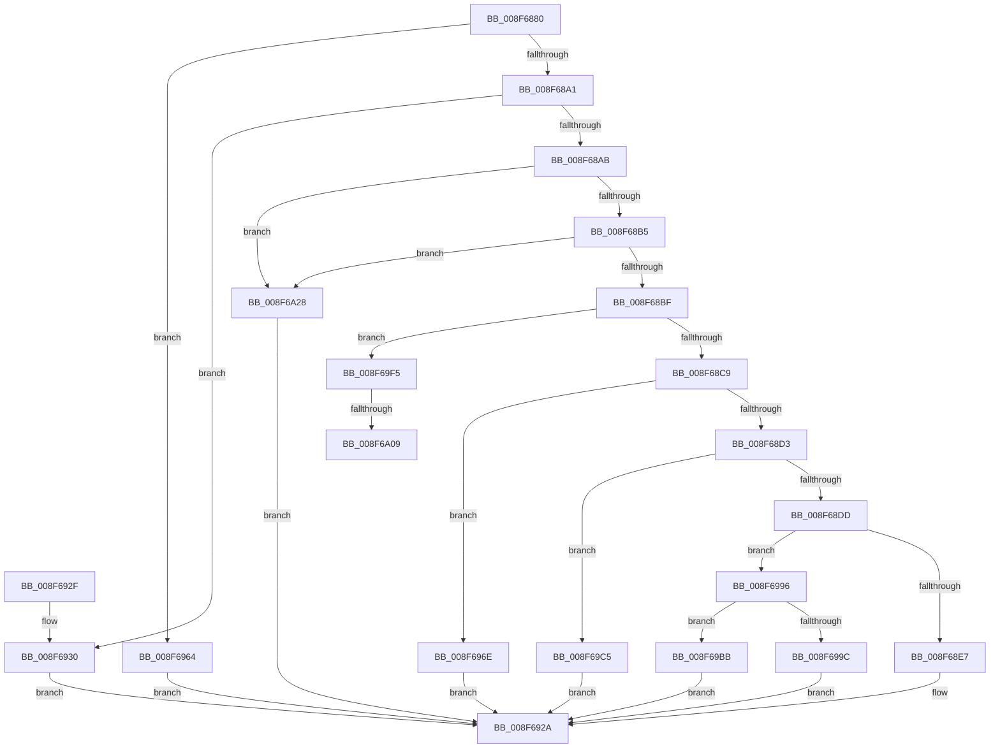

# _PnpDispatchDeviceContainer

- RVA: `0x008F6880`–`0x008F6A32` (길이 `434` bytes)
- VA: `0x00000001408F6880`
- 실행 섹션: `PAGE`
- PDB 이름 있음: `예`; PDB Function 태그: `예`
- unwind 정보 RVA: `0x00087980`
- 디코드: `98`개 명령, `434/434` bytes 표시
- 미해석 바이트: `0` (있으면 어셈블리에 `.byte`로 보존)

> 이 문서는 커널 이미지의 기계어와 PDB 기호를 분석해 생성했습니다. 4번과 5번은 함수 원형과 자료형을 바이너리 사용 방식에서 추정한 C 해석이며 원본 소스 복구 결과는 아닙니다.

## 1. Dependencies

- 직접 호출 지점: **6**; 고유 호출 대상: **6**
- 직접 호출자로 확인된 함수: **0**
- RIP 상대 이미지 참조: **1**

### Outgoing calls
- `0x008F6925` → [_CmGetDeviceContainerMappedProperty](_CmGetDeviceContainerMappedProperty_function_008F6A38.md) (function, `0x008F6A38`)
- `0x008F695D` → [_CmOpenDeviceContainerRegKey](_CmOpenDeviceContainerRegKey_function_008F5C80.md) (function, `0x008F5C80`)
- `0x008F6967` → [CmValidateDeviceContainerName](CmValidateDeviceContainerName_function_008F48B8.md) (function, `0x008F48B8`)
- `0x008F698F` → [CmGetDeviceContainerMappedPropertyKeys](../AB/CmGetDeviceContainerMappedPropertyKeys_function_00AB3CC4.md) (function, `0x00AB3CC4`)
- `0x008F69B1` → [_CmSetDeviceContainerMappedProperty](../AB/_CmSetDeviceContainerMappedProperty_function_00AB07F4.md) (function, `0x00AB07F4`)
- `0x008F69EB` → [CmGetDeviceContainerMappedPropertyLocales](../82/CmGetDeviceContainerMappedPropertyLocales_function_0082B9E8.md) (function, `0x0082B9E8`)

### Direct callers
- 이 함수 시작 RVA로 연결되는 직접 call은 확인되지 않았습니다. 간접 호출은 완전히 역산할 수 없습니다.

### Static image references
- `0x008F6A0E` → RVA `0x008317F0` (`PnpCmMatchCallbackRoutine`; read)

## 2. Other-region calls and transfers

- 다른 실행 섹션으로 향하는 call: **0**
- call이 아닌 외부 분기/꼬리 이동: **2**
  - `0x008F6A03` → [sub_00B1EF02](../B1/Unknown_function_00B1EF02.md) (`tail-transfer`)
  - `0x008F6A23` → [sub_00B1EF02](../B1/Unknown_function_00B1EF02.md) (`tail-transfer`)

## 3. Assembly (complete function range)

```asm
008F6880  48 83 EC 68                     sub rsp, 0x68
008F6884  4C 8B D2                        mov r10, rdx
008F6887  0F 57 C0                        xorps xmm0, xmm0
008F688A  33 D2                           xor edx, edx
008F688C  4C 8B D9                        mov r11, rcx
008F688F  44 8B C2                        mov r8d, edx
008F6892  0F 11 44 24 50                  movups xmmword ptr [rsp + 0x50], xmm0
008F6897  41 83 E9 01                     sub r9d, 1
008F689B  0F 84 C3 00 00 00               je 0x1408f6964
008F68A1  41 83 E9 01                     sub r9d, 1
008F68A5  0F 84 85 00 00 00               je 0x1408f6930
008F68AB  41 83 E9 01                     sub r9d, 1
008F68AF  0F 84 73 01 00 00               je 0x1408f6a28
008F68B5  41 83 E9 01                     sub r9d, 1
008F68B9  0F 84 69 01 00 00               je 0x1408f6a28
008F68BF  41 83 E9 01                     sub r9d, 1
008F68C3  0F 84 2C 01 00 00               je 0x1408f69f5
008F68C9  41 83 E9 01                     sub r9d, 1
008F68CD  0F 84 9B 00 00 00               je 0x1408f696e
008F68D3  41 83 E9 01                     sub r9d, 1
008F68D7  0F 84 E8 00 00 00               je 0x1408f69c5
008F68DD  41 83 E9 01                     sub r9d, 1
008F68E1  0F 85 AF 00 00 00               jne 0x1408f6996
008F68E7  4C 8B 84 24 90 00 00 00         mov r8, qword ptr [rsp + 0x90]
008F68EF  49 8B D2                        mov rdx, r10
008F68F2  49 8B 40 30                     mov rax, qword ptr [r8 + 0x30]
008F68F6  4D 8B 48 08                     mov r9, qword ptr [r8 + 8]
008F68FA  48 89 44 24 40                  mov qword ptr [rsp + 0x40], rax
008F68FF  41 8B 40 28                     mov eax, dword ptr [r8 + 0x28]
008F6903  89 44 24 38                     mov dword ptr [rsp + 0x38], eax
008F6907  49 8B 40 20                     mov rax, qword ptr [r8 + 0x20]
008F690B  48 89 44 24 30                  mov qword ptr [rsp + 0x30], rax
008F6910  49 8B 40 18                     mov rax, qword ptr [r8 + 0x18]
008F6914  48 89 44 24 28                  mov qword ptr [rsp + 0x28], rax
008F6919  49 8B 40 10                     mov rax, qword ptr [r8 + 0x10]
008F691D  4D 8B 00                        mov r8, qword ptr [r8]
008F6920  48 89 44 24 20                  mov qword ptr [rsp + 0x20], rax
008F6925  E8 0E 01 00 00                  call 0x1408f6a38
008F692A  48 83 C4 68                     add rsp, 0x68
008F692E  C3                              ret
008F692F  CC                              int3
008F6930  48 8B 8C 24 90 00 00 00         mov rcx, qword ptr [rsp + 0x90]
008F6938  49 8B D2                        mov rdx, r10
008F693B  48 8D 41 10                     lea rax, [rcx + 0x10]
008F693F  48 89 44 24 38                  mov qword ptr [rsp + 0x38], rax
008F6944  48 8B 41 08                     mov rax, qword ptr [rcx + 8]
008F6948  48 89 44 24 30                  mov qword ptr [rsp + 0x30], rax
008F694D  8A 41 04                        mov al, byte ptr [rcx + 4]
008F6950  88 44 24 28                     mov byte ptr [rsp + 0x28], al
008F6954  8B 01                           mov eax, dword ptr [rcx]
008F6956  49 8B CB                        mov rcx, r11
008F6959  89 44 24 20                     mov dword ptr [rsp + 0x20], eax
008F695D  E8 1E F3 FF FF                  call 0x1408f5c80
008F6962  EB C6                           jmp 0x1408f692a
008F6964  49 8B D2                        mov rdx, r10
008F6967  E8 4C DF FF FF                  call 0x1408f48b8
008F696C  EB BC                           jmp 0x1408f692a
008F696E  48 8B 8C 24 90 00 00 00         mov rcx, qword ptr [rsp + 0x90]
008F6976  48 8B 41 28                     mov rax, qword ptr [rcx + 0x28]
008F697A  48 89 44 24 30                  mov qword ptr [rsp + 0x30], rax
008F697F  8B 41 20                        mov eax, dword ptr [rcx + 0x20]
008F6982  89 44 24 28                     mov dword ptr [rsp + 0x28], eax
008F6986  48 8B 41 18                     mov rax, qword ptr [rcx + 0x18]
008F698A  48 89 44 24 20                  mov qword ptr [rsp + 0x20], rax
008F698F  E8 30 D3 1B 00                  call 0x140ab3cc4
008F6994  EB 94                           jmp 0x1408f692a
008F6996  41 83 F9 01                     cmp r9d, 1
008F699A  75 1F                           jne 0x1408f69bb
008F699C  4C 8B 8C 24 90 00 00 00         mov r9, qword ptr [rsp + 0x90]
008F69A4  49 8B 41 10                     mov rax, qword ptr [r9 + 0x10]
008F69A8  4D 8B 49 08                     mov r9, qword ptr [r9 + 8]
008F69AC  48 89 44 24 20                  mov qword ptr [rsp + 0x20], rax
008F69B1  E8 3E 9E 1B 00                  call 0x140ab07f4
008F69B6  E9 6F FF FF FF                  jmp 0x1408f692a
008F69BB  B8 0D 00 00 C0                  mov eax, 0xc000000d
008F69C0  E9 65 FF FF FF                  jmp 0x1408f692a
008F69C5  4C 8B 8C 24 90 00 00 00         mov r9, qword ptr [rsp + 0x90]
008F69CD  49 8B 41 20                     mov rax, qword ptr [r9 + 0x20]
008F69D1  48 89 44 24 30                  mov qword ptr [rsp + 0x30], rax
008F69D6  41 8B 41 18                     mov eax, dword ptr [r9 + 0x18]
008F69DA  89 44 24 28                     mov dword ptr [rsp + 0x28], eax
008F69DE  49 8B 41 10                     mov rax, qword ptr [r9 + 0x10]
008F69E2  4D 8B 49 08                     mov r9, qword ptr [r9 + 8]
008F69E6  48 89 44 24 20                  mov qword ptr [rsp + 0x20], rax
008F69EB  E8 F8 4F F3 FF                  call 0x14082b9e8
008F69F0  E9 35 FF FF FF                  jmp 0x1408f692a
008F69F5  4C 8B 8C 24 90 00 00 00         mov r9, qword ptr [rsp + 0x90]
008F69FD  49 8B 01                        mov rax, qword ptr [r9]
008F6A00  48 85 C0                        test rax, rax
008F6A03  0F 84 F9 84 22 00               je 0x140b1ef02
008F6A09  48 89 44 24 50                  mov qword ptr [rsp + 0x50], rax
008F6A0E  48 8D 15 DB AD F3 FF            lea rdx, [rip - 0xc5225]
008F6A15  49 8B 41 08                     mov rax, qword ptr [r9 + 8]
008F6A19  4C 8D 44 24 50                  lea r8, [rsp + 0x50]
008F6A1E  48 89 44 24 58                  mov qword ptr [rsp + 0x58], rax
008F6A23  E9 DA 84 22 00                  jmp 0x140b1ef02
008F6A28  B8 02 00 00 C0                  mov eax, 0xc0000002
008F6A2D  E9 F8 FE FF FF                  jmp 0x1408f692a
```

## 4. C-style interpretation (structured pseudocode)

```c
__int64 __fastcall _PnpDispatchDeviceContainer(__int64 a1, __int64 a2, __int64 a3, int a4, __int64 a5)
{
    __int64 result;
    __int64 v_rsp;
    unsigned __int64 v_stack_m18;
    unsigned __int64 v_stack_m28;
    unsigned int v_stack_m30;
    unsigned __int64 v_stack_m38;
    unsigned __int64 v_stack_m40;
    unsigned __int64 v_stack_m48;
    unsigned int v_stack_p20;
    unsigned __int8 v_stack_p28;
    unsigned __int64 v_stack_p30;
    unsigned __int64 v_stack_p38;
    unsigned __int64 v_stack_p50;
    unsigned __int64 v_stack_p58;

    v_rsp = (v_rsp) - (104);
    a2 = 0;
    v_stack_m18 = v_xmm0;
    a4 = (unsigned int)((a4) - (1));
    if (condition_is_equal) goto loc_008F6964;
    a4 = (unsigned int)((a4) - (1));
    if (condition_is_equal) goto loc_008F6930;
    a4 = (unsigned int)((a4) - (1));
    if (condition_is_equal) goto loc_008F6A28;
    a4 = (unsigned int)((a4) - (1));
    if (condition_is_equal) goto loc_008F6A28;
    a4 = (unsigned int)((a4) - (1));
    if (condition_is_equal) goto loc_008F69F5;
    a4 = (unsigned int)((a4) - (1));
    if (condition_is_equal) goto loc_008F696E;
    a4 = (unsigned int)((a4) - (1));
    if (condition_is_equal) goto loc_008F69C5;
    a4 = (unsigned int)((a4) - (1));
    if (condition_is_not_equal) goto loc_008F6996;
    v_stack_m28 = *(unsigned __int64 *)(a5 + 48);
    v_stack_m30 = (unsigned int)((unsigned int)(*(unsigned int *)(a5 + 40)));
    v_stack_m38 = *(unsigned __int64 *)(a5 + 32);
    v_stack_m40 = *(unsigned __int64 *)(a5 + 24);
    v_stack_m48 = *(unsigned __int64 *)(a5 + 16);
    result = _CmGetDeviceContainerMappedProperty(a1, 0, *(unsigned __int64 *)(a5), *(unsigned __int64 *)(a5 + 8));
loc_008F692A:
    v_rsp = (v_rsp) + (104);
    return result;
loc_008F6930:
    v_stack_p38 = a5 + 16;
    v_stack_p30 = *(unsigned __int64 *)(a5 + 8);
    v_stack_p28 = (unsigned __int8)(*(unsigned __int8 *)(a5 + 4));
    v_stack_p20 = (unsigned int)((unsigned int)(*(unsigned int *)(a5)));
    result = _CmOpenDeviceContainerRegKey(a1, 0, *(unsigned __int64 *)(a5), *(unsigned __int64 *)(a5 + 8));
    goto loc_008F692A;
loc_008F6964:
    result = CmValidateDeviceContainerName(a1, 0, *(unsigned __int64 *)(a5), *(unsigned __int64 *)(a5 + 8));
    goto loc_008F692A;
loc_008F696E:
    v_stack_p30 = *(unsigned __int64 *)(a5 + 40);
    v_stack_p28 = (unsigned int)((unsigned int)(*(unsigned int *)(a5 + 32)));
    v_stack_p20 = *(unsigned __int64 *)(a5 + 24);
    result = CmGetDeviceContainerMappedPropertyKeys(a5, 0, *(unsigned __int64 *)(a5), *(unsigned __int64 *)(a5 + 8));
    goto loc_008F692A;
loc_008F6996:
    if (((unsigned int)(*(unsigned __int64 *)(a5 + 8))) != 1) goto loc_008F69BB;
    v_stack_p20 = *(unsigned __int64 *)(a5 + 16);
    result = _CmSetDeviceContainerMappedProperty(a5, 0, *(unsigned __int64 *)(a5), *(unsigned __int64 *)(a5 + 8));
    goto loc_008F692A;
loc_008F69BB:
    goto loc_008F692A;
loc_008F69C5:
    v_stack_p30 = *(unsigned __int64 *)(a5 + 32);
    v_stack_p28 = (unsigned int)((unsigned int)(*(unsigned int *)(a5 + 24)));
    v_stack_p20 = *(unsigned __int64 *)(a5 + 16);
    result = CmGetDeviceContainerMappedPropertyLocales(a5, 0, *(unsigned __int64 *)(a5), *(unsigned __int64 *)(a5 + 8));
    goto loc_008F692A;
loc_008F69F5:
    v_stack_p50 = *(unsigned __int64 *)(a5);
    v_stack_p58 = *(unsigned __int64 *)(a5 + 8);
loc_008F6A28:
    goto loc_008F692A;
}
```

## 5. (Beta) C Style

```c
int64_t _PnpDispatchDeviceContainer(int64_t Arg1, int64_t Arg2, int64_t Arg3, int32_t Arg4, void *Arg5)
{
    uint8_t *arg5 = (uint8_t *)Arg5;

    int64_t result;
    int64_t local_rsp;
    uint64_t v_stack_m18;
    uint64_t v_stack_m28;
    uint32_t v_stack_m30;
    uint64_t v_stack_m38;
    uint64_t v_stack_m40;
    uint64_t v_stack_m48;
    uint32_t v_stack_p20;
    uint8_t v_stack_p28;
    uint64_t v_stack_p30;
    uint64_t v_stack_p38;
    uint64_t v_stack_p50;
    uint64_t v_stack_p58;

    local_rsp = (local_rsp) - (104);
    Arg2 = 0;
    v_stack_m18 = v_xmm0;
    Arg4 = (uint32_t)((Arg4) - (1));
    if (condition_is_equal) goto loc_008F6964;
    Arg4 = (uint32_t)((Arg4) - (1));
    if (condition_is_equal) goto loc_008F6930;
    Arg4 = (uint32_t)((Arg4) - (1));
    if (condition_is_equal) goto loc_008F6A28;
    Arg4 = (uint32_t)((Arg4) - (1));
    if (condition_is_equal) goto loc_008F6A28;
    Arg4 = (uint32_t)((Arg4) - (1));
    if (condition_is_equal) goto loc_008F69F5;
    Arg4 = (uint32_t)((Arg4) - (1));
    if (condition_is_equal) goto loc_008F696E;
    Arg4 = (uint32_t)((Arg4) - (1));
    if (condition_is_equal) goto loc_008F69C5;
    Arg4 = (uint32_t)((Arg4) - (1));
    if (condition_is_not_equal) goto loc_008F6996;
    v_stack_m28 = *(uint64_t *)(arg5 + 0x30);
    v_stack_m30 = (uint32_t)((uint32_t)(*(uint32_t *)(arg5 + 0x28)));
    v_stack_m38 = *(uint64_t *)(arg5 + 0x20);
    v_stack_m40 = *(uint64_t *)(arg5 + 0x18);
    v_stack_m48 = *(uint64_t *)(arg5 + 0x10);
    result = _CmGetDeviceContainerMappedProperty(Arg1, 0, *(uint64_t *)(arg5), *(uint64_t *)(arg5 + 0x8));
loc_008F692A:
    local_rsp = (local_rsp) + (104);
    return result;
loc_008F6930:
    v_stack_p38 = Arg5 + 16;
    v_stack_p30 = *(uint64_t *)(arg5 + 0x8);
    v_stack_p28 = (uint8_t)(*(uint8_t *)(arg5 + 0x4));
    v_stack_p20 = (uint32_t)((uint32_t)(*(uint32_t *)(arg5)));
    result = _CmOpenDeviceContainerRegKey(Arg1, 0, *(uint64_t *)(arg5), *(uint64_t *)(arg5 + 0x8));
    goto loc_008F692A;
loc_008F6964:
    result = CmValidateDeviceContainerName(Arg1, 0, *(uint64_t *)(arg5), *(uint64_t *)(arg5 + 0x8));
    goto loc_008F692A;
loc_008F696E:
    v_stack_p30 = *(uint64_t *)(arg5 + 0x28);
    v_stack_p28 = (uint32_t)((uint32_t)(*(uint32_t *)(arg5 + 0x20)));
    v_stack_p20 = *(uint64_t *)(arg5 + 0x18);
    result = CmGetDeviceContainerMappedPropertyKeys(Arg5, 0, *(uint64_t *)(arg5), *(uint64_t *)(arg5 + 0x8));
    goto loc_008F692A;
loc_008F6996:
    if (((uint32_t)(*(uint64_t *)(arg5 + 0x8))) != 1) goto loc_008F69BB;
    v_stack_p20 = *(uint64_t *)(arg5 + 0x10);
    result = _CmSetDeviceContainerMappedProperty(Arg5, 0, *(uint64_t *)(arg5), *(uint64_t *)(arg5 + 0x8));
    goto loc_008F692A;
loc_008F69BB:
    goto loc_008F692A;
loc_008F69C5:
    v_stack_p30 = *(uint64_t *)(arg5 + 0x20);
    v_stack_p28 = (uint32_t)((uint32_t)(*(uint32_t *)(arg5 + 0x18)));
    v_stack_p20 = *(uint64_t *)(arg5 + 0x10);
    result = CmGetDeviceContainerMappedPropertyLocales(Arg5, 0, *(uint64_t *)(arg5), *(uint64_t *)(arg5 + 0x8));
    goto loc_008F692A;
loc_008F69F5:
    v_stack_p50 = *(uint64_t *)(arg5);
    v_stack_p58 = *(uint64_t *)(arg5 + 0x8);
loc_008F6A28:
    goto loc_008F692A;
}
```

### 관측된 메모리 오프셋

구조체 형식이 확인되지 않은 접근은 인자 기준의 오프셋으로만 기록했습니다.

| 기준 인자 | 오프셋 표현 | 폭 (bit) | 접근 |
|---|---:|---:|---|
| `Arg5` | `+ 0x0` | `32` | `R` |
| `Arg5` | `+ 0x0` | `64` | `R` |
| `Arg5` | `+ 0x4` | `8` | `R` |
| `Arg5` | `+ 0x8` | `64` | `R` |
| `Arg5` | `+ 0x10` | `64` | `R` |
| `Arg5` | `+ 0x18` | `32` | `R` |
| `Arg5` | `+ 0x18` | `64` | `R` |
| `Arg5` | `+ 0x20` | `32` | `R` |
| `Arg5` | `+ 0x20` | `64` | `R` |
| `Arg5` | `+ 0x28` | `32` | `R` |
| `Arg5` | `+ 0x28` | `64` | `R` |
| `Arg5` | `+ 0x30` | `64` | `R` |

## 6. Execution-region graph

[열기: 2D/3D 그래프와 함수 탐색 컨트롤 패널](../../../control-panel.html?section=page&rva=0x008F6880&view=graph)

- 2D 그래프는 위에서 아래로 흐르고, 3D 그래프는 빈 공간을 드래그해 회전합니다. Shift+드래그는 이동, 휠은 확대·축소, 함수 노드 선택은 대상 보고서 이동입니다.

### Static fallback


