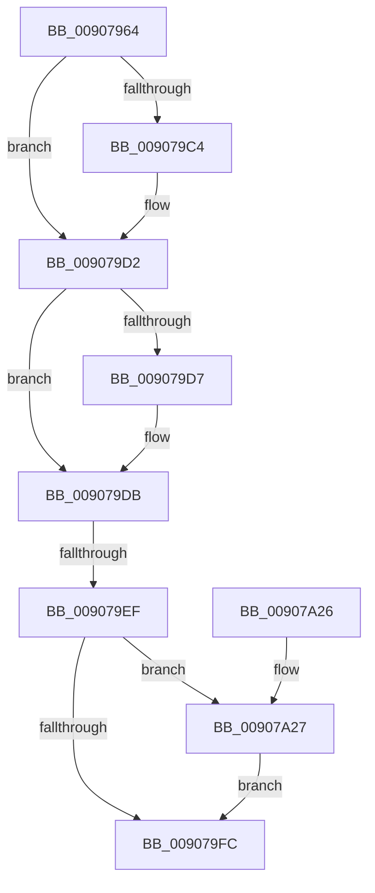

# AlpcpCleanupProcessViews

- RVA: `0x00907964`–`0x00907A31` (길이 `205` bytes)
- VA: `0x0000000140907964`
- 실행 섹션: `PAGE`
- PDB 이름 있음: `예`; PDB Function 태그: `예`
- unwind 정보 RVA: `0x00088DC8`
- 디코드: `58`개 명령, `205/205` bytes 표시
- 미해석 바이트: `0` (있으면 어셈블리에 `.byte`로 보존)

> 이 문서는 커널 이미지의 기계어와 PDB 기호를 분석해 생성했습니다. 4번과 5번은 함수 원형과 자료형을 바이너리 사용 방식에서 추정한 C 해석이며 원본 소스 복구 결과는 아닙니다.

## 1. Dependencies

- 직접 호출 지점: **5**; 고유 호출 대상: **5**
- 직접 호출자로 확인된 함수: **1**
- RIP 상대 이미지 참조: **0**

### Outgoing calls
- `0x009079B4` → [KeAbPreAcquire](../../text/21/KeAbPreAcquire_function_00210230.md) (function, `0x00210230`)
- `0x009079CD` → [ExfAcquirePushLockExclusiveEx](../../text/20/ExfAcquirePushLockExclusiveEx_function_0020FC90.md) (function, `0x0020FC90`)
- `0x009079FF` → [KeAbPostRelease](../../text/2E/KeAbPostRelease_function_002E1600.md) (function, `0x002E1600`)
- `0x00907A04` → [KeLeaveCriticalRegion](../../text/25/KeLeaveCriticalRegion_function_0025D8B0.md) (function, `0x0025D8B0`)
- `0x00907A2A` → [ExfTryToWakePushLock](../../text/26/ExfTryToWakePushLock_function_00265DD0.md) (function, `0x00265DD0`)

### Direct callers
- [LpcExitProcess](LpcExitProcess_function_00907920.md) at `0x0090794F`

### Static image references
- 디코드된 RIP-relative 메모리 참조가 없습니다.

## 2. Other-region calls and transfers

- 다른 실행 섹션으로 향하는 call: **5**
  - `0x009079B4` → [KeAbPreAcquire](../../text/21/KeAbPreAcquire_function_00210230.md) (`PAGE` → `.text`)
  - `0x009079CD` → [ExfAcquirePushLockExclusiveEx](../../text/20/ExfAcquirePushLockExclusiveEx_function_0020FC90.md) (`PAGE` → `.text`)
  - `0x009079FF` → [KeAbPostRelease](../../text/2E/KeAbPostRelease_function_002E1600.md) (`PAGE` → `.text`)
  - `0x00907A04` → [KeLeaveCriticalRegion](../../text/25/KeLeaveCriticalRegion_function_0025D8B0.md) (`PAGE` → `.text`)
  - `0x00907A2A` → [ExfTryToWakePushLock](../../text/26/ExfTryToWakePushLock_function_00265DD0.md) (`PAGE` → `.text`)
- call이 아닌 외부 분기/꼬리 이동: **1**
  - `0x009079E9` → [sub_00B20EEE](../B2/Unknown_function_00B20EEE.md) (`tail-transfer`)

## 3. Assembly (complete function range)

```asm
00907964  48 89 5C 24 10                  mov qword ptr [rsp + 0x10], rbx
00907969  48 89 6C 24 18                  mov qword ptr [rsp + 0x18], rbp
0090796E  48 89 74 24 20                  mov qword ptr [rsp + 0x20], rsi
00907973  57                              push rdi
00907974  41 54                           push r12
00907976  41 55                           push r13
00907978  41 56                           push r14
0090797A  41 57                           push r15
0090797C  48 83 EC 20                     sub rsp, 0x20
00907980  65 48 8B 04 25 88 01 00 00      mov rax, qword ptr gs:[0x188]
00907989  48 8D B1 80 05 00 00            lea rsi, [rcx + 0x580]
00907990  4C 8B F9                        mov r15, rcx
00907993  45 33 C9                        xor r9d, r9d
00907996  48 83 CB FF                     or rbx, 0xffffffffffffffff
0090799A  4C 89 4C 24 50                  mov qword ptr [rsp + 0x50], r9
0090799F  45 33 C0                        xor r8d, r8d
009079A2  33 D2                           xor edx, edx
009079A4  66 01 98 E4 01 00 00            add word ptr [rax + 0x1e4], bx
009079AB  48 8B CE                        mov rcx, rsi
009079AE  90                              nop
009079AF  45 33 F6                        xor r14d, r14d
009079B2  33 ED                           xor ebp, ebp
009079B4  E8 77 88 90 FF                  call 0x140210230
009079B9  F0 48 0F BA 2E 00               lock bts qword ptr [rsi], 0
009079BF  48 8B F8                        mov rdi, rax
009079C2  73 0E                           jae 0x1409079d2
009079C4  4C 8B C6                        mov r8, rsi
009079C7  48 8B D0                        mov rdx, rax
009079CA  48 8B CE                        mov rcx, rsi
009079CD  E8 BE 82 90 FF                  call 0x14020fc90
009079D2  48 85 FF                        test rdi, rdi
009079D5  74 04                           je 0x1409079db
009079D7  C6 47 0A 01                     mov byte ptr [rdi + 0xa], 1
009079DB  4D 8D AF 88 05 00 00            lea r13, [r15 + 0x588]
009079E2  49 8B 7D 00                     mov rdi, qword ptr [r13]
009079E6  49 3B FD                        cmp rdi, r13
009079E9  0F 85 FF 94 21 00               jne 0x140b20eee
009079EF  F0 48 0F C1 1E                  lock xadd qword ptr [rsi], rbx
009079F4  80 E3 06                        and bl, 6
009079F7  80 FB 02                        cmp bl, 2
009079FA  74 2B                           je 0x140907a27
009079FC  48 8B CE                        mov rcx, rsi
009079FF  E8 FC 9B 9D FF                  call 0x1402e1600
00907A04  E8 A7 5E 95 FF                  call 0x14025d8b0
00907A09  48 8B 5C 24 58                  mov rbx, qword ptr [rsp + 0x58]
00907A0E  48 8B 6C 24 60                  mov rbp, qword ptr [rsp + 0x60]
00907A13  48 8B 74 24 68                  mov rsi, qword ptr [rsp + 0x68]
00907A18  48 83 C4 20                     add rsp, 0x20
00907A1C  41 5F                           pop r15
00907A1E  41 5E                           pop r14
00907A20  41 5D                           pop r13
00907A22  41 5C                           pop r12
00907A24  5F                              pop rdi
00907A25  C3                              ret
00907A26  CC                              int3
00907A27  48 8B CE                        mov rcx, rsi
00907A2A  E8 A1 E3 95 FF                  call 0x140265dd0
00907A2F  EB CB                           jmp 0x1409079fc
```

## 4. C-style interpretation (structured pseudocode)

```c
__int64 __fastcall AlpcpCleanupProcessViews(__int64 a1, int a2, int a3, int a4)
{
    __int64 result;
    __int64 v_r14;
    __int64 v_rbp;
    __int64 v_rbx;
    __int64 v_rsp;
    unsigned __int64 v_stack_p10;
    unsigned __int64 v_stack_p18;
    unsigned __int64 v_stack_p20;
    unsigned __int64 v_stack_p8;

    v_stack_p10 = v_rbx;
    v_stack_p18 = v_rbp;
    v_stack_p20 = v_rsi;
    v_rsp = (v_rsp) - (32);
    a4 = 0;
    v_rbx = (v_rbx) | (-1);
    v_stack_p8 = 0;
    a3 = 0;
    a2 = 0;
    v_r14 = 0;
    v_rbp = 0;
    result = KeAbPreAcquire(a1 + 1408, a2, a3, a4);
    if (!(condition_is_above_or_equal)) {
        a3 = a1 + 1408;
        a2 = result;
        a1 = a1 + 1408;
        result = ExfAcquirePushLockExclusiveEx(a1, a2, a3, a4);
    }
    if (result != 0) {
        *(unsigned __int8 *)(result + 10) = 1;
    }
    v_rbx = (unsigned __int8)((v_rbx) & (6));
    if (((unsigned __int8)(v_rbx)) == 2) goto loc_00907A27;
loc_009079FC:
    result = KeAbPostRelease(a1 + 1408, a2, a3, a4);
    result = KeLeaveCriticalRegion(a1 + 1408, a2, a3, a4);
    v_rsp = (v_rsp) + (32);
    return result;
loc_00907A27:
    result = ExfTryToWakePushLock(v_stack_p20, a2, a3, a4);
    goto loc_009079FC;
}
```

## 5. (Beta) C Style

```c
int64_t AlpcpCleanupProcessViews(void *Arg1, int32_t Arg2, int32_t Arg3, int32_t Arg4)
{
    uint8_t *arg1 = (uint8_t *)Arg1;

    int64_t result;
    int64_t local_r14;
    int64_t local_rbp;
    int64_t local_rbx;
    int64_t local_rsp;
    uint64_t v_stack_p10;
    uint64_t v_stack_p18;
    uint64_t v_stack_p20;
    uint64_t v_stack_p8;

    v_stack_p10 = local_rbx;
    v_stack_p18 = local_rbp;
    v_stack_p20 = local_rsi;
    local_rsp = (local_rsp) - (32);
    Arg4 = 0;
    local_rbx = (local_rbx) | (-1);
    v_stack_p8 = 0;
    Arg3 = 0;
    Arg2 = 0;
    local_r14 = 0;
    local_rbp = 0;
    result = KeAbPreAcquire(Arg1 + 1408, Arg2, Arg3, Arg4);
    if (!(condition_is_above_or_equal)) {
        Arg3 = Arg1 + 1408;
        Arg2 = result;
        Arg1 = Arg1 + 1408;
        result = ExfAcquirePushLockExclusiveEx(Arg1, Arg2, Arg3, Arg4);
    }
    if (result != 0) {
        *(uint8_t *)(result + 0xA) = 1;
    }
    local_rbx = (uint8_t)((local_rbx) & (6));
    if (((uint8_t)(local_rbx)) == 2) goto loc_00907A27;
loc_009079FC:
    result = KeAbPostRelease(Arg1 + 1408, Arg2, Arg3, Arg4);
    result = KeLeaveCriticalRegion(Arg1 + 1408, Arg2, Arg3, Arg4);
    local_rsp = (local_rsp) + (32);
    return result;
loc_00907A27:
    result = ExfTryToWakePushLock(v_stack_p20, Arg2, Arg3, Arg4);
    goto loc_009079FC;
}
```

### 관측된 메모리 오프셋

구조체 형식이 확인되지 않은 접근은 인자 기준의 오프셋으로만 기록했습니다.

| 기준 인자 | 오프셋 표현 | 폭 (bit) | 접근 |
|---|---:|---:|---|
| `Arg1` | `+ 0x0` | `64` | `R` |
| `Arg1` | `+ 0x0` | `64` | `R/W` |
| `Arg1` | `+ 0x580` | `64` | `R` |
| `Arg1` | `+ 0x588` | `64` | `R` |

## 6. Execution-region graph

[열기: 2D/3D 그래프와 함수 탐색 컨트롤 패널](../../../control-panel.html?section=page&rva=0x00907964&view=graph)

- 2D 그래프는 위에서 아래로 흐르고, 3D 그래프는 빈 공간을 드래그해 회전합니다. Shift+드래그는 이동, 휠은 확대·축소, 함수 노드 선택은 대상 보고서 이동입니다.

### Static fallback


