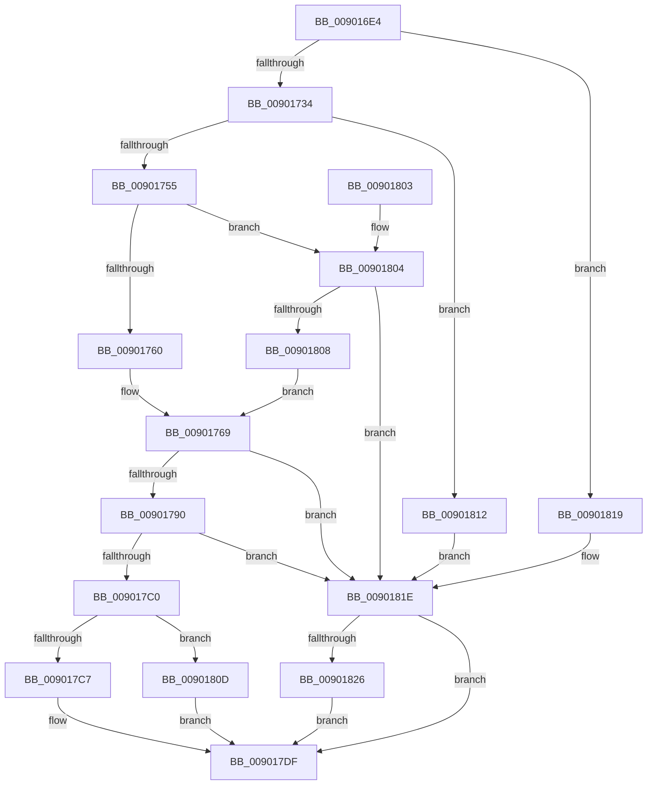

# CmCreateDeviceInterfaceWorker

- RVA: `0x009016E4`–`0x00901830` (길이 `332` bytes)
- VA: `0x00000001409016E4`
- 실행 섹션: `PAGE`
- PDB 이름 있음: `예`; PDB Function 태그: `아니요`
- unwind 정보 RVA: `0x0008864C`
- 디코드: `90`개 명령, `332/332` bytes 표시
- 미해석 바이트: `0` (있으면 어셈블리에 `.byte`로 보존)

> 이 문서는 커널 이미지의 기계어와 PDB 기호를 분석해 생성했습니다. 4번과 5번은 함수 원형과 자료형을 바이너리 사용 방식에서 추정한 C 해석이며 원본 소스 복구 결과는 아닙니다.

## 1. Dependencies

- 직접 호출 지점: **6**; 고유 호출 대상: **6**
- 직접 호출자로 확인된 함수: **1**
- RIP 상대 이미지 참조: **1**

### Outgoing calls
- `0x00901746` → [CmGetDeviceInterfaceSubkeyPath](../8F/CmGetDeviceInterfaceSubkeyPath_function_008F1010.md) (function, `0x008F1010`)
- `0x00901781` → [CmCreateInterfaceClass](CmCreateInterfaceClass_function_00901838.md) (function, `0x00901838`)
- `0x009017B5` → [_CmOpenDeviceInterfaceRegKey](../8F/_CmOpenDeviceInterfaceRegKey_function_008F31F4.md) (function, `0x008F31F4`)
- `0x009017DA` → [CmRaiseCreateEvent](../8F/CmRaiseCreateEvent_function_008FF944.md) (function, `0x008FF944`)
- `0x009017EC` → [_security_check_cookie](../../text/6A/_security_check_cookie_function_006AC640.md) (function, `0x006AC640`)
- `0x00901826` → [ZwClose](../../text/6A/ZwClose_function_006AD2B0.md) (function, `0x006AD2B0`)

### Direct callers
- [CmCreateDeviceInterface](CmCreateDeviceInterface_function_00901578.md) at `0x0090162E`

### Static image references
- `0x009016F6` → RVA `0x00E0A740` (`.data`; read)

## 2. Other-region calls and transfers

- 다른 실행 섹션으로 향하는 call: **2**
  - `0x009017EC` → [_security_check_cookie](../../text/6A/_security_check_cookie_function_006AC640.md) (`PAGE` → `.text`)
  - `0x00901826` → [ZwClose](../../text/6A/ZwClose_function_006AD2B0.md) (`PAGE` → `.text`)
- 별도 외부 분기/꼬리 이동을 확인하지 못했습니다.

## 3. Assembly (complete function range)

```asm
009016E4  40 53                           push rbx
009016E6  55                              push rbp
009016E7  56                              push rsi
009016E8  57                              push rdi
009016E9  41 54                           push r12
009016EB  41 56                           push r14
009016ED  41 57                           push r15
009016EF  48 81 EC B0 00 00 00            sub rsp, 0xb0
009016F6  48 8B 05 43 90 50 00            mov rax, qword ptr [rip + 0x509043]
009016FD  48 33 C4                        xor rax, rsp
00901700  48 89 84 24 A0 00 00 00         mov qword ptr [rsp + 0xa0], rax
00901708  0F B7 84 24 18 01 00 00         movzx eax, word ptr [rsp + 0x118]
00901710  45 33 E4                        xor r12d, r12d
00901713  4C 8B B4 24 10 01 00 00         mov r14, qword ptr [rsp + 0x110]
0090171B  49 8B F9                        mov rdi, r9
0090171E  44 89 64 24 40                  mov dword ptr [rsp + 0x40], r12d
00901723  45 8B F8                        mov r15d, r8d
00901726  48 8B EA                        mov rbp, rdx
00901729  48 8B F1                        mov rsi, rcx
0090172C  85 C0                           test eax, eax
0090172E  0F 85 E5 00 00 00               jne 0x140901819
00901734  44 89 64 24 28                  mov dword ptr [rsp + 0x28], r12d
00901739  4C 8D 4C 24 50                  lea r9, [rsp + 0x50]
0090173E  41 B0 01                        mov r8b, 1
00901741  4C 89 64 24 20                  mov qword ptr [rsp + 0x20], r12
00901746  E8 C5 F8 FE FF                  call 0x1408f1010
0090174B  8B D8                           mov ebx, eax
0090174D  85 C0                           test eax, eax
0090174F  0F 84 BD 00 00 00               je 0x140901812
00901755  3D 23 00 00 C0                  cmp eax, 0xc0000023
0090175A  0F 85 A4 00 00 00               jne 0x140901804
00901760  66 44 89 A4 24 9C 00 00 00      mov word ptr [rsp + 0x9c], r12w
00901769  44 89 64 24 28                  mov dword ptr [rsp + 0x28], r12d
0090176E  48 8D 54 24 50                  lea rdx, [rsp + 0x50]
00901773  45 33 C9                        xor r9d, r9d
00901776  4C 89 64 24 20                  mov qword ptr [rsp + 0x20], r12
0090177B  45 33 C0                        xor r8d, r8d
0090177E  48 8B CE                        mov rcx, rsi
00901781  E8 B2 00 00 00                  call 0x140901838
00901786  8B D8                           mov ebx, eax
00901788  85 C0                           test eax, eax
0090178A  0F 88 8E 00 00 00               js 0x14090181e
00901790  48 8D 44 24 40                  lea rax, [rsp + 0x40]
00901795  41 B8 30 00 00 00               mov r8d, 0x30
0090179B  48 89 44 24 38                  mov qword ptr [rsp + 0x38], rax
009017A0  48 8B D5                        mov rdx, rbp
009017A3  48 89 7C 24 30                  mov qword ptr [rsp + 0x30], rdi
009017A8  48 8B CE                        mov rcx, rsi
009017AB  C6 44 24 28 01                  mov byte ptr [rsp + 0x28], 1
009017B0  44 89 7C 24 20                  mov dword ptr [rsp + 0x20], r15d
009017B5  E8 3A 1A FF FF                  call 0x1408f31f4
009017BA  8B D8                           mov ebx, eax
009017BC  85 C0                           test eax, eax
009017BE  78 5E                           js 0x14090181e
009017C0  83 7C 24 40 01                  cmp dword ptr [rsp + 0x40], 1
009017C5  75 46                           jne 0x14090180d
009017C7  41 C6 06 01                     mov byte ptr [r14], 1
009017CB  41 B8 03 00 00 00               mov r8d, 3
009017D1  4C 8B 0F                        mov r9, qword ptr [rdi]
009017D4  48 8B D5                        mov rdx, rbp
009017D7  48 8B CE                        mov rcx, rsi
009017DA  E8 65 E1 FF FF                  call 0x1408ff944
009017DF  8B C3                           mov eax, ebx
009017E1  48 8B 8C 24 A0 00 00 00         mov rcx, qword ptr [rsp + 0xa0]
009017E9  48 33 CC                        xor rcx, rsp
009017EC  E8 4F AE DA FF                  call 0x1406ac640
009017F1  48 81 C4 B0 00 00 00            add rsp, 0xb0
009017F8  41 5F                           pop r15
009017FA  41 5E                           pop r14
009017FC  41 5C                           pop r12
009017FE  5F                              pop rdi
009017FF  5E                              pop rsi
00901800  5D                              pop rbp
00901801  5B                              pop rbx
00901802  C3                              ret
00901803  CC                              int3
00901804  85 C0                           test eax, eax
00901806  78 16                           js 0x14090181e
00901808  E9 5C FF FF FF                  jmp 0x140901769
0090180D  45 88 26                        mov byte ptr [r14], r12b
00901810  EB CD                           jmp 0x1409017df
00901812  BB E5 00 00 C0                  mov ebx, 0xc00000e5
00901817  EB 05                           jmp 0x14090181e
00901819  BB 0D 00 00 C0                  mov ebx, 0xc000000d
0090181E  48 8B 0F                        mov rcx, qword ptr [rdi]
00901821  48 85 C9                        test rcx, rcx
00901824  74 B9                           je 0x1409017df
00901826  E8 85 BA DA FF                  call 0x1406ad2b0
0090182B  4C 89 27                        mov qword ptr [rdi], r12
0090182E  EB AF                           jmp 0x1409017df
```

## 4. C-style interpretation (structured pseudocode)

```c
__int64 __fastcall CmCreateDeviceInterfaceWorker(__int64 a1, __int64 a2, int a3, __int64 a4, __int64 a5, unsigned __int16 a6)
{
    __int64 result;
    __int64 v_r12;
    __int64 v_rsp;
    unsigned __int64 v_stack_m48;
    unsigned __int16 v_stack_m4C;
    unsigned __int64 v_stack_m98;
    unsigned int v_stack_mA8;
    unsigned __int64 v_stack_mB0;
    unsigned __int64 v_stack_mB8;
    unsigned int v_stack_mC0;
    unsigned __int64 v_stack_mC8;

    v_rsp = (v_rsp) - (176);
    result = (*(unsigned __int64 *)(v_rip + 5279811)) ^ (v_rsp);
    v_stack_m48 = result;
    v_r12 = 0;
    v_stack_mA8 = 0;
    if (a6 != 0) goto loc_00901819;
    v_stack_mC0 = 0;
    v_stack_mC8 = 0;
    result = CmGetDeviceInterfaceSubkeyPath(a1, a2, 1, v_stack_m98);
    if ((unsigned int)(result) == 0) goto loc_00901812;
    if (((unsigned int)(result)) != 0xC0000023ULL) goto loc_00901804;
    v_stack_m4C = 0;
loc_00901769:
    v_stack_mC0 = 0;
    a4 = 0;
    v_stack_mC8 = 0;
    a3 = 0;
    result = CmCreateInterfaceClass(a1, v_stack_m98, a3, a4);
    if (sign_flag) goto loc_0090181E;
    v_stack_mB0 = v_stack_mA8;
    v_stack_mB8 = 0;
    v_stack_mC0 = 1;
    v_stack_mC8 = (unsigned int)((unsigned int)(a3));
    result = _CmOpenDeviceInterfaceRegKey(a1, a2, 48, a4);
    if (sign_flag) goto loc_0090181E;
    if (v_stack_mA8 != 1) goto loc_0090180D;
    *(unsigned __int8 *)(a5) = 1;
    result = CmRaiseCreateEvent(a1, a2, 3, *(unsigned __int64 *)(a4));
loc_009017DF:
    a1 = (v_stack_m48) ^ (v_rsp);
    result = _security_check_cookie(a1, a2, 3, *(unsigned __int64 *)(a4));
    v_rsp = (v_rsp) + (176);
    return result;
loc_00901804:
    if (sign_flag) goto loc_0090181E;
    goto loc_00901769;
loc_0090180D:
    *(unsigned __int8 *)(a5) = 0;
    goto loc_009017DF;
loc_00901812:
    goto loc_0090181E;
loc_00901819:
loc_0090181E:
    if (*(unsigned __int64 *)(a4) == 0) goto loc_009017DF;
    result = ZwClose(*(unsigned __int64 *)(a4), a2, 3, *(unsigned __int64 *)(a4));
    *(unsigned __int64 *)(a4) = 0;
    goto loc_009017DF;
}
```

## 5. (Beta) C Style

```c
int64_t CmCreateDeviceInterfaceWorker(int64_t Arg1, int64_t Arg2, int32_t Arg3, void *Arg4, void *Arg5, uint16_t Arg6)
{
    uint8_t *arg4 = (uint8_t *)Arg4;
    uint8_t *arg5 = (uint8_t *)Arg5;

    int64_t result;
    int64_t local_r12;
    int64_t local_rsp;
    uint64_t v_stack_m48;
    uint16_t v_stack_m4C;
    uint64_t v_stack_m98;
    uint32_t v_stack_mA8;
    uint64_t v_stack_mB0;
    uint64_t v_stack_mB8;
    uint32_t v_stack_mC0;
    uint64_t v_stack_mC8;

    local_rsp = (local_rsp) - (176);
    result = (*(uint64_t *)(v_rip + 0x509043)) ^ (local_rsp);
    v_stack_m48 = result;
    local_r12 = 0;
    v_stack_mA8 = 0;
    if (Arg6 != 0) goto loc_00901819;
    v_stack_mC0 = 0;
    v_stack_mC8 = 0;
    result = CmGetDeviceInterfaceSubkeyPath(Arg1, Arg2, 1, v_stack_m98);
    if ((uint32_t)(result) == 0) goto loc_00901812;
    if (((uint32_t)(result)) != 0xC0000023ULL) goto loc_00901804;
    v_stack_m4C = 0;
loc_00901769:
    v_stack_mC0 = 0;
    Arg4 = 0;
    v_stack_mC8 = 0;
    Arg3 = 0;
    result = CmCreateInterfaceClass(Arg1, v_stack_m98, Arg3, Arg4);
    if (sign_flag) goto loc_0090181E;
    v_stack_mB0 = v_stack_mA8;
    v_stack_mB8 = 0;
    v_stack_mC0 = 1;
    v_stack_mC8 = (uint32_t)((uint32_t)(Arg3));
    result = _CmOpenDeviceInterfaceRegKey(Arg1, Arg2, 48, Arg4);
    if (sign_flag) goto loc_0090181E;
    if (v_stack_mA8 != 1) goto loc_0090180D;
    *(uint8_t *)(arg5) = 1;
    result = CmRaiseCreateEvent(Arg1, Arg2, 3, *(uint64_t *)(arg4));
loc_009017DF:
    Arg1 = (v_stack_m48) ^ (local_rsp);
    result = _security_check_cookie(Arg1, Arg2, 3, *(uint64_t *)(arg4));
    local_rsp = (local_rsp) + (176);
    return result;
loc_00901804:
    if (sign_flag) goto loc_0090181E;
    goto loc_00901769;
loc_0090180D:
    *(uint8_t *)(arg5) = 0;
    goto loc_009017DF;
loc_00901812:
    goto loc_0090181E;
loc_00901819:
loc_0090181E:
    if (*(uint64_t *)(arg4) == 0) goto loc_009017DF;
    result = ZwClose(*(uint64_t *)(arg4), Arg2, 3, *(uint64_t *)(arg4));
    *(uint64_t *)(arg4) = 0;
    goto loc_009017DF;
}
```

### 관측된 메모리 오프셋

구조체 형식이 확인되지 않은 접근은 인자 기준의 오프셋으로만 기록했습니다.

| 기준 인자 | 오프셋 표현 | 폭 (bit) | 접근 |
|---|---:|---:|---|
| `Arg4` | `+ 0x0` | `64` | `R` |
| `Arg4` | `+ 0x0` | `64` | `W` |
| `Arg5` | `+ 0x0` | `8` | `W` |

## 6. Execution-region graph

[열기: 2D/3D 그래프와 함수 탐색 컨트롤 패널](../../../control-panel.html?section=page&rva=0x009016E4&view=graph)

- 2D 그래프는 위에서 아래로 흐르고, 3D 그래프는 빈 공간을 드래그해 회전합니다. Shift+드래그는 이동, 휠은 확대·축소, 함수 노드 선택은 대상 보고서 이동입니다.

### Static fallback


