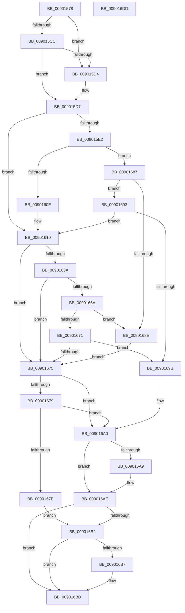

# CmCreateDeviceInterface

- RVA: `0x00901578`–`0x009016DE` (길이 `358` bytes)
- VA: `0x0000000140901578`
- 실행 섹션: `PAGE`
- PDB 이름 있음: `예`; PDB Function 태그: `아니요`
- unwind 정보 RVA: `0x00088628`
- 디코드: `111`개 명령, `358/358` bytes 표시
- 미해석 바이트: `0` (있으면 어셈블리에 `.byte`로 보존)

> 이 문서는 커널 이미지의 기계어와 PDB 기호를 분석해 생성했습니다. 4번과 5번은 함수 원형과 자료형을 바이너리 사용 방식에서 추정한 C 해석이며 원본 소스 복구 결과는 아닙니다.

## 1. Dependencies

- 직접 호출 지점: **6**; 고유 호출 대상: **5**
- 직접 호출자로 확인된 함수: **2**
- RIP 상대 이미지 참조: **1**

### Outgoing calls
- `0x009015B7` → [memset](../../text/6C/memset_function_006C6C40.md) (function, `0x006C6C40`)
- `0x00901602` → [guard_dispatch_icall](../../text/6B/guard_dispatch_icall_function_006BAAD0.md) (function, `0x006BAAD0`)
- `0x0090162E` → [CmCreateDeviceInterfaceWorker](CmCreateDeviceInterfaceWorker_function_009016E4.md) (function, `0x009016E4`)
- `0x0090165E` → [guard_dispatch_icall](../../text/6B/guard_dispatch_icall_function_006BAAD0.md) (function, `0x006BAAD0`)
- `0x009016A9` → [ZwClose](../../text/6A/ZwClose_function_006AD2B0.md) (function, `0x006AD2B0`)
- `0x009016C6` → [_security_check_cookie](../../text/6A/_security_check_cookie_function_006AC640.md) (function, `0x006AC640`)

### Direct callers
- [_PnpDispatchDeviceInterface](../8E/_PnpDispatchDeviceInterface_function_008E0DB0.md) at `0x008E10F7`
- [IopRegisterDeviceInterface](../95/IopRegisterDeviceInterface_function_009501B0.md) at `0x0095068C`

### Static image references
- `0x0090158F` → RVA `0x00E0A740` (`.data`; read)

## 2. Other-region calls and transfers

- 다른 실행 섹션으로 향하는 call: **5**
  - `0x009015B7` → [memset](../../text/6C/memset_function_006C6C40.md) (`PAGE` → `.text`)
  - `0x00901602` → [guard_dispatch_icall](../../text/6B/guard_dispatch_icall_function_006BAAD0.md) (`PAGE` → `.text`)
  - `0x0090165E` → [guard_dispatch_icall](../../text/6B/guard_dispatch_icall_function_006BAAD0.md) (`PAGE` → `.text`)
  - `0x009016A9` → [ZwClose](../../text/6A/ZwClose_function_006AD2B0.md) (`PAGE` → `.text`)
  - `0x009016C6` → [_security_check_cookie](../../text/6A/_security_check_cookie_function_006AC640.md) (`PAGE` → `.text`)
- 별도 외부 분기/꼬리 이동을 확인하지 못했습니다.

## 3. Assembly (complete function range)

```asm
00901578  40 55                           push rbp
0090157A  53                              push rbx
0090157B  56                              push rsi
0090157C  57                              push rdi
0090157D  41 54                           push r12
0090157F  41 56                           push r14
00901581  41 57                           push r15
00901583  48 8D 6C 24 E9                  lea rbp, [rsp - 0x17]
00901588  48 81 EC B0 00 00 00            sub rsp, 0xb0
0090158F  48 8B 05 AA 91 50 00            mov rax, qword ptr [rip + 0x5091aa]
00901596  48 33 C4                        xor rax, rsp
00901599  48 89 45 07                     mov qword ptr [rbp + 7], rax
0090159D  4C 8B 75 77                     mov r14, qword ptr [rbp + 0x77]
009015A1  4C 8B E2                        mov r12, rdx
009015A4  33 D2                           xor edx, edx
009015A6  41 8B D8                        mov ebx, r8d
009015A9  4C 8B F9                        mov r15, rcx
009015AC  49 8B F9                        mov rdi, r9
009015AF  48 8D 4D A7                     lea rcx, [rbp - 0x59]
009015B3  44 8D 42 58                     lea r8d, [rdx + 0x58]
009015B7  E8 84 56 DC FF                  call 0x1406c6c40
009015BC  49 8B B7 F8 01 00 00            mov rsi, qword ptr [r15 + 0x1f8]
009015C3  B9 01 00 00 00                  mov ecx, 1
009015C8  85 DB                           test ebx, ebx
009015CA  75 08                           jne 0x1409015d4
009015CC  89 4D B7                        mov dword ptr [rbp - 0x49], ecx
009015CF  48 85 FF                        test rdi, rdi
009015D2  74 03                           je 0x1409015d7
009015D4  89 5D B7                        mov dword ptr [rbp - 0x49], ebx
009015D7  8B 45 7F                        mov eax, dword ptr [rbp + 0x7f]
009015DA  89 45 CB                        mov dword ptr [rbp - 0x35], eax
009015DD  48 85 F6                        test rsi, rsi
009015E0  74 2E                           je 0x140901610
009015E2  41 B9 02 00 00 00               mov r9d, 2
009015E8  48 8D 45 A7                     lea rax, [rbp - 0x59]
009015EC  48 89 44 24 28                  mov qword ptr [rsp + 0x28], rax
009015F1  49 8B D4                        mov rdx, r12
009015F4  89 4C 24 20                     mov dword ptr [rsp + 0x20], ecx
009015F8  48 8B C6                        mov rax, rsi
009015FB  49 8B CF                        mov rcx, r15
009015FE  45 8D 41 01                     lea r8d, [r9 + 1]
00901602  E8 C9 94 DB FF                  call 0x1406baad0
00901607  3D 02 00 00 C0                  cmp eax, 0xc0000002
0090160C  75 79                           jne 0x140901687
0090160E  33 F6                           xor esi, esi
00901610  8B 45 CB                        mov eax, dword ptr [rbp - 0x35]
00901613  4C 8D 4D BF                     lea r9, [rbp - 0x41]
00901617  44 8B 45 B7                     mov r8d, dword ptr [rbp - 0x49]
0090161B  49 8B D4                        mov rdx, r12
0090161E  89 44 24 28                     mov dword ptr [rsp + 0x28], eax
00901622  49 8B CF                        mov rcx, r15
00901625  48 8D 45 C7                     lea rax, [rbp - 0x39]
00901629  48 89 44 24 20                  mov qword ptr [rsp + 0x20], rax
0090162E  E8 B1 00 00 00                  call 0x1409016e4
00901633  8B D8                           mov ebx, eax
00901635  48 85 F6                        test rsi, rsi
00901638  74 3B                           je 0x140901675
0090163A  41 B9 02 00 00 00               mov r9d, 2
00901640  89 45 A7                        mov dword ptr [rbp - 0x59], eax
00901643  48 8D 45 A7                     lea rax, [rbp - 0x59]
00901647  49 8B D4                        mov rdx, r12
0090164A  48 89 44 24 28                  mov qword ptr [rsp + 0x28], rax
0090164F  49 8B CF                        mov rcx, r15
00901652  48 8B C6                        mov rax, rsi
00901655  44 89 4C 24 20                  mov dword ptr [rsp + 0x20], r9d
0090165A  45 8D 41 01                     lea r8d, [r9 + 1]
0090165E  E8 6D 94 DB FF                  call 0x1406baad0
00901663  3D 02 00 00 C0                  cmp eax, 0xc0000002
00901668  74 0B                           je 0x140901675
0090166A  3D 20 01 00 C0                  cmp eax, 0xc0000120
0090166F  74 1D                           je 0x14090168e
00901671  85 C0                           test eax, eax
00901673  75 26                           jne 0x14090169b
00901675  85 DB                           test ebx, ebx
00901677  78 27                           js 0x1409016a0
00901679  48 85 FF                        test rdi, rdi
0090167C  74 22                           je 0x1409016a0
0090167E  48 8B 45 BF                     mov rax, qword ptr [rbp - 0x41]
00901682  48 89 07                        mov qword ptr [rdi], rax
00901685  EB 2B                           jmp 0x1409016b2
00901687  3D 20 01 00 C0                  cmp eax, 0xc0000120
0090168C  75 05                           jne 0x140901693
0090168E  8B 5D A7                        mov ebx, dword ptr [rbp - 0x59]
00901691  EB E2                           jmp 0x140901675
00901693  85 C0                           test eax, eax
00901695  0F 84 75 FF FF FF               je 0x140901610
0090169B  BB E5 00 00 C0                  mov ebx, 0xc00000e5
009016A0  48 8B 4D BF                     mov rcx, qword ptr [rbp - 0x41]
009016A4  48 85 C9                        test rcx, rcx
009016A7  74 05                           je 0x1409016ae
009016A9  E8 02 BC DA FF                  call 0x1406ad2b0
009016AE  85 DB                           test ebx, ebx
009016B0  78 0B                           js 0x1409016bd
009016B2  4D 85 F6                        test r14, r14
009016B5  74 06                           je 0x1409016bd
009016B7  8A 45 C7                        mov al, byte ptr [rbp - 0x39]
009016BA  41 88 06                        mov byte ptr [r14], al
009016BD  8B C3                           mov eax, ebx
009016BF  48 8B 4D 07                     mov rcx, qword ptr [rbp + 7]
009016C3  48 33 CC                        xor rcx, rsp
009016C6  E8 75 AF DA FF                  call 0x1406ac640
009016CB  48 81 C4 B0 00 00 00            add rsp, 0xb0
009016D2  41 5F                           pop r15
009016D4  41 5E                           pop r14
009016D6  41 5C                           pop r12
009016D8  5F                              pop rdi
009016D9  5E                              pop rsi
009016DA  5B                              pop rbx
009016DB  5D                              pop rbp
009016DC  C3                              ret
009016DD  CC                              int3
```

## 4. C-style interpretation (structured pseudocode)

```c
__int64 __fastcall CmCreateDeviceInterface(__int64 a1, __int64 a2, int a3, __int64 a4, __int64 a5, unsigned int a6)
{
    __int64 result;
    __int64 v_rsi;
    __int64 v_rsp;
    unsigned __int64 v_stack_m48;
    unsigned __int64 v_stack_m4F;
    unsigned int v_stack_m84;
    unsigned __int64 v_stack_m88;
    unsigned __int64 v_stack_m90;
    unsigned int v_stack_m98;
    unsigned __int64 v_stack_mA8;
    unsigned __int64 v_stack_mC0;
    unsigned int v_stack_mC8;

    v_rsp = (v_rsp) - (176);
    result = (*(unsigned __int64 *)(v_rip + 5280170)) ^ (v_rsp);
    v_stack_m48 = result;
    a2 = 0;
    result = memset(v_stack_mA8, a2, a2 + 88, a4);
    if ((unsigned int)((unsigned int)(a3)) != 0) goto loc_009015D4;
    v_stack_m98 = 1;
    if (a4 != 0) {
        v_stack_m98 = (unsigned int)((unsigned int)(a3));
    }
    v_stack_m84 = (unsigned int)((unsigned int)(a6));
    if (*(unsigned __int64 *)(a1 + 504) == 0) goto loc_00901610;
    v_stack_mC0 = v_stack_mA8;
    v_stack_mC8 = 1;
    result = guard_dispatch_icall(a1, 0, 2 + 1, 2);
    if (((unsigned int)(result)) != 0xC0000002ULL) goto loc_00901687;
    v_rsi = 0;
loc_00901610:
    v_stack_mC0 = (unsigned int)((unsigned int)(v_stack_m84));
    v_stack_mC8 = v_stack_m88;
    result = CmCreateDeviceInterfaceWorker(a1, 0, (unsigned int)(v_stack_m98), v_stack_m90);
    if (0 == 0) goto loc_00901675;
    v_stack_mA8 = (unsigned int)(result);
    v_stack_mC0 = v_stack_mA8;
    v_stack_mC8 = 2;
    result = guard_dispatch_icall(a1, 0, 2 + 1, 2);
    if (((unsigned int)(result)) == 0xC0000002ULL) goto loc_00901675;
    if (((unsigned int)(result)) == 0xC0000120ULL) goto loc_0090168E;
    if ((unsigned int)(result) != 0) goto loc_0090169B;
loc_00901675:
    if (sign_flag) goto loc_009016A0;
    if (a4 == 0) goto loc_009016A0;
    *(unsigned __int64 *)(a4) = v_stack_m90;
    goto loc_009016B2;
loc_00901687:
    if (((unsigned int)(v_stack_m90)) != 0xC0000120ULL) goto loc_00901693;
loc_0090168E:
    goto loc_00901675;
loc_00901693:
    if ((unsigned int)(v_stack_m90) == 0) goto loc_00901610;
loc_0090169B:
loc_009016A0:
    result = v_stack_m90;
    if (v_stack_m90 != 0) {
        result = ZwClose(v_stack_m90, 0, 2 + 1, 2);
    }
    if (sign_flag) goto loc_009016BD;
loc_009016B2:
    if (a5 != 0) {
        result = v_stack_m88;
        *(unsigned __int8 *)(a5) = (unsigned __int8)(result);
    }
    a1 = (v_stack_m48) ^ (v_rsp);
    result = _security_check_cookie(a1, 0, 2 + 1, 2);
    v_rsp = (v_rsp) + (176);
    return result;
}
```

## 5. (Beta) C Style

```c
int64_t CmCreateDeviceInterface(void *Arg1, int64_t Arg2, int32_t Arg3, int64_t Arg4, int64_t Arg5, uint32_t Arg6)
{
    uint8_t *arg1 = (uint8_t *)Arg1;

    int64_t result;
    int64_t local_rsi;
    int64_t local_rsp;
    uint64_t v_stack_m48;
    uint64_t v_stack_m4F;
    uint32_t v_stack_m84;
    uint64_t v_stack_m88;
    uint64_t v_stack_m90;
    uint32_t v_stack_m98;
    uint64_t v_stack_mA8;
    uint64_t v_stack_mC0;
    uint32_t v_stack_mC8;

    local_rsp = (local_rsp) - (176);
    result = (*(uint64_t *)(v_rip + 0x5091AA)) ^ (local_rsp);
    v_stack_m48 = result;
    Arg2 = 0;
    result = memset(v_stack_mA8, Arg2, Arg2 + 88, Arg4);
    if ((uint32_t)((uint32_t)(Arg3)) != 0) goto loc_009015D4;
    v_stack_m98 = 1;
    if (Arg4 != 0) {
        v_stack_m98 = (uint32_t)((uint32_t)(Arg3));
    }
    v_stack_m84 = (uint32_t)((uint32_t)(Arg6));
    if (*(uint64_t *)(arg1 + 0x1F8) == 0) goto loc_00901610;
    v_stack_mC0 = v_stack_mA8;
    v_stack_mC8 = 1;
    result = guard_dispatch_icall(Arg1, 0, 2 + 1, 2);
    if (((uint32_t)(result)) != 0xC0000002ULL) goto loc_00901687;
    local_rsi = 0;
loc_00901610:
    v_stack_mC0 = (uint32_t)((uint32_t)(v_stack_m84));
    v_stack_mC8 = v_stack_m88;
    result = CmCreateDeviceInterfaceWorker(Arg1, 0, (uint32_t)(v_stack_m98), v_stack_m90);
    if (0 == 0) goto loc_00901675;
    v_stack_mA8 = (uint32_t)(result);
    v_stack_mC0 = v_stack_mA8;
    v_stack_mC8 = 2;
    result = guard_dispatch_icall(Arg1, 0, 2 + 1, 2);
    if (((uint32_t)(result)) == 0xC0000002ULL) goto loc_00901675;
    if (((uint32_t)(result)) == 0xC0000120ULL) goto loc_0090168E;
    if ((uint32_t)(result) != 0) goto loc_0090169B;
loc_00901675:
    if (sign_flag) goto loc_009016A0;
    if (Arg4 == 0) goto loc_009016A0;
    *(uint64_t *)(Arg4) = v_stack_m90;
    goto loc_009016B2;
loc_00901687:
    if (((uint32_t)(v_stack_m90)) != 0xC0000120ULL) goto loc_00901693;
loc_0090168E:
    goto loc_00901675;
loc_00901693:
    if ((uint32_t)(v_stack_m90) == 0) goto loc_00901610;
loc_0090169B:
loc_009016A0:
    result = v_stack_m90;
    if (v_stack_m90 != 0) {
        result = ZwClose(v_stack_m90, 0, 2 + 1, 2);
    }
    if (sign_flag) goto loc_009016BD;
loc_009016B2:
    if (Arg5 != 0) {
        result = v_stack_m88;
        *(uint8_t *)(Arg5) = (uint8_t)(result);
    }
    Arg1 = (v_stack_m48) ^ (local_rsp);
    result = _security_check_cookie(Arg1, 0, 2 + 1, 2);
    local_rsp = (local_rsp) + (176);
    return result;
}
```

### 관측된 메모리 오프셋

구조체 형식이 확인되지 않은 접근은 인자 기준의 오프셋으로만 기록했습니다.

| 기준 인자 | 오프셋 표현 | 폭 (bit) | 접근 |
|---|---:|---:|---|
| `Arg1` | `+ 0x1F8` | `64` | `R` |

## 6. Execution-region graph

[열기: 2D/3D 그래프와 함수 탐색 컨트롤 패널](../../../control-panel.html?section=page&rva=0x00901578&view=graph)

- 2D 그래프는 위에서 아래로 흐르고, 3D 그래프는 빈 공간을 드래그해 회전합니다. Shift+드래그는 이동, 휠은 확대·축소, 함수 노드 선택은 대상 보고서 이동입니다.

### Static fallback


