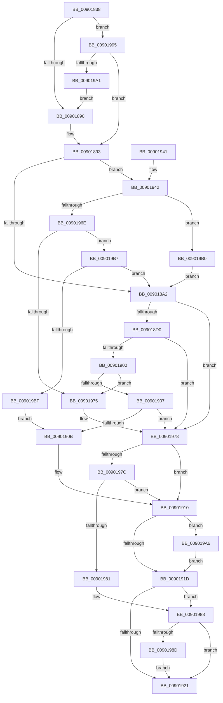

# CmCreateInterfaceClass

- RVA: `0x00901838`–`0x009019C4` (길이 `396` bytes)
- VA: `0x0000000140901838`
- 실행 섹션: `PAGE`
- PDB 이름 있음: `예`; PDB Function 태그: `아니요`
- unwind 정보 RVA: `0x00088670`
- 디코드: `114`개 명령, `396/396` bytes 표시
- 미해석 바이트: `0` (있으면 어셈블리에 `.byte`로 보존)

> 이 문서는 커널 이미지의 기계어와 PDB 기호를 분석해 생성했습니다. 4번과 5번은 함수 원형과 자료형을 바이너리 사용 방식에서 추정한 C 해석이며 원본 소스 복구 결과는 아닙니다.

## 1. Dependencies

- 직접 호출 지점: **6**; 고유 호출 대상: **5**
- 직접 호출자로 확인된 함수: **3**
- RIP 상대 이미지 참조: **1**

### Outgoing calls
- `0x00901877` → [memset](../../text/6C/memset_function_006C6C40.md) (function, `0x006C6C40`)
- `0x009018C0` → [_CmCreateInterfaceClassWorker](_CmCreateInterfaceClassWorker_function_009019CC.md) (function, `0x009019CC`)
- `0x009018F4` → [guard_dispatch_icall](../../text/6B/guard_dispatch_icall_function_006BAAD0.md) (function, `0x006BAAD0`)
- `0x0090192A` → [_security_check_cookie](../../text/6A/_security_check_cookie_function_006AC640.md) (function, `0x006AC640`)
- `0x00901962` → [guard_dispatch_icall](../../text/6B/guard_dispatch_icall_function_006BAAD0.md) (function, `0x006BAAD0`)
- `0x009019A6` → [ZwClose](../../text/6A/ZwClose_function_006AD2B0.md) (function, `0x006AD2B0`)

### Direct callers
- [CmCreateDeviceInterfaceWorker](CmCreateDeviceInterfaceWorker_function_009016E4.md) at `0x00901781`
- [PiCMOpenClassKey](../96/PiCMOpenClassKey_function_009617A8.md) at `0x00961A10`
- [_PnpDispatchInterfaceClass](../99/_PnpDispatchInterfaceClass_function_00993BD0.md) at `0x00993E72`

### Static image references
- `0x0090184F` → RVA `0x00E0A740` (`.data`; read)

## 2. Other-region calls and transfers

- 다른 실행 섹션으로 향하는 call: **5**
  - `0x00901877` → [memset](../../text/6C/memset_function_006C6C40.md) (`PAGE` → `.text`)
  - `0x009018F4` → [guard_dispatch_icall](../../text/6B/guard_dispatch_icall_function_006BAAD0.md) (`PAGE` → `.text`)
  - `0x0090192A` → [_security_check_cookie](../../text/6A/_security_check_cookie_function_006AC640.md) (`PAGE` → `.text`)
  - `0x00901962` → [guard_dispatch_icall](../../text/6B/guard_dispatch_icall_function_006BAAD0.md) (`PAGE` → `.text`)
  - `0x009019A6` → [ZwClose](../../text/6A/ZwClose_function_006AD2B0.md) (`PAGE` → `.text`)
- 별도 외부 분기/꼬리 이동을 확인하지 못했습니다.

## 3. Assembly (complete function range)

```asm
00901838  40 55                           push rbp
0090183A  53                              push rbx
0090183B  56                              push rsi
0090183C  57                              push rdi
0090183D  41 54                           push r12
0090183F  41 56                           push r14
00901841  41 57                           push r15
00901843  48 8D 6C 24 E9                  lea rbp, [rsp - 0x17]
00901848  48 81 EC B0 00 00 00            sub rsp, 0xb0
0090184F  48 8B 05 EA 8E 50 00            mov rax, qword ptr [rip + 0x508eea]
00901856  48 33 C4                        xor rax, rsp
00901859  48 89 45 07                     mov qword ptr [rbp + 7], rax
0090185D  4C 8B 75 77                     mov r14, qword ptr [rbp + 0x77]
00901861  4C 8B E2                        mov r12, rdx
00901864  33 D2                           xor edx, edx
00901866  41 8B D8                        mov ebx, r8d
00901869  4C 8B F9                        mov r15, rcx
0090186C  49 8B F9                        mov rdi, r9
0090186F  48 8D 4D A7                     lea rcx, [rbp - 0x59]
00901873  44 8D 42 58                     lea r8d, [rdx + 0x58]
00901877  E8 C4 53 DC FF                  call 0x1406c6c40
0090187C  49 8B B7 F8 01 00 00            mov rsi, qword ptr [r15 + 0x1f8]
00901883  B9 01 00 00 00                  mov ecx, 1
00901888  85 DB                           test ebx, ebx
0090188A  0F 84 05 01 00 00               je 0x140901995
00901890  89 5D B7                        mov dword ptr [rbp - 0x49], ebx
00901893  8B 45 7F                        mov eax, dword ptr [rbp + 0x7f]
00901896  89 45 CB                        mov dword ptr [rbp - 0x35], eax
00901899  48 85 F6                        test rsi, rsi
0090189C  0F 85 A0 00 00 00               jne 0x140901942
009018A2  8B 45 CB                        mov eax, dword ptr [rbp - 0x35]
009018A5  4C 8D 4D BF                     lea r9, [rbp - 0x41]
009018A9  44 8B 45 B7                     mov r8d, dword ptr [rbp - 0x49]
009018AD  49 8B D4                        mov rdx, r12
009018B0  89 44 24 28                     mov dword ptr [rsp + 0x28], eax
009018B4  49 8B CF                        mov rcx, r15
009018B7  48 8D 45 C7                     lea rax, [rbp - 0x39]
009018BB  48 89 44 24 20                  mov qword ptr [rsp + 0x20], rax
009018C0  E8 07 01 00 00                  call 0x1409019cc
009018C5  8B D8                           mov ebx, eax
009018C7  48 85 F6                        test rsi, rsi
009018CA  0F 84 A8 00 00 00               je 0x140901978
009018D0  41 B9 02 00 00 00               mov r9d, 2
009018D6  89 45 A7                        mov dword ptr [rbp - 0x59], eax
009018D9  48 8D 45 A7                     lea rax, [rbp - 0x59]
009018DD  49 8B D4                        mov rdx, r12
009018E0  48 89 44 24 28                  mov qword ptr [rsp + 0x28], rax
009018E5  49 8B CF                        mov rcx, r15
009018E8  48 8B C6                        mov rax, rsi
009018EB  44 89 4C 24 20                  mov dword ptr [rsp + 0x20], r9d
009018F0  45 8D 41 02                     lea r8d, [r9 + 2]
009018F4  E8 D7 91 DB FF                  call 0x1406baad0
009018F9  3D 02 00 00 C0                  cmp eax, 0xc0000002
009018FE  74 78                           je 0x140901978
00901900  3D 20 01 00 C0                  cmp eax, 0xc0000120
00901905  74 6E                           je 0x140901975
00901907  85 C0                           test eax, eax
00901909  74 6D                           je 0x140901978
0090190B  BB E5 00 00 C0                  mov ebx, 0xc00000e5
00901910  48 8B 4D BF                     mov rcx, qword ptr [rbp - 0x41]
00901914  48 85 C9                        test rcx, rcx
00901917  0F 85 89 00 00 00               jne 0x1409019a6
0090191D  85 DB                           test ebx, ebx
0090191F  79 67                           jns 0x140901988
00901921  8B C3                           mov eax, ebx
00901923  48 8B 4D 07                     mov rcx, qword ptr [rbp + 7]
00901927  48 33 CC                        xor rcx, rsp
0090192A  E8 11 AD DA FF                  call 0x1406ac640
0090192F  48 81 C4 B0 00 00 00            add rsp, 0xb0
00901936  41 5F                           pop r15
00901938  41 5E                           pop r14
0090193A  41 5C                           pop r12
0090193C  5F                              pop rdi
0090193D  5E                              pop rsi
0090193E  5B                              pop rbx
0090193F  5D                              pop rbp
00901940  C3                              ret
00901941  CC                              int3
00901942  41 B9 02 00 00 00               mov r9d, 2
00901948  48 8D 45 A7                     lea rax, [rbp - 0x59]
0090194C  48 89 44 24 28                  mov qword ptr [rsp + 0x28], rax
00901951  49 8B D4                        mov rdx, r12
00901954  89 4C 24 20                     mov dword ptr [rsp + 0x20], ecx
00901958  48 8B C6                        mov rax, rsi
0090195B  49 8B CF                        mov rcx, r15
0090195E  45 8D 41 02                     lea r8d, [r9 + 2]
00901962  E8 69 91 DB FF                  call 0x1406baad0
00901967  3D 02 00 00 C0                  cmp eax, 0xc0000002
0090196C  74 42                           je 0x1409019b0
0090196E  3D 20 01 00 C0                  cmp eax, 0xc0000120
00901973  75 42                           jne 0x1409019b7
00901975  8B 5D A7                        mov ebx, dword ptr [rbp - 0x59]
00901978  85 DB                           test ebx, ebx
0090197A  78 94                           js 0x140901910
0090197C  48 85 FF                        test rdi, rdi
0090197F  74 8F                           je 0x140901910
00901981  48 8B 45 BF                     mov rax, qword ptr [rbp - 0x41]
00901985  48 89 07                        mov qword ptr [rdi], rax
00901988  4D 85 F6                        test r14, r14
0090198B  74 94                           je 0x140901921
0090198D  8A 45 C7                        mov al, byte ptr [rbp - 0x39]
00901990  41 88 06                        mov byte ptr [r14], al
00901993  EB 8C                           jmp 0x140901921
00901995  89 4D B7                        mov dword ptr [rbp - 0x49], ecx
00901998  48 85 FF                        test rdi, rdi
0090199B  0F 84 F2 FE FF FF               je 0x140901893
009019A1  E9 EA FE FF FF                  jmp 0x140901890
009019A6  E8 05 B9 DA FF                  call 0x1406ad2b0
009019AB  E9 6D FF FF FF                  jmp 0x14090191d
009019B0  33 F6                           xor esi, esi
009019B2  E9 EB FE FF FF                  jmp 0x1409018a2
009019B7  85 C0                           test eax, eax
009019B9  0F 84 E3 FE FF FF               je 0x1409018a2
009019BF  E9 47 FF FF FF                  jmp 0x14090190b
```

## 4. C-style interpretation (structured pseudocode)

```c
__int64 __fastcall CmCreateInterfaceClass(__int64 a1, __int64 a2, int a3, __int64 a4, __int64 a5, unsigned int a6)
{
    __int64 result;
    __int64 v_rsi;
    __int64 v_rsp;
    unsigned __int64 v_stack_m48;
    unsigned __int64 v_stack_m4F;
    unsigned int v_stack_m84;
    unsigned __int64 v_stack_m88;
    unsigned __int64 v_stack_m90;
    unsigned int v_stack_m98;
    unsigned __int64 v_stack_mA8;
    unsigned int v_stack_mC0;
    unsigned __int64 v_stack_mC8;
    unsigned int v_stack_p20;
    unsigned __int64 v_stack_p28;

    v_rsp = (v_rsp) - (176);
    result = (*(unsigned __int64 *)(v_rip + 5279466)) ^ (v_rsp);
    v_stack_m48 = result;
    a2 = 0;
    result = memset(v_stack_mA8, a2, a2 + 88, a4);
    if ((unsigned int)((unsigned int)(a3)) == 0) goto loc_00901995;
loc_00901890:
    v_stack_m98 = (unsigned int)((unsigned int)(a3));
loc_00901893:
    v_stack_m84 = (unsigned int)((unsigned int)(a6));
    if (*(unsigned __int64 *)(a1 + 504) != 0) goto loc_00901942;
loc_009018A2:
    v_stack_mC0 = (unsigned int)((unsigned int)(v_stack_m84));
    v_stack_mC8 = v_stack_m88;
    result = _CmCreateInterfaceClassWorker(a1, 0, (unsigned int)(v_stack_m98), v_stack_m90);
    if (*(unsigned __int64 *)(a1 + 504) == 0) goto loc_00901978;
    v_stack_mA8 = (unsigned int)(result);
    v_stack_mC0 = v_stack_mA8;
    v_stack_mC8 = 2;
    result = guard_dispatch_icall(a1, 0, 2 + 2, 2);
    if (((unsigned int)(result)) == 0xC0000002ULL) goto loc_00901978;
    if (((unsigned int)(result)) == 0xC0000120ULL) goto loc_00901975;
    if ((unsigned int)(result) == 0) goto loc_00901978;
loc_0090190B:
loc_00901910:
    if (v_stack_m90 != 0) goto loc_009019A6;
loc_0090191D:
    if (!sign_flag) goto loc_00901988;
loc_00901921:
    a1 = (v_stack_m48) ^ (v_rsp);
    result = _security_check_cookie(a1, 0, 2 + 2, 2);
    v_rsp = (v_rsp) + (176);
    return result;
loc_00901942:
    v_stack_p28 = v_stack_mA8;
    v_stack_p20 = (unsigned int)(a1);
    result = guard_dispatch_icall(a1, 0, 2 + 2, 2);
    if (((unsigned int)(result)) == 0xC0000002ULL) goto loc_009019B0;
    if (((unsigned int)(result)) != 0xC0000120ULL) goto loc_009019B7;
loc_00901975:
loc_00901978:
    if (sign_flag) goto loc_00901910;
    if (a4 == 0) goto loc_00901910;
    *(unsigned __int64 *)(a4) = v_stack_m90;
loc_00901988:
    if (a5 == 0) goto loc_00901921;
    *(unsigned __int8 *)(a5) = (unsigned __int8)(v_stack_m88);
    goto loc_00901921;
loc_00901995:
    v_stack_m98 = (unsigned int)(a1);
    if (a4 == 0) goto loc_00901893;
    goto loc_00901890;
loc_009019A6:
    result = ZwClose(a1, 0, 2 + 2, 2);
    goto loc_0090191D;
loc_009019B0:
    v_rsi = 0;
    goto loc_009018A2;
loc_009019B7:
    if ((unsigned int)(result) == 0) goto loc_009018A2;
    goto loc_0090190B;
}
```

## 5. (Beta) C Style

```c
int64_t CmCreateInterfaceClass(void *Arg1, int64_t Arg2, int32_t Arg3, int64_t Arg4, int64_t Arg5, uint32_t Arg6)
{
    uint8_t *arg1 = (uint8_t *)Arg1;

    int64_t result;
    int64_t local_rsi;
    int64_t local_rsp;
    uint64_t v_stack_m48;
    uint64_t v_stack_m4F;
    uint32_t v_stack_m84;
    uint64_t v_stack_m88;
    uint64_t v_stack_m90;
    uint32_t v_stack_m98;
    uint64_t v_stack_mA8;
    uint32_t v_stack_mC0;
    uint64_t v_stack_mC8;
    uint32_t v_stack_p20;
    uint64_t v_stack_p28;

    local_rsp = (local_rsp) - (176);
    result = (*(uint64_t *)(v_rip + 0x508EEA)) ^ (local_rsp);
    v_stack_m48 = result;
    Arg2 = 0;
    result = memset(v_stack_mA8, Arg2, Arg2 + 88, Arg4);
    if ((uint32_t)((uint32_t)(Arg3)) == 0) goto loc_00901995;
loc_00901890:
    v_stack_m98 = (uint32_t)((uint32_t)(Arg3));
loc_00901893:
    v_stack_m84 = (uint32_t)((uint32_t)(Arg6));
    if (*(uint64_t *)(arg1 + 0x1F8) != 0) goto loc_00901942;
loc_009018A2:
    v_stack_mC0 = (uint32_t)((uint32_t)(v_stack_m84));
    v_stack_mC8 = v_stack_m88;
    result = _CmCreateInterfaceClassWorker(Arg1, 0, (uint32_t)(v_stack_m98), v_stack_m90);
    if (*(uint64_t *)(arg1 + 0x1F8) == 0) goto loc_00901978;
    v_stack_mA8 = (uint32_t)(result);
    v_stack_mC0 = v_stack_mA8;
    v_stack_mC8 = 2;
    result = guard_dispatch_icall(Arg1, 0, 2 + 2, 2);
    if (((uint32_t)(result)) == 0xC0000002ULL) goto loc_00901978;
    if (((uint32_t)(result)) == 0xC0000120ULL) goto loc_00901975;
    if ((uint32_t)(result) == 0) goto loc_00901978;
loc_0090190B:
loc_00901910:
    if (v_stack_m90 != 0) goto loc_009019A6;
loc_0090191D:
    if (!sign_flag) goto loc_00901988;
loc_00901921:
    Arg1 = (v_stack_m48) ^ (local_rsp);
    result = _security_check_cookie(Arg1, 0, 2 + 2, 2);
    local_rsp = (local_rsp) + (176);
    return result;
loc_00901942:
    v_stack_p28 = v_stack_mA8;
    v_stack_p20 = (uint32_t)(Arg1);
    result = guard_dispatch_icall(Arg1, 0, 2 + 2, 2);
    if (((uint32_t)(result)) == 0xC0000002ULL) goto loc_009019B0;
    if (((uint32_t)(result)) != 0xC0000120ULL) goto loc_009019B7;
loc_00901975:
loc_00901978:
    if (sign_flag) goto loc_00901910;
    if (Arg4 == 0) goto loc_00901910;
    *(uint64_t *)(Arg4) = v_stack_m90;
loc_00901988:
    if (Arg5 == 0) goto loc_00901921;
    *(uint8_t *)(Arg5) = (uint8_t)(v_stack_m88);
    goto loc_00901921;
loc_00901995:
    v_stack_m98 = (uint32_t)(Arg1);
    if (Arg4 == 0) goto loc_00901893;
    goto loc_00901890;
loc_009019A6:
    result = ZwClose(Arg1, 0, 2 + 2, 2);
    goto loc_0090191D;
loc_009019B0:
    local_rsi = 0;
    goto loc_009018A2;
loc_009019B7:
    if ((uint32_t)(result) == 0) goto loc_009018A2;
    goto loc_0090190B;
}
```

### 관측된 메모리 오프셋

구조체 형식이 확인되지 않은 접근은 인자 기준의 오프셋으로만 기록했습니다.

| 기준 인자 | 오프셋 표현 | 폭 (bit) | 접근 |
|---|---:|---:|---|
| `Arg1` | `+ 0x1F8` | `64` | `R` |

## 6. Execution-region graph

[열기: 2D/3D 그래프와 함수 탐색 컨트롤 패널](../../../control-panel.html?section=page&rva=0x00901838&view=graph)

- 2D 그래프는 위에서 아래로 흐르고, 3D 그래프는 빈 공간을 드래그해 회전합니다. Shift+드래그는 이동, 휠은 확대·축소, 함수 노드 선택은 대상 보고서 이동입니다.

### Static fallback


