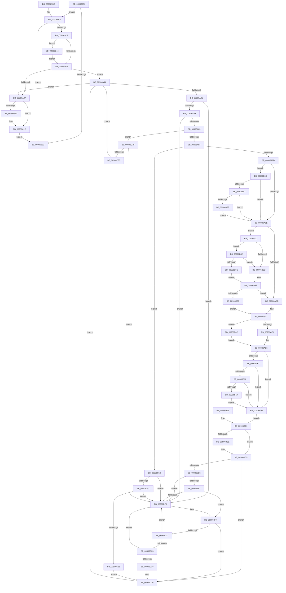

# CmNotifyRunDown

- RVA: `0x00906984`–`0x00906C99` (길이 `789` bytes)
- VA: `0x0000000140906984`
- 실행 섹션: `PAGE`
- PDB 이름 있음: `예`; PDB Function 태그: `아니요`
- unwind 정보 RVA: `0x00088D1C`
- 디코드: `196`개 명령, `789/789` bytes 표시
- 미해석 바이트: `0` (있으면 어셈블리에 `.byte`로 보존)

> 이 문서는 커널 이미지의 기계어와 PDB 기호를 분석해 생성했습니다. 4번과 5번은 함수 원형과 자료형을 바이너리 사용 방식에서 추정한 C 해석이며 원본 소스 복구 결과는 아닙니다.

## 1. Dependencies

- 직접 호출 지점: **16**; 고유 호출 대상: **15**
- 직접 호출자로 확인된 함수: **1**
- RIP 상대 이미지 참조: **5**

### Outgoing calls
- `0x009069C8` → [CmpInitializeThreadInfo](../../text/3F/CmpInitializeThreadInfo_function_003FBE70.md) (function, `0x003FBE70`)
- `0x009069CD` → [CmpLockRegistry](../../pagecmrc/BC/CmpLockRegistry_function_00BC9B34.md) (function, `0x00BC9B34`)
- `0x009069D9` → [ExAcquireFastMutexUnsafe](../../text/3F/ExAcquireFastMutexUnsafe_function_003F3720.md) (function, `0x003F3720`)
- `0x00906A17` → [KiLowerIrqlProcessIrqlFlags](../../text/4F/KiLowerIrqlProcessIrqlFlags_function_004F5698.md) (function, `0x004F5698`)
- `0x00906A2B` → [ExReleaseFastMutexUnsafe](../../text/25/ExReleaseFastMutexUnsafe_function_002503A0.md) (function, `0x002503A0`)
- `0x00906A30` → [CmpUnlockRegistry](../../pagecmrc/BC/CmpUnlockRegistry_function_00BC9A84.md) (function, `0x00BC9A84`)
- `0x00906A3A` → [CmCleanupThreadInfo](../../text/41/CmCleanupThreadInfo_function_0041FD50.md) (function, `0x0041FD50`)
- `0x00906AFE` → [DbgPrint](../../text/35/DbgPrint_function_00358CB0.md) (function, `0x00358CB0`)
- `0x00906B6F` → [DbgPrint](../../text/35/DbgPrint_function_00358CB0.md) (function, `0x00358CB0`)
- `0x00906BC3` → [KeSetEvent](../../text/33/KeSetEvent_function_0033F310.md) (function, `0x0033F310`)
- `0x00906BD0` → [ObfDereferenceObject](../../text/2F/ObfDereferenceObject_function_002F9350.md) (function, `0x002F9350`)
- `0x00906BDD` → [KeRemoveQueueApc](../../text/3C/KeRemoveQueueApc_function_003C4820.md) (function, `0x003C4820`)
- `0x00906C32` → [CmpFreeSubordinatePost](CmpFreeSubordinatePost_function_00906CA0.md) (function, `0x00906CA0`)
- `0x00906C3A` → [CmpFreePostBlock](../84/CmpFreePostBlock_function_00848560.md) (function, `0x00848560`)
- `0x00906C4A` → [KiRaiseIrqlProcessIrqlFlags](../../text/4F/KiRaiseIrqlProcessIrqlFlags_function_004F56FC.md) (function, `0x004F56FC`)
- `0x00906C72` → [CmpCancelSubordinatePost](../A3/CmpCancelSubordinatePost_function_00A33FE8.md) (function, `0x00A33FE8`)

### Direct callers
- [PspExitThread](PspExitThread_function_00905F60.md) at `0x009062AD`

### Static image references
- `0x009069D2` → RVA `0x00EF5940` (`.data`; read)
- `0x009069EC` → RVA `0x00FC6D20` (`ALMOSTRO`; read)
- `0x00906AF7` → RVA `0x00B090F0` (` ?? ::NNGAKEGL::`string'`; read)
- `0x00906B03` → RVA `0x00F475F8` (`.data`; read)
- `0x00906B10` → RVA `0x00F475DC` (`.data`; read)

## 2. Other-region calls and transfers

- 다른 실행 섹션으로 향하는 call: **13**
  - `0x009069C8` → [CmpInitializeThreadInfo](../../text/3F/CmpInitializeThreadInfo_function_003FBE70.md) (`PAGE` → `.text`)
  - `0x009069CD` → [CmpLockRegistry](../../pagecmrc/BC/CmpLockRegistry_function_00BC9B34.md) (`PAGE` → `PAGECMRC`)
  - `0x009069D9` → [ExAcquireFastMutexUnsafe](../../text/3F/ExAcquireFastMutexUnsafe_function_003F3720.md) (`PAGE` → `.text`)
  - `0x00906A17` → [KiLowerIrqlProcessIrqlFlags](../../text/4F/KiLowerIrqlProcessIrqlFlags_function_004F5698.md) (`PAGE` → `.text`)
  - `0x00906A2B` → [ExReleaseFastMutexUnsafe](../../text/25/ExReleaseFastMutexUnsafe_function_002503A0.md) (`PAGE` → `.text`)
  - `0x00906A30` → [CmpUnlockRegistry](../../pagecmrc/BC/CmpUnlockRegistry_function_00BC9A84.md) (`PAGE` → `PAGECMRC`)
  - `0x00906A3A` → [CmCleanupThreadInfo](../../text/41/CmCleanupThreadInfo_function_0041FD50.md) (`PAGE` → `.text`)
  - `0x00906AFE` → [DbgPrint](../../text/35/DbgPrint_function_00358CB0.md) (`PAGE` → `.text`)
  - `0x00906B6F` → [DbgPrint](../../text/35/DbgPrint_function_00358CB0.md) (`PAGE` → `.text`)
  - `0x00906BC3` → [KeSetEvent](../../text/33/KeSetEvent_function_0033F310.md) (`PAGE` → `.text`)
  - `0x00906BD0` → [ObfDereferenceObject](../../text/2F/ObfDereferenceObject_function_002F9350.md) (`PAGE` → `.text`)
  - `0x00906BDD` → [KeRemoveQueueApc](../../text/3C/KeRemoveQueueApc_function_003C4820.md) (`PAGE` → `.text`)
  - `0x00906C4A` → [KiRaiseIrqlProcessIrqlFlags](../../text/4F/KiRaiseIrqlProcessIrqlFlags_function_004F56FC.md) (`PAGE` → `.text`)
- 별도 외부 분기/꼬리 이동을 확인하지 못했습니다.

## 3. Assembly (complete function range)

```asm
00906984  40 56                           push rsi
00906986  57                              push rdi
00906987  41 56                           push r14
00906989  41 57                           push r15
0090698B  48 83 EC 58                     sub rsp, 0x58
0090698F  0F 57 C0                        xorps xmm0, xmm0
00906992  33 C0                           xor eax, eax
00906994  0F 11 44 24 30                  movups xmmword ptr [rsp + 0x30], xmm0
00906999  48 89 44 24 40                  mov qword ptr [rsp + 0x40], rax
0090699E  48 8D B1 D8 04 00 00            lea rsi, [rcx + 0x4d8]
009069A5  48 89 74 24 20                  mov qword ptr [rsp + 0x20], rsi
009069AA  48 8B 06                        mov rax, qword ptr [rsi]
009069AD  48 85 C0                        test rax, rax
009069B0  75 0C                           jne 0x1409069be
009069B2  48 83 C4 58                     add rsp, 0x58
009069B6  41 5F                           pop r15
009069B8  41 5E                           pop r14
009069BA  5F                              pop rdi
009069BB  5E                              pop rsi
009069BC  C3                              ret
009069BD  CC                              int3
009069BE  48 3B C6                        cmp rax, rsi
009069C1  74 EF                           je 0x1409069b2
009069C3  48 8D 4C 24 30                  lea rcx, [rsp + 0x30]
009069C8  E8 A3 54 AF FF                  call 0x1403fbe70
009069CD  E8 62 31 2C 00                  call 0x140bc9b34
009069D2  48 8D 0D 67 EF 5E 00            lea rcx, [rip + 0x5eef67]
009069D9  E8 42 CD AE FF                  call 0x1403f3720
009069DE  45 0F 20 C7                     mov r15, cr8
009069E2  41 BE 01 00 00 00               mov r14d, 1
009069E8  45 0F 22 C6                     mov cr8, r14
009069EC  83 3D 2D 03 6C 00 00            cmp dword ptr [rip + 0x6c032d], 0
009069F3  0F 85 4B 02 00 00               jne 0x140906c44
009069F9  44 88 BC 24 90 00 00 00         mov byte ptr [rsp + 0x90], r15b
00906A01  48 83 3E 00                     cmp qword ptr [rsi], 0
00906A05  75 3D                           jne 0x140906a44
00906A07  83 3D 12 03 6C 00 00            cmp dword ptr [rip + 0x6c0312], 0
00906A0E  74 0C                           je 0x140906a1c
00906A10  44 0F 20 C1                     mov rcx, cr8
00906A14  41 8A D7                        mov dl, r15b
00906A17  E8 7C EC BE FF                  call 0x1404f5698
00906A1C  41 0F B6 C7                     movzx eax, r15b
00906A20  44 0F 22 C0                     mov cr8, rax
00906A24  48 8D 0D 15 EF 5E 00            lea rcx, [rip + 0x5eef15]
00906A2B  E8 70 99 94 FF                  call 0x1402503a0
00906A30  E8 4F 30 2C 00                  call 0x140bc9a84
00906A35  48 8D 4C 24 30                  lea rcx, [rsp + 0x30]
00906A3A  E8 11 93 B1 FF                  call 0x14041fd50
00906A3F  E9 6E FF FF FF                  jmp 0x1409069b2
00906A44  48 8B 06                        mov rax, qword ptr [rsi]
00906A47  48 3B C6                        cmp rax, rsi
00906A4A  74 BB                           je 0x140906a07
00906A4C  48 8B 08                        mov rcx, qword ptr [rax]
00906A4F  48 39 70 08                     cmp qword ptr [rax + 8], rsi
00906A53  0F 85 9F 01 00 00               jne 0x140906bf8
00906A59  48 39 41 08                     cmp qword ptr [rcx + 8], rax
00906A5D  0F 85 95 01 00 00               jne 0x140906bf8
00906A63  48 89 0E                        mov qword ptr [rsi], rcx
00906A66  48 89 71 08                     mov qword ptr [rcx + 8], rsi
00906A6A  48 8D 78 F0                     lea rdi, [rax - 0x10]
00906A6E  48 89 BC 24 98 00 00 00         mov qword ptr [rsp + 0x98], rdi
00906A76  8B 4F 38                        mov ecx, dword ptr [rdi + 0x38]
00906A79  0F BA E1 10                     bt ecx, 0x10
00906A7D  0F 83 F6 01 00 00               jae 0x140906c79
00906A83  66 83 F9 02                     cmp cx, 2
00906A87  0F 85 C7 01 00 00               jne 0x140906c54
00906A8D  48 8B 57 40                     mov rdx, qword ptr [rdi + 0x40]
00906A91  48 8D 42 68                     lea rax, [rdx + 0x68]
00906A95  48 39 00                        cmp qword ptr [rax], rax
00906A98  0F 84 CA 00 00 00               je 0x140906b68
00906A9E  65 48 8B 04 25 88 01 00 00      mov rax, qword ptr gs:[0x188]
00906AA7  48 89 44 24 28                  mov qword ptr [rsp + 0x28], rax
00906AAC  48 8B 80 B8 00 00 00            mov rax, qword ptr [rax + 0xb8]
00906AB3  48 83 B8 10 03 00 00 00         cmp qword ptr [rax + 0x310], 0
00906ABB  75 5F                           jne 0x140906b1c
00906ABD  C6 84 24 88 00 00 00 00         mov byte ptr [rsp + 0x88], 0
00906AC5  32 C9                           xor cl, cl
00906AC7  48 8B 47 40                     mov rax, qword ptr [rdi + 0x40]
00906ACB  48 8B 50 68                     mov rdx, qword ptr [rax + 0x68]
00906ACF  C7 02 0B 01 00 00               mov dword ptr [rdx], 0x10b
00906AD5  48 8B 47 40                     mov rax, qword ptr [rdi + 0x40]
00906AD9  84 C9                           test cl, cl
00906ADB  48 8B 48 68                     mov rcx, qword ptr [rax + 0x68]
00906ADF  75 6B                           jne 0x140906b4c
00906AE1  48 83 61 08 00                  and qword ptr [rcx + 8], 0
00906AE6  48 8B 57 40                     mov rdx, qword ptr [rdi + 0x40]
00906AEA  48 8D 42 68                     lea rax, [rdx + 0x68]
00906AEE  48 39 00                        cmp qword ptr [rax], rax
00906AF1  0F 85 9D 00 00 00               jne 0x140906b94
00906AF7  48 8D 0D F2 25 20 00            lea rcx, [rip + 0x2025f2]
00906AFE  E8 AD 21 A5 FF                  call 0x140358cb0
00906B03  80 3D EE 0A 64 00 00            cmp byte ptr [rip + 0x640aee], 0
00906B0A  0F 84 84 00 00 00               je 0x140906b94
00906B10  80 3D C5 0A 64 00 00            cmp byte ptr [rip + 0x640ac5], 0
00906B17  75 7B                           jne 0x140906b94
00906B19  CC                              int3
00906B1A  EB 78                           jmp 0x140906b94
00906B1C  0F B7 80 EC 06 00 00            movzx eax, word ptr [rax + 0x6ec]
00906B23  B9 4C 01 00 00                  mov ecx, 0x14c
00906B28  66 3B C1                        cmp ax, cx
00906B2B  75 25                           jne 0x140906b52
00906B2D  44 88 B4 24 80 00 00 00         mov byte ptr [rsp + 0x80], r14b
00906B35  41 8A C6                        mov al, r14b
00906B38  84 C0                           test al, al
00906B3A  74 81                           je 0x140906abd
00906B3C  44 88 B4 24 88 00 00 00         mov byte ptr [rsp + 0x88], r14b
00906B44  41 8A CE                        mov cl, r14b
00906B47  E9 7B FF FF FF                  jmp 0x140906ac7
00906B4C  83 61 04 00                     and dword ptr [rcx + 4], 0
00906B50  EB 94                           jmp 0x140906ae6
00906B52  B9 C4 01 00 00                  mov ecx, 0x1c4
00906B57  66 3B C1                        cmp ax, cx
00906B5A  74 D1                           je 0x140906b2d
00906B5C  C6 84 24 80 00 00 00 00         mov byte ptr [rsp + 0x80], 0
00906B64  32 C0                           xor al, al
00906B66  EB D0                           jmp 0x140906b38
00906B68  48 8D 0D 81 25 20 00            lea rcx, [rip + 0x202581]
00906B6F  E8 3C 21 A5 FF                  call 0x140358cb0
00906B74  80 3D 7D 0A 64 00 00            cmp byte ptr [rip + 0x640a7d], 0
00906B7B  0F 84 1D FF FF FF               je 0x140906a9e
00906B81  80 3D 54 0A 64 00 00            cmp byte ptr [rip + 0x640a54], 0
00906B88  0F 85 10 FF FF FF               jne 0x140906a9e
00906B8E  CC                              int3
00906B8F  E9 0A FF FF FF                  jmp 0x140906a9e
00906B94  EB 1B                           jmp 0x140906bb1
00906B96  41 BE 01 00 00 00               mov r14d, 1
00906B9C  48 8B BC 24 98 00 00 00         mov rdi, qword ptr [rsp + 0x98]
00906BA4  44 8A BC 24 90 00 00 00         mov r15b, byte ptr [rsp + 0x90]
00906BAC  48 8B 74 24 20                  mov rsi, qword ptr [rsp + 0x20]
00906BB1  48 8B 47 40                     mov rax, qword ptr [rdi + 0x40]
00906BB5  48 8B 48 08                     mov rcx, qword ptr [rax + 8]
00906BB9  48 85 C9                        test rcx, rcx
00906BBC  74 17                           je 0x140906bd5
00906BBE  45 33 C0                        xor r8d, r8d
00906BC1  33 D2                           xor edx, edx
00906BC3  E8 48 87 A3 FF                  call 0x14033f310
00906BC8  48 8B 4F 40                     mov rcx, qword ptr [rdi + 0x40]
00906BCC  48 8B 49 08                     mov rcx, qword ptr [rcx + 8]
00906BD0  E8 7B 27 9F FF                  call 0x1402f9350
00906BD5  48 8B 4F 40                     mov rcx, qword ptr [rdi + 0x40]
00906BD9  48 83 C1 10                     add rcx, 0x10
00906BDD  E8 3E DC AB FF                  call 0x1403c4820
00906BE2  84 C0                           test al, al
00906BE4  75 49                           jne 0x140906c2f
00906BE6  48 8B 0F                        mov rcx, qword ptr [rdi]
00906BE9  48 8B 47 08                     mov rax, qword ptr [rdi + 8]
00906BED  48 39 79 08                     cmp qword ptr [rcx + 8], rdi
00906BF1  75 05                           jne 0x140906bf8
00906BF3  48 39 38                        cmp qword ptr [rax], rdi
00906BF6  74 07                           je 0x140906bff
00906BF8  B9 03 00 00 00                  mov ecx, 3
00906BFD  CD 29                           int 0x29
00906BFF  48 89 08                        mov qword ptr [rax], rcx
00906C02  48 89 41 08                     mov qword ptr [rcx + 8], rax
00906C06  48 8D 47 20                     lea rax, [rdi + 0x20]
00906C0A  48 8B 08                        mov rcx, qword ptr [rax]
00906C0D  48 3B C8                        cmp rcx, rax
00906C10  74 1D                           je 0x140906c2f
00906C12  48 83 C1 E0                     add rcx, -0x20
00906C16  48 8B 11                        mov rdx, qword ptr [rcx]
00906C19  48 8B 41 08                     mov rax, qword ptr [rcx + 8]
00906C1D  48 39 4A 08                     cmp qword ptr [rdx + 8], rcx
00906C21  75 D5                           jne 0x140906bf8
00906C23  48 39 08                        cmp qword ptr [rax], rcx
00906C26  75 D0                           jne 0x140906bf8
00906C28  48 89 10                        mov qword ptr [rax], rdx
00906C2B  48 89 42 08                     mov qword ptr [rdx + 8], rax
00906C2F  48 8B CF                        mov rcx, rdi
00906C32  E8 69 00 00 00                  call 0x140906ca0
00906C37  48 8B CF                        mov rcx, rdi
00906C3A  E8 21 19 F4 FF                  call 0x140848560
00906C3F  E9 00 FE FF FF                  jmp 0x140906a44
00906C44  41 8A D6                        mov dl, r14b
00906C47  41 8A CF                        mov cl, r15b
00906C4A  E8 AD EA BE FF                  call 0x1404f56fc
00906C4F  E9 A5 FD FF FF                  jmp 0x1409069f9
00906C54  48 8B 0F                        mov rcx, qword ptr [rdi]
00906C57  48 8B 47 08                     mov rax, qword ptr [rdi + 8]
00906C5B  48 39 79 08                     cmp qword ptr [rcx + 8], rdi
00906C5F  75 97                           jne 0x140906bf8
00906C61  48 39 38                        cmp qword ptr [rax], rdi
00906C64  75 92                           jne 0x140906bf8
00906C66  48 89 08                        mov qword ptr [rax], rcx
00906C69  48 89 41 08                     mov qword ptr [rcx + 8], rax
00906C6D  33 D2                           xor edx, edx
00906C6F  48 8B CF                        mov rcx, rdi
00906C72  E8 71 D3 12 00                  call 0x140a33fe8
00906C77  EB B6                           jmp 0x140906c2f
00906C79  48 8B 4E 08                     mov rcx, qword ptr [rsi + 8]
00906C7D  48 39 31                        cmp qword ptr [rcx], rsi
00906C80  0F 85 72 FF FF FF               jne 0x140906bf8
00906C86  48 89 30                        mov qword ptr [rax], rsi
00906C89  48 89 48 08                     mov qword ptr [rax + 8], rcx
00906C8D  48 89 01                        mov qword ptr [rcx], rax
00906C90  48 89 46 08                     mov qword ptr [rsi + 8], rax
00906C94  E9 AB FD FF FF                  jmp 0x140906a44
```

## 4. C-style interpretation (structured pseudocode)

```c
__int64 __fastcall CmNotifyRunDown(__int64 a1, __int64 a2, int a3)
{
    __int64 result;
    __int64 v_rsp;
    unsigned __int64 v_stack_m38;
    unsigned __int64 v_stack_m48;
    unsigned __int64 v_stack_m58;
    unsigned __int64 v_stack_p20;
    unsigned __int64 v_stack_p28;
    unsigned __int64 v_stack_p30;
    unsigned __int8 v_stack_p80;
    unsigned __int8 v_stack_p88;
    unsigned __int8 v_stack_p90;
    unsigned __int64 v_stack_p98;

    v_rsp = (v_rsp) - (88);
    result = 0;
    v_stack_m48 = v_xmm0;
    v_stack_m38 = 0;
    v_stack_m58 = a1 + 1240;
    if (*(unsigned __int64 *)(a1 + 1240) != 0) goto loc_009069BE;
loc_009069B2:
    v_rsp = (v_rsp) + (88);
    return *(unsigned __int64 *)(a1 + 1240);
loc_009069BE:
    if ((*(unsigned __int64 *)(a1 + 1240)) == (a1 + 1240)) goto loc_009069B2;
    result = CmpInitializeThreadInfo(v_stack_p30, a2, a3, a4);
    result = CmpLockRegistry(v_stack_p30, a2, a3, a4);
    result = ExAcquireFastMutexUnsafe(v_rip + 6221671, a2, a3, a4);
    if ((*(unsigned int *)(v_rip + 7078701)) != 0) goto loc_00906C44;
loc_009069F9:
    v_stack_p90 = (unsigned __int8)(v_cr8);
    if ((*(unsigned __int64 *)(a1 + 1240)) != 0) goto loc_00906A44;
loc_00906A07:
    if ((*(unsigned int *)(v_rip + 7078674)) != 0) {
        a1 = 1;
        a2 = (unsigned __int8)(v_cr8);
        result = KiLowerIrqlProcessIrqlFlags(a1, a2, a3, a4);
    }
    result = ExReleaseFastMutexUnsafe(v_rip + 6221589, a2, a3, a4);
    result = CmpUnlockRegistry(v_rip + 6221589, a2, a3, a4);
    result = CmCleanupThreadInfo(v_stack_p30, a2, a3, a4);
    goto loc_009069B2;
loc_00906A44:
    if ((*(unsigned __int64 *)(a1 + 1240)) == (a1 + 1240)) goto loc_00906A07;
    if ((*(unsigned __int64 *)(*(unsigned __int64 *)(a1 + 1240) + 8)) != (a1 + 1240)) goto loc_00906BF8;
    if ((*(unsigned __int64 *)(*(unsigned __int64 *)(*(unsigned __int64 *)(a1 + 1240)) + 8)) != (*(unsigned __int64 *)(a1 + 1240))) goto loc_00906BF8;
    *(unsigned __int64 *)(a1 + 1240) = *(unsigned __int64 *)(*(unsigned __int64 *)(a1 + 1240));
    *(unsigned __int64 *)(*(unsigned __int64 *)(*(unsigned __int64 *)(a1 + 1240)) + 8) = a1 + 1240;
    v_stack_p98 = *(unsigned __int64 *)(a1 + 1240) - 16;
    if ((*(unsigned __int64 *)(*(unsigned __int64 *)(*(unsigned __int64 *)(a1 + 1240)) + 8)) >= (*(unsigned __int64 *)(a1 + 1240))) goto loc_00906C79;
    if (((unsigned __int16)((unsigned int)(*(unsigned int *)(*(unsigned __int64 *)(a1 + 1240) - 16 + 56)))) != 2) goto loc_00906C54;
    if ((*(unsigned __int64 *)(*(unsigned __int64 *)(*(unsigned __int64 *)(a1 + 1240) - 16 + 64) + 104)) == (*(unsigned __int64 *)(*(unsigned __int64 *)(a1 + 1240) - 16 + 64) + 104)) goto loc_00906B68;
loc_00906A9E:
    v_stack_p28 = *(unsigned __int64 *)(gs_base + (0 + 392));
    if ((*(unsigned __int64 *)(*(unsigned __int64 *)(*(unsigned __int64 *)(gs_base + (0 + 392)) + 184) + 784)) != 0) goto loc_00906B1C;
loc_00906ABD:
    v_stack_p88 = 0;
    a1 = 0;
loc_00906AC7:
    *(unsigned int *)(*(unsigned __int64 *)(*(unsigned __int64 *)(*(unsigned __int64 *)(a1 + 1240) - 16 + 64) + 104)) = 267;
    if (0 != 0) goto loc_00906B4C;
loc_00906AE6:
    if ((*(unsigned __int64 *)(*(unsigned __int64 *)(*(unsigned __int64 *)(a1 + 1240) - 16 + 64) + 104)) != (*(unsigned __int64 *)(*(unsigned __int64 *)(a1 + 1240) - 16 + 64) + 104)) goto loc_00906B94;
    result = DbgPrint(v_rip + 2106866, *(unsigned __int64 *)(*(unsigned __int64 *)(a1 + 1240) - 16 + 64), a3, a4);
    if ((*(unsigned __int8 *)(v_rip + 6556398)) == 0) goto loc_00906B94;
    if ((*(unsigned __int8 *)(v_rip + 6556357)) != 0) goto loc_00906B94;
    goto loc_00906B94;
loc_00906B1C:
    if (((unsigned __int16)(*(unsigned __int16 *)(result + 1772))) != 332) goto loc_00906B52;
loc_00906B2D:
    v_stack_p80 = 1;
loc_00906B38:
    if (1 == 0) goto loc_00906ABD;
    v_stack_p88 = 1;
    goto loc_00906AC7;
loc_00906B4C:
    goto loc_00906AE6;
loc_00906B52:
    if (1 == 452) goto loc_00906B2D;
    v_stack_p80 = 0;
    result = 0;
    goto loc_00906B38;
loc_00906B68:
    result = DbgPrint(v_rip + 2106753, *(unsigned __int64 *)(*(unsigned __int64 *)(a1 + 1240) - 16 + 64), a3, a4);
    if ((*(unsigned __int8 *)(v_rip + 6556285)) == 0) goto loc_00906A9E;
    if ((*(unsigned __int8 *)(v_rip + 6556244)) != 0) goto loc_00906A9E;
    goto loc_00906A9E;
loc_00906B94:
    goto loc_00906BB1;
loc_00906BB1:
    result = *(unsigned __int64 *)(*(unsigned __int64 *)(a1 + 1240) - 16 + 64);
    if (*(unsigned __int64 *)(*(unsigned __int64 *)(*(unsigned __int64 *)(a1 + 1240) - 16 + 64) + 8) != 0) {
        a3 = 0;
        a2 = 0;
        result = KeSetEvent(*(unsigned __int64 *)(*(unsigned __int64 *)(*(unsigned __int64 *)(a1 + 1240) - 16 + 64) + 8), a2, a3, a4);
        a1 = *(unsigned __int64 *)(*(unsigned __int64 *)(a1 + 1240) - 16 + 64);
        a1 = *(unsigned __int64 *)(a1 + 8);
        result = ObfDereferenceObject(a1, a2, a3, a4);
    }
    a1 = (*(unsigned __int64 *)(*(unsigned __int64 *)(a1 + 1240) - 16 + 64)) + (16);
    result = KeRemoveQueueApc(a1, a2, a3, a4);
    if ((unsigned __int8)(result) != 0) goto loc_00906C2F;
    if ((*(unsigned __int64 *)(*(unsigned __int64 *)(*(unsigned __int64 *)(a1 + 1240) - 16) + 8)) != (*(unsigned __int64 *)(a1 + 1240) - 16)) goto loc_00906BF8;
    if ((*(unsigned __int64 *)(*(unsigned __int64 *)(*(unsigned __int64 *)(a1 + 1240) - 16 + 8))) != (*(unsigned __int64 *)(a1 + 1240) - 16)) {
        a1 = 3;
    }
    *(unsigned __int64 *)(*(unsigned __int64 *)(*(unsigned __int64 *)(a1 + 1240) - 16 + 8)) = a1;
    *(unsigned __int64 *)(a1 + 8) = *(unsigned __int64 *)(*(unsigned __int64 *)(a1 + 1240) - 16 + 8);
    if ((*(unsigned __int64 *)(*(unsigned __int64 *)(a1 + 1240) - 16 + 32)) == (*(unsigned __int64 *)(a1 + 1240) - 16 + 32)) goto loc_00906C2F;
    a1 = (*(unsigned __int64 *)(*(unsigned __int64 *)(a1 + 1240) - 16 + 32)) + (-32);
    if ((*(unsigned __int64 *)(*(unsigned __int64 *)(a1) + 8)) != a1) goto loc_00906BF8;
    if ((*(unsigned __int64 *)(*(unsigned __int64 *)(a1 + 8))) != a1) goto loc_00906BF8;
    *(unsigned __int64 *)(*(unsigned __int64 *)(a1 + 8)) = *(unsigned __int64 *)(a1);
    *(unsigned __int64 *)(*(unsigned __int64 *)(a1) + 8) = *(unsigned __int64 *)(a1 + 8);
loc_00906C2F:
    result = CmpFreeSubordinatePost(*(unsigned __int64 *)(a1 + 1240) - 16, *(unsigned __int64 *)(a1), a3, a4);
    result = CmpFreePostBlock(*(unsigned __int64 *)(a1 + 1240) - 16, *(unsigned __int64 *)(a1), a3, a4);
    goto loc_00906A44;
loc_00906C44:
    result = KiRaiseIrqlProcessIrqlFlags((unsigned __int8)(v_cr8), 1, a3, a4);
    goto loc_009069F9;
loc_00906C54:
    if ((*(unsigned __int64 *)(*(unsigned __int64 *)(*(unsigned __int64 *)(a1 + 1240) - 16) + 8)) != (*(unsigned __int64 *)(a1 + 1240) - 16)) goto loc_00906BF8;
    if ((*(unsigned __int64 *)(*(unsigned __int64 *)(*(unsigned __int64 *)(a1 + 1240) - 16 + 8))) != (*(unsigned __int64 *)(a1 + 1240) - 16)) goto loc_00906BF8;
    *(unsigned __int64 *)(*(unsigned __int64 *)(*(unsigned __int64 *)(a1 + 1240) - 16 + 8)) = *(unsigned __int64 *)(*(unsigned __int64 *)(a1 + 1240) - 16);
    *(unsigned __int64 *)(*(unsigned __int64 *)(*(unsigned __int64 *)(a1 + 1240) - 16) + 8) = *(unsigned __int64 *)(*(unsigned __int64 *)(a1 + 1240) - 16 + 8);
    a2 = 0;
    result = CmpCancelSubordinatePost(*(unsigned __int64 *)(a1 + 1240) - 16, a2, a3, a4);
    goto loc_00906C2F;
loc_00906C79:
    if ((*(unsigned __int64 *)(*(unsigned __int64 *)(a1 + 1240 + 8))) != (a1 + 1240)) goto loc_00906BF8;
    *(unsigned __int64 *)(result) = a1 + 1240;
    *(unsigned __int64 *)(result + 8) = *(unsigned __int64 *)(a1 + 1240 + 8);
    *(unsigned __int64 *)(*(unsigned __int64 *)(a1 + 1240 + 8)) = result;
    *(unsigned __int64 *)(a1 + 1240 + 8) = result;
    goto loc_00906A44;
}
```

## 5. (Beta) C Style

```c
int64_t CmNotifyRunDown(void *Arg1, int64_t Arg2, int32_t Arg3)
{
    uint8_t *arg1 = (uint8_t *)Arg1;

    int64_t result;
    int64_t local_rsp;
    uint64_t v_stack_m38;
    uint64_t v_stack_m48;
    uint64_t v_stack_m58;
    uint64_t v_stack_p20;
    uint64_t v_stack_p28;
    uint64_t v_stack_p30;
    uint8_t v_stack_p80;
    uint8_t v_stack_p88;
    uint8_t v_stack_p90;
    uint64_t v_stack_p98;

    local_rsp = (local_rsp) - (88);
    result = 0;
    v_stack_m48 = v_xmm0;
    v_stack_m38 = 0;
    v_stack_m58 = Arg1 + 1240;
    if (*(uint64_t *)(arg1 + 0x4D8) != 0) goto loc_009069BE;
loc_009069B2:
    local_rsp = (local_rsp) + (88);
    return *(uint64_t *)(arg1 + 0x4D8);
loc_009069BE:
    if ((*(uint64_t *)(arg1 + 0x4D8)) == (Arg1 + 1240)) goto loc_009069B2;
    result = CmpInitializeThreadInfo(v_stack_p30, Arg2, Arg3, a4);
    result = CmpLockRegistry(v_stack_p30, Arg2, Arg3, a4);
    result = ExAcquireFastMutexUnsafe(v_rip + 6221671, Arg2, Arg3, a4);
    if ((*(uint32_t *)(v_rip + 0x6C032D)) != 0) goto loc_00906C44;
loc_009069F9:
    v_stack_p90 = (uint8_t)(v_cr8);
    if ((*(uint64_t *)(arg1 + 0x4D8)) != 0) goto loc_00906A44;
loc_00906A07:
    if ((*(uint32_t *)(v_rip + 0x6C0312)) != 0) {
        Arg1 = 1;
        Arg2 = (uint8_t)(v_cr8);
        result = KiLowerIrqlProcessIrqlFlags(Arg1, Arg2, Arg3, a4);
    }
    result = ExReleaseFastMutexUnsafe(v_rip + 6221589, Arg2, Arg3, a4);
    result = CmpUnlockRegistry(v_rip + 6221589, Arg2, Arg3, a4);
    result = CmCleanupThreadInfo(v_stack_p30, Arg2, Arg3, a4);
    goto loc_009069B2;
loc_00906A44:
    if ((*(uint64_t *)(arg1 + 0x4D8)) == (Arg1 + 1240)) goto loc_00906A07;
    if ((*(uint64_t *)(*(uint64_t *)(arg1 + 0x4D8) + 0x8)) != (Arg1 + 1240)) goto loc_00906BF8;
    if ((*(uint64_t *)(*(uint64_t *)(*(uint64_t *)(arg1 + 0x4D8)) + 0x8)) != (*(uint64_t *)(arg1 + 0x4D8))) goto loc_00906BF8;
    *(uint64_t *)(arg1 + 0x4D8) = *(uint64_t *)(*(uint64_t *)(arg1 + 0x4D8));
    *(void **)(*(uint64_t *)(*(uint64_t *)(arg1 + 0x4D8)) + 0x8) = Arg1 + 1240;
    v_stack_p98 = *(uint64_t *)(arg1 + 0x4D8) - 16;
    if ((*(uint64_t *)(*(uint64_t *)(*(uint64_t *)(arg1 + 0x4D8)) + 0x8)) >= (*(uint64_t *)(arg1 + 0x4D8))) goto loc_00906C79;
    if (((uint16_t)((uint32_t)(*(uint32_t *)(*(uint64_t *)(arg1 + 0x4D8) - 0x10 + 0x38)))) != 2) goto loc_00906C54;
    if ((*(uint64_t *)(*(uint64_t *)(*(uint64_t *)(arg1 + 0x4D8) - 0x10 + 0x40) + 0x68)) == (*(uint64_t *)(*(uint64_t *)(arg1 + 0x4D8) - 0x10 + 0x40) + 104)) goto loc_00906B68;
loc_00906A9E:
    v_stack_p28 = *(uint64_t *)(gs_base + (0 + 0x188));
    if ((*(uint64_t *)(*(uint64_t *)(*(uint64_t *)(gs_base + (0 + 0x188)) + 0xB8) + 0x310)) != 0) goto loc_00906B1C;
loc_00906ABD:
    v_stack_p88 = 0;
    Arg1 = 0;
loc_00906AC7:
    *(uint32_t *)(*(uint64_t *)(*(uint64_t *)(*(uint64_t *)(arg1 + 0x4D8) - 0x10 + 0x40) + 0x68)) = 267;
    if (0 != 0) goto loc_00906B4C;
loc_00906AE6:
    if ((*(uint64_t *)(*(uint64_t *)(*(uint64_t *)(arg1 + 0x4D8) - 0x10 + 0x40) + 0x68)) != (*(uint64_t *)(*(uint64_t *)(arg1 + 0x4D8) - 0x10 + 0x40) + 104)) goto loc_00906B94;
    result = DbgPrint(v_rip + 2106866, *(uint64_t *)(*(uint64_t *)(arg1 + 0x4D8) - 0x10 + 0x40), Arg3, a4);
    if ((*(uint8_t *)(v_rip + 0x640AEE)) == 0) goto loc_00906B94;
    if ((*(uint8_t *)(v_rip + 0x640AC5)) != 0) goto loc_00906B94;
    goto loc_00906B94;
loc_00906B1C:
    if (((uint16_t)(*(uint16_t *)(result + 0x6EC))) != 332) goto loc_00906B52;
loc_00906B2D:
    v_stack_p80 = 1;
loc_00906B38:
    if (1 == 0) goto loc_00906ABD;
    v_stack_p88 = 1;
    goto loc_00906AC7;
loc_00906B4C:
    goto loc_00906AE6;
loc_00906B52:
    if (1 == 452) goto loc_00906B2D;
    v_stack_p80 = 0;
    result = 0;
    goto loc_00906B38;
loc_00906B68:
    result = DbgPrint(v_rip + 2106753, *(uint64_t *)(*(uint64_t *)(arg1 + 0x4D8) - 0x10 + 0x40), Arg3, a4);
    if ((*(uint8_t *)(v_rip + 0x640A7D)) == 0) goto loc_00906A9E;
    if ((*(uint8_t *)(v_rip + 0x640A54)) != 0) goto loc_00906A9E;
    goto loc_00906A9E;
loc_00906B94:
    goto loc_00906BB1;
loc_00906BB1:
    result = *(uint64_t *)(*(uint64_t *)(arg1 + 0x4D8) - 0x10 + 0x40);
    if (*(uint64_t *)(*(uint64_t *)(*(uint64_t *)(arg1 + 0x4D8) - 0x10 + 0x40) + 0x8) != 0) {
        Arg3 = 0;
        Arg2 = 0;
        result = KeSetEvent(*(uint64_t *)(*(uint64_t *)(*(uint64_t *)(arg1 + 0x4D8) - 0x10 + 0x40) + 0x8), Arg2, Arg3, a4);
        Arg1 = *(uint64_t *)(*(uint64_t *)(arg1 + 0x4D8) - 0x10 + 0x40);
        Arg1 = *(uint64_t *)(arg1 + 0x8);
        result = ObfDereferenceObject(Arg1, Arg2, Arg3, a4);
    }
    Arg1 = (*(uint64_t *)(*(uint64_t *)(arg1 + 0x4D8) - 0x10 + 0x40)) + (16);
    result = KeRemoveQueueApc(Arg1, Arg2, Arg3, a4);
    if ((uint8_t)(result) != 0) goto loc_00906C2F;
    if ((*(uint64_t *)(*(uint64_t *)(*(uint64_t *)(arg1 + 0x4D8) - 0x10) + 0x8)) != (*(uint64_t *)(arg1 + 0x4D8) - 16)) goto loc_00906BF8;
    if ((*(uint64_t *)(*(uint64_t *)(*(uint64_t *)(arg1 + 0x4D8) - 0x10 + 0x8))) != (*(uint64_t *)(arg1 + 0x4D8) - 16)) {
        Arg1 = 3;
    }
    *(void **)(*(uint64_t *)(*(uint64_t *)(arg1 + 0x4D8) - 0x10 + 0x8)) = Arg1;
    *(uint64_t *)(arg1 + 0x8) = *(uint64_t *)(*(uint64_t *)(arg1 + 0x4D8) - 0x10 + 0x8);
    if ((*(uint64_t *)(*(uint64_t *)(arg1 + 0x4D8) - 0x10 + 0x20)) == (*(uint64_t *)(arg1 + 0x4D8) - 16 + 32)) goto loc_00906C2F;
    Arg1 = (*(uint64_t *)(*(uint64_t *)(arg1 + 0x4D8) - 0x10 + 0x20)) + (-32);
    if ((*(uint64_t *)(*(uint64_t *)(arg1) + 0x8)) != Arg1) goto loc_00906BF8;
    if ((*(uint64_t *)(*(uint64_t *)(arg1 + 0x8))) != Arg1) goto loc_00906BF8;
    *(uint64_t *)(*(uint64_t *)(arg1 + 0x8)) = *(uint64_t *)(arg1);
    *(uint64_t *)(*(uint64_t *)(arg1) + 0x8) = *(uint64_t *)(arg1 + 0x8);
loc_00906C2F:
    result = CmpFreeSubordinatePost(*(uint64_t *)(arg1 + 0x4D8) - 16, *(uint64_t *)(arg1), Arg3, a4);
    result = CmpFreePostBlock(*(uint64_t *)(arg1 + 0x4D8) - 16, *(uint64_t *)(arg1), Arg3, a4);
    goto loc_00906A44;
loc_00906C44:
    result = KiRaiseIrqlProcessIrqlFlags((uint8_t)(v_cr8), 1, Arg3, a4);
    goto loc_009069F9;
loc_00906C54:
    if ((*(uint64_t *)(*(uint64_t *)(*(uint64_t *)(arg1 + 0x4D8) - 0x10) + 0x8)) != (*(uint64_t *)(arg1 + 0x4D8) - 16)) goto loc_00906BF8;
    if ((*(uint64_t *)(*(uint64_t *)(*(uint64_t *)(arg1 + 0x4D8) - 0x10 + 0x8))) != (*(uint64_t *)(arg1 + 0x4D8) - 16)) goto loc_00906BF8;
    *(uint64_t *)(*(uint64_t *)(*(uint64_t *)(arg1 + 0x4D8) - 0x10 + 0x8)) = *(uint64_t *)(*(uint64_t *)(arg1 + 0x4D8) - 0x10);
    *(uint64_t *)(*(uint64_t *)(*(uint64_t *)(arg1 + 0x4D8) - 0x10) + 0x8) = *(uint64_t *)(*(uint64_t *)(arg1 + 0x4D8) - 0x10 + 0x8);
    Arg2 = 0;
    result = CmpCancelSubordinatePost(*(uint64_t *)(arg1 + 0x4D8) - 16, Arg2, Arg3, a4);
    goto loc_00906C2F;
loc_00906C79:
    if ((*(uint64_t *)(*(uint64_t *)(arg1 + 0x4D8 + 0x8))) != (Arg1 + 1240)) goto loc_00906BF8;
    *(void **)(result) = Arg1 + 1240;
    *(uint64_t *)(result + 0x8) = *(uint64_t *)(arg1 + 0x4D8 + 0x8);
    *(uint64_t *)(*(uint64_t *)(arg1 + 0x4D8 + 0x8)) = result;
    *(uint64_t *)(arg1 + 0x4D8 + 0x8) = result;
    goto loc_00906A44;
}
```

### 관측된 메모리 오프셋

구조체 형식이 확인되지 않은 접근은 인자 기준의 오프셋으로만 기록했습니다.

| 기준 인자 | 오프셋 표현 | 폭 (bit) | 접근 |
|---|---:|---:|---|
| `Arg1` | `+ 0x0` | `64` | `R` |
| `Arg1` | `+ 0x0` | `64` | `W` |
| `Arg1` | `+ 0x8` | `64` | `R` |
| `Arg1` | `+ 0x8` | `64` | `W` |
| `Arg1` | `+ 0x4D8` | `64` | `R` |

## 6. Execution-region graph

[열기: 2D/3D 그래프와 함수 탐색 컨트롤 패널](../../../control-panel.html?section=page&rva=0x00906984&view=graph)

- 2D 그래프는 위에서 아래로 흐르고, 3D 그래프는 빈 공간을 드래그해 회전합니다. Shift+드래그는 이동, 휠은 확대·축소, 함수 노드 선택은 대상 보고서 이동입니다.

### Static fallback


