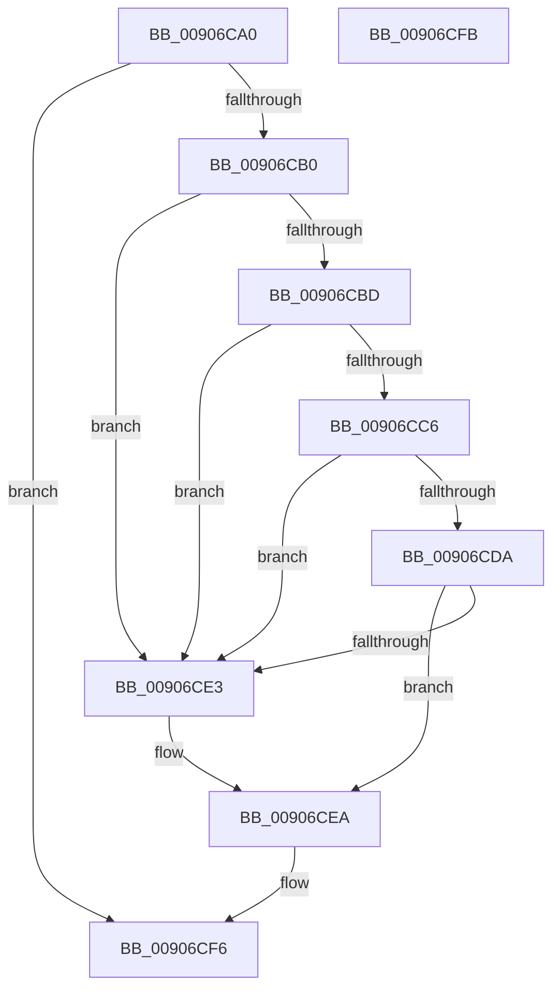

# CmpFreeSubordinatePost

- RVA: `0x00906CA0`–`0x00906CFC` (길이 `92` bytes)
- VA: `0x0000000140906CA0`
- 실행 섹션: `PAGE`
- PDB 이름 있음: `예`; PDB Function 태그: `아니요`
- unwind 정보 RVA: `0x0005C788`
- 디코드: `29`개 명령, `92/92` bytes 표시
- 미해석 바이트: `0` (있으면 어셈블리에 `.byte`로 보존)

> 이 문서는 커널 이미지의 기계어와 PDB 기호를 분석해 생성했습니다. 4번과 5번은 함수 원형과 자료형을 바이너리 사용 방식에서 추정한 C 해석이며 원본 소스 복구 결과는 아닙니다.

## 1. Dependencies

- 직접 호출 지점: **1**; 고유 호출 대상: **1**
- 직접 호출자로 확인된 함수: **4**
- RIP 상대 이미지 참조: **0**

### Outgoing calls
- `0x00906CF1` → [CmpFreePostBlock](../84/CmpFreePostBlock_function_00848560.md) (function, `0x00848560`)

### Direct callers
- [CmpPostApcRunDown](../7E/CmpPostApcRunDown_function_007E1F90.md) at `0x007E20FB`
- [CmpPostNotify](../86/CmpPostNotify_function_008645D8.md) at `0x008648DF`
- [CmNotifyRunDown](CmNotifyRunDown_function_00906984.md) at `0x00906C32`
- [CmpPostApc](../AF/CmpPostApc_function_00AF78F0.md) at `0x00AF7A74`

### Static image references
- 디코드된 RIP-relative 메모리 참조가 없습니다.

## 2. Other-region calls and transfers

- 다른 실행 섹션으로 향하는 call: **0**
- 별도 외부 분기/꼬리 이동을 확인하지 못했습니다.

## 3. Assembly (complete function range)

```asm
00906CA0  48 83 EC 28                     sub rsp, 0x28
00906CA4  48 83 C1 20                     add rcx, 0x20
00906CA8  48 8B 01                        mov rax, qword ptr [rcx]
00906CAB  48 3B C1                        cmp rax, rcx
00906CAE  74 46                           je 0x140906cf6
00906CB0  4C 8B 00                        mov r8, qword ptr [rax]
00906CB3  48 8D 48 E0                     lea rcx, [rax - 0x20]
00906CB7  49 39 40 08                     cmp qword ptr [r8 + 8], rax
00906CBB  75 26                           jne 0x140906ce3
00906CBD  48 8B 50 08                     mov rdx, qword ptr [rax + 8]
00906CC1  48 39 02                        cmp qword ptr [rdx], rax
00906CC4  75 1D                           jne 0x140906ce3
00906CC6  4C 89 02                        mov qword ptr [rdx], r8
00906CC9  49 89 50 08                     mov qword ptr [r8 + 8], rdx
00906CCD  48 8D 51 10                     lea rdx, [rcx + 0x10]
00906CD1  4C 8B 02                        mov r8, qword ptr [rdx]
00906CD4  49 39 50 08                     cmp qword ptr [r8 + 8], rdx
00906CD8  75 09                           jne 0x140906ce3
00906CDA  48 8B 42 08                     mov rax, qword ptr [rdx + 8]
00906CDE  48 39 10                        cmp qword ptr [rax], rdx
00906CE1  74 07                           je 0x140906cea
00906CE3  B9 03 00 00 00                  mov ecx, 3
00906CE8  CD 29                           int 0x29
00906CEA  4C 89 00                        mov qword ptr [rax], r8
00906CED  49 89 40 08                     mov qword ptr [r8 + 8], rax
00906CF1  E8 6A 18 F4 FF                  call 0x140848560
00906CF6  48 83 C4 28                     add rsp, 0x28
00906CFA  C3                              ret
00906CFB  CC                              int3
```

## 4. C-style interpretation (structured pseudocode)

```c
__int64 __fastcall CmpFreeSubordinatePost(__int64 a1)
{
    __int64 result;
    __int64 v_rsp;

    v_rsp = (v_rsp) - (40);
    a1 = (a1) + (32);
    if ((*(unsigned __int64 *)(a1)) == a1) goto loc_00906CF6;
    if ((*(unsigned __int64 *)(*(unsigned __int64 *)(*(unsigned __int64 *)(a1)) + 8)) != (*(unsigned __int64 *)(a1))) goto loc_00906CE3;
    if ((*(unsigned __int64 *)(*(unsigned __int64 *)(*(unsigned __int64 *)(a1) + 8))) != (*(unsigned __int64 *)(a1))) goto loc_00906CE3;
    *(unsigned __int64 *)(*(unsigned __int64 *)(*(unsigned __int64 *)(a1) + 8)) = *(unsigned __int64 *)(*(unsigned __int64 *)(a1));
    *(unsigned __int64 *)(*(unsigned __int64 *)(*(unsigned __int64 *)(a1)) + 8) = *(unsigned __int64 *)(*(unsigned __int64 *)(a1) + 8);
    if ((*(unsigned __int64 *)(*(unsigned __int64 *)(*(unsigned __int64 *)(a1) - 32 + 16) + 8)) != (*(unsigned __int64 *)(a1) - 32 + 16)) goto loc_00906CE3;
    if ((*(unsigned __int64 *)(*(unsigned __int64 *)(*(unsigned __int64 *)(a1) - 32 + 16 + 8))) != (*(unsigned __int64 *)(a1) - 32 + 16)) {
        a1 = 3;
    }
    *(unsigned __int64 *)(*(unsigned __int64 *)(*(unsigned __int64 *)(a1) - 32 + 16 + 8)) = *(unsigned __int64 *)(*(unsigned __int64 *)(a1) - 32 + 16);
    *(unsigned __int64 *)(*(unsigned __int64 *)(*(unsigned __int64 *)(a1) - 32 + 16) + 8) = *(unsigned __int64 *)(*(unsigned __int64 *)(a1) - 32 + 16 + 8);
    result = CmpFreePostBlock(a1, *(unsigned __int64 *)(a1) - 32 + 16, *(unsigned __int64 *)(*(unsigned __int64 *)(a1) - 32 + 16), a4);
loc_00906CF6:
    v_rsp = (v_rsp) + (40);
    return result;
}
```

## 5. (Beta) C Style

```c
int64_t CmpFreeSubordinatePost(void *Arg1)
{
    uint8_t *arg1 = (uint8_t *)Arg1;

    int64_t result;
    int64_t local_rsp;

    local_rsp = (local_rsp) - (40);
    Arg1 = (Arg1) + (32);
    if ((*(uint64_t *)(arg1)) == Arg1) goto loc_00906CF6;
    if ((*(uint64_t *)(*(uint64_t *)(*(uint64_t *)(arg1)) + 0x8)) != (*(uint64_t *)(arg1))) goto loc_00906CE3;
    if ((*(uint64_t *)(*(uint64_t *)(*(uint64_t *)(arg1) + 0x8))) != (*(uint64_t *)(arg1))) goto loc_00906CE3;
    *(uint64_t *)(*(uint64_t *)(*(uint64_t *)(arg1) + 0x8)) = *(uint64_t *)(*(uint64_t *)(arg1));
    *(uint64_t *)(*(uint64_t *)(*(uint64_t *)(arg1)) + 0x8) = *(uint64_t *)(*(uint64_t *)(arg1) + 0x8);
    if ((*(uint64_t *)(*(uint64_t *)(*(uint64_t *)(arg1) - 0x20 + 0x10) + 0x8)) != (*(uint64_t *)(arg1) - 32 + 16)) goto loc_00906CE3;
    if ((*(uint64_t *)(*(uint64_t *)(*(uint64_t *)(arg1) - 0x20 + 0x10 + 0x8))) != (*(uint64_t *)(arg1) - 32 + 16)) {
        Arg1 = 3;
    }
    *(uint64_t *)(*(uint64_t *)(*(uint64_t *)(arg1) - 0x20 + 0x10 + 0x8)) = *(uint64_t *)(*(uint64_t *)(arg1) - 0x20 + 0x10);
    *(uint64_t *)(*(uint64_t *)(*(uint64_t *)(arg1) - 0x20 + 0x10) + 0x8) = *(uint64_t *)(*(uint64_t *)(arg1) - 0x20 + 0x10 + 0x8);
    result = CmpFreePostBlock(Arg1, *(uint64_t *)(arg1) - 32 + 16, *(uint64_t *)(*(uint64_t *)(arg1) - 0x20 + 0x10), a4);
loc_00906CF6:
    local_rsp = (local_rsp) + (40);
    return result;
}
```

### 관측된 메모리 오프셋

구조체 형식이 확인되지 않은 접근은 인자 기준의 오프셋으로만 기록했습니다.

| 기준 인자 | 오프셋 표현 | 폭 (bit) | 접근 |
|---|---:|---:|---|
| `Arg1` | `+ 0x0` | `64` | `R` |

## 6. Execution-region graph

[열기: 2D/3D 그래프와 함수 탐색 컨트롤 패널](../../../control-panel.html?section=page&rva=0x00906CA0&view=graph)

- 2D 그래프는 위에서 아래로 흐르고, 3D 그래프는 빈 공간을 드래그해 회전합니다. Shift+드래그는 이동, 휠은 확대·축소, 함수 노드 선택은 대상 보고서 이동입니다.

### Static fallback


