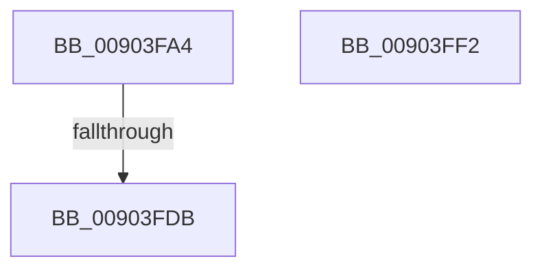

# DbgkFlushErrorPort

- RVA: `0x00903FA4`–`0x00903FF3` (길이 `79` bytes)
- VA: `0x0000000140903FA4`
- 실행 섹션: `PAGE`
- PDB 이름 있음: `예`; PDB Function 태그: `예`
- unwind 정보 RVA: `0x00083688`
- 디코드: `25`개 명령, `79/79` bytes 표시
- 미해석 바이트: `0` (있으면 어셈블리에 `.byte`로 보존)

> 이 문서는 커널 이미지의 기계어와 PDB 기호를 분석해 생성했습니다. 4번과 5번은 함수 원형과 자료형을 바이너리 사용 방식에서 추정한 C 해석이며 원본 소스 복구 결과는 아닙니다.

## 1. Dependencies

- 직접 호출 지점: **2**; 고유 호출 대상: **2**
- 직접 호출자로 확인된 함수: **1**
- RIP 상대 이미지 참조: **0**

### Outgoing calls
- `0x00903FBD` → [PsGetProcessServerSilo](../../text/44/PsGetProcessServerSilo_function_0044BEE0.md) (function, `0x0044BEE0`)
- `0x00903FC5` → [PsGetServerSiloGlobals](../../text/22/PsGetServerSiloGlobals_function_002250A0.md) (function, `0x002250A0`)

### Direct callers
- [PspExitProcess](PspExitProcess_function_00904830.md) at `0x009048F5`

### Static image references
- 디코드된 RIP-relative 메모리 참조가 없습니다.

## 2. Other-region calls and transfers

- 다른 실행 섹션으로 향하는 call: **2**
  - `0x00903FBD` → [PsGetProcessServerSilo](../../text/44/PsGetProcessServerSilo_function_0044BEE0.md) (`PAGE` → `.text`)
  - `0x00903FC5` → [PsGetServerSiloGlobals](../../text/22/PsGetServerSiloGlobals_function_002250A0.md) (`PAGE` → `.text`)
- call이 아닌 외부 분기/꼬리 이동: **1**
  - `0x00903FD5` → [sub_00B20C44](../B2/Unknown_function_00B20C44.md) (`tail-transfer`)

## 3. Assembly (complete function range)

```asm
00903FA4  48 89 5C 24 10                  mov qword ptr [rsp + 0x10], rbx
00903FA9  48 89 6C 24 18                  mov qword ptr [rsp + 0x18], rbp
00903FAE  56                              push rsi
00903FAF  57                              push rdi
00903FB0  41 54                           push r12
00903FB2  41 56                           push r14
00903FB4  41 57                           push r15
00903FB6  48 83 EC 20                     sub rsp, 0x20
00903FBA  48 8B F1                        mov rsi, rcx
00903FBD  E8 1E 7F B4 FF                  call 0x14044bee0
00903FC2  48 8B C8                        mov rcx, rax
00903FC5  E8 D6 10 92 FF                  call 0x1402250a0
00903FCA  48 8D 98 A8 03 00 00            lea rbx, [rax + 0x3a8]
00903FD1  48 3B 73 10                     cmp rsi, qword ptr [rbx + 0x10]
00903FD5  0F 84 69 CC 21 00               je 0x140b20c44
00903FDB  48 8B 5C 24 58                  mov rbx, qword ptr [rsp + 0x58]
00903FE0  48 8B 6C 24 60                  mov rbp, qword ptr [rsp + 0x60]
00903FE5  48 83 C4 20                     add rsp, 0x20
00903FE9  41 5F                           pop r15
00903FEB  41 5E                           pop r14
00903FED  41 5C                           pop r12
00903FEF  5F                              pop rdi
00903FF0  5E                              pop rsi
00903FF1  C3                              ret
00903FF2  CC                              int3
```

## 4. C-style interpretation (structured pseudocode)

```c
__int64 __fastcall DbgkFlushErrorPort(__int64 a1)
{
    __int64 result;
    __int64 v_rsp;
    unsigned __int64 v_stack_p10;
    unsigned __int64 v_stack_p18;

    v_stack_p10 = v_rbx;
    v_stack_p18 = v_rbp;
    v_rsp = (v_rsp) - (32);
    result = PsGetProcessServerSilo(a1, a2, a3, a4);
    result = PsGetServerSiloGlobals(result, a2, a3, a4);
    v_rsp = (v_rsp) + (32);
    return result;
}
```

## 5. (Beta) C Style

```c
int64_t DbgkFlushErrorPort(int64_t Arg1)
{
    int64_t result;
    int64_t local_rsp;
    uint64_t v_stack_p10;
    uint64_t v_stack_p18;

    v_stack_p10 = local_rbx;
    v_stack_p18 = local_rbp;
    local_rsp = (local_rsp) - (32);
    result = PsGetProcessServerSilo(Arg1, a2, a3, a4);
    result = PsGetServerSiloGlobals(result, a2, a3, a4);
    local_rsp = (local_rsp) + (32);
    return result;
}
```

## 6. Execution-region graph

[열기: 2D/3D 그래프와 함수 탐색 컨트롤 패널](../../../control-panel.html?section=page&rva=0x00903FA4&view=graph)

- 2D 그래프는 위에서 아래로 흐르고, 3D 그래프는 빈 공간을 드래그해 회전합니다. Shift+드래그는 이동, 휠은 확대·축소, 함수 노드 선택은 대상 보고서 이동입니다.

### Static fallback


