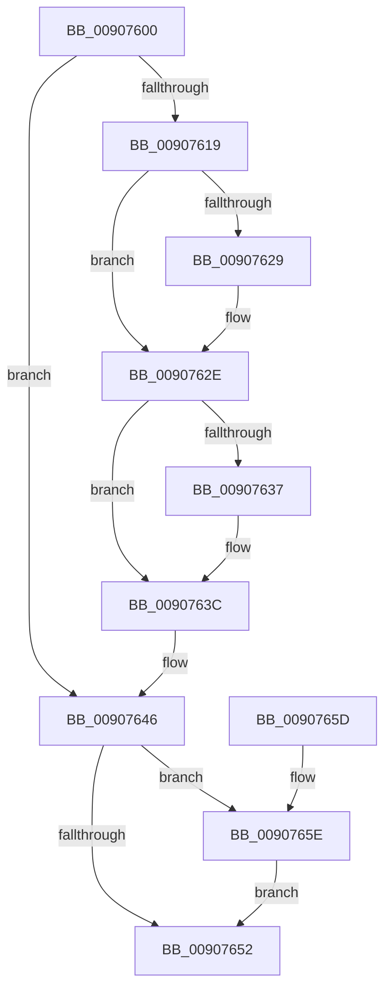

# EtwExitProcess

- RVA: `0x00907600`–`0x0090767F` (길이 `127` bytes)
- VA: `0x0000000140907600`
- 실행 섹션: `PAGE`
- PDB 이름 있음: `예`; PDB Function 태그: `아니요`
- unwind 정보 RVA: `0x00088DA0`
- 디코드: `35`개 명령, `127/127` bytes 표시
- 미해석 바이트: `0` (있으면 어셈블리에 `.byte`로 보존)

> 이 문서는 커널 이미지의 기계어와 PDB 기호를 분석해 생성했습니다. 4번과 5번은 함수 원형과 자료형을 바이너리 사용 방식에서 추정한 C 해석이며 원본 소스 복구 결과는 아닙니다.

## 1. Dependencies

- 직접 호출 지점: **5**; 고유 호출 대상: **3**
- 직접 호출자로 확인된 함수: **1**
- RIP 상대 이미지 참조: **0**

### Outgoing calls
- `0x00907629` → [ObfDereferenceObject](../../text/2F/ObfDereferenceObject_function_002F9350.md) (function, `0x002F9350`)
- `0x00907637` → [ObfDereferenceObject](../../text/2F/ObfDereferenceObject_function_002F9350.md) (function, `0x002F9350`)
- `0x00907641` → [ExFreePoolWithTag](../../poolcode/B8/ExFreePoolWithTag_function_00B82870.md) (function, `0x00B82870`)
- `0x0090766B` → [EtwpCovSampProcessCleanup](../8D/EtwpCovSampProcessCleanup_function_008D94A0.md) (function, `0x008D94A0`)
- `0x00907678` → [ExFreePoolWithTag](../../poolcode/B8/ExFreePoolWithTag_function_00B82870.md) (function, `0x00B82870`)

### Direct callers
- [PspProcessDelete](PspProcessDelete_function_00907B90.md) at `0x00907E40`

### Static image references
- 디코드된 RIP-relative 메모리 참조가 없습니다.

## 2. Other-region calls and transfers

- 다른 실행 섹션으로 향하는 call: **4**
  - `0x00907629` → [ObfDereferenceObject](../../text/2F/ObfDereferenceObject_function_002F9350.md) (`PAGE` → `.text`)
  - `0x00907637` → [ObfDereferenceObject](../../text/2F/ObfDereferenceObject_function_002F9350.md) (`PAGE` → `.text`)
  - `0x00907641` → [ExFreePoolWithTag](../../poolcode/B8/ExFreePoolWithTag_function_00B82870.md) (`PAGE` → `POOLCODE`)
  - `0x00907678` → [ExFreePoolWithTag](../../poolcode/B8/ExFreePoolWithTag_function_00B82870.md) (`PAGE` → `POOLCODE`)
- 별도 외부 분기/꼬리 이동을 확인하지 못했습니다.

## 3. Assembly (complete function range)

```asm
00907600  48 89 5C 24 08                  mov qword ptr [rsp + 8], rbx
00907605  57                              push rdi
00907606  48 83 EC 20                     sub rsp, 0x20
0090760A  48 8B 99 20 03 00 00            mov rbx, qword ptr [rcx + 0x320]
00907611  48 8B F9                        mov rdi, rcx
00907614  48 85 DB                        test rbx, rbx
00907617  74 2D                           je 0x140907646
00907619  48 83 A1 20 03 00 00 00         and qword ptr [rcx + 0x320], 0
00907621  48 8B 0B                        mov rcx, qword ptr [rbx]
00907624  48 85 C9                        test rcx, rcx
00907627  74 05                           je 0x14090762e
00907629  E8 22 1D 9F FF                  call 0x1402f9350
0090762E  48 8B 4B 08                     mov rcx, qword ptr [rbx + 8]
00907632  48 85 C9                        test rcx, rcx
00907635  74 05                           je 0x14090763c
00907637  E8 14 1D 9F FF                  call 0x1402f9350
0090763C  33 D2                           xor edx, edx
0090763E  48 8B CB                        mov rcx, rbx
00907641  E8 2A B2 27 00                  call 0x140b82870
00907646  48 8B 9F 70 07 00 00            mov rbx, qword ptr [rdi + 0x770]
0090764D  48 85 DB                        test rbx, rbx
00907650  75 0C                           jne 0x14090765e
00907652  48 8B 5C 24 30                  mov rbx, qword ptr [rsp + 0x30]
00907657  48 83 C4 20                     add rsp, 0x20
0090765B  5F                              pop rdi
0090765C  C3                              ret
0090765D  CC                              int3
0090765E  48 83 A7 70 07 00 00 00         and qword ptr [rdi + 0x770], 0
00907666  B2 01                           mov dl, 1
00907668  48 8B CB                        mov rcx, rbx
0090766B  E8 30 1E FD FF                  call 0x1408d94a0
00907670  BA 45 74 77 56                  mov edx, 0x56777445
00907675  48 8B CB                        mov rcx, rbx
00907678  E8 F3 B1 27 00                  call 0x140b82870
0090767D  EB D3                           jmp 0x140907652
```

## 4. C-style interpretation (structured pseudocode)

```c
__int64 __fastcall EtwExitProcess(__int64 a1, int a2)
{
    __int64 result;
    __int64 v_rsp;
    unsigned __int64 v_stack_p8;

    v_stack_p8 = v_rbx;
    v_rsp = (v_rsp) - (32);
    if (*(unsigned __int64 *)(a1 + 800) == 0) goto loc_00907646;
    if (*(unsigned __int64 *)(*(unsigned __int64 *)(a1 + 800)) != 0) {
        result = ObfDereferenceObject(*(unsigned __int64 *)(*(unsigned __int64 *)(a1 + 800)), a2, a3, a4);
    }
    if (*(unsigned __int64 *)(*(unsigned __int64 *)(a1 + 800) + 8) != 0) {
        result = ObfDereferenceObject(*(unsigned __int64 *)(*(unsigned __int64 *)(a1 + 800) + 8), a2, a3, a4);
    }
    a2 = 0;
    result = ExFreePoolWithTag(*(unsigned __int64 *)(a1 + 800), a2, a3, a4);
loc_00907646:
    if (*(unsigned __int64 *)(a1 + 1904) != 0) goto loc_0090765E;
loc_00907652:
    v_rsp = (v_rsp) + (32);
    return result;
loc_0090765E:
    result = EtwpCovSampProcessCleanup(v_stack_p8, 1, a3, a4);
    result = ExFreePoolWithTag(v_stack_p8, (unsigned int)(0x56777445ULL), a3, a4);
    goto loc_00907652;
}
```

## 5. (Beta) C Style

```c
int64_t EtwExitProcess(void *Arg1, int32_t Arg2)
{
    uint8_t *arg1 = (uint8_t *)Arg1;

    int64_t result;
    int64_t local_rsp;
    uint64_t v_stack_p8;

    v_stack_p8 = local_rbx;
    local_rsp = (local_rsp) - (32);
    if (*(uint64_t *)(arg1 + 0x320) == 0) goto loc_00907646;
    if (*(uint64_t *)(*(uint64_t *)(arg1 + 0x320)) != 0) {
        result = ObfDereferenceObject(*(uint64_t *)(*(uint64_t *)(arg1 + 0x320)), Arg2, a3, a4);
    }
    if (*(uint64_t *)(*(uint64_t *)(arg1 + 0x320) + 0x8) != 0) {
        result = ObfDereferenceObject(*(uint64_t *)(*(uint64_t *)(arg1 + 0x320) + 0x8), Arg2, a3, a4);
    }
    Arg2 = 0;
    result = ExFreePoolWithTag(*(uint64_t *)(arg1 + 0x320), Arg2, a3, a4);
loc_00907646:
    if (*(uint64_t *)(arg1 + 0x770) != 0) goto loc_0090765E;
loc_00907652:
    local_rsp = (local_rsp) + (32);
    return result;
loc_0090765E:
    result = EtwpCovSampProcessCleanup(v_stack_p8, 1, a3, a4);
    result = ExFreePoolWithTag(v_stack_p8, (uint32_t)(0x56777445ULL), a3, a4);
    goto loc_00907652;
}
```

### 관측된 메모리 오프셋

구조체 형식이 확인되지 않은 접근은 인자 기준의 오프셋으로만 기록했습니다.

| 기준 인자 | 오프셋 표현 | 폭 (bit) | 접근 |
|---|---:|---:|---|
| `Arg1` | `+ 0x320` | `64` | `R` |
| `Arg1` | `+ 0x320` | `64` | `R/W` |
| `Arg1` | `+ 0x770` | `64` | `R` |
| `Arg1` | `+ 0x770` | `64` | `R/W` |

## 6. Execution-region graph

[열기: 2D/3D 그래프와 함수 탐색 컨트롤 패널](../../../control-panel.html?section=page&rva=0x00907600&view=graph)

- 2D 그래프는 위에서 아래로 흐르고, 3D 그래프는 빈 공간을 드래그해 회전합니다. Shift+드래그는 이동, 휠은 확대·축소, 함수 노드 선택은 대상 보고서 이동입니다.

### Static fallback


