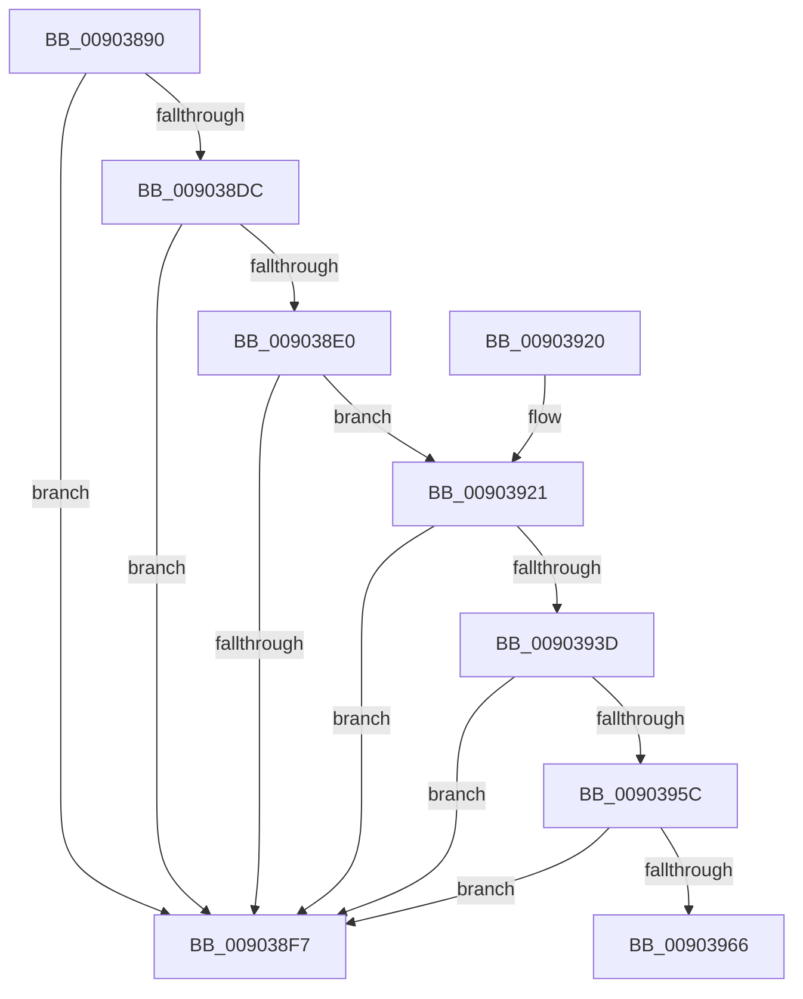

# EtwTiLogSyscallUsage

- RVA: `0x00903890`–`0x0090396B` (길이 `219` bytes)
- VA: `0x0000000140903890`
- 실행 섹션: `PAGE`
- PDB 이름 있음: `예`; PDB Function 태그: `예`
- unwind 정보 RVA: `0x000889A0`
- 디코드: `53`개 명령, `219/219` bytes 표시
- 미해석 바이트: `0` (있으면 어셈블리에 `.byte`로 보존)

> 이 문서는 커널 이미지의 기계어와 PDB 기호를 분석해 생성했습니다. 4번과 5번은 함수 원형과 자료형을 바이너리 사용 방식에서 추정한 C 해석이며 원본 소스 복구 결과는 아닙니다.

## 1. Dependencies

- 직접 호출 지점: **3**; 고유 호출 대상: **3**
- 직접 호출자로 확인된 함수: **4**
- RIP 상대 이미지 참조: **3**

### Outgoing calls
- `0x009038EE` → [EtwEventEnabled](../../text/39/EtwEventEnabled_function_00392450.md) (function, `0x00392450`)
- `0x009038FE` → [_security_check_cookie](../../text/6A/_security_check_cookie_function_006AC640.md) (function, `0x006AC640`)
- `0x00903934` → [EtwProviderEnabled](../../text/3B/EtwProviderEnabled_function_003BA250.md) (function, `0x003BA250`)

### Direct callers
- [PfQuerySuperfetchInformation](PfQuerySuperfetchInformation_function_0090210C.md) at `0x009021F0`
- [ExpQuerySystemInformation](../A5/ExpQuerySystemInformation_function_00A57858.md) at `0x00A57FA9`
- [PfSetSuperfetchInformation](../AD/PfSetSuperfetchInformation_function_00ADE6E8.md) at `0x00ADEA44`
- [sub_00B3F842](../B3/Unknown_function_00B3F842.md) at `0x00B3FC74`
- [sub_00B3F842](../B3/Unknown_function_00B3F842.md) at `0x00B3FD86`

### Static image references
- `0x009038AF` → RVA `0x00E0A740` (`.data`; read)
- `0x009038E0` → RVA `0x00EFFA30` (`.data`; read)
- `0x009038E7` → RVA `0x000118A0` (`.rdata`; read)

## 2. Other-region calls and transfers

- 다른 실행 섹션으로 향하는 call: **3**
  - `0x009038EE` → [EtwEventEnabled](../../text/39/EtwEventEnabled_function_00392450.md) (`PAGE` → `.text`)
  - `0x009038FE` → [_security_check_cookie](../../text/6A/_security_check_cookie_function_006AC640.md) (`PAGE` → `.text`)
  - `0x00903934` → [EtwProviderEnabled](../../text/3B/EtwProviderEnabled_function_003BA250.md) (`PAGE` → `.text`)
- call이 아닌 외부 분기/꼬리 이동: **1**
  - `0x00903966` → [sub_00B20A40](../B2/Unknown_function_00B20A40.md) (`tail-transfer`)

## 3. Assembly (complete function range)

```asm
00903890  48 8B C4                        mov rax, rsp
00903893  48 89 58 08                     mov qword ptr [rax + 8], rbx
00903897  48 89 70 18                     mov qword ptr [rax + 0x18], rsi
0090389B  48 89 78 20                     mov qword ptr [rax + 0x20], rdi
0090389F  55                              push rbp
009038A0  41 56                           push r14
009038A2  41 57                           push r15
009038A4  48 8D 68 D8                     lea rbp, [rax - 0x28]
009038A8  48 81 EC 10 01 00 00            sub rsp, 0x110
009038AF  48 8B 05 8A 6E 50 00            mov rax, qword ptr [rip + 0x506e8a]
009038B6  48 33 C4                        xor rax, rsp
009038B9  48 89 45 00                     mov qword ptr [rbp], rax
009038BD  48 83 64 24 48 00               and qword ptr [rsp + 0x48], 0
009038C3  89 54 24 38                     mov dword ptr [rsp + 0x38], edx
009038C7  65 48 8B 04 25 88 01 00 00      mov rax, qword ptr gs:[0x188]
009038D0  44 8A B0 32 02 00 00            mov r14b, byte ptr [rax + 0x232]
009038D7  45 84 F6                        test r14b, r14b
009038DA  74 1B                           je 0x1409038f7
009038DC  85 C9                           test ecx, ecx
009038DE  78 17                           js 0x1409038f7
009038E0  48 8B 0D 49 C1 5F 00            mov rcx, qword ptr [rip + 0x5fc149]
009038E7  48 8D 15 B2 DF 70 FF            lea rdx, [rip - 0x8f204e]
009038EE  E8 5D EB A8 FF                  call 0x140392450
009038F3  84 C0                           test al, al
009038F5  75 2A                           jne 0x140903921
009038F7  48 8B 4D 00                     mov rcx, qword ptr [rbp]
009038FB  48 33 CC                        xor rcx, rsp
009038FE  E8 3D 8D DA FF                  call 0x1406ac640
00903903  4C 8D 9C 24 10 01 00 00         lea r11, [rsp + 0x110]
0090390B  49 8B 5B 20                     mov rbx, qword ptr [r11 + 0x20]
0090390F  49 8B 73 30                     mov rsi, qword ptr [r11 + 0x30]
00903913  49 8B 7B 38                     mov rdi, qword ptr [r11 + 0x38]
00903917  49 8B E3                        mov rsp, r11
0090391A  41 5F                           pop r15
0090391C  41 5E                           pop r14
0090391E  5D                              pop rbp
0090391F  C3                              ret
00903920  CC                              int3
00903921  48 8B 0D 08 C1 5F 00            mov rcx, qword ptr [rip + 0x5fc108]
00903928  33 D2                           xor edx, edx
0090392A  49 B8 00 00 00 00 00 01 00 00   movabs r8, 0x10000000000
00903934  E8 17 69 AB FF                  call 0x1403ba250
00903939  84 C0                           test al, al
0090393B  74 BA                           je 0x1409038f7
0090393D  65 4C 8B 3C 25 88 01 00 00      mov r15, qword ptr gs:[0x188]
00903946  8B 4C 24 38                     mov ecx, dword ptr [rsp + 0x38]
0090394A  49 8B B7 B8 00 00 00            mov rsi, qword ptr [r15 + 0xb8]
00903951  8B 86 E0 07 00 00               mov eax, dword ptr [rsi + 0x7e0]
00903957  0F A3 C8                        bt eax, ecx
0090395A  72 9B                           jb 0x1409038f7
0090395C  F0 0F AB 8E E0 07 00 00         lock bts dword ptr [rsi + 0x7e0], ecx
00903964  72 91                           jb 0x1409038f7
00903966  E9 D5 D0 21 00                  jmp 0x140b20a40
```

## 4. C-style interpretation (structured pseudocode)

```c
__int64 __fastcall EtwTiLogSyscallUsage(int a1, int a2)
{
    __int64 result;
    __int64 v_rsp;
    unsigned __int64 v_stack_m18;
    unsigned int v_stack_mD8;
    unsigned __int64 v_stack_mE0;
    unsigned int v_stack_mF0;

    *(unsigned __int64 *)(v_rsp + 8) = v_rbx;
    *(unsigned __int64 *)(v_rsp + 24) = v_rsi;
    *(unsigned __int64 *)(v_rsp + 32) = v_rdi;
    v_rsp = (v_rsp) - (272);
    result = (*(unsigned __int64 *)(v_rip + 5271178)) ^ (v_rsp);
    *(unsigned __int64 *)(v_rsp - 40) = result;
    v_stack_mF0 = a2;
    if ((unsigned __int8)(*(unsigned __int8 *)(*(unsigned __int64 *)(gs_base + (0 + 392)) + 562)) == 0) goto loc_009038F7;
    if (sign_flag) goto loc_009038F7;
    result = EtwEventEnabled(*(unsigned __int64 *)(v_rip + 6275401), v_rip - 9379918, a3, a4);
    if ((unsigned __int8)(result) != 0) goto loc_00903921;
loc_009038F7:
    a1 = (*(unsigned __int64 *)(v_rsp - 40)) ^ (v_rsp);
    result = _security_check_cookie(a1, v_rip - 9379918, a3, a4);
    return result;
loc_00903921:
    a2 = 0;
    result = EtwProviderEnabled(*(unsigned __int64 *)(v_rip + 6275336), a2, a3, a4);
    if ((unsigned __int8)(result) == 0) goto loc_009038F7;
    if (condition_is_below) goto loc_009038F7;
    if (condition_is_below) goto loc_009038F7;
}
```

## 5. (Beta) C Style

```c
int64_t EtwTiLogSyscallUsage(int32_t Arg1, int32_t Arg2)
{
    int64_t result;
    int64_t local_rsp;
    uint64_t v_stack_m18;
    uint32_t v_stack_mD8;
    uint64_t v_stack_mE0;
    uint32_t v_stack_mF0;

    *(uint64_t *)(local_rsp + 0x8) = local_rbx;
    *(uint64_t *)(local_rsp + 0x18) = local_rsi;
    *(uint64_t *)(local_rsp + 0x20) = local_rdi;
    local_rsp = (local_rsp) - (272);
    result = (*(uint64_t *)(v_rip + 0x506E8A)) ^ (local_rsp);
    *(uint64_t *)(local_rsp - 0x28) = result;
    v_stack_mF0 = Arg2;
    if ((uint8_t)(*(uint8_t *)(*(uint64_t *)(gs_base + (0 + 0x188)) + 0x232)) == 0) goto loc_009038F7;
    if (sign_flag) goto loc_009038F7;
    result = EtwEventEnabled(*(uint64_t *)(v_rip + 0x5FC149), v_rip - 9379918, a3, a4);
    if ((uint8_t)(result) != 0) goto loc_00903921;
loc_009038F7:
    Arg1 = (*(uint64_t *)(local_rsp - 0x28)) ^ (local_rsp);
    result = _security_check_cookie(Arg1, v_rip - 9379918, a3, a4);
    return result;
loc_00903921:
    Arg2 = 0;
    result = EtwProviderEnabled(*(uint64_t *)(v_rip + 0x5FC108), Arg2, a3, a4);
    if ((uint8_t)(result) == 0) goto loc_009038F7;
    if (condition_is_below) goto loc_009038F7;
    if (condition_is_below) goto loc_009038F7;
}
```

## 6. Execution-region graph

[열기: 2D/3D 그래프와 함수 탐색 컨트롤 패널](../../../control-panel.html?section=page&rva=0x00903890&view=graph)

- 2D 그래프는 위에서 아래로 흐르고, 3D 그래프는 빈 공간을 드래그해 회전합니다. Shift+드래그는 이동, 휠은 확대·축소, 함수 노드 선택은 대상 보고서 이동입니다.

### Static fallback


