# EtwTraceThread

- RVA: `0x00905700`–`0x00905ACE` (길이 `974` bytes)
- VA: `0x0000000140905700`
- 실행 섹션: `PAGE`
- PDB 이름 있음: `예`; PDB Function 태그: `아니요`
- unwind 정보 RVA: `0x00088BF4`
- 디코드: `207`개 명령, `974/974` bytes 표시
- 미해석 바이트: `0` (있으면 어셈블리에 `.byte`로 보존)

> 이 문서는 커널 이미지의 기계어와 PDB 기호를 분석해 생성했습니다. 4번과 5번은 함수 원형과 자료형을 바이너리 사용 방식에서 추정한 C 해석이며 원본 소스 복구 결과는 아닙니다.

## 1. Dependencies

- 직접 호출 지점: **11**; 고유 호출 대상: **10**
- 직접 호출자로 확인된 함수: **2**
- RIP 상대 이미지 참조: **3**

### Outgoing calls
- `0x00905766` → [EtwpPsProvTraceThread](../9F/EtwpPsProvTraceThread_function_009FFE5C.md) (function, `0x009FFE5C`)
- `0x009057F1` → [PsGetPagePriorityThread](../../text/3C/PsGetPagePriorityThread_function_003C3E80.md) (function, `0x003C3E80`)
- `0x00905800` → [PsGetIoPriorityThread](../../text/34/PsGetIoPriorityThread_function_00343930.md) (function, `0x00343930`)
- `0x009058F0` → [Feature_1224463674__private_IsEnabledDeviceUsageNoInline](../../text/4F/Feature_1224463674__private_IsEnabledDeviceUsageNoInline_function_004F146C.md) (function, `0x004F146C`)
- `0x0090592F` → [PsGetProcessServerSilo](../../text/44/PsGetProcessServerSilo_function_0044BEE0.md) (function, `0x0044BEE0`)
- `0x0090595A` → [EtwTraceSiloKernelEvent](../../text/22/EtwTraceSiloKernelEvent_function_002242A0.md) (function, `0x002242A0`)
- `0x0090595F` → [Feature_1224463674__private_IsEnabledDeviceUsageNoInline](../../text/4F/Feature_1224463674__private_IsEnabledDeviceUsageNoInline_function_004F146C.md) (function, `0x004F146C`)
- `0x00905977` → [_security_check_cookie](../../text/6A/_security_check_cookie_function_006AC640.md) (function, `0x006AC640`)
- `0x009059B7` → [PsGetCurrentThreadTeb](../../text/47/PsGetCurrentThreadTeb_function_004745C0.md) (function, `0x004745C0`)
- `0x00905AAC` → [PsLockThreadNameShared](../../text/4F/PsLockThreadNameShared_function_004F3020.md) (function, `0x004F3020`)
- `0x00905AC4` → [PsUnlockThreadNameShared](../../text/4F/PsUnlockThreadNameShared_function_004F4394.md) (function, `0x004F4394`)

### Direct callers
- [PspExitThread](PspExitThread_function_00905F60.md) at `0x00906079`
- [PspInsertThread](../9F/PspInsertThread_function_009F0314.md) at `0x009F0B65`

### Static image references
- `0x00905717` → RVA `0x00E0A740` (`.data`; read)
- `0x00905750` → RVA `0x00FC6AA8` (`ALMOSTRO`; read)
- `0x0090590D` → RVA `0x000105E0` (`.rdata`; read)

## 2. Other-region calls and transfers

- 다른 실행 섹션으로 향하는 call: **10**
  - `0x009057F1` → [PsGetPagePriorityThread](../../text/3C/PsGetPagePriorityThread_function_003C3E80.md) (`PAGE` → `.text`)
  - `0x00905800` → [PsGetIoPriorityThread](../../text/34/PsGetIoPriorityThread_function_00343930.md) (`PAGE` → `.text`)
  - `0x009058F0` → [Feature_1224463674__private_IsEnabledDeviceUsageNoInline](../../text/4F/Feature_1224463674__private_IsEnabledDeviceUsageNoInline_function_004F146C.md) (`PAGE` → `.text`)
  - `0x0090592F` → [PsGetProcessServerSilo](../../text/44/PsGetProcessServerSilo_function_0044BEE0.md) (`PAGE` → `.text`)
  - `0x0090595A` → [EtwTraceSiloKernelEvent](../../text/22/EtwTraceSiloKernelEvent_function_002242A0.md) (`PAGE` → `.text`)
  - `0x0090595F` → [Feature_1224463674__private_IsEnabledDeviceUsageNoInline](../../text/4F/Feature_1224463674__private_IsEnabledDeviceUsageNoInline_function_004F146C.md) (`PAGE` → `.text`)
  - `0x00905977` → [_security_check_cookie](../../text/6A/_security_check_cookie_function_006AC640.md) (`PAGE` → `.text`)
  - `0x009059B7` → [PsGetCurrentThreadTeb](../../text/47/PsGetCurrentThreadTeb_function_004745C0.md) (`PAGE` → `.text`)
  - `0x00905AAC` → [PsLockThreadNameShared](../../text/4F/PsLockThreadNameShared_function_004F3020.md) (`PAGE` → `.text`)
  - `0x00905AC4` → [PsUnlockThreadNameShared](../../text/4F/PsUnlockThreadNameShared_function_004F4394.md) (`PAGE` → `.text`)
- 별도 외부 분기/꼬리 이동을 확인하지 못했습니다.

## 3. Assembly (complete function range)

```asm
00905700  4C 8B DC                        mov r11, rsp
00905703  49 89 5B 18                     mov qword ptr [r11 + 0x18], rbx
00905707  49 89 73 20                     mov qword ptr [r11 + 0x20], rsi
0090570B  57                              push rdi
0090570C  41 56                           push r14
0090570E  41 57                           push r15
00905710  48 81 EC E0 00 00 00            sub rsp, 0xe0
00905717  48 8B 05 22 50 50 00            mov rax, qword ptr [rip + 0x505022]
0090571E  48 33 C4                        xor rax, rsp
00905721  48 89 84 24 D0 00 00 00         mov qword ptr [rsp + 0xd0], rax
00905729  45 8A F8                        mov r15b, r8b
0090572C  48 8B F2                        mov rsi, rdx
0090572F  48 8B F9                        mov rdi, rcx
00905732  48 89 4C 24 40                  mov qword ptr [rsp + 0x40], rcx
00905737  41 BE 02 00 00 00               mov r14d, 2
0090573D  44 89 74 24 34                  mov dword ptr [rsp + 0x34], r14d
00905742  33 DB                           xor ebx, ebx
00905744  49 89 5B A0                     mov qword ptr [r11 - 0x60], rbx
00905748  C7 44 24 38 03 19 60 00         mov dword ptr [rsp + 0x38], 0x601903
00905750  48 8B 05 51 13 6C 00            mov rax, qword ptr [rip + 0x6c1351]
00905757  48 05 CC 12 00 00               add rax, 0x12cc
0090575D  74 0C                           je 0x14090576b
0090575F  8B 00                           mov eax, dword ptr [rax]
00905761  41 84 C6                        test r14b, al
00905764  74 05                           je 0x14090576b
00905766  E8 F1 A6 0F 00                  call 0x1409ffe5c
0090576B  8B 87 08 05 00 00               mov eax, dword ptr [rdi + 0x508]
00905771  89 44 24 50                     mov dword ptr [rsp + 0x50], eax
00905775  8B 87 10 05 00 00               mov eax, dword ptr [rdi + 0x510]
0090577B  89 44 24 54                     mov dword ptr [rsp + 0x54], eax
0090577F  48 8B 47 38                     mov rax, qword ptr [rdi + 0x38]
00905783  48 89 44 24 58                  mov qword ptr [rsp + 0x58], rax
00905788  48 8B 47 30                     mov rax, qword ptr [rdi + 0x30]
0090578C  48 89 44 24 60                  mov qword ptr [rsp + 0x60], rax
00905791  0F B7 87 48 02 00 00            movzx eax, word ptr [rdi + 0x248]
00905798  48 8B 8F 40 02 00 00            mov rcx, qword ptr [rdi + 0x240]
0090579F  66 3B 01                        cmp ax, word ptr [rcx]
009057A2  0F 83 0E 03 00 00               jae 0x140905ab6
009057A8  48 8B 54 C1 08                  mov rdx, qword ptr [rcx + rax*8 + 8]
009057AD  48 89 54 24 78                  mov qword ptr [rsp + 0x78], rdx
009057B2  48 8B 87 60 05 00 00            mov rax, qword ptr [rdi + 0x560]
009057B9  48 89 84 24 80 00 00 00         mov qword ptr [rsp + 0x80], rax
009057C1  48 89 5C 24 68                  mov qword ptr [rsp + 0x68], rbx
009057C6  48 89 5C 24 70                  mov qword ptr [rsp + 0x70], rbx
009057CB  48 8B 87 F0 00 00 00            mov rax, qword ptr [rdi + 0xf0]
009057D2  48 89 84 24 88 00 00 00         mov qword ptr [rsp + 0x88], rax
009057DA  89 9C 24 90 00 00 00            mov dword ptr [rsp + 0x90], ebx
009057E1  8A 87 33 02 00 00               mov al, byte ptr [rdi + 0x233]
009057E7  88 84 24 94 00 00 00            mov byte ptr [rsp + 0x94], al
009057EE  48 8B CF                        mov rcx, rdi
009057F1  E8 8A E6 AB FF                  call 0x1403c3e80
009057F6  88 84 24 95 00 00 00            mov byte ptr [rsp + 0x95], al
009057FD  48 8B CF                        mov rcx, rdi
00905800  E8 2B E1 A3 FF                  call 0x140343930
00905805  88 84 24 96 00 00 00            mov byte ptr [rsp + 0x96], al
0090580C  88 9C 24 97 00 00 00            mov byte ptr [rsp + 0x97], bl
00905813  45 84 FF                        test r15b, r15b
00905816  0F 85 7A 01 00 00               jne 0x140905996
0090581C  B8 02 05 00 00                  mov eax, 0x502
00905821  66 89 44 24 30                  mov word ptr [rsp + 0x30], ax
00905826  C7 44 24 38 03 19 60 04         mov dword ptr [rsp + 0x38], 0x4601903
0090582E  48 8B 8F F0 00 00 00            mov rcx, qword ptr [rdi + 0xf0]
00905835  48 85 C9                        test rcx, rcx
00905838  0F 84 90 00 00 00               je 0x1409058ce
0090583E  65 48 8B 04 25 88 01 00 00      mov rax, qword ptr gs:[0x188]
00905847  48 8B 90 20 02 00 00            mov rdx, qword ptr [rax + 0x220]
0090584E  48 39 9A 10 03 00 00            cmp qword ptr [rdx + 0x310], rbx
00905855  74 19                           je 0x140905870
00905857  44 0F B7 82 EC 06 00 00         movzx r8d, word ptr [rdx + 0x6ec]
0090585F  B8 4C 01 00 00                  mov eax, 0x14c
00905864  66 44 3B C0                     cmp r8w, ax
00905868  75 42                           jne 0x1409058ac
0090586A  B0 01                           mov al, 1
0090586C  84 C0                           test al, al
0090586E  75 1C                           jne 0x14090588c
00905870  8B 81 20 17 00 00               mov eax, dword ptr [rcx + 0x1720]
00905876  89 84 24 90 00 00 00            mov dword ptr [rsp + 0x90], eax
0090587D  48 8B 41 08                     mov rax, qword ptr [rcx + 8]
00905881  48 89 44 24 68                  mov qword ptr [rsp + 0x68], rax
00905886  48 8B 41 10                     mov rax, qword ptr [rcx + 0x10]
0090588A  EB 2F                           jmp 0x1409058bb
0090588C  8B 81 60 2F 00 00               mov eax, dword ptr [rcx + 0x2f60]
00905892  89 84 24 90 00 00 00            mov dword ptr [rsp + 0x90], eax
00905899  8B 81 04 20 00 00               mov eax, dword ptr [rcx + 0x2004]
0090589F  48 89 44 24 68                  mov qword ptr [rsp + 0x68], rax
009058A4  8B 81 08 20 00 00               mov eax, dword ptr [rcx + 0x2008]
009058AA  EB 0F                           jmp 0x1409058bb
009058AC  B8 C4 01 00 00                  mov eax, 0x1c4
009058B1  66 44 3B C0                     cmp r8w, ax
009058B5  8A C3                           mov al, bl
009058B7  75 B3                           jne 0x14090586c
009058B9  EB AF                           jmp 0x14090586a
009058BB  48 89 44 24 70                  mov qword ptr [rsp + 0x70], rax
009058C0  EB 0C                           jmp 0x1409058ce
009058C2  33 DB                           xor ebx, ebx
009058C4  44 8B 74 24 34                  mov r14d, dword ptr [rsp + 0x34]
009058C9  48 8B 7C 24 40                  mov rdi, qword ptr [rsp + 0x40]
009058CE  48 8D 44 24 50                  lea rax, [rsp + 0x50]
009058D3  48 89 84 24 A0 00 00 00         mov qword ptr [rsp + 0xa0], rax
009058DB  48 C7 84 24 A8 00 00 00 48 00 00 00  mov qword ptr [rsp + 0xa8], 0x48
009058E7  65 48 8B 34 25 88 01 00 00      mov rsi, qword ptr gs:[0x188]
009058F0  E8 77 BB BE FF                  call 0x1404f146c
009058F5  85 C0                           test eax, eax
009058F7  0F 85 A9 01 00 00               jne 0x140905aa6
009058FD  48 8B 97 A0 06 00 00            mov rdx, qword ptr [rdi + 0x6a0]
00905904  48 85 D2                        test rdx, rdx
00905907  0F 85 26 01 00 00               jne 0x140905a33
0090590D  48 8D 05 CC AC 70 FF            lea rax, [rip - 0x8f5334]
00905914  48 89 84 24 B0 00 00 00         mov qword ptr [rsp + 0xb0], rax
0090591C  48 C7 84 24 B8 00 00 00 02 00 00 00  mov qword ptr [rsp + 0xb8], 2
00905928  48 8B 8F 20 02 00 00            mov rcx, qword ptr [rdi + 0x220]
0090592F  E8 AC 65 B4 FF                  call 0x14044bee0
00905934  48 8B C8                        mov rcx, rax
00905937  8B 44 24 38                     mov eax, dword ptr [rsp + 0x38]
0090593B  89 44 24 28                     mov dword ptr [rsp + 0x28], eax
0090593F  0F B7 44 24 30                  movzx eax, word ptr [rsp + 0x30]
00905944  66 89 44 24 20                  mov word ptr [rsp + 0x20], ax
00905949  41 B9 02 00 00 00               mov r9d, 2
0090594F  45 8B C6                        mov r8d, r14d
00905952  48 8D 94 24 A0 00 00 00         lea rdx, [rsp + 0xa0]
0090595A  E8 41 E9 91 FF                  call 0x1402242a0
0090595F  E8 08 BB BE FF                  call 0x1404f146c
00905964  85 C0                           test eax, eax
00905966  0F 85 52 01 00 00               jne 0x140905abe
0090596C  48 8B 8C 24 D0 00 00 00         mov rcx, qword ptr [rsp + 0xd0]
00905974  48 33 CC                        xor rcx, rsp
00905977  E8 C4 6C DA FF                  call 0x1406ac640
0090597C  4C 8D 9C 24 E0 00 00 00         lea r11, [rsp + 0xe0]
00905984  49 8B 5B 30                     mov rbx, qword ptr [r11 + 0x30]
00905988  49 8B 73 38                     mov rsi, qword ptr [r11 + 0x38]
0090598C  49 8B E3                        mov rsp, r11
0090598F  41 5F                           pop r15
00905991  41 5E                           pop r14
00905993  5F                              pop rdi
00905994  C3                              ret
00905995  CC                              int3
00905996  B8 01 05 00 00                  mov eax, 0x501
0090599B  66 89 44 24 30                  mov word ptr [rsp + 0x30], ax
009059A0  48 85 F6                        test rsi, rsi
009059A3  74 12                           je 0x1409059b7
009059A5  48 8B 46 10                     mov rax, qword ptr [rsi + 0x10]
009059A9  48 89 44 24 68                  mov qword ptr [rsp + 0x68], rax
009059AE  48 8B 46 18                     mov rax, qword ptr [rsi + 0x18]
009059B2  48 89 44 24 70                  mov qword ptr [rsp + 0x70], rax
009059B7  E8 04 EC B6 FF                  call 0x1404745c0
009059BC  48 8B D0                        mov rdx, rax
009059BF  48 85 C0                        test rax, rax
009059C2  0F 84 06 FF FF FF               je 0x1409058ce
009059C8  65 48 8B 0C 25 88 01 00 00      mov rcx, qword ptr gs:[0x188]
009059D1  48 8B 81 20 02 00 00            mov rax, qword ptr [rcx + 0x220]
009059D8  48 39 98 10 03 00 00            cmp qword ptr [rax + 0x310], rbx
009059DF  74 17                           je 0x1409059f8
009059E1  0F B7 88 EC 06 00 00            movzx ecx, word ptr [rax + 0x6ec]
009059E8  B8 4C 01 00 00                  mov eax, 0x14c
009059ED  66 3B C8                        cmp cx, ax
009059F0  75 16                           jne 0x140905a08
009059F2  B0 01                           mov al, 1
009059F4  84 C0                           test al, al
009059F6  75 08                           jne 0x140905a00
009059F8  8B 82 20 17 00 00               mov eax, dword ptr [rdx + 0x1720]
009059FE  EB 16                           jmp 0x140905a16
00905A00  8B 82 60 2F 00 00               mov eax, dword ptr [rdx + 0x2f60]
00905A06  EB 0E                           jmp 0x140905a16
00905A08  B8 C4 01 00 00                  mov eax, 0x1c4
00905A0D  66 3B C8                        cmp cx, ax
00905A10  8A C3                           mov al, bl
00905A12  75 E0                           jne 0x1409059f4
00905A14  EB DC                           jmp 0x1409059f2
00905A16  89 84 24 90 00 00 00            mov dword ptr [rsp + 0x90], eax
00905A1D  E9 AC FE FF FF                  jmp 0x1409058ce
00905A22  33 DB                           xor ebx, ebx
00905A24  44 8B 74 24 34                  mov r14d, dword ptr [rsp + 0x34]
00905A29  48 8B 7C 24 40                  mov rdi, qword ptr [rsp + 0x40]
00905A2E  E9 9B FE FF FF                  jmp 0x1409058ce
00905A33  48 8B 4A 08                     mov rcx, qword ptr [rdx + 8]
00905A37  48 85 C9                        test rcx, rcx
00905A3A  0F 84 CD FE FF FF               je 0x14090590d
00905A40  44 0F B7 02                     movzx r8d, word ptr [rdx]
00905A44  B8 00 08 00 00                  mov eax, 0x800
00905A49  66 44 3B C0                     cmp r8w, ax
00905A4D  73 03                           jae 0x140905a52
00905A4F  41 8B C0                        mov eax, r8d
00905A52  48 89 8C 24 B0 00 00 00         mov qword ptr [rsp + 0xb0], rcx
00905A5A  89 84 24 B8 00 00 00            mov dword ptr [rsp + 0xb8], eax
00905A61  89 9C 24 BC 00 00 00            mov dword ptr [rsp + 0xbc], ebx
00905A68  85 C0                           test eax, eax
00905A6A  74 14                           je 0x140905a80
00905A6C  8B C8                           mov ecx, eax
00905A6E  48 D1 E9                        shr rcx, 1
00905A71  48 8B 42 08                     mov rax, qword ptr [rdx + 8]
00905A75  66 39 5C 48 FE                  cmp word ptr [rax + rcx*2 - 2], bx
00905A7A  0F 84 A8 FE FF FF               je 0x140905928
00905A80  48 8D 05 59 AB 70 FF            lea rax, [rip - 0x8f54a7]
00905A87  48 89 84 24 C0 00 00 00         mov qword ptr [rsp + 0xc0], rax
00905A8F  48 C7 84 24 C8 00 00 00 02 00 00 00  mov qword ptr [rsp + 0xc8], 2
00905A9B  41 BE 03 00 00 00               mov r14d, 3
00905AA1  E9 82 FE FF FF                  jmp 0x140905928
00905AA6  48 8B D6                        mov rdx, rsi
00905AA9  48 8B CF                        mov rcx, rdi
00905AAC  E8 6F D5 BE FF                  call 0x1404f3020
00905AB1  E9 47 FE FF FF                  jmp 0x1409058fd
00905AB6  48 8B D3                        mov rdx, rbx
00905AB9  E9 EF FC FF FF                  jmp 0x1409057ad
00905ABE  48 8B D6                        mov rdx, rsi
00905AC1  48 8B CF                        mov rcx, rdi
00905AC4  E8 CB E8 BE FF                  call 0x1404f4394
00905AC9  E9 9E FE FF FF                  jmp 0x14090596c
```

## 4. C-style interpretation (structured pseudocode)

```c
__int64 __fastcall EtwTraceThread(__int64 a1, __int64 a2, unsigned __int8 a3)
{
    __int64 result;
    __int64 v_rbx;
    __int64 v_rsp;
    unsigned __int64 v_stack_m18;
    unsigned __int64 v_stack_m20;
    unsigned int v_stack_m24;
    unsigned __int64 v_stack_m28;
    unsigned __int64 v_stack_m30;
    unsigned __int64 v_stack_m40;
    unsigned __int64 v_stack_m48;
    unsigned __int64 v_stack_m50;
    unsigned __int64 v_stack_m58;
    unsigned __int8 v_stack_m61;
    unsigned __int8 v_stack_m62;
    unsigned __int8 v_stack_m63;
    unsigned __int8 v_stack_m64;
    unsigned int v_stack_m68;
    unsigned __int64 v_stack_m70;
    unsigned __int64 v_stack_m78;
    unsigned __int64 v_stack_m80;
    unsigned __int64 v_stack_m88;
    unsigned __int64 v_stack_m90;
    unsigned __int64 v_stack_m98;
    unsigned __int64 v_stack_mA0;
    unsigned int v_stack_mA4;
    unsigned int v_stack_mA8;
    unsigned int v_stack_mAC;
    unsigned __int16 v_stack_mB0;
    unsigned __int64 v_stack_mB8;
    unsigned int v_stack_mC0;
    unsigned int v_stack_mC4;
    unsigned __int16 v_stack_mC8;
    unsigned int v_stack_mD0;
    unsigned __int16 v_stack_mD8;

    *(unsigned __int64 *)(v_rsp + 24) = v_rbx;
    *(unsigned __int64 *)(v_rsp + 32) = v_rsi;
    v_rsp = (v_rsp) - (224);
    result = (*(unsigned __int64 *)(v_rip + 5263394)) ^ (v_rsp);
    v_stack_m28 = result;
    v_stack_mB8 = a1;
    v_stack_mC4 = 2;
    v_rbx = 0;
    *(unsigned __int64 *)(v_rsp - 96) = 0;
    v_stack_mC0 = 0x601903ULL;
    result = (*(unsigned __int64 *)(v_rip + 7082833)) + (0x12CCULL);
    if (condition_is_equal) goto loc_0090576B;
    result = (unsigned int)(*(unsigned int *)(result));
    if (((2) & ((unsigned __int8)((unsigned int)(*(unsigned int *)(result))))) != 0) {
        result = EtwpPsProvTraceThread(a1, a2, a3, a4);
    }
    v_stack_mA8 = (unsigned int)((unsigned int)(*(unsigned int *)(a1 + 1288)));
    v_stack_mA4 = (unsigned int)((unsigned int)(*(unsigned int *)(a1 + 1296)));
    v_stack_mA0 = *(unsigned __int64 *)(a1 + 56);
    v_stack_m98 = *(unsigned __int64 *)(a1 + 48);
    if (((unsigned __int16)(*(unsigned __int16 *)(a1 + 584))) >= (*(unsigned __int16 *)(*(unsigned __int64 *)(a1 + 576)))) goto loc_00905AB6;
loc_009057AD:
    v_stack_m80 = *(unsigned __int64 *)(*(unsigned __int64 *)(a1 + 576) + *(unsigned __int16 *)(a1 + 584) * 8 + 8);
    v_stack_m78 = *(unsigned __int64 *)(a1 + 1376);
    v_stack_m90 = 0;
    v_stack_m88 = 0;
    v_stack_m70 = *(unsigned __int64 *)(a1 + 240);
    v_stack_m68 = 0;
    v_stack_m64 = (unsigned __int8)(*(unsigned __int8 *)(a1 + 563));
    result = PsGetPagePriorityThread(a1, *(unsigned __int64 *)(*(unsigned __int64 *)(a1 + 576) + *(unsigned __int16 *)(a1 + 584) * 8 + 8), a3, a4);
    v_stack_m63 = (unsigned __int8)(result);
    result = PsGetIoPriorityThread(a1, *(unsigned __int64 *)(*(unsigned __int64 *)(a1 + 576) + *(unsigned __int16 *)(a1 + 584) * 8 + 8), a3, a4);
    v_stack_m62 = (unsigned __int8)(result);
    v_stack_m61 = 0;
    if (a3 != 0) goto loc_00905996;
    v_stack_mC8 = (unsigned __int16)((unsigned int)(0x502ULL));
    v_stack_mC0 = 0x4601903ULL;
    if (*(unsigned __int64 *)(a1 + 240) == 0) goto loc_009058CE;
    if ((*(unsigned __int64 *)(*(unsigned __int64 *)(*(unsigned __int64 *)(gs_base + (0 + 392)) + 544) + 784)) == 0) goto loc_00905870;
    if (((unsigned __int16)(*(unsigned __int16 *)(*(unsigned __int64 *)(*(unsigned __int64 *)(gs_base + (0 + 392)) + 544) + 1772))) != 332) goto loc_009058AC;
loc_0090586A:
loc_0090586C:
    if (1 != 0) goto loc_0090588C;
loc_00905870:
    v_stack_m68 = (unsigned int)((unsigned int)(*(unsigned int *)(*(unsigned __int64 *)(a1 + 240) + 5920)));
    v_stack_m90 = *(unsigned __int64 *)(*(unsigned __int64 *)(a1 + 240) + 8);
    goto loc_009058BB;
loc_0090588C:
    v_stack_m68 = (unsigned int)((unsigned int)(*(unsigned int *)(*(unsigned __int64 *)(a1 + 240) + 12128)));
    v_stack_m90 = (unsigned int)(*(unsigned int *)(*(unsigned __int64 *)(a1 + 240) + 8196));
    goto loc_009058BB;
loc_009058AC:
    if (((unsigned __int16)(*(unsigned __int16 *)(*(unsigned __int64 *)(*(unsigned __int64 *)(gs_base + (0 + 392)) + 544) + 1772))) != 452) goto loc_0090586C;
    goto loc_0090586A;
loc_009058BB:
    v_stack_m88 = 0;
    goto loc_009058CE;
loc_009058CE:
    v_stack_m58 = v_stack_mA8;
    v_stack_m50 = 72;
    result = Feature_1224463674__private_IsEnabledDeviceUsageNoInline(*(unsigned __int64 *)(a1 + 240), *(unsigned __int64 *)(*(unsigned __int64 *)(gs_base + (0 + 392)) + 544), *(unsigned __int16 *)(*(unsigned __int64 *)(*(unsigned __int64 *)(gs_base + (0 + 392)) + 544) + 1772), a4);
    if ((unsigned int)(result) != 0) goto loc_00905AA6;
loc_009058FD:
    if (*(unsigned __int64 *)(a1 + 1696) != 0) goto loc_00905A33;
loc_0090590D:
    v_stack_m48 = v_rip - 9392948;
    v_stack_m40 = 2;
loc_00905928:
    result = PsGetProcessServerSilo(*(unsigned __int64 *)(a1 + 544), *(unsigned __int64 *)(a1 + 1696), *(unsigned __int16 *)(*(unsigned __int64 *)(*(unsigned __int64 *)(gs_base + (0 + 392)) + 544) + 1772), a4);
    v_stack_mD0 = (unsigned int)((unsigned int)(v_stack_mC0));
    v_stack_mD8 = (unsigned __int16)(v_stack_mC8);
    result = EtwTraceSiloKernelEvent(result, v_stack_m58, 2, 2);
    result = Feature_1224463674__private_IsEnabledDeviceUsageNoInline(result, v_stack_m58, 2, 2);
    if ((unsigned int)(result) != 0) goto loc_00905ABE;
loc_0090596C:
    a1 = (v_stack_m28) ^ (v_rsp);
    result = _security_check_cookie(a1, v_stack_m58, 2, 2);
    return result;
loc_00905996:
    v_stack_mB0 = (unsigned __int16)((unsigned int)(0x501ULL));
    result = (unsigned int)(0x501ULL);
    if (*(unsigned __int64 *)(v_stack_m18 + 56) != 0) {
        result = *(unsigned __int64 *)(*(unsigned __int64 *)(v_stack_m18 + 56) + 16);
        v_stack_m78 = result;
        result = *(unsigned __int64 *)(*(unsigned __int64 *)(v_stack_m18 + 56) + 24);
        v_stack_m70 = result;
    }
    result = PsGetCurrentThreadTeb(a1, v_stack_m58, 2, 2);
    if (result == 0) goto loc_009058CE;
    if ((*(unsigned __int64 *)(*(unsigned __int64 *)(*(unsigned __int64 *)(gs_base + (0 + 392)) + 544) + 784)) == (*(unsigned __int64 *)(v_stack_m18 + 48))) goto loc_009059F8;
    if (((unsigned __int16)(*(unsigned __int16 *)(*(unsigned __int64 *)(*(unsigned __int64 *)(gs_base + (0 + 392)) + 544) + 1772))) != 332) goto loc_00905A08;
loc_009059F2:
loc_009059F4:
    if (1 != 0) goto loc_00905A00;
loc_009059F8:
    goto loc_00905A16;
loc_00905A00:
    goto loc_00905A16;
loc_00905A08:
    if (((unsigned __int16)(*(unsigned __int16 *)(*(unsigned __int64 *)(*(unsigned __int64 *)(gs_base + (0 + 392)) + 544) + 1772))) != 452) goto loc_009059F4;
    goto loc_009059F2;
loc_00905A16:
    v_stack_m50 = (unsigned int)((unsigned __int8)(*(unsigned __int64 *)(v_stack_m18 + 48)));
    goto loc_009058CE;
loc_00905A33:
    if (*(unsigned __int64 *)(result + 8) == 0) goto loc_0090590D;
    result = (unsigned int)(0x800ULL);
    if (((unsigned __int16)(*(unsigned __int16 *)(result))) < ((unsigned __int16)((unsigned int)(0x800ULL)))) {
        result = (unsigned int)(*(unsigned __int16 *)(result));
    }
    v_stack_m30 = *(unsigned __int64 *)(result + 8);
    v_stack_m28 = (unsigned int)(result);
    v_stack_m24 = (unsigned int)(*(unsigned __int64 *)(v_stack_m18 + 48));
    if ((unsigned int)(result) == 0) goto loc_00905A80;
    a1 = ((unsigned int)((unsigned int)(result))) >> (1);
    if ((*(unsigned __int16 *)(*(unsigned __int64 *)(result + 8) + a1 * 2 - 2)) == ((unsigned __int16)(*(unsigned __int64 *)(v_stack_m18 + 48)))) goto loc_00905928;
loc_00905A80:
    v_stack_m20 = v_rip - 9393319;
    v_stack_m18 = 2;
    goto loc_00905928;
loc_00905AA6:
    result = PsLockThreadNameShared(a1, *(unsigned __int64 *)(v_stack_m18 + 56), *(unsigned __int16 *)(result), 2);
    goto loc_009058FD;
loc_00905AB6:
    goto loc_009057AD;
loc_00905ABE:
    result = PsUnlockThreadNameShared(a1, *(unsigned __int64 *)(v_stack_m18 + 56), *(unsigned __int16 *)(result), 2);
    goto loc_0090596C;
}
```

## 5. (Beta) C Style

```c
int64_t EtwTraceThread(void *Arg1, int64_t Arg2, uint8_t Arg3)
{
    uint8_t *arg1 = (uint8_t *)Arg1;

    int64_t result;
    int64_t local_rbx;
    int64_t local_rsp;
    uint64_t v_stack_m18;
    uint64_t v_stack_m20;
    uint32_t v_stack_m24;
    uint64_t v_stack_m28;
    uint64_t v_stack_m30;
    uint64_t v_stack_m40;
    uint64_t v_stack_m48;
    uint64_t v_stack_m50;
    uint64_t v_stack_m58;
    uint8_t v_stack_m61;
    uint8_t v_stack_m62;
    uint8_t v_stack_m63;
    uint8_t v_stack_m64;
    uint32_t v_stack_m68;
    uint64_t v_stack_m70;
    uint64_t v_stack_m78;
    uint64_t v_stack_m80;
    uint64_t v_stack_m88;
    uint64_t v_stack_m90;
    uint64_t v_stack_m98;
    uint64_t v_stack_mA0;
    uint32_t v_stack_mA4;
    uint32_t v_stack_mA8;
    uint32_t v_stack_mAC;
    uint16_t v_stack_mB0;
    uint64_t v_stack_mB8;
    uint32_t v_stack_mC0;
    uint32_t v_stack_mC4;
    uint16_t v_stack_mC8;
    uint32_t v_stack_mD0;
    uint16_t v_stack_mD8;

    *(uint64_t *)(local_rsp + 0x18) = local_rbx;
    *(uint64_t *)(local_rsp + 0x20) = local_rsi;
    local_rsp = (local_rsp) - (224);
    result = (*(uint64_t *)(v_rip + 0x505022)) ^ (local_rsp);
    v_stack_m28 = result;
    v_stack_mB8 = Arg1;
    v_stack_mC4 = 2;
    local_rbx = 0;
    *(uint64_t *)(local_rsp - 0x60) = 0;
    v_stack_mC0 = 0x601903ULL;
    result = (*(uint64_t *)(v_rip + 0x6C1351)) + (0x12CCULL);
    if (condition_is_equal) goto loc_0090576B;
    result = (uint32_t)(*(uint32_t *)(result));
    if (((2) & ((uint8_t)((uint32_t)(*(uint32_t *)(result))))) != 0) {
        result = EtwpPsProvTraceThread(Arg1, Arg2, Arg3, a4);
    }
    v_stack_mA8 = (uint32_t)((uint32_t)(*(uint32_t *)(arg1 + 0x508)));
    v_stack_mA4 = (uint32_t)((uint32_t)(*(uint32_t *)(arg1 + 0x510)));
    v_stack_mA0 = *(uint64_t *)(arg1 + 0x38);
    v_stack_m98 = *(uint64_t *)(arg1 + 0x30);
    if (((uint16_t)(*(uint16_t *)(arg1 + 0x248))) >= (*(uint16_t *)(*(uint64_t *)(arg1 + 0x240)))) goto loc_00905AB6;
loc_009057AD:
    v_stack_m80 = *(uint64_t *)(*(uint64_t *)(arg1 + 0x240) + *(uint16_t *)(arg1 + 0x248) * 8 + 0x8);
    v_stack_m78 = *(uint64_t *)(arg1 + 0x560);
    v_stack_m90 = 0;
    v_stack_m88 = 0;
    v_stack_m70 = *(uint64_t *)(arg1 + 0xF0);
    v_stack_m68 = 0;
    v_stack_m64 = (uint8_t)(*(uint8_t *)(arg1 + 0x233));
    result = PsGetPagePriorityThread(Arg1, *(uint64_t *)(*(uint64_t *)(arg1 + 0x240) + *(uint16_t *)(arg1 + 0x248) * 8 + 0x8), Arg3, a4);
    v_stack_m63 = (uint8_t)(result);
    result = PsGetIoPriorityThread(Arg1, *(uint64_t *)(*(uint64_t *)(arg1 + 0x240) + *(uint16_t *)(arg1 + 0x248) * 8 + 0x8), Arg3, a4);
    v_stack_m62 = (uint8_t)(result);
    v_stack_m61 = 0;
    if (Arg3 != 0) goto loc_00905996;
    v_stack_mC8 = (uint16_t)((uint32_t)(0x502ULL));
    v_stack_mC0 = 0x4601903ULL;
    if (*(uint64_t *)(arg1 + 0xF0) == 0) goto loc_009058CE;
    if ((*(uint64_t *)(*(uint64_t *)(*(uint64_t *)(gs_base + (0 + 0x188)) + 0x220) + 0x310)) == 0) goto loc_00905870;
    if (((uint16_t)(*(uint16_t *)(*(uint64_t *)(*(uint64_t *)(gs_base + (0 + 0x188)) + 0x220) + 0x6EC))) != 332) goto loc_009058AC;
loc_0090586A:
loc_0090586C:
    if (1 != 0) goto loc_0090588C;
loc_00905870:
    v_stack_m68 = (uint32_t)((uint32_t)(*(uint32_t *)(*(uint64_t *)(arg1 + 0xF0) + 0x1720)));
    v_stack_m90 = *(uint64_t *)(*(uint64_t *)(arg1 + 0xF0) + 0x8);
    goto loc_009058BB;
loc_0090588C:
    v_stack_m68 = (uint32_t)((uint32_t)(*(uint32_t *)(*(uint64_t *)(arg1 + 0xF0) + 0x2F60)));
    v_stack_m90 = (uint32_t)(*(uint32_t *)(*(uint64_t *)(arg1 + 0xF0) + 0x2004));
    goto loc_009058BB;
loc_009058AC:
    if (((uint16_t)(*(uint16_t *)(*(uint64_t *)(*(uint64_t *)(gs_base + (0 + 0x188)) + 0x220) + 0x6EC))) != 452) goto loc_0090586C;
    goto loc_0090586A;
loc_009058BB:
    v_stack_m88 = 0;
    goto loc_009058CE;
loc_009058CE:
    v_stack_m58 = v_stack_mA8;
    v_stack_m50 = 72;
    result = Feature_1224463674__private_IsEnabledDeviceUsageNoInline(*(uint64_t *)(arg1 + 0xF0), *(uint64_t *)(*(uint64_t *)(gs_base + (0 + 0x188)) + 0x220), *(uint16_t *)(*(uint64_t *)(*(uint64_t *)(gs_base + (0 + 0x188)) + 0x220) + 0x6EC), a4);
    if ((uint32_t)(result) != 0) goto loc_00905AA6;
loc_009058FD:
    if (*(uint64_t *)(arg1 + 0x6A0) != 0) goto loc_00905A33;
loc_0090590D:
    v_stack_m48 = v_rip - 9392948;
    v_stack_m40 = 2;
loc_00905928:
    result = PsGetProcessServerSilo(*(uint64_t *)(arg1 + 0x220), *(uint64_t *)(arg1 + 0x6A0), *(uint16_t *)(*(uint64_t *)(*(uint64_t *)(gs_base + (0 + 0x188)) + 0x220) + 0x6EC), a4);
    v_stack_mD0 = (uint32_t)((uint32_t)(v_stack_mC0));
    v_stack_mD8 = (uint16_t)(v_stack_mC8);
    result = EtwTraceSiloKernelEvent(result, v_stack_m58, 2, 2);
    result = Feature_1224463674__private_IsEnabledDeviceUsageNoInline(result, v_stack_m58, 2, 2);
    if ((uint32_t)(result) != 0) goto loc_00905ABE;
loc_0090596C:
    Arg1 = (v_stack_m28) ^ (local_rsp);
    result = _security_check_cookie(Arg1, v_stack_m58, 2, 2);
    return result;
loc_00905996:
    v_stack_mB0 = (uint16_t)((uint32_t)(0x501ULL));
    result = (uint32_t)(0x501ULL);
    if (*(uint64_t *)(v_stack_m18 + 0x38) != 0) {
        result = *(uint64_t *)(*(uint64_t *)(v_stack_m18 + 0x38) + 0x10);
        v_stack_m78 = result;
        result = *(uint64_t *)(*(uint64_t *)(v_stack_m18 + 0x38) + 0x18);
        v_stack_m70 = result;
    }
    result = PsGetCurrentThreadTeb(Arg1, v_stack_m58, 2, 2);
    if (result == 0) goto loc_009058CE;
    if ((*(uint64_t *)(*(uint64_t *)(*(uint64_t *)(gs_base + (0 + 0x188)) + 0x220) + 0x310)) == (*(uint64_t *)(v_stack_m18 + 0x30))) goto loc_009059F8;
    if (((uint16_t)(*(uint16_t *)(*(uint64_t *)(*(uint64_t *)(gs_base + (0 + 0x188)) + 0x220) + 0x6EC))) != 332) goto loc_00905A08;
loc_009059F2:
loc_009059F4:
    if (1 != 0) goto loc_00905A00;
loc_009059F8:
    goto loc_00905A16;
loc_00905A00:
    goto loc_00905A16;
loc_00905A08:
    if (((uint16_t)(*(uint16_t *)(*(uint64_t *)(*(uint64_t *)(gs_base + (0 + 0x188)) + 0x220) + 0x6EC))) != 452) goto loc_009059F4;
    goto loc_009059F2;
loc_00905A16:
    v_stack_m50 = (uint32_t)((uint8_t)(*(uint64_t *)(v_stack_m18 + 0x30)));
    goto loc_009058CE;
loc_00905A33:
    if (*(uint64_t *)(result + 0x8) == 0) goto loc_0090590D;
    result = (uint32_t)(0x800ULL);
    if (((uint16_t)(*(uint16_t *)(result))) < ((uint16_t)((uint32_t)(0x800ULL)))) {
        result = (uint32_t)(*(uint16_t *)(result));
    }
    v_stack_m30 = *(uint64_t *)(result + 0x8);
    v_stack_m28 = (uint32_t)(result);
    v_stack_m24 = (uint32_t)(*(uint64_t *)(v_stack_m18 + 0x30));
    if ((uint32_t)(result) == 0) goto loc_00905A80;
    Arg1 = ((uint32_t)((uint32_t)(result))) >> (1);
    if ((*(uint16_t *)(*(uint64_t *)(result + 0x8) + arg1 * 2 - 0x2)) == ((uint16_t)(*(uint64_t *)(v_stack_m18 + 0x30)))) goto loc_00905928;
loc_00905A80:
    v_stack_m20 = v_rip - 9393319;
    v_stack_m18 = 2;
    goto loc_00905928;
loc_00905AA6:
    result = PsLockThreadNameShared(Arg1, *(uint64_t *)(v_stack_m18 + 0x38), *(uint16_t *)(result), 2);
    goto loc_009058FD;
loc_00905AB6:
    goto loc_009057AD;
loc_00905ABE:
    result = PsUnlockThreadNameShared(Arg1, *(uint64_t *)(v_stack_m18 + 0x38), *(uint16_t *)(result), 2);
    goto loc_0090596C;
}
```

### 관측된 메모리 오프셋

구조체 형식이 확인되지 않은 접근은 인자 기준의 오프셋으로만 기록했습니다.

| 기준 인자 | 오프셋 표현 | 폭 (bit) | 접근 |
|---|---:|---:|---|
| `Arg1` | `+ 0x30` | `64` | `R` |
| `Arg1` | `+ 0x38` | `64` | `R` |
| `Arg1` | `+ 0xF0` | `64` | `R` |
| `Arg1` | `+ 0x220` | `64` | `R` |
| `Arg1` | `+ 0x233` | `8` | `R` |
| `Arg1` | `+ 0x240` | `64` | `R` |
| `Arg1` | `+ 0x248` | `16` | `R` |
| `Arg1` | `+ 0x508` | `32` | `R` |
| `Arg1` | `+ 0x510` | `32` | `R` |
| `Arg1` | `+ 0x560` | `64` | `R` |
| `Arg1` | `+ 0x6A0` | `64` | `R` |

## 6. Execution-region graph

[열기: 2D/3D 그래프와 함수 탐색 컨트롤 패널](../../../control-panel.html?section=page&rva=0x00905700&view=graph)

- 2D 그래프는 위에서 아래로 흐르고, 3D 그래프는 빈 공간을 드래그해 회전합니다. Shift+드래그는 이동, 휠은 확대·축소, 함수 노드 선택은 대상 보고서 이동입니다.

### Static fallback

```mermaid
flowchart TD
  bb_00905700[BB_00905700]
  bb_0090575F[BB_0090575F]
  bb_00905766[BB_00905766]
  bb_0090576B[BB_0090576B]
  bb_009057A8[BB_009057A8]
  bb_009057AD[BB_009057AD]
  bb_0090581C[BB_0090581C]
  bb_0090583E[BB_0090583E]
  bb_00905857[BB_00905857]
  bb_0090586A[BB_0090586A]
  bb_0090586C[BB_0090586C]
  bb_00905870[BB_00905870]
  bb_0090588C[BB_0090588C]
  bb_009058AC[BB_009058AC]
  bb_009058B9[BB_009058B9]
  bb_009058BB[BB_009058BB]
  bb_009058C2[BB_009058C2]
  bb_009058CE[BB_009058CE]
  bb_009058FD[BB_009058FD]
  bb_0090590D[BB_0090590D]
  bb_00905928[BB_00905928]
  bb_0090596C[BB_0090596C]
  bb_00905995[BB_00905995]
  bb_00905996[BB_00905996]
  bb_009059A5[BB_009059A5]
  bb_009059B7[BB_009059B7]
  bb_009059C8[BB_009059C8]
  bb_009059E1[BB_009059E1]
  bb_009059F2[BB_009059F2]
  bb_009059F4[BB_009059F4]
  bb_009059F8[BB_009059F8]
  bb_00905A00[BB_00905A00]
  bb_00905A08[BB_00905A08]
  bb_00905A14[BB_00905A14]
  bb_00905A16[BB_00905A16]
  bb_00905A22[BB_00905A22]
  bb_00905A33[BB_00905A33]
  bb_00905A40[BB_00905A40]
  bb_00905A4F[BB_00905A4F]
  bb_00905A52[BB_00905A52]
  bb_00905A6C[BB_00905A6C]
  bb_00905A80[BB_00905A80]
  bb_00905AA6[BB_00905AA6]
  bb_00905AB6[BB_00905AB6]
  bb_00905ABE[BB_00905ABE]
  bb_00905700 -->|branch| bb_0090576B
  bb_00905700 -->|fallthrough| bb_0090575F
  bb_0090575F -->|branch| bb_0090576B
  bb_0090575F -->|fallthrough| bb_00905766
  bb_00905766 -->|flow| bb_0090576B
  bb_0090576B -->|branch| bb_00905AB6
  bb_0090576B -->|fallthrough| bb_009057A8
  bb_009057A8 -->|flow| bb_009057AD
  bb_009057AD -->|branch| bb_00905996
  bb_009057AD -->|fallthrough| bb_0090581C
  bb_0090581C -->|branch| bb_009058CE
  bb_0090581C -->|fallthrough| bb_0090583E
  bb_0090583E -->|branch| bb_00905870
  bb_0090583E -->|fallthrough| bb_00905857
  bb_00905857 -->|branch| bb_009058AC
  bb_00905857 -->|fallthrough| bb_0090586A
  bb_0090586A -->|flow| bb_0090586C
  bb_0090586C -->|branch| bb_0090588C
  bb_0090586C -->|fallthrough| bb_00905870
  bb_00905870 -->|branch| bb_009058BB
  bb_0090588C -->|branch| bb_009058BB
  bb_009058AC -->|branch| bb_0090586C
  bb_009058AC -->|fallthrough| bb_009058B9
  bb_009058B9 -->|branch| bb_0090586A
  bb_009058BB -->|branch| bb_009058CE
  bb_009058C2 -->|flow| bb_009058CE
  bb_009058CE -->|branch| bb_00905AA6
  bb_009058CE -->|fallthrough| bb_009058FD
  bb_009058FD -->|branch| bb_00905A33
  bb_009058FD -->|fallthrough| bb_0090590D
  bb_0090590D -->|flow| bb_00905928
  bb_00905928 -->|branch| bb_00905ABE
  bb_00905928 -->|fallthrough| bb_0090596C
  bb_00905995 -->|flow| bb_00905996
  bb_00905996 -->|branch| bb_009059B7
  bb_00905996 -->|fallthrough| bb_009059A5
  bb_009059A5 -->|flow| bb_009059B7
  bb_009059B7 -->|branch| bb_009058CE
  bb_009059B7 -->|fallthrough| bb_009059C8
  bb_009059C8 -->|branch| bb_009059F8
  bb_009059C8 -->|fallthrough| bb_009059E1
  bb_009059E1 -->|branch| bb_00905A08
  bb_009059E1 -->|fallthrough| bb_009059F2
  bb_009059F2 -->|flow| bb_009059F4
  bb_009059F4 -->|branch| bb_00905A00
  bb_009059F4 -->|fallthrough| bb_009059F8
  bb_009059F8 -->|branch| bb_00905A16
  bb_00905A00 -->|branch| bb_00905A16
  bb_00905A08 -->|branch| bb_009059F4
  bb_00905A08 -->|fallthrough| bb_00905A14
  bb_00905A14 -->|branch| bb_009059F2
  bb_00905A16 -->|branch| bb_009058CE
  bb_00905A22 -->|branch| bb_009058CE
  bb_00905A33 -->|branch| bb_0090590D
  bb_00905A33 -->|fallthrough| bb_00905A40
  bb_00905A40 -->|branch| bb_00905A52
  bb_00905A40 -->|fallthrough| bb_00905A4F
  bb_00905A4F -->|flow| bb_00905A52
  bb_00905A52 -->|branch| bb_00905A80
  bb_00905A52 -->|fallthrough| bb_00905A6C
  bb_00905A6C -->|branch| bb_00905928
  bb_00905A6C -->|fallthrough| bb_00905A80
  bb_00905A80 -->|branch| bb_00905928
  bb_00905AA6 -->|branch| bb_009058FD
  bb_00905AB6 -->|branch| bb_009057AD
  bb_00905ABE -->|branch| bb_0090596C
```


