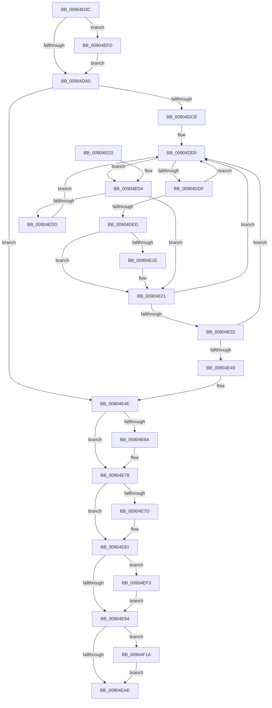

# ExSweepHandleTable

- RVA: `0x00904D3C`–`0x00904F28` (길이 `492` bytes)
- VA: `0x0000000140904D3C`
- 실행 섹션: `PAGE`
- PDB 이름 있음: `예`; PDB Function 태그: `아니요`
- unwind 정보 RVA: `0x00088B5C`
- 디코드: `132`개 명령, `492/492` bytes 표시
- 미해석 바이트: `0` (있으면 어셈블리에 `.byte`로 보존)

> 이 문서는 커널 이미지의 기계어와 PDB 기호를 분석해 생성했습니다. 4번과 5번은 함수 원형과 자료형을 바이너리 사용 방식에서 추정한 C 해석이며 원본 소스 복구 결과는 아닙니다.

## 1. Dependencies

- 직접 호출 지점: **12**; 고유 호출 대상: **11**
- 직접 호출자로 확인된 함수: **3**
- RIP 상대 이미지 참조: **1**

### Outgoing calls
- `0x00904DB6` → [ExpLookupHandleTableEntry](../86/ExpLookupHandleTableEntry_function_00869DB0.md) (function, `0x00869DB0`)
- `0x00904E03` → [ObCloseHandleTableEntry](../86/ObCloseHandleTableEntry_function_00869E20.md) (function, `0x00869E20`)
- `0x00904E3C` → [ExpLookupHandleTableEntry](../86/ExpLookupHandleTableEntry_function_00869DB0.md) (function, `0x00869DB0`)
- `0x00904E5A` → [KeAbPreAcquire](../../text/21/KeAbPreAcquire_function_00210230.md) (function, `0x00210230`)
- `0x00904E73` → [ExfAcquirePushLockExclusiveEx](../../text/20/ExfAcquirePushLockExclusiveEx_function_0020FC90.md) (function, `0x0020FC90`)
- `0x00904E97` → [KeAbPostRelease](../../text/2E/KeAbPostRelease_function_002E1600.md) (function, `0x002E1600`)
- `0x00904EA3` → [KeLeaveCriticalRegionThread](../../text/25/KeLeaveCriticalRegionThread_function_0025EFF0.md) (function, `0x0025EFF0`)
- `0x00904EB6` → [_security_check_cookie](../../text/6A/_security_check_cookie_function_006AC640.md) (function, `0x006AC640`)
- `0x00904EE3` → [ExpBlockOnLockedHandleEntry](../86/ExpBlockOnLockedHandleEntry_function_00868838.md) (function, `0x00868838`)
- `0x00904EF6` → [ExfTryToWakePushLock](../../text/26/ExfTryToWakePushLock_function_00265DD0.md) (function, `0x00265DD0`)
- `0x00904F02` → [KeStackAttachProcess](../../text/21/KeStackAttachProcess_function_00216800.md) (function, `0x00216800`)
- `0x00904F21` → [KiUnstackDetachProcess](../../text/21/KiUnstackDetachProcess_function_00217D30.md) (function, `0x00217D30`)

### Direct callers
- [ObKillProcess](ObKillProcess_function_00904F30.md) at `0x00904F60`
- [PspRundownSingleProcess](PspRundownSingleProcess_function_00906D50.md) at `0x009070AD`
- [ObInitProcess](../94/ObInitProcess_function_0094C62C.md) at `0x0094C752`

### Static image references
- `0x00904D50` → RVA `0x00E0A740` (`.data`; read)

## 2. Other-region calls and transfers

- 다른 실행 섹션으로 향하는 call: **8**
  - `0x00904E5A` → [KeAbPreAcquire](../../text/21/KeAbPreAcquire_function_00210230.md) (`PAGE` → `.text`)
  - `0x00904E73` → [ExfAcquirePushLockExclusiveEx](../../text/20/ExfAcquirePushLockExclusiveEx_function_0020FC90.md) (`PAGE` → `.text`)
  - `0x00904E97` → [KeAbPostRelease](../../text/2E/KeAbPostRelease_function_002E1600.md) (`PAGE` → `.text`)
  - `0x00904EA3` → [KeLeaveCriticalRegionThread](../../text/25/KeLeaveCriticalRegionThread_function_0025EFF0.md) (`PAGE` → `.text`)
  - `0x00904EB6` → [_security_check_cookie](../../text/6A/_security_check_cookie_function_006AC640.md) (`PAGE` → `.text`)
  - `0x00904EF6` → [ExfTryToWakePushLock](../../text/26/ExfTryToWakePushLock_function_00265DD0.md) (`PAGE` → `.text`)
  - `0x00904F02` → [KeStackAttachProcess](../../text/21/KeStackAttachProcess_function_00216800.md) (`PAGE` → `.text`)
  - `0x00904F21` → [KiUnstackDetachProcess](../../text/21/KiUnstackDetachProcess_function_00217D30.md) (`PAGE` → `.text`)
- 별도 외부 분기/꼬리 이동을 확인하지 못했습니다.

## 3. Assembly (complete function range)

```asm
00904D3C  48 89 5C 24 18                  mov qword ptr [rsp + 0x18], rbx
00904D41  55                              push rbp
00904D42  56                              push rsi
00904D43  57                              push rdi
00904D44  41 54                           push r12
00904D46  41 55                           push r13
00904D48  41 56                           push r14
00904D4A  41 57                           push r15
00904D4C  48 83 EC 70                     sub rsp, 0x70
00904D50  48 8B 05 E9 59 50 00            mov rax, qword ptr [rip + 0x5059e9]
00904D57  48 33 C4                        xor rax, rsp
00904D5A  48 89 44 24 68                  mov qword ptr [rsp + 0x68], rax
00904D5F  0F 57 C0                        xorps xmm0, xmm0
00904D62  44 88 44 24 31                  mov byte ptr [rsp + 0x31], r8b
00904D67  0F 11 44 24 38                  movups xmmword ptr [rsp + 0x38], xmm0
00904D6C  45 32 ED                        xor r13b, r13b
00904D6F  48 8B EA                        mov rbp, rdx
00904D72  0F 11 44 24 48                  movups xmmword ptr [rsp + 0x48], xmm0
00904D77  4C 8B F9                        mov r15, rcx
00904D7A  44 88 6C 24 30                  mov byte ptr [rsp + 0x30], r13b
00904D7F  0F 11 44 24 58                  movups xmmword ptr [rsp + 0x58], xmm0
00904D84  65 4C 8B 34 25 88 01 00 00      mov r14, qword ptr gs:[0x188]
00904D8D  41 B9 01 00 00 00               mov r9d, 1
00904D93  49 39 8E B8 00 00 00            cmp qword ptr [r14 + 0xb8], rcx
00904D9A  0F 85 5D 01 00 00               jne 0x140904efd
00904DA0  66 45 29 8E E4 01 00 00         sub word ptr [r14 + 0x1e4], r9w
00904DA8  BB 04 00 00 00                  mov ebx, 4
00904DAD  8B D3                           mov edx, ebx
00904DAF  48 8B CD                        mov rcx, rbp
00904DB2  45 33 E4                        xor r12d, r12d
00904DB5  90                              nop
00904DB6  E8 F5 4F F6 FF                  call 0x140869db0
00904DBB  48 83 CF FF                     or rdi, 0xffffffffffffffff
00904DBF  48 8B F0                        mov rsi, rax
00904DC2  48 85 C0                        test rax, rax
00904DC5  0F 84 83 00 00 00               je 0x140904e4e
00904DCB  44 8A 6C 24 31                  mov r13b, byte ptr [rsp + 0x31]
00904DD0  0F 0D 0E                        prefetchw byte ptr [rsi]
00904DD3  4C 8B 06                        mov r8, qword ptr [rsi]
00904DD6  45 84 C1                        test r9b, r8b
00904DD9  0F 84 F5 00 00 00               je 0x140904ed4
00904DDF  49 8D 48 FF                     lea rcx, [r8 - 1]
00904DE3  49 8B C0                        mov rax, r8
00904DE6  F0 48 0F B1 0E                  lock cmpxchg qword ptr [rsi], rcx
00904DEB  75 E3                           jne 0x140904dd0
00904DED  44 88 4C 24 28                  mov byte ptr [rsp + 0x28], r9b
00904DF2  4D 8B C7                        mov r8, r15
00904DF5  4C 8B CB                        mov r9, rbx
00904DF8  44 88 6C 24 20                  mov byte ptr [rsp + 0x20], r13b
00904DFD  48 8B D6                        mov rdx, rsi
00904E00  48 8B CD                        mov rcx, rbp
00904E03  E8 18 50 F6 FF                  call 0x140869e20
00904E08  66 41 01 BE E4 01 00 00         add word ptr [r14 + 0x1e4], di
00904E10  41 B9 01 00 00 00               mov r9d, 1
00904E16  C1 E8 1F                        shr eax, 0x1f
00904E19  90                              nop
00904E1A  84 C0                           test al, al
00904E1C  75 03                           jne 0x140904e21
00904E1E  45 03 E1                        add r12d, r9d
00904E21  48 83 C3 04                     add rbx, 4
00904E25  48 83 C6 10                     add rsi, 0x10
00904E29  48 F7 C3 FF 03 00 00            test rbx, 0x3ff
00904E30  75 9E                           jne 0x140904dd0
00904E32  48 83 C3 04                     add rbx, 4
00904E36  48 8B CD                        mov rcx, rbp
00904E39  48 8B D3                        mov rdx, rbx
00904E3C  E8 6F 4F F6 FF                  call 0x140869db0
00904E41  48 8B F0                        mov rsi, rax
00904E44  48 85 C0                        test rax, rax
00904E47  75 87                           jne 0x140904dd0
00904E49  44 8A 6C 24 30                  mov r13b, byte ptr [rsp + 0x30]
00904E4E  48 8D 5D 40                     lea rbx, [rbp + 0x40]
00904E52  45 33 C0                        xor r8d, r8d
00904E55  48 8B CB                        mov rcx, rbx
00904E58  33 D2                           xor edx, edx
00904E5A  E8 D1 B3 90 FF                  call 0x140210230
00904E5F  F0 48 0F BA 2B 00               lock bts qword ptr [rbx], 0
00904E65  48 8B F0                        mov rsi, rax
00904E68  73 0E                           jae 0x140904e78
00904E6A  4C 8B C3                        mov r8, rbx
00904E6D  48 8B D0                        mov rdx, rax
00904E70  48 8B CB                        mov rcx, rbx
00904E73  E8 18 AE 90 FF                  call 0x14020fc90
00904E78  48 85 F6                        test rsi, rsi
00904E7B  74 04                           je 0x140904e81
00904E7D  C6 46 0A 01                     mov byte ptr [rsi + 0xa], 1
00904E81  44 29 65 58                     sub dword ptr [rbp + 0x58], r12d
00904E85  F0 48 0F C1 3B                  lock xadd qword ptr [rbx], rdi
00904E8A  40 80 E7 06                     and dil, 6
00904E8E  40 80 FF 02                     cmp dil, 2
00904E92  74 5F                           je 0x140904ef3
00904E94  48 8B CB                        mov rcx, rbx
00904E97  E8 64 C7 9D FF                  call 0x1402e1600
00904E9C  80 4D 2C 04                     or byte ptr [rbp + 0x2c], 4
00904EA0  49 8B CE                        mov rcx, r14
00904EA3  E8 48 A1 95 FF                  call 0x14025eff0
00904EA8  41 80 FD 01                     cmp r13b, 1
00904EAC  74 6C                           je 0x140904f1a
00904EAE  48 8B 4C 24 68                  mov rcx, qword ptr [rsp + 0x68]
00904EB3  48 33 CC                        xor rcx, rsp
00904EB6  E8 85 77 DA FF                  call 0x1406ac640
00904EBB  48 8B 9C 24 C0 00 00 00         mov rbx, qword ptr [rsp + 0xc0]
00904EC3  48 83 C4 70                     add rsp, 0x70
00904EC7  41 5F                           pop r15
00904EC9  41 5E                           pop r14
00904ECB  41 5D                           pop r13
00904ECD  41 5C                           pop r12
00904ECF  5F                              pop rdi
00904ED0  5E                              pop rsi
00904ED1  5D                              pop rbp
00904ED2  C3                              ret
00904ED3  CC                              int3
00904ED4  4D 85 C0                        test r8, r8
00904ED7  0F 84 44 FF FF FF               je 0x140904e21
00904EDD  48 8B D6                        mov rdx, rsi
00904EE0  48 8B CD                        mov rcx, rbp
00904EE3  E8 50 39 F6 FF                  call 0x140868838
00904EE8  41 B9 01 00 00 00               mov r9d, 1
00904EEE  E9 DD FE FF FF                  jmp 0x140904dd0
00904EF3  48 8B CB                        mov rcx, rbx
00904EF6  E8 D5 0E 96 FF                  call 0x140265dd0
00904EFB  EB 97                           jmp 0x140904e94
00904EFD  48 8D 54 24 38                  lea rdx, [rsp + 0x38]
00904F02  E8 F9 18 91 FF                  call 0x140216800
00904F07  41 B9 01 00 00 00               mov r9d, 1
00904F0D  45 8A E9                        mov r13b, r9b
00904F10  44 88 4C 24 30                  mov byte ptr [rsp + 0x30], r9b
00904F15  E9 86 FE FF FF                  jmp 0x140904da0
00904F1A  33 D2                           xor edx, edx
00904F1C  48 8D 4C 24 38                  lea rcx, [rsp + 0x38]
00904F21  E8 0A 2E 91 FF                  call 0x140217d30
00904F26  EB 86                           jmp 0x140904eae
```

## 4. C-style interpretation (structured pseudocode)

```c
__int64 __fastcall ExSweepHandleTable(__int64 a1, __int64 a2, unsigned __int8 a3)
{
    __int64 result;
    __int64 v_r12;
    __int64 v_r13;
    __int64 v_rbx;
    __int64 v_rdi;
    __int64 v_rsi;
    __int64 v_rsp;
    unsigned __int64 v_stack_m40;
    unsigned __int64 v_stack_m50;
    unsigned __int64 v_stack_m60;
    unsigned __int64 v_stack_m70;
    unsigned __int8 v_stack_m77;
    unsigned __int8 v_stack_m78;
    unsigned __int8 v_stack_m80;
    unsigned __int8 v_stack_m88;
    unsigned __int64 v_stack_p18;
    unsigned __int8 v_stack_p30;
    unsigned __int64 v_stack_p38;

    v_stack_p18 = v_rbx;
    v_rsp = (v_rsp) - (112);
    result = (*(unsigned __int64 *)(v_rip + 5265897)) ^ (v_rsp);
    v_stack_m40 = result;
    v_stack_m77 = a3;
    v_stack_m70 = v_xmm0;
    v_r13 = 0;
    v_stack_m60 = v_xmm0;
    v_stack_m78 = 0;
    v_stack_m50 = v_xmm0;
    if ((*(unsigned __int64 *)(*(unsigned __int64 *)(gs_base + (0 + 392)) + 184)) != a1) goto loc_00904EFD;
loc_00904DA0:
    v_r12 = 0;
    result = ExpLookupHandleTableEntry(a2, 4, a3, 1);
    v_rdi = (v_rdi) | (-1);
    if (result == 0) goto loc_00904E4E;
loc_00904DD0:
    if (((1) & ((unsigned __int8)(*(unsigned __int64 *)(result)))) == 0) goto loc_00904ED4;
    if (((1) & ((unsigned __int8)(*(unsigned __int64 *)(result)))) != 0) goto loc_00904DD0;
    v_stack_m80 = 1;
    v_stack_m88 = (unsigned __int8)(v_stack_m77);
    result = ObCloseHandleTableEntry(a2, result, a1, 4);
    result = (unsigned int)((result) >> (31));
    if ((unsigned __int8)(result) == 0) {
        v_r12 = (unsigned int)((v_r12) + (1));
    }
    v_rbx = (4) + (4);
    v_rsi = (result) + (16);
    if (((v_rbx) & (0x3FFULL)) != 0) goto loc_00904DD0;
    v_rbx = (v_rbx) + (4);
    result = ExpLookupHandleTableEntry(a2, v_rbx, a1, 1);
    if (result != 0) goto loc_00904DD0;
loc_00904E4E:
    a3 = 0;
    a2 = 0;
    result = KeAbPreAcquire(a2 + 64, a2, a3, 1);
    if (!(condition_is_above_or_equal)) {
        a3 = a2 + 64;
        a2 = result;
        a1 = a2 + 64;
        result = ExfAcquirePushLockExclusiveEx(a1, a2, a3, 1);
    }
    if (result != 0) {
        *(unsigned __int8 *)(result + 10) = 1;
    }
    v_rdi = (unsigned __int8)((v_rdi) & (6));
    if (((unsigned __int8)(v_rdi)) == 2) goto loc_00904EF3;
loc_00904E94:
    result = KeAbPostRelease(a2 + 64, a2, a3, 1);
    result = KeLeaveCriticalRegionThread(*(unsigned __int64 *)(gs_base + (0 + 392)), a2, a3, 1);
    if (((unsigned __int8)(v_stack_m78)) == 1) goto loc_00904F1A;
loc_00904EAE:
    a1 = (v_stack_m40) ^ (v_rsp);
    result = _security_check_cookie(a1, a2, a3, 1);
    v_rsp = (v_rsp) + (112);
    return result;
loc_00904ED4:
    if (a3 == 0) goto loc_00904E21;
    result = ExpBlockOnLockedHandleEntry(a2, result, a3, 1);
    goto loc_00904DD0;
loc_00904EF3:
    result = ExfTryToWakePushLock(v_stack_p18, result, a3, 1);
    goto loc_00904E94;
loc_00904EFD:
    result = KeStackAttachProcess(v_stack_p18, v_stack_p38, a3, 1);
    v_stack_p30 = 1;
    goto loc_00904DA0;
loc_00904F1A:
    a2 = 0;
    result = KiUnstackDetachProcess(v_stack_p38, a2, a3, 1);
    goto loc_00904EAE;
}
```

## 5. (Beta) C Style

```c
int64_t ExSweepHandleTable(int64_t Arg1, void *Arg2, uint8_t Arg3)
{
    uint8_t *arg2 = (uint8_t *)Arg2;

    int64_t result;
    int64_t local_r12;
    int64_t local_r13;
    int64_t local_rbx;
    int64_t local_rdi;
    int64_t local_rsi;
    int64_t local_rsp;
    uint64_t v_stack_m40;
    uint64_t v_stack_m50;
    uint64_t v_stack_m60;
    uint64_t v_stack_m70;
    uint8_t v_stack_m77;
    uint8_t v_stack_m78;
    uint8_t v_stack_m80;
    uint8_t v_stack_m88;
    uint64_t v_stack_p18;
    uint8_t v_stack_p30;
    uint64_t v_stack_p38;

    v_stack_p18 = local_rbx;
    local_rsp = (local_rsp) - (112);
    result = (*(uint64_t *)(v_rip + 0x5059E9)) ^ (local_rsp);
    v_stack_m40 = result;
    v_stack_m77 = Arg3;
    v_stack_m70 = v_xmm0;
    local_r13 = 0;
    v_stack_m60 = v_xmm0;
    v_stack_m78 = 0;
    v_stack_m50 = v_xmm0;
    if ((*(uint64_t *)(*(uint64_t *)(gs_base + (0 + 0x188)) + 0xB8)) != Arg1) goto loc_00904EFD;
loc_00904DA0:
    local_r12 = 0;
    result = ExpLookupHandleTableEntry(Arg2, 4, Arg3, 1);
    local_rdi = (local_rdi) | (-1);
    if (result == 0) goto loc_00904E4E;
loc_00904DD0:
    if (((1) & ((uint8_t)(*(uint64_t *)(result)))) == 0) goto loc_00904ED4;
    if (((1) & ((uint8_t)(*(uint64_t *)(result)))) != 0) goto loc_00904DD0;
    v_stack_m80 = 1;
    v_stack_m88 = (uint8_t)(v_stack_m77);
    result = ObCloseHandleTableEntry(Arg2, result, Arg1, 4);
    result = (uint32_t)((result) >> (31));
    if ((uint8_t)(result) == 0) {
        local_r12 = (uint32_t)((local_r12) + (1));
    }
    local_rbx = (4) + (4);
    local_rsi = (result) + (16);
    if (((local_rbx) & (0x3FFULL)) != 0) goto loc_00904DD0;
    local_rbx = (local_rbx) + (4);
    result = ExpLookupHandleTableEntry(Arg2, local_rbx, Arg1, 1);
    if (result != 0) goto loc_00904DD0;
loc_00904E4E:
    Arg3 = 0;
    Arg2 = 0;
    result = KeAbPreAcquire(Arg2 + 64, Arg2, Arg3, 1);
    if (!(condition_is_above_or_equal)) {
        Arg3 = Arg2 + 64;
        Arg2 = result;
        Arg1 = Arg2 + 64;
        result = ExfAcquirePushLockExclusiveEx(Arg1, Arg2, Arg3, 1);
    }
    if (result != 0) {
        *(uint8_t *)(result + 0xA) = 1;
    }
    local_rdi = (uint8_t)((local_rdi) & (6));
    if (((uint8_t)(local_rdi)) == 2) goto loc_00904EF3;
loc_00904E94:
    result = KeAbPostRelease(Arg2 + 64, Arg2, Arg3, 1);
    result = KeLeaveCriticalRegionThread(*(uint64_t *)(gs_base + (0 + 0x188)), Arg2, Arg3, 1);
    if (((uint8_t)(v_stack_m78)) == 1) goto loc_00904F1A;
loc_00904EAE:
    Arg1 = (v_stack_m40) ^ (local_rsp);
    result = _security_check_cookie(Arg1, Arg2, Arg3, 1);
    local_rsp = (local_rsp) + (112);
    return result;
loc_00904ED4:
    if (Arg3 == 0) goto loc_00904E21;
    result = ExpBlockOnLockedHandleEntry(Arg2, result, Arg3, 1);
    goto loc_00904DD0;
loc_00904EF3:
    result = ExfTryToWakePushLock(v_stack_p18, result, Arg3, 1);
    goto loc_00904E94;
loc_00904EFD:
    result = KeStackAttachProcess(v_stack_p18, v_stack_p38, Arg3, 1);
    v_stack_p30 = 1;
    goto loc_00904DA0;
loc_00904F1A:
    Arg2 = 0;
    result = KiUnstackDetachProcess(v_stack_p38, Arg2, Arg3, 1);
    goto loc_00904EAE;
}
```

### 관측된 메모리 오프셋

구조체 형식이 확인되지 않은 접근은 인자 기준의 오프셋으로만 기록했습니다.

| 기준 인자 | 오프셋 표현 | 폭 (bit) | 접근 |
|---|---:|---:|---|
| `Arg2` | `+ 0x0` | `64` | `R/W` |
| `Arg2` | `+ 0x2C` | `8` | `R/W` |
| `Arg2` | `+ 0x40` | `64` | `R` |
| `Arg2` | `+ 0x58` | `32` | `R/W` |

## 6. Execution-region graph

[열기: 2D/3D 그래프와 함수 탐색 컨트롤 패널](../../../control-panel.html?section=page&rva=0x00904D3C&view=graph)

- 2D 그래프는 위에서 아래로 흐르고, 3D 그래프는 빈 공간을 드래그해 회전합니다. Shift+드래그는 이동, 휠은 확대·축소, 함수 노드 선택은 대상 보고서 이동입니다.

### Static fallback


