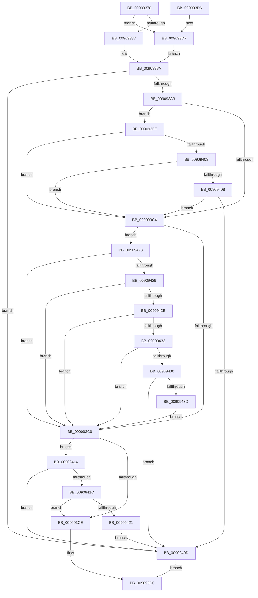

# ExpCaptureWnfStateName

- RVA: `0x00909370`–`0x0090943F` (길이 `207` bytes)
- VA: `0x0000000140909370`
- 실행 섹션: `PAGE`
- PDB 이름 있음: `예`; PDB Function 태그: `아니요`
- unwind 정보 RVA: `0x00088F54`
- 디코드: `66`개 명령, `207/207` bytes 표시
- 미해석 바이트: `0` (있으면 어셈블리에 `.byte`로 보존)

> 이 문서는 커널 이미지의 기계어와 PDB 기호를 분석해 생성했습니다. 4번과 5번은 함수 원형과 자료형을 바이너리 사용 방식에서 추정한 C 해석이며 원본 소스 복구 결과는 아닙니다.

## 1. Dependencies

- 직접 호출 지점: **1**; 고유 호출 대상: **1**
- 직접 호출자로 확인된 함수: **6**
- RIP 상대 이미지 참조: **0**

### Outgoing calls
- `0x009093F3` → [RtlCopyVolatileMemory](../../text/6B/RtlCopyVolatileMemory_function_006BC9D0.md) (function, `0x006BC9D0`)

### Direct callers
- [ExpNtDeleteWnfStateData](../7C/ExpNtDeleteWnfStateData_function_007CF1A8.md) at `0x007CF231`
- [NtDeleteWnfStateName](NtDeleteWnfStateName_function_00908E60.md) at `0x00908EC3`
- [NtUnsubscribeWnfStateChange](NtUnsubscribeWnfStateChange_function_009092B0.md) at `0x009092EB`
- [ExpWnfCompleteThreadSubscriptions](ExpWnfCompleteThreadSubscriptions_function_00909A10.md) at `0x00909A4A`
- [ExpWnfSubscribeWnfStateChange](../9D/ExpWnfSubscribeWnfStateChange_function_009D4D0C.md) at `0x009D4D62`
- [NtQueryWnfStateNameInformation](../9E/NtQueryWnfStateNameInformation_function_009EBD20.md) at `0x009EBD9F`

### Static image references
- 디코드된 RIP-relative 메모리 참조가 없습니다.

## 2. Other-region calls and transfers

- 다른 실행 섹션으로 향하는 call: **1**
  - `0x009093F3` → [RtlCopyVolatileMemory](../../text/6B/RtlCopyVolatileMemory_function_006BC9D0.md) (`PAGE` → `.text`)
- 별도 외부 분기/꼬리 이동을 확인하지 못했습니다.

## 3. Assembly (complete function range)

```asm
00909370  40 53                           push rbx
00909372  48 83 EC 20                     sub rsp, 0x20
00909376  48 C7 44 24 38 00 00 00 00      mov qword ptr [rsp + 0x38], 0
0090937F  48 8B DA                        mov rbx, rdx
00909382  45 84 C0                        test r8b, r8b
00909385  75 50                           jne 0x1409093d7
00909387  48 8B 09                        mov rcx, qword ptr [rcx]
0090938A  48 B8 74 00 BC A3 6D 4E C6 41   movabs rax, 0x41c64e6da3bc0074
00909394  48 33 C8                        xor rcx, rax
00909397  0F B6 C1                        movzx eax, cl
0090939A  48 89 0B                        mov qword ptr [rbx], rcx
0090939D  24 0F                           and al, 0xf
0090939F  3C 01                           cmp al, 1
009093A1  75 6A                           jne 0x14090940d
009093A3  48 8B D1                        mov rdx, rcx
009093A6  4C 8B C1                        mov r8, rcx
009093A9  48 C1 EA 06                     shr rdx, 6
009093AD  49 C1 E8 0A                     shr r8, 0xa
009093B1  83 E2 0F                        and edx, 0xf
009093B4  48 C1 E9 04                     shr rcx, 4
009093B8  41 83 E0 01                     and r8d, 1
009093BC  83 E1 03                        and ecx, 3
009093BF  83 F9 03                        cmp ecx, 3
009093C2  75 3B                           jne 0x1409093ff
009093C4  83 FA 05                        cmp edx, 5
009093C7  75 5A                           jne 0x140909423
009093C9  45 85 C0                        test r8d, r8d
009093CC  75 46                           jne 0x140909414
009093CE  33 C0                           xor eax, eax
009093D0  48 83 C4 20                     add rsp, 0x20
009093D4  5B                              pop rbx
009093D5  C3                              ret
009093D6  CC                              int3
009093D7  48 BA 00 00 FF FF FF 7F 00 00   movabs rdx, 0x7fffffff0000
009093E1  41 B8 08 00 00 00               mov r8d, 8
009093E7  48 3B CA                        cmp rcx, rdx
009093EA  48 0F 42 D1                     cmovb rdx, rcx
009093EE  48 8D 4C 24 38                  lea rcx, [rsp + 0x38]
009093F3  E8 D8 35 DB FF                  call 0x1406bc9d0
009093F8  48 8B 4C 24 38                  mov rcx, qword ptr [rsp + 0x38]
009093FD  EB 8B                           jmp 0x14090938a
009093FF  85 C9                           test ecx, ecx
00909401  74 C1                           je 0x1409093c4
00909403  83 E9 01                        sub ecx, 1
00909406  74 BC                           je 0x1409093c4
00909408  83 F9 01                        cmp ecx, 1
0090940B  74 B7                           je 0x1409093c4
0090940D  B8 0D 00 00 C0                  mov eax, 0xc000000d
00909412  EB BC                           jmp 0x1409093d0
00909414  F7 C2 F9 FF FF FF               test edx, 0xfffffff9
0090941A  75 F1                           jne 0x14090940d
0090941C  83 FA 06                        cmp edx, 6
0090941F  75 AD                           jne 0x1409093ce
00909421  EB EA                           jmp 0x14090940d
00909423  8B CA                           mov ecx, edx
00909425  85 D2                           test edx, edx
00909427  74 A0                           je 0x1409093c9
00909429  83 E9 01                        sub ecx, 1
0090942C  74 9B                           je 0x1409093c9
0090942E  83 E9 01                        sub ecx, 1
00909431  74 96                           je 0x1409093c9
00909433  83 E9 01                        sub ecx, 1
00909436  74 91                           je 0x1409093c9
00909438  83 F9 01                        cmp ecx, 1
0090943B  75 D0                           jne 0x14090940d
0090943D  EB 8A                           jmp 0x1409093c9
```

## 4. C-style interpretation (structured pseudocode)

```c
__int64 __fastcall ExpCaptureWnfStateName(__int64 a1, __int64 a2, unsigned __int8 a3)
{
    __int64 result;
    __int64 v_rsp;
    unsigned __int64 v_stack_p10;
    unsigned __int64 v_stack_p38;

    v_rsp = (v_rsp) - (32);
    v_stack_p10 = 0;
    if (a3 != 0) goto loc_009093D7;
loc_0090938A:
    a1 = (*(unsigned __int64 *)(a1)) ^ (result);
    *(unsigned __int64 *)(a2) = a1;
    result = (unsigned __int8)(((unsigned __int8)(a1)) & (15));
    if (((unsigned __int8)(result)) != 1) goto loc_0090940D;
    a2 = (a1) >> (6);
    a3 = (a1) >> (10);
    a2 = (unsigned int)((a2) & (15));
    a1 = (a1) >> (4);
    a3 = (unsigned int)((a3) & (1));
    a1 = (unsigned int)((a1) & (3));
    if (((unsigned int)(a1)) != 3) goto loc_009093FF;
loc_009093C4:
    if (((unsigned int)(a2)) != 5) goto loc_00909423;
loc_009093C9:
    if (a3 != 0) goto loc_00909414;
loc_009093CE:
    result = 0;
loc_009093D0:
    v_rsp = (v_rsp) + (32);
    return result;
loc_009093D7:
    if (a1 < a2) { a2 = a1; }
    result = RtlCopyVolatileMemory(v_stack_p38, a2, 8, a4);
    goto loc_0090938A;
loc_009093FF:
    if ((unsigned int)(v_stack_p38) == 0) goto loc_009093C4;
    a1 = (unsigned int)((v_stack_p38) - (1));
    if (condition_is_equal) goto loc_009093C4;
    if (((unsigned int)(a1)) == 1) goto loc_009093C4;
loc_0090940D:
    goto loc_009093D0;
loc_00909414:
    if ((((unsigned int)(a2)) & (0xFFFFFFF9ULL)) != 0) goto loc_0090940D;
    if (((unsigned int)(a2)) != 6) goto loc_009093CE;
    goto loc_0090940D;
loc_00909423:
    if ((unsigned int)(a2) == 0) goto loc_009093C9;
    a1 = (unsigned int)(((unsigned int)((unsigned int)(a2))) - (1));
    if (condition_is_equal) goto loc_009093C9;
    a1 = (unsigned int)((a1) - (1));
    if (condition_is_equal) goto loc_009093C9;
    a1 = (unsigned int)((a1) - (1));
    if (condition_is_equal) goto loc_009093C9;
    if (((unsigned int)(a1)) != 1) goto loc_0090940D;
    goto loc_009093C9;
}
```

## 5. (Beta) C Style

```c
int64_t ExpCaptureWnfStateName(void *Arg1, void *Arg2, uint8_t Arg3)
{
    uint8_t *arg1 = (uint8_t *)Arg1;
    uint8_t *arg2 = (uint8_t *)Arg2;

    int64_t result;
    int64_t local_rsp;
    uint64_t v_stack_p10;
    uint64_t v_stack_p38;

    local_rsp = (local_rsp) - (32);
    v_stack_p10 = 0;
    if (Arg3 != 0) goto loc_009093D7;
loc_0090938A:
    Arg1 = (*(uint64_t *)(arg1)) ^ (result);
    *(void **)(arg2) = Arg1;
    result = (uint8_t)(((uint8_t)(Arg1)) & (15));
    if (((uint8_t)(result)) != 1) goto loc_0090940D;
    Arg2 = (Arg1) >> (6);
    Arg3 = (Arg1) >> (10);
    Arg2 = (uint32_t)((Arg2) & (15));
    Arg1 = (Arg1) >> (4);
    Arg3 = (uint32_t)((Arg3) & (1));
    Arg1 = (uint32_t)((Arg1) & (3));
    if (((uint32_t)(Arg1)) != 3) goto loc_009093FF;
loc_009093C4:
    if (((uint32_t)(Arg2)) != 5) goto loc_00909423;
loc_009093C9:
    if (Arg3 != 0) goto loc_00909414;
loc_009093CE:
    result = 0;
loc_009093D0:
    local_rsp = (local_rsp) + (32);
    return result;
loc_009093D7:
    if (Arg1 < Arg2) { Arg2 = Arg1; }
    result = RtlCopyVolatileMemory(v_stack_p38, Arg2, 8, a4);
    goto loc_0090938A;
loc_009093FF:
    if ((uint32_t)(v_stack_p38) == 0) goto loc_009093C4;
    Arg1 = (uint32_t)((v_stack_p38) - (1));
    if (condition_is_equal) goto loc_009093C4;
    if (((uint32_t)(Arg1)) == 1) goto loc_009093C4;
loc_0090940D:
    goto loc_009093D0;
loc_00909414:
    if ((((uint32_t)(Arg2)) & (0xFFFFFFF9ULL)) != 0) goto loc_0090940D;
    if (((uint32_t)(Arg2)) != 6) goto loc_009093CE;
    goto loc_0090940D;
loc_00909423:
    if ((uint32_t)(Arg2) == 0) goto loc_009093C9;
    Arg1 = (uint32_t)(((uint32_t)((uint32_t)(Arg2))) - (1));
    if (condition_is_equal) goto loc_009093C9;
    Arg1 = (uint32_t)((Arg1) - (1));
    if (condition_is_equal) goto loc_009093C9;
    Arg1 = (uint32_t)((Arg1) - (1));
    if (condition_is_equal) goto loc_009093C9;
    if (((uint32_t)(Arg1)) != 1) goto loc_0090940D;
    goto loc_009093C9;
}
```

### 관측된 메모리 오프셋

구조체 형식이 확인되지 않은 접근은 인자 기준의 오프셋으로만 기록했습니다.

| 기준 인자 | 오프셋 표현 | 폭 (bit) | 접근 |
|---|---:|---:|---|
| `Arg1` | `+ 0x0` | `64` | `R` |
| `Arg2` | `+ 0x0` | `64` | `W` |

## 6. Execution-region graph

[열기: 2D/3D 그래프와 함수 탐색 컨트롤 패널](../../../control-panel.html?section=page&rva=0x00909370&view=graph)

- 2D 그래프는 위에서 아래로 흐르고, 3D 그래프는 빈 공간을 드래그해 회전합니다. Shift+드래그는 이동, 휠은 확대·축소, 함수 노드 선택은 대상 보고서 이동입니다.

### Static fallback


