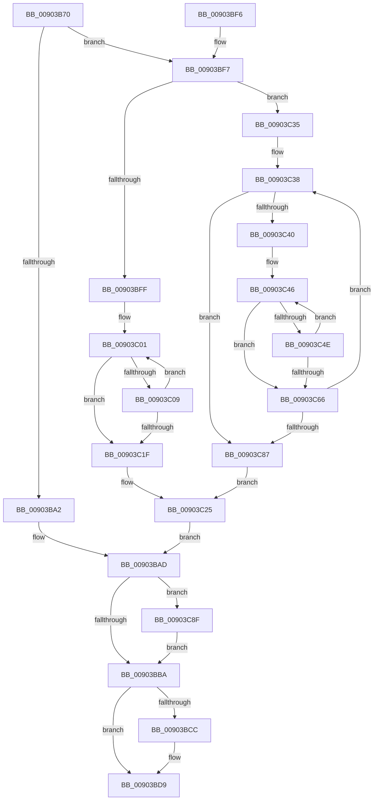

# ExpFreeHandleTable

- RVA: `0x00903B70`–`0x00903C9C` (길이 `300` bytes)
- VA: `0x0000000140903B70`
- 실행 섹션: `PAGE`
- PDB 이름 있음: `예`; PDB Function 태그: `아니요`
- unwind 정보 RVA: `0x00088A10`
- 디코드: `87`개 명령, `300/300` bytes 표시
- 미해석 바이트: `0` (있으면 어셈블리에 `.byte`로 보존)

> 이 문서는 커널 이미지의 기계어와 PDB 기호를 분석해 생성했습니다. 4번과 5번은 함수 원형과 자료형을 바이너리 사용 방식에서 추정한 C 해석이며 원본 소스 복구 결과는 아닙니다.

## 1. Dependencies

- 직접 호출 지점: **8**; 고유 호출 대상: **5**
- 직접 호출자로 확인된 함수: **2**
- RIP 상대 이미지 참조: **0**

### Outgoing calls
- `0x00903BA8` → [ExpFreeLowLevelTable](ExpFreeLowLevelTable_function_00901E28.md) (function, `0x00901E28`)
- `0x00903BC2` → [ExFreePoolWithTag](../../poolcode/B8/ExFreePoolWithTag_function_00B82870.md) (function, `0x00B82870`)
- `0x00903BD4` → [PsReturnProcessPagedPoolQuota](../../text/2A/PsReturnProcessPagedPoolQuota_function_002A6860.md) (function, `0x002A6860`)
- `0x00903C0C` → [ExpFreeLowLevelTable](ExpFreeLowLevelTable_function_00901E28.md) (function, `0x00901E28`)
- `0x00903C2B` → [ExpFreeTablePagedPool](../86/ExpFreeTablePagedPool_function_0086B410.md) (function, `0x0086B410`)
- `0x00903C51` → [ExpFreeLowLevelTable](ExpFreeLowLevelTable_function_00901E28.md) (function, `0x00901E28`)
- `0x00903C72` → [ExpFreeTablePagedPool](../86/ExpFreeTablePagedPool_function_0086B410.md) (function, `0x0086B410`)
- `0x00903C92` → [ExDereferenceHandleDebugInfo](../A1/ExDereferenceHandleDebugInfo_function_00A17430.md) (function, `0x00A17430`)

### Direct callers
- [ExDestroyHandleTable](ExDestroyHandleTable_function_00904D18.md) at `0x00904D29`
- [ExDupHandleTable](../94/ExDupHandleTable_function_0094CAC0.md) at `0x0094CB47`

### Static image references
- 디코드된 RIP-relative 메모리 참조가 없습니다.

## 2. Other-region calls and transfers

- 다른 실행 섹션으로 향하는 call: **2**
  - `0x00903BC2` → [ExFreePoolWithTag](../../poolcode/B8/ExFreePoolWithTag_function_00B82870.md) (`PAGE` → `POOLCODE`)
  - `0x00903BD4` → [PsReturnProcessPagedPoolQuota](../../text/2A/PsReturnProcessPagedPoolQuota_function_002A6860.md) (`PAGE` → `.text`)
- 별도 외부 분기/꼬리 이동을 확인하지 못했습니다.

## 3. Assembly (complete function range)

```asm
00903B70  48 89 5C 24 08                  mov qword ptr [rsp + 8], rbx
00903B75  48 89 6C 24 10                  mov qword ptr [rsp + 0x10], rbp
00903B7A  48 89 74 24 18                  mov qword ptr [rsp + 0x18], rsi
00903B7F  57                              push rdi
00903B80  41 54                           push r12
00903B82  41 55                           push r13
00903B84  41 56                           push r14
00903B86  41 57                           push r15
00903B88  48 83 EC 20                     sub rsp, 0x20
00903B8C  48 8B 59 08                     mov rbx, qword ptr [rcx + 8]
00903B90  48 8B F1                        mov rsi, rcx
00903B93  48 8B 79 10                     mov rdi, qword ptr [rcx + 0x10]
00903B97  8B C3                           mov eax, ebx
00903B99  48 83 E3 FC                     and rbx, 0xfffffffffffffffc
00903B9D  83 E0 03                        and eax, 3
00903BA0  75 55                           jne 0x140903bf7
00903BA2  48 8B D3                        mov rdx, rbx
00903BA5  48 8B CF                        mov rcx, rdi
00903BA8  E8 7B E2 FF FF                  call 0x140901e28
00903BAD  48 8B 56 60                     mov rdx, qword ptr [rsi + 0x60]
00903BB1  48 85 D2                        test rdx, rdx
00903BB4  0F 85 D5 00 00 00               jne 0x140903c8f
00903BBA  BA 4F 62 74 62                  mov edx, 0x6274624f
00903BBF  48 8B CE                        mov rcx, rsi
00903BC2  E8 A9 EC 27 00                  call 0x140b82870
00903BC7  48 85 FF                        test rdi, rdi
00903BCA  74 0D                           je 0x140903bd9
00903BCC  BA 80 00 00 00                  mov edx, 0x80
00903BD1  48 8B CF                        mov rcx, rdi
00903BD4  E8 87 2C 9A FF                  call 0x1402a6860
00903BD9  48 8B 5C 24 50                  mov rbx, qword ptr [rsp + 0x50]
00903BDE  48 8B 6C 24 58                  mov rbp, qword ptr [rsp + 0x58]
00903BE3  48 8B 74 24 60                  mov rsi, qword ptr [rsp + 0x60]
00903BE8  48 83 C4 20                     add rsp, 0x20
00903BEC  41 5F                           pop r15
00903BEE  41 5E                           pop r14
00903BF0  41 5D                           pop r13
00903BF2  41 5C                           pop r12
00903BF4  5F                              pop rdi
00903BF5  C3                              ret
00903BF6  CC                              int3
00903BF7  4C 8B F3                        mov r14, rbx
00903BFA  83 F8 01                        cmp eax, 1
00903BFD  75 36                           jne 0x140903c35
00903BFF  33 ED                           xor ebp, ebp
00903C01  49 8B 16                        mov rdx, qword ptr [r14]
00903C04  48 85 D2                        test rdx, rdx
00903C07  74 16                           je 0x140903c1f
00903C09  48 8B CF                        mov rcx, rdi
00903C0C  E8 17 E2 FF FF                  call 0x140901e28
00903C11  FF C5                           inc ebp
00903C13  49 83 C6 08                     add r14, 8
00903C17  81 FD 00 02 00 00               cmp ebp, 0x200
00903C1D  72 E2                           jb 0x140903c01
00903C1F  41 B8 00 10 00 00               mov r8d, 0x1000
00903C25  48 8B D3                        mov rdx, rbx
00903C28  48 8B CF                        mov rcx, rdi
00903C2B  E8 E0 77 F6 FF                  call 0x14086b410
00903C30  E9 78 FF FF FF                  jmp 0x140903bad
00903C35  45 33 E4                        xor r12d, r12d
00903C38  49 8B 2E                        mov rbp, qword ptr [r14]
00903C3B  48 85 ED                        test rbp, rbp
00903C3E  74 47                           je 0x140903c87
00903C40  45 33 ED                        xor r13d, r13d
00903C43  4C 8B FD                        mov r15, rbp
00903C46  49 8B 17                        mov rdx, qword ptr [r15]
00903C49  48 85 D2                        test rdx, rdx
00903C4C  74 18                           je 0x140903c66
00903C4E  48 8B CF                        mov rcx, rdi
00903C51  E8 D2 E1 FF FF                  call 0x140901e28
00903C56  41 FF C5                        inc r13d
00903C59  49 83 C7 08                     add r15, 8
00903C5D  41 81 FD 00 02 00 00            cmp r13d, 0x200
00903C64  72 E0                           jb 0x140903c46
00903C66  41 B8 00 10 00 00               mov r8d, 0x1000
00903C6C  48 8B D5                        mov rdx, rbp
00903C6F  48 8B CF                        mov rcx, rdi
00903C72  E8 99 77 F6 FF                  call 0x14086b410
00903C77  41 FF C4                        inc r12d
00903C7A  49 83 C6 08                     add r14, 8
00903C7E  41 81 FC 80 00 00 00            cmp r12d, 0x80
00903C85  72 B1                           jb 0x140903c38
00903C87  41 B8 00 04 00 00               mov r8d, 0x400
00903C8D  EB 96                           jmp 0x140903c25
00903C8F  48 8B CE                        mov rcx, rsi
00903C92  E8 99 37 11 00                  call 0x140a17430
00903C97  E9 1E FF FF FF                  jmp 0x140903bba
```

## 4. C-style interpretation (structured pseudocode)

```c
__int64 __fastcall ExpFreeHandleTable(__int64 a1)
{
    __int64 result;
    __int64 v_r12;
    __int64 v_r13;
    __int64 v_r14;
    __int64 v_r15;
    __int64 v_rbp;
    __int64 v_rbx;
    __int64 v_rsp;
    unsigned __int64 v_stack_p10;
    unsigned __int64 v_stack_p18;
    unsigned __int64 v_stack_p8;

    v_stack_p8 = v_rbx;
    v_stack_p10 = v_rbp;
    v_stack_p18 = v_rsi;
    v_rsp = (v_rsp) - (32);
    v_rbx = (*(unsigned __int64 *)(a1 + 8)) & (-4);
    result = (unsigned int)(((unsigned int)((unsigned int)(*(unsigned __int64 *)(a1 + 8)))) & (3));
    if (condition_is_not_equal) goto loc_00903BF7;
    result = ExpFreeLowLevelTable(*(unsigned __int64 *)(a1 + 16), v_rbx, a3, a4);
loc_00903BAD:
    if (*(unsigned __int64 *)(a1 + 96) != 0) goto loc_00903C8F;
loc_00903BBA:
    result = ExFreePoolWithTag(a1, (unsigned int)(0x6274624FULL), a3, a4);
    if (*(unsigned __int64 *)(a1 + 16) != 0) {
        a2 = 128;
        a1 = *(unsigned __int64 *)(a1 + 16);
        result = PsReturnProcessPagedPoolQuota(a1, a2, a3, a4);
    }
    v_rsp = (v_rsp) + (32);
    return result;
loc_00903BF7:
    if (((unsigned int)(result)) != 1) goto loc_00903C35;
    v_rbp = 0;
loc_00903C01:
    if (*(unsigned __int64 *)(v_stack_p8) == 0) goto loc_00903C1F;
    result = ExpFreeLowLevelTable(*(unsigned __int64 *)(a1 + 16), *(unsigned __int64 *)(v_stack_p8), a3, a4);
    v_rbp = (unsigned int)((v_rbp) + 1);
    v_r14 = (v_stack_p8) + (8);
    if (((unsigned int)(v_rbp)) < 512) goto loc_00903C01;
loc_00903C1F:
loc_00903C25:
    result = ExpFreeTablePagedPool(*(unsigned __int64 *)(a1 + 16), v_stack_p8, (unsigned int)(0x1000ULL), a4);
    goto loc_00903BAD;
loc_00903C35:
    v_r12 = 0;
loc_00903C38:
    if (*(unsigned __int64 *)(v_r14) == 0) goto loc_00903C87;
    v_r13 = 0;
loc_00903C46:
    if (*(unsigned __int64 *)(*(unsigned __int64 *)(v_r14)) == 0) goto loc_00903C66;
    result = ExpFreeLowLevelTable(*(unsigned __int64 *)(a1 + 16), *(unsigned __int64 *)(*(unsigned __int64 *)(v_r14)), (unsigned int)(0x1000ULL), a4);
    v_r13 = (unsigned int)((v_r13) + 1);
    v_r15 = (*(unsigned __int64 *)(v_r14)) + (8);
    if (((unsigned int)(v_r13)) < 512) goto loc_00903C46;
loc_00903C66:
    result = ExpFreeTablePagedPool(*(unsigned __int64 *)(a1 + 16), *(unsigned __int64 *)(v_r14), (unsigned int)(0x1000ULL), a4);
    v_r12 = (unsigned int)((v_r12) + 1);
    v_r14 = (v_r14) + (8);
    if (((unsigned int)(v_r12)) < 128) goto loc_00903C38;
loc_00903C87:
    goto loc_00903C25;
loc_00903C8F:
    result = ExDereferenceHandleDebugInfo(v_stack_p18, *(unsigned __int64 *)(v_r14), (unsigned int)(0x400ULL), a4);
    goto loc_00903BBA;
}
```

## 5. (Beta) C Style

```c
int64_t ExpFreeHandleTable(void *Arg1)
{
    uint8_t *arg1 = (uint8_t *)Arg1;

    int64_t result;
    int64_t local_r12;
    int64_t local_r13;
    int64_t local_r14;
    int64_t local_r15;
    int64_t local_rbp;
    int64_t local_rbx;
    int64_t local_rsp;
    uint64_t v_stack_p10;
    uint64_t v_stack_p18;
    uint64_t v_stack_p8;

    v_stack_p8 = local_rbx;
    v_stack_p10 = local_rbp;
    v_stack_p18 = local_rsi;
    local_rsp = (local_rsp) - (32);
    local_rbx = (*(uint64_t *)(arg1 + 0x8)) & (-4);
    result = (uint32_t)(((uint32_t)((uint32_t)(*(uint64_t *)(arg1 + 0x8)))) & (3));
    if (condition_is_not_equal) goto loc_00903BF7;
    result = ExpFreeLowLevelTable(*(uint64_t *)(arg1 + 0x10), local_rbx, a3, a4);
loc_00903BAD:
    if (*(uint64_t *)(arg1 + 0x60) != 0) goto loc_00903C8F;
loc_00903BBA:
    result = ExFreePoolWithTag(Arg1, (uint32_t)(0x6274624FULL), a3, a4);
    if (*(uint64_t *)(arg1 + 0x10) != 0) {
        a2 = 128;
        Arg1 = *(uint64_t *)(arg1 + 0x10);
        result = PsReturnProcessPagedPoolQuota(Arg1, a2, a3, a4);
    }
    local_rsp = (local_rsp) + (32);
    return result;
loc_00903BF7:
    if (((uint32_t)(result)) != 1) goto loc_00903C35;
    local_rbp = 0;
loc_00903C01:
    if (*(uint64_t *)(v_stack_p8) == 0) goto loc_00903C1F;
    result = ExpFreeLowLevelTable(*(uint64_t *)(arg1 + 0x10), *(uint64_t *)(v_stack_p8), a3, a4);
    local_rbp = (uint32_t)((local_rbp) + 1);
    local_r14 = (v_stack_p8) + (8);
    if (((uint32_t)(local_rbp)) < 512) goto loc_00903C01;
loc_00903C1F:
loc_00903C25:
    result = ExpFreeTablePagedPool(*(uint64_t *)(arg1 + 0x10), v_stack_p8, (uint32_t)(0x1000ULL), a4);
    goto loc_00903BAD;
loc_00903C35:
    local_r12 = 0;
loc_00903C38:
    if (*(uint64_t *)(local_r14) == 0) goto loc_00903C87;
    local_r13 = 0;
loc_00903C46:
    if (*(uint64_t *)(*(uint64_t *)(local_r14)) == 0) goto loc_00903C66;
    result = ExpFreeLowLevelTable(*(uint64_t *)(arg1 + 0x10), *(uint64_t *)(*(uint64_t *)(local_r14)), (uint32_t)(0x1000ULL), a4);
    local_r13 = (uint32_t)((local_r13) + 1);
    local_r15 = (*(uint64_t *)(local_r14)) + (8);
    if (((uint32_t)(local_r13)) < 512) goto loc_00903C46;
loc_00903C66:
    result = ExpFreeTablePagedPool(*(uint64_t *)(arg1 + 0x10), *(uint64_t *)(local_r14), (uint32_t)(0x1000ULL), a4);
    local_r12 = (uint32_t)((local_r12) + 1);
    local_r14 = (local_r14) + (8);
    if (((uint32_t)(local_r12)) < 128) goto loc_00903C38;
loc_00903C87:
    goto loc_00903C25;
loc_00903C8F:
    result = ExDereferenceHandleDebugInfo(v_stack_p18, *(uint64_t *)(local_r14), (uint32_t)(0x400ULL), a4);
    goto loc_00903BBA;
}
```

### 관측된 메모리 오프셋

구조체 형식이 확인되지 않은 접근은 인자 기준의 오프셋으로만 기록했습니다.

| 기준 인자 | 오프셋 표현 | 폭 (bit) | 접근 |
|---|---:|---:|---|
| `Arg1` | `+ 0x8` | `64` | `R` |
| `Arg1` | `+ 0x10` | `64` | `R` |
| `Arg1` | `+ 0x60` | `64` | `R` |

## 6. Execution-region graph

[열기: 2D/3D 그래프와 함수 탐색 컨트롤 패널](../../../control-panel.html?section=page&rva=0x00903B70&view=graph)

- 2D 그래프는 위에서 아래로 흐르고, 3D 그래프는 빈 공간을 드래그해 회전합니다. Shift+드래그는 이동, 휠은 확대·축소, 함수 노드 선택은 대상 보고서 이동입니다.

### Static fallback


