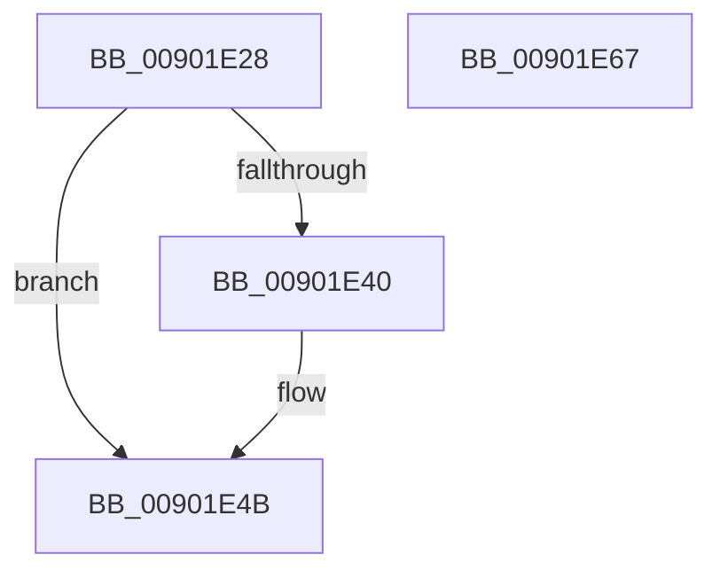

# ExpFreeLowLevelTable

- RVA: `0x00901E28`–`0x00901E68` (길이 `64` bytes)
- VA: `0x0000000140901E28`
- 실행 섹션: `PAGE`
- PDB 이름 있음: `예`; PDB Function 태그: `아니요`
- unwind 정보 RVA: `0x0005CAAC`
- 디코드: `19`개 명령, `64/64` bytes 표시
- 미해석 바이트: `0` (있으면 어셈블리에 `.byte`로 보존)

> 이 문서는 커널 이미지의 기계어와 PDB 기호를 분석해 생성했습니다. 4번과 5번은 함수 원형과 자료형을 바이너리 사용 방식에서 추정한 C 해석이며 원본 소스 복구 결과는 아닙니다.

## 1. Dependencies

- 직접 호출 지점: **2**; 고유 호출 대상: **1**
- 직접 호출자로 확인된 함수: **1**
- RIP 상대 이미지 참조: **0**

### Outgoing calls
- `0x00901E46` → [ExpFreeTablePagedPool](../86/ExpFreeTablePagedPool_function_0086B410.md) (function, `0x0086B410`)
- `0x00901E57` → [ExpFreeTablePagedPool](../86/ExpFreeTablePagedPool_function_0086B410.md) (function, `0x0086B410`)

### Direct callers
- [ExpFreeHandleTable](ExpFreeHandleTable_function_00903B70.md) at `0x00903BA8`
- [ExpFreeHandleTable](ExpFreeHandleTable_function_00903B70.md) at `0x00903C0C`
- [ExpFreeHandleTable](ExpFreeHandleTable_function_00903B70.md) at `0x00903C51`

### Static image references
- 디코드된 RIP-relative 메모리 참조가 없습니다.

## 2. Other-region calls and transfers

- 다른 실행 섹션으로 향하는 call: **0**
- 별도 외부 분기/꼬리 이동을 확인하지 못했습니다.

## 3. Assembly (complete function range)

```asm
00901E28  48 89 5C 24 08                  mov qword ptr [rsp + 8], rbx
00901E2D  57                              push rdi
00901E2E  48 83 EC 20                     sub rsp, 0x20
00901E32  48 8B DA                        mov rbx, rdx
00901E35  48 8B F9                        mov rdi, rcx
00901E38  48 8B 12                        mov rdx, qword ptr [rdx]
00901E3B  48 85 D2                        test rdx, rdx
00901E3E  74 0B                           je 0x140901e4b
00901E40  41 B8 00 08 00 00               mov r8d, 0x800
00901E46  E8 C5 95 F6 FF                  call 0x14086b410
00901E4B  41 B8 00 10 00 00               mov r8d, 0x1000
00901E51  48 8B D3                        mov rdx, rbx
00901E54  48 8B CF                        mov rcx, rdi
00901E57  E8 B4 95 F6 FF                  call 0x14086b410
00901E5C  48 8B 5C 24 30                  mov rbx, qword ptr [rsp + 0x30]
00901E61  48 83 C4 20                     add rsp, 0x20
00901E65  5F                              pop rdi
00901E66  C3                              ret
00901E67  CC                              int3
```

## 4. C-style interpretation (structured pseudocode)

```c
__int64 __fastcall ExpFreeLowLevelTable(__int64 a1, __int64 a2)
{
    __int64 result;
    __int64 v_rsp;
    unsigned __int64 v_stack_p8;

    v_stack_p8 = v_rbx;
    v_rsp = (v_rsp) - (32);
    if (*(unsigned __int64 *)(a2) != 0) {
        a3 = 0x800ULL;
        result = ExpFreeTablePagedPool(a1, *(unsigned __int64 *)(a2), a3, a4);
    }
    result = ExpFreeTablePagedPool(a1, a2, (unsigned int)(0x1000ULL), a4);
    v_rsp = (v_rsp) + (32);
    return result;
}
```

## 5. (Beta) C Style

```c
int64_t ExpFreeLowLevelTable(int64_t Arg1, void *Arg2)
{
    uint8_t *arg2 = (uint8_t *)Arg2;

    int64_t result;
    int64_t local_rsp;
    uint64_t v_stack_p8;

    v_stack_p8 = local_rbx;
    local_rsp = (local_rsp) - (32);
    if (*(uint64_t *)(arg2) != 0) {
        a3 = 0x800ULL;
        result = ExpFreeTablePagedPool(Arg1, *(uint64_t *)(arg2), a3, a4);
    }
    result = ExpFreeTablePagedPool(Arg1, Arg2, (uint32_t)(0x1000ULL), a4);
    local_rsp = (local_rsp) + (32);
    return result;
}
```

### 관측된 메모리 오프셋

구조체 형식이 확인되지 않은 접근은 인자 기준의 오프셋으로만 기록했습니다.

| 기준 인자 | 오프셋 표현 | 폭 (bit) | 접근 |
|---|---:|---:|---|
| `Arg2` | `+ 0x0` | `64` | `R` |

## 6. Execution-region graph

[열기: 2D/3D 그래프와 함수 탐색 컨트롤 패널](../../../control-panel.html?section=page&rva=0x00901E28&view=graph)

- 2D 그래프는 위에서 아래로 흐르고, 3D 그래프는 빈 공간을 드래그해 회전합니다. Shift+드래그는 이동, 휠은 확대·축소, 함수 노드 선택은 대상 보고서 이동입니다.

### Static fallback


