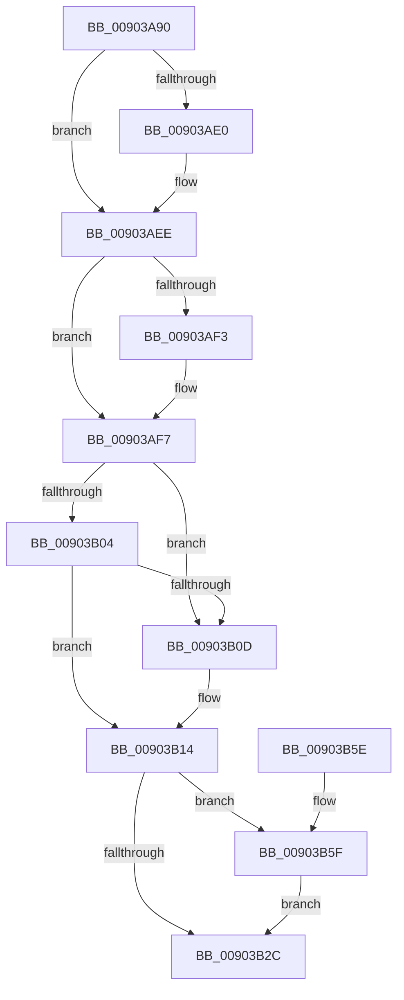

# ExpRemoveHandleTable

- RVA: `0x00903A90`–`0x00903B69` (길이 `217` bytes)
- VA: `0x0000000140903A90`
- 실행 섹션: `PAGE`
- PDB 이름 있음: `예`; PDB Function 태그: `아니요`
- unwind 정보 RVA: `0x000841B4`
- 디코드: `59`개 명령, `217/217` bytes 표시
- 미해석 바이트: `0` (있으면 어셈블리에 `.byte`로 보존)

> 이 문서는 커널 이미지의 기계어와 PDB 기호를 분석해 생성했습니다. 4번과 5번은 함수 원형과 자료형을 바이너리 사용 방식에서 추정한 C 해석이며 원본 소스 복구 결과는 아닙니다.

## 1. Dependencies

- 직접 호출 지점: **5**; 고유 호출 대상: **5**
- 직접 호출자로 확인된 함수: **1**
- RIP 상대 이미지 참조: **2**

### Outgoing calls
- `0x00903AD0` → [KeAbPreAcquire](../../text/21/KeAbPreAcquire_function_00210230.md) (function, `0x00210230`)
- `0x00903AE9` → [ExfAcquirePushLockExclusiveEx](../../text/20/ExfAcquirePushLockExclusiveEx_function_0020FC90.md) (function, `0x0020FC90`)
- `0x00903B2F` → [KeAbPostRelease](../../text/2E/KeAbPostRelease_function_002E1600.md) (function, `0x002E1600`)
- `0x00903B37` → [KeLeaveCriticalRegionThread](../../text/25/KeLeaveCriticalRegionThread_function_0025EFF0.md) (function, `0x0025EFF0`)
- `0x00903B62` → [ExfTryToWakePushLock](../../text/26/ExfTryToWakePushLock_function_00265DD0.md) (function, `0x00265DD0`)

### Direct callers
- [ExDestroyHandleTable](ExDestroyHandleTable_function_00904D18.md) at `0x00904D21`

### Static image references
- `0x00903AB2` → RVA `0x00FD9BA0` (`PAGEDATA`; read)
- `0x00903B1B` → RVA `0x00FD9BA0` (`PAGEDATA`; read/write)

## 2. Other-region calls and transfers

- 다른 실행 섹션으로 향하는 call: **5**
  - `0x00903AD0` → [KeAbPreAcquire](../../text/21/KeAbPreAcquire_function_00210230.md) (`PAGE` → `.text`)
  - `0x00903AE9` → [ExfAcquirePushLockExclusiveEx](../../text/20/ExfAcquirePushLockExclusiveEx_function_0020FC90.md) (`PAGE` → `.text`)
  - `0x00903B2F` → [KeAbPostRelease](../../text/2E/KeAbPostRelease_function_002E1600.md) (`PAGE` → `.text`)
  - `0x00903B37` → [KeLeaveCriticalRegionThread](../../text/25/KeLeaveCriticalRegionThread_function_0025EFF0.md) (`PAGE` → `.text`)
  - `0x00903B62` → [ExfTryToWakePushLock](../../text/26/ExfTryToWakePushLock_function_00265DD0.md) (`PAGE` → `.text`)
- 별도 외부 분기/꼬리 이동을 확인하지 못했습니다.

## 3. Assembly (complete function range)

```asm
00903A90  48 8B C4                        mov rax, rsp
00903A93  48 89 58 08                     mov qword ptr [rax + 8], rbx
00903A97  48 89 68 10                     mov qword ptr [rax + 0x10], rbp
00903A9B  48 89 70 18                     mov qword ptr [rax + 0x18], rsi
00903A9F  48 89 78 20                     mov qword ptr [rax + 0x20], rdi
00903AA3  41 56                           push r14
00903AA5  48 83 EC 20                     sub rsp, 0x20
00903AA9  65 48 8B 34 25 88 01 00 00      mov rsi, qword ptr gs:[0x188]
00903AB2  4C 8D 35 E7 60 6D 00            lea r14, [rip + 0x6d60e7]
00903AB9  48 8B E9                        mov rbp, rcx
00903ABC  48 83 CB FF                     or rbx, 0xffffffffffffffff
00903AC0  45 33 C0                        xor r8d, r8d
00903AC3  33 D2                           xor edx, edx
00903AC5  49 8B CE                        mov rcx, r14
00903AC8  66 01 9E E4 01 00 00            add word ptr [rsi + 0x1e4], bx
00903ACF  90                              nop
00903AD0  E8 5B C7 90 FF                  call 0x140210230
00903AD5  F0 49 0F BA 2E 00               lock bts qword ptr [r14], 0
00903ADB  48 8B F8                        mov rdi, rax
00903ADE  73 0E                           jae 0x140903aee
00903AE0  4D 8B C6                        mov r8, r14
00903AE3  48 8B D0                        mov rdx, rax
00903AE6  49 8B CE                        mov rcx, r14
00903AE9  E8 A2 C1 90 FF                  call 0x14020fc90
00903AEE  48 85 FF                        test rdi, rdi
00903AF1  74 04                           je 0x140903af7
00903AF3  C6 47 0A 01                     mov byte ptr [rdi + 0xa], 1
00903AF7  48 8D 7D 18                     lea rdi, [rbp + 0x18]
00903AFB  48 8B 17                        mov rdx, qword ptr [rdi]
00903AFE  48 39 7A 08                     cmp qword ptr [rdx + 8], rdi
00903B02  75 09                           jne 0x140903b0d
00903B04  48 8B 47 08                     mov rax, qword ptr [rdi + 8]
00903B08  48 39 38                        cmp qword ptr [rax], rdi
00903B0B  74 07                           je 0x140903b14
00903B0D  B9 03 00 00 00                  mov ecx, 3
00903B12  CD 29                           int 0x29
00903B14  48 89 10                        mov qword ptr [rax], rdx
00903B17  48 89 42 08                     mov qword ptr [rdx + 8], rax
00903B1B  F0 48 0F C1 1D 7C 60 6D 00      lock xadd qword ptr [rip + 0x6d607c], rbx
00903B24  80 E3 06                        and bl, 6
00903B27  80 FB 02                        cmp bl, 2
00903B2A  74 33                           je 0x140903b5f
00903B2C  49 8B CE                        mov rcx, r14
00903B2F  E8 CC DA 9D FF                  call 0x1402e1600
00903B34  48 8B CE                        mov rcx, rsi
00903B37  E8 B4 B4 95 FF                  call 0x14025eff0
00903B3C  48 8B 5C 24 30                  mov rbx, qword ptr [rsp + 0x30]
00903B41  48 8B 6C 24 38                  mov rbp, qword ptr [rsp + 0x38]
00903B46  48 8B 74 24 40                  mov rsi, qword ptr [rsp + 0x40]
00903B4B  48 89 7F 08                     mov qword ptr [rdi + 8], rdi
00903B4F  48 89 3F                        mov qword ptr [rdi], rdi
00903B52  48 8B 7C 24 48                  mov rdi, qword ptr [rsp + 0x48]
00903B57  48 83 C4 20                     add rsp, 0x20
00903B5B  41 5E                           pop r14
00903B5D  C3                              ret
00903B5E  CC                              int3
00903B5F  49 8B CE                        mov rcx, r14
00903B62  E8 69 22 96 FF                  call 0x140265dd0
00903B67  EB C3                           jmp 0x140903b2c
```

## 4. C-style interpretation (structured pseudocode)

```c
__int64 __fastcall ExpRemoveHandleTable(__int64 a1, int a2, int a3)
{
    __int64 result;
    __int64 v_rbx;
    __int64 v_rsp;
    unsigned __int64 v_stack_p10;
    unsigned __int64 v_stack_p18;
    unsigned __int64 v_stack_p20;
    unsigned __int64 v_stack_p8;

    *(unsigned __int64 *)(v_rsp + 8) = v_rbx;
    *(unsigned __int64 *)(v_rsp + 16) = v_rbp;
    *(unsigned __int64 *)(v_rsp + 24) = v_rsi;
    *(unsigned __int64 *)(v_rsp + 32) = v_rdi;
    v_rsp = (v_rsp) - (32);
    v_rbx = (v_rbx) | (-1);
    a3 = 0;
    a2 = 0;
    result = KeAbPreAcquire(v_rip + 7168231, a2, a3, a4);
    if (!(condition_is_above_or_equal)) {
        a3 = v_rip + 7168231;
        a2 = result;
        a1 = v_rip + 7168231;
        result = ExfAcquirePushLockExclusiveEx(a1, a2, a3, a4);
    }
    if (result != 0) {
        *(unsigned __int8 *)(result + 10) = 1;
    }
    if ((*(unsigned __int64 *)(*(unsigned __int64 *)(a1 + 24) + 8)) != (a1 + 24)) goto loc_00903B0D;
    if ((*(unsigned __int64 *)(*(unsigned __int64 *)(a1 + 24 + 8))) != (a1 + 24)) {
        a1 = 3;
    }
    *(unsigned __int64 *)(*(unsigned __int64 *)(a1 + 24 + 8)) = *(unsigned __int64 *)(a1 + 24);
    *(unsigned __int64 *)(*(unsigned __int64 *)(a1 + 24) + 8) = *(unsigned __int64 *)(a1 + 24 + 8);
    v_rbx = (unsigned __int8)((v_rbx) & (6));
    if (((unsigned __int8)(v_rbx)) == 2) goto loc_00903B5F;
loc_00903B2C:
    result = KeAbPostRelease(v_rip + 7168231, *(unsigned __int64 *)(a1 + 24), a3, a4);
    result = KeLeaveCriticalRegionThread(*(unsigned __int64 *)(gs_base + (0 + 392)), *(unsigned __int64 *)(a1 + 24), a3, a4);
    *(unsigned __int64 *)(a1 + 24 + 8) = a1 + 24;
    *(unsigned __int64 *)(a1 + 24) = a1 + 24;
    v_rsp = (v_rsp) + (32);
    return result;
loc_00903B5F:
    result = ExfTryToWakePushLock(v_rip + 7168231, *(unsigned __int64 *)(a1 + 24), a3, a4);
    goto loc_00903B2C;
}
```

## 5. (Beta) C Style

```c
int64_t ExpRemoveHandleTable(void *Arg1, int32_t Arg2, int32_t Arg3)
{
    uint8_t *arg1 = (uint8_t *)Arg1;

    int64_t result;
    int64_t local_rbx;
    int64_t local_rsp;
    uint64_t v_stack_p10;
    uint64_t v_stack_p18;
    uint64_t v_stack_p20;
    uint64_t v_stack_p8;

    *(uint64_t *)(local_rsp + 0x8) = local_rbx;
    *(uint64_t *)(local_rsp + 0x10) = local_rbp;
    *(uint64_t *)(local_rsp + 0x18) = local_rsi;
    *(uint64_t *)(local_rsp + 0x20) = local_rdi;
    local_rsp = (local_rsp) - (32);
    local_rbx = (local_rbx) | (-1);
    Arg3 = 0;
    Arg2 = 0;
    result = KeAbPreAcquire(v_rip + 7168231, Arg2, Arg3, a4);
    if (!(condition_is_above_or_equal)) {
        Arg3 = v_rip + 7168231;
        Arg2 = result;
        Arg1 = v_rip + 7168231;
        result = ExfAcquirePushLockExclusiveEx(Arg1, Arg2, Arg3, a4);
    }
    if (result != 0) {
        *(uint8_t *)(result + 0xA) = 1;
    }
    if ((*(uint64_t *)(*(uint64_t *)(arg1 + 0x18) + 0x8)) != (Arg1 + 24)) goto loc_00903B0D;
    if ((*(uint64_t *)(*(uint64_t *)(arg1 + 0x18 + 0x8))) != (Arg1 + 24)) {
        Arg1 = 3;
    }
    *(uint64_t *)(*(uint64_t *)(arg1 + 0x18 + 0x8)) = *(uint64_t *)(arg1 + 0x18);
    *(uint64_t *)(*(uint64_t *)(arg1 + 0x18) + 0x8) = *(uint64_t *)(arg1 + 0x18 + 0x8);
    local_rbx = (uint8_t)((local_rbx) & (6));
    if (((uint8_t)(local_rbx)) == 2) goto loc_00903B5F;
loc_00903B2C:
    result = KeAbPostRelease(v_rip + 7168231, *(uint64_t *)(arg1 + 0x18), Arg3, a4);
    result = KeLeaveCriticalRegionThread(*(uint64_t *)(gs_base + (0 + 0x188)), *(uint64_t *)(arg1 + 0x18), Arg3, a4);
    *(void **)(arg1 + 0x18 + 0x8) = Arg1 + 24;
    *(void **)(arg1 + 0x18) = Arg1 + 24;
    local_rsp = (local_rsp) + (32);
    return result;
loc_00903B5F:
    result = ExfTryToWakePushLock(v_rip + 7168231, *(uint64_t *)(arg1 + 0x18), Arg3, a4);
    goto loc_00903B2C;
}
```

### 관측된 메모리 오프셋

구조체 형식이 확인되지 않은 접근은 인자 기준의 오프셋으로만 기록했습니다.

| 기준 인자 | 오프셋 표현 | 폭 (bit) | 접근 |
|---|---:|---:|---|
| `Arg1` | `+ 0x0` | `64` | `R` |
| `Arg1` | `+ 0x0` | `64` | `W` |
| `Arg1` | `+ 0x8` | `64` | `R` |
| `Arg1` | `+ 0x8` | `64` | `W` |
| `Arg1` | `+ 0x18` | `64` | `R` |

## 6. Execution-region graph

[열기: 2D/3D 그래프와 함수 탐색 컨트롤 패널](../../../control-panel.html?section=page&rva=0x00903A90&view=graph)

- 2D 그래프는 위에서 아래로 흐르고, 3D 그래프는 빈 공간을 드래그해 회전합니다. Shift+드래그는 이동, 휠은 확대·축소, 함수 노드 선택은 대상 보고서 이동입니다.

### Static fallback


