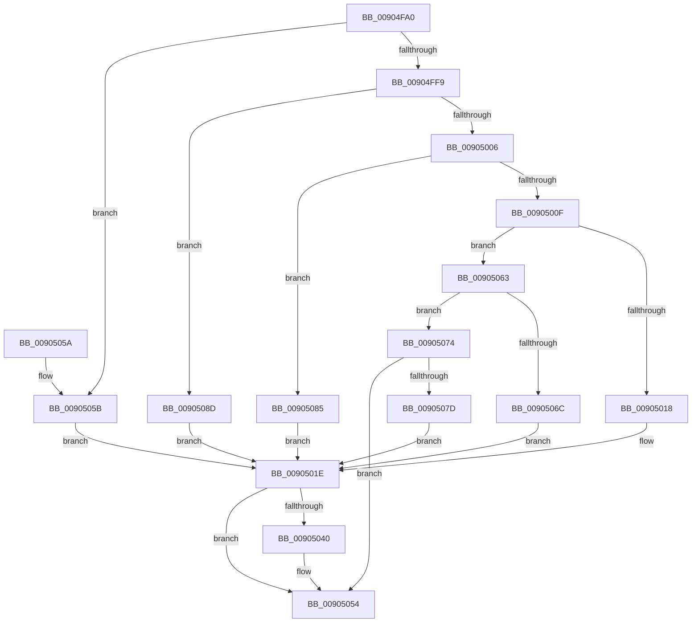

# ExpWin32CloseProcedure

- RVA: `0x00904FA0`–`0x00905095` (길이 `245` bytes)
- VA: `0x0000000140904FA0`
- 실행 섹션: `PAGE`
- PDB 이름 있음: `예`; PDB Function 태그: `아니요`
- unwind 정보 RVA: `0x00088B80`
- 디코드: `62`개 명령, `245/245` bytes 표시
- 미해석 바이트: `0` (있으면 어셈블리에 `.byte`로 보존)

> 이 문서는 커널 이미지의 기계어와 PDB 기호를 분석해 생성했습니다. 4번과 5번은 함수 원형과 자료형을 바이너리 사용 방식에서 추정한 C 해석이며 원본 소스 복구 결과는 아닙니다.

## 1. Dependencies

- 직접 호출 지점: **3**; 고유 호출 대상: **3**
- 직접 호출자로 확인된 함수: **0**
- RIP 상대 이미지 참조: **8**

### Outgoing calls
- `0x00905037` → [PspUpdateCalloutParameters](../../text/49/PspUpdateCalloutParameters_function_0049BBA4.md) (function, `0x0049BBA4`)
- `0x00905040` → [PsSessionGetWin32Callouts](../../text/47/PsSessionGetWin32Callouts_function_00474F98.md) (function, `0x00474F98`)
- `0x0090504F` → [ExCallCallBack](ExCallCallBack_function_009054B4.md) (function, `0x009054B4`)

### Direct callers
- 이 함수 시작 RVA로 연결되는 직접 call은 확인되지 않았습니다. 간접 호출은 완전히 역산할 수 없습니다.

### Static image references
- `0x00904FCF` → RVA `0x00FC6E4C` (`ALMOSTRO`; read)
- `0x00904FDD` → RVA `0x00FC7800` (`ALMOSTRO`; read)
- `0x00904FF0` → RVA `0x00FC6F28` (`ALMOSTRO`; read)
- `0x00904FF9` → RVA `0x00FC6F38` (`ALMOSTRO`; read)
- `0x00905006` → RVA `0x00FC6F30` (`ALMOSTRO`; read)
- `0x0090500F` → RVA `0x00FC6F48` (`ALMOSTRO`; read)
- `0x00905063` → RVA `0x00FC6F40` (`ALMOSTRO`; read)
- `0x00905074` → RVA `0x00FC6F50` (`ALMOSTRO`; read)

## 2. Other-region calls and transfers

- 다른 실행 섹션으로 향하는 call: **2**
  - `0x00905037` → [PspUpdateCalloutParameters](../../text/49/PspUpdateCalloutParameters_function_0049BBA4.md) (`PAGE` → `.text`)
  - `0x00905040` → [PsSessionGetWin32Callouts](../../text/47/PsSessionGetWin32Callouts_function_00474F98.md) (`PAGE` → `.text`)
- 별도 외부 분기/꼬리 이동을 확인하지 못했습니다.

## 3. Assembly (complete function range)

```asm
00904FA0  40 55                           push rbp
00904FA2  48 8B EC                        mov rbp, rsp
00904FA5  48 83 EC 60                     sub rsp, 0x60
00904FA9  8B 02                           mov eax, dword ptr [rdx]
00904FAB  48 83 65 D0 00                  and qword ptr [rbp - 0x30], 0
00904FB0  48 83 65 D8 00                  and qword ptr [rbp - 0x28], 0
00904FB5  89 45 10                        mov dword ptr [rbp + 0x10], eax
00904FB8  48 8D 42 D0                     lea rax, [rdx - 0x30]
00904FBC  48 C1 E8 08                     shr rax, 8
00904FC0  44 0F B6 D8                     movzx r11d, al
00904FC4  0F B6 42 E8                     movzx eax, byte ptr [rdx - 0x18]
00904FC8  4C 33 D8                        xor r11, rax
00904FCB  48 89 4D E0                     mov qword ptr [rbp - 0x20], rcx
00904FCF  0F B6 05 76 1E 6C 00            movzx eax, byte ptr [rip + 0x6c1e76]
00904FD6  4C 33 D8                        xor r11, rax
00904FD9  48 89 55 E8                     mov qword ptr [rbp - 0x18], rdx
00904FDD  48 8D 05 1C 28 6C 00            lea rax, [rip + 0x6c281c]
00904FE4  44 89 45 F0                     mov dword ptr [rbp - 0x10], r8d
00904FE8  44 89 4D F4                     mov dword ptr [rbp - 0xc], r9d
00904FEC  4A 8B 04 D8                     mov rax, qword ptr [rax + r11*8]
00904FF0  48 3B 05 31 1F 6C 00            cmp rax, qword ptr [rip + 0x6c1f31]
00904FF7  74 62                           je 0x14090505b
00904FF9  48 3B 05 38 1F 6C 00            cmp rax, qword ptr [rip + 0x6c1f38]
00905000  0F 84 87 00 00 00               je 0x14090508d
00905006  48 3B 05 23 1F 6C 00            cmp rax, qword ptr [rip + 0x6c1f23]
0090500D  74 76                           je 0x140905085
0090500F  48 3B 05 32 1F 6C 00            cmp rax, qword ptr [rip + 0x6c1f32]
00905016  75 4B                           jne 0x140905063
00905018  41 BA 14 00 00 00               mov r10d, 0x14
0090501E  33 C0                           xor eax, eax
00905020  4C 8D 4D 10                     lea r9, [rbp + 0x10]
00905024  48 89 45 C4                     mov qword ptr [rbp - 0x3c], rax
00905028  48 8D 55 D0                     lea rdx, [rbp - 0x30]
0090502C  41 8B CA                        mov ecx, r10d
0090502F  48 89 45 C0                     mov qword ptr [rbp - 0x40], rax
00905033  44 8D 40 01                     lea r8d, [rax + 1]
00905037  E8 68 6B B9 FF                  call 0x14049bba4
0090503C  85 C0                           test eax, eax
0090503E  74 14                           je 0x140905054
00905040  E8 53 FF B6 FF                  call 0x140474f98
00905045  49 8B D2                        mov rdx, r10
00905048  4C 8D 45 D0                     lea r8, [rbp - 0x30]
0090504C  48 8B C8                        mov rcx, rax
0090504F  E8 60 04 00 00                  call 0x1409054b4
00905054  48 83 C4 60                     add rsp, 0x60
00905058  5D                              pop rbp
00905059  C3                              ret
0090505A  CC                              int3
0090505B  41 BA 27 00 00 00               mov r10d, 0x27
00905061  EB BB                           jmp 0x14090501e
00905063  48 3B 05 D6 1E 6C 00            cmp rax, qword ptr [rip + 0x6c1ed6]
0090506A  75 08                           jne 0x140905074
0090506C  41 BA 0A 00 00 00               mov r10d, 0xa
00905072  EB AA                           jmp 0x14090501e
00905074  48 3B 05 D5 1E 6C 00            cmp rax, qword ptr [rip + 0x6c1ed5]
0090507B  75 D7                           jne 0x140905054
0090507D  41 BA 0D 00 00 00               mov r10d, 0xd
00905083  EB 99                           jmp 0x14090501e
00905085  41 BA 1D 00 00 00               mov r10d, 0x1d
0090508B  EB 91                           jmp 0x14090501e
0090508D  41 BA 23 00 00 00               mov r10d, 0x23
00905093  EB 89                           jmp 0x14090501e
```

## 4. C-style interpretation (structured pseudocode)

```c
__int64 __fastcall ExpWin32CloseProcedure(__int64 a1, __int64 a2, int a3, int a4)
{
    __int64 result;
    __int64 v_r11;
    __int64 v_rsp;
    unsigned int v_stack_m14;
    unsigned int v_stack_m18;
    unsigned __int64 v_stack_m20;
    unsigned __int64 v_stack_m28;
    unsigned __int64 v_stack_m30;
    unsigned __int64 v_stack_m38;
    unsigned __int64 v_stack_m44;
    unsigned __int64 v_stack_m48;
    unsigned int v_stack_p8;

    v_rsp = (v_rsp) - (96);
    v_stack_p8 = (unsigned int)((unsigned int)(*(unsigned int *)(a2)));
    result = (a2 - 48) >> (8);
    v_r11 = ((unsigned __int8)(result)) ^ (*(unsigned __int8 *)(a2 - 24));
    v_stack_m28 = a1;
    v_r11 = (v_r11) ^ (*(unsigned __int8 *)(v_rip + 7085686));
    v_stack_m20 = a2;
    v_stack_m18 = a3;
    v_stack_m14 = a4;
    if ((*(unsigned __int64 *)(v_rip + 7088156 + v_r11 * 8)) == (*(unsigned __int64 *)(v_rip + 7085873))) goto loc_0090505B;
    if ((*(unsigned __int64 *)(v_rip + 7088156 + v_r11 * 8)) == (*(unsigned __int64 *)(v_rip + 7085880))) goto loc_0090508D;
    if ((*(unsigned __int64 *)(v_rip + 7088156 + v_r11 * 8)) == (*(unsigned __int64 *)(v_rip + 7085859))) goto loc_00905085;
    if ((*(unsigned __int64 *)(v_rip + 7088156 + v_r11 * 8)) != (*(unsigned __int64 *)(v_rip + 7085874))) goto loc_00905063;
loc_0090501E:
    result = 0;
    v_stack_m44 = 0;
    v_stack_m48 = 0;
    result = PspUpdateCalloutParameters(20, v_stack_m38, result + 1, v_stack_p8);
    if ((unsigned int)(result) != 0) {
        result = PsSessionGetWin32Callouts(20, v_stack_m38, result + 1, v_stack_p8);
        a2 = 20;
        a3 = v_stack_m38;
        a1 = result;
        result = ExCallCallBack(a1, a2, a3, v_stack_p8);
    }
    v_rsp = (v_rsp) + (96);
    return result;
loc_0090505B:
    goto loc_0090501E;
loc_00905063:
    if (result != (*(unsigned __int64 *)(v_rip + 7085782))) goto loc_00905074;
    goto loc_0090501E;
loc_00905074:
    if (result != (*(unsigned __int64 *)(v_rip + 7085781))) goto loc_00905054;
    goto loc_0090501E;
loc_00905085:
    goto loc_0090501E;
loc_0090508D:
    goto loc_0090501E;
}
```

## 5. (Beta) C Style

```c
int64_t ExpWin32CloseProcedure(int64_t Arg1, void *Arg2, int32_t Arg3, int32_t Arg4)
{
    uint8_t *arg2 = (uint8_t *)Arg2;

    int64_t result;
    int64_t local_r11;
    int64_t local_rsp;
    uint32_t v_stack_m14;
    uint32_t v_stack_m18;
    uint64_t v_stack_m20;
    uint64_t v_stack_m28;
    uint64_t v_stack_m30;
    uint64_t v_stack_m38;
    uint64_t v_stack_m44;
    uint64_t v_stack_m48;
    uint32_t v_stack_p8;

    local_rsp = (local_rsp) - (96);
    v_stack_p8 = (uint32_t)((uint32_t)(*(uint32_t *)(arg2)));
    result = (Arg2 - 48) >> (8);
    local_r11 = ((uint8_t)(result)) ^ (*(uint8_t *)(arg2 - 0x18));
    v_stack_m28 = Arg1;
    local_r11 = (local_r11) ^ (*(uint8_t *)(v_rip + 0x6C1E76));
    v_stack_m20 = Arg2;
    v_stack_m18 = Arg3;
    v_stack_m14 = Arg4;
    if ((*(uint64_t *)(v_rip + 0x6C281C + local_r11 * 8)) == (*(uint64_t *)(v_rip + 0x6C1F31))) goto loc_0090505B;
    if ((*(uint64_t *)(v_rip + 0x6C281C + local_r11 * 8)) == (*(uint64_t *)(v_rip + 0x6C1F38))) goto loc_0090508D;
    if ((*(uint64_t *)(v_rip + 0x6C281C + local_r11 * 8)) == (*(uint64_t *)(v_rip + 0x6C1F23))) goto loc_00905085;
    if ((*(uint64_t *)(v_rip + 0x6C281C + local_r11 * 8)) != (*(uint64_t *)(v_rip + 0x6C1F32))) goto loc_00905063;
loc_0090501E:
    result = 0;
    v_stack_m44 = 0;
    v_stack_m48 = 0;
    result = PspUpdateCalloutParameters(20, v_stack_m38, result + 1, v_stack_p8);
    if ((uint32_t)(result) != 0) {
        result = PsSessionGetWin32Callouts(20, v_stack_m38, result + 1, v_stack_p8);
        Arg2 = 20;
        Arg3 = v_stack_m38;
        Arg1 = result;
        result = ExCallCallBack(Arg1, Arg2, Arg3, v_stack_p8);
    }
    local_rsp = (local_rsp) + (96);
    return result;
loc_0090505B:
    goto loc_0090501E;
loc_00905063:
    if (result != (*(uint64_t *)(v_rip + 0x6C1ED6))) goto loc_00905074;
    goto loc_0090501E;
loc_00905074:
    if (result != (*(uint64_t *)(v_rip + 0x6C1ED5))) goto loc_00905054;
    goto loc_0090501E;
loc_00905085:
    goto loc_0090501E;
loc_0090508D:
    goto loc_0090501E;
}
```

### 관측된 메모리 오프셋

구조체 형식이 확인되지 않은 접근은 인자 기준의 오프셋으로만 기록했습니다.

| 기준 인자 | 오프셋 표현 | 폭 (bit) | 접근 |
|---|---:|---:|---|
| `Arg2` | `- 0x30` | `64` | `R` |
| `Arg2` | `- 0x18` | `8` | `R` |
| `Arg2` | `+ 0x0` | `32` | `R` |

## 6. Execution-region graph

[열기: 2D/3D 그래프와 함수 탐색 컨트롤 패널](../../../control-panel.html?section=page&rva=0x00904FA0&view=graph)

- 2D 그래프는 위에서 아래로 흐르고, 3D 그래프는 빈 공간을 드래그해 회전합니다. Shift+드래그는 이동, 휠은 확대·축소, 함수 노드 선택은 대상 보고서 이동입니다.

### Static fallback


