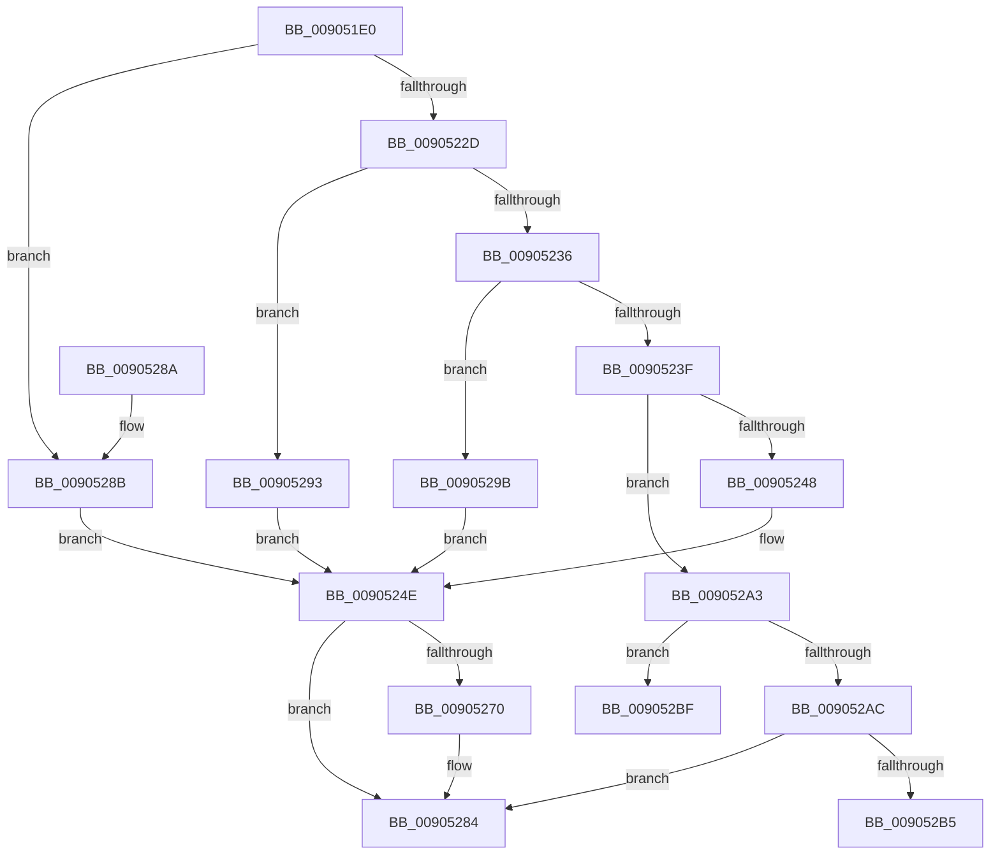

# ExpWin32DeleteProcedure

- RVA: `0x009051E0`–`0x009052C9` (길이 `233` bytes)
- VA: `0x00000001409051E0`
- 실행 섹션: `PAGE`
- PDB 이름 있음: `예`; PDB Function 태그: `예`
- unwind 정보 RVA: `0x00088BA0`
- 디코드: `59`개 명령, `233/233` bytes 표시
- 미해석 바이트: `0` (있으면 어셈블리에 `.byte`로 보존)

> 이 문서는 커널 이미지의 기계어와 PDB 기호를 분석해 생성했습니다. 4번과 5번은 함수 원형과 자료형을 바이너리 사용 방식에서 추정한 C 해석이며 원본 소스 복구 결과는 아닙니다.

## 1. Dependencies

- 직접 호출 지점: **3**; 고유 호출 대상: **3**
- 직접 호출자로 확인된 함수: **0**
- RIP 상대 이미지 참조: **8**

### Outgoing calls
- `0x00905267` → [PspUpdateCalloutParameters](../../text/49/PspUpdateCalloutParameters_function_0049BBA4.md) (function, `0x0049BBA4`)
- `0x00905270` → [PsSessionGetWin32Callouts](../../text/47/PsSessionGetWin32Callouts_function_00474F98.md) (function, `0x00474F98`)
- `0x0090527F` → [ExCallCallBack](ExCallCallBack_function_009054B4.md) (function, `0x009054B4`)

### Direct callers
- 이 함수 시작 RVA로 연결되는 직접 call은 확인되지 않았습니다. 간접 호출은 완전히 역산할 수 없습니다.

### Static image references
- `0x0090520F` → RVA `0x00FC6E4C` (`ALMOSTRO`; read)
- `0x00905219` → RVA `0x00FC7800` (`ALMOSTRO`; read)
- `0x00905224` → RVA `0x00FC6F28` (`ALMOSTRO`; read)
- `0x0090522D` → RVA `0x00FC6F38` (`ALMOSTRO`; read)
- `0x00905236` → RVA `0x00FC6F30` (`ALMOSTRO`; read)
- `0x0090523F` → RVA `0x00FC6F48` (`ALMOSTRO`; read)
- `0x009052A3` → RVA `0x00FC6F40` (`ALMOSTRO`; read)
- `0x009052AC` → RVA `0x00FC6F50` (`ALMOSTRO`; read)

## 2. Other-region calls and transfers

- 다른 실행 섹션으로 향하는 call: **2**
  - `0x00905267` → [PspUpdateCalloutParameters](../../text/49/PspUpdateCalloutParameters_function_0049BBA4.md) (`PAGE` → `.text`)
  - `0x00905270` → [PsSessionGetWin32Callouts](../../text/47/PsSessionGetWin32Callouts_function_00474F98.md) (`PAGE` → `.text`)
- call이 아닌 외부 분기/꼬리 이동: **2**
  - `0x009052BA` → [sub_00B20D64](../B2/Unknown_function_00B20D64.md) (`tail-transfer`)
  - `0x009052C4` → [sub_00B20D64](../B2/Unknown_function_00B20D64.md) (`tail-transfer`)

## 3. Assembly (complete function range)

```asm
009051E0  40 55                           push rbp
009051E2  48 8B EC                        mov rbp, rsp
009051E5  48 83 EC 50                     sub rsp, 0x50
009051E9  8B 01                           mov eax, dword ptr [rcx]
009051EB  48 83 65 E0 00                  and qword ptr [rbp - 0x20], 0
009051F0  48 83 65 E8 00                  and qword ptr [rbp - 0x18], 0
009051F5  89 45 10                        mov dword ptr [rbp + 0x10], eax
009051F8  48 8D 41 D0                     lea rax, [rcx - 0x30]
009051FC  48 C1 E8 08                     shr rax, 8
00905200  44 0F B6 C0                     movzx r8d, al
00905204  0F B6 41 E8                     movzx eax, byte ptr [rcx - 0x18]
00905208  4C 33 C0                        xor r8, rax
0090520B  48 89 4D F0                     mov qword ptr [rbp - 0x10], rcx
0090520F  0F B6 05 36 1C 6C 00            movzx eax, byte ptr [rip + 0x6c1c36]
00905216  4C 33 C0                        xor r8, rax
00905219  48 8D 05 E0 25 6C 00            lea rax, [rip + 0x6c25e0]
00905220  4A 8B 04 C0                     mov rax, qword ptr [rax + r8*8]
00905224  48 3B 05 FD 1C 6C 00            cmp rax, qword ptr [rip + 0x6c1cfd]
0090522B  74 5E                           je 0x14090528b
0090522D  48 3B 05 04 1D 6C 00            cmp rax, qword ptr [rip + 0x6c1d04]
00905234  74 5D                           je 0x140905293
00905236  48 3B 05 F3 1C 6C 00            cmp rax, qword ptr [rip + 0x6c1cf3]
0090523D  74 5C                           je 0x14090529b
0090523F  48 3B 05 02 1D 6C 00            cmp rax, qword ptr [rip + 0x6c1d02]
00905246  75 5B                           jne 0x1409052a3
00905248  41 BA 15 00 00 00               mov r10d, 0x15
0090524E  33 C0                           xor eax, eax
00905250  48 8D 55 E0                     lea rdx, [rbp - 0x20]
00905254  48 89 45 D4                     mov qword ptr [rbp - 0x2c], rax
00905258  4C 8D 4D 10                     lea r9, [rbp + 0x10]
0090525C  41 8B CA                        mov ecx, r10d
0090525F  48 89 45 D0                     mov qword ptr [rbp - 0x30], rax
00905263  44 8D 40 01                     lea r8d, [rax + 1]
00905267  E8 38 69 B9 FF                  call 0x14049bba4
0090526C  85 C0                           test eax, eax
0090526E  74 14                           je 0x140905284
00905270  E8 23 FD B6 FF                  call 0x140474f98
00905275  48 8B C8                        mov rcx, rax
00905278  4C 8D 45 E0                     lea r8, [rbp - 0x20]
0090527C  49 8B D2                        mov rdx, r10
0090527F  E8 30 02 00 00                  call 0x1409054b4
00905284  48 83 C4 50                     add rsp, 0x50
00905288  5D                              pop rbp
00905289  C3                              ret
0090528A  CC                              int3
0090528B  41 BA 28 00 00 00               mov r10d, 0x28
00905291  EB BB                           jmp 0x14090524e
00905293  41 BA 24 00 00 00               mov r10d, 0x24
00905299  EB B3                           jmp 0x14090524e
0090529B  41 BA 1E 00 00 00               mov r10d, 0x1e
009052A1  EB AB                           jmp 0x14090524e
009052A3  48 3B 05 96 1C 6C 00            cmp rax, qword ptr [rip + 0x6c1c96]
009052AA  74 13                           je 0x1409052bf
009052AC  48 3B 05 9D 1C 6C 00            cmp rax, qword ptr [rip + 0x6c1c9d]
009052B3  75 CF                           jne 0x140905284
009052B5  B9 0E 00 00 00                  mov ecx, 0xe
009052BA  E9 A5 BA 21 00                  jmp 0x140b20d64
009052BF  B9 0B 00 00 00                  mov ecx, 0xb
009052C4  E9 9B BA 21 00                  jmp 0x140b20d64
```

## 4. C-style interpretation (structured pseudocode)

```c
__int64 __fastcall ExpWin32DeleteProcedure(__int64 a1)
{
    __int64 result;
    __int64 v_rsp;
    unsigned __int64 v_stack_m18;
    unsigned __int64 v_stack_m20;
    unsigned __int64 v_stack_m28;
    unsigned __int64 v_stack_m34;
    unsigned __int64 v_stack_m38;
    unsigned int v_stack_p8;

    v_rsp = (v_rsp) - (80);
    v_stack_p8 = (unsigned int)((unsigned int)(*(unsigned int *)(a1)));
    result = (a1 - 48) >> (8);
    a3 = ((unsigned __int8)(result)) ^ (*(unsigned __int8 *)(a1 - 24));
    v_stack_m18 = a1;
    a3 = (a3) ^ (*(unsigned __int8 *)(v_rip + 7085110));
    if ((*(unsigned __int64 *)(v_rip + 7087584 + a3 * 8)) == (*(unsigned __int64 *)(v_rip + 7085309))) goto loc_0090528B;
    if ((*(unsigned __int64 *)(v_rip + 7087584 + a3 * 8)) == (*(unsigned __int64 *)(v_rip + 7085316))) goto loc_00905293;
    if ((*(unsigned __int64 *)(v_rip + 7087584 + a3 * 8)) == (*(unsigned __int64 *)(v_rip + 7085299))) goto loc_0090529B;
    if ((*(unsigned __int64 *)(v_rip + 7087584 + a3 * 8)) != (*(unsigned __int64 *)(v_rip + 7085314))) goto loc_009052A3;
loc_0090524E:
    result = 0;
    v_stack_m34 = 0;
    v_stack_m38 = 0;
    result = PspUpdateCalloutParameters(21, v_stack_m28, result + 1, v_stack_p8);
    if ((unsigned int)(result) != 0) {
        result = PsSessionGetWin32Callouts(21, v_stack_m28, result + 1, v_stack_p8);
        a1 = result;
        a3 = v_stack_m28;
        a2 = 21;
        result = ExCallCallBack(a1, a2, a3, v_stack_p8);
    }
    v_rsp = (v_rsp) + (80);
    return result;
loc_0090528B:
    goto loc_0090524E;
loc_00905293:
    goto loc_0090524E;
loc_0090529B:
    goto loc_0090524E;
loc_009052A3:
    if (result == (*(unsigned __int64 *)(v_rip + 7085206))) goto loc_009052BF;
    if (result != (*(unsigned __int64 *)(v_rip + 7085213))) goto loc_00905284;
loc_009052BF:
}
```

## 5. (Beta) C Style

```c
int64_t ExpWin32DeleteProcedure(void *Arg1)
{
    uint8_t *arg1 = (uint8_t *)Arg1;

    int64_t result;
    int64_t local_rsp;
    uint64_t v_stack_m18;
    uint64_t v_stack_m20;
    uint64_t v_stack_m28;
    uint64_t v_stack_m34;
    uint64_t v_stack_m38;
    uint32_t v_stack_p8;

    local_rsp = (local_rsp) - (80);
    v_stack_p8 = (uint32_t)((uint32_t)(*(uint32_t *)(arg1)));
    result = (Arg1 - 48) >> (8);
    a3 = ((uint8_t)(result)) ^ (*(uint8_t *)(arg1 - 0x18));
    v_stack_m18 = Arg1;
    a3 = (a3) ^ (*(uint8_t *)(v_rip + 0x6C1C36));
    if ((*(uint64_t *)(v_rip + 0x6C25E0 + a3 * 8)) == (*(uint64_t *)(v_rip + 0x6C1CFD))) goto loc_0090528B;
    if ((*(uint64_t *)(v_rip + 0x6C25E0 + a3 * 8)) == (*(uint64_t *)(v_rip + 0x6C1D04))) goto loc_00905293;
    if ((*(uint64_t *)(v_rip + 0x6C25E0 + a3 * 8)) == (*(uint64_t *)(v_rip + 0x6C1CF3))) goto loc_0090529B;
    if ((*(uint64_t *)(v_rip + 0x6C25E0 + a3 * 8)) != (*(uint64_t *)(v_rip + 0x6C1D02))) goto loc_009052A3;
loc_0090524E:
    result = 0;
    v_stack_m34 = 0;
    v_stack_m38 = 0;
    result = PspUpdateCalloutParameters(21, v_stack_m28, result + 1, v_stack_p8);
    if ((uint32_t)(result) != 0) {
        result = PsSessionGetWin32Callouts(21, v_stack_m28, result + 1, v_stack_p8);
        Arg1 = result;
        a3 = v_stack_m28;
        a2 = 21;
        result = ExCallCallBack(Arg1, a2, a3, v_stack_p8);
    }
    local_rsp = (local_rsp) + (80);
    return result;
loc_0090528B:
    goto loc_0090524E;
loc_00905293:
    goto loc_0090524E;
loc_0090529B:
    goto loc_0090524E;
loc_009052A3:
    if (result == (*(uint64_t *)(v_rip + 0x6C1C96))) goto loc_009052BF;
    if (result != (*(uint64_t *)(v_rip + 0x6C1C9D))) goto loc_00905284;
loc_009052BF:
}
```

### 관측된 메모리 오프셋

구조체 형식이 확인되지 않은 접근은 인자 기준의 오프셋으로만 기록했습니다.

| 기준 인자 | 오프셋 표현 | 폭 (bit) | 접근 |
|---|---:|---:|---|
| `Arg1` | `- 0x30` | `64` | `R` |
| `Arg1` | `- 0x18` | `8` | `R` |
| `Arg1` | `+ 0x0` | `32` | `R` |

## 6. Execution-region graph

[열기: 2D/3D 그래프와 함수 탐색 컨트롤 패널](../../../control-panel.html?section=page&rva=0x009051E0&view=graph)

- 2D 그래프는 위에서 아래로 흐르고, 3D 그래프는 빈 공간을 드래그해 회전합니다. Shift+드래그는 이동, 휠은 확대·축소, 함수 노드 선택은 대상 보고서 이동입니다.

### Static fallback


