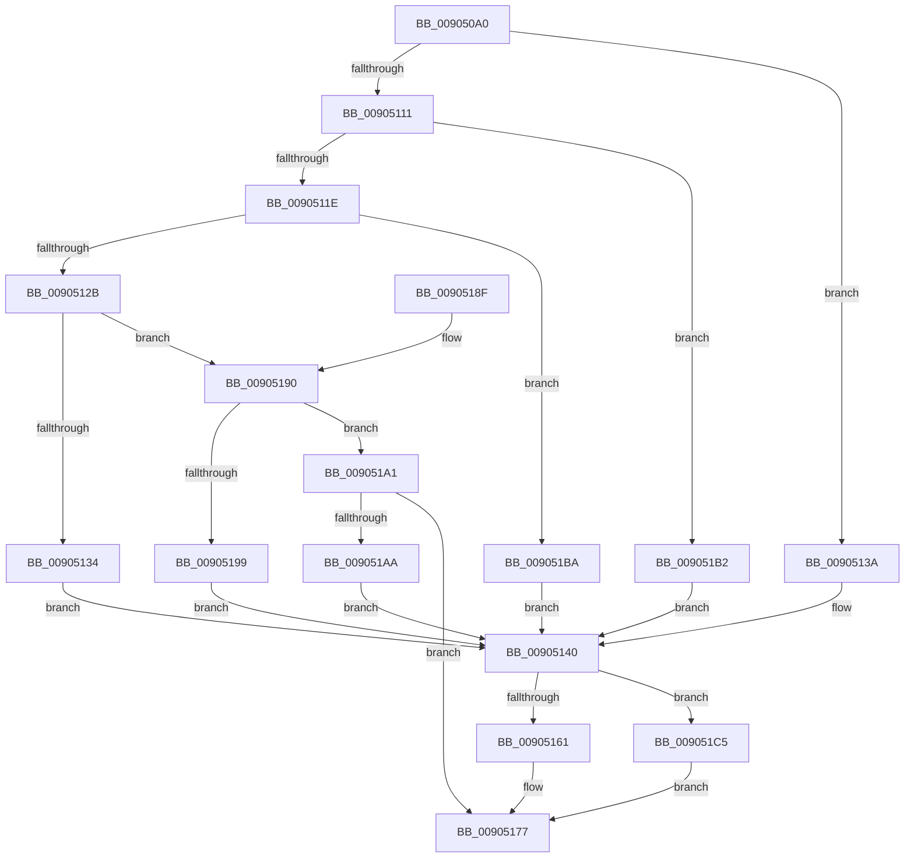

# ExpWin32OkayToCloseProcedure

- RVA: `0x009050A0`–`0x009051CC` (길이 `300` bytes)
- VA: `0x00000001409050A0`
- 실행 섹션: `PAGE`
- PDB 이름 있음: `예`; PDB Function 태그: `아니요`
- unwind 정보 RVA: `0x00088B8C`
- 디코드: `76`개 명령, `300/300` bytes 표시
- 미해석 바이트: `0` (있으면 어셈블리에 `.byte`로 보존)

> 이 문서는 커널 이미지의 기계어와 PDB 기호를 분석해 생성했습니다. 4번과 5번은 함수 원형과 자료형을 바이너리 사용 방식에서 추정한 C 해석이며 원본 소스 복구 결과는 아닙니다.

## 1. Dependencies

- 직접 호출 지점: **3**; 고유 호출 대상: **3**
- 직접 호출자로 확인된 함수: **1**
- RIP 상대 이미지 참조: **8**

### Outgoing calls
- `0x00905158` → [PspUpdateCalloutParameters](../../text/49/PspUpdateCalloutParameters_function_0049BBA4.md) (function, `0x0049BBA4`)
- `0x00905161` → [PsSessionGetWin32Callouts](../../text/47/PsSessionGetWin32Callouts_function_00474F98.md) (function, `0x00474F98`)
- `0x00905170` → [ExCallCallBack](ExCallCallBack_function_009054B4.md) (function, `0x009054B4`)

### Direct callers
- [ObCloseHandleTableEntry](../86/ObCloseHandleTableEntry_function_00869E20.md) at `0x0086A54F`

### Static image references
- `0x009050E3` → RVA `0x00FC6E4C` (`ALMOSTRO`; read)
- `0x009050ED` → RVA `0x00FC7800` (`ALMOSTRO`; read)
- `0x00905104` → RVA `0x00FC6F28` (`ALMOSTRO`; read)
- `0x00905111` → RVA `0x00FC6F38` (`ALMOSTRO`; read)
- `0x0090511E` → RVA `0x00FC6F30` (`ALMOSTRO`; read)
- `0x0090512B` → RVA `0x00FC6F48` (`ALMOSTRO`; read)
- `0x00905190` → RVA `0x00FC6F40` (`ALMOSTRO`; read)
- `0x009051A1` → RVA `0x00FC6F50` (`ALMOSTRO`; read)

## 2. Other-region calls and transfers

- 다른 실행 섹션으로 향하는 call: **2**
  - `0x00905158` → [PspUpdateCalloutParameters](../../text/49/PspUpdateCalloutParameters_function_0049BBA4.md) (`PAGE` → `.text`)
  - `0x00905161` → [PsSessionGetWin32Callouts](../../text/47/PsSessionGetWin32Callouts_function_00474F98.md) (`PAGE` → `.text`)
- 별도 외부 분기/꼬리 이동을 확인하지 못했습니다.

## 3. Assembly (complete function range)

```asm
009050A0  48 89 5C 24 08                  mov qword ptr [rsp + 8], rbx
009050A5  48 89 7C 24 10                  mov qword ptr [rsp + 0x10], rdi
009050AA  55                              push rbp
009050AB  48 8B EC                        mov rbp, rsp
009050AE  48 83 EC 60                     sub rsp, 0x60
009050B2  8B 02                           mov eax, dword ptr [rdx]
009050B4  0F 57 C0                        xorps xmm0, xmm0
009050B7  89 45 28                        mov dword ptr [rbp + 0x28], eax
009050BA  BB 01 00 00 C0                  mov ebx, 0xc0000001
009050BF  0F 11 45 E0                     movups xmmword ptr [rbp - 0x20], xmm0
009050C3  48 8D 42 D0                     lea rax, [rdx - 0x30]
009050C7  48 89 4D E0                     mov qword ptr [rbp - 0x20], rcx
009050CB  48 C1 E8 08                     shr rax, 8
009050CF  BF 01 00 00 00                  mov edi, 1
009050D4  44 0F B6 D8                     movzx r11d, al
009050D8  0F B6 42 E8                     movzx eax, byte ptr [rdx - 0x18]
009050DC  4C 33 D8                        xor r11, rax
009050DF  48 89 55 E8                     mov qword ptr [rbp - 0x18], rdx
009050E3  0F B6 05 62 1D 6C 00            movzx eax, byte ptr [rip + 0x6c1d62]
009050EA  4C 33 D8                        xor r11, rax
009050ED  48 8D 05 0C 27 6C 00            lea rax, [rip + 0x6c270c]
009050F4  0F 11 45 F0                     movups xmmword ptr [rbp - 0x10], xmm0
009050F8  4C 89 45 F0                     mov qword ptr [rbp - 0x10], r8
009050FC  0F 11 45 D0                     movups xmmword ptr [rbp - 0x30], xmm0
00905100  4A 8B 04 D8                     mov rax, qword ptr [rax + r11*8]
00905104  48 3B 05 1D 1E 6C 00            cmp rax, qword ptr [rip + 0x6c1e1d]
0090510B  44 88 4D F8                     mov byte ptr [rbp - 8], r9b
0090510F  74 29                           je 0x14090513a
00905111  48 3B 05 20 1E 6C 00            cmp rax, qword ptr [rip + 0x6c1e20]
00905118  0F 84 94 00 00 00               je 0x1409051b2
0090511E  48 3B 05 0B 1E 6C 00            cmp rax, qword ptr [rip + 0x6c1e0b]
00905125  0F 84 8F 00 00 00               je 0x1409051ba
0090512B  48 3B 05 16 1E 6C 00            cmp rax, qword ptr [rip + 0x6c1e16]
00905132  75 5C                           jne 0x140905190
00905134  44 8D 57 12                     lea r10d, [rdi + 0x12]
00905138  EB 06                           jmp 0x140905140
0090513A  41 BA 26 00 00 00               mov r10d, 0x26
00905140  33 C0                           xor eax, eax
00905142  4C 8D 4D 28                     lea r9, [rbp + 0x28]
00905146  48 89 45 C4                     mov qword ptr [rbp - 0x3c], rax
0090514A  48 8D 55 D0                     lea rdx, [rbp - 0x30]
0090514E  44 8B C7                        mov r8d, edi
00905151  48 89 45 C0                     mov qword ptr [rbp - 0x40], rax
00905155  41 8B CA                        mov ecx, r10d
00905158  E8 47 6A B9 FF                  call 0x14049bba4
0090515D  85 C0                           test eax, eax
0090515F  74 64                           je 0x1409051c5
00905161  E8 32 FE B6 FF                  call 0x140474f98
00905166  49 8B D2                        mov rdx, r10
00905169  4C 8D 45 D0                     lea r8, [rbp - 0x30]
0090516D  48 8B C8                        mov rcx, rax
00905170  E8 3F 03 00 00                  call 0x1409054b4
00905175  8B D8                           mov ebx, eax
00905177  C1 EB 1F                        shr ebx, 0x1f
0090517A  40 32 DF                        xor bl, dil
0090517D  48 8B 7C 24 78                  mov rdi, qword ptr [rsp + 0x78]
00905182  8A C3                           mov al, bl
00905184  48 8B 5C 24 70                  mov rbx, qword ptr [rsp + 0x70]
00905189  48 83 C4 60                     add rsp, 0x60
0090518D  5D                              pop rbp
0090518E  C3                              ret
0090518F  CC                              int3
00905190  48 3B 05 A9 1D 6C 00            cmp rax, qword ptr [rip + 0x6c1da9]
00905197  75 08                           jne 0x1409051a1
00905199  41 BA 09 00 00 00               mov r10d, 9
0090519F  EB 9F                           jmp 0x140905140
009051A1  48 3B 05 A8 1D 6C 00            cmp rax, qword ptr [rip + 0x6c1da8]
009051A8  75 CD                           jne 0x140905177
009051AA  41 BA 0C 00 00 00               mov r10d, 0xc
009051B0  EB 8E                           jmp 0x140905140
009051B2  41 BA 22 00 00 00               mov r10d, 0x22
009051B8  EB 86                           jmp 0x140905140
009051BA  41 BA 1C 00 00 00               mov r10d, 0x1c
009051C0  E9 7B FF FF FF                  jmp 0x140905140
009051C5  BB 0D 00 00 C0                  mov ebx, 0xc000000d
009051CA  EB AB                           jmp 0x140905177
```

## 4. C-style interpretation (structured pseudocode)

```c
__int64 __fastcall ExpWin32OkayToCloseProcedure(__int64 a1, __int64 a2, __int64 a3, unsigned __int8 a4)
{
    __int64 result;
    __int64 v_r11;
    __int64 v_rbx;
    __int64 v_rsp;
    unsigned __int8 v_stack_m10;
    unsigned __int64 v_stack_m18;
    unsigned __int64 v_stack_m20;
    unsigned __int64 v_stack_m28;
    unsigned __int64 v_stack_m38;
    unsigned __int64 v_stack_m44;
    unsigned __int64 v_stack_m48;
    unsigned __int64 v_stack_p10;
    unsigned int v_stack_p20;
    unsigned __int64 v_stack_p8;

    v_stack_p8 = v_rbx;
    v_stack_p10 = v_rdi;
    v_rsp = (v_rsp) - (96);
    v_stack_p20 = (unsigned int)((unsigned int)(*(unsigned int *)(a2)));
    v_stack_m28 = v_xmm0;
    v_stack_m28 = a1;
    result = (a2 - 48) >> (8);
    v_r11 = ((unsigned __int8)(result)) ^ (*(unsigned __int8 *)(a2 - 24));
    v_stack_m20 = a2;
    v_r11 = (v_r11) ^ (*(unsigned __int8 *)(v_rip + 7085410));
    v_stack_m18 = v_xmm0;
    v_stack_m18 = a3;
    v_stack_m38 = v_xmm0;
    v_stack_m10 = a4;
    if ((*(unsigned __int64 *)(v_rip + 7087884 + v_r11 * 8)) == (*(unsigned __int64 *)(v_rip + 7085597))) goto loc_0090513A;
    if ((*(unsigned __int64 *)(v_rip + 7087884 + v_r11 * 8)) == (*(unsigned __int64 *)(v_rip + 7085600))) goto loc_009051B2;
    if ((*(unsigned __int64 *)(v_rip + 7087884 + v_r11 * 8)) == (*(unsigned __int64 *)(v_rip + 7085579))) goto loc_009051BA;
    if ((*(unsigned __int64 *)(v_rip + 7087884 + v_r11 * 8)) != (*(unsigned __int64 *)(v_rip + 7085590))) goto loc_00905190;
    goto loc_00905140;
loc_0090513A:
loc_00905140:
    result = 0;
    v_stack_m44 = 0;
    v_stack_m48 = 0;
    result = PspUpdateCalloutParameters(38, v_stack_m38, 1, v_stack_p20);
    if ((unsigned int)(result) == 0) goto loc_009051C5;
    result = PsSessionGetWin32Callouts(38, v_stack_m38, 1, v_stack_p20);
    result = ExCallCallBack(result, 38, v_stack_m38, v_stack_p20);
loc_00905177:
    v_rbx = (unsigned int)(((unsigned int)((unsigned int)(result))) >> (31));
    v_rbx = (unsigned __int8)((v_rbx) ^ (1));
    v_rsp = (v_rsp) + (96);
    return (unsigned __int8)(v_rbx);
loc_00905190:
    if (((unsigned __int8)(v_rbx)) != (*(unsigned __int64 *)(v_rip + 7085481))) goto loc_009051A1;
    goto loc_00905140;
loc_009051A1:
    if (((unsigned __int8)(v_rbx)) != (*(unsigned __int64 *)(v_rip + 7085480))) goto loc_00905177;
    goto loc_00905140;
loc_009051B2:
    goto loc_00905140;
loc_009051BA:
    goto loc_00905140;
loc_009051C5:
    goto loc_00905177;
}
```

## 5. (Beta) C Style

```c
int64_t ExpWin32OkayToCloseProcedure(int64_t Arg1, void *Arg2, int64_t Arg3, uint8_t Arg4)
{
    uint8_t *arg2 = (uint8_t *)Arg2;

    int64_t result;
    int64_t local_r11;
    int64_t local_rbx;
    int64_t local_rsp;
    uint8_t v_stack_m10;
    uint64_t v_stack_m18;
    uint64_t v_stack_m20;
    uint64_t v_stack_m28;
    uint64_t v_stack_m38;
    uint64_t v_stack_m44;
    uint64_t v_stack_m48;
    uint64_t v_stack_p10;
    uint32_t v_stack_p20;
    uint64_t v_stack_p8;

    v_stack_p8 = local_rbx;
    v_stack_p10 = local_rdi;
    local_rsp = (local_rsp) - (96);
    v_stack_p20 = (uint32_t)((uint32_t)(*(uint32_t *)(arg2)));
    v_stack_m28 = v_xmm0;
    v_stack_m28 = Arg1;
    result = (Arg2 - 48) >> (8);
    local_r11 = ((uint8_t)(result)) ^ (*(uint8_t *)(arg2 - 0x18));
    v_stack_m20 = Arg2;
    local_r11 = (local_r11) ^ (*(uint8_t *)(v_rip + 0x6C1D62));
    v_stack_m18 = v_xmm0;
    v_stack_m18 = Arg3;
    v_stack_m38 = v_xmm0;
    v_stack_m10 = Arg4;
    if ((*(uint64_t *)(v_rip + 0x6C270C + local_r11 * 8)) == (*(uint64_t *)(v_rip + 0x6C1E1D))) goto loc_0090513A;
    if ((*(uint64_t *)(v_rip + 0x6C270C + local_r11 * 8)) == (*(uint64_t *)(v_rip + 0x6C1E20))) goto loc_009051B2;
    if ((*(uint64_t *)(v_rip + 0x6C270C + local_r11 * 8)) == (*(uint64_t *)(v_rip + 0x6C1E0B))) goto loc_009051BA;
    if ((*(uint64_t *)(v_rip + 0x6C270C + local_r11 * 8)) != (*(uint64_t *)(v_rip + 0x6C1E16))) goto loc_00905190;
    goto loc_00905140;
loc_0090513A:
loc_00905140:
    result = 0;
    v_stack_m44 = 0;
    v_stack_m48 = 0;
    result = PspUpdateCalloutParameters(38, v_stack_m38, 1, v_stack_p20);
    if ((uint32_t)(result) == 0) goto loc_009051C5;
    result = PsSessionGetWin32Callouts(38, v_stack_m38, 1, v_stack_p20);
    result = ExCallCallBack(result, 38, v_stack_m38, v_stack_p20);
loc_00905177:
    local_rbx = (uint32_t)(((uint32_t)((uint32_t)(result))) >> (31));
    local_rbx = (uint8_t)((local_rbx) ^ (1));
    local_rsp = (local_rsp) + (96);
    return (uint8_t)(local_rbx);
loc_00905190:
    if (((uint8_t)(local_rbx)) != (*(uint64_t *)(v_rip + 0x6C1DA9))) goto loc_009051A1;
    goto loc_00905140;
loc_009051A1:
    if (((uint8_t)(local_rbx)) != (*(uint64_t *)(v_rip + 0x6C1DA8))) goto loc_00905177;
    goto loc_00905140;
loc_009051B2:
    goto loc_00905140;
loc_009051BA:
    goto loc_00905140;
loc_009051C5:
    goto loc_00905177;
}
```

### 관측된 메모리 오프셋

구조체 형식이 확인되지 않은 접근은 인자 기준의 오프셋으로만 기록했습니다.

| 기준 인자 | 오프셋 표현 | 폭 (bit) | 접근 |
|---|---:|---:|---|
| `Arg2` | `- 0x30` | `64` | `R` |
| `Arg2` | `- 0x18` | `8` | `R` |
| `Arg2` | `+ 0x0` | `32` | `R` |

## 6. Execution-region graph

[열기: 2D/3D 그래프와 함수 탐색 컨트롤 패널](../../../control-panel.html?section=page&rva=0x009050A0&view=graph)

- 2D 그래프는 위에서 아래로 흐르고, 3D 그래프는 빈 공간을 드래그해 회전합니다. Shift+드래그는 이동, 휠은 확대·축소, 함수 노드 선택은 대상 보고서 이동입니다.

### Static fallback


