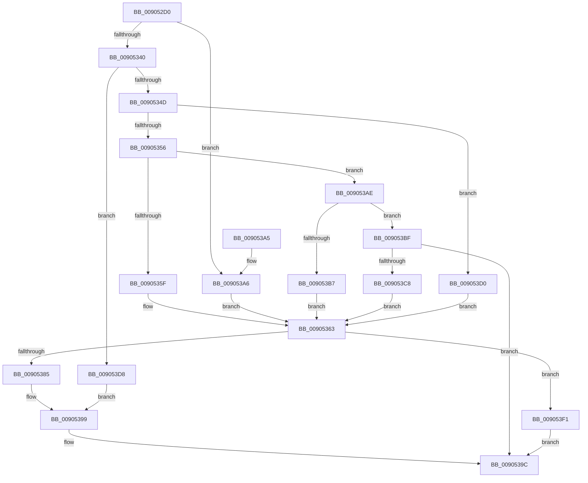

# ExpWin32OpenProcedure

- RVA: `0x009052D0`–`0x009053F9` (길이 `297` bytes)
- VA: `0x00000001409052D0`
- 실행 섹션: `PAGE`
- PDB 이름 있음: `예`; PDB Function 태그: `아니요`
- unwind 정보 RVA: `0x00088BBC`
- 디코드: `77`개 명령, `297/297` bytes 표시
- 미해석 바이트: `0` (있으면 어셈블리에 `.byte`로 보존)

> 이 문서는 커널 이미지의 기계어와 PDB 기호를 분석해 생성했습니다. 4번과 5번은 함수 원형과 자료형을 바이너리 사용 방식에서 추정한 C 해석이며 원본 소스 복구 결과는 아닙니다.

## 1. Dependencies

- 직접 호출 지점: **4**; 고유 호출 대상: **4**
- 직접 호출자로 확인된 함수: **0**
- RIP 상대 이미지 참조: **8**

### Outgoing calls
- `0x0090537C` → [PspUpdateCalloutParameters](../../text/49/PspUpdateCalloutParameters_function_0049BBA4.md) (function, `0x0049BBA4`)
- `0x00905385` → [PsSessionGetWin32Callouts](../../text/47/PsSessionGetWin32Callouts_function_00474F98.md) (function, `0x00474F98`)
- `0x00905394` → [ExCallCallBack](ExCallCallBack_function_009054B4.md) (function, `0x009054B4`)
- `0x009053EA` → [PsInvokeWin32Callout](../91/PsInvokeWin32Callout_function_009133C0.md) (function, `0x009133C0`)

### Direct callers
- 이 함수 시작 RVA로 연결되는 직접 call은 확인되지 않았습니다. 간접 호출은 완전히 역산할 수 없습니다.

### Static image references
- `0x009052DC` → RVA `0x00FC7800` (`ALMOSTRO`; read)
- `0x00905307` → RVA `0x00FC6E4C` (`ALMOSTRO`; read)
- `0x00905320` → RVA `0x00FC6F28` (`ALMOSTRO`; read)
- `0x00905340` → RVA `0x00FC6F38` (`ALMOSTRO`; read)
- `0x0090534D` → RVA `0x00FC6F30` (`ALMOSTRO`; read)
- `0x00905356` → RVA `0x00FC6F48` (`ALMOSTRO`; read)
- `0x009053AE` → RVA `0x00FC6F40` (`ALMOSTRO`; read)
- `0x009053BF` → RVA `0x00FC6F50` (`ALMOSTRO`; read)

## 2. Other-region calls and transfers

- 다른 실행 섹션으로 향하는 call: **2**
  - `0x0090537C` → [PspUpdateCalloutParameters](../../text/49/PspUpdateCalloutParameters_function_0049BBA4.md) (`PAGE` → `.text`)
  - `0x00905385` → [PsSessionGetWin32Callouts](../../text/47/PsSessionGetWin32Callouts_function_00474F98.md) (`PAGE` → `.text`)
- 별도 외부 분기/꼬리 이동을 확인하지 못했습니다.

## 3. Assembly (complete function range)

```asm
009052D0  40 55                           push rbp
009052D2  48 8B EC                        mov rbp, rsp
009052D5  48 83 EC 60                     sub rsp, 0x60
009052D9  41 8B 01                        mov eax, dword ptr [r9]
009052DC  48 8D 15 1D 25 6C 00            lea rdx, [rip + 0x6c251d]
009052E3  89 45 10                        mov dword ptr [rbp + 0x10], eax
009052E6  41 BB 01 00 00 C0               mov r11d, 0xc0000001
009052EC  49 8D 41 D0                     lea rax, [r9 - 0x30]
009052F0  89 4D E0                        mov dword ptr [rbp - 0x20], ecx
009052F3  48 C1 E8 08                     shr rax, 8
009052F7  44 0F B6 D0                     movzx r10d, al
009052FB  41 0F B6 41 E8                  movzx eax, byte ptr [r9 - 0x18]
00905300  4C 33 D0                        xor r10, rax
00905303  4C 89 45 E8                     mov qword ptr [rbp - 0x18], r8
00905307  0F B6 05 3E 1B 6C 00            movzx eax, byte ptr [rip + 0x6c1b3e]
0090530E  4C 33 D0                        xor r10, rax
00905311  4C 89 4D F0                     mov qword ptr [rbp - 0x10], r9
00905315  48 8B 45 30                     mov rax, qword ptr [rbp + 0x30]
00905319  4A 8B 14 D2                     mov rdx, qword ptr [rdx + r10*8]
0090531D  45 33 D2                        xor r10d, r10d
00905320  48 3B 15 01 1C 6C 00            cmp rdx, qword ptr [rip + 0x6c1c01]
00905327  8B 08                           mov ecx, dword ptr [rax]
00905329  8B 45 38                        mov eax, dword ptr [rbp + 0x38]
0090532C  4C 89 55 D0                     mov qword ptr [rbp - 0x30], r10
00905330  4C 89 55 D8                     mov qword ptr [rbp - 0x28], r10
00905334  44 89 55 E4                     mov dword ptr [rbp - 0x1c], r10d
00905338  89 4D F8                        mov dword ptr [rbp - 8], ecx
0090533B  89 45 FC                        mov dword ptr [rbp - 4], eax
0090533E  74 66                           je 0x1409053a6
00905340  48 3B 15 F1 1B 6C 00            cmp rdx, qword ptr [rip + 0x6c1bf1]
00905347  0F 84 8B 00 00 00               je 0x1409053d8
0090534D  48 3B 15 DC 1B 6C 00            cmp rdx, qword ptr [rip + 0x6c1bdc]
00905354  74 7A                           je 0x1409053d0
00905356  48 3B 15 EB 1B 6C 00            cmp rdx, qword ptr [rip + 0x6c1beb]
0090535D  75 4F                           jne 0x1409053ae
0090535F  45 8D 5A 12                     lea r11d, [r10 + 0x12]
00905363  33 C0                           xor eax, eax
00905365  4C 8D 4D 10                     lea r9, [rbp + 0x10]
00905369  48 89 45 C4                     mov qword ptr [rbp - 0x3c], rax
0090536D  48 8D 55 D0                     lea rdx, [rbp - 0x30]
00905371  41 8B CB                        mov ecx, r11d
00905374  48 89 45 C0                     mov qword ptr [rbp - 0x40], rax
00905378  44 8D 40 01                     lea r8d, [rax + 1]
0090537C  E8 23 68 B9 FF                  call 0x14049bba4
00905381  85 C0                           test eax, eax
00905383  74 6C                           je 0x1409053f1
00905385  E8 0E FC B6 FF                  call 0x140474f98
0090538A  49 8B D3                        mov rdx, r11
0090538D  4C 8D 45 D0                     lea r8, [rbp - 0x30]
00905391  48 8B C8                        mov rcx, rax
00905394  E8 1B 01 00 00                  call 0x1409054b4
00905399  44 8B D8                        mov r11d, eax
0090539C  41 8B C3                        mov eax, r11d
0090539F  48 83 C4 60                     add rsp, 0x60
009053A3  5D                              pop rbp
009053A4  C3                              ret
009053A5  CC                              int3
009053A6  41 BB 25 00 00 00               mov r11d, 0x25
009053AC  EB B5                           jmp 0x140905363
009053AE  48 3B 15 8B 1B 6C 00            cmp rdx, qword ptr [rip + 0x6c1b8b]
009053B5  75 08                           jne 0x1409053bf
009053B7  41 BB 08 00 00 00               mov r11d, 8
009053BD  EB A4                           jmp 0x140905363
009053BF  48 3B 15 8A 1B 6C 00            cmp rdx, qword ptr [rip + 0x6c1b8a]
009053C6  75 D4                           jne 0x14090539c
009053C8  41 BB 10 00 00 00               mov r11d, 0x10
009053CE  EB 93                           jmp 0x140905363
009053D0  41 BB 1B 00 00 00               mov r11d, 0x1b
009053D6  EB 8B                           jmp 0x140905363
009053D8  41 B8 01 00 00 00               mov r8d, 1
009053DE  4C 8D 4D 10                     lea r9, [rbp + 0x10]
009053E2  48 8D 55 D0                     lea rdx, [rbp - 0x30]
009053E6  41 8D 48 20                     lea ecx, [r8 + 0x20]
009053EA  E8 D1 DF 00 00                  call 0x1409133c0
009053EF  EB A8                           jmp 0x140905399
009053F1  41 BB 0D 00 00 C0               mov r11d, 0xc000000d
009053F7  EB A3                           jmp 0x14090539c
```

## 4. C-style interpretation (structured pseudocode)

```c
__int64 __fastcall ExpWin32OpenProcedure(int a1, __int64 a2, __int64 a3, __int64 a4, __int64 a5, unsigned int a6)
{
    __int64 result;
    __int64 v_r10;
    __int64 v_rsp;
    unsigned int v_stack_m10;
    unsigned __int64 v_stack_m18;
    unsigned __int64 v_stack_m20;
    unsigned int v_stack_m24;
    unsigned int v_stack_m28;
    unsigned __int64 v_stack_m30;
    unsigned __int64 v_stack_m38;
    unsigned __int64 v_stack_m44;
    unsigned __int64 v_stack_m48;
    unsigned int v_stack_mC;
    unsigned int v_stack_p8;

    v_rsp = (v_rsp) - (96);
    v_stack_p8 = (unsigned int)((unsigned int)(*(unsigned int *)(a4)));
    v_stack_m28 = a1;
    result = (a4 - 48) >> (8);
    v_r10 = ((unsigned __int8)(result)) ^ (*(unsigned __int8 *)(a4 - 24));
    v_stack_m20 = a3;
    v_r10 = (v_r10) ^ (*(unsigned __int8 *)(v_rip + 7084862));
    v_stack_m18 = a4;
    v_r10 = 0;
    v_stack_m38 = 0;
    v_stack_m30 = 0;
    v_stack_m24 = 0;
    v_stack_m10 = (unsigned int)((unsigned int)(*(unsigned int *)(a5)));
    v_stack_mC = (unsigned int)((unsigned int)(a6));
    if ((*(unsigned __int64 *)(v_rip + 7087389 + v_r10 * 8)) == (*(unsigned __int64 *)(v_rip + 7085057))) goto loc_009053A6;
    if ((*(unsigned __int64 *)(v_rip + 7087389 + v_r10 * 8)) == (*(unsigned __int64 *)(v_rip + 7085041))) goto loc_009053D8;
    if ((*(unsigned __int64 *)(v_rip + 7087389 + v_r10 * 8)) == (*(unsigned __int64 *)(v_rip + 7085020))) goto loc_009053D0;
    if ((*(unsigned __int64 *)(v_rip + 7087389 + v_r10 * 8)) != (*(unsigned __int64 *)(v_rip + 7085035))) goto loc_009053AE;
loc_00905363:
    result = 0;
    v_stack_m44 = 0;
    v_stack_m48 = 0;
    result = PspUpdateCalloutParameters((unsigned int)((unsigned int)(v_r10 + 18)), v_stack_m38, result + 1, v_stack_p8);
    if ((unsigned int)(result) == 0) goto loc_009053F1;
    result = PsSessionGetWin32Callouts((unsigned int)((unsigned int)(v_r10 + 18)), v_stack_m38, result + 1, v_stack_p8);
    result = ExCallCallBack(result, v_r10 + 18, v_stack_m38, v_stack_p8);
loc_00905399:
loc_0090539C:
    v_rsp = (v_rsp) + (96);
    return (unsigned int)((unsigned int)((unsigned int)((unsigned int)(result))));
loc_009053A6:
    goto loc_00905363;
loc_009053AE:
    if ((v_r10 + 18) != (*(unsigned __int64 *)(v_rip + 7084939))) goto loc_009053BF;
    goto loc_00905363;
loc_009053BF:
    if ((v_r10 + 18) != (*(unsigned __int64 *)(v_rip + 7084938))) goto loc_0090539C;
    goto loc_00905363;
loc_009053D0:
    goto loc_00905363;
loc_009053D8:
    result = PsInvokeWin32Callout(1 + 32, v_stack_m38, 1, v_stack_p8);
    goto loc_00905399;
loc_009053F1:
    goto loc_0090539C;
}
```

## 5. (Beta) C Style

```c
int64_t ExpWin32OpenProcedure(int32_t Arg1, int64_t Arg2, int64_t Arg3, void *Arg4, void *Arg5, uint32_t Arg6)
{
    uint8_t *arg4 = (uint8_t *)Arg4;
    uint8_t *arg5 = (uint8_t *)Arg5;

    int64_t result;
    int64_t local_r10;
    int64_t local_rsp;
    uint32_t v_stack_m10;
    uint64_t v_stack_m18;
    uint64_t v_stack_m20;
    uint32_t v_stack_m24;
    uint32_t v_stack_m28;
    uint64_t v_stack_m30;
    uint64_t v_stack_m38;
    uint64_t v_stack_m44;
    uint64_t v_stack_m48;
    uint32_t v_stack_mC;
    uint32_t v_stack_p8;

    local_rsp = (local_rsp) - (96);
    v_stack_p8 = (uint32_t)((uint32_t)(*(uint32_t *)(arg4)));
    v_stack_m28 = Arg1;
    result = (Arg4 - 48) >> (8);
    local_r10 = ((uint8_t)(result)) ^ (*(uint8_t *)(arg4 - 0x18));
    v_stack_m20 = Arg3;
    local_r10 = (local_r10) ^ (*(uint8_t *)(v_rip + 0x6C1B3E));
    v_stack_m18 = Arg4;
    local_r10 = 0;
    v_stack_m38 = 0;
    v_stack_m30 = 0;
    v_stack_m24 = 0;
    v_stack_m10 = (uint32_t)((uint32_t)(*(uint32_t *)(arg5)));
    v_stack_mC = (uint32_t)((uint32_t)(Arg6));
    if ((*(uint64_t *)(v_rip + 0x6C251D + local_r10 * 8)) == (*(uint64_t *)(v_rip + 0x6C1C01))) goto loc_009053A6;
    if ((*(uint64_t *)(v_rip + 0x6C251D + local_r10 * 8)) == (*(uint64_t *)(v_rip + 0x6C1BF1))) goto loc_009053D8;
    if ((*(uint64_t *)(v_rip + 0x6C251D + local_r10 * 8)) == (*(uint64_t *)(v_rip + 0x6C1BDC))) goto loc_009053D0;
    if ((*(uint64_t *)(v_rip + 0x6C251D + local_r10 * 8)) != (*(uint64_t *)(v_rip + 0x6C1BEB))) goto loc_009053AE;
loc_00905363:
    result = 0;
    v_stack_m44 = 0;
    v_stack_m48 = 0;
    result = PspUpdateCalloutParameters((uint32_t)((uint32_t)(local_r10 + 18)), v_stack_m38, result + 1, v_stack_p8);
    if ((uint32_t)(result) == 0) goto loc_009053F1;
    result = PsSessionGetWin32Callouts((uint32_t)((uint32_t)(local_r10 + 18)), v_stack_m38, result + 1, v_stack_p8);
    result = ExCallCallBack(result, local_r10 + 18, v_stack_m38, v_stack_p8);
loc_00905399:
loc_0090539C:
    local_rsp = (local_rsp) + (96);
    return (uint32_t)((uint32_t)((uint32_t)((uint32_t)(result))));
loc_009053A6:
    goto loc_00905363;
loc_009053AE:
    if ((local_r10 + 18) != (*(uint64_t *)(v_rip + 0x6C1B8B))) goto loc_009053BF;
    goto loc_00905363;
loc_009053BF:
    if ((local_r10 + 18) != (*(uint64_t *)(v_rip + 0x6C1B8A))) goto loc_0090539C;
    goto loc_00905363;
loc_009053D0:
    goto loc_00905363;
loc_009053D8:
    result = PsInvokeWin32Callout(1 + 32, v_stack_m38, 1, v_stack_p8);
    goto loc_00905399;
loc_009053F1:
    goto loc_0090539C;
}
```

### 관측된 메모리 오프셋

구조체 형식이 확인되지 않은 접근은 인자 기준의 오프셋으로만 기록했습니다.

| 기준 인자 | 오프셋 표현 | 폭 (bit) | 접근 |
|---|---:|---:|---|
| `Arg4` | `- 0x30` | `64` | `R` |
| `Arg4` | `- 0x18` | `8` | `R` |
| `Arg4` | `+ 0x0` | `32` | `R` |
| `Arg5` | `+ 0x0` | `32` | `R` |

## 6. Execution-region graph

[열기: 2D/3D 그래프와 함수 탐색 컨트롤 패널](../../../control-panel.html?section=page&rva=0x009052D0&view=graph)

- 2D 그래프는 위에서 아래로 흐르고, 3D 그래프는 빈 공간을 드래그해 회전합니다. Shift+드래그는 이동, 휠은 확대·축소, 함수 노드 선택은 대상 보고서 이동입니다.

### Static fallback


