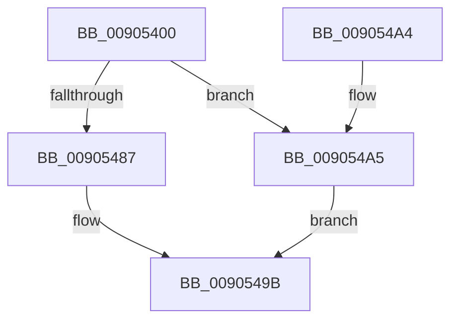

# ExpWin32ParseProcedure

- RVA: `0x00905400`–`0x009054AC` (길이 `172` bytes)
- VA: `0x0000000140905400`
- 실행 섹션: `PAGE`
- PDB 이름 있음: `예`; PDB Function 태그: `아니요`
- unwind 정보 RVA: `0x00088BC8`
- 디코드: `48`개 명령, `172/172` bytes 표시
- 미해석 바이트: `0` (있으면 어셈블리에 `.byte`로 보존)

> 이 문서는 커널 이미지의 기계어와 PDB 기호를 분석해 생성했습니다. 4번과 5번은 함수 원형과 자료형을 바이너리 사용 방식에서 추정한 C 해석이며 원본 소스 복구 결과는 아닙니다.

## 1. Dependencies

- 직접 호출 지점: **3**; 고유 호출 대상: **3**
- 직접 호출자로 확인된 함수: **1**
- RIP 상대 이미지 참조: **0**

### Outgoing calls
- `0x0090547E` → [PspUpdateCalloutParameters](../../text/49/PspUpdateCalloutParameters_function_0049BBA4.md) (function, `0x0049BBA4`)
- `0x00905487` → [PsSessionGetWin32Callouts](../../text/47/PsSessionGetWin32Callouts_function_00474F98.md) (function, `0x00474F98`)
- `0x00905496` → [ExCallCallBack](ExCallCallBack_function_009054B4.md) (function, `0x009054B4`)

### Direct callers
- [ObpLookupObjectName](../89/ObpLookupObjectName_function_0089BE90.md) at `0x0089D753`

### Static image references
- 디코드된 RIP-relative 메모리 참조가 없습니다.

## 2. Other-region calls and transfers

- 다른 실행 섹션으로 향하는 call: **2**
  - `0x0090547E` → [PspUpdateCalloutParameters](../../text/49/PspUpdateCalloutParameters_function_0049BBA4.md) (`PAGE` → `.text`)
  - `0x00905487` → [PsSessionGetWin32Callouts](../../text/47/PsSessionGetWin32Callouts_function_00474F98.md) (`PAGE` → `.text`)
- 별도 외부 분기/꼬리 이동을 확인하지 못했습니다.

## 3. Assembly (complete function range)

```asm
00905400  40 55                           push rbp
00905402  48 8D 6C 24 D9                  lea rbp, [rsp - 0x27]
00905407  48 81 EC 90 00 00 00            sub rsp, 0x90
0090540E  8B 01                           mov eax, dword ptr [rcx]
00905410  0F 57 C0                        xorps xmm0, xmm0
00905413  89 45 4F                        mov dword ptr [rbp + 0x4f], eax
00905416  33 C0                           xor eax, eax
00905418  66 89 45 F0                     mov word ptr [rbp - 0x10], ax
0090541C  88 45 F2                        mov byte ptr [rbp - 0xe], al
0090541F  8B 45 57                        mov eax, dword ptr [rbp + 0x57]
00905422  89 45 F3                        mov dword ptr [rbp - 0xd], eax
00905425  48 8B 45 5F                     mov rax, qword ptr [rbp + 0x5f]
00905429  48 89 45 F7                     mov qword ptr [rbp - 9], rax
0090542D  48 8B 45 67                     mov rax, qword ptr [rbp + 0x67]
00905431  48 89 45 FF                     mov qword ptr [rbp - 1], rax
00905435  48 8B 45 6F                     mov rax, qword ptr [rbp + 0x6f]
00905439  48 89 45 07                     mov qword ptr [rbp + 7], rax
0090543D  48 8B 45 77                     mov rax, qword ptr [rbp + 0x77]
00905441  48 89 45 0F                     mov qword ptr [rbp + 0xf], rax
00905445  48 8B 45 7F                     mov rax, qword ptr [rbp + 0x7f]
00905449  48 89 45 17                     mov qword ptr [rbp + 0x17], rax
0090544D  33 C0                           xor eax, eax
0090544F  48 89 4D D7                     mov qword ptr [rbp - 0x29], rcx
00905453  48 89 55 DF                     mov qword ptr [rbp - 0x21], rdx
00905457  48 8D 55 C7                     lea rdx, [rbp - 0x39]
0090545B  4C 89 45 E7                     mov qword ptr [rbp - 0x19], r8
0090545F  44 8D 50 0F                     lea r10d, [rax + 0xf]
00905463  44 88 4D EF                     mov byte ptr [rbp - 0x11], r9b
00905467  48 89 45 BB                     mov qword ptr [rbp - 0x45], rax
0090546B  4C 8D 4D 4F                     lea r9, [rbp + 0x4f]
0090546F  41 8B CA                        mov ecx, r10d
00905472  48 89 45 B7                     mov qword ptr [rbp - 0x49], rax
00905476  44 8D 40 01                     lea r8d, [rax + 1]
0090547A  0F 11 45 C7                     movups xmmword ptr [rbp - 0x39], xmm0
0090547E  E8 21 67 B9 FF                  call 0x14049bba4
00905483  85 C0                           test eax, eax
00905485  74 1E                           je 0x1409054a5
00905487  E8 0C FB B6 FF                  call 0x140474f98
0090548C  48 8B C8                        mov rcx, rax
0090548F  4C 8D 45 C7                     lea r8, [rbp - 0x39]
00905493  41 8B D2                        mov edx, r10d
00905496  E8 19 00 00 00                  call 0x1409054b4
0090549B  48 81 C4 90 00 00 00            add rsp, 0x90
009054A2  5D                              pop rbp
009054A3  C3                              ret
009054A4  CC                              int3
009054A5  B8 0D 00 00 C0                  mov eax, 0xc000000d
009054AA  EB EF                           jmp 0x14090549b
```

## 4. C-style interpretation (structured pseudocode)

```c
__int64 __fastcall ExpWin32ParseProcedure(__int64 a1, __int64 a2, __int64 a3, unsigned __int8 a4, unsigned int a5, __int64 a6, __int64 a7, __int64 a8, __int64 a9, __int64 a10)
{
    __int64 result;
    __int64 v_rsp;
    unsigned __int64 v_stack_m18;
    unsigned __int64 v_stack_m20;
    unsigned __int64 v_stack_m28;
    unsigned __int64 v_stack_m2F;
    unsigned __int64 v_stack_m30;
    unsigned __int64 v_stack_m38;
    unsigned int v_stack_m3C;
    unsigned __int8 v_stack_m3D;
    unsigned __int16 v_stack_m3F;
    unsigned __int8 v_stack_m40;
    unsigned __int64 v_stack_m48;
    unsigned __int64 v_stack_m50;
    unsigned __int64 v_stack_m58;
    unsigned __int64 v_stack_m68;
    unsigned __int64 v_stack_m74;
    unsigned __int64 v_stack_m78;
    unsigned int v_stack_p20;

    v_rsp = (v_rsp) - (144);
    v_stack_p20 = (unsigned int)((unsigned int)(*(unsigned int *)(a1)));
    result = 0;
    v_stack_m3F = 0;
    v_stack_m3D = 0;
    v_stack_m3C = (unsigned int)((unsigned int)(a5));
    v_stack_m38 = a6;
    v_stack_m30 = a7;
    v_stack_m28 = a8;
    v_stack_m20 = a9;
    v_stack_m18 = a10;
    result = 0;
    v_stack_m58 = a1;
    v_stack_m50 = a2;
    v_stack_m48 = a3;
    v_stack_m40 = a4;
    v_stack_m74 = 0;
    v_stack_m78 = 0;
    v_stack_m68 = v_xmm0;
    result = PspUpdateCalloutParameters((unsigned int)((unsigned int)(result + 15)), v_stack_m68, result + 1, v_stack_p20);
    if ((unsigned int)(result) == 0) goto loc_009054A5;
    result = PsSessionGetWin32Callouts((unsigned int)((unsigned int)(result + 15)), v_stack_m68, result + 1, v_stack_p20);
    result = ExCallCallBack(result, (unsigned int)((unsigned int)(result + 15)), v_stack_m68, v_stack_p20);
loc_0090549B:
    v_rsp = (v_rsp) + (144);
    return result;
loc_009054A5:
    goto loc_0090549B;
}
```

## 5. (Beta) C Style

```c
int64_t ExpWin32ParseProcedure(void *Arg1, int64_t Arg2, int64_t Arg3, uint8_t Arg4, uint32_t Arg5, int64_t Arg6, int64_t Arg7, int64_t Arg8, int64_t Arg9, int64_t Arg10)
{
    uint8_t *arg1 = (uint8_t *)Arg1;

    int64_t result;
    int64_t local_rsp;
    uint64_t v_stack_m18;
    uint64_t v_stack_m20;
    uint64_t v_stack_m28;
    uint64_t v_stack_m2F;
    uint64_t v_stack_m30;
    uint64_t v_stack_m38;
    uint32_t v_stack_m3C;
    uint8_t v_stack_m3D;
    uint16_t v_stack_m3F;
    uint8_t v_stack_m40;
    uint64_t v_stack_m48;
    uint64_t v_stack_m50;
    uint64_t v_stack_m58;
    uint64_t v_stack_m68;
    uint64_t v_stack_m74;
    uint64_t v_stack_m78;
    uint32_t v_stack_p20;

    local_rsp = (local_rsp) - (144);
    v_stack_p20 = (uint32_t)((uint32_t)(*(uint32_t *)(arg1)));
    result = 0;
    v_stack_m3F = 0;
    v_stack_m3D = 0;
    v_stack_m3C = (uint32_t)((uint32_t)(Arg5));
    v_stack_m38 = Arg6;
    v_stack_m30 = Arg7;
    v_stack_m28 = Arg8;
    v_stack_m20 = Arg9;
    v_stack_m18 = Arg10;
    result = 0;
    v_stack_m58 = Arg1;
    v_stack_m50 = Arg2;
    v_stack_m48 = Arg3;
    v_stack_m40 = Arg4;
    v_stack_m74 = 0;
    v_stack_m78 = 0;
    v_stack_m68 = v_xmm0;
    result = PspUpdateCalloutParameters((uint32_t)((uint32_t)(result + 15)), v_stack_m68, result + 1, v_stack_p20);
    if ((uint32_t)(result) == 0) goto loc_009054A5;
    result = PsSessionGetWin32Callouts((uint32_t)((uint32_t)(result + 15)), v_stack_m68, result + 1, v_stack_p20);
    result = ExCallCallBack(result, (uint32_t)((uint32_t)(result + 15)), v_stack_m68, v_stack_p20);
loc_0090549B:
    local_rsp = (local_rsp) + (144);
    return result;
loc_009054A5:
    goto loc_0090549B;
}
```

### 관측된 메모리 오프셋

구조체 형식이 확인되지 않은 접근은 인자 기준의 오프셋으로만 기록했습니다.

| 기준 인자 | 오프셋 표현 | 폭 (bit) | 접근 |
|---|---:|---:|---|
| `Arg1` | `+ 0x0` | `32` | `R` |

## 6. Execution-region graph

[열기: 2D/3D 그래프와 함수 탐색 컨트롤 패널](../../../control-panel.html?section=page&rva=0x00905400&view=graph)

- 2D 그래프는 위에서 아래로 흐르고, 3D 그래프는 빈 공간을 드래그해 회전합니다. Shift+드래그는 이동, 휠은 확대·축소, 함수 노드 선택은 대상 보고서 이동입니다.

### Static fallback


