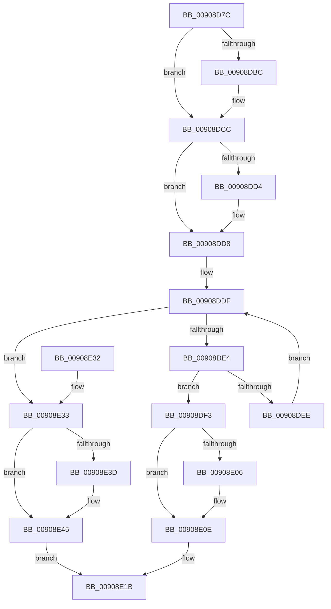

# ExpWnfAcquireSubscriptionByName

- RVA: `0x00908D7C`–`0x00908E54` (길이 `216` bytes)
- VA: `0x0000000140908D7C`
- 실행 섹션: `PAGE`
- PDB 이름 있음: `예`; PDB Function 태그: `아니요`
- unwind 정보 RVA: `0x00088EC4`
- 디코드: `69`개 명령, `216/216` bytes 표시
- 미해석 바이트: `0` (있으면 어셈블리에 `.byte`로 보존)

> 이 문서는 커널 이미지의 기계어와 PDB 기호를 분석해 생성했습니다. 4번과 5번은 함수 원형과 자료형을 바이너리 사용 방식에서 추정한 C 해석이며 원본 소스 복구 결과는 아닙니다.

## 1. Dependencies

- 직접 호출 지점: **7**; 고유 호출 대상: **5**
- 직접 호출자로 확인된 함수: **1**
- RIP 상대 이미지 참조: **0**

### Outgoing calls
- `0x00908DA7` → [KeAbPreAcquire](../../text/21/KeAbPreAcquire_function_00210230.md) (function, `0x00210230`)
- `0x00908DC7` → [ExfAcquirePushLockSharedEx](../../text/21/ExfAcquirePushLockSharedEx_function_0021044C.md) (function, `0x0021044C`)
- `0x00908DF7` → [ExAcquireRundownProtection](../../text/21/ExAcquireRundownProtection_function_00216620.md) (function, `0x00216620`)
- `0x00908E09` → [ExfReleasePushLockShared](../../text/26/ExfReleasePushLockShared_function_00263440.md) (function, `0x00263440`)
- `0x00908E11` → [KeAbPostRelease](../../text/2E/KeAbPostRelease_function_002E1600.md) (function, `0x002E1600`)
- `0x00908E40` → [ExfReleasePushLockShared](../../text/26/ExfReleasePushLockShared_function_00263440.md) (function, `0x00263440`)
- `0x00908E48` → [KeAbPostRelease](../../text/2E/KeAbPostRelease_function_002E1600.md) (function, `0x002E1600`)

### Direct callers
- [NtUnsubscribeWnfStateChange](NtUnsubscribeWnfStateChange_function_009092B0.md) at `0x0090932A`

### Static image references
- 디코드된 RIP-relative 메모리 참조가 없습니다.

## 2. Other-region calls and transfers

- 다른 실행 섹션으로 향하는 call: **7**
  - `0x00908DA7` → [KeAbPreAcquire](../../text/21/KeAbPreAcquire_function_00210230.md) (`PAGE` → `.text`)
  - `0x00908DC7` → [ExfAcquirePushLockSharedEx](../../text/21/ExfAcquirePushLockSharedEx_function_0021044C.md) (`PAGE` → `.text`)
  - `0x00908DF7` → [ExAcquireRundownProtection](../../text/21/ExAcquireRundownProtection_function_00216620.md) (`PAGE` → `.text`)
  - `0x00908E09` → [ExfReleasePushLockShared](../../text/26/ExfReleasePushLockShared_function_00263440.md) (`PAGE` → `.text`)
  - `0x00908E11` → [KeAbPostRelease](../../text/2E/KeAbPostRelease_function_002E1600.md) (`PAGE` → `.text`)
  - `0x00908E40` → [ExfReleasePushLockShared](../../text/26/ExfReleasePushLockShared_function_00263440.md) (`PAGE` → `.text`)
  - `0x00908E48` → [KeAbPostRelease](../../text/2E/KeAbPostRelease_function_002E1600.md) (`PAGE` → `.text`)
- 별도 외부 분기/꼬리 이동을 확인하지 못했습니다.

## 3. Assembly (complete function range)

```asm
00908D7C  48 89 5C 24 08                  mov qword ptr [rsp + 8], rbx
00908D81  48 89 6C 24 18                  mov qword ptr [rsp + 0x18], rbp
00908D86  56                              push rsi
00908D87  57                              push rdi
00908D88  41 54                           push r12
00908D8A  41 56                           push r14
00908D8C  41 57                           push r15
00908D8E  48 83 EC 20                     sub rsp, 0x20
00908D92  48 8D 7A 50                     lea rdi, [rdx + 0x50]
00908D96  4D 8B F0                        mov r14, r8
00908D99  48 8B EA                        mov rbp, rdx
00908D9C  48 8B D9                        mov rbx, rcx
00908D9F  48 8B CF                        mov rcx, rdi
00908DA2  45 33 C0                        xor r8d, r8d
00908DA5  33 D2                           xor edx, edx
00908DA7  E8 84 74 90 FF                  call 0x140210230
00908DAC  48 8B F0                        mov rsi, rax
00908DAF  33 C0                           xor eax, eax
00908DB1  44 8D 60 11                     lea r12d, [rax + 0x11]
00908DB5  F0 4C 0F B1 27                  lock cmpxchg qword ptr [rdi], r12
00908DBA  74 10                           je 0x140908dcc
00908DBC  4C 8B CF                        mov r9, rdi
00908DBF  4C 8B C6                        mov r8, rsi
00908DC2  33 D2                           xor edx, edx
00908DC4  48 8B CF                        mov rcx, rdi
00908DC7  E8 80 76 90 FF                  call 0x14021044c
00908DCC  45 33 FF                        xor r15d, r15d
00908DCF  48 85 F6                        test rsi, rsi
00908DD2  74 04                           je 0x140908dd8
00908DD4  C6 46 0A 01                     mov byte ptr [rsi + 0xa], 1
00908DD8  48 8D 4D 58                     lea rcx, [rbp + 0x58]
00908DDC  48 8B 01                        mov rax, qword ptr [rcx]
00908DDF  48 3B C1                        cmp rax, rcx
00908DE2  74 4F                           je 0x140908e33
00908DE4  48 8D 70 E8                     lea rsi, [rax - 0x18]
00908DE8  48 39 5E 38                     cmp qword ptr [rsi + 0x38], rbx
00908DEC  74 05                           je 0x140908df3
00908DEE  48 8B 00                        mov rax, qword ptr [rax]
00908DF1  EB EC                           jmp 0x140908ddf
00908DF3  48 8D 4E 08                     lea rcx, [rsi + 8]
00908DF7  E8 24 D8 90 FF                  call 0x140216620
00908DFC  49 8B C4                        mov rax, r12
00908DFF  F0 4C 0F B1 3F                  lock cmpxchg qword ptr [rdi], r15
00908E04  74 08                           je 0x140908e0e
00908E06  48 8B CF                        mov rcx, rdi
00908E09  E8 32 A6 95 FF                  call 0x140263440
00908E0E  48 8B CF                        mov rcx, rdi
00908E11  E8 EA 87 9D FF                  call 0x1402e1600
00908E16  33 C0                           xor eax, eax
00908E18  49 89 36                        mov qword ptr [r14], rsi
00908E1B  48 8B 5C 24 50                  mov rbx, qword ptr [rsp + 0x50]
00908E20  48 8B 6C 24 60                  mov rbp, qword ptr [rsp + 0x60]
00908E25  48 83 C4 20                     add rsp, 0x20
00908E29  41 5F                           pop r15
00908E2B  41 5E                           pop r14
00908E2D  41 5C                           pop r12
00908E2F  5F                              pop rdi
00908E30  5E                              pop rsi
00908E31  C3                              ret
00908E32  CC                              int3
00908E33  49 8B C4                        mov rax, r12
00908E36  F0 4C 0F B1 3F                  lock cmpxchg qword ptr [rdi], r15
00908E3B  74 08                           je 0x140908e45
00908E3D  48 8B CF                        mov rcx, rdi
00908E40  E8 FB A5 95 FF                  call 0x140263440
00908E45  48 8B CF                        mov rcx, rdi
00908E48  E8 B3 87 9D FF                  call 0x1402e1600
00908E4D  B8 34 00 00 C0                  mov eax, 0xc0000034
00908E52  EB C7                           jmp 0x140908e1b
```

## 4. C-style interpretation (structured pseudocode)

```c
__int64 __fastcall ExpWnfAcquireSubscriptionByName(__int64 a1, __int64 a2, __int64 a3)
{
    __int64 result;
    __int64 v_r15;
    __int64 v_rsp;
    unsigned __int64 v_stack_p18;
    unsigned __int64 v_stack_p8;

    v_stack_p8 = v_rbx;
    v_stack_p18 = v_rbp;
    v_rsp = (v_rsp) - (32);
    a3 = 0;
    a2 = 0;
    result = KeAbPreAcquire(a2 + 80, a2, a3, a4);
    result = 0;
    if (!(condition_is_equal)) {
        a4 = a2 + 80;
        a3 = 0;
        a2 = 0;
        a1 = a2 + 80;
        result = ExfAcquirePushLockSharedEx(a1, a2, a3, a4);
    }
    v_r15 = 0;
    if (result != 0) {
        *(unsigned __int8 *)(result + 10) = 1;
    }
loc_00908DDF:
    if ((*(unsigned __int64 *)(a2 + 88)) == (a2 + 88)) goto loc_00908E33;
    if ((*(unsigned __int64 *)(*(unsigned __int64 *)(a2 + 88) - 24 + 56)) == a1) goto loc_00908DF3;
    goto loc_00908DDF;
loc_00908DF3:
    result = ExAcquireRundownProtection(*(unsigned __int64 *)(a2 + 88) - 24 + 8, a2, a3, a4);
    result = result + 17;
    if ((*(unsigned __int64 *)(*(unsigned __int64 *)(a2 + 88) - 24 + 56)) != a1) {
        a1 = a2 + 80;
        result = ExfReleasePushLockShared(a1, a2, a3, a4);
    }
    result = KeAbPostRelease(a2 + 80, a2, a3, a4);
    result = 0;
    *(unsigned __int64 *)(a3) = *(unsigned __int64 *)(a2 + 88) - 24;
loc_00908E1B:
    v_rsp = (v_rsp) + (32);
    return result;
loc_00908E33:
    result = result + 17;
    if (!(condition_is_equal)) {
        a1 = a2 + 80;
        result = ExfReleasePushLockShared(a1, a2, a3, a4);
    }
    result = KeAbPostRelease(a2 + 80, a2, a3, a4);
    goto loc_00908E1B;
}
```

## 5. (Beta) C Style

```c
int64_t ExpWnfAcquireSubscriptionByName(int64_t Arg1, void *Arg2, void *Arg3)
{
    uint8_t *arg2 = (uint8_t *)Arg2;
    uint8_t *arg3 = (uint8_t *)Arg3;

    int64_t result;
    int64_t local_r15;
    int64_t local_rsp;
    uint64_t v_stack_p18;
    uint64_t v_stack_p8;

    v_stack_p8 = local_rbx;
    v_stack_p18 = local_rbp;
    local_rsp = (local_rsp) - (32);
    Arg3 = 0;
    Arg2 = 0;
    result = KeAbPreAcquire(Arg2 + 80, Arg2, Arg3, a4);
    result = 0;
    if (!(condition_is_equal)) {
        a4 = Arg2 + 80;
        Arg3 = 0;
        Arg2 = 0;
        Arg1 = Arg2 + 80;
        result = ExfAcquirePushLockSharedEx(Arg1, Arg2, Arg3, a4);
    }
    local_r15 = 0;
    if (result != 0) {
        *(uint8_t *)(result + 0xA) = 1;
    }
loc_00908DDF:
    if ((*(uint64_t *)(arg2 + 0x58)) == (Arg2 + 88)) goto loc_00908E33;
    if ((*(uint64_t *)(*(uint64_t *)(arg2 + 0x58) - 0x18 + 0x38)) == Arg1) goto loc_00908DF3;
    goto loc_00908DDF;
loc_00908DF3:
    result = ExAcquireRundownProtection(*(uint64_t *)(arg2 + 0x58) - 24 + 8, Arg2, Arg3, a4);
    result = result + 17;
    if ((*(uint64_t *)(*(uint64_t *)(arg2 + 0x58) - 0x18 + 0x38)) != Arg1) {
        Arg1 = Arg2 + 80;
        result = ExfReleasePushLockShared(Arg1, Arg2, Arg3, a4);
    }
    result = KeAbPostRelease(Arg2 + 80, Arg2, Arg3, a4);
    result = 0;
    *(uint64_t *)(arg3) = *(uint64_t *)(arg2 + 0x58) - 24;
loc_00908E1B:
    local_rsp = (local_rsp) + (32);
    return result;
loc_00908E33:
    result = result + 17;
    if (!(condition_is_equal)) {
        Arg1 = Arg2 + 80;
        result = ExfReleasePushLockShared(Arg1, Arg2, Arg3, a4);
    }
    result = KeAbPostRelease(Arg2 + 80, Arg2, Arg3, a4);
    goto loc_00908E1B;
}
```

### 관측된 메모리 오프셋

구조체 형식이 확인되지 않은 접근은 인자 기준의 오프셋으로만 기록했습니다.

| 기준 인자 | 오프셋 표현 | 폭 (bit) | 접근 |
|---|---:|---:|---|
| `Arg2` | `+ 0x0` | `64` | `R` |
| `Arg2` | `+ 0x50` | `64` | `R` |
| `Arg2` | `+ 0x58` | `64` | `R` |
| `Arg3` | `+ 0x0` | `64` | `W` |

## 6. Execution-region graph

[열기: 2D/3D 그래프와 함수 탐색 컨트롤 패널](../../../control-panel.html?section=page&rva=0x00908D7C&view=graph)

- 2D 그래프는 위에서 아래로 흐르고, 3D 그래프는 빈 공간을 드래그해 회전합니다. Shift+드래그는 이동, 휠은 확대·축소, 함수 노드 선택은 대상 보고서 이동입니다.

### Static fallback


