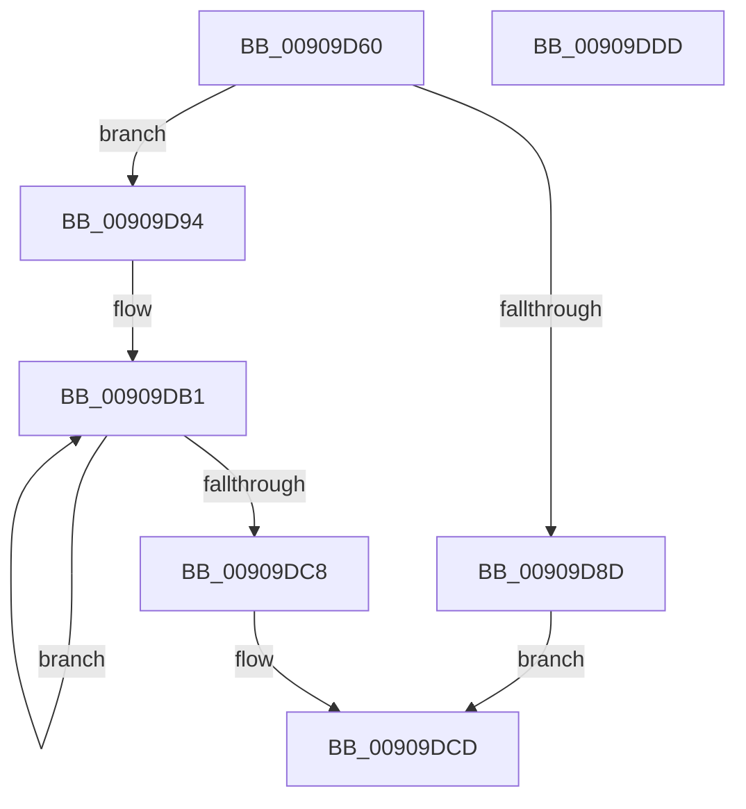

# ExpWnfAllocateScopeMap

- RVA: `0x00909D60`–`0x00909DDE` (길이 `126` bytes)
- VA: `0x0000000140909D60`
- 실행 섹션: `PAGE`
- PDB 이름 있음: `예`; PDB Function 태그: `아니요`
- unwind 정보 RVA: `0x00060BC4`
- 디코드: `36`개 명령, `126/126` bytes 표시
- 미해석 바이트: `0` (있으면 어셈블리에 `.byte`로 보존)

> 이 문서는 커널 이미지의 기계어와 PDB 기호를 분석해 생성했습니다. 4번과 5번은 함수 원형과 자료형을 바이너리 사용 방식에서 추정한 C 해석이며 원본 소스 복구 결과는 아닙니다.

## 1. Dependencies

- 직접 호출 지점: **2**; 고유 호출 대상: **2**
- 직접 호출자로 확인된 함수: **1**
- RIP 상대 이미지 참조: **0**

### Outgoing calls
- `0x00909D80` → [ExAllocatePool2](../../poolcode/B8/ExAllocatePool2_function_00B820F0.md) (function, `0x00B820F0`)
- `0x00909DA0` → [memset](../../text/6C/memset_function_006C6C40.md) (function, `0x006C6C40`)

### Direct callers
- [sub_0090B43E](Unknown_function_0090B43E.md) at `0x0090B442`

### Static image references
- 디코드된 RIP-relative 메모리 참조가 없습니다.

## 2. Other-region calls and transfers

- 다른 실행 섹션으로 향하는 call: **2**
  - `0x00909D80` → [ExAllocatePool2](../../poolcode/B8/ExAllocatePool2_function_00B820F0.md) (`PAGE` → `POOLCODE`)
  - `0x00909DA0` → [memset](../../text/6C/memset_function_006C6C40.md) (`PAGE` → `.text`)
- 별도 외부 분기/꼬리 이동을 확인하지 못했습니다.

## 3. Assembly (complete function range)

```asm
00909D60  48 89 5C 24 08                  mov qword ptr [rsp + 8], rbx
00909D65  48 89 74 24 10                  mov qword ptr [rsp + 0x10], rsi
00909D6A  57                              push rdi
00909D6B  48 83 EC 20                     sub rsp, 0x20
00909D6F  BA B0 00 00 00                  mov edx, 0xb0
00909D74  48 8B F9                        mov rdi, rcx
00909D77  41 B8 57 6E 66 20               mov r8d, 0x20666e57
00909D7D  8D 4A 50                        lea ecx, [rdx + 0x50]
00909D80  E8 6B 83 27 00                  call 0x140b820f0
00909D85  48 8B D8                        mov rbx, rax
00909D88  48 85 C0                        test rax, rax
00909D8B  75 07                           jne 0x140909d94
00909D8D  B8 9A 00 00 C0                  mov eax, 0xc000009a
00909D92  EB 39                           jmp 0x140909dcd
00909D94  48 8D 48 04                     lea rcx, [rax + 4]
00909D98  33 D2                           xor edx, edx
00909D9A  41 B8 AC 00 00 00               mov r8d, 0xac
00909DA0  E8 9B CE DB FF                  call 0x1406c6c40
00909DA5  33 C9                           xor ecx, ecx
00909DA7  C7 03 01 09 B0 00               mov dword ptr [rbx], 0xb00901
00909DAD  48 8D 43 28                     lea rax, [rbx + 0x28]
00909DB1  48 89 40 08                     mov qword ptr [rax + 8], rax
00909DB5  FF C1                           inc ecx
00909DB7  48 89 00                        mov qword ptr [rax], rax
00909DBA  48 83 60 F8 00                  and qword ptr [rax - 8], 0
00909DBF  48 83 C0 18                     add rax, 0x18
00909DC3  83 F9 06                        cmp ecx, 6
00909DC6  72 E9                           jb 0x140909db1
00909DC8  48 89 1F                        mov qword ptr [rdi], rbx
00909DCB  33 C0                           xor eax, eax
00909DCD  48 8B 5C 24 30                  mov rbx, qword ptr [rsp + 0x30]
00909DD2  48 8B 74 24 38                  mov rsi, qword ptr [rsp + 0x38]
00909DD7  48 83 C4 20                     add rsp, 0x20
00909DDB  5F                              pop rdi
00909DDC  C3                              ret
00909DDD  CC                              int3
```

## 4. C-style interpretation (structured pseudocode)

```c
__int64 __fastcall ExpWnfAllocateScopeMap(__int64 a1)
{
    __int64 result;
    __int64 v_rsp;
    unsigned __int64 v_stack_p10;
    unsigned __int64 v_stack_p8;

    v_stack_p8 = v_rbx;
    v_stack_p10 = v_rsi;
    v_rsp = (v_rsp) - (32);
    result = ExAllocatePool2(176 + 80, 176, (unsigned int)(0x20666E57ULL), a4);
    if (result != 0) goto loc_00909D94;
    goto loc_00909DCD;
loc_00909D94:
    a2 = 0;
    result = memset((unsigned int)(0xC000009AULL) + 4, a2, 172, a4);
    a1 = 0;
    *(unsigned int *)(result) = 0xB00901ULL;
loc_00909DB1:
    *(unsigned __int64 *)(result + 40 + 8) = result + 40;
    a1 = (unsigned int)((a1) + 1);
    *(unsigned __int64 *)(result + 40) = result + 40;
    result = (result + 40) + (24);
    if (((unsigned int)(a1)) < 6) goto loc_00909DB1;
    *(unsigned __int64 *)(a1) = result;
    result = 0;
loc_00909DCD:
    v_rsp = (v_rsp) + (32);
    return result;
}
```

## 5. (Beta) C Style

```c
int64_t ExpWnfAllocateScopeMap(void *Arg1)
{
    uint8_t *arg1 = (uint8_t *)Arg1;

    int64_t result;
    int64_t local_rsp;
    uint64_t v_stack_p10;
    uint64_t v_stack_p8;

    v_stack_p8 = local_rbx;
    v_stack_p10 = local_rsi;
    local_rsp = (local_rsp) - (32);
    result = ExAllocatePool2(176 + 80, 176, (uint32_t)(0x20666E57ULL), a4);
    if (result != 0) goto loc_00909D94;
    goto loc_00909DCD;
loc_00909D94:
    a2 = 0;
    result = memset((uint32_t)(0xC000009AULL) + 4, a2, 172, a4);
    Arg1 = 0;
    *(uint32_t *)(result) = 0xB00901ULL;
loc_00909DB1:
    *(uint64_t *)(result + 0x28 + 0x8) = result + 40;
    Arg1 = (uint32_t)((Arg1) + 1);
    *(uint64_t *)(result + 0x28) = result + 40;
    result = (result + 40) + (24);
    if (((uint32_t)(Arg1)) < 6) goto loc_00909DB1;
    *(uint64_t *)(arg1) = result;
    result = 0;
loc_00909DCD:
    local_rsp = (local_rsp) + (32);
    return result;
}
```

### 관측된 메모리 오프셋

구조체 형식이 확인되지 않은 접근은 인자 기준의 오프셋으로만 기록했습니다.

| 기준 인자 | 오프셋 표현 | 폭 (bit) | 접근 |
|---|---:|---:|---|
| `Arg1` | `+ 0x0` | `64` | `W` |

## 6. Execution-region graph

[열기: 2D/3D 그래프와 함수 탐색 컨트롤 패널](../../../control-panel.html?section=page&rva=0x00909D60&view=graph)

- 2D 그래프는 위에서 아래로 흐르고, 3D 그래프는 빈 공간을 드래그해 회전합니다. Shift+드래그는 이동, 휠은 확대·축소, 함수 노드 선택은 대상 보고서 이동입니다.

### Static fallback


