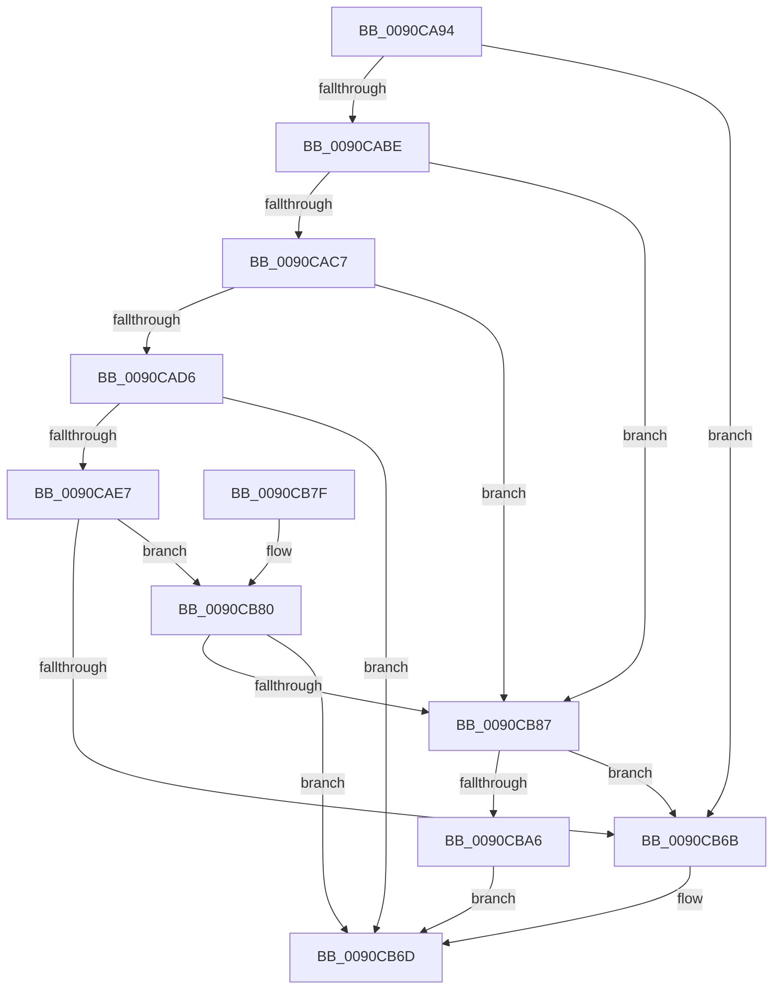

# ExpWnfCheckCrossScopeAccess

- RVA: `0x0090CA94`–`0x0090CBAD` (길이 `281` bytes)
- VA: `0x000000014090CA94`
- 실행 섹션: `PAGE`
- PDB 이름 있음: `예`; PDB Function 태그: `아니요`
- unwind 정보 RVA: `0x000892D4`
- 디코드: `70`개 명령, `281/281` bytes 표시
- 미해석 바이트: `0` (있으면 어셈블리에 `.byte`로 보존)

> 이 문서는 커널 이미지의 기계어와 PDB 기호를 분석해 생성했습니다. 4번과 5번은 함수 원형과 자료형을 바이너리 사용 방식에서 추정한 C 해석이며 원본 소스 복구 결과는 아닙니다.

## 1. Dependencies

- 직접 호출 지점: **6**; 고유 호출 대상: **6**
- 직접 호출자로 확인된 함수: **4**
- RIP 상대 이미지 참조: **2**

### Outgoing calls
- `0x0090CADA` → [ExpWnfLookupPermanentName](../8B/ExpWnfLookupPermanentName_function_008BD914.md) (function, `0x008BD914`)
- `0x0090CB06` → [SeCaptureSubjectContext](../86/SeCaptureSubjectContext_function_0086B820.md) (function, `0x0086B820`)
- `0x0090CB49` → [SeAccessCheck](../../text/3A/SeAccessCheck_function_003A6BC0.md) (function, `0x003A6BC0`)
- `0x0090CB52` → [SeReleaseSubjectContext](../86/SeReleaseSubjectContext_function_0086B710.md) (function, `0x0086B710`)
- `0x0090CB5F` → [ExFreePoolWithTag](../../poolcode/B8/ExFreePoolWithTag_function_00B82870.md) (function, `0x00B82870`)
- `0x0090CB9D` → [SeSinglePrivilegeCheck](../87/SeSinglePrivilegeCheck_function_00871E20.md) (function, `0x00871E20`)

### Direct callers
- [ExpNtDeleteWnfStateData](../7C/ExpNtDeleteWnfStateData_function_007CF1A8.md) at `0x007CF2B3`
- [NtQueryWnfStateData](NtQueryWnfStateData_function_00909DF0.md) at `0x0090A65B`
- [ExpNtUpdateWnfStateData](ExpNtUpdateWnfStateData_function_0090A7A0.md) at `0x0090AF5D`
- [NtQueryWnfStateNameInformation](../9E/NtQueryWnfStateNameInformation_function_009EBD20.md) at `0x009EBE8C`

### Static image references
- `0x0090CB32` → RVA `0x00B4B070` (`ExpWnfNotificationMapping`; read)
- `0x0090CB90` → RVA `0x00FD9A78` (`PAGEDATA`; read)

## 2. Other-region calls and transfers

- 다른 실행 섹션으로 향하는 call: **2**
  - `0x0090CB49` → [SeAccessCheck](../../text/3A/SeAccessCheck_function_003A6BC0.md) (`PAGE` → `.text`)
  - `0x0090CB5F` → [ExFreePoolWithTag](../../poolcode/B8/ExFreePoolWithTag_function_00B82870.md) (`PAGE` → `POOLCODE`)
- 별도 외부 분기/꼬리 이동을 확인하지 못했습니다.

## 3. Assembly (complete function range)

```asm
0090CA94  48 89 5C 24 18                  mov qword ptr [rsp + 0x18], rbx
0090CA99  48 89 7C 24 20                  mov qword ptr [rsp + 0x20], rdi
0090CA9E  55                              push rbp
0090CA9F  48 8B EC                        mov rbp, rsp
0090CAA2  48 83 EC 70                     sub rsp, 0x70
0090CAA6  48 83 65 10 00                  and qword ptr [rbp + 0x10], 0
0090CAAB  48 8B C1                        mov rax, rcx
0090CAAE  48 C1 E8 06                     shr rax, 6
0090CAB2  83 E0 0F                        and eax, 0xf
0090CAB5  83 F8 03                        cmp eax, 3
0090CAB8  0F 84 AD 00 00 00               je 0x14090cb6b
0090CABE  83 F8 01                        cmp eax, 1
0090CAC1  0F 85 C0 00 00 00               jne 0x14090cb87
0090CAC7  48 8B C1                        mov rax, rcx
0090CACA  48 C1 E8 04                     shr rax, 4
0090CACE  A8 03                           test al, 3
0090CAD0  0F 85 B1 00 00 00               jne 0x14090cb87
0090CAD6  48 8D 55 10                     lea rdx, [rbp + 0x10]
0090CADA  E8 35 0E FB FF                  call 0x1408bd914
0090CADF  85 C0                           test eax, eax
0090CAE1  0F 88 86 00 00 00               js 0x14090cb6d
0090CAE7  48 8B 7D 10                     mov rdi, qword ptr [rbp + 0x10]
0090CAEB  48 8D 4D E0                     lea rcx, [rbp - 0x20]
0090CAEF  83 65 18 00                     and dword ptr [rbp + 0x18], 0
0090CAF3  0F 57 C0                        xorps xmm0, xmm0
0090CAF6  83 65 10 00                     and dword ptr [rbp + 0x10], 0
0090CAFA  0F 11 45 E0                     movups xmmword ptr [rbp - 0x20], xmm0
0090CAFE  48 8B 5F 10                     mov rbx, qword ptr [rdi + 0x10]
0090CB02  0F 11 45 F0                     movups xmmword ptr [rbp - 0x10], xmm0
0090CB06  E8 15 ED F5 FF                  call 0x14086b820
0090CB0B  48 8D 45 10                     lea rax, [rbp + 0x10]
0090CB0F  41 B9 10 00 00 00               mov r9d, 0x10
0090CB15  48 89 44 24 48                  mov qword ptr [rsp + 0x48], rax
0090CB1A  48 8D 55 E0                     lea rdx, [rbp - 0x20]
0090CB1E  48 8D 45 18                     lea rax, [rbp + 0x18]
0090CB22  45 33 C0                        xor r8d, r8d
0090CB25  48 89 44 24 40                  mov qword ptr [rsp + 0x40], rax
0090CB2A  48 8B CB                        mov rcx, rbx
0090CB2D  C6 44 24 38 01                  mov byte ptr [rsp + 0x38], 1
0090CB32  48 8D 05 37 E5 23 00            lea rax, [rip + 0x23e537]
0090CB39  48 89 44 24 30                  mov qword ptr [rsp + 0x30], rax
0090CB3E  48 83 64 24 28 00               and qword ptr [rsp + 0x28], 0
0090CB44  83 64 24 20 00                  and dword ptr [rsp + 0x20], 0
0090CB49  E8 72 A0 A9 FF                  call 0x1403a6bc0
0090CB4E  48 8D 4D E0                     lea rcx, [rbp - 0x20]
0090CB52  E8 B9 EB F5 FF                  call 0x14086b710
0090CB57  BA 57 6E 66 20                  mov edx, 0x20666e57
0090CB5C  48 8B CF                        mov rcx, rdi
0090CB5F  E8 0C 5D 27 00                  call 0x140b82870
0090CB64  8B 45 10                        mov eax, dword ptr [rbp + 0x10]
0090CB67  85 C0                           test eax, eax
0090CB69  78 15                           js 0x14090cb80
0090CB6B  33 C0                           xor eax, eax
0090CB6D  4C 8D 5C 24 70                  lea r11, [rsp + 0x70]
0090CB72  49 8B 5B 20                     mov rbx, qword ptr [r11 + 0x20]
0090CB76  49 8B 7B 28                     mov rdi, qword ptr [r11 + 0x28]
0090CB7A  49 8B E3                        mov rsp, r11
0090CB7D  5D                              pop rbp
0090CB7E  C3                              ret
0090CB7F  CC                              int3
0090CB80  3D 22 00 00 C0                  cmp eax, 0xc0000022
0090CB85  75 E6                           jne 0x14090cb6d
0090CB87  65 48 8B 04 25 88 01 00 00      mov rax, qword ptr gs:[0x188]
0090CB90  48 8B 0D E1 CE 6C 00            mov rcx, qword ptr [rip + 0x6ccee1]
0090CB97  8A 90 32 02 00 00               mov dl, byte ptr [rax + 0x232]
0090CB9D  E8 7E 52 F6 FF                  call 0x140871e20
0090CBA2  84 C0                           test al, al
0090CBA4  75 C5                           jne 0x14090cb6b
0090CBA6  B8 61 00 00 C0                  mov eax, 0xc0000061
0090CBAB  EB C0                           jmp 0x14090cb6d
```

## 4. C-style interpretation (structured pseudocode)

```c
__int64 __fastcall ExpWnfCheckCrossScopeAccess(__int64 a1, __int64 a2, int a3)
{
    __int64 result;
    __int64 v_rsp;
    unsigned __int64 v_stack_m18;
    unsigned __int64 v_stack_m28;
    unsigned __int64 v_stack_m30;
    unsigned __int64 v_stack_m38;
    unsigned __int8 v_stack_m40;
    unsigned __int64 v_stack_m48;
    unsigned __int64 v_stack_m50;
    unsigned int v_stack_m58;
    unsigned __int64 v_stack_m8;
    unsigned int v_stack_p10;
    unsigned __int64 v_stack_p18;
    unsigned __int64 v_stack_p20;
    unsigned __int64 v_stack_p8;

    v_stack_p18 = v_rbx;
    v_stack_p20 = v_rdi;
    v_rsp = (v_rsp) - (112);
    result = (a1) >> (6);
    result = (unsigned int)((result) & (15));
    if (((unsigned int)(result)) == 3) goto loc_0090CB6B;
    if (((unsigned int)(result)) != 1) goto loc_0090CB87;
    result = (a1) >> (4);
    if ((((unsigned __int8)(result)) & (3)) != 0) goto loc_0090CB87;
    result = ExpWnfLookupPermanentName(a1, v_stack_p8, a3, a4);
    if (sign_flag) goto loc_0090CB6D;
    v_stack_m28 = v_xmm0;
    v_stack_m18 = v_xmm0;
    result = SeCaptureSubjectContext(v_stack_m28, v_stack_p8, a3, a4);
    v_stack_m30 = v_stack_p8;
    a3 = 0;
    v_stack_m38 = v_stack_p10;
    v_stack_m40 = 1;
    v_stack_m48 = v_rip + 2352439;
    result = SeAccessCheck(*(unsigned __int64 *)(v_stack_p8 + 16), v_stack_m28, a3, 16);
    result = SeReleaseSubjectContext(v_stack_m28, v_stack_m28, a3, 16);
    result = ExFreePoolWithTag(v_stack_p8, (unsigned int)(0x20666E57ULL), a3, 16);
    if (sign_flag) goto loc_0090CB80;
loc_0090CB6B:
    result = 0;
loc_0090CB6D:
    return result;
loc_0090CB80:
    if (0 != 0xC0000022ULL) goto loc_0090CB6D;
loc_0090CB87:
    result = SeSinglePrivilegeCheck(*(unsigned __int64 *)(v_rip + 7130849), *(unsigned __int8 *)(*(unsigned __int64 *)(gs_base + (0 + 392)) + 562), a3, 16);
    if ((unsigned __int8)(result) != 0) goto loc_0090CB6B;
    goto loc_0090CB6D;
}
```

## 5. (Beta) C Style

```c
int64_t ExpWnfCheckCrossScopeAccess(int64_t Arg1, int64_t Arg2, int32_t Arg3)
{
    int64_t result;
    int64_t local_rsp;
    uint64_t v_stack_m18;
    uint64_t v_stack_m28;
    uint64_t v_stack_m30;
    uint64_t v_stack_m38;
    uint8_t v_stack_m40;
    uint64_t v_stack_m48;
    uint64_t v_stack_m50;
    uint32_t v_stack_m58;
    uint64_t v_stack_m8;
    uint32_t v_stack_p10;
    uint64_t v_stack_p18;
    uint64_t v_stack_p20;
    uint64_t v_stack_p8;

    v_stack_p18 = local_rbx;
    v_stack_p20 = local_rdi;
    local_rsp = (local_rsp) - (112);
    result = (Arg1) >> (6);
    result = (uint32_t)((result) & (15));
    if (((uint32_t)(result)) == 3) goto loc_0090CB6B;
    if (((uint32_t)(result)) != 1) goto loc_0090CB87;
    result = (Arg1) >> (4);
    if ((((uint8_t)(result)) & (3)) != 0) goto loc_0090CB87;
    result = ExpWnfLookupPermanentName(Arg1, v_stack_p8, Arg3, a4);
    if (sign_flag) goto loc_0090CB6D;
    v_stack_m28 = v_xmm0;
    v_stack_m18 = v_xmm0;
    result = SeCaptureSubjectContext(v_stack_m28, v_stack_p8, Arg3, a4);
    v_stack_m30 = v_stack_p8;
    Arg3 = 0;
    v_stack_m38 = v_stack_p10;
    v_stack_m40 = 1;
    v_stack_m48 = v_rip + 2352439;
    result = SeAccessCheck(*(uint64_t *)(v_stack_p8 + 0x10), v_stack_m28, Arg3, 16);
    result = SeReleaseSubjectContext(v_stack_m28, v_stack_m28, Arg3, 16);
    result = ExFreePoolWithTag(v_stack_p8, (uint32_t)(0x20666E57ULL), Arg3, 16);
    if (sign_flag) goto loc_0090CB80;
loc_0090CB6B:
    result = 0;
loc_0090CB6D:
    return result;
loc_0090CB80:
    if (0 != 0xC0000022ULL) goto loc_0090CB6D;
loc_0090CB87:
    result = SeSinglePrivilegeCheck(*(uint64_t *)(v_rip + 0x6CCEE1), *(uint8_t *)(*(uint64_t *)(gs_base + (0 + 0x188)) + 0x232), Arg3, 16);
    if ((uint8_t)(result) != 0) goto loc_0090CB6B;
    goto loc_0090CB6D;
}
```

## 6. Execution-region graph

[열기: 2D/3D 그래프와 함수 탐색 컨트롤 패널](../../../control-panel.html?section=page&rva=0x0090CA94&view=graph)

- 2D 그래프는 위에서 아래로 흐르고, 3D 그래프는 빈 공간을 드래그해 회전합니다. Shift+드래그는 이동, 휠은 확대·축소, 함수 노드 선택은 대상 보고서 이동입니다.

### Static fallback


