# ExpWnfCompleteThreadSubscriptions

- RVA: `0x00909A10`–`0x00909C4A` (길이 `570` bytes)
- VA: `0x0000000140909A10`
- 실행 섹션: `PAGE`
- PDB 이름 있음: `예`; PDB Function 태그: `아니요`
- unwind 정보 RVA: `0x00088FFC`
- 디코드: `158`개 명령, `570/570` bytes 표시
- 미해석 바이트: `0` (있으면 어셈블리에 `.byte`로 보존)

> 이 문서는 커널 이미지의 기계어와 PDB 기호를 분석해 생성했습니다. 4번과 5번은 함수 원형과 자료형을 바이너리 사용 방식에서 추정한 C 해석이며 원본 소스 복구 결과는 아닙니다.

## 1. Dependencies

- 직접 호출 지점: **12**; 고유 호출 대상: **10**
- 직접 호출자로 확인된 함수: **1**
- RIP 상대 이미지 참조: **0**

### Outgoing calls
- `0x00909A4A` → [ExpCaptureWnfStateName](ExpCaptureWnfStateName_function_00909370.md) (function, `0x00909370`)
- `0x00909A63` → [KeAbPreAcquire](../../text/21/KeAbPreAcquire_function_00210230.md) (function, `0x00210230`)
- `0x00909A84` → [ExfAcquirePushLockSharedEx](../../text/21/ExfAcquirePushLockSharedEx_function_0021044C.md) (function, `0x0021044C`)
- `0x00909A9E` → [KeAbPreAcquire](../../text/21/KeAbPreAcquire_function_00210230.md) (function, `0x00210230`)
- `0x00909AB8` → [ExfAcquirePushLockExclusiveEx](../../text/20/ExfAcquirePushLockExclusiveEx_function_0020FC90.md) (function, `0x0020FC90`)
- `0x00909B7F` → [KeAbPostRelease](../../text/2E/KeAbPostRelease_function_002E1600.md) (function, `0x002E1600`)
- `0x00909B93` → [ExfReleasePushLockShared](../../text/26/ExfReleasePushLockShared_function_00263440.md) (function, `0x00263440`)
- `0x00909B9B` → [KeAbPostRelease](../../text/2E/KeAbPostRelease_function_002E1600.md) (function, `0x002E1600`)
- `0x00909BB4` → [ExpWnfNotifyNameSubscribers](ExpWnfNotifyNameSubscribers_function_0090C160.md) (function, `0x0090C160`)
- `0x00909BBD` → [ExReleaseRundownProtection](../../text/34/ExReleaseRundownProtection_function_00349E80.md) (function, `0x00349E80`)
- `0x00909BEC` → [ExAcquireRundownProtection](../../text/21/ExAcquireRundownProtection_function_00216620.md) (function, `0x00216620`)
- `0x00909C34` → [ExfTryToWakePushLock](../../text/26/ExfTryToWakePushLock_function_00265DD0.md) (function, `0x00265DD0`)

### Direct callers
- [NtGetCompleteWnfStateSubscription](NtGetCompleteWnfStateSubscription_function_00909450.md) at `0x009095F7`

### Static image references
- 디코드된 RIP-relative 메모리 참조가 없습니다.

## 2. Other-region calls and transfers

- 다른 실행 섹션으로 향하는 call: **10**
  - `0x00909A63` → [KeAbPreAcquire](../../text/21/KeAbPreAcquire_function_00210230.md) (`PAGE` → `.text`)
  - `0x00909A84` → [ExfAcquirePushLockSharedEx](../../text/21/ExfAcquirePushLockSharedEx_function_0021044C.md) (`PAGE` → `.text`)
  - `0x00909A9E` → [KeAbPreAcquire](../../text/21/KeAbPreAcquire_function_00210230.md) (`PAGE` → `.text`)
  - `0x00909AB8` → [ExfAcquirePushLockExclusiveEx](../../text/20/ExfAcquirePushLockExclusiveEx_function_0020FC90.md) (`PAGE` → `.text`)
  - `0x00909B7F` → [KeAbPostRelease](../../text/2E/KeAbPostRelease_function_002E1600.md) (`PAGE` → `.text`)
  - `0x00909B93` → [ExfReleasePushLockShared](../../text/26/ExfReleasePushLockShared_function_00263440.md) (`PAGE` → `.text`)
  - `0x00909B9B` → [KeAbPostRelease](../../text/2E/KeAbPostRelease_function_002E1600.md) (`PAGE` → `.text`)
  - `0x00909BBD` → [ExReleaseRundownProtection](../../text/34/ExReleaseRundownProtection_function_00349E80.md) (`PAGE` → `.text`)
  - `0x00909BEC` → [ExAcquireRundownProtection](../../text/21/ExAcquireRundownProtection_function_00216620.md) (`PAGE` → `.text`)
  - `0x00909C34` → [ExfTryToWakePushLock](../../text/26/ExfTryToWakePushLock_function_00265DD0.md) (`PAGE` → `.text`)
- 별도 외부 분기/꼬리 이동을 확인하지 못했습니다.

## 3. Assembly (complete function range)

```asm
00909A10  4C 8B DC                        mov r11, rsp
00909A13  49 89 5B 08                     mov qword ptr [r11 + 8], rbx
00909A17  49 89 6B 10                     mov qword ptr [r11 + 0x10], rbp
00909A1B  49 89 73 18                     mov qword ptr [r11 + 0x18], rsi
00909A1F  49 89 7B 20                     mov qword ptr [r11 + 0x20], rdi
00909A23  41 54                           push r12
00909A25  41 56                           push r14
00909A27  41 57                           push r15
00909A29  48 83 EC 30                     sub rsp, 0x30
00909A2D  48 8B C2                        mov rax, rdx
00909A30  4D 8B F8                        mov r15, r8
00909A33  48 8B F9                        mov rdi, rcx
00909A36  49 8D 53 D8                     lea rdx, [r11 - 0x28]
00909A3A  45 33 E4                        xor r12d, r12d
00909A3D  48 8B C8                        mov rcx, rax
00909A40  45 33 C0                        xor r8d, r8d
00909A43  4D 89 63 D8                     mov qword ptr [r11 - 0x28], r12
00909A47  45 8B F4                        mov r14d, r12d
00909A4A  E8 21 F9 FF FF                  call 0x140909370
00909A4F  85 C0                           test eax, eax
00909A51  0F 88 D3 01 00 00               js 0x140909c2a
00909A57  48 8D 77 50                     lea rsi, [rdi + 0x50]
00909A5B  45 33 C0                        xor r8d, r8d
00909A5E  48 8B CE                        mov rcx, rsi
00909A61  33 D2                           xor edx, edx
00909A63  E8 C8 67 90 FF                  call 0x140210230
00909A68  48 8B D8                        mov rbx, rax
00909A6B  41 8D 4C 24 11                  lea ecx, [r12 + 0x11]
00909A70  33 C0                           xor eax, eax
00909A72  F0 48 0F B1 0E                  lock cmpxchg qword ptr [rsi], rcx
00909A77  74 10                           je 0x140909a89
00909A79  4C 8B CE                        mov r9, rsi
00909A7C  4C 8B C3                        mov r8, rbx
00909A7F  33 D2                           xor edx, edx
00909A81  48 8B CE                        mov rcx, rsi
00909A84  E8 C3 69 90 FF                  call 0x14021044c
00909A89  48 85 DB                        test rbx, rbx
00909A8C  74 04                           je 0x140909a92
00909A8E  C6 43 0A 01                     mov byte ptr [rbx + 0xa], 1
00909A92  48 8D 6F 68                     lea rbp, [rdi + 0x68]
00909A96  45 33 C0                        xor r8d, r8d
00909A99  48 8B CD                        mov rcx, rbp
00909A9C  33 D2                           xor edx, edx
00909A9E  E8 8D 67 90 FF                  call 0x140210230
00909AA3  F0 48 0F BA 6D 00 00            lock bts qword ptr [rbp], 0
00909AAA  48 8B D8                        mov rbx, rax
00909AAD  73 0E                           jae 0x140909abd
00909AAF  4C 8B C5                        mov r8, rbp
00909AB2  48 8B D0                        mov rdx, rax
00909AB5  48 8B CD                        mov rcx, rbp
00909AB8  E8 D3 61 90 FF                  call 0x14020fc90
00909ABD  48 85 DB                        test rbx, rbx
00909AC0  74 04                           je 0x140909ac6
00909AC2  C6 43 0A 01                     mov byte ptr [rbx + 0xa], 1
00909AC6  48 8B 44 24 20                  mov rax, qword ptr [rsp + 0x20]
00909ACB  48 8D 4F 70                     lea rcx, [rdi + 0x70]
00909ACF  48 8B 39                        mov rdi, qword ptr [rcx]
00909AD2  48 83 CB FF                     or rbx, 0xffffffffffffffff
00909AD6  48 3B F9                        cmp rdi, rcx
00909AD9  0F 84 8B 00 00 00               je 0x140909b6a
00909ADF  4C 39 7F A8                     cmp qword ptr [rdi - 0x58], r15
00909AE3  75 06                           jne 0x140909aeb
00909AE5  48 3B 47 D0                     cmp rax, qword ptr [rdi - 0x30]
00909AE9  74 05                           je 0x140909af0
00909AEB  48 8B 3F                        mov rdi, qword ptr [rdi]
00909AEE  EB E2                           jmp 0x140909ad2
00909AF0  8B 4F 10                        mov ecx, dword ptr [rdi + 0x10]
00909AF3  83 E9 02                        sub ecx, 2
00909AF6  74 05                           je 0x140909afd
00909AF8  83 F9 01                        cmp ecx, 1
00909AFB  75 6D                           jne 0x140909b6a
00909AFD  8B 47 14                        mov eax, dword ptr [rdi + 0x14]
00909B00  85 C0                           test eax, eax
00909B02  0F 85 FA 00 00 00               jne 0x140909c02
00909B08  44 39 64 24 70                  cmp dword ptr [rsp + 0x70], r12d
00909B0D  0F 85 2B 01 00 00               jne 0x140909c3e
00909B13  44 89 67 10                     mov dword ptr [rdi + 0x10], r12d
00909B17  48 8B 0F                        mov rcx, qword ptr [rdi]
00909B1A  48 39 79 08                     cmp qword ptr [rcx + 8], rdi
00909B1E  75 09                           jne 0x140909b29
00909B20  48 8B 47 08                     mov rax, qword ptr [rdi + 8]
00909B24  48 39 38                        cmp qword ptr [rax], rdi
00909B27  74 07                           je 0x140909b30
00909B29  B9 03 00 00 00                  mov ecx, 3
00909B2E  CD 29                           int 0x29
00909B30  48 89 08                        mov qword ptr [rax], rcx
00909B33  48 89 41 08                     mov qword ptr [rcx + 8], rax
00909B37  83 7F 10 03                     cmp dword ptr [rdi + 0x10], 3
00909B3B  74 2D                           je 0x140909b6a
00909B3D  F6 47 14 01                     test byte ptr [rdi + 0x14], 1
00909B41  0F 94 C1                        sete cl
00909B44  F6 47 18 01                     test byte ptr [rdi + 0x18], 1
00909B48  0F 95 C0                        setne al
00909B4B  84 C8                           test al, cl
00909B4D  74 17                           je 0x140909b66
00909B4F  48 8B 4F C8                     mov rcx, qword ptr [rdi - 0x38]
00909B53  48 85 C9                        test rcx, rcx
00909B56  74 0E                           je 0x140909b66
00909B58  8B C3                           mov eax, ebx
00909B5A  F0 0F C1 81 A4 00 00 00         lock xadd dword ptr [rcx + 0xa4], eax
00909B62  03 C3                           add eax, ebx
00909B64  74 7E                           je 0x140909be4
00909B66  44 89 67 18                     mov dword ptr [rdi + 0x18], r12d
00909B6A  F0 48 0F C1 5D 00               lock xadd qword ptr [rbp], rbx
00909B70  80 E3 06                        and bl, 6
00909B73  80 FB 02                        cmp bl, 2
00909B76  0F 84 B5 00 00 00               je 0x140909c31
00909B7C  48 8B CD                        mov rcx, rbp
00909B7F  E8 7C 7A 9D FF                  call 0x1402e1600
00909B84  B8 11 00 00 00                  mov eax, 0x11
00909B89  F0 4C 0F B1 26                  lock cmpxchg qword ptr [rsi], r12
00909B8E  74 08                           je 0x140909b98
00909B90  48 8B CE                        mov rcx, rsi
00909B93  E8 A8 98 95 FF                  call 0x140263440
00909B98  48 8B CE                        mov rcx, rsi
00909B9B  E8 60 7A 9D FF                  call 0x1402e1600
00909BA0  4D 85 F6                        test r14, r14
00909BA3  74 1D                           je 0x140909bc2
00909BA5  BA 08 00 00 00                  mov edx, 8
00909BAA  49 8B CE                        mov rcx, r14
00909BAD  44 8D 4A F9                     lea r9d, [rdx - 7]
00909BB1  45 8B C1                        mov r8d, r9d
00909BB4  E8 A7 25 00 00                  call 0x14090c160
00909BB9  49 8D 4E 08                     lea rcx, [r14 + 8]
00909BBD  E8 BE 02 A4 FF                  call 0x140349e80
00909BC2  33 C0                           xor eax, eax
00909BC4  48 8B 5C 24 50                  mov rbx, qword ptr [rsp + 0x50]
00909BC9  48 8B 6C 24 58                  mov rbp, qword ptr [rsp + 0x58]
00909BCE  48 8B 74 24 60                  mov rsi, qword ptr [rsp + 0x60]
00909BD3  48 8B 7C 24 68                  mov rdi, qword ptr [rsp + 0x68]
00909BD8  48 83 C4 30                     add rsp, 0x30
00909BDC  41 5F                           pop r15
00909BDE  41 5E                           pop r14
00909BE0  41 5C                           pop r12
00909BE2  C3                              ret
00909BE3  CC                              int3
00909BE4  48 8B 4F C8                     mov rcx, qword ptr [rdi - 0x38]
00909BE8  48 83 C1 08                     add rcx, 8
00909BEC  E8 2F CA 90 FF                  call 0x140216620
00909BF1  84 C0                           test al, al
00909BF3  0F 84 6D FF FF FF               je 0x140909b66
00909BF9  4C 8B 77 C8                     mov r14, qword ptr [rdi - 0x38]
00909BFD  E9 64 FF FF FF                  jmp 0x140909b66
00909C02  81 7C 24 70 2D 02 00 C0         cmp dword ptr [rsp + 0x70], 0xc000022d
00909C0A  C7 47 10 01 00 00 00            mov dword ptr [rdi + 0x10], 1
00909C11  0F 85 20 FF FF FF               jne 0x140909b37
00909C17  A8 01                           test al, 1
00909C19  0F 85 18 FF FF FF               jne 0x140909b37
00909C1F  83 C8 01                        or eax, 1
00909C22  89 47 14                        mov dword ptr [rdi + 0x14], eax
00909C25  E9 0D FF FF FF                  jmp 0x140909b37
00909C2A  B8 0D 00 00 C0                  mov eax, 0xc000000d
00909C2F  EB 93                           jmp 0x140909bc4
00909C31  48 8B CD                        mov rcx, rbp
00909C34  E8 97 C1 95 FF                  call 0x140265dd0
00909C39  E9 3E FF FF FF                  jmp 0x140909b7c
00909C3E  C7 47 10 03 00 00 00            mov dword ptr [rdi + 0x10], 3
00909C45  E9 ED FE FF FF                  jmp 0x140909b37
```

## 4. C-style interpretation (structured pseudocode)

```c
__int64 __fastcall ExpWnfCompleteThreadSubscriptions(__int64 a1, __int64 a2, __int64 a3, __int64 a4, unsigned int a5)
{
    __int64 result;
    __int64 v_r12;
    __int64 v_rbx;
    __int64 v_rsp;
    unsigned __int64 v_stack_m28;
    unsigned __int64 v_stack_p10;
    unsigned __int64 v_stack_p18;
    unsigned __int64 v_stack_p20;
    unsigned __int64 v_stack_p8;

    *(unsigned __int64 *)(v_rsp + 8) = v_rbx;
    *(unsigned __int64 *)(v_rsp + 16) = v_rbp;
    *(unsigned __int64 *)(v_rsp + 24) = v_rsi;
    *(unsigned __int64 *)(v_rsp + 32) = v_rdi;
    v_rsp = (v_rsp) - (48);
    v_r12 = 0;
    a3 = 0;
    *(unsigned __int64 *)(v_rsp - 40) = 0;
    result = ExpCaptureWnfStateName(a2, v_rsp - 40, a3, a4);
    if (sign_flag) goto loc_00909C2A;
    a3 = 0;
    a2 = 0;
    result = KeAbPreAcquire(a1 + 80, a2, a3, a4);
    result = 0;
    if (!(condition_is_equal)) {
        a4 = a1 + 80;
        a3 = 0;
        a2 = 0;
        a1 = a1 + 80;
        result = ExfAcquirePushLockSharedEx(a1, a2, a3, a4);
    }
    if (result != 0) {
        *(unsigned __int8 *)(result + 10) = 1;
    }
    a3 = 0;
    a2 = 0;
    result = KeAbPreAcquire(a1 + 104, a2, a3, a4);
    if (!(condition_is_above_or_equal)) {
        a3 = a1 + 104;
        a2 = result;
        a1 = a1 + 104;
        result = ExfAcquirePushLockExclusiveEx(a1, a2, a3, a4);
    }
    if (result != 0) {
        *(unsigned __int8 *)(result + 10) = 1;
    }
loc_00909AD2:
    v_rbx = (result) | (-1);
    if ((*(unsigned __int64 *)(a1 + 112)) == (a1 + 112)) goto loc_00909B6A;
    if ((*(unsigned __int64 *)(*(unsigned __int64 *)(a1 + 112) - 88)) != a3) goto loc_00909AEB;
    if (v_stack_m28 == (*(unsigned __int64 *)(*(unsigned __int64 *)(a1 + 112) - 48))) goto loc_00909AF0;
loc_00909AEB:
    goto loc_00909AD2;
loc_00909AF0:
    a1 = (unsigned int)(((unsigned int)(*(unsigned int *)(*(unsigned __int64 *)(*(unsigned __int64 *)(a1 + 112)) + 16))) - (2));
    if (condition_is_equal) goto loc_00909AFD;
    if (((unsigned int)(a1)) != 1) goto loc_00909B6A;
loc_00909AFD:
    if ((unsigned int)((unsigned int)(*(unsigned int *)(*(unsigned __int64 *)(*(unsigned __int64 *)(a1 + 112)) + 20))) != 0) goto loc_00909C02;
    if (a5 != 0) goto loc_00909C3E;
    *(unsigned int *)(*(unsigned __int64 *)(*(unsigned __int64 *)(a1 + 112)) + 16) = 0;
    if ((*(unsigned __int64 *)(*(unsigned __int64 *)(*(unsigned __int64 *)(*(unsigned __int64 *)(a1 + 112))) + 8)) != (*(unsigned __int64 *)(*(unsigned __int64 *)(a1 + 112)))) goto loc_00909B29;
    if ((*(unsigned __int64 *)(*(unsigned __int64 *)(*(unsigned __int64 *)(*(unsigned __int64 *)(a1 + 112)) + 8))) != (*(unsigned __int64 *)(*(unsigned __int64 *)(a1 + 112)))) {
        a1 = 3;
    }
    *(unsigned __int64 *)(*(unsigned __int64 *)(*(unsigned __int64 *)(*(unsigned __int64 *)(a1 + 112)) + 8)) = a1;
    *(unsigned __int64 *)(a1 + 8) = *(unsigned __int64 *)(*(unsigned __int64 *)(*(unsigned __int64 *)(a1 + 112)) + 8);
loc_00909B37:
    if ((*(unsigned int *)(*(unsigned __int64 *)(*(unsigned __int64 *)(a1 + 112)) + 16)) == 3) goto loc_00909B6A;
    a1 = (((*(unsigned __int8 *)(*(unsigned __int64 *)(*(unsigned __int64 *)(a1 + 112)) + 20)) & (1)) == 0) ? 1 : 0;
    result = (((*(unsigned __int8 *)(*(unsigned __int64 *)(*(unsigned __int64 *)(a1 + 112)) + 24)) & (1)) != 0) ? 1 : 0;
    if ((((unsigned __int8)(result)) & ((unsigned __int8)(a1))) == 0) goto loc_00909B66;
    if (*(unsigned __int64 *)(*(unsigned __int64 *)(*(unsigned __int64 *)(a1 + 112)) - 56) == 0) goto loc_00909B66;
    result = (unsigned int)(((unsigned int)((unsigned int)(v_rbx))) + ((unsigned int)(v_rbx)));
    if (condition_is_equal) goto loc_00909BE4;
loc_00909B66:
    *(unsigned int *)(*(unsigned __int64 *)(*(unsigned __int64 *)(a1 + 112)) + 24) = 0;
loc_00909B6A:
    v_rbx = (unsigned __int8)((v_rbx) & (6));
    if (((unsigned __int8)(v_rbx)) == 2) goto loc_00909C31;
loc_00909B7C:
    result = KeAbPostRelease(a1 + 104, a2, a3, a4);
    result = 17;
    if (((unsigned __int8)(v_rbx)) != 2) {
        a1 = a1 + 80;
        result = ExfReleasePushLockShared(a1, a2, a3, a4);
    }
    result = KeAbPostRelease(a1 + 80, a2, a3, a4);
    if (0 != 0) {
        a2 = 8;
        a1 = 0;
        a4 = a2 - 7;
        a3 = (unsigned int)(a4);
        result = ExpWnfNotifyNameSubscribers(a1, a2, a3, a4);
        a1 = 0 + 8;
        result = ExReleaseRundownProtection(a1, a2, a3, a4);
    }
    result = 0;
loc_00909BC4:
    v_rsp = (v_rsp) + (48);
    return result;
loc_00909BE4:
    a1 = (*(unsigned __int64 *)(v_stack_p20 - 56)) + (8);
    result = ExAcquireRundownProtection(a1, a2, a3, a4);
    if ((unsigned __int8)(result) == 0) goto loc_00909B66;
    goto loc_00909B66;
loc_00909C02:
    *(unsigned int *)(v_stack_p20 + 16) = 1;
    if (a5 != 0xC000022DULL) goto loc_00909B37;
    if ((((unsigned __int8)(result)) & (1)) != 0) goto loc_00909B37;
    result = (unsigned int)((result) | (1));
    *(unsigned int *)(v_stack_p20 + 20) = (unsigned int)(result);
    goto loc_00909B37;
loc_00909C2A:
    goto loc_00909BC4;
loc_00909C31:
    result = ExfTryToWakePushLock(v_stack_p10, a2, a3, a4);
    goto loc_00909B7C;
loc_00909C3E:
    *(unsigned int *)(v_stack_p20 + 16) = 3;
    goto loc_00909B37;
}
```

## 5. (Beta) C Style

```c
int64_t ExpWnfCompleteThreadSubscriptions(void *Arg1, int64_t Arg2, int64_t Arg3, int64_t Arg4, uint32_t Arg5)
{
    uint8_t *arg1 = (uint8_t *)Arg1;

    int64_t result;
    int64_t local_r12;
    int64_t local_rbx;
    int64_t local_rsp;
    uint64_t v_stack_m28;
    uint64_t v_stack_p10;
    uint64_t v_stack_p18;
    uint64_t v_stack_p20;
    uint64_t v_stack_p8;

    *(uint64_t *)(local_rsp + 0x8) = local_rbx;
    *(uint64_t *)(local_rsp + 0x10) = local_rbp;
    *(uint64_t *)(local_rsp + 0x18) = local_rsi;
    *(uint64_t *)(local_rsp + 0x20) = local_rdi;
    local_rsp = (local_rsp) - (48);
    local_r12 = 0;
    Arg3 = 0;
    *(uint64_t *)(local_rsp - 0x28) = 0;
    result = ExpCaptureWnfStateName(Arg2, local_rsp - 40, Arg3, Arg4);
    if (sign_flag) goto loc_00909C2A;
    Arg3 = 0;
    Arg2 = 0;
    result = KeAbPreAcquire(Arg1 + 80, Arg2, Arg3, Arg4);
    result = 0;
    if (!(condition_is_equal)) {
        Arg4 = Arg1 + 80;
        Arg3 = 0;
        Arg2 = 0;
        Arg1 = Arg1 + 80;
        result = ExfAcquirePushLockSharedEx(Arg1, Arg2, Arg3, Arg4);
    }
    if (result != 0) {
        *(uint8_t *)(result + 0xA) = 1;
    }
    Arg3 = 0;
    Arg2 = 0;
    result = KeAbPreAcquire(Arg1 + 104, Arg2, Arg3, Arg4);
    if (!(condition_is_above_or_equal)) {
        Arg3 = Arg1 + 104;
        Arg2 = result;
        Arg1 = Arg1 + 104;
        result = ExfAcquirePushLockExclusiveEx(Arg1, Arg2, Arg3, Arg4);
    }
    if (result != 0) {
        *(uint8_t *)(result + 0xA) = 1;
    }
loc_00909AD2:
    local_rbx = (result) | (-1);
    if ((*(uint64_t *)(arg1 + 0x70)) == (Arg1 + 112)) goto loc_00909B6A;
    if ((*(uint64_t *)(*(uint64_t *)(arg1 + 0x70) - 0x58)) != Arg3) goto loc_00909AEB;
    if (v_stack_m28 == (*(uint64_t *)(*(uint64_t *)(arg1 + 0x70) - 0x30))) goto loc_00909AF0;
loc_00909AEB:
    goto loc_00909AD2;
loc_00909AF0:
    Arg1 = (uint32_t)(((uint32_t)(*(uint32_t *)(*(uint64_t *)(*(uint64_t *)(arg1 + 0x70)) + 0x10))) - (2));
    if (condition_is_equal) goto loc_00909AFD;
    if (((uint32_t)(Arg1)) != 1) goto loc_00909B6A;
loc_00909AFD:
    if ((uint32_t)((uint32_t)(*(uint32_t *)(*(uint64_t *)(*(uint64_t *)(arg1 + 0x70)) + 0x14))) != 0) goto loc_00909C02;
    if (Arg5 != 0) goto loc_00909C3E;
    *(uint32_t *)(*(uint64_t *)(*(uint64_t *)(arg1 + 0x70)) + 0x10) = 0;
    if ((*(uint64_t *)(*(uint64_t *)(*(uint64_t *)(*(uint64_t *)(arg1 + 0x70))) + 0x8)) != (*(uint64_t *)(*(uint64_t *)(arg1 + 0x70)))) goto loc_00909B29;
    if ((*(uint64_t *)(*(uint64_t *)(*(uint64_t *)(*(uint64_t *)(arg1 + 0x70)) + 0x8))) != (*(uint64_t *)(*(uint64_t *)(arg1 + 0x70)))) {
        Arg1 = 3;
    }
    *(void **)(*(uint64_t *)(*(uint64_t *)(*(uint64_t *)(arg1 + 0x70)) + 0x8)) = Arg1;
    *(uint64_t *)(arg1 + 0x8) = *(uint64_t *)(*(uint64_t *)(*(uint64_t *)(arg1 + 0x70)) + 0x8);
loc_00909B37:
    if ((*(uint32_t *)(*(uint64_t *)(*(uint64_t *)(arg1 + 0x70)) + 0x10)) == 3) goto loc_00909B6A;
    Arg1 = (((*(uint8_t *)(*(uint64_t *)(*(uint64_t *)(arg1 + 0x70)) + 0x14)) & (1)) == 0) ? 1 : 0;
    result = (((*(uint8_t *)(*(uint64_t *)(*(uint64_t *)(arg1 + 0x70)) + 0x18)) & (1)) != 0) ? 1 : 0;
    if ((((uint8_t)(result)) & ((uint8_t)(Arg1))) == 0) goto loc_00909B66;
    if (*(uint64_t *)(*(uint64_t *)(*(uint64_t *)(arg1 + 0x70)) - 0x38) == 0) goto loc_00909B66;
    result = (uint32_t)(((uint32_t)((uint32_t)(local_rbx))) + ((uint32_t)(local_rbx)));
    if (condition_is_equal) goto loc_00909BE4;
loc_00909B66:
    *(uint32_t *)(*(uint64_t *)(*(uint64_t *)(arg1 + 0x70)) + 0x18) = 0;
loc_00909B6A:
    local_rbx = (uint8_t)((local_rbx) & (6));
    if (((uint8_t)(local_rbx)) == 2) goto loc_00909C31;
loc_00909B7C:
    result = KeAbPostRelease(Arg1 + 104, Arg2, Arg3, Arg4);
    result = 17;
    if (((uint8_t)(local_rbx)) != 2) {
        Arg1 = Arg1 + 80;
        result = ExfReleasePushLockShared(Arg1, Arg2, Arg3, Arg4);
    }
    result = KeAbPostRelease(Arg1 + 80, Arg2, Arg3, Arg4);
    if (0 != 0) {
        Arg2 = 8;
        Arg1 = 0;
        Arg4 = Arg2 - 7;
        Arg3 = (uint32_t)(Arg4);
        result = ExpWnfNotifyNameSubscribers(Arg1, Arg2, Arg3, Arg4);
        Arg1 = 0 + 8;
        result = ExReleaseRundownProtection(Arg1, Arg2, Arg3, Arg4);
    }
    result = 0;
loc_00909BC4:
    local_rsp = (local_rsp) + (48);
    return result;
loc_00909BE4:
    Arg1 = (*(uint64_t *)(v_stack_p20 - 0x38)) + (8);
    result = ExAcquireRundownProtection(Arg1, Arg2, Arg3, Arg4);
    if ((uint8_t)(result) == 0) goto loc_00909B66;
    goto loc_00909B66;
loc_00909C02:
    *(uint32_t *)(v_stack_p20 + 0x10) = 1;
    if (Arg5 != 0xC000022DULL) goto loc_00909B37;
    if ((((uint8_t)(result)) & (1)) != 0) goto loc_00909B37;
    result = (uint32_t)((result) | (1));
    *(uint32_t *)(v_stack_p20 + 0x14) = (uint32_t)(result);
    goto loc_00909B37;
loc_00909C2A:
    goto loc_00909BC4;
loc_00909C31:
    result = ExfTryToWakePushLock(v_stack_p10, Arg2, Arg3, Arg4);
    goto loc_00909B7C;
loc_00909C3E:
    *(uint32_t *)(v_stack_p20 + 0x10) = 3;
    goto loc_00909B37;
}
```

### 관측된 메모리 오프셋

구조체 형식이 확인되지 않은 접근은 인자 기준의 오프셋으로만 기록했습니다.

| 기준 인자 | 오프셋 표현 | 폭 (bit) | 접근 |
|---|---:|---:|---|
| `Arg1` | `+ 0x0` | `64` | `R` |
| `Arg1` | `+ 0x0` | `64` | `R/W` |
| `Arg1` | `+ 0x50` | `64` | `R` |
| `Arg1` | `+ 0x68` | `64` | `R` |
| `Arg1` | `+ 0x70` | `64` | `R` |

## 6. Execution-region graph

[열기: 2D/3D 그래프와 함수 탐색 컨트롤 패널](../../../control-panel.html?section=page&rva=0x00909A10&view=graph)

- 2D 그래프는 위에서 아래로 흐르고, 3D 그래프는 빈 공간을 드래그해 회전합니다. Shift+드래그는 이동, 휠은 확대·축소, 함수 노드 선택은 대상 보고서 이동입니다.

### Static fallback

```mermaid
flowchart TD
  bb_00909A10[BB_00909A10]
  bb_00909A57[BB_00909A57]
  bb_00909A79[BB_00909A79]
  bb_00909A89[BB_00909A89]
  bb_00909A8E[BB_00909A8E]
  bb_00909A92[BB_00909A92]
  bb_00909AAF[BB_00909AAF]
  bb_00909ABD[BB_00909ABD]
  bb_00909AC2[BB_00909AC2]
  bb_00909AC6[BB_00909AC6]
  bb_00909AD2[BB_00909AD2]
  bb_00909ADF[BB_00909ADF]
  bb_00909AE5[BB_00909AE5]
  bb_00909AEB[BB_00909AEB]
  bb_00909AF0[BB_00909AF0]
  bb_00909AF8[BB_00909AF8]
  bb_00909AFD[BB_00909AFD]
  bb_00909B08[BB_00909B08]
  bb_00909B13[BB_00909B13]
  bb_00909B20[BB_00909B20]
  bb_00909B29[BB_00909B29]
  bb_00909B30[BB_00909B30]
  bb_00909B37[BB_00909B37]
  bb_00909B3D[BB_00909B3D]
  bb_00909B4F[BB_00909B4F]
  bb_00909B58[BB_00909B58]
  bb_00909B66[BB_00909B66]
  bb_00909B6A[BB_00909B6A]
  bb_00909B7C[BB_00909B7C]
  bb_00909B90[BB_00909B90]
  bb_00909B98[BB_00909B98]
  bb_00909BA5[BB_00909BA5]
  bb_00909BC2[BB_00909BC2]
  bb_00909BC4[BB_00909BC4]
  bb_00909BE3[BB_00909BE3]
  bb_00909BE4[BB_00909BE4]
  bb_00909BF9[BB_00909BF9]
  bb_00909C02[BB_00909C02]
  bb_00909C17[BB_00909C17]
  bb_00909C1F[BB_00909C1F]
  bb_00909C2A[BB_00909C2A]
  bb_00909C31[BB_00909C31]
  bb_00909C3E[BB_00909C3E]
  bb_00909A10 -->|branch| bb_00909C2A
  bb_00909A10 -->|fallthrough| bb_00909A57
  bb_00909A57 -->|branch| bb_00909A89
  bb_00909A57 -->|fallthrough| bb_00909A79
  bb_00909A79 -->|flow| bb_00909A89
  bb_00909A89 -->|branch| bb_00909A92
  bb_00909A89 -->|fallthrough| bb_00909A8E
  bb_00909A8E -->|flow| bb_00909A92
  bb_00909A92 -->|branch| bb_00909ABD
  bb_00909A92 -->|fallthrough| bb_00909AAF
  bb_00909AAF -->|flow| bb_00909ABD
  bb_00909ABD -->|branch| bb_00909AC6
  bb_00909ABD -->|fallthrough| bb_00909AC2
  bb_00909AC2 -->|flow| bb_00909AC6
  bb_00909AC6 -->|flow| bb_00909AD2
  bb_00909AD2 -->|branch| bb_00909B6A
  bb_00909AD2 -->|fallthrough| bb_00909ADF
  bb_00909ADF -->|branch| bb_00909AEB
  bb_00909ADF -->|fallthrough| bb_00909AE5
  bb_00909AE5 -->|branch| bb_00909AF0
  bb_00909AE5 -->|fallthrough| bb_00909AEB
  bb_00909AEB -->|branch| bb_00909AD2
  bb_00909AF0 -->|branch| bb_00909AFD
  bb_00909AF0 -->|fallthrough| bb_00909AF8
  bb_00909AF8 -->|branch| bb_00909B6A
  bb_00909AF8 -->|fallthrough| bb_00909AFD
  bb_00909AFD -->|branch| bb_00909C02
  bb_00909AFD -->|fallthrough| bb_00909B08
  bb_00909B08 -->|branch| bb_00909C3E
  bb_00909B08 -->|fallthrough| bb_00909B13
  bb_00909B13 -->|branch| bb_00909B29
  bb_00909B13 -->|fallthrough| bb_00909B20
  bb_00909B20 -->|branch| bb_00909B30
  bb_00909B20 -->|fallthrough| bb_00909B29
  bb_00909B29 -->|flow| bb_00909B30
  bb_00909B30 -->|flow| bb_00909B37
  bb_00909B37 -->|branch| bb_00909B6A
  bb_00909B37 -->|fallthrough| bb_00909B3D
  bb_00909B3D -->|branch| bb_00909B66
  bb_00909B3D -->|fallthrough| bb_00909B4F
  bb_00909B4F -->|branch| bb_00909B66
  bb_00909B4F -->|fallthrough| bb_00909B58
  bb_00909B58 -->|branch| bb_00909BE4
  bb_00909B58 -->|fallthrough| bb_00909B66
  bb_00909B66 -->|flow| bb_00909B6A
  bb_00909B6A -->|branch| bb_00909C31
  bb_00909B6A -->|fallthrough| bb_00909B7C
  bb_00909B7C -->|branch| bb_00909B98
  bb_00909B7C -->|fallthrough| bb_00909B90
  bb_00909B90 -->|flow| bb_00909B98
  bb_00909B98 -->|branch| bb_00909BC2
  bb_00909B98 -->|fallthrough| bb_00909BA5
  bb_00909BA5 -->|flow| bb_00909BC2
  bb_00909BC2 -->|flow| bb_00909BC4
  bb_00909BE3 -->|flow| bb_00909BE4
  bb_00909BE4 -->|branch| bb_00909B66
  bb_00909BE4 -->|fallthrough| bb_00909BF9
  bb_00909BF9 -->|branch| bb_00909B66
  bb_00909C02 -->|branch| bb_00909B37
  bb_00909C02 -->|fallthrough| bb_00909C17
  bb_00909C17 -->|branch| bb_00909B37
  bb_00909C17 -->|fallthrough| bb_00909C1F
  bb_00909C1F -->|branch| bb_00909B37
  bb_00909C2A -->|branch| bb_00909BC4
  bb_00909C31 -->|branch| bb_00909B7C
  bb_00909C3E -->|branch| bb_00909B37
```


