# ExpWnfDeleteNameInstance

- RVA: `0x009088C8`–`0x00908C64` (길이 `924` bytes)
- VA: `0x00000001409088C8`
- 실행 섹션: `PAGE`
- PDB 이름 있음: `예`; PDB Function 태그: `아니요`
- unwind 정보 RVA: `0x00088E88`
- 디코드: `247`개 명령, `924/924` bytes 표시
- 미해석 바이트: `0` (있으면 어셈블리에 `.byte`로 보존)

> 이 문서는 커널 이미지의 기계어와 PDB 기호를 분석해 생성했습니다. 4번과 5번은 함수 원형과 자료형을 바이너리 사용 방식에서 추정한 C 해석이며 원본 소스 복구 결과는 아닙니다.

## 1. Dependencies

- 직접 호출 지점: **34**; 고유 호출 대상: **11**
- 직접 호출자로 확인된 함수: **3**
- RIP 상대 이미지 참조: **0**

### Outgoing calls
- `0x009088F9` → [KeAbPreAcquire](../../text/21/KeAbPreAcquire_function_00210230.md) (function, `0x00210230`)
- `0x00908912` → [ExfAcquirePushLockExclusiveEx](../../text/20/ExfAcquirePushLockExclusiveEx_function_0020FC90.md) (function, `0x0020FC90`)
- `0x00908939` → [KeAbPreAcquire](../../text/21/KeAbPreAcquire_function_00210230.md) (function, `0x00210230`)
- `0x00908952` → [ExfAcquirePushLockExclusiveEx](../../text/20/ExfAcquirePushLockExclusiveEx_function_0020FC90.md) (function, `0x0020FC90`)
- `0x0090896D` → [RtlAvlRemoveNode](../../text/29/RtlAvlRemoveNode_function_00296650.md) (function, `0x00296650`)
- `0x00908997` → [KeAbPostRelease](../../text/2E/KeAbPostRelease_function_002E1600.md) (function, `0x002E1600`)
- `0x009089B3` → [KeAbPostRelease](../../text/2E/KeAbPostRelease_function_002E1600.md) (function, `0x002E1600`)
- `0x009089C0` → [KeAbPreAcquire](../../text/21/KeAbPreAcquire_function_00210230.md) (function, `0x00210230`)
- `0x009089D9` → [ExfAcquirePushLockExclusiveEx](../../text/20/ExfAcquirePushLockExclusiveEx_function_0020FC90.md) (function, `0x0020FC90`)
- `0x00908A0E` → [KeAbPostRelease](../../text/2E/KeAbPostRelease_function_002E1600.md) (function, `0x002E1600`)
- `0x00908A36` → [KeAbPreAcquire](../../text/21/KeAbPreAcquire_function_00210230.md) (function, `0x00210230`)
- `0x00908A4F` → [ExfAcquirePushLockExclusiveEx](../../text/20/ExfAcquirePushLockExclusiveEx_function_0020FC90.md) (function, `0x0020FC90`)
- `0x00908A85` → [ExAcquireRundownProtection](../../text/21/ExAcquireRundownProtection_function_00216620.md) (function, `0x00216620`)
- `0x00908AA5` → [KeAbPostRelease](../../text/2E/KeAbPostRelease_function_002E1600.md) (function, `0x002E1600`)
- `0x00908ABD` → [KeAbPreAcquire](../../text/21/KeAbPreAcquire_function_00210230.md) (function, `0x00210230`)
- `0x00908AD6` → [ExfAcquirePushLockExclusiveEx](../../text/20/ExfAcquirePushLockExclusiveEx_function_0020FC90.md) (function, `0x0020FC90`)
- `0x00908AED` → [KeAbPreAcquire](../../text/21/KeAbPreAcquire_function_00210230.md) (function, `0x00210230`)
- `0x00908B06` → [ExfAcquirePushLockExclusiveEx](../../text/20/ExfAcquirePushLockExclusiveEx_function_0020FC90.md) (function, `0x0020FC90`)
- `0x00908B35` → [ExfTryToWakePushLock](../../text/26/ExfTryToWakePushLock_function_00265DD0.md) (function, `0x00265DD0`)
- `0x00908B3D` → [KeAbPostRelease](../../text/2E/KeAbPostRelease_function_002E1600.md) (function, `0x002E1600`)
- `0x00908B46` → [ExReleaseRundownProtection](../../text/34/ExReleaseRundownProtection_function_00349E80.md) (function, `0x00349E80`)
- `0x00908B72` → [KeAbPostRelease](../../text/2E/KeAbPostRelease_function_002E1600.md) (function, `0x002E1600`)
- `0x00908B7B` → [ExReleaseRundownProtection](../../text/34/ExReleaseRundownProtection_function_00349E80.md) (function, `0x00349E80`)
- `0x00908B84` → [ExWaitForRundownProtectionRelease](../../text/2A/ExWaitForRundownProtectionRelease_function_002A4CB0.md) (function, `0x002A4CB0`)
- `0x00908B8C` → [ExpWnfDeleteStateData](../A4/ExpWnfDeleteStateData_function_00A4AC3C.md) (function, `0x00A4AC3C`)
- `0x00908B9A` → [ObDereferenceSecurityDescriptor](../87/ObDereferenceSecurityDescriptor_function_008740A0.md) (function, `0x008740A0`)
- `0x00908BA7` → [ExFreePoolWithTag](../../poolcode/B8/ExFreePoolWithTag_function_00B82870.md) (function, `0x00B82870`)
- `0x00908BE6` → [KeAbPostRelease](../../text/2E/KeAbPostRelease_function_002E1600.md) (function, `0x002E1600`)
- `0x00908C1C` → [ExfTryToWakePushLock](../../text/26/ExfTryToWakePushLock_function_00265DD0.md) (function, `0x00265DD0`)
- `0x00908C29` → [ExfTryToWakePushLock](../../text/26/ExfTryToWakePushLock_function_00265DD0.md) (function, `0x00265DD0`)
- `0x00908C36` → [ExfTryToWakePushLock](../../text/26/ExfTryToWakePushLock_function_00265DD0.md) (function, `0x00265DD0`)
- `0x00908C43` → [ExfTryToWakePushLock](../../text/26/ExfTryToWakePushLock_function_00265DD0.md) (function, `0x00265DD0`)
- `0x00908C50` → [ExfTryToWakePushLock](../../text/26/ExfTryToWakePushLock_function_00265DD0.md) (function, `0x00265DD0`)
- `0x00908C5A` → [ExfTryToWakePushLock](../../text/26/ExfTryToWakePushLock_function_00265DD0.md) (function, `0x00265DD0`)

### Direct callers
- [ExpWnfDeleteProcessContext](ExpWnfDeleteProcessContext_function_00908270.md) at `0x0090844F`
- [NtDeleteWnfStateName](NtDeleteWnfStateName_function_00908E60.md) at `0x0090908F`
- [ExpWnfDeleteNameInstanceCallback](../A7/ExpWnfDeleteNameInstanceCallback_function_00A776B4.md) at `0x00A776D7`

### Static image references
- 디코드된 RIP-relative 메모리 참조가 없습니다.

## 2. Other-region calls and transfers

- 다른 실행 섹션으로 향하는 call: **32**
  - `0x009088F9` → [KeAbPreAcquire](../../text/21/KeAbPreAcquire_function_00210230.md) (`PAGE` → `.text`)
  - `0x00908912` → [ExfAcquirePushLockExclusiveEx](../../text/20/ExfAcquirePushLockExclusiveEx_function_0020FC90.md) (`PAGE` → `.text`)
  - `0x00908939` → [KeAbPreAcquire](../../text/21/KeAbPreAcquire_function_00210230.md) (`PAGE` → `.text`)
  - `0x00908952` → [ExfAcquirePushLockExclusiveEx](../../text/20/ExfAcquirePushLockExclusiveEx_function_0020FC90.md) (`PAGE` → `.text`)
  - `0x0090896D` → [RtlAvlRemoveNode](../../text/29/RtlAvlRemoveNode_function_00296650.md) (`PAGE` → `.text`)
  - `0x00908997` → [KeAbPostRelease](../../text/2E/KeAbPostRelease_function_002E1600.md) (`PAGE` → `.text`)
  - `0x009089B3` → [KeAbPostRelease](../../text/2E/KeAbPostRelease_function_002E1600.md) (`PAGE` → `.text`)
  - `0x009089C0` → [KeAbPreAcquire](../../text/21/KeAbPreAcquire_function_00210230.md) (`PAGE` → `.text`)
  - `0x009089D9` → [ExfAcquirePushLockExclusiveEx](../../text/20/ExfAcquirePushLockExclusiveEx_function_0020FC90.md) (`PAGE` → `.text`)
  - `0x00908A0E` → [KeAbPostRelease](../../text/2E/KeAbPostRelease_function_002E1600.md) (`PAGE` → `.text`)
  - `0x00908A36` → [KeAbPreAcquire](../../text/21/KeAbPreAcquire_function_00210230.md) (`PAGE` → `.text`)
  - `0x00908A4F` → [ExfAcquirePushLockExclusiveEx](../../text/20/ExfAcquirePushLockExclusiveEx_function_0020FC90.md) (`PAGE` → `.text`)
  - `0x00908A85` → [ExAcquireRundownProtection](../../text/21/ExAcquireRundownProtection_function_00216620.md) (`PAGE` → `.text`)
  - `0x00908AA5` → [KeAbPostRelease](../../text/2E/KeAbPostRelease_function_002E1600.md) (`PAGE` → `.text`)
  - `0x00908ABD` → [KeAbPreAcquire](../../text/21/KeAbPreAcquire_function_00210230.md) (`PAGE` → `.text`)
  - `0x00908AD6` → [ExfAcquirePushLockExclusiveEx](../../text/20/ExfAcquirePushLockExclusiveEx_function_0020FC90.md) (`PAGE` → `.text`)
  - `0x00908AED` → [KeAbPreAcquire](../../text/21/KeAbPreAcquire_function_00210230.md) (`PAGE` → `.text`)
  - `0x00908B06` → [ExfAcquirePushLockExclusiveEx](../../text/20/ExfAcquirePushLockExclusiveEx_function_0020FC90.md) (`PAGE` → `.text`)
  - `0x00908B35` → [ExfTryToWakePushLock](../../text/26/ExfTryToWakePushLock_function_00265DD0.md) (`PAGE` → `.text`)
  - `0x00908B3D` → [KeAbPostRelease](../../text/2E/KeAbPostRelease_function_002E1600.md) (`PAGE` → `.text`)
  - `0x00908B46` → [ExReleaseRundownProtection](../../text/34/ExReleaseRundownProtection_function_00349E80.md) (`PAGE` → `.text`)
  - `0x00908B72` → [KeAbPostRelease](../../text/2E/KeAbPostRelease_function_002E1600.md) (`PAGE` → `.text`)
  - `0x00908B7B` → [ExReleaseRundownProtection](../../text/34/ExReleaseRundownProtection_function_00349E80.md) (`PAGE` → `.text`)
  - `0x00908B84` → [ExWaitForRundownProtectionRelease](../../text/2A/ExWaitForRundownProtectionRelease_function_002A4CB0.md) (`PAGE` → `.text`)
  - `0x00908BA7` → [ExFreePoolWithTag](../../poolcode/B8/ExFreePoolWithTag_function_00B82870.md) (`PAGE` → `POOLCODE`)
  - `0x00908BE6` → [KeAbPostRelease](../../text/2E/KeAbPostRelease_function_002E1600.md) (`PAGE` → `.text`)
  - `0x00908C1C` → [ExfTryToWakePushLock](../../text/26/ExfTryToWakePushLock_function_00265DD0.md) (`PAGE` → `.text`)
  - `0x00908C29` → [ExfTryToWakePushLock](../../text/26/ExfTryToWakePushLock_function_00265DD0.md) (`PAGE` → `.text`)
  - `0x00908C36` → [ExfTryToWakePushLock](../../text/26/ExfTryToWakePushLock_function_00265DD0.md) (`PAGE` → `.text`)
  - `0x00908C43` → [ExfTryToWakePushLock](../../text/26/ExfTryToWakePushLock_function_00265DD0.md) (`PAGE` → `.text`)
  - `0x00908C50` → [ExfTryToWakePushLock](../../text/26/ExfTryToWakePushLock_function_00265DD0.md) (`PAGE` → `.text`)
  - `0x00908C5A` → [ExfTryToWakePushLock](../../text/26/ExfTryToWakePushLock_function_00265DD0.md) (`PAGE` → `.text`)
- 별도 외부 분기/꼬리 이동을 확인하지 못했습니다.

## 3. Assembly (complete function range)

```asm
009088C8  48 89 5C 24 08                  mov qword ptr [rsp + 8], rbx
009088CD  48 89 6C 24 10                  mov qword ptr [rsp + 0x10], rbp
009088D2  48 89 74 24 18                  mov qword ptr [rsp + 0x18], rsi
009088D7  57                              push rdi
009088D8  41 54                           push r12
009088DA  41 55                           push r13
009088DC  41 56                           push r14
009088DE  41 57                           push r15
009088E0  48 83 EC 20                     sub rsp, 0x20
009088E4  48 8D 71 30                     lea rsi, [rcx + 0x30]
009088E8  45 8A F8                        mov r15b, r8b
009088EB  48 8B EA                        mov rbp, rdx
009088EE  4C 8B F1                        mov r14, rcx
009088F1  48 8B CE                        mov rcx, rsi
009088F4  45 33 C0                        xor r8d, r8d
009088F7  33 D2                           xor edx, edx
009088F9  E8 32 79 90 FF                  call 0x140210230
009088FE  F0 48 0F BA 2E 00               lock bts qword ptr [rsi], 0
00908904  48 8B D8                        mov rbx, rax
00908907  73 0E                           jae 0x140908917
00908909  4C 8B C6                        mov r8, rsi
0090890C  48 8B D0                        mov rdx, rax
0090890F  48 8B CE                        mov rcx, rsi
00908912  E8 79 73 90 FF                  call 0x14020fc90
00908917  45 33 ED                        xor r13d, r13d
0090891A  48 85 DB                        test rbx, rbx
0090891D  74 04                           je 0x140908923
0090891F  C6 43 0A 01                     mov byte ptr [rbx + 0xa], 1
00908923  4C 39 6D 30                     cmp qword ptr [rbp + 0x30], r13
00908927  0F 84 A2 02 00 00               je 0x140908bcf
0090892D  48 8D 7D 70                     lea rdi, [rbp + 0x70]
00908931  45 33 C0                        xor r8d, r8d
00908934  48 8B CF                        mov rcx, rdi
00908937  33 D2                           xor edx, edx
00908939  E8 F2 78 90 FF                  call 0x140210230
0090893E  F0 48 0F BA 2F 00               lock bts qword ptr [rdi], 0
00908944  48 8B D8                        mov rbx, rax
00908947  73 0E                           jae 0x140908957
00908949  4C 8B C7                        mov r8, rdi
0090894C  48 8B D0                        mov rdx, rax
0090894F  48 8B CF                        mov rcx, rdi
00908952  E8 39 73 90 FF                  call 0x14020fc90
00908957  48 85 DB                        test rbx, rbx
0090895A  74 04                           je 0x140908960
0090895C  C6 43 0A 01                     mov byte ptr [rbx + 0xa], 1
00908960  45 84 FF                        test r15b, r15b
00908963  74 0D                           je 0x140908972
00908965  48 8D 55 10                     lea rdx, [rbp + 0x10]
00908969  49 8D 4E 38                     lea rcx, [r14 + 0x38]
0090896D  E8 DE DC 98 FF                  call 0x140296650
00908972  48 83 CB FF                     or rbx, 0xffffffffffffffff
00908976  4C 89 6D 30                     mov qword ptr [rbp + 0x30], r13
0090897A  48 8B C3                        mov rax, rbx
0090897D  F0 48 0F C1 07                  lock xadd qword ptr [rdi], rax
00908982  41 B7 06                        mov r15b, 6
00908985  41 B4 02                        mov r12b, 2
00908988  41 22 C7                        and al, r15b
0090898B  41 3A C4                        cmp al, r12b
0090898E  0F 84 85 02 00 00               je 0x140908c19
00908994  48 8B CF                        mov rcx, rdi
00908997  E8 64 8C 9D FF                  call 0x1402e1600
0090899C  48 8B C3                        mov rax, rbx
0090899F  F0 48 0F C1 06                  lock xadd qword ptr [rsi], rax
009089A4  41 22 C7                        and al, r15b
009089A7  41 3A C4                        cmp al, r12b
009089AA  0F 84 76 02 00 00               je 0x140908c26
009089B0  48 8B CE                        mov rcx, rsi
009089B3  E8 48 8C 9D FF                  call 0x1402e1600
009089B8  45 33 C0                        xor r8d, r8d
009089BB  33 D2                           xor edx, edx
009089BD  48 8B CF                        mov rcx, rdi
009089C0  E8 6B 78 90 FF                  call 0x140210230
009089C5  F0 48 0F BA 2F 00               lock bts qword ptr [rdi], 0
009089CB  48 8B F0                        mov rsi, rax
009089CE  73 0E                           jae 0x1409089de
009089D0  4C 8B C7                        mov r8, rdi
009089D3  48 8B D0                        mov rdx, rax
009089D6  48 8B CF                        mov rcx, rdi
009089D9  E8 B2 72 90 FF                  call 0x14020fc90
009089DE  48 85 F6                        test rsi, rsi
009089E1  74 04                           je 0x1409089e7
009089E3  C6 46 0A 01                     mov byte ptr [rsi + 0xa], 1
009089E7  48 8D 45 78                     lea rax, [rbp + 0x78]
009089EB  48 8B 30                        mov rsi, qword ptr [rax]
009089EE  48 3B F0                        cmp rsi, rax
009089F1  0F 85 8A 00 00 00               jne 0x140908a81
009089F7  48 8B C3                        mov rax, rbx
009089FA  F0 48 0F C1 07                  lock xadd qword ptr [rdi], rax
009089FF  41 22 C7                        and al, r15b
00908A02  41 3A C4                        cmp al, r12b
00908A05  0F 84 28 02 00 00               je 0x140908c33
00908A0B  48 8B CF                        mov rcx, rdi
00908A0E  E8 ED 8B 9D FF                  call 0x1402e1600
00908A13  48 8B 85 98 00 00 00            mov rax, qword ptr [rbp + 0x98]
00908A1A  48 85 C0                        test rax, rax
00908A1D  0F 84 54 01 00 00               je 0x140908b77
00908A23  48 8B B8 E8 05 00 00            mov rdi, qword ptr [rax + 0x5e8]
00908A2A  45 33 C0                        xor r8d, r8d
00908A2D  48 83 C7 38                     add rdi, 0x38
00908A31  33 D2                           xor edx, edx
00908A33  48 8B CF                        mov rcx, rdi
00908A36  E8 F5 77 90 FF                  call 0x140210230
00908A3B  F0 48 0F BA 2F 00               lock bts qword ptr [rdi], 0
00908A41  48 8B F0                        mov rsi, rax
00908A44  73 0E                           jae 0x140908a54
00908A46  4C 8B C7                        mov r8, rdi
00908A49  48 8B D0                        mov rdx, rax
00908A4C  48 8B CF                        mov rcx, rdi
00908A4F  E8 3C 72 90 FF                  call 0x14020fc90
00908A54  48 85 F6                        test rsi, rsi
00908A57  74 04                           je 0x140908a5d
00908A59  C6 46 0A 01                     mov byte ptr [rsi + 0xa], 1
00908A5D  48 8D 85 88 00 00 00            lea rax, [rbp + 0x88]
00908A64  48 8B 10                        mov rdx, qword ptr [rax]
00908A67  48 39 42 08                     cmp qword ptr [rdx + 8], rax
00908A6B  75 0D                           jne 0x140908a7a
00908A6D  48 8B 48 08                     mov rcx, qword ptr [rax + 8]
00908A71  48 39 01                        cmp qword ptr [rcx], rax
00908A74  0F 84 D6 00 00 00               je 0x140908b50
00908A7A  B9 03 00 00 00                  mov ecx, 3
00908A7F  CD 29                           int 0x29
00908A81  48 8D 4E C8                     lea rcx, [rsi - 0x38]
00908A85  E8 96 DB 90 FF                  call 0x140216620
00908A8A  4C 8B 76 E8                     mov r14, qword ptr [rsi - 0x18]
00908A8E  48 8B C3                        mov rax, rbx
00908A91  F0 48 0F C1 07                  lock xadd qword ptr [rdi], rax
00908A96  41 22 C7                        and al, r15b
00908A99  41 3A C4                        cmp al, r12b
00908A9C  0F 84 B5 01 00 00               je 0x140908c57
00908AA2  48 8B CF                        mov rcx, rdi
00908AA5  E8 56 8B 9D FF                  call 0x1402e1600
00908AAA  4D 8B B6 E8 05 00 00            mov r14, qword ptr [r14 + 0x5e8]
00908AB1  45 33 C0                        xor r8d, r8d
00908AB4  49 83 C6 50                     add r14, 0x50
00908AB8  33 D2                           xor edx, edx
00908ABA  49 8B CE                        mov rcx, r14
00908ABD  E8 6E 77 90 FF                  call 0x140210230
00908AC2  F0 49 0F BA 2E 00               lock bts qword ptr [r14], 0
00908AC8  4C 8B E8                        mov r13, rax
00908ACB  73 0E                           jae 0x140908adb
00908ACD  4D 8B C6                        mov r8, r14
00908AD0  48 8B D0                        mov rdx, rax
00908AD3  49 8B CE                        mov rcx, r14
00908AD6  E8 B5 71 90 FF                  call 0x14020fc90
00908ADB  4D 85 ED                        test r13, r13
00908ADE  74 05                           je 0x140908ae5
00908AE0  41 C6 45 0A 01                  mov byte ptr [r13 + 0xa], 1
00908AE5  45 33 C0                        xor r8d, r8d
00908AE8  33 D2                           xor edx, edx
00908AEA  48 8B CF                        mov rcx, rdi
00908AED  E8 3E 77 90 FF                  call 0x140210230
00908AF2  F0 48 0F BA 2F 00               lock bts qword ptr [rdi], 0
00908AF8  4C 8B E8                        mov r13, rax
00908AFB  73 0E                           jae 0x140908b0b
00908AFD  4C 8B C7                        mov r8, rdi
00908B00  48 8B D0                        mov rdx, rax
00908B03  48 8B CF                        mov rcx, rdi
00908B06  E8 85 71 90 FF                  call 0x14020fc90
00908B0B  4D 85 ED                        test r13, r13
00908B0E  74 05                           je 0x140908b15
00908B10  41 C6 45 0A 01                  mov byte ptr [r13 + 0xa], 1
00908B15  45 33 ED                        xor r13d, r13d
00908B18  4C 39 6E F0                     cmp qword ptr [rsi - 0x10], r13
00908B1C  0F 85 CD 00 00 00               jne 0x140908bef
00908B22  48 8B C3                        mov rax, rbx
00908B25  F0 49 0F C1 06                  lock xadd qword ptr [r14], rax
00908B2A  41 22 C7                        and al, r15b
00908B2D  41 3A C4                        cmp al, r12b
00908B30  75 08                           jne 0x140908b3a
00908B32  49 8B CE                        mov rcx, r14
00908B35  E8 96 D2 95 FF                  call 0x140265dd0
00908B3A  49 8B CE                        mov rcx, r14
00908B3D  E8 BE 8A 9D FF                  call 0x1402e1600
00908B42  48 8D 4E C8                     lea rcx, [rsi - 0x38]
00908B46  E8 35 13 A4 FF                  call 0x140349e80
00908B4B  E9 97 FE FF FF                  jmp 0x1409089e7
00908B50  48 89 11                        mov qword ptr [rcx], rdx
00908B53  48 89 4A 08                     mov qword ptr [rdx + 8], rcx
00908B57  4C 89 AD 98 00 00 00            mov qword ptr [rbp + 0x98], r13
00908B5E  F0 48 0F C1 1F                  lock xadd qword ptr [rdi], rbx
00908B63  41 22 DF                        and bl, r15b
00908B66  41 3A DC                        cmp bl, r12b
00908B69  0F 84 D1 00 00 00               je 0x140908c40
00908B6F  48 8B CF                        mov rcx, rdi
00908B72  E8 89 8A 9D FF                  call 0x1402e1600
00908B77  48 8D 4D 08                     lea rcx, [rbp + 8]
00908B7B  E8 00 13 A4 FF                  call 0x140349e80
00908B80  48 8D 4D 08                     lea rcx, [rbp + 8]
00908B84  E8 27 C1 99 FF                  call 0x1402a4cb0
00908B89  48 8B CD                        mov rcx, rbp
00908B8C  E8 AB 20 14 00                  call 0x140a4ac3c
00908B91  48 8B 4D 48                     mov rcx, qword ptr [rbp + 0x48]
00908B95  BA 01 00 00 00                  mov edx, 1
00908B9A  E8 01 B5 F6 FF                  call 0x1408740a0
00908B9F  BA 57 6E 66 20                  mov edx, 0x20666e57
00908BA4  48 8B CD                        mov rcx, rbp
00908BA7  E8 C4 9C 27 00                  call 0x140b82870
00908BAC  B8 01 00 00 00                  mov eax, 1
00908BB1  48 8B 5C 24 50                  mov rbx, qword ptr [rsp + 0x50]
00908BB6  48 8B 6C 24 58                  mov rbp, qword ptr [rsp + 0x58]
00908BBB  48 8B 74 24 60                  mov rsi, qword ptr [rsp + 0x60]
00908BC0  48 83 C4 20                     add rsp, 0x20
00908BC4  41 5F                           pop r15
00908BC6  41 5E                           pop r14
00908BC8  41 5D                           pop r13
00908BCA  41 5C                           pop r12
00908BCC  5F                              pop rdi
00908BCD  C3                              ret
00908BCE  CC                              int3
00908BCF  48 83 CB FF                     or rbx, 0xffffffffffffffff
00908BD3  F0 48 0F C1 1E                  lock xadd qword ptr [rsi], rbx
00908BD8  80 E3 06                        and bl, 6
00908BDB  41 B4 02                        mov r12b, 2
00908BDE  41 3A DC                        cmp bl, r12b
00908BE1  74 6A                           je 0x140908c4d
00908BE3  48 8B CE                        mov rcx, rsi
00908BE6  E8 15 8A 9D FF                  call 0x1402e1600
00908BEB  33 C0                           xor eax, eax
00908BED  EB C2                           jmp 0x140908bb1
00908BEF  48 8B 0E                        mov rcx, qword ptr [rsi]
00908BF2  48 39 71 08                     cmp qword ptr [rcx + 8], rsi
00908BF6  0F 85 7E FE FF FF               jne 0x140908a7a
00908BFC  48 8B 46 08                     mov rax, qword ptr [rsi + 8]
00908C00  48 39 30                        cmp qword ptr [rax], rsi
00908C03  0F 85 71 FE FF FF               jne 0x140908a7a
00908C09  48 89 08                        mov qword ptr [rax], rcx
00908C0C  48 89 41 08                     mov qword ptr [rcx + 8], rax
00908C10  4C 89 6E F0                     mov qword ptr [rsi - 0x10], r13
00908C14  E9 09 FF FF FF                  jmp 0x140908b22
00908C19  48 8B CF                        mov rcx, rdi
00908C1C  E8 AF D1 95 FF                  call 0x140265dd0
00908C21  E9 6E FD FF FF                  jmp 0x140908994
00908C26  48 8B CE                        mov rcx, rsi
00908C29  E8 A2 D1 95 FF                  call 0x140265dd0
00908C2E  E9 7D FD FF FF                  jmp 0x1409089b0
00908C33  48 8B CF                        mov rcx, rdi
00908C36  E8 95 D1 95 FF                  call 0x140265dd0
00908C3B  E9 CB FD FF FF                  jmp 0x140908a0b
00908C40  48 8B CF                        mov rcx, rdi
00908C43  E8 88 D1 95 FF                  call 0x140265dd0
00908C48  E9 22 FF FF FF                  jmp 0x140908b6f
00908C4D  48 8B CE                        mov rcx, rsi
00908C50  E8 7B D1 95 FF                  call 0x140265dd0
00908C55  EB 8C                           jmp 0x140908be3
00908C57  48 8B CF                        mov rcx, rdi
00908C5A  E8 71 D1 95 FF                  call 0x140265dd0
00908C5F  E9 3E FE FF FF                  jmp 0x140908aa2
```

## 4. C-style interpretation (structured pseudocode)

```c
__int64 __fastcall ExpWnfDeleteNameInstance(__int64 a1, __int64 a2, int a3)
{
    __int64 result;
    __int64 v_r13;
    __int64 v_r14;
    __int64 v_rbx;
    __int64 v_rdi;
    __int64 v_rsp;
    unsigned __int64 v_stack_p10;
    unsigned __int64 v_stack_p18;
    unsigned __int64 v_stack_p8;

    v_stack_p8 = v_rbx;
    v_stack_p10 = v_rbp;
    v_stack_p18 = v_rsi;
    v_rsp = (v_rsp) - (32);
    a3 = 0;
    a2 = 0;
    result = KeAbPreAcquire(a1 + 48, a2, a3, a4);
    if (!(condition_is_above_or_equal)) {
        a3 = a1 + 48;
        a2 = result;
        a1 = a1 + 48;
        result = ExfAcquirePushLockExclusiveEx(a1, a2, a3, a4);
    }
    v_r13 = 0;
    if (result != 0) {
        *(unsigned __int8 *)(result + 10) = 1;
    }
    if ((*(unsigned __int64 *)(a2 + 48)) == 0) goto loc_00908BCF;
    a3 = 0;
    a2 = 0;
    result = KeAbPreAcquire(a2 + 112, a2, a3, a4);
    if (!(condition_is_above_or_equal)) {
        a3 = a2 + 112;
        a2 = result;
        a1 = a2 + 112;
        result = ExfAcquirePushLockExclusiveEx(a1, a2, a3, a4);
    }
    if (result != 0) {
        *(unsigned __int8 *)(result + 10) = 1;
    }
    if ((unsigned __int8)((unsigned __int8)(a3)) != 0) {
        a2 = a2 + 16;
        a1 = a1 + 56;
        result = RtlAvlRemoveNode(a1, a2, a3, a4);
    }
    v_rbx = (result) | (-1);
    *(unsigned __int64 *)(a2 + 48) = 0;
    result = (unsigned __int8)((v_rbx) & (6));
    if (((unsigned __int8)(result)) == 2) goto loc_00908C19;
loc_00908994:
    result = KeAbPostRelease(a2 + 112, a2, a3, a4);
    result = (unsigned __int8)((v_rbx) & (6));
    if (((unsigned __int8)(result)) == 2) goto loc_00908C26;
loc_009089B0:
    result = KeAbPostRelease(a1 + 48, a2, a3, a4);
    a3 = 0;
    a2 = 0;
    result = KeAbPreAcquire(a2 + 112, a2, a3, a4);
    if (!(condition_is_above_or_equal)) {
        a3 = a2 + 112;
        a2 = result;
        a1 = a2 + 112;
        result = ExfAcquirePushLockExclusiveEx(a1, a2, a3, a4);
    }
    if (result != 0) {
        *(unsigned __int8 *)(result + 10) = 1;
    }
    if ((*(unsigned __int64 *)(a2 + 120)) != (a2 + 120)) goto loc_00908A81;
    result = (unsigned __int8)((v_rbx) & (6));
    if (((unsigned __int8)(result)) == 2) goto loc_00908C33;
loc_00908A0B:
    result = KeAbPostRelease(a2 + 112, a2, a3, a4);
    if (*(unsigned __int64 *)(a2 + 152) == 0) goto loc_00908B77;
    a3 = 0;
    v_rdi = (*(unsigned __int64 *)(*(unsigned __int64 *)(a2 + 152) + 1512)) + (56);
    a2 = 0;
    result = KeAbPreAcquire(v_rdi, a2, a3, a4);
    if (!(condition_is_above_or_equal)) {
        a3 = v_rdi;
        a2 = result;
        a1 = v_rdi;
        result = ExfAcquirePushLockExclusiveEx(a1, a2, a3, a4);
    }
    if (result != 0) {
        *(unsigned __int8 *)(result + 10) = 1;
    }
    if ((*(unsigned __int64 *)(*(unsigned __int64 *)(a2 + 136) + 8)) != (a2 + 136)) goto loc_00908A7A;
    if ((*(unsigned __int64 *)(*(unsigned __int64 *)(a2 + 136 + 8))) == (a2 + 136)) goto loc_00908B50;
loc_00908A7A:
loc_00908A81:
    result = ExAcquireRundownProtection(result - 56, *(unsigned __int64 *)(a2 + 136), a3, a4);
    result = (unsigned __int8)((v_rbx) & (6));
    if (((unsigned __int8)(result)) == 2) goto loc_00908C57;
loc_00908AA2:
    result = KeAbPostRelease(v_rdi, *(unsigned __int64 *)(a2 + 136), a3, a4);
    a3 = 0;
    v_r14 = (*(unsigned __int64 *)(*(unsigned __int64 *)(result - 24) + 1512)) + (80);
    a2 = 0;
    result = KeAbPreAcquire(v_r14, a2, a3, a4);
    if (!(condition_is_above_or_equal)) {
        a3 = v_r14;
        a2 = result;
        a1 = v_r14;
        result = ExfAcquirePushLockExclusiveEx(a1, a2, a3, a4);
    }
    if (result != 0) {
        *(unsigned __int8 *)(result + 10) = 1;
    }
    a3 = 0;
    a2 = 0;
    result = KeAbPreAcquire(v_rdi, a2, a3, a4);
    if (!(condition_is_above_or_equal)) {
        a3 = v_rdi;
        a2 = result;
        a1 = v_rdi;
        result = ExfAcquirePushLockExclusiveEx(a1, a2, a3, a4);
    }
    if (result != 0) {
        *(unsigned __int8 *)(result + 10) = 1;
    }
    v_r13 = 0;
    if ((*(unsigned __int64 *)(result - 16)) != 0) goto loc_00908BEF;
loc_00908B22:
    result = (unsigned __int8)((v_rbx) & (6));
    if (((unsigned __int8)(result)) == 2) {
        a1 = v_r14;
        result = ExfTryToWakePushLock(a1, a2, a3, a4);
    }
    result = KeAbPostRelease(v_r14, a2, a3, a4);
    result = ExReleaseRundownProtection(result - 56, a2, a3, a4);
    goto loc_009089E7;
loc_00908B50:
    *(unsigned __int64 *)(result - 56) = a2;
    *(unsigned __int64 *)(a2 + 8) = result - 56;
    *(unsigned __int64 *)(a2 + 152) = 0;
    v_rbx = (unsigned __int8)((v_rbx) & (6));
    if (((unsigned __int8)(v_rbx)) == 2) goto loc_00908C40;
loc_00908B6F:
    result = KeAbPostRelease(v_rdi, a2, a3, a4);
loc_00908B77:
    result = ExReleaseRundownProtection(a2 + 8, a2, a3, a4);
    result = ExWaitForRundownProtectionRelease(a2 + 8, a2, a3, a4);
    result = ExpWnfDeleteStateData(a2, a2, a3, a4);
    result = ObDereferenceSecurityDescriptor(*(unsigned __int64 *)(a2 + 72), 1, a3, a4);
    result = ExFreePoolWithTag(a2, (unsigned int)(0x20666E57ULL), a3, a4);
loc_00908BB1:
    v_rsp = (v_rsp) + (32);
    return 1;
loc_00908BCF:
    v_rbx = (v_stack_p8) | (-1);
    v_rbx = (unsigned __int8)((v_rbx) & (6));
    if (((unsigned __int8)(v_rbx)) == 2) goto loc_00908C4D;
loc_00908BE3:
    result = KeAbPostRelease(v_stack_p18, (unsigned int)(0x20666E57ULL), a3, a4);
    result = 0;
    goto loc_00908BB1;
loc_00908BEF:
    if ((*(unsigned __int64 *)(*(unsigned __int64 *)(v_stack_p18) + 8)) != v_stack_p18) goto loc_00908A7A;
    if ((*(unsigned __int64 *)(*(unsigned __int64 *)(v_stack_p18 + 8))) != v_stack_p18) goto loc_00908A7A;
    *(unsigned __int64 *)(*(unsigned __int64 *)(v_stack_p18 + 8)) = *(unsigned __int64 *)(v_stack_p18);
    *(unsigned __int64 *)(*(unsigned __int64 *)(v_stack_p18) + 8) = *(unsigned __int64 *)(v_stack_p18 + 8);
    *(unsigned __int64 *)(v_stack_p18 - 16) = 0;
    goto loc_00908B22;
loc_00908C19:
    result = ExfTryToWakePushLock(v_rdi, (unsigned int)(0x20666E57ULL), a3, a4);
    goto loc_00908994;
loc_00908C26:
    result = ExfTryToWakePushLock(v_stack_p18, (unsigned int)(0x20666E57ULL), a3, a4);
    goto loc_009089B0;
loc_00908C33:
    result = ExfTryToWakePushLock(v_rdi, (unsigned int)(0x20666E57ULL), a3, a4);
    goto loc_00908A0B;
loc_00908C40:
    result = ExfTryToWakePushLock(v_rdi, (unsigned int)(0x20666E57ULL), a3, a4);
    goto loc_00908B6F;
loc_00908C4D:
    result = ExfTryToWakePushLock(v_stack_p18, (unsigned int)(0x20666E57ULL), a3, a4);
    goto loc_00908BE3;
loc_00908C57:
    result = ExfTryToWakePushLock(v_rdi, (unsigned int)(0x20666E57ULL), a3, a4);
    goto loc_00908AA2;
}
```

## 5. (Beta) C Style

```c
int64_t ExpWnfDeleteNameInstance(void *Arg1, void *Arg2, int32_t Arg3)
{
    uint8_t *arg1 = (uint8_t *)Arg1;
    uint8_t *arg2 = (uint8_t *)Arg2;

    int64_t result;
    int64_t local_r13;
    int64_t local_r14;
    int64_t local_rbx;
    int64_t local_rdi;
    int64_t local_rsp;
    uint64_t v_stack_p10;
    uint64_t v_stack_p18;
    uint64_t v_stack_p8;

    v_stack_p8 = local_rbx;
    v_stack_p10 = local_rbp;
    v_stack_p18 = local_rsi;
    local_rsp = (local_rsp) - (32);
    Arg3 = 0;
    Arg2 = 0;
    result = KeAbPreAcquire(Arg1 + 48, Arg2, Arg3, a4);
    if (!(condition_is_above_or_equal)) {
        Arg3 = Arg1 + 48;
        Arg2 = result;
        Arg1 = Arg1 + 48;
        result = ExfAcquirePushLockExclusiveEx(Arg1, Arg2, Arg3, a4);
    }
    local_r13 = 0;
    if (result != 0) {
        *(uint8_t *)(result + 0xA) = 1;
    }
    if ((*(uint64_t *)(arg2 + 0x30)) == 0) goto loc_00908BCF;
    Arg3 = 0;
    Arg2 = 0;
    result = KeAbPreAcquire(Arg2 + 112, Arg2, Arg3, a4);
    if (!(condition_is_above_or_equal)) {
        Arg3 = Arg2 + 112;
        Arg2 = result;
        Arg1 = Arg2 + 112;
        result = ExfAcquirePushLockExclusiveEx(Arg1, Arg2, Arg3, a4);
    }
    if (result != 0) {
        *(uint8_t *)(result + 0xA) = 1;
    }
    if ((uint8_t)((uint8_t)(Arg3)) != 0) {
        Arg2 = Arg2 + 16;
        Arg1 = Arg1 + 56;
        result = RtlAvlRemoveNode(Arg1, Arg2, Arg3, a4);
    }
    local_rbx = (result) | (-1);
    *(uint64_t *)(arg2 + 0x30) = 0;
    result = (uint8_t)((local_rbx) & (6));
    if (((uint8_t)(result)) == 2) goto loc_00908C19;
loc_00908994:
    result = KeAbPostRelease(Arg2 + 112, Arg2, Arg3, a4);
    result = (uint8_t)((local_rbx) & (6));
    if (((uint8_t)(result)) == 2) goto loc_00908C26;
loc_009089B0:
    result = KeAbPostRelease(Arg1 + 48, Arg2, Arg3, a4);
    Arg3 = 0;
    Arg2 = 0;
    result = KeAbPreAcquire(Arg2 + 112, Arg2, Arg3, a4);
    if (!(condition_is_above_or_equal)) {
        Arg3 = Arg2 + 112;
        Arg2 = result;
        Arg1 = Arg2 + 112;
        result = ExfAcquirePushLockExclusiveEx(Arg1, Arg2, Arg3, a4);
    }
    if (result != 0) {
        *(uint8_t *)(result + 0xA) = 1;
    }
    if ((*(uint64_t *)(arg2 + 0x78)) != (Arg2 + 120)) goto loc_00908A81;
    result = (uint8_t)((local_rbx) & (6));
    if (((uint8_t)(result)) == 2) goto loc_00908C33;
loc_00908A0B:
    result = KeAbPostRelease(Arg2 + 112, Arg2, Arg3, a4);
    if (*(uint64_t *)(arg2 + 0x98) == 0) goto loc_00908B77;
    Arg3 = 0;
    local_rdi = (*(uint64_t *)(*(uint64_t *)(arg2 + 0x98) + 0x5E8)) + (56);
    Arg2 = 0;
    result = KeAbPreAcquire(local_rdi, Arg2, Arg3, a4);
    if (!(condition_is_above_or_equal)) {
        Arg3 = local_rdi;
        Arg2 = result;
        Arg1 = local_rdi;
        result = ExfAcquirePushLockExclusiveEx(Arg1, Arg2, Arg3, a4);
    }
    if (result != 0) {
        *(uint8_t *)(result + 0xA) = 1;
    }
    if ((*(uint64_t *)(*(uint64_t *)(arg2 + 0x88) + 0x8)) != (Arg2 + 136)) goto loc_00908A7A;
    if ((*(uint64_t *)(*(uint64_t *)(arg2 + 0x88 + 0x8))) == (Arg2 + 136)) goto loc_00908B50;
loc_00908A7A:
loc_00908A81:
    result = ExAcquireRundownProtection(result - 56, *(uint64_t *)(arg2 + 0x88), Arg3, a4);
    result = (uint8_t)((local_rbx) & (6));
    if (((uint8_t)(result)) == 2) goto loc_00908C57;
loc_00908AA2:
    result = KeAbPostRelease(local_rdi, *(uint64_t *)(arg2 + 0x88), Arg3, a4);
    Arg3 = 0;
    local_r14 = (*(uint64_t *)(*(uint64_t *)(result - 0x18) + 0x5E8)) + (80);
    Arg2 = 0;
    result = KeAbPreAcquire(local_r14, Arg2, Arg3, a4);
    if (!(condition_is_above_or_equal)) {
        Arg3 = local_r14;
        Arg2 = result;
        Arg1 = local_r14;
        result = ExfAcquirePushLockExclusiveEx(Arg1, Arg2, Arg3, a4);
    }
    if (result != 0) {
        *(uint8_t *)(result + 0xA) = 1;
    }
    Arg3 = 0;
    Arg2 = 0;
    result = KeAbPreAcquire(local_rdi, Arg2, Arg3, a4);
    if (!(condition_is_above_or_equal)) {
        Arg3 = local_rdi;
        Arg2 = result;
        Arg1 = local_rdi;
        result = ExfAcquirePushLockExclusiveEx(Arg1, Arg2, Arg3, a4);
    }
    if (result != 0) {
        *(uint8_t *)(result + 0xA) = 1;
    }
    local_r13 = 0;
    if ((*(uint64_t *)(result - 0x10)) != 0) goto loc_00908BEF;
loc_00908B22:
    result = (uint8_t)((local_rbx) & (6));
    if (((uint8_t)(result)) == 2) {
        Arg1 = local_r14;
        result = ExfTryToWakePushLock(Arg1, Arg2, Arg3, a4);
    }
    result = KeAbPostRelease(local_r14, Arg2, Arg3, a4);
    result = ExReleaseRundownProtection(result - 56, Arg2, Arg3, a4);
    goto loc_009089E7;
loc_00908B50:
    *(void **)(result - 0x38) = Arg2;
    *(uint64_t *)(arg2 + 0x8) = result - 56;
    *(uint64_t *)(arg2 + 0x98) = 0;
    local_rbx = (uint8_t)((local_rbx) & (6));
    if (((uint8_t)(local_rbx)) == 2) goto loc_00908C40;
loc_00908B6F:
    result = KeAbPostRelease(local_rdi, Arg2, Arg3, a4);
loc_00908B77:
    result = ExReleaseRundownProtection(Arg2 + 8, Arg2, Arg3, a4);
    result = ExWaitForRundownProtectionRelease(Arg2 + 8, Arg2, Arg3, a4);
    result = ExpWnfDeleteStateData(Arg2, Arg2, Arg3, a4);
    result = ObDereferenceSecurityDescriptor(*(uint64_t *)(arg2 + 0x48), 1, Arg3, a4);
    result = ExFreePoolWithTag(Arg2, (uint32_t)(0x20666E57ULL), Arg3, a4);
loc_00908BB1:
    local_rsp = (local_rsp) + (32);
    return 1;
loc_00908BCF:
    local_rbx = (v_stack_p8) | (-1);
    local_rbx = (uint8_t)((local_rbx) & (6));
    if (((uint8_t)(local_rbx)) == 2) goto loc_00908C4D;
loc_00908BE3:
    result = KeAbPostRelease(v_stack_p18, (uint32_t)(0x20666E57ULL), Arg3, a4);
    result = 0;
    goto loc_00908BB1;
loc_00908BEF:
    if ((*(uint64_t *)(*(uint64_t *)(v_stack_p18) + 0x8)) != v_stack_p18) goto loc_00908A7A;
    if ((*(uint64_t *)(*(uint64_t *)(v_stack_p18 + 0x8))) != v_stack_p18) goto loc_00908A7A;
    *(uint64_t *)(*(uint64_t *)(v_stack_p18 + 0x8)) = *(uint64_t *)(v_stack_p18);
    *(uint64_t *)(*(uint64_t *)(v_stack_p18) + 0x8) = *(uint64_t *)(v_stack_p18 + 0x8);
    *(uint64_t *)(v_stack_p18 - 0x10) = 0;
    goto loc_00908B22;
loc_00908C19:
    result = ExfTryToWakePushLock(local_rdi, (uint32_t)(0x20666E57ULL), Arg3, a4);
    goto loc_00908994;
loc_00908C26:
    result = ExfTryToWakePushLock(v_stack_p18, (uint32_t)(0x20666E57ULL), Arg3, a4);
    goto loc_009089B0;
loc_00908C33:
    result = ExfTryToWakePushLock(local_rdi, (uint32_t)(0x20666E57ULL), Arg3, a4);
    goto loc_00908A0B;
loc_00908C40:
    result = ExfTryToWakePushLock(local_rdi, (uint32_t)(0x20666E57ULL), Arg3, a4);
    goto loc_00908B6F;
loc_00908C4D:
    result = ExfTryToWakePushLock(v_stack_p18, (uint32_t)(0x20666E57ULL), Arg3, a4);
    goto loc_00908BE3;
loc_00908C57:
    result = ExfTryToWakePushLock(local_rdi, (uint32_t)(0x20666E57ULL), Arg3, a4);
    goto loc_00908AA2;
}
```

### 관측된 메모리 오프셋

구조체 형식이 확인되지 않은 접근은 인자 기준의 오프셋으로만 기록했습니다.

| 기준 인자 | 오프셋 표현 | 폭 (bit) | 접근 |
|---|---:|---:|---|
| `Arg1` | `+ 0x0` | `64` | `R/W` |
| `Arg1` | `+ 0x30` | `64` | `R` |
| `Arg1` | `+ 0x38` | `64` | `R` |
| `Arg2` | `+ 0x0` | `64` | `R` |
| `Arg2` | `+ 0x0` | `64` | `R/W` |
| `Arg2` | `+ 0x8` | `64` | `R` |
| `Arg2` | `+ 0x10` | `64` | `R` |
| `Arg2` | `+ 0x30` | `64` | `R` |
| `Arg2` | `+ 0x30` | `64` | `W` |
| `Arg2` | `+ 0x48` | `64` | `R` |
| `Arg2` | `+ 0x70` | `64` | `R` |
| `Arg2` | `+ 0x78` | `64` | `R` |
| `Arg2` | `+ 0x88` | `64` | `R` |
| `Arg2` | `+ 0x98` | `64` | `R` |
| `Arg2` | `+ 0x98` | `64` | `W` |

## 6. Execution-region graph

[열기: 2D/3D 그래프와 함수 탐색 컨트롤 패널](../../../control-panel.html?section=page&rva=0x009088C8&view=graph)

- 2D 그래프는 위에서 아래로 흐르고, 3D 그래프는 빈 공간을 드래그해 회전합니다. Shift+드래그는 이동, 휠은 확대·축소, 함수 노드 선택은 대상 보고서 이동입니다.

### Static fallback

```mermaid
flowchart TD
  bb_009088C8[BB_009088C8]
  bb_00908909[BB_00908909]
  bb_00908917[BB_00908917]
  bb_0090891F[BB_0090891F]
  bb_00908923[BB_00908923]
  bb_0090892D[BB_0090892D]
  bb_00908949[BB_00908949]
  bb_00908957[BB_00908957]
  bb_0090895C[BB_0090895C]
  bb_00908960[BB_00908960]
  bb_00908965[BB_00908965]
  bb_00908972[BB_00908972]
  bb_00908994[BB_00908994]
  bb_009089B0[BB_009089B0]
  bb_009089D0[BB_009089D0]
  bb_009089DE[BB_009089DE]
  bb_009089E3[BB_009089E3]
  bb_009089E7[BB_009089E7]
  bb_009089F7[BB_009089F7]
  bb_00908A0B[BB_00908A0B]
  bb_00908A23[BB_00908A23]
  bb_00908A46[BB_00908A46]
  bb_00908A54[BB_00908A54]
  bb_00908A59[BB_00908A59]
  bb_00908A5D[BB_00908A5D]
  bb_00908A6D[BB_00908A6D]
  bb_00908A7A[BB_00908A7A]
  bb_00908A81[BB_00908A81]
  bb_00908AA2[BB_00908AA2]
  bb_00908ACD[BB_00908ACD]
  bb_00908ADB[BB_00908ADB]
  bb_00908AE0[BB_00908AE0]
  bb_00908AE5[BB_00908AE5]
  bb_00908AFD[BB_00908AFD]
  bb_00908B0B[BB_00908B0B]
  bb_00908B10[BB_00908B10]
  bb_00908B15[BB_00908B15]
  bb_00908B22[BB_00908B22]
  bb_00908B32[BB_00908B32]
  bb_00908B3A[BB_00908B3A]
  bb_00908B50[BB_00908B50]
  bb_00908B6F[BB_00908B6F]
  bb_00908B77[BB_00908B77]
  bb_00908BB1[BB_00908BB1]
  bb_00908BCE[BB_00908BCE]
  bb_00908BCF[BB_00908BCF]
  bb_00908BE3[BB_00908BE3]
  bb_00908BEF[BB_00908BEF]
  bb_00908BFC[BB_00908BFC]
  bb_00908C09[BB_00908C09]
  bb_00908C19[BB_00908C19]
  bb_00908C26[BB_00908C26]
  bb_00908C33[BB_00908C33]
  bb_00908C40[BB_00908C40]
  bb_00908C4D[BB_00908C4D]
  bb_00908C57[BB_00908C57]
  bb_009088C8 -->|branch| bb_00908917
  bb_009088C8 -->|fallthrough| bb_00908909
  bb_00908909 -->|flow| bb_00908917
  bb_00908917 -->|branch| bb_00908923
  bb_00908917 -->|fallthrough| bb_0090891F
  bb_0090891F -->|flow| bb_00908923
  bb_00908923 -->|branch| bb_00908BCF
  bb_00908923 -->|fallthrough| bb_0090892D
  bb_0090892D -->|branch| bb_00908957
  bb_0090892D -->|fallthrough| bb_00908949
  bb_00908949 -->|flow| bb_00908957
  bb_00908957 -->|branch| bb_00908960
  bb_00908957 -->|fallthrough| bb_0090895C
  bb_0090895C -->|flow| bb_00908960
  bb_00908960 -->|branch| bb_00908972
  bb_00908960 -->|fallthrough| bb_00908965
  bb_00908965 -->|flow| bb_00908972
  bb_00908972 -->|branch| bb_00908C19
  bb_00908972 -->|fallthrough| bb_00908994
  bb_00908994 -->|branch| bb_00908C26
  bb_00908994 -->|fallthrough| bb_009089B0
  bb_009089B0 -->|branch| bb_009089DE
  bb_009089B0 -->|fallthrough| bb_009089D0
  bb_009089D0 -->|flow| bb_009089DE
  bb_009089DE -->|branch| bb_009089E7
  bb_009089DE -->|fallthrough| bb_009089E3
  bb_009089E3 -->|flow| bb_009089E7
  bb_009089E7 -->|branch| bb_00908A81
  bb_009089E7 -->|fallthrough| bb_009089F7
  bb_009089F7 -->|branch| bb_00908C33
  bb_009089F7 -->|fallthrough| bb_00908A0B
  bb_00908A0B -->|branch| bb_00908B77
  bb_00908A0B -->|fallthrough| bb_00908A23
  bb_00908A23 -->|branch| bb_00908A54
  bb_00908A23 -->|fallthrough| bb_00908A46
  bb_00908A46 -->|flow| bb_00908A54
  bb_00908A54 -->|branch| bb_00908A5D
  bb_00908A54 -->|fallthrough| bb_00908A59
  bb_00908A59 -->|flow| bb_00908A5D
  bb_00908A5D -->|branch| bb_00908A7A
  bb_00908A5D -->|fallthrough| bb_00908A6D
  bb_00908A6D -->|branch| bb_00908B50
  bb_00908A6D -->|fallthrough| bb_00908A7A
  bb_00908A7A -->|flow| bb_00908A81
  bb_00908A81 -->|branch| bb_00908C57
  bb_00908A81 -->|fallthrough| bb_00908AA2
  bb_00908AA2 -->|branch| bb_00908ADB
  bb_00908AA2 -->|fallthrough| bb_00908ACD
  bb_00908ACD -->|flow| bb_00908ADB
  bb_00908ADB -->|branch| bb_00908AE5
  bb_00908ADB -->|fallthrough| bb_00908AE0
  bb_00908AE0 -->|flow| bb_00908AE5
  bb_00908AE5 -->|branch| bb_00908B0B
  bb_00908AE5 -->|fallthrough| bb_00908AFD
  bb_00908AFD -->|flow| bb_00908B0B
  bb_00908B0B -->|branch| bb_00908B15
  bb_00908B0B -->|fallthrough| bb_00908B10
  bb_00908B10 -->|flow| bb_00908B15
  bb_00908B15 -->|branch| bb_00908BEF
  bb_00908B15 -->|fallthrough| bb_00908B22
  bb_00908B22 -->|branch| bb_00908B3A
  bb_00908B22 -->|fallthrough| bb_00908B32
  bb_00908B32 -->|flow| bb_00908B3A
  bb_00908B3A -->|branch| bb_009089E7
  bb_00908B50 -->|branch| bb_00908C40
  bb_00908B50 -->|fallthrough| bb_00908B6F
  bb_00908B6F -->|flow| bb_00908B77
  bb_00908B77 -->|flow| bb_00908BB1
  bb_00908BCE -->|flow| bb_00908BCF
  bb_00908BCF -->|branch| bb_00908C4D
  bb_00908BCF -->|fallthrough| bb_00908BE3
  bb_00908BE3 -->|branch| bb_00908BB1
  bb_00908BEF -->|branch| bb_00908A7A
  bb_00908BEF -->|fallthrough| bb_00908BFC
  bb_00908BFC -->|branch| bb_00908A7A
  bb_00908BFC -->|fallthrough| bb_00908C09
  bb_00908C09 -->|branch| bb_00908B22
  bb_00908C19 -->|branch| bb_00908994
  bb_00908C26 -->|branch| bb_009089B0
  bb_00908C33 -->|branch| bb_00908A0B
  bb_00908C40 -->|branch| bb_00908B6F
  bb_00908C4D -->|branch| bb_00908BE3
  bb_00908C57 -->|branch| bb_00908AA2
```


