# ExpWnfDeleteProcessContext

- RVA: `0x00908270`–`0x00908522` (길이 `690` bytes)
- VA: `0x0000000140908270`
- 실행 섹션: `PAGE`
- PDB 이름 있음: `예`; PDB Function 태그: `아니요`
- unwind 정보 RVA: `0x00088E50`
- 디코드: `189`개 명령, `690/690` bytes 표시
- 미해석 바이트: `0` (있으면 어셈블리에 `.byte`로 보존)

> 이 문서는 커널 이미지의 기계어와 PDB 기호를 분석해 생성했습니다. 4번과 5번은 함수 원형과 자료형을 바이너리 사용 방식에서 추정한 C 해석이며 원본 소스 복구 결과는 아닙니다.

## 1. Dependencies

- 직접 호출 지점: **27**; 고유 호출 대상: **10**
- 직접 호출자로 확인된 함수: **3**
- RIP 상대 이미지 참조: **2**

### Outgoing calls
- `0x0090829A` → [KeAbPreAcquire](../../text/21/KeAbPreAcquire_function_00210230.md) (function, `0x00210230`)
- `0x009082B3` → [ExfAcquirePushLockExclusiveEx](../../text/20/ExfAcquirePushLockExclusiveEx_function_0020FC90.md) (function, `0x0020FC90`)
- `0x009082D9` → [ExAcquireRundownProtection](../../text/21/ExAcquireRundownProtection_function_00216620.md) (function, `0x00216620`)
- `0x009082F3` → [KeAbPostRelease](../../text/2E/KeAbPostRelease_function_002E1600.md) (function, `0x002E1600`)
- `0x009082FF` → [ExpWnfDeleteSubscription](ExpWnfDeleteSubscription_function_00908528.md) (function, `0x00908528`)
- `0x0090830C` → [KeAbPreAcquire](../../text/21/KeAbPreAcquire_function_00210230.md) (function, `0x00210230`)
- `0x00908325` → [ExfAcquirePushLockExclusiveEx](../../text/20/ExfAcquirePushLockExclusiveEx_function_0020FC90.md) (function, `0x0020FC90`)
- `0x0090834A` → [KeAbPostRelease](../../text/2E/KeAbPostRelease_function_002E1600.md) (function, `0x002E1600`)
- `0x0090835B` → [KeAbPreAcquire](../../text/21/KeAbPreAcquire_function_00210230.md) (function, `0x00210230`)
- `0x00908374` → [ExfAcquirePushLockExclusiveEx](../../text/20/ExfAcquirePushLockExclusiveEx_function_0020FC90.md) (function, `0x0020FC90`)
- `0x009083A3` → [KeAbPostRelease](../../text/2E/KeAbPostRelease_function_002E1600.md) (function, `0x002E1600`)
- `0x009083C0` → [KeAbPreAcquire](../../text/21/KeAbPreAcquire_function_00210230.md) (function, `0x00210230`)
- `0x009083DA` → [ExfAcquirePushLockExclusiveEx](../../text/20/ExfAcquirePushLockExclusiveEx_function_0020FC90.md) (function, `0x0020FC90`)
- `0x00908414` → [ExAcquireRundownProtection](../../text/21/ExAcquireRundownProtection_function_00216620.md) (function, `0x00216620`)
- `0x0090842E` → [KeAbPostRelease](../../text/2E/KeAbPostRelease_function_002E1600.md) (function, `0x002E1600`)
- `0x00908440` → [ExpWnfNotifyNameSubscribers](ExpWnfNotifyNameSubscribers_function_0090C160.md) (function, `0x0090C160`)
- `0x0090844F` → [ExpWnfDeleteNameInstance](ExpWnfDeleteNameInstance_function_009088C8.md) (function, `0x009088C8`)
- `0x0090845C` → [KeAbPreAcquire](../../text/21/KeAbPreAcquire_function_00210230.md) (function, `0x00210230`)
- `0x00908475` → [ExfAcquirePushLockExclusiveEx](../../text/20/ExfAcquirePushLockExclusiveEx_function_0020FC90.md) (function, `0x0020FC90`)
- `0x009084A7` → [KeAbPostRelease](../../text/2E/KeAbPostRelease_function_002E1600.md) (function, `0x002E1600`)
- `0x009084B8` → [ObfDereferenceObject](../../text/2F/ObfDereferenceObject_function_002F9350.md) (function, `0x002F9350`)
- `0x009084C5` → [ExFreePoolWithTag](../../poolcode/B8/ExFreePoolWithTag_function_00B82870.md) (function, `0x00B82870`)
- `0x009084E7` → [ExfTryToWakePushLock](../../text/26/ExfTryToWakePushLock_function_00265DD0.md) (function, `0x00265DD0`)
- `0x009084F4` → [ExfTryToWakePushLock](../../text/26/ExfTryToWakePushLock_function_00265DD0.md) (function, `0x00265DD0`)
- `0x00908501` → [ExfTryToWakePushLock](../../text/26/ExfTryToWakePushLock_function_00265DD0.md) (function, `0x00265DD0`)
- `0x0090850E` → [ExfTryToWakePushLock](../../text/26/ExfTryToWakePushLock_function_00265DD0.md) (function, `0x00265DD0`)
- `0x00908518` → [ExfTryToWakePushLock](../../text/26/ExfTryToWakePushLock_function_00265DD0.md) (function, `0x00265DD0`)

### Direct callers
- [PspExitLastThread](PspExitLastThread_function_00904184.md) at `0x00904256`
- [PspProcessDelete](PspProcessDelete_function_00907B90.md) at `0x00907E72`
- [ExpWnfCreateProcessContext](../A4/ExpWnfCreateProcessContext_function_00A48B54.md) at `0x00A48CA8`

### Static image references
- `0x009083B1` → RVA `0x00FD9E40` (`PAGEDATA`; read)
- `0x00908493` → RVA `0x00FD9E40` (`PAGEDATA`; read/write)

## 2. Other-region calls and transfers

- 다른 실행 섹션으로 향하는 call: **24**
  - `0x0090829A` → [KeAbPreAcquire](../../text/21/KeAbPreAcquire_function_00210230.md) (`PAGE` → `.text`)
  - `0x009082B3` → [ExfAcquirePushLockExclusiveEx](../../text/20/ExfAcquirePushLockExclusiveEx_function_0020FC90.md) (`PAGE` → `.text`)
  - `0x009082D9` → [ExAcquireRundownProtection](../../text/21/ExAcquireRundownProtection_function_00216620.md) (`PAGE` → `.text`)
  - `0x009082F3` → [KeAbPostRelease](../../text/2E/KeAbPostRelease_function_002E1600.md) (`PAGE` → `.text`)
  - `0x0090830C` → [KeAbPreAcquire](../../text/21/KeAbPreAcquire_function_00210230.md) (`PAGE` → `.text`)
  - `0x00908325` → [ExfAcquirePushLockExclusiveEx](../../text/20/ExfAcquirePushLockExclusiveEx_function_0020FC90.md) (`PAGE` → `.text`)
  - `0x0090834A` → [KeAbPostRelease](../../text/2E/KeAbPostRelease_function_002E1600.md) (`PAGE` → `.text`)
  - `0x0090835B` → [KeAbPreAcquire](../../text/21/KeAbPreAcquire_function_00210230.md) (`PAGE` → `.text`)
  - `0x00908374` → [ExfAcquirePushLockExclusiveEx](../../text/20/ExfAcquirePushLockExclusiveEx_function_0020FC90.md) (`PAGE` → `.text`)
  - `0x009083A3` → [KeAbPostRelease](../../text/2E/KeAbPostRelease_function_002E1600.md) (`PAGE` → `.text`)
  - `0x009083C0` → [KeAbPreAcquire](../../text/21/KeAbPreAcquire_function_00210230.md) (`PAGE` → `.text`)
  - `0x009083DA` → [ExfAcquirePushLockExclusiveEx](../../text/20/ExfAcquirePushLockExclusiveEx_function_0020FC90.md) (`PAGE` → `.text`)
  - `0x00908414` → [ExAcquireRundownProtection](../../text/21/ExAcquireRundownProtection_function_00216620.md) (`PAGE` → `.text`)
  - `0x0090842E` → [KeAbPostRelease](../../text/2E/KeAbPostRelease_function_002E1600.md) (`PAGE` → `.text`)
  - `0x0090845C` → [KeAbPreAcquire](../../text/21/KeAbPreAcquire_function_00210230.md) (`PAGE` → `.text`)
  - `0x00908475` → [ExfAcquirePushLockExclusiveEx](../../text/20/ExfAcquirePushLockExclusiveEx_function_0020FC90.md) (`PAGE` → `.text`)
  - `0x009084A7` → [KeAbPostRelease](../../text/2E/KeAbPostRelease_function_002E1600.md) (`PAGE` → `.text`)
  - `0x009084B8` → [ObfDereferenceObject](../../text/2F/ObfDereferenceObject_function_002F9350.md) (`PAGE` → `.text`)
  - `0x009084C5` → [ExFreePoolWithTag](../../poolcode/B8/ExFreePoolWithTag_function_00B82870.md) (`PAGE` → `POOLCODE`)
  - `0x009084E7` → [ExfTryToWakePushLock](../../text/26/ExfTryToWakePushLock_function_00265DD0.md) (`PAGE` → `.text`)
  - `0x009084F4` → [ExfTryToWakePushLock](../../text/26/ExfTryToWakePushLock_function_00265DD0.md) (`PAGE` → `.text`)
  - `0x00908501` → [ExfTryToWakePushLock](../../text/26/ExfTryToWakePushLock_function_00265DD0.md) (`PAGE` → `.text`)
  - `0x0090850E` → [ExfTryToWakePushLock](../../text/26/ExfTryToWakePushLock_function_00265DD0.md) (`PAGE` → `.text`)
  - `0x00908518` → [ExfTryToWakePushLock](../../text/26/ExfTryToWakePushLock_function_00265DD0.md) (`PAGE` → `.text`)
- 별도 외부 분기/꼬리 이동을 확인하지 못했습니다.

## 3. Assembly (complete function range)

```asm
00908270  48 89 5C 24 08                  mov qword ptr [rsp + 8], rbx
00908275  48 89 6C 24 10                  mov qword ptr [rsp + 0x10], rbp
0090827A  48 89 74 24 18                  mov qword ptr [rsp + 0x18], rsi
0090827F  57                              push rdi
00908280  41 56                           push r14
00908282  41 57                           push r15
00908284  48 83 EC 20                     sub rsp, 0x20
00908288  48 8D 79 50                     lea rdi, [rcx + 0x50]
0090828C  44 8B FA                        mov r15d, edx
0090828F  48 8B F1                        mov rsi, rcx
00908292  45 33 C0                        xor r8d, r8d
00908295  48 8B CF                        mov rcx, rdi
00908298  33 D2                           xor edx, edx
0090829A  E8 91 7F 90 FF                  call 0x140210230
0090829F  F0 48 0F BA 2F 00               lock bts qword ptr [rdi], 0
009082A5  48 8B D8                        mov rbx, rax
009082A8  73 0E                           jae 0x1409082b8
009082AA  4C 8B C7                        mov r8, rdi
009082AD  48 8B D0                        mov rdx, rax
009082B0  48 8B CF                        mov rcx, rdi
009082B3  E8 D8 79 90 FF                  call 0x14020fc90
009082B8  48 85 DB                        test rbx, rbx
009082BB  74 04                           je 0x1409082c1
009082BD  C6 43 0A 01                     mov byte ptr [rbx + 0xa], 1
009082C1  4C 8D 76 58                     lea r14, [rsi + 0x58]
009082C5  48 83 CB FF                     or rbx, 0xffffffffffffffff
009082C9  49 8B 06                        mov rax, qword ptr [r14]
009082CC  49 3B C6                        cmp rax, r14
009082CF  74 64                           je 0x140908335
009082D1  48 8D 68 E8                     lea rbp, [rax - 0x18]
009082D5  48 8D 4D 08                     lea rcx, [rbp + 8]
009082D9  E8 42 E3 90 FF                  call 0x140216620
009082DE  48 8B C3                        mov rax, rbx
009082E1  F0 48 0F C1 07                  lock xadd qword ptr [rdi], rax
009082E6  24 06                           and al, 6
009082E8  3C 02                           cmp al, 2
009082EA  0F 84 F4 01 00 00               je 0x1409084e4
009082F0  48 8B CF                        mov rcx, rdi
009082F3  E8 08 93 9D FF                  call 0x1402e1600
009082F8  48 8B 56 08                     mov rdx, qword ptr [rsi + 8]
009082FC  48 8B CD                        mov rcx, rbp
009082FF  E8 24 02 00 00                  call 0x140908528
00908304  45 33 C0                        xor r8d, r8d
00908307  33 D2                           xor edx, edx
00908309  48 8B CF                        mov rcx, rdi
0090830C  E8 1F 7F 90 FF                  call 0x140210230
00908311  F0 48 0F BA 2F 00               lock bts qword ptr [rdi], 0
00908317  48 8B E8                        mov rbp, rax
0090831A  73 0E                           jae 0x14090832a
0090831C  4C 8B C7                        mov r8, rdi
0090831F  48 8B D0                        mov rdx, rax
00908322  48 8B CF                        mov rcx, rdi
00908325  E8 66 79 90 FF                  call 0x14020fc90
0090832A  48 85 ED                        test rbp, rbp
0090832D  74 9A                           je 0x1409082c9
0090832F  C6 45 0A 01                     mov byte ptr [rbp + 0xa], 1
00908333  EB 94                           jmp 0x1409082c9
00908335  48 8B C3                        mov rax, rbx
00908338  F0 48 0F C1 07                  lock xadd qword ptr [rdi], rax
0090833D  24 06                           and al, 6
0090833F  3C 02                           cmp al, 2
00908341  0F 84 AA 01 00 00               je 0x1409084f1
00908347  48 8B CF                        mov rcx, rdi
0090834A  E8 B1 92 9D FF                  call 0x1402e1600
0090834F  48 8D 7E 38                     lea rdi, [rsi + 0x38]
00908353  45 33 C0                        xor r8d, r8d
00908356  48 8B CF                        mov rcx, rdi
00908359  33 D2                           xor edx, edx
0090835B  E8 D0 7E 90 FF                  call 0x140210230
00908360  F0 48 0F BA 2F 00               lock bts qword ptr [rdi], 0
00908366  48 8B E8                        mov rbp, rax
00908369  73 0E                           jae 0x140908379
0090836B  4C 8B C7                        mov r8, rdi
0090836E  48 8B D0                        mov rdx, rax
00908371  48 8B CF                        mov rcx, rdi
00908374  E8 17 79 90 FF                  call 0x14020fc90
00908379  48 85 ED                        test rbp, rbp
0090837C  74 04                           je 0x140908382
0090837E  C6 45 0A 01                     mov byte ptr [rbp + 0xa], 1
00908382  4C 8D 76 40                     lea r14, [rsi + 0x40]
00908386  49 8B 06                        mov rax, qword ptr [r14]
00908389  49 3B C6                        cmp rax, r14
0090838C  75 7B                           jne 0x140908409
0090838E  48 8B C3                        mov rax, rbx
00908391  F0 48 0F C1 07                  lock xadd qword ptr [rdi], rax
00908396  24 06                           and al, 6
00908398  3C 02                           cmp al, 2
0090839A  0F 84 5E 01 00 00               je 0x1409084fe
009083A0  48 8B CF                        mov rcx, rdi
009083A3  E8 58 92 9D FF                  call 0x1402e1600
009083A8  45 85 FF                        test r15d, r15d
009083AB  0F 84 19 01 00 00               je 0x1409084ca
009083B1  48 8D 2D 88 1A 6D 00            lea rbp, [rip + 0x6d1a88]
009083B8  45 33 C0                        xor r8d, r8d
009083BB  48 8B CD                        mov rcx, rbp
009083BE  33 D2                           xor edx, edx
009083C0  E8 6B 7E 90 FF                  call 0x140210230
009083C5  F0 48 0F BA 6D 00 00            lock bts qword ptr [rbp], 0
009083CC  48 8B F8                        mov rdi, rax
009083CF  73 0E                           jae 0x1409083df
009083D1  4C 8B C5                        mov r8, rbp
009083D4  48 8B D0                        mov rdx, rax
009083D7  48 8B CD                        mov rcx, rbp
009083DA  E8 B1 78 90 FF                  call 0x14020fc90
009083DF  48 85 FF                        test rdi, rdi
009083E2  74 04                           je 0x1409083e8
009083E4  C6 47 0A 01                     mov byte ptr [rdi + 0xa], 1
009083E8  48 8D 46 10                     lea rax, [rsi + 0x10]
009083EC  4C 8B 00                        mov r8, qword ptr [rax]
009083EF  49 39 40 08                     cmp qword ptr [r8 + 8], rax
009083F3  75 0D                           jne 0x140908402
009083F5  48 8B 50 08                     mov rdx, qword ptr [rax + 8]
009083F9  48 39 02                        cmp qword ptr [rdx], rax
009083FC  0F 84 8A 00 00 00               je 0x14090848c
00908402  B9 03 00 00 00                  mov ecx, 3
00908407  CD 29                           int 0x29
00908409  48 8D A8 78 FF FF FF            lea rbp, [rax - 0x88]
00908410  48 8D 4D 08                     lea rcx, [rbp + 8]
00908414  E8 07 E2 90 FF                  call 0x140216620
00908419  48 8B C3                        mov rax, rbx
0090841C  F0 48 0F C1 07                  lock xadd qword ptr [rdi], rax
00908421  24 06                           and al, 6
00908423  3C 02                           cmp al, 2
00908425  0F 84 EA 00 00 00               je 0x140908515
0090842B  48 8B CF                        mov rcx, rdi
0090842E  E8 CD 91 9D FF                  call 0x1402e1600
00908433  45 33 C9                        xor r9d, r9d
00908436  45 33 C0                        xor r8d, r8d
00908439  48 8B CD                        mov rcx, rbp
0090843C  41 8D 51 10                     lea edx, [r9 + 0x10]
00908440  E8 1B 3D 00 00                  call 0x14090c160
00908445  48 8B 4D 30                     mov rcx, qword ptr [rbp + 0x30]
00908449  41 B0 01                        mov r8b, 1
0090844C  48 8B D5                        mov rdx, rbp
0090844F  E8 74 04 00 00                  call 0x1409088c8
00908454  45 33 C0                        xor r8d, r8d
00908457  33 D2                           xor edx, edx
00908459  48 8B CF                        mov rcx, rdi
0090845C  E8 CF 7D 90 FF                  call 0x140210230
00908461  F0 48 0F BA 2F 00               lock bts qword ptr [rdi], 0
00908467  48 8B E8                        mov rbp, rax
0090846A  73 0E                           jae 0x14090847a
0090846C  4C 8B C7                        mov r8, rdi
0090846F  48 8B D0                        mov rdx, rax
00908472  48 8B CF                        mov rcx, rdi
00908475  E8 16 78 90 FF                  call 0x14020fc90
0090847A  48 85 ED                        test rbp, rbp
0090847D  0F 84 03 FF FF FF               je 0x140908386
00908483  C6 45 0A 01                     mov byte ptr [rbp + 0xa], 1
00908487  E9 FA FE FF FF                  jmp 0x140908386
0090848C  4C 89 02                        mov qword ptr [rdx], r8
0090848F  49 89 50 08                     mov qword ptr [r8 + 8], rdx
00908493  F0 48 0F C1 1D A4 19 6D 00      lock xadd qword ptr [rip + 0x6d19a4], rbx
0090849C  80 E3 06                        and bl, 6
0090849F  80 FB 02                        cmp bl, 2
009084A2  74 67                           je 0x14090850b
009084A4  48 8B CD                        mov rcx, rbp
009084A7  E8 54 91 9D FF                  call 0x1402e1600
009084AC  48 8B 8E 80 00 00 00            mov rcx, qword ptr [rsi + 0x80]
009084B3  48 85 C9                        test rcx, rcx
009084B6  74 05                           je 0x1409084bd
009084B8  E8 93 0E 9F FF                  call 0x1402f9350
009084BD  BA 57 6E 66 20                  mov edx, 0x20666e57
009084C2  48 8B CE                        mov rcx, rsi
009084C5  E8 A6 A3 27 00                  call 0x140b82870
009084CA  48 8B 5C 24 40                  mov rbx, qword ptr [rsp + 0x40]
009084CF  48 8B 6C 24 48                  mov rbp, qword ptr [rsp + 0x48]
009084D4  48 8B 74 24 50                  mov rsi, qword ptr [rsp + 0x50]
009084D9  48 83 C4 20                     add rsp, 0x20
009084DD  41 5F                           pop r15
009084DF  41 5E                           pop r14
009084E1  5F                              pop rdi
009084E2  C3                              ret
009084E3  CC                              int3
009084E4  48 8B CF                        mov rcx, rdi
009084E7  E8 E4 D8 95 FF                  call 0x140265dd0
009084EC  E9 FF FD FF FF                  jmp 0x1409082f0
009084F1  48 8B CF                        mov rcx, rdi
009084F4  E8 D7 D8 95 FF                  call 0x140265dd0
009084F9  E9 49 FE FF FF                  jmp 0x140908347
009084FE  48 8B CF                        mov rcx, rdi
00908501  E8 CA D8 95 FF                  call 0x140265dd0
00908506  E9 95 FE FF FF                  jmp 0x1409083a0
0090850B  48 8B CD                        mov rcx, rbp
0090850E  E8 BD D8 95 FF                  call 0x140265dd0
00908513  EB 8F                           jmp 0x1409084a4
00908515  48 8B CF                        mov rcx, rdi
00908518  E8 B3 D8 95 FF                  call 0x140265dd0
0090851D  E9 09 FF FF FF                  jmp 0x14090842b
```

## 4. C-style interpretation (structured pseudocode)

```c
__int64 __fastcall ExpWnfDeleteProcessContext(__int64 a1, int a2, int a3, int a4)
{
    __int64 result;
    __int64 v_rbx;
    __int64 v_rsp;
    unsigned __int64 v_stack_p10;
    unsigned __int64 v_stack_p18;
    unsigned __int64 v_stack_p8;

    v_stack_p8 = v_rbx;
    v_stack_p10 = v_rbp;
    v_stack_p18 = v_rsi;
    v_rsp = (v_rsp) - (32);
    a3 = 0;
    a2 = 0;
    result = KeAbPreAcquire(a1 + 80, a2, a3, a4);
    if (!(condition_is_above_or_equal)) {
        a3 = a1 + 80;
        a2 = result;
        a1 = a1 + 80;
        result = ExfAcquirePushLockExclusiveEx(a1, a2, a3, a4);
    }
    if (result != 0) {
        *(unsigned __int8 *)(result + 10) = 1;
    }
    v_rbx = (result) | (-1);
loc_009082C9:
    if ((*(unsigned __int64 *)(a1 + 88)) == (a1 + 88)) goto loc_00908335;
    result = ExAcquireRundownProtection(*(unsigned __int64 *)(a1 + 88) - 24 + 8, a2, a3, a4);
    result = (unsigned __int8)((v_rbx) & (6));
    if (((unsigned __int8)(result)) == 2) goto loc_009084E4;
loc_009082F0:
    result = KeAbPostRelease(a1 + 80, a2, a3, a4);
    result = ExpWnfDeleteSubscription(*(unsigned __int64 *)(a1 + 88) - 24, *(unsigned __int64 *)(a1 + 8), a3, a4);
    a3 = 0;
    a2 = 0;
    result = KeAbPreAcquire(a1 + 80, a2, a3, a4);
    if (!(condition_is_above_or_equal)) {
        a3 = a1 + 80;
        a2 = result;
        a1 = a1 + 80;
        result = ExfAcquirePushLockExclusiveEx(a1, a2, a3, a4);
    }
    if (result == 0) goto loc_009082C9;
    *(unsigned __int8 *)(result + 10) = 1;
    goto loc_009082C9;
loc_00908335:
    result = (unsigned __int8)((v_rbx) & (6));
    if (((unsigned __int8)(result)) == 2) goto loc_009084F1;
loc_00908347:
    result = KeAbPostRelease(a1 + 80, a2, a3, a4);
    a3 = 0;
    a2 = 0;
    result = KeAbPreAcquire(a1 + 56, a2, a3, a4);
    if (!(condition_is_above_or_equal)) {
        a3 = a1 + 56;
        a2 = result;
        a1 = a1 + 56;
        result = ExfAcquirePushLockExclusiveEx(a1, a2, a3, a4);
    }
    if (result != 0) {
        *(unsigned __int8 *)(result + 10) = 1;
    }
loc_00908386:
    if ((*(unsigned __int64 *)(a1 + 64)) != (a1 + 64)) goto loc_00908409;
    result = (unsigned __int8)((v_rbx) & (6));
    if (((unsigned __int8)(result)) == 2) goto loc_009084FE;
loc_009083A0:
    result = KeAbPostRelease(a1 + 56, a2, a3, a4);
    if ((unsigned int)((unsigned int)(a2)) == 0) goto loc_009084CA;
    a3 = 0;
    a2 = 0;
    result = KeAbPreAcquire(v_rip + 7150216, a2, a3, a4);
    if (!(condition_is_above_or_equal)) {
        a3 = v_rip + 7150216;
        a2 = result;
        a1 = v_rip + 7150216;
        result = ExfAcquirePushLockExclusiveEx(a1, a2, a3, a4);
    }
    if (result != 0) {
        *(unsigned __int8 *)(result + 10) = 1;
    }
    if ((*(unsigned __int64 *)(*(unsigned __int64 *)(a1 + 16) + 8)) != (a1 + 16)) goto loc_00908402;
    if ((*(unsigned __int64 *)(*(unsigned __int64 *)(a1 + 16 + 8))) == (a1 + 16)) goto loc_0090848C;
loc_00908402:
loc_00908409:
    result = ExAcquireRundownProtection(a1 + 16 - 136 + 8, *(unsigned __int64 *)(a1 + 16 + 8), *(unsigned __int64 *)(a1 + 16), a4);
    result = (unsigned __int8)((v_rbx) & (6));
    if (((unsigned __int8)(result)) == 2) goto loc_00908515;
loc_0090842B:
    result = KeAbPostRelease(result, *(unsigned __int64 *)(a1 + 16 + 8), *(unsigned __int64 *)(a1 + 16), a4);
    a4 = 0;
    a3 = 0;
    result = ExpWnfNotifyNameSubscribers(a1 + 16 - 136, a4 + 16, a3, a4);
    result = ExpWnfDeleteNameInstance(*(unsigned __int64 *)(a1 + 16 - 136 + 48), a1 + 16 - 136, 1, a4);
    a3 = 0;
    a2 = 0;
    result = KeAbPreAcquire(result, a2, a3, a4);
    if (!(condition_is_above_or_equal)) {
        a3 = result;
        a2 = result;
        a1 = result;
        result = ExfAcquirePushLockExclusiveEx(a1, a2, a3, a4);
    }
    if (result == 0) goto loc_00908386;
    *(unsigned __int8 *)(result + 10) = 1;
    goto loc_00908386;
loc_0090848C:
    *(unsigned __int64 *)(a2) = a3;
    *(unsigned __int64 *)(a3 + 8) = a2;
    v_rbx = (unsigned __int8)((v_rbx) & (6));
    if (((unsigned __int8)(v_rbx)) == 2) goto loc_0090850B;
loc_009084A4:
    result = KeAbPostRelease(result, a2, a3, a4);
    if (*(unsigned __int64 *)(a1 + 128) != 0) {
        result = ObfDereferenceObject(*(unsigned __int64 *)(a1 + 128), a2, a3, a4);
    }
    result = ExFreePoolWithTag(a1, (unsigned int)(0x20666E57ULL), a3, a4);
loc_009084CA:
    v_rsp = (v_rsp) + (32);
    return result;
loc_009084E4:
    result = ExfTryToWakePushLock(result, (unsigned int)(0x20666E57ULL), a3, a4);
    goto loc_009082F0;
loc_009084F1:
    result = ExfTryToWakePushLock(result, (unsigned int)(0x20666E57ULL), a3, a4);
    goto loc_00908347;
loc_009084FE:
    result = ExfTryToWakePushLock(result, (unsigned int)(0x20666E57ULL), a3, a4);
    goto loc_009083A0;
loc_0090850B:
    result = ExfTryToWakePushLock(v_stack_p10, (unsigned int)(0x20666E57ULL), a3, a4);
    goto loc_009084A4;
loc_00908515:
    result = ExfTryToWakePushLock(result, (unsigned int)(0x20666E57ULL), a3, a4);
    goto loc_0090842B;
}
```

## 5. (Beta) C Style

```c
int64_t ExpWnfDeleteProcessContext(void *Arg1, int32_t Arg2, int32_t Arg3, int32_t Arg4)
{
    uint8_t *arg1 = (uint8_t *)Arg1;

    int64_t result;
    int64_t local_rbx;
    int64_t local_rsp;
    uint64_t v_stack_p10;
    uint64_t v_stack_p18;
    uint64_t v_stack_p8;

    v_stack_p8 = local_rbx;
    v_stack_p10 = local_rbp;
    v_stack_p18 = local_rsi;
    local_rsp = (local_rsp) - (32);
    Arg3 = 0;
    Arg2 = 0;
    result = KeAbPreAcquire(Arg1 + 80, Arg2, Arg3, Arg4);
    if (!(condition_is_above_or_equal)) {
        Arg3 = Arg1 + 80;
        Arg2 = result;
        Arg1 = Arg1 + 80;
        result = ExfAcquirePushLockExclusiveEx(Arg1, Arg2, Arg3, Arg4);
    }
    if (result != 0) {
        *(uint8_t *)(result + 0xA) = 1;
    }
    local_rbx = (result) | (-1);
loc_009082C9:
    if ((*(uint64_t *)(arg1 + 0x58)) == (Arg1 + 88)) goto loc_00908335;
    result = ExAcquireRundownProtection(*(uint64_t *)(arg1 + 0x58) - 24 + 8, Arg2, Arg3, Arg4);
    result = (uint8_t)((local_rbx) & (6));
    if (((uint8_t)(result)) == 2) goto loc_009084E4;
loc_009082F0:
    result = KeAbPostRelease(Arg1 + 80, Arg2, Arg3, Arg4);
    result = ExpWnfDeleteSubscription(*(uint64_t *)(arg1 + 0x58) - 24, *(uint64_t *)(arg1 + 0x8), Arg3, Arg4);
    Arg3 = 0;
    Arg2 = 0;
    result = KeAbPreAcquire(Arg1 + 80, Arg2, Arg3, Arg4);
    if (!(condition_is_above_or_equal)) {
        Arg3 = Arg1 + 80;
        Arg2 = result;
        Arg1 = Arg1 + 80;
        result = ExfAcquirePushLockExclusiveEx(Arg1, Arg2, Arg3, Arg4);
    }
    if (result == 0) goto loc_009082C9;
    *(uint8_t *)(result + 0xA) = 1;
    goto loc_009082C9;
loc_00908335:
    result = (uint8_t)((local_rbx) & (6));
    if (((uint8_t)(result)) == 2) goto loc_009084F1;
loc_00908347:
    result = KeAbPostRelease(Arg1 + 80, Arg2, Arg3, Arg4);
    Arg3 = 0;
    Arg2 = 0;
    result = KeAbPreAcquire(Arg1 + 56, Arg2, Arg3, Arg4);
    if (!(condition_is_above_or_equal)) {
        Arg3 = Arg1 + 56;
        Arg2 = result;
        Arg1 = Arg1 + 56;
        result = ExfAcquirePushLockExclusiveEx(Arg1, Arg2, Arg3, Arg4);
    }
    if (result != 0) {
        *(uint8_t *)(result + 0xA) = 1;
    }
loc_00908386:
    if ((*(uint64_t *)(arg1 + 0x40)) != (Arg1 + 64)) goto loc_00908409;
    result = (uint8_t)((local_rbx) & (6));
    if (((uint8_t)(result)) == 2) goto loc_009084FE;
loc_009083A0:
    result = KeAbPostRelease(Arg1 + 56, Arg2, Arg3, Arg4);
    if ((uint32_t)((uint32_t)(Arg2)) == 0) goto loc_009084CA;
    Arg3 = 0;
    Arg2 = 0;
    result = KeAbPreAcquire(v_rip + 7150216, Arg2, Arg3, Arg4);
    if (!(condition_is_above_or_equal)) {
        Arg3 = v_rip + 7150216;
        Arg2 = result;
        Arg1 = v_rip + 7150216;
        result = ExfAcquirePushLockExclusiveEx(Arg1, Arg2, Arg3, Arg4);
    }
    if (result != 0) {
        *(uint8_t *)(result + 0xA) = 1;
    }
    if ((*(uint64_t *)(*(uint64_t *)(arg1 + 0x10) + 0x8)) != (Arg1 + 16)) goto loc_00908402;
    if ((*(uint64_t *)(*(uint64_t *)(arg1 + 0x10 + 0x8))) == (Arg1 + 16)) goto loc_0090848C;
loc_00908402:
loc_00908409:
    result = ExAcquireRundownProtection(Arg1 + 16 - 136 + 8, *(uint64_t *)(arg1 + 0x10 + 0x8), *(uint64_t *)(arg1 + 0x10), Arg4);
    result = (uint8_t)((local_rbx) & (6));
    if (((uint8_t)(result)) == 2) goto loc_00908515;
loc_0090842B:
    result = KeAbPostRelease(result, *(uint64_t *)(arg1 + 0x10 + 0x8), *(uint64_t *)(arg1 + 0x10), Arg4);
    Arg4 = 0;
    Arg3 = 0;
    result = ExpWnfNotifyNameSubscribers(Arg1 + 16 - 136, Arg4 + 16, Arg3, Arg4);
    result = ExpWnfDeleteNameInstance(*(uint64_t *)(arg1 + 0x10 - 0x88 + 0x30), Arg1 + 16 - 136, 1, Arg4);
    Arg3 = 0;
    Arg2 = 0;
    result = KeAbPreAcquire(result, Arg2, Arg3, Arg4);
    if (!(condition_is_above_or_equal)) {
        Arg3 = result;
        Arg2 = result;
        Arg1 = result;
        result = ExfAcquirePushLockExclusiveEx(Arg1, Arg2, Arg3, Arg4);
    }
    if (result == 0) goto loc_00908386;
    *(uint8_t *)(result + 0xA) = 1;
    goto loc_00908386;
loc_0090848C:
    *(uint64_t *)(Arg2) = Arg3;
    *(uint64_t *)(Arg3 + 0x8) = Arg2;
    local_rbx = (uint8_t)((local_rbx) & (6));
    if (((uint8_t)(local_rbx)) == 2) goto loc_0090850B;
loc_009084A4:
    result = KeAbPostRelease(result, Arg2, Arg3, Arg4);
    if (*(uint64_t *)(arg1 + 0x80) != 0) {
        result = ObfDereferenceObject(*(uint64_t *)(arg1 + 0x80), Arg2, Arg3, Arg4);
    }
    result = ExFreePoolWithTag(Arg1, (uint32_t)(0x20666E57ULL), Arg3, Arg4);
loc_009084CA:
    local_rsp = (local_rsp) + (32);
    return result;
loc_009084E4:
    result = ExfTryToWakePushLock(result, (uint32_t)(0x20666E57ULL), Arg3, Arg4);
    goto loc_009082F0;
loc_009084F1:
    result = ExfTryToWakePushLock(result, (uint32_t)(0x20666E57ULL), Arg3, Arg4);
    goto loc_00908347;
loc_009084FE:
    result = ExfTryToWakePushLock(result, (uint32_t)(0x20666E57ULL), Arg3, Arg4);
    goto loc_009083A0;
loc_0090850B:
    result = ExfTryToWakePushLock(v_stack_p10, (uint32_t)(0x20666E57ULL), Arg3, Arg4);
    goto loc_009084A4;
loc_00908515:
    result = ExfTryToWakePushLock(result, (uint32_t)(0x20666E57ULL), Arg3, Arg4);
    goto loc_0090842B;
}
```

### 관측된 메모리 오프셋

구조체 형식이 확인되지 않은 접근은 인자 기준의 오프셋으로만 기록했습니다.

| 기준 인자 | 오프셋 표현 | 폭 (bit) | 접근 |
|---|---:|---:|---|
| `Arg1` | `+ 0x0` | `64` | `R` |
| `Arg1` | `+ 0x0` | `64` | `R/W` |
| `Arg1` | `+ 0x8` | `64` | `R` |
| `Arg1` | `+ 0x10` | `64` | `R` |
| `Arg1` | `+ 0x38` | `64` | `R` |
| `Arg1` | `+ 0x40` | `64` | `R` |
| `Arg1` | `+ 0x50` | `64` | `R` |
| `Arg1` | `+ 0x58` | `64` | `R` |
| `Arg1` | `+ 0x80` | `64` | `R` |

## 6. Execution-region graph

[열기: 2D/3D 그래프와 함수 탐색 컨트롤 패널](../../../control-panel.html?section=page&rva=0x00908270&view=graph)

- 2D 그래프는 위에서 아래로 흐르고, 3D 그래프는 빈 공간을 드래그해 회전합니다. Shift+드래그는 이동, 휠은 확대·축소, 함수 노드 선택은 대상 보고서 이동입니다.

### Static fallback

```mermaid
flowchart TD
  bb_00908270[BB_00908270]
  bb_009082AA[BB_009082AA]
  bb_009082B8[BB_009082B8]
  bb_009082BD[BB_009082BD]
  bb_009082C1[BB_009082C1]
  bb_009082C9[BB_009082C9]
  bb_009082D1[BB_009082D1]
  bb_009082F0[BB_009082F0]
  bb_0090831C[BB_0090831C]
  bb_0090832A[BB_0090832A]
  bb_0090832F[BB_0090832F]
  bb_00908335[BB_00908335]
  bb_00908347[BB_00908347]
  bb_0090836B[BB_0090836B]
  bb_00908379[BB_00908379]
  bb_0090837E[BB_0090837E]
  bb_00908382[BB_00908382]
  bb_00908386[BB_00908386]
  bb_0090838E[BB_0090838E]
  bb_009083A0[BB_009083A0]
  bb_009083B1[BB_009083B1]
  bb_009083D1[BB_009083D1]
  bb_009083DF[BB_009083DF]
  bb_009083E4[BB_009083E4]
  bb_009083E8[BB_009083E8]
  bb_009083F5[BB_009083F5]
  bb_00908402[BB_00908402]
  bb_00908409[BB_00908409]
  bb_0090842B[BB_0090842B]
  bb_0090846C[BB_0090846C]
  bb_0090847A[BB_0090847A]
  bb_00908483[BB_00908483]
  bb_0090848C[BB_0090848C]
  bb_009084A4[BB_009084A4]
  bb_009084B8[BB_009084B8]
  bb_009084BD[BB_009084BD]
  bb_009084CA[BB_009084CA]
  bb_009084E3[BB_009084E3]
  bb_009084E4[BB_009084E4]
  bb_009084F1[BB_009084F1]
  bb_009084FE[BB_009084FE]
  bb_0090850B[BB_0090850B]
  bb_00908515[BB_00908515]
  bb_00908270 -->|branch| bb_009082B8
  bb_00908270 -->|fallthrough| bb_009082AA
  bb_009082AA -->|flow| bb_009082B8
  bb_009082B8 -->|branch| bb_009082C1
  bb_009082B8 -->|fallthrough| bb_009082BD
  bb_009082BD -->|flow| bb_009082C1
  bb_009082C1 -->|flow| bb_009082C9
  bb_009082C9 -->|branch| bb_00908335
  bb_009082C9 -->|fallthrough| bb_009082D1
  bb_009082D1 -->|branch| bb_009084E4
  bb_009082D1 -->|fallthrough| bb_009082F0
  bb_009082F0 -->|branch| bb_0090832A
  bb_009082F0 -->|fallthrough| bb_0090831C
  bb_0090831C -->|flow| bb_0090832A
  bb_0090832A -->|branch| bb_009082C9
  bb_0090832A -->|fallthrough| bb_0090832F
  bb_0090832F -->|branch| bb_009082C9
  bb_00908335 -->|branch| bb_009084F1
  bb_00908335 -->|fallthrough| bb_00908347
  bb_00908347 -->|branch| bb_00908379
  bb_00908347 -->|fallthrough| bb_0090836B
  bb_0090836B -->|flow| bb_00908379
  bb_00908379 -->|branch| bb_00908382
  bb_00908379 -->|fallthrough| bb_0090837E
  bb_0090837E -->|flow| bb_00908382
  bb_00908382 -->|flow| bb_00908386
  bb_00908386 -->|branch| bb_00908409
  bb_00908386 -->|fallthrough| bb_0090838E
  bb_0090838E -->|branch| bb_009084FE
  bb_0090838E -->|fallthrough| bb_009083A0
  bb_009083A0 -->|branch| bb_009084CA
  bb_009083A0 -->|fallthrough| bb_009083B1
  bb_009083B1 -->|branch| bb_009083DF
  bb_009083B1 -->|fallthrough| bb_009083D1
  bb_009083D1 -->|flow| bb_009083DF
  bb_009083DF -->|branch| bb_009083E8
  bb_009083DF -->|fallthrough| bb_009083E4
  bb_009083E4 -->|flow| bb_009083E8
  bb_009083E8 -->|branch| bb_00908402
  bb_009083E8 -->|fallthrough| bb_009083F5
  bb_009083F5 -->|branch| bb_0090848C
  bb_009083F5 -->|fallthrough| bb_00908402
  bb_00908402 -->|flow| bb_00908409
  bb_00908409 -->|branch| bb_00908515
  bb_00908409 -->|fallthrough| bb_0090842B
  bb_0090842B -->|branch| bb_0090847A
  bb_0090842B -->|fallthrough| bb_0090846C
  bb_0090846C -->|flow| bb_0090847A
  bb_0090847A -->|branch| bb_00908386
  bb_0090847A -->|fallthrough| bb_00908483
  bb_00908483 -->|branch| bb_00908386
  bb_0090848C -->|branch| bb_0090850B
  bb_0090848C -->|fallthrough| bb_009084A4
  bb_009084A4 -->|branch| bb_009084BD
  bb_009084A4 -->|fallthrough| bb_009084B8
  bb_009084B8 -->|flow| bb_009084BD
  bb_009084BD -->|flow| bb_009084CA
  bb_009084E3 -->|flow| bb_009084E4
  bb_009084E4 -->|branch| bb_009082F0
  bb_009084F1 -->|branch| bb_00908347
  bb_009084FE -->|branch| bb_009083A0
  bb_0090850B -->|branch| bb_009084A4
  bb_00908515 -->|branch| bb_0090842B
```


