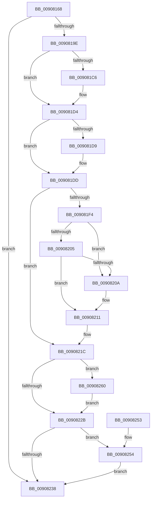

# ExpWnfDeleteScopeById

- RVA: `0x00908168`–`0x0090826A` (길이 `258` bytes)
- VA: `0x0000000140908168`
- 실행 섹션: `PAGE`
- PDB 이름 있음: `예`; PDB Function 태그: `아니요`
- unwind 정보 RVA: `0x00083650`
- 디코드: `75`개 명령, `258/258` bytes 표시
- 미해석 바이트: `0` (있으면 어셈블리에 `.byte`로 보존)

> 이 문서는 커널 이미지의 기계어와 PDB 기호를 분석해 생성했습니다. 4번과 5번은 함수 원형과 자료형을 바이너리 사용 방식에서 추정한 C 해석이며 원본 소스 복구 결과는 아닙니다.

## 1. Dependencies

- 직접 호출 지점: **7**; 고유 호출 대상: **7**
- 직접 호출자로 확인된 함수: **2**
- RIP 상대 이미지 참조: **0**

### Outgoing calls
- `0x00908189` → [PsGetCurrentServerSiloGlobals](../../text/2F/PsGetCurrentServerSiloGlobals_function_002FE1F0.md) (function, `0x002FE1F0`)
- `0x009081B6` → [KeAbPreAcquire](../../text/21/KeAbPreAcquire_function_00210230.md) (function, `0x00210230`)
- `0x009081CF` → [ExfAcquirePushLockExclusiveEx](../../text/20/ExfAcquirePushLockExclusiveEx_function_0020FC90.md) (function, `0x0020FC90`)
- `0x009081E7` → [ExpWnfFindScopeInstance](../9F/ExpWnfFindScopeInstance_function_009FFDE8.md) (function, `0x009FFDE8`)
- `0x0090822E` → [KeAbPostRelease](../../text/2E/KeAbPostRelease_function_002E1600.md) (function, `0x002E1600`)
- `0x00908259` → [ExpWnfFreeScopeInstance](../A7/ExpWnfFreeScopeInstance_function_00A77614.md) (function, `0x00A77614`)
- `0x00908263` → [ExfTryToWakePushLock](../../text/26/ExfTryToWakePushLock_function_00265DD0.md) (function, `0x00265DD0`)

### Direct callers
- [PspDereferenceSessionFinal](../78/PspDereferenceSessionFinal_function_00788F5C.md) at `0x00789029`
- [PspProcessDelete](PspProcessDelete_function_00907B90.md) at `0x00907E87`

### Static image references
- 디코드된 RIP-relative 메모리 참조가 없습니다.

## 2. Other-region calls and transfers

- 다른 실행 섹션으로 향하는 call: **5**
  - `0x00908189` → [PsGetCurrentServerSiloGlobals](../../text/2F/PsGetCurrentServerSiloGlobals_function_002FE1F0.md) (`PAGE` → `.text`)
  - `0x009081B6` → [KeAbPreAcquire](../../text/21/KeAbPreAcquire_function_00210230.md) (`PAGE` → `.text`)
  - `0x009081CF` → [ExfAcquirePushLockExclusiveEx](../../text/20/ExfAcquirePushLockExclusiveEx_function_0020FC90.md) (`PAGE` → `.text`)
  - `0x0090822E` → [KeAbPostRelease](../../text/2E/KeAbPostRelease_function_002E1600.md) (`PAGE` → `.text`)
  - `0x00908263` → [ExfTryToWakePushLock](../../text/26/ExfTryToWakePushLock_function_00265DD0.md) (`PAGE` → `.text`)
- 별도 외부 분기/꼬리 이동을 확인하지 못했습니다.

## 3. Assembly (complete function range)

```asm
00908168  48 8B C4                        mov rax, rsp
0090816B  48 89 58 08                     mov qword ptr [rax + 8], rbx
0090816F  48 89 68 10                     mov qword ptr [rax + 0x10], rbp
00908173  48 89 70 18                     mov qword ptr [rax + 0x18], rsi
00908177  48 89 78 20                     mov qword ptr [rax + 0x20], rdi
0090817B  41 56                           push r14
0090817D  48 83 EC 20                     sub rsp, 0x20
00908181  48 8B EA                        mov rbp, rdx
00908184  41 8B F0                        mov esi, r8d
00908187  8B D1                           mov edx, ecx
00908189  E8 62 60 9F FF                  call 0x1402fe1f0
0090818E  4C 8B 88 70 03 00 00            mov r9, qword ptr [rax + 0x370]
00908195  4D 85 C9                        test r9, r9
00908198  0F 84 9A 00 00 00               je 0x140908238
0090819E  48 8D 0C 52                     lea rcx, [rdx + rdx*2]
009081A2  45 33 C0                        xor r8d, r8d
009081A5  4D 8D 34 C9                     lea r14, [r9 + rcx*8]
009081A9  33 D2                           xor edx, edx
009081AB  48 8D 49 04                     lea rcx, [rcx + 4]
009081AF  49 8D 1C C9                     lea rbx, [r9 + rcx*8]
009081B3  48 8B CB                        mov rcx, rbx
009081B6  E8 75 80 90 FF                  call 0x140210230
009081BB  F0 48 0F BA 2B 00               lock bts qword ptr [rbx], 0
009081C1  48 8B F8                        mov rdi, rax
009081C4  73 0E                           jae 0x1409081d4
009081C6  4C 8B C3                        mov r8, rbx
009081C9  48 8B D0                        mov rdx, rax
009081CC  48 8B CB                        mov rcx, rbx
009081CF  E8 BC 7A 90 FF                  call 0x14020fc90
009081D4  48 85 FF                        test rdi, rdi
009081D7  74 04                           je 0x1409081dd
009081D9  C6 47 0A 01                     mov byte ptr [rdi + 0xa], 1
009081DD  44 8B C6                        mov r8d, esi
009081E0  49 8D 4E 28                     lea rcx, [r14 + 0x28]
009081E4  48 8B D5                        mov rdx, rbp
009081E7  E8 FC 7B 0F 00                  call 0x1409ffde8
009081EC  48 8B F8                        mov rdi, rax
009081EF  48 85 C0                        test rax, rax
009081F2  74 28                           je 0x14090821c
009081F4  48 8D 48 20                     lea rcx, [rax + 0x20]
009081F8  48 8B 11                        mov rdx, qword ptr [rcx]
009081FB  48 8B 41 08                     mov rax, qword ptr [rcx + 8]
009081FF  48 39 4A 08                     cmp qword ptr [rdx + 8], rcx
00908203  75 05                           jne 0x14090820a
00908205  48 39 08                        cmp qword ptr [rax], rcx
00908208  74 07                           je 0x140908211
0090820A  B9 03 00 00 00                  mov ecx, 3
0090820F  CD 29                           int 0x29
00908211  48 89 10                        mov qword ptr [rax], rdx
00908214  48 89 42 08                     mov qword ptr [rdx + 8], rax
00908218  48 83 21 00                     and qword ptr [rcx], 0
0090821C  48 83 C8 FF                     or rax, 0xffffffffffffffff
00908220  F0 48 0F C1 03                  lock xadd qword ptr [rbx], rax
00908225  24 06                           and al, 6
00908227  3C 02                           cmp al, 2
00908229  74 35                           je 0x140908260
0090822B  48 8B CB                        mov rcx, rbx
0090822E  E8 CD 93 9D FF                  call 0x1402e1600
00908233  48 85 FF                        test rdi, rdi
00908236  75 1C                           jne 0x140908254
00908238  48 8B 5C 24 30                  mov rbx, qword ptr [rsp + 0x30]
0090823D  48 8B 6C 24 38                  mov rbp, qword ptr [rsp + 0x38]
00908242  48 8B 74 24 40                  mov rsi, qword ptr [rsp + 0x40]
00908247  48 8B 7C 24 48                  mov rdi, qword ptr [rsp + 0x48]
0090824C  48 83 C4 20                     add rsp, 0x20
00908250  41 5E                           pop r14
00908252  C3                              ret
00908253  CC                              int3
00908254  B2 01                           mov dl, 1
00908256  48 8B CF                        mov rcx, rdi
00908259  E8 B6 F3 16 00                  call 0x140a77614
0090825E  EB D8                           jmp 0x140908238
00908260  48 8B CB                        mov rcx, rbx
00908263  E8 68 DB 95 FF                  call 0x140265dd0
00908268  EB C1                           jmp 0x14090822b
```

## 4. C-style interpretation (structured pseudocode)

```c
__int64 __fastcall ExpWnfDeleteScopeById(int a1, __int64 a2, int a3)
{
    __int64 result;
    __int64 v_rsp;
    unsigned __int64 v_stack_p10;
    unsigned __int64 v_stack_p18;
    unsigned __int64 v_stack_p20;
    unsigned __int64 v_stack_p8;

    *(unsigned __int64 *)(v_rsp + 8) = v_rbx;
    *(unsigned __int64 *)(v_rsp + 16) = v_rbp;
    *(unsigned __int64 *)(v_rsp + 24) = v_rsi;
    *(unsigned __int64 *)(v_rsp + 32) = v_rdi;
    v_rsp = (v_rsp) - (32);
    result = PsGetCurrentServerSiloGlobals(a1, (unsigned int)(a1), a3, a4);
    if (*(unsigned __int64 *)(result + 880) == 0) goto loc_00908238;
    a3 = 0;
    a2 = 0;
    result = KeAbPreAcquire(*(unsigned __int64 *)(result + 880) + (unsigned int)(a1) + (unsigned int)(a1) * 2 + 4 * 8, a2, a3, *(unsigned __int64 *)(result + 880));
    if (!(condition_is_above_or_equal)) {
        a3 = *(unsigned __int64 *)(result + 880) + (unsigned int)(a1) + (unsigned int)(a1) * 2 + 4 * 8;
        a2 = result;
        a1 = *(unsigned __int64 *)(result + 880) + (unsigned int)(a1) + (unsigned int)(a1) * 2 + 4 * 8;
        result = ExfAcquirePushLockExclusiveEx(a1, a2, a3, *(unsigned __int64 *)(result + 880));
    }
    if (result != 0) {
        *(unsigned __int8 *)(result + 10) = 1;
    }
    result = ExpWnfFindScopeInstance(*(unsigned __int64 *)(result + 880) + (unsigned int)(a1) + (unsigned int)(a1) * 2 * 8 + 40, a2, (unsigned int)((unsigned int)((unsigned int)(a3))), *(unsigned __int64 *)(result + 880));
    if (result == 0) goto loc_0090821C;
    if ((*(unsigned __int64 *)(*(unsigned __int64 *)(result + 32) + 8)) != (result + 32)) goto loc_0090820A;
    if ((*(unsigned __int64 *)(*(unsigned __int64 *)(result + 32 + 8))) != (result + 32)) {
        a1 = 3;
    }
    *(unsigned __int64 *)(*(unsigned __int64 *)(result + 32 + 8)) = *(unsigned __int64 *)(result + 32);
    *(unsigned __int64 *)(*(unsigned __int64 *)(result + 32) + 8) = *(unsigned __int64 *)(result + 32 + 8);
loc_0090821C:
    result = (*(unsigned __int64 *)(result + 32 + 8)) | (-1);
    result = (unsigned __int8)((result) & (6));
    if (((unsigned __int8)(result)) == 2) goto loc_00908260;
loc_0090822B:
    result = KeAbPostRelease(*(unsigned __int64 *)(result + 880) + (unsigned int)(a1) + (unsigned int)(a1) * 2 + 4 * 8, *(unsigned __int64 *)(result + 32), (unsigned int)((unsigned int)((unsigned int)(a3))), *(unsigned __int64 *)(result + 880));
    if (result != 0) goto loc_00908254;
loc_00908238:
    v_rsp = (v_rsp) + (32);
    return result;
loc_00908254:
    result = ExpWnfFreeScopeInstance(v_stack_p20, 1, (unsigned int)((unsigned int)((unsigned int)(a3))), *(unsigned __int64 *)(result + 880));
    goto loc_00908238;
loc_00908260:
    result = ExfTryToWakePushLock(v_stack_p8, 1, (unsigned int)((unsigned int)((unsigned int)(a3))), *(unsigned __int64 *)(result + 880));
    goto loc_0090822B;
}
```

## 5. (Beta) C Style

```c
int64_t ExpWnfDeleteScopeById(int32_t Arg1, int64_t Arg2, int32_t Arg3)
{
    int64_t result;
    int64_t local_rsp;
    uint64_t v_stack_p10;
    uint64_t v_stack_p18;
    uint64_t v_stack_p20;
    uint64_t v_stack_p8;

    *(uint64_t *)(local_rsp + 0x8) = local_rbx;
    *(uint64_t *)(local_rsp + 0x10) = local_rbp;
    *(uint64_t *)(local_rsp + 0x18) = local_rsi;
    *(uint64_t *)(local_rsp + 0x20) = local_rdi;
    local_rsp = (local_rsp) - (32);
    result = PsGetCurrentServerSiloGlobals(Arg1, (uint32_t)(Arg1), Arg3, a4);
    if (*(uint64_t *)(result + 0x370) == 0) goto loc_00908238;
    Arg3 = 0;
    Arg2 = 0;
    result = KeAbPreAcquire(*(uint64_t *)(result + 0x370) + (uint32_t)(Arg1) + (uint32_t)(Arg1) * 2 + 4 * 8, Arg2, Arg3, *(uint64_t *)(result + 0x370));
    if (!(condition_is_above_or_equal)) {
        Arg3 = *(uint64_t *)(result + 0x370) + (uint32_t)(Arg1) + (uint32_t)(Arg1) * 2 + 4 * 8;
        Arg2 = result;
        Arg1 = *(uint64_t *)(result + 0x370) + (uint32_t)(Arg1) + (uint32_t)(Arg1) * 2 + 4 * 8;
        result = ExfAcquirePushLockExclusiveEx(Arg1, Arg2, Arg3, *(uint64_t *)(result + 0x370));
    }
    if (result != 0) {
        *(uint8_t *)(result + 0xA) = 1;
    }
    result = ExpWnfFindScopeInstance(*(uint64_t *)(result + 0x370) + (uint32_t)(Arg1) + (uint32_t)(Arg1) * 2 * 8 + 40, Arg2, (uint32_t)((uint32_t)((uint32_t)(Arg3))), *(uint64_t *)(result + 0x370));
    if (result == 0) goto loc_0090821C;
    if ((*(uint64_t *)(*(uint64_t *)(result + 0x20) + 0x8)) != (result + 32)) goto loc_0090820A;
    if ((*(uint64_t *)(*(uint64_t *)(result + 0x20 + 0x8))) != (result + 32)) {
        Arg1 = 3;
    }
    *(uint64_t *)(*(uint64_t *)(result + 0x20 + 0x8)) = *(uint64_t *)(result + 0x20);
    *(uint64_t *)(*(uint64_t *)(result + 0x20) + 0x8) = *(uint64_t *)(result + 0x20 + 0x8);
loc_0090821C:
    result = (*(uint64_t *)(result + 0x20 + 0x8)) | (-1);
    result = (uint8_t)((result) & (6));
    if (((uint8_t)(result)) == 2) goto loc_00908260;
loc_0090822B:
    result = KeAbPostRelease(*(uint64_t *)(result + 0x370) + (uint32_t)(Arg1) + (uint32_t)(Arg1) * 2 + 4 * 8, *(uint64_t *)(result + 0x20), (uint32_t)((uint32_t)((uint32_t)(Arg3))), *(uint64_t *)(result + 0x370));
    if (result != 0) goto loc_00908254;
loc_00908238:
    local_rsp = (local_rsp) + (32);
    return result;
loc_00908254:
    result = ExpWnfFreeScopeInstance(v_stack_p20, 1, (uint32_t)((uint32_t)((uint32_t)(Arg3))), *(uint64_t *)(result + 0x370));
    goto loc_00908238;
loc_00908260:
    result = ExfTryToWakePushLock(v_stack_p8, 1, (uint32_t)((uint32_t)((uint32_t)(Arg3))), *(uint64_t *)(result + 0x370));
    goto loc_0090822B;
}
```

## 6. Execution-region graph

[열기: 2D/3D 그래프와 함수 탐색 컨트롤 패널](../../../control-panel.html?section=page&rva=0x00908168&view=graph)

- 2D 그래프는 위에서 아래로 흐르고, 3D 그래프는 빈 공간을 드래그해 회전합니다. Shift+드래그는 이동, 휠은 확대·축소, 함수 노드 선택은 대상 보고서 이동입니다.

### Static fallback


