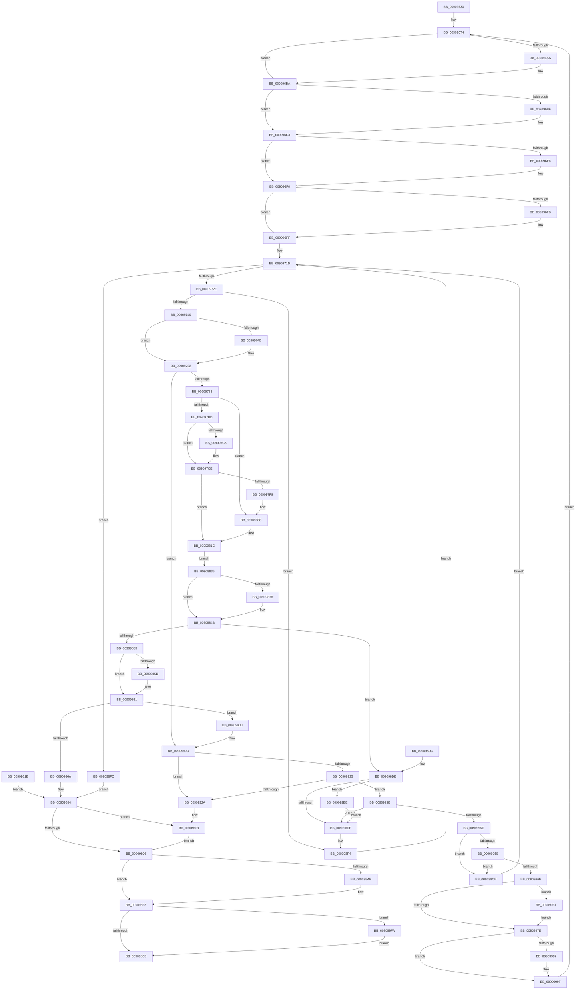

# ExpWnfDeliverThreadNotifications

- RVA: `0x00909630`–`0x00909A08` (길이 `984` bytes)
- VA: `0x0000000140909630`
- 실행 섹션: `PAGE`
- PDB 이름 있음: `예`; PDB Function 태그: `아니요`
- unwind 정보 RVA: `0x00088FBC`
- 디코드: `246`개 명령, `984/984` bytes 표시
- 미해석 바이트: `0` (있으면 어셈블리에 `.byte`로 보존)

> 이 문서는 커널 이미지의 기계어와 PDB 기호를 분석해 생성했습니다. 4번과 5번은 함수 원형과 자료형을 바이너리 사용 방식에서 추정한 C 해석이며 원본 소스 복구 결과는 아닙니다.

## 1. Dependencies

- 직접 호출 지점: **19**; 고유 호출 대상: **10**
- 직접 호출자로 확인된 함수: **1**
- RIP 상대 이미지 참조: **0**

### Outgoing calls
- `0x00909699` → [KeAbPreAcquire](../../text/21/KeAbPreAcquire_function_00210230.md) (function, `0x00210230`)
- `0x009096B5` → [ExfAcquirePushLockSharedEx](../../text/21/ExfAcquirePushLockSharedEx_function_0021044C.md) (function, `0x0021044C`)
- `0x009096D7` → [KeAbPreAcquire](../../text/21/KeAbPreAcquire_function_00210230.md) (function, `0x00210230`)
- `0x009096F1` → [ExfAcquirePushLockExclusiveEx](../../text/20/ExfAcquirePushLockExclusiveEx_function_0020FC90.md) (function, `0x0020FC90`)
- `0x00909752` → [ExAcquireRundownProtection](../../text/21/ExAcquireRundownProtection_function_00216620.md) (function, `0x00216620`)
- `0x009097EC` → [ExpWnfReadStateData](ExpWnfReadStateData_function_00909C50.md) (function, `0x00909C50`)
- `0x0090983F` → [ExReleaseRundownProtection](../../text/34/ExReleaseRundownProtection_function_00349E80.md) (function, `0x00349E80`)
- `0x00909899` → [KeAbPostRelease](../../text/2E/KeAbPostRelease_function_002E1600.md) (function, `0x002E1600`)
- `0x009098B2` → [ExfReleasePushLockShared](../../text/26/ExfReleasePushLockShared_function_00263440.md) (function, `0x00263440`)
- `0x009098BA` → [KeAbPostRelease](../../text/2E/KeAbPostRelease_function_002E1600.md) (function, `0x002E1600`)
- `0x00909934` → [ExfTryToWakePushLock](../../text/26/ExfTryToWakePushLock_function_00265DD0.md) (function, `0x00265DD0`)
- `0x00909981` → [KeAbPostRelease](../../text/2E/KeAbPostRelease_function_002E1600.md) (function, `0x002E1600`)
- `0x0090999A` → [ExfReleasePushLockShared](../../text/26/ExfReleasePushLockShared_function_00263440.md) (function, `0x00263440`)
- `0x009099A2` → [KeAbPostRelease](../../text/2E/KeAbPostRelease_function_002E1600.md) (function, `0x002E1600`)
- `0x009099B8` → [ExpWnfNotifyNameSubscribers](ExpWnfNotifyNameSubscribers_function_0090C160.md) (function, `0x0090C160`)
- `0x009099C1` → [ExReleaseRundownProtection](../../text/34/ExReleaseRundownProtection_function_00349E80.md) (function, `0x00349E80`)
- `0x009099CF` → [ExReleaseRundownProtection](../../text/34/ExReleaseRundownProtection_function_00349E80.md) (function, `0x00349E80`)
- `0x009099E7` → [ExfTryToWakePushLock](../../text/26/ExfTryToWakePushLock_function_00265DD0.md) (function, `0x00265DD0`)
- `0x009099FE` → [ExReleaseRundownProtection](../../text/34/ExReleaseRundownProtection_function_00349E80.md) (function, `0x00349E80`)

### Direct callers
- [NtGetCompleteWnfStateSubscription](NtGetCompleteWnfStateSubscription_function_00909450.md) at `0x00909551`

### Static image references
- 디코드된 RIP-relative 메모리 참조가 없습니다.

## 2. Other-region calls and transfers

- 다른 실행 섹션으로 향하는 call: **17**
  - `0x00909699` → [KeAbPreAcquire](../../text/21/KeAbPreAcquire_function_00210230.md) (`PAGE` → `.text`)
  - `0x009096B5` → [ExfAcquirePushLockSharedEx](../../text/21/ExfAcquirePushLockSharedEx_function_0021044C.md) (`PAGE` → `.text`)
  - `0x009096D7` → [KeAbPreAcquire](../../text/21/KeAbPreAcquire_function_00210230.md) (`PAGE` → `.text`)
  - `0x009096F1` → [ExfAcquirePushLockExclusiveEx](../../text/20/ExfAcquirePushLockExclusiveEx_function_0020FC90.md) (`PAGE` → `.text`)
  - `0x00909752` → [ExAcquireRundownProtection](../../text/21/ExAcquireRundownProtection_function_00216620.md) (`PAGE` → `.text`)
  - `0x0090983F` → [ExReleaseRundownProtection](../../text/34/ExReleaseRundownProtection_function_00349E80.md) (`PAGE` → `.text`)
  - `0x00909899` → [KeAbPostRelease](../../text/2E/KeAbPostRelease_function_002E1600.md) (`PAGE` → `.text`)
  - `0x009098B2` → [ExfReleasePushLockShared](../../text/26/ExfReleasePushLockShared_function_00263440.md) (`PAGE` → `.text`)
  - `0x009098BA` → [KeAbPostRelease](../../text/2E/KeAbPostRelease_function_002E1600.md) (`PAGE` → `.text`)
  - `0x00909934` → [ExfTryToWakePushLock](../../text/26/ExfTryToWakePushLock_function_00265DD0.md) (`PAGE` → `.text`)
  - `0x00909981` → [KeAbPostRelease](../../text/2E/KeAbPostRelease_function_002E1600.md) (`PAGE` → `.text`)
  - `0x0090999A` → [ExfReleasePushLockShared](../../text/26/ExfReleasePushLockShared_function_00263440.md) (`PAGE` → `.text`)
  - `0x009099A2` → [KeAbPostRelease](../../text/2E/KeAbPostRelease_function_002E1600.md) (`PAGE` → `.text`)
  - `0x009099C1` → [ExReleaseRundownProtection](../../text/34/ExReleaseRundownProtection_function_00349E80.md) (`PAGE` → `.text`)
  - `0x009099CF` → [ExReleaseRundownProtection](../../text/34/ExReleaseRundownProtection_function_00349E80.md) (`PAGE` → `.text`)
  - `0x009099E7` → [ExfTryToWakePushLock](../../text/26/ExfTryToWakePushLock_function_00265DD0.md) (`PAGE` → `.text`)
  - `0x009099FE` → [ExReleaseRundownProtection](../../text/34/ExReleaseRundownProtection_function_00349E80.md) (`PAGE` → `.text`)
- 별도 외부 분기/꼬리 이동을 확인하지 못했습니다.

## 3. Assembly (complete function range)

```asm
00909630  48 89 54 24 10                  mov qword ptr [rsp + 0x10], rdx
00909635  48 89 4C 24 08                  mov qword ptr [rsp + 8], rcx
0090963A  53                              push rbx
0090963B  56                              push rsi
0090963C  57                              push rdi
0090963D  41 54                           push r12
0090963F  41 55                           push r13
00909641  41 56                           push r14
00909643  41 57                           push r15
00909645  48 81 EC 90 00 00 00            sub rsp, 0x90
0090964C  45 33 FF                        xor r15d, r15d
0090964F  44 89 7C 24 38                  mov dword ptr [rsp + 0x38], r15d
00909654  C7 84 24 E8 00 00 00 1A 00 00 80  mov dword ptr [rsp + 0xe8], 0x8000001a
0090965F  44 89 7C 24 34                  mov dword ptr [rsp + 0x34], r15d
00909664  44 89 BC 24 E0 00 00 00         mov dword ptr [rsp + 0xe0], r15d
0090966C  41 8D 40 D0                     lea eax, [r8 - 0x30]
00909670  89 44 24 48                     mov dword ptr [rsp + 0x48], eax
00909674  41 BD 11 00 00 00               mov r13d, 0x11
0090967A  66 0F 1F 44 00 00               nop word ptr [rax + rax]
00909680  48 8B 9C 24 D0 00 00 00         mov rbx, qword ptr [rsp + 0xd0]
00909688  4C 8D 73 50                     lea r14, [rbx + 0x50]
0090968C  4C 89 74 24 70                  mov qword ptr [rsp + 0x70], r14
00909691  45 33 C0                        xor r8d, r8d
00909694  33 D2                           xor edx, edx
00909696  49 8B CE                        mov rcx, r14
00909699  E8 92 6B 90 FF                  call 0x140210230
0090969E  48 8B F8                        mov rdi, rax
009096A1  33 C0                           xor eax, eax
009096A3  F0 4D 0F B1 2E                  lock cmpxchg qword ptr [r14], r13
009096A8  74 10                           je 0x1409096ba
009096AA  4D 8B CE                        mov r9, r14
009096AD  4C 8B C7                        mov r8, rdi
009096B0  33 D2                           xor edx, edx
009096B2  49 8B CE                        mov rcx, r14
009096B5  E8 92 6D 90 FF                  call 0x14021044c
009096BA  48 85 FF                        test rdi, rdi
009096BD  74 04                           je 0x1409096c3
009096BF  C6 47 0A 01                     mov byte ptr [rdi + 0xa], 1
009096C3  4C 8D 63 68                     lea r12, [rbx + 0x68]
009096C7  4C 89 A4 24 80 00 00 00         mov qword ptr [rsp + 0x80], r12
009096CF  45 33 C0                        xor r8d, r8d
009096D2  33 D2                           xor edx, edx
009096D4  49 8B CC                        mov rcx, r12
009096D7  E8 54 6B 90 FF                  call 0x140210230
009096DC  48 8B F8                        mov rdi, rax
009096DF  F0 49 0F BA 2C 24 00            lock bts qword ptr [r12], 0
009096E6  73 0E                           jae 0x1409096f6
009096E8  4D 8B C4                        mov r8, r12
009096EB  48 8B D0                        mov rdx, rax
009096EE  49 8B CC                        mov rcx, r12
009096F1  E8 9A 65 90 FF                  call 0x14020fc90
009096F6  48 85 FF                        test rdi, rdi
009096F9  74 04                           je 0x1409096ff
009096FB  C6 47 0A 01                     mov byte ptr [rdi + 0xa], 1
009096FF  48 8D 43 70                     lea rax, [rbx + 0x70]
00909703  48 89 44 24 40                  mov qword ptr [rsp + 0x40], rax
00909708  48 8B 38                        mov rdi, qword ptr [rax]
0090970B  49 8B F7                        mov rsi, r15
0090970E  48 C7 C3 FF FF FF FF            mov rbx, 0xffffffffffffffff
00909715  4C 8B AC 24 D8 00 00 00         mov r13, qword ptr [rsp + 0xd8]
0090971D  48 89 BC 24 88 00 00 00         mov qword ptr [rsp + 0x88], rdi
00909725  48 3B F8                        cmp rdi, rax
00909728  0F 84 CE 01 00 00               je 0x1409098fc
0090972E  48 8D 4F 10                     lea rcx, [rdi + 0x10]
00909732  48 89 4C 24 68                  mov qword ptr [rsp + 0x68], rcx
00909737  83 39 01                        cmp dword ptr [rcx], 1
0090973A  0F 85 B4 01 00 00               jne 0x1409098f4
00909740  48 8B 77 C8                     mov rsi, qword ptr [rdi - 0x38]
00909744  48 89 74 24 58                  mov qword ptr [rsp + 0x58], rsi
00909749  48 85 F6                        test rsi, rsi
0090974C  74 14                           je 0x140909762
0090974E  48 8D 4E 08                     lea rcx, [rsi + 8]
00909752  E8 C9 CE 90 FF                  call 0x140216620
00909757  84 C0                           test al, al
00909759  49 0F 44 F7                     cmove rsi, r15
0090975D  48 89 74 24 58                  mov qword ptr [rsp + 0x58], rsi
00909762  4C 8D 47 14                     lea r8, [rdi + 0x14]
00909766  4C 89 44 24 60                  mov qword ptr [rsp + 0x60], r8
0090976B  8B 4F FC                        mov ecx, dword ptr [rdi - 4]
0090976E  41 23 08                        and ecx, dword ptr [r8]
00909771  44 8B F1                        mov r14d, ecx
00909774  41 83 E6 FE                     and r14d, 0xfffffffe
00909778  48 85 F6                        test rsi, rsi
0090977B  44 0F 45 F1                     cmovne r14d, ecx
0090977F  45 85 F6                        test r14d, r14d
00909782  0F 84 85 01 00 00               je 0x14090990d
00909788  0F 57 C0                        xorps xmm0, xmm0
0090978B  41 0F 11 45 00                  movups xmmword ptr [r13], xmm0
00909790  41 0F 11 45 10                  movups xmmword ptr [r13 + 0x10], xmm0
00909795  41 0F 11 45 20                  movups xmmword ptr [r13 + 0x20], xmm0
0090979A  48 8B 47 D0                     mov rax, qword ptr [rdi - 0x30]
0090979E  48 B9 74 00 BC A3 6D 4E C6 41   movabs rcx, 0x41c64e6da3bc0074
009097A8  48 33 C1                        xor rax, rcx
009097AB  49 89 45 08                     mov qword ptr [r13 + 8], rax
009097AF  48 8B 47 A8                     mov rax, qword ptr [rdi - 0x58]
009097B3  49 89 45 00                     mov qword ptr [r13], rax
009097B7  41 F6 C6 01                     test r14b, 1
009097BB  74 4F                           je 0x14090980c
009097BD  48 8B 46 40                     mov rax, qword ptr [rsi + 0x40]
009097C1  48 85 C0                        test rax, rax
009097C4  74 08                           je 0x1409097ce
009097C6  0F 10 00                        movups xmm0, xmmword ptr [rax]
009097C9  41 0F 11 45 1C                  movups xmmword ptr [r13 + 0x1c], xmm0
009097CE  48 8D 44 24 38                  lea rax, [rsp + 0x38]
009097D3  48 89 44 24 20                  mov qword ptr [rsp + 0x20], rax
009097D8  44 8B 4C 24 48                  mov r9d, dword ptr [rsp + 0x48]
009097DD  4D 8D 45 30                     lea r8, [r13 + 0x30]
009097E1  48 8D 94 24 E0 00 00 00         lea rdx, [rsp + 0xe0]
009097E9  48 8B CE                        mov rcx, rsi
009097EC  E8 5F 04 00 00                  call 0x140909c50
009097F1  89 44 24 34                     mov dword ptr [rsp + 0x34], eax
009097F5  85 C0                           test eax, eax
009097F7  78 23                           js 0x14090981c
009097F9  8B 84 24 E0 00 00 00            mov eax, dword ptr [rsp + 0xe0]
00909800  41 89 45 10                     mov dword ptr [r13 + 0x10], eax
00909804  8B 44 24 38                     mov eax, dword ptr [rsp + 0x38]
00909808  41 89 45 14                     mov dword ptr [r13 + 0x14], eax
0090980C  41 C7 45 2C 30 00 00 00         mov dword ptr [r13 + 0x2c], 0x30
00909814  45 89 75 18                     mov dword ptr [r13 + 0x18], r14d
00909818  8B 44 24 34                     mov eax, dword ptr [rsp + 0x34]
0090981C  EB 18                           jmp 0x140909836
0090981E  8B F8                           mov edi, eax
00909820  45 33 FF                        xor r15d, r15d
00909823  49 8D 5F FF                     lea rbx, [r15 - 1]
00909827  48 8B 74 24 58                  mov rsi, qword ptr [rsp + 0x58]
0090982C  4C 8B A4 24 80 00 00 00         mov r12, qword ptr [rsp + 0x80]
00909834  EB 4E                           jmp 0x140909884
00909836  48 85 F6                        test rsi, rsi
00909839  74 10                           je 0x14090984b
0090983B  48 8D 4E 08                     lea rcx, [rsi + 8]
0090983F  E8 3C 06 A4 FF                  call 0x140349e80
00909844  49 8B F7                        mov rsi, r15
00909847  8B 44 24 34                     mov eax, dword ptr [rsp + 0x34]
0090984B  85 C0                           test eax, eax
0090984D  0F 88 8B 00 00 00               js 0x1409098de
00909853  83 BC 24 E0 00 00 00 00         cmp dword ptr [rsp + 0xe0], 0
0090985B  75 04                           jne 0x140909861
0090985D  41 83 E6 FE                     and r14d, 0xfffffffe
00909861  45 85 F6                        test r14d, r14d
00909864  0F 84 9E 00 00 00               je 0x140909908
0090986A  44 89 77 18                     mov dword ptr [rdi + 0x18], r14d
0090986E  48 8B 44 24 60                  mov rax, qword ptr [rsp + 0x60]
00909873  44 89 38                        mov dword ptr [rax], r15d
00909876  48 8B 44 24 68                  mov rax, qword ptr [rsp + 0x68]
0090987B  C7 00 02 00 00 00               mov dword ptr [rax], 2
00909881  41 8B FF                        mov edi, r15d
00909884  F0 49 0F C1 1C 24               lock xadd qword ptr [r12], rbx
0090988A  80 E3 06                        and bl, 6
0090988D  80 FB 02                        cmp bl, 2
00909890  0F 84 9B 00 00 00               je 0x140909931
00909896  49 8B CC                        mov rcx, r12
00909899  E8 62 7D 9D FF                  call 0x1402e1600
0090989E  B8 11 00 00 00                  mov eax, 0x11
009098A3  4C 8B 74 24 70                  mov r14, qword ptr [rsp + 0x70]
009098A8  F0 4D 0F B1 3E                  lock cmpxchg qword ptr [r14], r15
009098AD  74 08                           je 0x1409098b7
009098AF  49 8B CE                        mov rcx, r14
009098B2  E8 89 9B 95 FF                  call 0x140263440
009098B7  49 8B CE                        mov rcx, r14
009098BA  E8 41 7D 9D FF                  call 0x1402e1600
009098BF  48 85 F6                        test rsi, rsi
009098C2  0F 85 32 01 00 00               jne 0x1409099fa
009098C8  8B C7                           mov eax, edi
009098CA  48 81 C4 90 00 00 00            add rsp, 0x90
009098D1  41 5F                           pop r15
009098D3  41 5E                           pop r14
009098D5  41 5D                           pop r13
009098D7  41 5C                           pop r12
009098D9  5F                              pop rdi
009098DA  5E                              pop rsi
009098DB  5B                              pop rbx
009098DC  C3                              ret
009098DD  CC                              int3
009098DE  81 BC 24 E8 00 00 00 1A 00 00 80  cmp dword ptr [rsp + 0xe8], 0x8000001a
009098E9  0F 84 FF 00 00 00               je 0x1409099ee
009098EF  48 8B 44 24 40                  mov rax, qword ptr [rsp + 0x40]
009098F4  48 8B 3F                        mov rdi, qword ptr [rdi]
009098F7  E9 21 FE FF FF                  jmp 0x14090971d
009098FC  8B BC 24 E8 00 00 00            mov edi, dword ptr [rsp + 0xe8]
00909903  E9 7C FF FF FF                  jmp 0x140909884
00909908  4C 8B 44 24 60                  mov r8, qword ptr [rsp + 0x60]
0090990D  48 8B 47 08                     mov rax, qword ptr [rdi + 8]
00909911  48 8B F8                        mov rdi, rax
00909914  48 8B 94 24 88 00 00 00         mov rdx, qword ptr [rsp + 0x88]
0090991C  48 8B 0A                        mov rcx, qword ptr [rdx]
0090991F  48 39 51 08                     cmp qword ptr [rcx + 8], rdx
00909923  75 05                           jne 0x14090992a
00909925  48 39 10                        cmp qword ptr [rax], rdx
00909928  74 14                           je 0x14090993e
0090992A  B9 03 00 00 00                  mov ecx, 3
0090992F  CD 29                           int 0x29
00909931  49 8B CC                        mov rcx, r12
00909934  E8 97 C4 95 FF                  call 0x140265dd0
00909939  E9 58 FF FF FF                  jmp 0x140909896
0090993E  48 89 08                        mov qword ptr [rax], rcx
00909941  48 89 41 08                     mov qword ptr [rcx + 8], rax
00909945  48 8B 44 24 68                  mov rax, qword ptr [rsp + 0x68]
0090994A  44 89 38                        mov dword ptr [rax], r15d
0090994D  41 8B 00                        mov eax, dword ptr [r8]
00909950  45 89 38                        mov dword ptr [r8], r15d
00909953  44 89 7A 18                     mov dword ptr [rdx + 0x18], r15d
00909957  48 85 F6                        test rsi, rsi
0090995A  74 93                           je 0x1409098ef
0090995C  A8 01                           test al, 1
0090995E  74 6B                           je 0x1409099cb
00909960  8B C3                           mov eax, ebx
00909962  F0 0F C1 86 A4 00 00 00         lock xadd dword ptr [rsi + 0xa4], eax
0090996A  83 F8 01                        cmp eax, 1
0090996D  75 5C                           jne 0x1409099cb
0090996F  48 8B C3                        mov rax, rbx
00909972  F0 49 0F C1 04 24               lock xadd qword ptr [r12], rax
00909978  24 06                           and al, 6
0090997A  3C 02                           cmp al, 2
0090997C  74 66                           je 0x1409099e4
0090997E  49 8B CC                        mov rcx, r12
00909981  E8 7A 7C 9D FF                  call 0x1402e1600
00909986  B8 11 00 00 00                  mov eax, 0x11
0090998B  48 8B 7C 24 70                  mov rdi, qword ptr [rsp + 0x70]
00909990  F0 4C 0F B1 3F                  lock cmpxchg qword ptr [rdi], r15
00909995  74 08                           je 0x14090999f
00909997  48 8B CF                        mov rcx, rdi
0090999A  E8 A1 9A 95 FF                  call 0x140263440
0090999F  48 8B CF                        mov rcx, rdi
009099A2  E8 59 7C 9D FF                  call 0x1402e1600
009099A7  BA 08 00 00 00                  mov edx, 8
009099AC  41 B9 01 00 00 00               mov r9d, 1
009099B2  45 8B C1                        mov r8d, r9d
009099B5  48 8B CE                        mov rcx, rsi
009099B8  E8 A3 27 00 00                  call 0x14090c160
009099BD  48 8D 4E 08                     lea rcx, [rsi + 8]
009099C1  E8 BA 04 A4 FF                  call 0x140349e80
009099C6  E9 A9 FC FF FF                  jmp 0x140909674
009099CB  48 8D 4E 08                     lea rcx, [rsi + 8]
009099CF  E8 AC 04 A4 FF                  call 0x140349e80
009099D4  49 8B F7                        mov rsi, r15
009099D7  48 8B 44 24 40                  mov rax, qword ptr [rsp + 0x40]
009099DC  48 8B 3F                        mov rdi, qword ptr [rdi]
009099DF  E9 39 FD FF FF                  jmp 0x14090971d
009099E4  49 8B CC                        mov rcx, r12
009099E7  E8 E4 C3 95 FF                  call 0x140265dd0
009099EC  EB 90                           jmp 0x14090997e
009099EE  89 84 24 E8 00 00 00            mov dword ptr [rsp + 0xe8], eax
009099F5  E9 F5 FE FF FF                  jmp 0x1409098ef
009099FA  48 8D 4E 08                     lea rcx, [rsi + 8]
009099FE  E8 7D 04 A4 FF                  call 0x140349e80
00909A03  E9 C0 FE FF FF                  jmp 0x1409098c8
```

## 4. C-style interpretation (structured pseudocode)

```c
__int64 __fastcall ExpWnfDeliverThreadNotifications(__int64 a1, __int64 a2, __int64 a3)
{
    __int64 result;
    __int64 v_r14;
    __int64 v_r15;
    __int64 v_rbx;
    __int64 v_rsi;
    __int64 v_rsp;
    unsigned __int64 v_stack_m40;
    unsigned __int64 v_stack_m48;
    unsigned __int64 v_stack_m58;
    unsigned __int64 v_stack_m60;
    unsigned __int64 v_stack_m68;
    unsigned __int64 v_stack_m70;
    unsigned int v_stack_m80;
    unsigned __int64 v_stack_m88;
    unsigned int v_stack_m90;
    unsigned int v_stack_m94;
    unsigned __int64 v_stack_mA8;
    unsigned __int64 v_stack_p10;
    unsigned int v_stack_p18;
    unsigned int v_stack_p20;
    unsigned __int64 v_stack_p40;
    unsigned __int64 v_stack_p60;
    unsigned __int64 v_stack_p68;
    unsigned __int64 v_stack_p70;
    unsigned __int64 v_stack_p8;
    unsigned __int64 v_stack_p88;
    unsigned int v_stack_pE8;

    v_stack_p10 = a2;
    v_stack_p8 = a1;
    v_rsp = (v_rsp) - (144);
    v_r15 = 0;
    v_stack_m90 = 0;
    v_stack_p20 = 0x8000001AULL;
    v_stack_m94 = 0;
    v_stack_p18 = 0;
    v_stack_m80 = (unsigned int)(a3 - 48);
loc_00909674:
    v_stack_m58 = v_stack_p8 + 80;
    a3 = 0;
    a2 = 0;
    result = KeAbPreAcquire(v_stack_p8 + 80, a2, a3, a4);
    result = 0;
    if (!(condition_is_equal)) {
        a4 = v_stack_p8 + 80;
        a3 = 0;
        a2 = 0;
        a1 = v_stack_p8 + 80;
        result = ExfAcquirePushLockSharedEx(a1, a2, a3, a4);
    }
    if (result != 0) {
        *(unsigned __int8 *)(result + 10) = 1;
    }
    v_stack_m48 = v_stack_p8 + 104;
    a3 = 0;
    a2 = 0;
    result = KeAbPreAcquire(v_stack_p8 + 104, a2, a3, a4);
    if (!(condition_is_above_or_equal)) {
        a3 = v_stack_p8 + 104;
        a2 = result;
        a1 = v_stack_p8 + 104;
        result = ExfAcquirePushLockExclusiveEx(a1, a2, a3, a4);
    }
    if (result != 0) {
        *(unsigned __int8 *)(result + 10) = 1;
    }
    v_stack_m88 = v_stack_p8 + 112;
loc_0090971D:
    v_stack_m40 = *(unsigned __int64 *)(v_stack_p8 + 112);
    if ((*(unsigned __int64 *)(v_stack_p8 + 112)) == (v_stack_p8 + 112)) goto loc_009098FC;
    v_stack_m60 = *(unsigned __int64 *)(v_stack_p8 + 112) + 16;
    if ((*(unsigned int *)(*(unsigned __int64 *)(v_stack_p8 + 112) + 16)) != 1) goto loc_009098F4;
    v_stack_m70 = *(unsigned __int64 *)(*(unsigned __int64 *)(v_stack_p8 + 112) - 56);
    result = v_stack_p8 + 112;
    v_rsi = *(unsigned __int64 *)(*(unsigned __int64 *)(v_stack_p8 + 112) - 56);
    if (*(unsigned __int64 *)(*(unsigned __int64 *)(v_stack_p8 + 112) - 56) != 0) {
        a1 = *(unsigned __int64 *)(*(unsigned __int64 *)(v_stack_p8 + 112) - 56) + 8;
        result = ExAcquireRundownProtection(a1, a2, a3, a4);
        v_rsi = *(unsigned __int64 *)(*(unsigned __int64 *)(v_stack_p8 + 112) - 56);
        if ((unsigned __int8)(result) == 0) { v_rsi = 0; }
        v_stack_m70 = v_rsi;
    }
    v_stack_m68 = *(unsigned __int64 *)(v_stack_p8 + 112) + 20;
    a1 = (unsigned int)(((unsigned int)(*(unsigned int *)(*(unsigned __int64 *)(v_stack_p8 + 112) - 4))) & (*(unsigned int *)(*(unsigned __int64 *)(v_stack_p8 + 112) + 20)));
    v_r14 = (unsigned int)(((unsigned int)((unsigned int)(a1))) & (0xFFFFFFFEULL));
    if (v_rsi != 0) { v_r14 = (unsigned int)(a1); }
    if ((unsigned int)(v_r14) == 0) goto loc_0090990D;
    *(unsigned __int64 *)(v_stack_p10) = v_xmm0;
    *(unsigned __int64 *)(v_stack_p10 + 16) = v_xmm0;
    *(unsigned __int64 *)(v_stack_p10 + 32) = v_xmm0;
    result = (*(unsigned __int64 *)(*(unsigned __int64 *)(v_stack_p8 + 112) - 48)) ^ (a1);
    *(unsigned __int64 *)(v_stack_p10 + 8) = result;
    *(unsigned __int64 *)(v_stack_p10) = *(unsigned __int64 *)(*(unsigned __int64 *)(v_stack_p8 + 112) - 88);
    if ((((unsigned __int8)(v_r14)) & (1)) == 0) goto loc_0090980C;
    if (*(unsigned __int64 *)(v_rsi + 64) != 0) {
        *(unsigned __int64 *)(v_stack_p10 + 28) = v_xmm0;
    }
    v_stack_mA8 = v_stack_m90;
    result = ExpWnfReadStateData(v_rsi, v_stack_p18, v_stack_p10 + 48, (unsigned int)(v_stack_m80));
    v_stack_m94 = (unsigned int)(result);
    if (sign_flag) goto loc_0090981C;
    *(unsigned int *)(v_stack_p10 + 16) = (unsigned int)((unsigned int)(v_stack_p18));
    *(unsigned int *)(v_stack_p10 + 20) = (unsigned int)((unsigned int)(v_stack_m90));
loc_0090980C:
    *(unsigned int *)(v_stack_p10 + 44) = 48;
    *(unsigned int *)(v_stack_p10 + 24) = (unsigned int)(v_r14);
loc_0090981C:
    goto loc_00909836;
loc_00909836:
    result = (unsigned int)(v_stack_m94);
    if (v_rsi != 0) {
        a1 = v_rsi + 8;
        result = ExReleaseRundownProtection(a1, v_stack_p18, v_stack_p10 + 48, (unsigned int)(v_stack_m80));
        v_rsi = 0;
        result = v_stack_m94;
    }
    if (sign_flag) goto loc_009098DE;
    if (v_stack_p18 == 0) {
        v_r14 = (unsigned int)((v_r14) & (0xFFFFFFFEULL));
    }
    if ((unsigned int)(v_r14) == 0) goto loc_00909908;
    *(unsigned int *)(*(unsigned __int64 *)(v_stack_p8 + 112) + 24) = (unsigned int)(v_r14);
    *(unsigned int *)(v_stack_m68) = 0;
    *(unsigned int *)(v_stack_m60) = 2;
loc_00909884:
    v_rbx = (unsigned __int8)((-1) & (6));
    if (((unsigned __int8)(v_rbx)) == 2) goto loc_00909931;
loc_00909896:
    result = KeAbPostRelease(v_stack_p8 + 104, v_stack_p18, v_stack_p10 + 48, (unsigned int)(v_stack_m80));
    result = 17;
    if (((unsigned __int8)(v_rbx)) != 2) {
        a1 = v_stack_m58;
        result = ExfReleasePushLockShared(a1, v_stack_p18, v_stack_p10 + 48, (unsigned int)(v_stack_m80));
    }
    result = KeAbPostRelease(v_stack_m58, v_stack_p18, v_stack_p10 + 48, (unsigned int)(v_stack_m80));
    if (v_rsi != 0) goto loc_009099FA;
loc_009098C8:
    v_rsp = (v_rsp) + (144);
    return 0;
loc_009098DE:
    if (v_stack_pE8 == 0x8000001AULL) goto loc_009099EE;
loc_009098EF:
loc_009098F4:
    goto loc_0090971D;
loc_009098FC:
    goto loc_00909884;
loc_00909908:
loc_0090990D:
    if ((*(unsigned __int64 *)(*(unsigned __int64 *)(v_stack_p88) + 8)) != v_stack_p88) goto loc_0090992A;
    if ((*(unsigned __int64 *)(*(unsigned __int64 *)((unsigned int)(v_stack_pE8) + 8))) == v_stack_p88) goto loc_0090993E;
loc_0090992A:
loc_00909931:
    result = ExfTryToWakePushLock(v_stack_p8 + 104, v_stack_p88, v_stack_p60, (unsigned int)(v_stack_m80));
    goto loc_00909896;
loc_0090993E:
    *(unsigned __int64 *)(result) = v_stack_p8 + 104;
    *(unsigned __int64 *)(v_stack_p8 + 104 + 8) = result;
    *(unsigned int *)(v_stack_p68) = 0;
    *(unsigned int *)(v_stack_p60) = 0;
    *(unsigned int *)(v_stack_p88 + 24) = 0;
    if (v_rsi == 0) goto loc_009098EF;
    if ((((unsigned __int8)((unsigned int)(*(unsigned int *)(v_stack_p60)))) & (1)) == 0) goto loc_009099CB;
    if (((unsigned int)((unsigned int)((unsigned int)(v_rbx)))) != 1) goto loc_009099CB;
    result = (unsigned __int8)((v_rbx) & (6));
    if (((unsigned __int8)(result)) == 2) goto loc_009099E4;
loc_0090997E:
    result = KeAbPostRelease(v_stack_p8 + 104, v_stack_p88, v_stack_p60, (unsigned int)(v_stack_m80));
    result = 17;
    if (((unsigned __int8)(result)) != 2) {
        a1 = v_stack_p70;
        result = ExfReleasePushLockShared(a1, v_stack_p88, v_stack_p60, (unsigned int)(v_stack_m80));
    }
    result = KeAbPostRelease(v_stack_p70, v_stack_p88, v_stack_p60, (unsigned int)(v_stack_m80));
    result = ExpWnfNotifyNameSubscribers(v_rsi, 8, 1, 1);
    result = ExReleaseRundownProtection(v_rsi + 8, 8, 1, 1);
    goto loc_00909674;
loc_009099CB:
    result = ExReleaseRundownProtection(v_rsi + 8, 8, 1, 1);
    goto loc_0090971D;
loc_009099E4:
    result = ExfTryToWakePushLock(v_stack_p8 + 104, 8, 1, 1);
    goto loc_0090997E;
loc_009099EE:
    v_stack_pE8 = (unsigned int)(result);
    goto loc_009098EF;
loc_009099FA:
    result = ExReleaseRundownProtection(0 + 8, 8, 1, 1);
    goto loc_009098C8;
}
```

## 5. (Beta) C Style

```c
int64_t ExpWnfDeliverThreadNotifications(int64_t Arg1, int64_t Arg2, void *Arg3)
{
    uint8_t *arg3 = (uint8_t *)Arg3;

    int64_t result;
    int64_t local_r14;
    int64_t local_r15;
    int64_t local_rbx;
    int64_t local_rsi;
    int64_t local_rsp;
    uint64_t v_stack_m40;
    uint64_t v_stack_m48;
    uint64_t v_stack_m58;
    uint64_t v_stack_m60;
    uint64_t v_stack_m68;
    uint64_t v_stack_m70;
    uint32_t v_stack_m80;
    uint64_t v_stack_m88;
    uint32_t v_stack_m90;
    uint32_t v_stack_m94;
    uint64_t v_stack_mA8;
    uint64_t v_stack_p10;
    uint32_t v_stack_p18;
    uint32_t v_stack_p20;
    uint64_t v_stack_p40;
    uint64_t v_stack_p60;
    uint64_t v_stack_p68;
    uint64_t v_stack_p70;
    uint64_t v_stack_p8;
    uint64_t v_stack_p88;
    uint32_t v_stack_pE8;

    v_stack_p10 = Arg2;
    v_stack_p8 = Arg1;
    local_rsp = (local_rsp) - (144);
    local_r15 = 0;
    v_stack_m90 = 0;
    v_stack_p20 = 0x8000001AULL;
    v_stack_m94 = 0;
    v_stack_p18 = 0;
    v_stack_m80 = (uint32_t)(Arg3 - 48);
loc_00909674:
    v_stack_m58 = v_stack_p8 + 80;
    Arg3 = 0;
    Arg2 = 0;
    result = KeAbPreAcquire(v_stack_p8 + 80, Arg2, Arg3, a4);
    result = 0;
    if (!(condition_is_equal)) {
        a4 = v_stack_p8 + 80;
        Arg3 = 0;
        Arg2 = 0;
        Arg1 = v_stack_p8 + 80;
        result = ExfAcquirePushLockSharedEx(Arg1, Arg2, Arg3, a4);
    }
    if (result != 0) {
        *(uint8_t *)(result + 0xA) = 1;
    }
    v_stack_m48 = v_stack_p8 + 104;
    Arg3 = 0;
    Arg2 = 0;
    result = KeAbPreAcquire(v_stack_p8 + 104, Arg2, Arg3, a4);
    if (!(condition_is_above_or_equal)) {
        Arg3 = v_stack_p8 + 104;
        Arg2 = result;
        Arg1 = v_stack_p8 + 104;
        result = ExfAcquirePushLockExclusiveEx(Arg1, Arg2, Arg3, a4);
    }
    if (result != 0) {
        *(uint8_t *)(result + 0xA) = 1;
    }
    v_stack_m88 = v_stack_p8 + 112;
loc_0090971D:
    v_stack_m40 = *(uint64_t *)(v_stack_p8 + 0x70);
    if ((*(uint64_t *)(v_stack_p8 + 0x70)) == (v_stack_p8 + 112)) goto loc_009098FC;
    v_stack_m60 = *(uint64_t *)(v_stack_p8 + 0x70) + 16;
    if ((*(uint32_t *)(*(uint64_t *)(v_stack_p8 + 0x70) + 0x10)) != 1) goto loc_009098F4;
    v_stack_m70 = *(uint64_t *)(*(uint64_t *)(v_stack_p8 + 0x70) - 0x38);
    result = v_stack_p8 + 112;
    local_rsi = *(uint64_t *)(*(uint64_t *)(v_stack_p8 + 0x70) - 0x38);
    if (*(uint64_t *)(*(uint64_t *)(v_stack_p8 + 0x70) - 0x38) != 0) {
        Arg1 = *(uint64_t *)(*(uint64_t *)(v_stack_p8 + 0x70) - 0x38) + 8;
        result = ExAcquireRundownProtection(Arg1, Arg2, Arg3, a4);
        local_rsi = *(uint64_t *)(*(uint64_t *)(v_stack_p8 + 0x70) - 0x38);
        if ((uint8_t)(result) == 0) { local_rsi = 0; }
        v_stack_m70 = local_rsi;
    }
    v_stack_m68 = *(uint64_t *)(v_stack_p8 + 0x70) + 20;
    Arg1 = (uint32_t)(((uint32_t)(*(uint32_t *)(*(uint64_t *)(v_stack_p8 + 0x70) - 0x4))) & (*(uint32_t *)(*(uint64_t *)(v_stack_p8 + 0x70) + 0x14)));
    local_r14 = (uint32_t)(((uint32_t)((uint32_t)(Arg1))) & (0xFFFFFFFEULL));
    if (local_rsi != 0) { local_r14 = (uint32_t)(Arg1); }
    if ((uint32_t)(local_r14) == 0) goto loc_0090990D;
    *(uint64_t *)(v_stack_p10) = v_xmm0;
    *(uint64_t *)(v_stack_p10 + 0x10) = v_xmm0;
    *(uint64_t *)(v_stack_p10 + 0x20) = v_xmm0;
    result = (*(uint64_t *)(*(uint64_t *)(v_stack_p8 + 0x70) - 0x30)) ^ (Arg1);
    *(uint64_t *)(v_stack_p10 + 0x8) = result;
    *(uint64_t *)(v_stack_p10) = *(uint64_t *)(*(uint64_t *)(v_stack_p8 + 0x70) - 0x58);
    if ((((uint8_t)(local_r14)) & (1)) == 0) goto loc_0090980C;
    if (*(uint64_t *)(local_rsi + 0x40) != 0) {
        *(uint64_t *)(v_stack_p10 + 0x1C) = v_xmm0;
    }
    v_stack_mA8 = v_stack_m90;
    result = ExpWnfReadStateData(local_rsi, v_stack_p18, v_stack_p10 + 48, (uint32_t)(v_stack_m80));
    v_stack_m94 = (uint32_t)(result);
    if (sign_flag) goto loc_0090981C;
    *(uint32_t *)(v_stack_p10 + 0x10) = (uint32_t)((uint32_t)(v_stack_p18));
    *(uint32_t *)(v_stack_p10 + 0x14) = (uint32_t)((uint32_t)(v_stack_m90));
loc_0090980C:
    *(uint32_t *)(v_stack_p10 + 0x2C) = 48;
    *(uint32_t *)(v_stack_p10 + 0x18) = (uint32_t)(local_r14);
loc_0090981C:
    goto loc_00909836;
loc_00909836:
    result = (uint32_t)(v_stack_m94);
    if (local_rsi != 0) {
        Arg1 = local_rsi + 8;
        result = ExReleaseRundownProtection(Arg1, v_stack_p18, v_stack_p10 + 48, (uint32_t)(v_stack_m80));
        local_rsi = 0;
        result = v_stack_m94;
    }
    if (sign_flag) goto loc_009098DE;
    if (v_stack_p18 == 0) {
        local_r14 = (uint32_t)((local_r14) & (0xFFFFFFFEULL));
    }
    if ((uint32_t)(local_r14) == 0) goto loc_00909908;
    *(uint32_t *)(*(uint64_t *)(v_stack_p8 + 0x70) + 0x18) = (uint32_t)(local_r14);
    *(uint32_t *)(v_stack_m68) = 0;
    *(uint32_t *)(v_stack_m60) = 2;
loc_00909884:
    local_rbx = (uint8_t)((-1) & (6));
    if (((uint8_t)(local_rbx)) == 2) goto loc_00909931;
loc_00909896:
    result = KeAbPostRelease(v_stack_p8 + 104, v_stack_p18, v_stack_p10 + 48, (uint32_t)(v_stack_m80));
    result = 17;
    if (((uint8_t)(local_rbx)) != 2) {
        Arg1 = v_stack_m58;
        result = ExfReleasePushLockShared(Arg1, v_stack_p18, v_stack_p10 + 48, (uint32_t)(v_stack_m80));
    }
    result = KeAbPostRelease(v_stack_m58, v_stack_p18, v_stack_p10 + 48, (uint32_t)(v_stack_m80));
    if (local_rsi != 0) goto loc_009099FA;
loc_009098C8:
    local_rsp = (local_rsp) + (144);
    return 0;
loc_009098DE:
    if (v_stack_pE8 == 0x8000001AULL) goto loc_009099EE;
loc_009098EF:
loc_009098F4:
    goto loc_0090971D;
loc_009098FC:
    goto loc_00909884;
loc_00909908:
loc_0090990D:
    if ((*(uint64_t *)(*(uint64_t *)(v_stack_p88) + 0x8)) != v_stack_p88) goto loc_0090992A;
    if ((*(uint64_t *)(*(uint64_t *)((uint32_t)(v_stack_pE8) + 0x8))) == v_stack_p88) goto loc_0090993E;
loc_0090992A:
loc_00909931:
    result = ExfTryToWakePushLock(v_stack_p8 + 104, v_stack_p88, v_stack_p60, (uint32_t)(v_stack_m80));
    goto loc_00909896;
loc_0090993E:
    *(uint64_t *)(result) = v_stack_p8 + 104;
    *(uint64_t *)(v_stack_p8 + 0x68 + 0x8) = result;
    *(uint32_t *)(v_stack_p68) = 0;
    *(uint32_t *)(v_stack_p60) = 0;
    *(uint32_t *)(v_stack_p88 + 0x18) = 0;
    if (local_rsi == 0) goto loc_009098EF;
    if ((((uint8_t)((uint32_t)(*(uint32_t *)(v_stack_p60)))) & (1)) == 0) goto loc_009099CB;
    if (((uint32_t)((uint32_t)((uint32_t)(local_rbx)))) != 1) goto loc_009099CB;
    result = (uint8_t)((local_rbx) & (6));
    if (((uint8_t)(result)) == 2) goto loc_009099E4;
loc_0090997E:
    result = KeAbPostRelease(v_stack_p8 + 104, v_stack_p88, v_stack_p60, (uint32_t)(v_stack_m80));
    result = 17;
    if (((uint8_t)(result)) != 2) {
        Arg1 = v_stack_p70;
        result = ExfReleasePushLockShared(Arg1, v_stack_p88, v_stack_p60, (uint32_t)(v_stack_m80));
    }
    result = KeAbPostRelease(v_stack_p70, v_stack_p88, v_stack_p60, (uint32_t)(v_stack_m80));
    result = ExpWnfNotifyNameSubscribers(local_rsi, 8, 1, 1);
    result = ExReleaseRundownProtection(local_rsi + 8, 8, 1, 1);
    goto loc_00909674;
loc_009099CB:
    result = ExReleaseRundownProtection(local_rsi + 8, 8, 1, 1);
    goto loc_0090971D;
loc_009099E4:
    result = ExfTryToWakePushLock(v_stack_p8 + 104, 8, 1, 1);
    goto loc_0090997E;
loc_009099EE:
    v_stack_pE8 = (uint32_t)(result);
    goto loc_009098EF;
loc_009099FA:
    result = ExReleaseRundownProtection(0 + 8, 8, 1, 1);
    goto loc_009098C8;
}
```

### 관측된 메모리 오프셋

구조체 형식이 확인되지 않은 접근은 인자 기준의 오프셋으로만 기록했습니다.

| 기준 인자 | 오프셋 표현 | 폭 (bit) | 접근 |
|---|---:|---:|---|
| `Arg3` | `- 0x30` | `32` | `R` |

## 6. Execution-region graph

[열기: 2D/3D 그래프와 함수 탐색 컨트롤 패널](../../../control-panel.html?section=page&rva=0x00909630&view=graph)

- 2D 그래프는 위에서 아래로 흐르고, 3D 그래프는 빈 공간을 드래그해 회전합니다. Shift+드래그는 이동, 휠은 확대·축소, 함수 노드 선택은 대상 보고서 이동입니다.

### Static fallback


