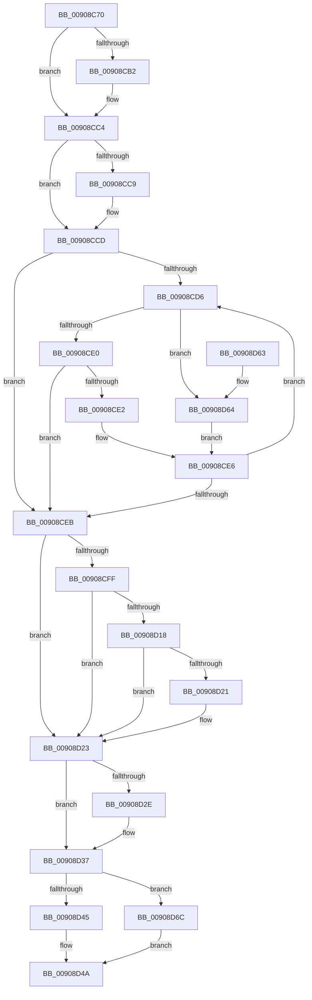

# ExpWnfLookupNameInstance

- RVA: `0x00908C70`–`0x00908D73` (길이 `259` bytes)
- VA: `0x0000000140908C70`
- 실행 섹션: `PAGE`
- PDB 이름 있음: `예`; PDB Function 태그: `아니요`
- unwind 정보 RVA: `0x00088EA8`
- 디코드: `78`개 명령, `259/259` bytes 표시
- 미해석 바이트: `0` (있으면 어셈블리에 `.byte`로 보존)

> 이 문서는 커널 이미지의 기계어와 PDB 기호를 분석해 생성했습니다. 4번과 5번은 함수 원형과 자료형을 바이너리 사용 방식에서 추정한 C 해석이며 원본 소스 복구 결과는 아닙니다.

## 1. Dependencies

- 직접 호출 지점: **5**; 고유 호출 대상: **5**
- 직접 호출자로 확인된 함수: **4**
- RIP 상대 이미지 참조: **0**

### Outgoing calls
- `0x00908C9A` → [KeAbPreAcquire](../../text/21/KeAbPreAcquire_function_00210230.md) (function, `0x00210230`)
- `0x00908CBF` → [ExfAcquirePushLockSharedEx](../../text/21/ExfAcquirePushLockSharedEx_function_0021044C.md) (function, `0x0021044C`)
- `0x00908D18` → [ExfAcquireRundownProtection](../../text/34/ExfAcquireRundownProtection_function_0034C050.md) (function, `0x0034C050`)
- `0x00908D32` → [ExfReleasePushLockShared](../../text/26/ExfReleasePushLockShared_function_00263440.md) (function, `0x00263440`)
- `0x00908D3B` → [KeAbPostRelease](../../text/2E/KeAbPostRelease_function_002E1600.md) (function, `0x002E1600`)

### Direct callers
- [ExpNtDeleteWnfStateData](../7C/ExpNtDeleteWnfStateData_function_007CF1A8.md) at `0x007CF39F`
- [NtDeleteWnfStateName](NtDeleteWnfStateName_function_00908E60.md) at `0x00908F91`
- [ExpWnfSubscribeWnfStateChange](../9D/ExpWnfSubscribeWnfStateChange_function_009D4D0C.md) at `0x009D4E3A`
- [NtQueryWnfStateNameInformation](../9E/NtQueryWnfStateNameInformation_function_009EBD20.md) at `0x009EBF1F`

### Static image references
- 디코드된 RIP-relative 메모리 참조가 없습니다.

## 2. Other-region calls and transfers

- 다른 실행 섹션으로 향하는 call: **5**
  - `0x00908C9A` → [KeAbPreAcquire](../../text/21/KeAbPreAcquire_function_00210230.md) (`PAGE` → `.text`)
  - `0x00908CBF` → [ExfAcquirePushLockSharedEx](../../text/21/ExfAcquirePushLockSharedEx_function_0021044C.md) (`PAGE` → `.text`)
  - `0x00908D18` → [ExfAcquireRundownProtection](../../text/34/ExfAcquireRundownProtection_function_0034C050.md) (`PAGE` → `.text`)
  - `0x00908D32` → [ExfReleasePushLockShared](../../text/26/ExfReleasePushLockShared_function_00263440.md) (`PAGE` → `.text`)
  - `0x00908D3B` → [KeAbPostRelease](../../text/2E/KeAbPostRelease_function_002E1600.md) (`PAGE` → `.text`)
- 별도 외부 분기/꼬리 이동을 확인하지 못했습니다.

## 3. Assembly (complete function range)

```asm
00908C70  48 89 5C 24 10                  mov qword ptr [rsp + 0x10], rbx
00908C75  48 89 6C 24 18                  mov qword ptr [rsp + 0x18], rbp
00908C7A  48 89 74 24 20                  mov qword ptr [rsp + 0x20], rsi
00908C7F  57                              push rdi
00908C80  41 56                           push r14
00908C82  41 57                           push r15
00908C84  48 83 EC 20                     sub rsp, 0x20
00908C88  4D 8B F0                        mov r14, r8
00908C8B  48 8B DA                        mov rbx, rdx
00908C8E  48 8B F1                        mov rsi, rcx
00908C91  45 33 C0                        xor r8d, r8d
00908C94  33 D2                           xor edx, edx
00908C96  48 83 C1 30                     add rcx, 0x30
00908C9A  E8 91 75 90 FF                  call 0x140210230
00908C9F  48 8B F8                        mov rdi, rax
00908CA2  41 BF 11 00 00 00               mov r15d, 0x11
00908CA8  33 C0                           xor eax, eax
00908CAA  F0 4C 0F B1 7E 30               lock cmpxchg qword ptr [rsi + 0x30], r15
00908CB0  74 12                           je 0x140908cc4
00908CB2  4C 8D 4E 30                     lea r9, [rsi + 0x30]
00908CB6  4C 8B C7                        mov r8, rdi
00908CB9  33 D2                           xor edx, edx
00908CBB  48 8D 4E 30                     lea rcx, [rsi + 0x30]
00908CBF  E8 88 77 90 FF                  call 0x14021044c
00908CC4  48 85 FF                        test rdi, rdi
00908CC7  74 04                           je 0x140908ccd
00908CC9  C6 47 0A 01                     mov byte ptr [rdi + 0xa], 1
00908CCD  48 8B 4E 38                     mov rcx, qword ptr [rsi + 0x38]
00908CD1  48 85 C9                        test rcx, rcx
00908CD4  74 15                           je 0x140908ceb
00908CD6  48 3B 59 18                     cmp rbx, qword ptr [rcx + 0x18]
00908CDA  0F 82 84 00 00 00               jb 0x140908d64
00908CE0  76 09                           jbe 0x140908ceb
00908CE2  48 8B 49 08                     mov rcx, qword ptr [rcx + 8]
00908CE6  48 85 C9                        test rcx, rcx
00908CE9  75 EB                           jne 0x140908cd6
00908CEB  33 FF                           xor edi, edi
00908CED  48 8D 41 F0                     lea rax, [rcx - 0x10]
00908CF1  48 85 C9                        test rcx, rcx
00908CF4  8B DF                           mov ebx, edi
00908CF6  48 0F 45 D8                     cmovne rbx, rax
00908CFA  48 85 DB                        test rbx, rbx
00908CFD  74 24                           je 0x140908d23
00908CFF  48 8D 4B 08                     lea rcx, [rbx + 8]
00908D03  0F 0D 09                        prefetchw byte ptr [rcx]
00908D06  48 8B 01                        mov rax, qword ptr [rcx]
00908D09  48 83 E0 FE                     and rax, 0xfffffffffffffffe
00908D0D  48 8D 50 02                     lea rdx, [rax + 2]
00908D11  F0 48 0F B1 11                  lock cmpxchg qword ptr [rcx], rdx
00908D16  74 0B                           je 0x140908d23
00908D18  E8 33 33 A4 FF                  call 0x14034c050
00908D1D  84 C0                           test al, al
00908D1F  75 02                           jne 0x140908d23
00908D21  8B DF                           mov ebx, edi
00908D23  49 8B C7                        mov rax, r15
00908D26  F0 48 0F B1 7E 30               lock cmpxchg qword ptr [rsi + 0x30], rdi
00908D2C  74 09                           je 0x140908d37
00908D2E  48 8D 4E 30                     lea rcx, [rsi + 0x30]
00908D32  E8 09 A7 95 FF                  call 0x140263440
00908D37  48 8D 4E 30                     lea rcx, [rsi + 0x30]
00908D3B  E8 C0 88 9D FF                  call 0x1402e1600
00908D40  48 85 DB                        test rbx, rbx
00908D43  74 27                           je 0x140908d6c
00908D45  49 89 1E                        mov qword ptr [r14], rbx
00908D48  33 C0                           xor eax, eax
00908D4A  48 8B 5C 24 48                  mov rbx, qword ptr [rsp + 0x48]
00908D4F  48 8B 6C 24 50                  mov rbp, qword ptr [rsp + 0x50]
00908D54  48 8B 74 24 58                  mov rsi, qword ptr [rsp + 0x58]
00908D59  48 83 C4 20                     add rsp, 0x20
00908D5D  41 5F                           pop r15
00908D5F  41 5E                           pop r14
00908D61  5F                              pop rdi
00908D62  C3                              ret
00908D63  CC                              int3
00908D64  48 8B 09                        mov rcx, qword ptr [rcx]
00908D67  E9 7A FF FF FF                  jmp 0x140908ce6
00908D6C  B8 34 00 00 C0                  mov eax, 0xc0000034
00908D71  EB D7                           jmp 0x140908d4a
```

## 4. C-style interpretation (structured pseudocode)

```c
__int64 __fastcall ExpWnfLookupNameInstance(__int64 a1, __int64 a2, __int64 a3)
{
    __int64 result;
    __int64 v_rbx;
    __int64 v_rdi;
    __int64 v_rsp;
    unsigned __int64 v_stack_p10;
    unsigned __int64 v_stack_p18;
    unsigned __int64 v_stack_p20;

    v_stack_p10 = v_rbx;
    v_stack_p18 = v_rbp;
    v_stack_p20 = v_rsi;
    v_rsp = (v_rsp) - (32);
    a3 = 0;
    a2 = 0;
    a1 = (a1) + (48);
    result = KeAbPreAcquire(a1, a2, a3, a4);
    result = 0;
    if (!(condition_is_equal)) {
        a4 = a1 + 48;
        a3 = 0;
        a2 = 0;
        a1 = a1 + 48;
        result = ExfAcquirePushLockSharedEx(a1, a2, a3, a4);
    }
    if (result != 0) {
        *(unsigned __int8 *)(result + 10) = 1;
    }
    if (*(unsigned __int64 *)(a1 + 56) == 0) goto loc_00908CEB;
loc_00908CD6:
    if (0 < (*(unsigned __int64 *)(*(unsigned __int64 *)(a1 + 56) + 24))) goto loc_00908D64;
    if (0 <= (*(unsigned __int64 *)(*(unsigned __int64 *)(a1 + 56) + 24))) goto loc_00908CEB;
loc_00908CE6:
    if (*(unsigned __int64 *)(*(unsigned __int64 *)(a1 + 56) + 8) != 0) goto loc_00908CD6;
loc_00908CEB:
    v_rdi = 0;
    v_rbx = 0;
    if (*(unsigned __int64 *)(*(unsigned __int64 *)(a1 + 56) + 8) != 0) { v_rbx = *(unsigned __int64 *)(*(unsigned __int64 *)(a1 + 56) + 8) - 16; }
    if (v_rbx == 0) goto loc_00908D23;
    result = (*(unsigned __int64 *)(v_rbx + 8)) & (-2);
    if (condition_is_equal) goto loc_00908D23;
    result = ExfAcquireRundownProtection(v_rbx + 8, result + 2, a3, a4);
    if ((unsigned __int8)(result) == 0) {
        v_rbx = 0;
    }
    result = 17;
    if ((unsigned __int8)(result) != 0) {
        a1 = a1 + 48;
        result = ExfReleasePushLockShared(a1, result + 2, a3, a4);
    }
    result = KeAbPostRelease(a1 + 48, result + 2, a3, a4);
    if (v_rbx == 0) goto loc_00908D6C;
    *(unsigned __int64 *)(a3) = v_rbx;
    result = 0;
loc_00908D4A:
    v_rsp = (v_rsp) + (32);
    return result;
loc_00908D64:
    goto loc_00908CE6;
loc_00908D6C:
    goto loc_00908D4A;
}
```

## 5. (Beta) C Style

```c
int64_t ExpWnfLookupNameInstance(void *Arg1, int64_t Arg2, void *Arg3)
{
    uint8_t *arg1 = (uint8_t *)Arg1;
    uint8_t *arg3 = (uint8_t *)Arg3;

    int64_t result;
    int64_t local_rbx;
    int64_t local_rdi;
    int64_t local_rsp;
    uint64_t v_stack_p10;
    uint64_t v_stack_p18;
    uint64_t v_stack_p20;

    v_stack_p10 = local_rbx;
    v_stack_p18 = local_rbp;
    v_stack_p20 = local_rsi;
    local_rsp = (local_rsp) - (32);
    Arg3 = 0;
    Arg2 = 0;
    Arg1 = (Arg1) + (48);
    result = KeAbPreAcquire(Arg1, Arg2, Arg3, a4);
    result = 0;
    if (!(condition_is_equal)) {
        a4 = Arg1 + 48;
        Arg3 = 0;
        Arg2 = 0;
        Arg1 = Arg1 + 48;
        result = ExfAcquirePushLockSharedEx(Arg1, Arg2, Arg3, a4);
    }
    if (result != 0) {
        *(uint8_t *)(result + 0xA) = 1;
    }
    if (*(uint64_t *)(arg1 + 0x38) == 0) goto loc_00908CEB;
loc_00908CD6:
    if (0 < (*(uint64_t *)(*(uint64_t *)(arg1 + 0x38) + 0x18))) goto loc_00908D64;
    if (0 <= (*(uint64_t *)(*(uint64_t *)(arg1 + 0x38) + 0x18))) goto loc_00908CEB;
loc_00908CE6:
    if (*(uint64_t *)(*(uint64_t *)(arg1 + 0x38) + 0x8) != 0) goto loc_00908CD6;
loc_00908CEB:
    local_rdi = 0;
    local_rbx = 0;
    if (*(uint64_t *)(*(uint64_t *)(arg1 + 0x38) + 0x8) != 0) { local_rbx = *(uint64_t *)(*(uint64_t *)(arg1 + 0x38) + 0x8) - 16; }
    if (local_rbx == 0) goto loc_00908D23;
    result = (*(uint64_t *)(local_rbx + 0x8)) & (-2);
    if (condition_is_equal) goto loc_00908D23;
    result = ExfAcquireRundownProtection(local_rbx + 8, result + 2, Arg3, a4);
    if ((uint8_t)(result) == 0) {
        local_rbx = 0;
    }
    result = 17;
    if ((uint8_t)(result) != 0) {
        Arg1 = Arg1 + 48;
        result = ExfReleasePushLockShared(Arg1, result + 2, Arg3, a4);
    }
    result = KeAbPostRelease(Arg1 + 48, result + 2, Arg3, a4);
    if (local_rbx == 0) goto loc_00908D6C;
    *(uint64_t *)(arg3) = local_rbx;
    result = 0;
loc_00908D4A:
    local_rsp = (local_rsp) + (32);
    return result;
loc_00908D64:
    goto loc_00908CE6;
loc_00908D6C:
    goto loc_00908D4A;
}
```

### 관측된 메모리 오프셋

구조체 형식이 확인되지 않은 접근은 인자 기준의 오프셋으로만 기록했습니다.

| 기준 인자 | 오프셋 표현 | 폭 (bit) | 접근 |
|---|---:|---:|---|
| `Arg1` | `+ 0x30` | `64` | `R` |
| `Arg1` | `+ 0x38` | `64` | `R` |
| `Arg3` | `+ 0x0` | `64` | `W` |

## 6. Execution-region graph

[열기: 2D/3D 그래프와 함수 탐색 컨트롤 패널](../../../control-panel.html?section=page&rva=0x00908C70&view=graph)

- 2D 그래프는 위에서 아래로 흐르고, 3D 그래프는 빈 공간을 드래그해 회전합니다. Shift+드래그는 이동, 휠은 확대·축소, 함수 노드 선택은 대상 보고서 이동입니다.

### Static fallback


