# ExpWnfNotifyNameSubscribers

- RVA: `0x0090C160`–`0x0090C4AF` (길이 `847` bytes)
- VA: `0x000000014090C160`
- 실행 섹션: `PAGE`
- PDB 이름 있음: `예`; PDB Function 태그: `아니요`
- unwind 정보 RVA: `0x0008926C`
- 디코드: `217`개 명령, `847/847` bytes 표시
- 미해석 바이트: `0` (있으면 어셈블리에 `.byte`로 보존)

> 이 문서는 커널 이미지의 기계어와 PDB 기호를 분석해 생성했습니다. 4번과 5번은 함수 원형과 자료형을 바이너리 사용 방식에서 추정한 C 해석이며 원본 소스 복구 결과는 아닙니다.

## 1. Dependencies

- 직접 호출 지점: **14**; 고유 호출 대상: **10**
- 직접 호출자로 확인된 함수: **9**
- RIP 상대 이미지 참조: **2**

### Outgoing calls
- `0x0090C1A6` → [KeAbPreAcquire](../../text/21/KeAbPreAcquire_function_00210230.md) (function, `0x00210230`)
- `0x0090C1C8` → [ExfAcquirePushLockSharedEx](../../text/21/ExfAcquirePushLockSharedEx_function_0021044C.md) (function, `0x0021044C`)
- `0x0090C21D` → [KeAbPreAcquire](../../text/21/KeAbPreAcquire_function_00210230.md) (function, `0x00210230`)
- `0x0090C239` → [ExfAcquirePushLockExclusiveEx](../../text/20/ExfAcquirePushLockExclusiveEx_function_0020FC90.md) (function, `0x0020FC90`)
- `0x0090C2BD` → [KeAbPostRelease](../../text/2E/KeAbPostRelease_function_002E1600.md) (function, `0x002E1600`)
- `0x0090C30F` → [ExfReleasePushLockShared](../../text/26/ExfReleasePushLockShared_function_00263440.md) (function, `0x00263440`)
- `0x0090C317` → [KeAbPostRelease](../../text/2E/KeAbPostRelease_function_002E1600.md) (function, `0x002E1600`)
- `0x0090C36E` → [ExQueueWorkItem](../../text/2F/ExQueueWorkItem_function_002F9520.md) (function, `0x002F9520`)
- `0x0090C3D7` → [KeSetEvent](../../text/33/KeSetEvent_function_0033F310.md) (function, `0x0033F310`)
- `0x0090C3F8` → [KeAbPostRelease](../../text/2E/KeAbPostRelease_function_002E1600.md) (function, `0x002E1600`)
- `0x0090C406` → [ExfTryToWakePushLock](../../text/26/ExfTryToWakePushLock_function_00265DD0.md) (function, `0x00265DD0`)
- `0x0090C43D` → [ExpWnfNotifyNameSubscribers](ExpWnfNotifyNameSubscribers_function_0090C160.md) (function, `0x0090C160`)
- `0x0090C467` → [ExfTryToWakePushLock](../../text/26/ExfTryToWakePushLock_function_00265DD0.md) (function, `0x00265DD0`)
- `0x0090C46E` → [ExpWnfDispatchKernelSubscription](ExpWnfDispatchKernelSubscription_function_0090C520.md) (function, `0x0090C520`)

### Direct callers
- [ExpWnfDeleteProcessContext](ExpWnfDeleteProcessContext_function_00908270.md) at `0x00908440`
- [ExpWnfDeleteSubscription](ExpWnfDeleteSubscription_function_00908528.md) at `0x00908820`
- [ExpWnfDeleteSubscription](ExpWnfDeleteSubscription_function_00908528.md) at `0x009088B5`
- [NtDeleteWnfStateName](NtDeleteWnfStateName_function_00908E60.md) at `0x0090907F`
- [ExpWnfDeliverThreadNotifications](ExpWnfDeliverThreadNotifications_function_00909630.md) at `0x009099B8`
- [ExpWnfCompleteThreadSubscriptions](ExpWnfCompleteThreadSubscriptions_function_00909A10.md) at `0x00909BB4`
- [ExpNtUpdateWnfStateData](ExpNtUpdateWnfStateData_function_0090A7A0.md) at `0x0090AEA3`
- [ExpWnfNotifyNameSubscribers](ExpWnfNotifyNameSubscribers_function_0090C160.md) at `0x0090C43D`
- [ExpWnfDispatchKernelSubscription](ExpWnfDispatchKernelSubscription_function_0090C520.md) at `0x0090C7A9`
- [ExpWnfSubscribeNameInstance](../9D/ExpWnfSubscribeNameInstance_function_009D50E8.md) at `0x009D5430`

### Static image references
- `0x0090C33C` → RVA `0x00FD9B98` (`PAGEDATA`; read)
- `0x0090C385` → RVA `0x00FC6AB0` (`ALMOSTRO`; read)

## 2. Other-region calls and transfers

- 다른 실행 섹션으로 향하는 call: **12**
  - `0x0090C1A6` → [KeAbPreAcquire](../../text/21/KeAbPreAcquire_function_00210230.md) (`PAGE` → `.text`)
  - `0x0090C1C8` → [ExfAcquirePushLockSharedEx](../../text/21/ExfAcquirePushLockSharedEx_function_0021044C.md) (`PAGE` → `.text`)
  - `0x0090C21D` → [KeAbPreAcquire](../../text/21/KeAbPreAcquire_function_00210230.md) (`PAGE` → `.text`)
  - `0x0090C239` → [ExfAcquirePushLockExclusiveEx](../../text/20/ExfAcquirePushLockExclusiveEx_function_0020FC90.md) (`PAGE` → `.text`)
  - `0x0090C2BD` → [KeAbPostRelease](../../text/2E/KeAbPostRelease_function_002E1600.md) (`PAGE` → `.text`)
  - `0x0090C30F` → [ExfReleasePushLockShared](../../text/26/ExfReleasePushLockShared_function_00263440.md) (`PAGE` → `.text`)
  - `0x0090C317` → [KeAbPostRelease](../../text/2E/KeAbPostRelease_function_002E1600.md) (`PAGE` → `.text`)
  - `0x0090C36E` → [ExQueueWorkItem](../../text/2F/ExQueueWorkItem_function_002F9520.md) (`PAGE` → `.text`)
  - `0x0090C3D7` → [KeSetEvent](../../text/33/KeSetEvent_function_0033F310.md) (`PAGE` → `.text`)
  - `0x0090C3F8` → [KeAbPostRelease](../../text/2E/KeAbPostRelease_function_002E1600.md) (`PAGE` → `.text`)
  - `0x0090C406` → [ExfTryToWakePushLock](../../text/26/ExfTryToWakePushLock_function_00265DD0.md) (`PAGE` → `.text`)
  - `0x0090C467` → [ExfTryToWakePushLock](../../text/26/ExfTryToWakePushLock_function_00265DD0.md) (`PAGE` → `.text`)
- 별도 외부 분기/꼬리 이동을 확인하지 못했습니다.

## 3. Assembly (complete function range)

```asm
0090C160  44 89 4C 24 20                  mov dword ptr [rsp + 0x20], r9d
0090C165  44 89 44 24 18                  mov dword ptr [rsp + 0x18], r8d
0090C16A  89 54 24 10                     mov dword ptr [rsp + 0x10], edx
0090C16E  48 89 4C 24 08                  mov qword ptr [rsp + 8], rcx
0090C173  53                              push rbx
0090C174  55                              push rbp
0090C175  56                              push rsi
0090C176  57                              push rdi
0090C177  41 54                           push r12
0090C179  41 55                           push r13
0090C17B  41 56                           push r14
0090C17D  41 57                           push r15
0090C17F  48 83 EC 38                     sub rsp, 0x38
0090C183  45 33 F6                        xor r14d, r14d
0090C186  4C 8D 69 70                     lea r13, [rcx + 0x70]
0090C18A  8B F2                           mov esi, edx
0090C18C  44 89 74 24 20                  mov dword ptr [rsp + 0x20], r14d
0090C191  4C 8B F9                        mov r15, rcx
0090C194  45 33 C0                        xor r8d, r8d
0090C197  33 D2                           xor edx, edx
0090C199  49 8B CD                        mov rcx, r13
0090C19C  45 8D 66 01                     lea r12d, [r14 + 1]
0090C1A0  41 8B E9                        mov ebp, r9d
0090C1A3  41 8B FE                        mov edi, r14d
0090C1A6  E8 85 40 90 FF                  call 0x140210230
0090C1AB  48 8B D8                        mov rbx, rax
0090C1AE  B9 11 00 00 00                  mov ecx, 0x11
0090C1B3  33 C0                           xor eax, eax
0090C1B5  F0 49 0F B1 4D 00               lock cmpxchg qword ptr [r13], rcx
0090C1BB  74 10                           je 0x14090c1cd
0090C1BD  4D 8B CD                        mov r9, r13
0090C1C0  4C 8B C3                        mov r8, rbx
0090C1C3  33 D2                           xor edx, edx
0090C1C5  49 8B CD                        mov rcx, r13
0090C1C8  E8 7F 42 90 FF                  call 0x14021044c
0090C1CD  48 85 DB                        test rbx, rbx
0090C1D0  74 04                           je 0x14090c1d6
0090C1D2  44 88 63 0A                     mov byte ptr [rbx + 0xa], r12b
0090C1D6  48 8B 9C 24 80 00 00 00         mov rbx, qword ptr [rsp + 0x80]
0090C1DE  49 8D 47 78                     lea rax, [r15 + 0x78]
0090C1E2  4D 8B 7F 78                     mov r15, qword ptr [r15 + 0x78]
0090C1E6  4C 3B F8                        cmp r15, rax
0090C1E9  0F 84 10 01 00 00               je 0x14090c2ff
0090C1EF  45 85 E4                        test r12d, r12d
0090C1F2  74 09                           je 0x14090c1fd
0090C1F4  41 F6 47 24 01                  test byte ptr [r15 + 0x24], 1
0090C1F9  45 0F 45 E6                     cmovne r12d, r14d
0090C1FD  49 8B 47 E8                     mov rax, qword ptr [r15 - 0x18]
0090C201  48 85 C0                        test rax, rax
0090C204  0F 84 9C 02 00 00               je 0x14090c4a6
0090C20A  48 8B B0 E8 05 00 00            mov rsi, qword ptr [rax + 0x5e8]
0090C211  45 33 C0                        xor r8d, r8d
0090C214  33 D2                           xor edx, edx
0090C216  41 8B EE                        mov ebp, r14d
0090C219  48 8D 4E 68                     lea rcx, [rsi + 0x68]
0090C21D  E8 0E 40 90 FF                  call 0x140210230
0090C222  F0 48 0F BA 6E 68 00            lock bts qword ptr [rsi + 0x68], 0
0090C229  48 8B D8                        mov rbx, rax
0090C22C  73 10                           jae 0x14090c23e
0090C22E  4C 8D 46 68                     lea r8, [rsi + 0x68]
0090C232  48 8B D0                        mov rdx, rax
0090C235  48 8D 4E 68                     lea rcx, [rsi + 0x68]
0090C239  E8 52 3A 90 FF                  call 0x14020fc90
0090C23E  48 85 DB                        test rbx, rbx
0090C241  74 04                           je 0x14090c247
0090C243  C6 43 0A 01                     mov byte ptr [rbx + 0xa], 1
0090C247  8B 94 24 88 00 00 00            mov edx, dword ptr [rsp + 0x88]
0090C24E  41 23 57 24                     and edx, dword ptr [r15 + 0x24]
0090C252  F6 C2 08                        test dl, 8
0090C255  0F 85 1D 02 00 00               jne 0x14090c478
0090C25B  85 D2                           test edx, edx
0090C25D  0F 84 7E 01 00 00               je 0x14090c3e1
0090C263  41 8B 47 38                     mov eax, dword ptr [r15 + 0x38]
0090C267  83 F8 01                        cmp eax, 1
0090C26A  0F 85 2C 01 00 00               jne 0x14090c39c
0090C270  41 8B 4F 40                     mov ecx, dword ptr [r15 + 0x40]
0090C274  41 0B 4F 3C                     or ecx, dword ptr [r15 + 0x3c]
0090C278  F6 C1 01                        test cl, 1
0090C27B  0F 94 C1                        sete cl
0090C27E  F6 C2 01                        test dl, 1
0090C281  0F 95 C0                        setne al
0090C284  84 C8                           test al, cl
0090C286  74 0E                           je 0x14090c296
0090C288  49 8B 47 F0                     mov rax, qword ptr [r15 - 0x10]
0090C28C  F0 FF 80 A4 00 00 00            lock inc dword ptr [rax + 0xa4]
0090C293  83 E2 F7                        and edx, 0xfffffff7
0090C296  41 0B 57 3C                     or edx, dword ptr [r15 + 0x3c]
0090C29A  48 C7 C0 FF FF FF FF            mov rax, 0xffffffffffffffff
0090C2A1  41 23 57 24                     and edx, dword ptr [r15 + 0x24]
0090C2A5  41 89 57 3C                     mov dword ptr [r15 + 0x3c], edx
0090C2A9  F0 48 0F C1 46 68               lock xadd qword ptr [rsi + 0x68], rax
0090C2AF  24 06                           and al, 6
0090C2B1  3C 02                           cmp al, 2
0090C2B3  0F 84 49 01 00 00               je 0x14090c402
0090C2B9  48 8D 4E 68                     lea rcx, [rsi + 0x68]
0090C2BD  E8 3E 53 9D FF                  call 0x1402e1600
0090C2C2  49 8B 47 E8                     mov rax, qword ptr [r15 - 0x18]
0090C2C6  48 8B 88 E8 05 00 00            mov rcx, qword ptr [rax + 0x5e8]
0090C2CD  85 ED                           test ebp, ebp
0090C2CF  0F 85 B0 00 00 00               jne 0x14090c385
0090C2D5  8B 7C 24 20                     mov edi, dword ptr [rsp + 0x20]
0090C2D9  48 8B 9C 24 80 00 00 00         mov rbx, qword ptr [rsp + 0x80]
0090C2E1  8B B4 24 88 00 00 00            mov esi, dword ptr [rsp + 0x88]
0090C2E8  8B AC 24 98 00 00 00            mov ebp, dword ptr [rsp + 0x98]
0090C2EF  4D 8B 3F                        mov r15, qword ptr [r15]
0090C2F2  48 8D 43 78                     lea rax, [rbx + 0x78]
0090C2F6  4C 3B F8                        cmp r15, rax
0090C2F9  0F 85 F0 FE FF FF               jne 0x14090c1ef
0090C2FF  B8 11 00 00 00                  mov eax, 0x11
0090C304  F0 4D 0F B1 75 00               lock cmpxchg qword ptr [r13], r14
0090C30A  74 08                           je 0x14090c314
0090C30C  49 8B CD                        mov rcx, r13
0090C30F  E8 2C 71 95 FF                  call 0x140263440
0090C314  49 8B CD                        mov rcx, r13
0090C317  E8 E4 52 9D FF                  call 0x1402e1600
0090C31C  45 85 E4                        test r12d, r12d
0090C31F  0F 85 EB 00 00 00               jne 0x14090c410
0090C325  8B B4 24 90 00 00 00            mov esi, dword ptr [rsp + 0x90]
0090C32C  85 FF                           test edi, edi
0090C32E  74 43                           je 0x14090c373
0090C330  85 F6                           test esi, esi
0090C332  74 3F                           je 0x14090c373
0090C334  85 ED                           test ebp, ebp
0090C336  0F 85 32 01 00 00               jne 0x14090c46e
0090C33C  48 8B 05 55 D8 6C 00            mov rax, qword ptr [rip + 0x6cd855]
0090C343  F0 83 48 28 02                  lock or dword ptr [rax + 0x28], 2
0090C348  48 8B 0D 49 D8 6C 00            mov rcx, qword ptr [rip + 0x6cd849]
0090C34F  BA 03 00 00 00                  mov edx, 3
0090C354  B8 02 00 00 00                  mov eax, 2
0090C359  F0 0F B1 51 28                  lock cmpxchg dword ptr [rcx + 0x28], edx
0090C35E  75 13                           jne 0x14090c373
0090C360  48 8B 0D 31 D8 6C 00            mov rcx, qword ptr [rip + 0x6cd831]
0090C367  8D 55 01                        lea edx, [rbp + 1]
0090C36A  48 83 C1 08                     add rcx, 8
0090C36E  E8 AD D1 9E FF                  call 0x1402f9520
0090C373  48 83 C4 38                     add rsp, 0x38
0090C377  41 5F                           pop r15
0090C379  41 5E                           pop r14
0090C37B  41 5D                           pop r13
0090C37D  41 5C                           pop r12
0090C37F  5F                              pop rdi
0090C380  5E                              pop rsi
0090C381  5D                              pop rbp
0090C382  5B                              pop rbx
0090C383  C3                              ret
0090C384  CC                              int3
0090C385  48 3B 05 24 A7 6B 00            cmp rax, qword ptr [rip + 0x6ba724]
0090C38C  75 32                           jne 0x14090c3c0
0090C38E  BF 01 00 00 00                  mov edi, 1
0090C393  89 7C 24 20                     mov dword ptr [rsp + 0x20], edi
0090C397  E9 3D FF FF FF                  jmp 0x14090c2d9
0090C39C  85 C0                           test eax, eax
0090C39E  0F 85 F7 00 00 00               jne 0x14090c49b
0090C3A4  48 8B 4E 78                     mov rcx, qword ptr [rsi + 0x78]
0090C3A8  48 8D 46 70                     lea rax, [rsi + 0x70]
0090C3AC  4D 8D 47 28                     lea r8, [r15 + 0x28]
0090C3B0  48 39 01                        cmp qword ptr [rcx], rax
0090C3B3  0F 84 8E 00 00 00               je 0x14090c447
0090C3B9  B9 03 00 00 00                  mov ecx, 3
0090C3BE  CD 29                           int 0x29
0090C3C0  48 8B 89 80 00 00 00            mov rcx, qword ptr [rcx + 0x80]
0090C3C7  48 85 C9                        test rcx, rcx
0090C3CA  0F 84 05 FF FF FF               je 0x14090c2d5
0090C3D0  45 33 C0                        xor r8d, r8d
0090C3D3  41 8D 50 01                     lea edx, [r8 + 1]
0090C3D7  E8 34 2F A3 FF                  call 0x14033f310
0090C3DC  E9 F4 FE FF FF                  jmp 0x14090c2d5
0090C3E1  48 C7 C0 FF FF FF FF            mov rax, 0xffffffffffffffff
0090C3E8  F0 48 0F C1 46 68               lock xadd qword ptr [rsi + 0x68], rax
0090C3EE  24 06                           and al, 6
0090C3F0  3C 02                           cmp al, 2
0090C3F2  74 6F                           je 0x14090c463
0090C3F4  48 8D 4E 68                     lea rcx, [rsi + 0x68]
0090C3F8  E8 03 52 9D FF                  call 0x1402e1600
0090C3FD  E9 D3 FE FF FF                  jmp 0x14090c2d5
0090C402  48 8D 4E 68                     lea rcx, [rsi + 0x68]
0090C406  E8 C5 99 95 FF                  call 0x140265dd0
0090C40B  E9 A9 FE FF FF                  jmp 0x14090c2b9
0090C410  40 F6 C6 01                     test sil, 1
0090C414  8B B4 24 90 00 00 00            mov esi, dword ptr [rsp + 0x90]
0090C41B  0F 84 0B FF FF FF               je 0x14090c32c
0090C421  85 FF                           test edi, edi
0090C423  75 0A                           jne 0x14090c42f
0090C425  85 F6                           test esi, esi
0090C427  74 06                           je 0x14090c42f
0090C429  41 BE 01 00 00 00               mov r14d, 1
0090C42F  44 8B CD                        mov r9d, ebp
0090C432  45 8B C6                        mov r8d, r14d
0090C435  BA 08 00 00 00                  mov edx, 8
0090C43A  48 8B CB                        mov rcx, rbx
0090C43D  E8 1E FD FF FF                  call 0x14090c160
0090C442  E9 E5 FE FF FF                  jmp 0x14090c32c
0090C447  49 89 00                        mov qword ptr [r8], rax
0090C44A  49 89 48 08                     mov qword ptr [r8 + 8], rcx
0090C44E  4C 89 01                        mov qword ptr [rcx], r8
0090C451  4C 89 40 08                     mov qword ptr [rax + 8], r8
0090C455  BD 01 00 00 00                  mov ebp, 1
0090C45A  41 89 6F 38                     mov dword ptr [r15 + 0x38], ebp
0090C45E  E9 0D FE FF FF                  jmp 0x14090c270
0090C463  48 8D 4E 68                     lea rcx, [rsi + 0x68]
0090C467  E8 64 99 95 FF                  call 0x140265dd0
0090C46C  EB 86                           jmp 0x14090c3f4
0090C46E  E8 AD 00 00 00                  call 0x14090c520
0090C473  E9 FB FE FF FF                  jmp 0x14090c373
0090C478  49 8B 47 F0                     mov rax, qword ptr [r15 - 0x10]
0090C47C  48 85 C0                        test rax, rax
0090C47F  0F 84 D6 FD FF FF               je 0x14090c25b
0090C485  8B 80 A4 00 00 00               mov eax, dword ptr [rax + 0xa4]
0090C48B  85 C0                           test eax, eax
0090C48D  0F 84 C8 FD FF FF               je 0x14090c25b
0090C493  83 E2 F7                        and edx, 0xfffffff7
0090C496  E9 C0 FD FF FF                  jmp 0x14090c25b
0090C49B  83 F8 03                        cmp eax, 3
0090C49E  0F 85 CC FD FF FF               jne 0x14090c270
0090C4A4  EB AF                           jmp 0x14090c455
0090C4A6  8B 7C 24 20                     mov edi, dword ptr [rsp + 0x20]
0090C4AA  E9 40 FE FF FF                  jmp 0x14090c2ef
```

## 4. C-style interpretation (structured pseudocode)

```c
__int64 __fastcall ExpWnfNotifyNameSubscribers(__int64 a1, int a2, int a3, int a4)
{
    __int64 result;
    __int64 v_r12;
    __int64 v_r14;
    __int64 v_rsp;
    unsigned int v_stack_m58;
    unsigned int v_stack_p10;
    unsigned int v_stack_p18;
    unsigned int v_stack_p20;
    unsigned __int64 v_stack_p8;
    unsigned int v_stack_p90;

    v_stack_p20 = a4;
    v_stack_p18 = a3;
    v_stack_p10 = a2;
    v_stack_p8 = a1;
    v_rsp = (v_rsp) - (56);
    v_r14 = 0;
    v_stack_m58 = 0;
    a3 = 0;
    a2 = 0;
    result = KeAbPreAcquire(a1 + 112, a2, a3, a4);
    result = 0;
    if (!(condition_is_equal)) {
        a4 = a1 + 112;
        a3 = 0;
        a2 = 0;
        a1 = a1 + 112;
        result = ExfAcquirePushLockSharedEx(a1, a2, a3, a4);
    }
    if (result != 0) {
        *(unsigned __int8 *)(result + 10) = (unsigned __int8)(v_r14 + 1);
    }
    if ((*(unsigned __int64 *)(a1 + 120)) == (a1 + 120)) goto loc_0090C2FF;
loc_0090C1EF:
    v_r12 = v_r14 + 1;
    if ((unsigned int)(v_r14 + 1) != 0) {
        v_r12 = v_r14 + 1;
        if (((*(unsigned __int8 *)(*(unsigned __int64 *)(a1 + 120) + 36)) & (1)) != 0) { v_r12 = 0; }
    }
    if (*(unsigned __int64 *)(*(unsigned __int64 *)(a1 + 120) - 24) == 0) goto loc_0090C4A6;
    a3 = 0;
    a2 = 0;
    result = KeAbPreAcquire(*(unsigned __int64 *)(*(unsigned __int64 *)(*(unsigned __int64 *)(a1 + 120) - 24) + 1512) + 104, a2, a3, a4);
    if (!(condition_is_above_or_equal)) {
        a3 = *(unsigned __int64 *)(*(unsigned __int64 *)(*(unsigned __int64 *)(a1 + 120) - 24) + 1512) + 104;
        a2 = result;
        a1 = *(unsigned __int64 *)(*(unsigned __int64 *)(*(unsigned __int64 *)(a1 + 120) - 24) + 1512) + 104;
        result = ExfAcquirePushLockExclusiveEx(a1, a2, a3, a4);
    }
    if (result != 0) {
        *(unsigned __int8 *)(result + 10) = 1;
    }
    a2 = (unsigned int)(((unsigned int)(v_stack_p10)) & (*(unsigned int *)(*(unsigned __int64 *)(a1 + 120) + 36)));
    if ((((unsigned __int8)(a2)) & (8)) != 0) goto loc_0090C478;
loc_0090C25B:
    if (a2 == 0) goto loc_0090C3E1;
    if (((unsigned int)((unsigned int)(*(unsigned int *)(*(unsigned __int64 *)(a1 + 120) + 56)))) != 1) goto loc_0090C39C;
loc_0090C270:
    a1 = (unsigned int)(((unsigned int)(*(unsigned int *)(*(unsigned __int64 *)(a1 + 120) + 64))) | (*(unsigned int *)(*(unsigned __int64 *)(a1 + 120) + 60)));
    a1 = ((((unsigned __int8)(a1)) & (1)) == 0) ? 1 : 0;
    result = ((((unsigned __int8)(a2)) & (1)) != 0) ? 1 : 0;
    if ((((unsigned __int8)(result)) & ((unsigned __int8)(a1))) != 0) {
        result = *(unsigned __int64 *)(*(unsigned __int64 *)(a1 + 120) - 16);
        a2 = (unsigned int)((a2) & (0xFFFFFFF7ULL));
    }
    a2 = (unsigned int)((a2) | (*(unsigned int *)(*(unsigned __int64 *)(a1 + 120) + 60)));
    a2 = (unsigned int)((a2) & (*(unsigned int *)(*(unsigned __int64 *)(a1 + 120) + 36)));
    *(unsigned int *)(*(unsigned __int64 *)(a1 + 120) + 60) = a2;
    result = (unsigned __int8)((-1) & (6));
    if (((unsigned __int8)(result)) == 2) goto loc_0090C402;
loc_0090C2B9:
    result = KeAbPostRelease(*(unsigned __int64 *)(*(unsigned __int64 *)(*(unsigned __int64 *)(a1 + 120) - 24) + 1512) + 104, a2, a3, a4);
    if (0 != 0) goto loc_0090C385;
loc_0090C2D5:
loc_0090C2D9:
loc_0090C2EF:
    if ((*(unsigned __int64 *)(*(unsigned __int64 *)(a1 + 120))) != (v_stack_p8 + 120)) goto loc_0090C1EF;
loc_0090C2FF:
    result = 17;
    if ((*(unsigned __int64 *)(*(unsigned __int64 *)(a1 + 120))) != (v_stack_p8 + 120)) {
        a1 = a1 + 112;
        result = ExfReleasePushLockShared(a1, a2, a3, a4);
    }
    result = KeAbPostRelease(a1 + 112, a2, a3, a4);
    if ((unsigned int)(v_r12) != 0) goto loc_0090C410;
loc_0090C32C:
    if ((unsigned int)((unsigned int)(v_stack_m58)) == 0) goto loc_0090C373;
    if ((unsigned int)((unsigned int)(v_stack_p18)) == 0) goto loc_0090C373;
    if ((unsigned int)((unsigned int)(v_stack_p20)) != 0) goto loc_0090C46E;
    result = 2;
    if ((unsigned int)((unsigned int)(v_stack_p20)) == 0) {
        a1 = *(unsigned __int64 *)(v_rip + 7133233);
        a2 = (unsigned int)(v_stack_p20) + 1;
        a1 = (a1) + (8);
        result = ExQueueWorkItem(a1, a2, a3, a4);
    }
    v_rsp = (v_rsp) + (56);
    return result;
loc_0090C385:
    if (result != (*(unsigned __int64 *)(v_rip + 7055140))) goto loc_0090C3C0;
    v_stack_p20 = 1;
    goto loc_0090C2D9;
loc_0090C39C:
    if ((unsigned int)(result) != 0) goto loc_0090C49B;
    if ((*(unsigned __int64 *)(*(unsigned __int64 *)((unsigned int)(v_stack_p18) + 120))) == ((unsigned int)(v_stack_p18) + 112)) goto loc_0090C447;
loc_0090C3C0:
    if (*(unsigned __int64 *)(3 + 128) == 0) goto loc_0090C2D5;
    a3 = 0;
    result = KeSetEvent(*(unsigned __int64 *)(3 + 128), a3 + 1, a3, a4);
    goto loc_0090C2D5;
loc_0090C3E1:
    result = (unsigned __int8)((-1) & (6));
    if (((unsigned __int8)(result)) == 2) goto loc_0090C463;
loc_0090C3F4:
    result = KeAbPostRelease((unsigned int)(v_stack_p18) + 104, a3 + 1, a3, a4);
    goto loc_0090C2D5;
loc_0090C402:
    result = ExfTryToWakePushLock((unsigned int)(v_stack_p18) + 104, a3 + 1, a3, a4);
    goto loc_0090C2B9;
loc_0090C410:
    if ((((unsigned __int8)((unsigned int)(v_stack_p18))) & (1)) == 0) goto loc_0090C32C;
    if (1 != 0) goto loc_0090C42F;
    if ((unsigned int)((unsigned int)(v_stack_p90)) != 0) {
        v_r14 = 1;
    }
    result = ExpWnfNotifyNameSubscribers(v_stack_p8, 8, (unsigned int)((unsigned int)(v_r14)), (unsigned int)((unsigned int)((unsigned int)(v_stack_p20))));
    goto loc_0090C32C;
loc_0090C447:
    *(unsigned __int64 *)((unsigned int)((unsigned int)(v_r14))) = result;
    *(unsigned __int64 *)((unsigned int)((unsigned int)(v_r14)) + 8) = v_stack_p8;
    *(unsigned __int64 *)(v_stack_p8) = (unsigned int)((unsigned int)(v_r14));
    *(unsigned __int64 *)(result + 8) = (unsigned int)((unsigned int)(v_r14));
loc_0090C455:
    *(unsigned int *)(*(unsigned __int64 *)(*(unsigned __int64 *)(a1 + 120)) + 56) = 1;
    goto loc_0090C270;
loc_0090C463:
    result = ExfTryToWakePushLock((unsigned int)(v_stack_p90) + 104, 8, (unsigned int)((unsigned int)(v_r14)), (unsigned int)((unsigned int)((unsigned int)(v_stack_p20))));
    goto loc_0090C3F4;
loc_0090C46E:
    result = ExpWnfDispatchKernelSubscription((unsigned int)(v_stack_p90) + 104, 8, (unsigned int)((unsigned int)(v_r14)), (unsigned int)((unsigned int)((unsigned int)(v_stack_p20))));
    goto loc_0090C373;
loc_0090C478:
    if (*(unsigned __int64 *)(*(unsigned __int64 *)(*(unsigned __int64 *)(a1 + 120)) - 16) == 0) goto loc_0090C25B;
    if ((unsigned int)((unsigned int)(*(unsigned int *)(*(unsigned __int64 *)(*(unsigned __int64 *)(*(unsigned __int64 *)(a1 + 120)) - 16) + 164))) == 0) goto loc_0090C25B;
    a2 = (unsigned int)((8) & (0xFFFFFFF7ULL));
    goto loc_0090C25B;
loc_0090C49B:
    if (((unsigned int)((unsigned int)(*(unsigned int *)(*(unsigned __int64 *)(*(unsigned __int64 *)(*(unsigned __int64 *)(a1 + 120)) - 16) + 164)))) != 3) goto loc_0090C270;
    goto loc_0090C455;
loc_0090C4A6:
    goto loc_0090C2EF;
}
```

## 5. (Beta) C Style

```c
int64_t ExpWnfNotifyNameSubscribers(void *Arg1, int32_t Arg2, int32_t Arg3, int32_t Arg4)
{
    uint8_t *arg1 = (uint8_t *)Arg1;

    int64_t result;
    int64_t local_r12;
    int64_t local_r14;
    int64_t local_rsp;
    uint32_t v_stack_m58;
    uint32_t v_stack_p10;
    uint32_t v_stack_p18;
    uint32_t v_stack_p20;
    uint64_t v_stack_p8;
    uint32_t v_stack_p90;

    v_stack_p20 = Arg4;
    v_stack_p18 = Arg3;
    v_stack_p10 = Arg2;
    v_stack_p8 = Arg1;
    local_rsp = (local_rsp) - (56);
    local_r14 = 0;
    v_stack_m58 = 0;
    Arg3 = 0;
    Arg2 = 0;
    result = KeAbPreAcquire(Arg1 + 112, Arg2, Arg3, Arg4);
    result = 0;
    if (!(condition_is_equal)) {
        Arg4 = Arg1 + 112;
        Arg3 = 0;
        Arg2 = 0;
        Arg1 = Arg1 + 112;
        result = ExfAcquirePushLockSharedEx(Arg1, Arg2, Arg3, Arg4);
    }
    if (result != 0) {
        *(uint8_t *)(result + 0xA) = (uint8_t)(local_r14 + 1);
    }
    if ((*(uint64_t *)(arg1 + 0x78)) == (Arg1 + 120)) goto loc_0090C2FF;
loc_0090C1EF:
    local_r12 = local_r14 + 1;
    if ((uint32_t)(local_r14 + 1) != 0) {
        local_r12 = local_r14 + 1;
        if (((*(uint8_t *)(*(uint64_t *)(arg1 + 0x78) + 0x24)) & (1)) != 0) { local_r12 = 0; }
    }
    if (*(uint64_t *)(*(uint64_t *)(arg1 + 0x78) - 0x18) == 0) goto loc_0090C4A6;
    Arg3 = 0;
    Arg2 = 0;
    result = KeAbPreAcquire(*(uint64_t *)(*(uint64_t *)(*(uint64_t *)(arg1 + 0x78) - 0x18) + 0x5E8) + 104, Arg2, Arg3, Arg4);
    if (!(condition_is_above_or_equal)) {
        Arg3 = *(uint64_t *)(*(uint64_t *)(*(uint64_t *)(arg1 + 0x78) - 0x18) + 0x5E8) + 104;
        Arg2 = result;
        Arg1 = *(uint64_t *)(*(uint64_t *)(*(uint64_t *)(arg1 + 0x78) - 0x18) + 0x5E8) + 104;
        result = ExfAcquirePushLockExclusiveEx(Arg1, Arg2, Arg3, Arg4);
    }
    if (result != 0) {
        *(uint8_t *)(result + 0xA) = 1;
    }
    Arg2 = (uint32_t)(((uint32_t)(v_stack_p10)) & (*(uint32_t *)(*(uint64_t *)(arg1 + 0x78) + 0x24)));
    if ((((uint8_t)(Arg2)) & (8)) != 0) goto loc_0090C478;
loc_0090C25B:
    if (Arg2 == 0) goto loc_0090C3E1;
    if (((uint32_t)((uint32_t)(*(uint32_t *)(*(uint64_t *)(arg1 + 0x78) + 0x38)))) != 1) goto loc_0090C39C;
loc_0090C270:
    Arg1 = (uint32_t)(((uint32_t)(*(uint32_t *)(*(uint64_t *)(arg1 + 0x78) + 0x40))) | (*(uint32_t *)(*(uint64_t *)(arg1 + 0x78) + 0x3C)));
    Arg1 = ((((uint8_t)(Arg1)) & (1)) == 0) ? 1 : 0;
    result = ((((uint8_t)(Arg2)) & (1)) != 0) ? 1 : 0;
    if ((((uint8_t)(result)) & ((uint8_t)(Arg1))) != 0) {
        result = *(uint64_t *)(*(uint64_t *)(arg1 + 0x78) - 0x10);
        Arg2 = (uint32_t)((Arg2) & (0xFFFFFFF7ULL));
    }
    Arg2 = (uint32_t)((Arg2) | (*(uint32_t *)(*(uint64_t *)(arg1 + 0x78) + 0x3C)));
    Arg2 = (uint32_t)((Arg2) & (*(uint32_t *)(*(uint64_t *)(arg1 + 0x78) + 0x24)));
    *(uint32_t *)(*(uint64_t *)(arg1 + 0x78) + 0x3C) = Arg2;
    result = (uint8_t)((-1) & (6));
    if (((uint8_t)(result)) == 2) goto loc_0090C402;
loc_0090C2B9:
    result = KeAbPostRelease(*(uint64_t *)(*(uint64_t *)(*(uint64_t *)(arg1 + 0x78) - 0x18) + 0x5E8) + 104, Arg2, Arg3, Arg4);
    if (0 != 0) goto loc_0090C385;
loc_0090C2D5:
loc_0090C2D9:
loc_0090C2EF:
    if ((*(uint64_t *)(*(uint64_t *)(arg1 + 0x78))) != (v_stack_p8 + 120)) goto loc_0090C1EF;
loc_0090C2FF:
    result = 17;
    if ((*(uint64_t *)(*(uint64_t *)(arg1 + 0x78))) != (v_stack_p8 + 120)) {
        Arg1 = Arg1 + 112;
        result = ExfReleasePushLockShared(Arg1, Arg2, Arg3, Arg4);
    }
    result = KeAbPostRelease(Arg1 + 112, Arg2, Arg3, Arg4);
    if ((uint32_t)(local_r12) != 0) goto loc_0090C410;
loc_0090C32C:
    if ((uint32_t)((uint32_t)(v_stack_m58)) == 0) goto loc_0090C373;
    if ((uint32_t)((uint32_t)(v_stack_p18)) == 0) goto loc_0090C373;
    if ((uint32_t)((uint32_t)(v_stack_p20)) != 0) goto loc_0090C46E;
    result = 2;
    if ((uint32_t)((uint32_t)(v_stack_p20)) == 0) {
        Arg1 = *(uint64_t *)(v_rip + 0x6CD831);
        Arg2 = (uint32_t)(v_stack_p20) + 1;
        Arg1 = (Arg1) + (8);
        result = ExQueueWorkItem(Arg1, Arg2, Arg3, Arg4);
    }
    local_rsp = (local_rsp) + (56);
    return result;
loc_0090C385:
    if (result != (*(uint64_t *)(v_rip + 0x6BA724))) goto loc_0090C3C0;
    v_stack_p20 = 1;
    goto loc_0090C2D9;
loc_0090C39C:
    if ((uint32_t)(result) != 0) goto loc_0090C49B;
    if ((*(uint64_t *)(*(uint64_t *)((uint32_t)(v_stack_p18) + 0x78))) == ((uint32_t)(v_stack_p18) + 112)) goto loc_0090C447;
loc_0090C3C0:
    if (*(uint64_t *)(3 + 0x80) == 0) goto loc_0090C2D5;
    Arg3 = 0;
    result = KeSetEvent(*(uint64_t *)(3 + 0x80), Arg3 + 1, Arg3, Arg4);
    goto loc_0090C2D5;
loc_0090C3E1:
    result = (uint8_t)((-1) & (6));
    if (((uint8_t)(result)) == 2) goto loc_0090C463;
loc_0090C3F4:
    result = KeAbPostRelease((uint32_t)(v_stack_p18) + 104, Arg3 + 1, Arg3, Arg4);
    goto loc_0090C2D5;
loc_0090C402:
    result = ExfTryToWakePushLock((uint32_t)(v_stack_p18) + 104, Arg3 + 1, Arg3, Arg4);
    goto loc_0090C2B9;
loc_0090C410:
    if ((((uint8_t)((uint32_t)(v_stack_p18))) & (1)) == 0) goto loc_0090C32C;
    if (1 != 0) goto loc_0090C42F;
    if ((uint32_t)((uint32_t)(v_stack_p90)) != 0) {
        local_r14 = 1;
    }
    result = ExpWnfNotifyNameSubscribers(v_stack_p8, 8, (uint32_t)((uint32_t)(local_r14)), (uint32_t)((uint32_t)((uint32_t)(v_stack_p20))));
    goto loc_0090C32C;
loc_0090C447:
    *(uint64_t *)((uint32_t)((uint32_t)(local_r14))) = result;
    *(uint64_t *)((uint32_t)((uint32_t)(local_r14)) + 0x8) = v_stack_p8;
    *(uint64_t *)(v_stack_p8) = (uint32_t)((uint32_t)(local_r14));
    *(uint64_t *)(result + 0x8) = (uint32_t)((uint32_t)(local_r14));
loc_0090C455:
    *(uint32_t *)(*(uint64_t *)(*(uint64_t *)(arg1 + 0x78)) + 0x38) = 1;
    goto loc_0090C270;
loc_0090C463:
    result = ExfTryToWakePushLock((uint32_t)(v_stack_p90) + 104, 8, (uint32_t)((uint32_t)(local_r14)), (uint32_t)((uint32_t)((uint32_t)(v_stack_p20))));
    goto loc_0090C3F4;
loc_0090C46E:
    result = ExpWnfDispatchKernelSubscription((uint32_t)(v_stack_p90) + 104, 8, (uint32_t)((uint32_t)(local_r14)), (uint32_t)((uint32_t)((uint32_t)(v_stack_p20))));
    goto loc_0090C373;
loc_0090C478:
    if (*(uint64_t *)(*(uint64_t *)(*(uint64_t *)(arg1 + 0x78)) - 0x10) == 0) goto loc_0090C25B;
    if ((uint32_t)((uint32_t)(*(uint32_t *)(*(uint64_t *)(*(uint64_t *)(*(uint64_t *)(arg1 + 0x78)) - 0x10) + 0xA4))) == 0) goto loc_0090C25B;
    Arg2 = (uint32_t)((8) & (0xFFFFFFF7ULL));
    goto loc_0090C25B;
loc_0090C49B:
    if (((uint32_t)((uint32_t)(*(uint32_t *)(*(uint64_t *)(*(uint64_t *)(*(uint64_t *)(arg1 + 0x78)) - 0x10) + 0xA4)))) != 3) goto loc_0090C270;
    goto loc_0090C455;
loc_0090C4A6:
    goto loc_0090C2EF;
}
```

### 관측된 메모리 오프셋

구조체 형식이 확인되지 않은 접근은 인자 기준의 오프셋으로만 기록했습니다.

| 기준 인자 | 오프셋 표현 | 폭 (bit) | 접근 |
|---|---:|---:|---|
| `Arg1` | `+ 0x0` | `64` | `R` |
| `Arg1` | `+ 0x70` | `64` | `R` |
| `Arg1` | `+ 0x78` | `64` | `R` |

## 6. Execution-region graph

[열기: 2D/3D 그래프와 함수 탐색 컨트롤 패널](../../../control-panel.html?section=page&rva=0x0090C160&view=graph)

- 2D 그래프는 위에서 아래로 흐르고, 3D 그래프는 빈 공간을 드래그해 회전합니다. Shift+드래그는 이동, 휠은 확대·축소, 함수 노드 선택은 대상 보고서 이동입니다.

### Static fallback

```mermaid
flowchart TD
  bb_0090C160[BB_0090C160]
  bb_0090C1BD[BB_0090C1BD]
  bb_0090C1CD[BB_0090C1CD]
  bb_0090C1D2[BB_0090C1D2]
  bb_0090C1D6[BB_0090C1D6]
  bb_0090C1EF[BB_0090C1EF]
  bb_0090C1F4[BB_0090C1F4]
  bb_0090C1FD[BB_0090C1FD]
  bb_0090C20A[BB_0090C20A]
  bb_0090C22E[BB_0090C22E]
  bb_0090C23E[BB_0090C23E]
  bb_0090C243[BB_0090C243]
  bb_0090C247[BB_0090C247]
  bb_0090C25B[BB_0090C25B]
  bb_0090C263[BB_0090C263]
  bb_0090C270[BB_0090C270]
  bb_0090C288[BB_0090C288]
  bb_0090C296[BB_0090C296]
  bb_0090C2B9[BB_0090C2B9]
  bb_0090C2D5[BB_0090C2D5]
  bb_0090C2D9[BB_0090C2D9]
  bb_0090C2EF[BB_0090C2EF]
  bb_0090C2FF[BB_0090C2FF]
  bb_0090C30C[BB_0090C30C]
  bb_0090C314[BB_0090C314]
  bb_0090C325[BB_0090C325]
  bb_0090C32C[BB_0090C32C]
  bb_0090C330[BB_0090C330]
  bb_0090C334[BB_0090C334]
  bb_0090C33C[BB_0090C33C]
  bb_0090C360[BB_0090C360]
  bb_0090C373[BB_0090C373]
  bb_0090C384[BB_0090C384]
  bb_0090C385[BB_0090C385]
  bb_0090C38E[BB_0090C38E]
  bb_0090C39C[BB_0090C39C]
  bb_0090C3A4[BB_0090C3A4]
  bb_0090C3B9[BB_0090C3B9]
  bb_0090C3C0[BB_0090C3C0]
  bb_0090C3D0[BB_0090C3D0]
  bb_0090C3E1[BB_0090C3E1]
  bb_0090C3F4[BB_0090C3F4]
  bb_0090C402[BB_0090C402]
  bb_0090C410[BB_0090C410]
  bb_0090C421[BB_0090C421]
  bb_0090C425[BB_0090C425]
  bb_0090C429[BB_0090C429]
  bb_0090C42F[BB_0090C42F]
  bb_0090C447[BB_0090C447]
  bb_0090C455[BB_0090C455]
  bb_0090C463[BB_0090C463]
  bb_0090C46E[BB_0090C46E]
  bb_0090C478[BB_0090C478]
  bb_0090C485[BB_0090C485]
  bb_0090C493[BB_0090C493]
  bb_0090C49B[BB_0090C49B]
  bb_0090C4A4[BB_0090C4A4]
  bb_0090C4A6[BB_0090C4A6]
  bb_0090C160 -->|branch| bb_0090C1CD
  bb_0090C160 -->|fallthrough| bb_0090C1BD
  bb_0090C1BD -->|flow| bb_0090C1CD
  bb_0090C1CD -->|branch| bb_0090C1D6
  bb_0090C1CD -->|fallthrough| bb_0090C1D2
  bb_0090C1D2 -->|flow| bb_0090C1D6
  bb_0090C1D6 -->|branch| bb_0090C2FF
  bb_0090C1D6 -->|fallthrough| bb_0090C1EF
  bb_0090C1EF -->|branch| bb_0090C1FD
  bb_0090C1EF -->|fallthrough| bb_0090C1F4
  bb_0090C1F4 -->|flow| bb_0090C1FD
  bb_0090C1FD -->|branch| bb_0090C4A6
  bb_0090C1FD -->|fallthrough| bb_0090C20A
  bb_0090C20A -->|branch| bb_0090C23E
  bb_0090C20A -->|fallthrough| bb_0090C22E
  bb_0090C22E -->|flow| bb_0090C23E
  bb_0090C23E -->|branch| bb_0090C247
  bb_0090C23E -->|fallthrough| bb_0090C243
  bb_0090C243 -->|flow| bb_0090C247
  bb_0090C247 -->|branch| bb_0090C478
  bb_0090C247 -->|fallthrough| bb_0090C25B
  bb_0090C25B -->|branch| bb_0090C3E1
  bb_0090C25B -->|fallthrough| bb_0090C263
  bb_0090C263 -->|branch| bb_0090C39C
  bb_0090C263 -->|fallthrough| bb_0090C270
  bb_0090C270 -->|branch| bb_0090C296
  bb_0090C270 -->|fallthrough| bb_0090C288
  bb_0090C288 -->|flow| bb_0090C296
  bb_0090C296 -->|branch| bb_0090C402
  bb_0090C296 -->|fallthrough| bb_0090C2B9
  bb_0090C2B9 -->|branch| bb_0090C385
  bb_0090C2B9 -->|fallthrough| bb_0090C2D5
  bb_0090C2D5 -->|flow| bb_0090C2D9
  bb_0090C2D9 -->|flow| bb_0090C2EF
  bb_0090C2EF -->|branch| bb_0090C1EF
  bb_0090C2EF -->|fallthrough| bb_0090C2FF
  bb_0090C2FF -->|branch| bb_0090C314
  bb_0090C2FF -->|fallthrough| bb_0090C30C
  bb_0090C30C -->|flow| bb_0090C314
  bb_0090C314 -->|branch| bb_0090C410
  bb_0090C314 -->|fallthrough| bb_0090C325
  bb_0090C325 -->|flow| bb_0090C32C
  bb_0090C32C -->|branch| bb_0090C373
  bb_0090C32C -->|fallthrough| bb_0090C330
  bb_0090C330 -->|branch| bb_0090C373
  bb_0090C330 -->|fallthrough| bb_0090C334
  bb_0090C334 -->|branch| bb_0090C46E
  bb_0090C334 -->|fallthrough| bb_0090C33C
  bb_0090C33C -->|branch| bb_0090C373
  bb_0090C33C -->|fallthrough| bb_0090C360
  bb_0090C360 -->|flow| bb_0090C373
  bb_0090C384 -->|flow| bb_0090C385
  bb_0090C385 -->|branch| bb_0090C3C0
  bb_0090C385 -->|fallthrough| bb_0090C38E
  bb_0090C38E -->|branch| bb_0090C2D9
  bb_0090C39C -->|branch| bb_0090C49B
  bb_0090C39C -->|fallthrough| bb_0090C3A4
  bb_0090C3A4 -->|branch| bb_0090C447
  bb_0090C3A4 -->|fallthrough| bb_0090C3B9
  bb_0090C3B9 -->|flow| bb_0090C3C0
  bb_0090C3C0 -->|branch| bb_0090C2D5
  bb_0090C3C0 -->|fallthrough| bb_0090C3D0
  bb_0090C3D0 -->|branch| bb_0090C2D5
  bb_0090C3E1 -->|branch| bb_0090C463
  bb_0090C3E1 -->|fallthrough| bb_0090C3F4
  bb_0090C3F4 -->|branch| bb_0090C2D5
  bb_0090C402 -->|branch| bb_0090C2B9
  bb_0090C410 -->|branch| bb_0090C32C
  bb_0090C410 -->|fallthrough| bb_0090C421
  bb_0090C421 -->|branch| bb_0090C42F
  bb_0090C421 -->|fallthrough| bb_0090C425
  bb_0090C425 -->|branch| bb_0090C42F
  bb_0090C425 -->|fallthrough| bb_0090C429
  bb_0090C429 -->|flow| bb_0090C42F
  bb_0090C42F -->|branch| bb_0090C32C
  bb_0090C447 -->|flow| bb_0090C455
  bb_0090C455 -->|branch| bb_0090C270
  bb_0090C463 -->|branch| bb_0090C3F4
  bb_0090C46E -->|branch| bb_0090C373
  bb_0090C478 -->|branch| bb_0090C25B
  bb_0090C478 -->|fallthrough| bb_0090C485
  bb_0090C485 -->|branch| bb_0090C25B
  bb_0090C485 -->|fallthrough| bb_0090C493
  bb_0090C493 -->|branch| bb_0090C25B
  bb_0090C49B -->|branch| bb_0090C270
  bb_0090C49B -->|fallthrough| bb_0090C4A4
  bb_0090C4A4 -->|branch| bb_0090C455
  bb_0090C4A6 -->|branch| bb_0090C2EF
```


