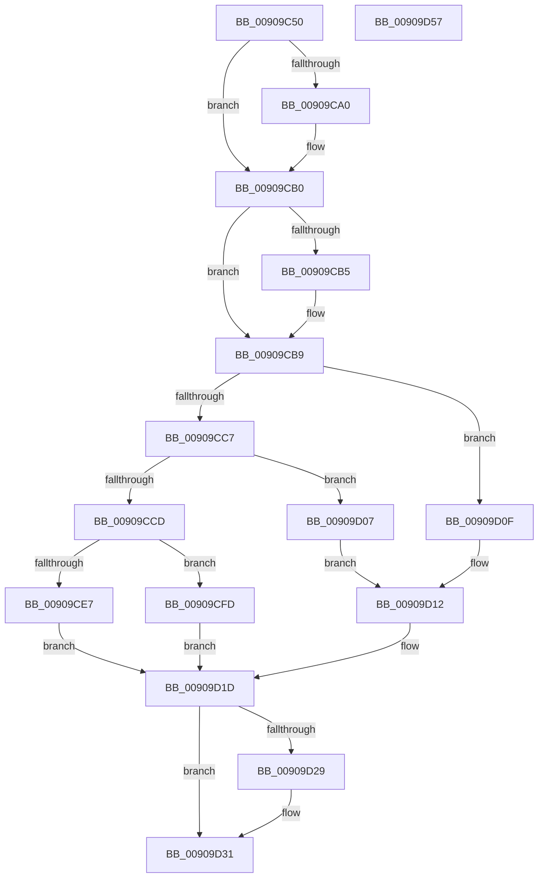

# ExpWnfReadStateData

- RVA: `0x00909C50`–`0x00909D58` (길이 `264` bytes)
- VA: `0x0000000140909C50`
- 실행 섹션: `PAGE`
- PDB 이름 있음: `예`; PDB Function 태그: `아니요`
- unwind 정보 RVA: `0x0008901C`
- 디코드: `81`개 명령, `264/264` bytes 표시
- 미해석 바이트: `0` (있으면 어셈블리에 `.byte`로 보존)

> 이 문서는 커널 이미지의 기계어와 PDB 기호를 분석해 생성했습니다. 4번과 5번은 함수 원형과 자료형을 바이너리 사용 방식에서 추정한 C 해석이며 원본 소스 복구 결과는 아닙니다.

## 1. Dependencies

- 직접 호출 지점: **5**; 고유 호출 대상: **5**
- 직접 호출자로 확인된 함수: **10**
- RIP 상대 이미지 참조: **0**

### Outgoing calls
- `0x00909C8B` → [KeAbPreAcquire](../../text/21/KeAbPreAcquire_function_00210230.md) (function, `0x00210230`)
- `0x00909CAB` → [ExfAcquirePushLockSharedEx](../../text/21/ExfAcquirePushLockSharedEx_function_0021044C.md) (function, `0x0021044C`)
- `0x00909CF1` → [memcpy](../../text/6C/memcpy_function_006C6840.md) (function, `0x006C6840`)
- `0x00909D2C` → [ExfReleasePushLockShared](../../text/26/ExfReleasePushLockShared_function_00263440.md) (function, `0x00263440`)
- `0x00909D34` → [KeAbPostRelease](../../text/2E/KeAbPostRelease_function_002E1600.md) (function, `0x002E1600`)

### Direct callers
- [ExpWnfDeliverThreadNotifications](ExpWnfDeliverThreadNotifications_function_00909630.md) at `0x009097EC`
- [NtQueryWnfStateData](NtQueryWnfStateData_function_00909DF0.md) at `0x0090A5C8`
- [PopWnfSprActiveSessionChangeCallback](PopWnfSprActiveSessionChangeCallback_function_0090C930.md) at `0x0090C9A1`
- [VslpConnectedStandbyWnfCallback](../A4/VslpConnectedStandbyWnfCallback_function_00A49D90.md) at `0x00A49E1B`
- [PopWnfFullscreenVideoCallback](../A4/PopWnfFullscreenVideoCallback_function_00A49EB0.md) at `0x00A49F1E`
- [PopNetWnfLowPowerEpochCallback](../A4/PopNetWnfLowPowerEpochCallback_function_00A49FB0.md) at `0x00A4A01E`
- [PopWnfAudioCallback](../A4/PopWnfAudioCallback_function_00A4A0E0.md) at `0x00A4A143`
- [PopEsInStandbyEvaluate](../A4/PopEsInStandbyEvaluate_function_00A4A260.md) at `0x00A4A316`
- [PopEsWnfSubscriptionOverrideCallback](../A4/PopEsWnfSubscriptionOverrideCallback_function_00A4A3C0.md) at `0x00A4A40D`
- [ExQueryWnfStateData](../A4/ExQueryWnfStateData_function_00A4A480.md) at `0x00A4A4D6`

### Static image references
- 디코드된 RIP-relative 메모리 참조가 없습니다.

## 2. Other-region calls and transfers

- 다른 실행 섹션으로 향하는 call: **5**
  - `0x00909C8B` → [KeAbPreAcquire](../../text/21/KeAbPreAcquire_function_00210230.md) (`PAGE` → `.text`)
  - `0x00909CAB` → [ExfAcquirePushLockSharedEx](../../text/21/ExfAcquirePushLockSharedEx_function_0021044C.md) (`PAGE` → `.text`)
  - `0x00909CF1` → [memcpy](../../text/6C/memcpy_function_006C6840.md) (`PAGE` → `.text`)
  - `0x00909D2C` → [ExfReleasePushLockShared](../../text/26/ExfReleasePushLockShared_function_00263440.md) (`PAGE` → `.text`)
  - `0x00909D34` → [KeAbPostRelease](../../text/2E/KeAbPostRelease_function_002E1600.md) (`PAGE` → `.text`)
- 별도 외부 분기/꼬리 이동을 확인하지 못했습니다.

## 3. Assembly (complete function range)

```asm
00909C50  48 8B C4                        mov rax, rsp
00909C53  48 89 58 10                     mov qword ptr [rax + 0x10], rbx
00909C57  48 89 70 18                     mov qword ptr [rax + 0x18], rsi
00909C5B  48 89 48 08                     mov qword ptr [rax + 8], rcx
00909C5F  57                              push rdi
00909C60  41 54                           push r12
00909C62  41 55                           push r13
00909C64  41 56                           push r14
00909C66  41 57                           push r15
00909C68  48 83 EC 40                     sub rsp, 0x40
00909C6C  45 8B E1                        mov r12d, r9d
00909C6F  4D 8B F8                        mov r15, r8
00909C72  48 8B F2                        mov rsi, rdx
00909C75  4C 8B F1                        mov r14, rcx
00909C78  45 33 ED                        xor r13d, r13d
00909C7B  44 89 68 B8                     mov dword ptr [rax - 0x48], r13d
00909C7F  48 8D 59 50                     lea rbx, [rcx + 0x50]
00909C83  45 33 C0                        xor r8d, r8d
00909C86  33 D2                           xor edx, edx
00909C88  48 8B CB                        mov rcx, rbx
00909C8B  E8 A0 65 90 FF                  call 0x140210230
00909C90  48 8B F8                        mov rdi, rax
00909C93  41 8D 4D 11                     lea ecx, [r13 + 0x11]
00909C97  33 C0                           xor eax, eax
00909C99  F0 48 0F B1 0B                  lock cmpxchg qword ptr [rbx], rcx
00909C9E  74 10                           je 0x140909cb0
00909CA0  4C 8B CB                        mov r9, rbx
00909CA3  4C 8B C7                        mov r8, rdi
00909CA6  33 D2                           xor edx, edx
00909CA8  48 8B CB                        mov rcx, rbx
00909CAB  E8 9C 67 90 FF                  call 0x14021044c
00909CB0  48 85 FF                        test rdi, rdi
00909CB3  74 04                           je 0x140909cb9
00909CB5  C6 47 0A 01                     mov byte ptr [rdi + 0xa], 1
00909CB9  49 8B 56 58                     mov rdx, qword ptr [r14 + 0x58]
00909CBD  48 89 54 24 30                  mov qword ptr [rsp + 0x30], rdx
00909CC2  48 85 D2                        test rdx, rdx
00909CC5  74 48                           je 0x140909d0f
00909CC7  48 83 FA 01                     cmp rdx, 1
00909CCB  74 3A                           je 0x140909d07
00909CCD  8B 42 0C                        mov eax, dword ptr [rdx + 0xc]
00909CD0  89 06                           mov dword ptr [rsi], eax
00909CD2  8B 4A 08                        mov ecx, dword ptr [rdx + 8]
00909CD5  48 8B 84 24 90 00 00 00         mov rax, qword ptr [rsp + 0x90]
00909CDD  89 08                           mov dword ptr [rax], ecx
00909CDF  8B 42 08                        mov eax, dword ptr [rdx + 8]
00909CE2  44 3B E0                        cmp r12d, eax
00909CE5  72 16                           jb 0x140909cfd
00909CE7  44 8B C0                        mov r8d, eax
00909CEA  48 83 C2 10                     add rdx, 0x10
00909CEE  49 8B CF                        mov rcx, r15
00909CF1  E8 4A CB DB FF                  call 0x1406c6840
00909CF6  44 89 6C 24 20                  mov dword ptr [rsp + 0x20], r13d
00909CFB  EB 20                           jmp 0x140909d1d
00909CFD  C7 44 24 20 23 00 00 C0         mov dword ptr [rsp + 0x20], 0xc0000023
00909D05  EB 16                           jmp 0x140909d1d
00909D07  41 8B 46 60                     mov eax, dword ptr [r14 + 0x60]
00909D0B  89 06                           mov dword ptr [rsi], eax
00909D0D  EB 03                           jmp 0x140909d12
00909D0F  44 89 2E                        mov dword ptr [rsi], r13d
00909D12  48 8B 84 24 90 00 00 00         mov rax, qword ptr [rsp + 0x90]
00909D1A  44 89 28                        mov dword ptr [rax], r13d
00909D1D  B8 11 00 00 00                  mov eax, 0x11
00909D22  F0 4C 0F B1 2B                  lock cmpxchg qword ptr [rbx], r13
00909D27  74 08                           je 0x140909d31
00909D29  48 8B CB                        mov rcx, rbx
00909D2C  E8 0F 97 95 FF                  call 0x140263440
00909D31  48 8B CB                        mov rcx, rbx
00909D34  E8 C7 78 9D FF                  call 0x1402e1600
00909D39  8B 44 24 20                     mov eax, dword ptr [rsp + 0x20]
00909D3D  4C 8D 5C 24 40                  lea r11, [rsp + 0x40]
00909D42  49 8B 5B 38                     mov rbx, qword ptr [r11 + 0x38]
00909D46  49 8B 73 40                     mov rsi, qword ptr [r11 + 0x40]
00909D4A  49 8B E3                        mov rsp, r11
00909D4D  41 5F                           pop r15
00909D4F  41 5E                           pop r14
00909D51  41 5D                           pop r13
00909D53  41 5C                           pop r12
00909D55  5F                              pop rdi
00909D56  C3                              ret
00909D57  CC                              int3
```

## 4. C-style interpretation (structured pseudocode)

```c
__int64 __fastcall ExpWnfReadStateData(__int64 a1, __int64 a2, __int64 a3, int a4, __int64 a5)
{
    __int64 result;
    __int64 v_r13;
    __int64 v_rsp;
    unsigned __int64 v_stack_m28;
    unsigned __int64 v_stack_m38;
    unsigned int v_stack_m48;

    *(unsigned __int64 *)(v_rsp + 16) = v_rbx;
    *(unsigned __int64 *)(v_rsp + 24) = v_rsi;
    *(unsigned __int64 *)(v_rsp + 8) = a1;
    v_rsp = (v_rsp) - (64);
    v_r13 = 0;
    *(unsigned int *)(v_rsp - 72) = 0;
    a3 = 0;
    a2 = 0;
    result = KeAbPreAcquire(a1 + 80, a2, a3, a4);
    result = 0;
    if (!(condition_is_equal)) {
        a4 = a1 + 80;
        a3 = 0;
        a2 = 0;
        a1 = a1 + 80;
        result = ExfAcquirePushLockSharedEx(a1, a2, a3, a4);
    }
    if (result != 0) {
        *(unsigned __int8 *)(result + 10) = 1;
    }
    v_stack_m38 = *(unsigned __int64 *)(a1 + 88);
    if (*(unsigned __int64 *)(a1 + 88) == 0) goto loc_00909D0F;
    if ((*(unsigned __int64 *)(a1 + 88)) == 1) goto loc_00909D07;
    *(unsigned int *)(a2) = (unsigned int)((unsigned int)(*(unsigned int *)(*(unsigned __int64 *)(a1 + 88) + 12)));
    *(unsigned int *)(a5) = (unsigned int)((unsigned int)(*(unsigned int *)(*(unsigned __int64 *)(a1 + 88) + 8)));
    if (((unsigned int)((unsigned int)(a4))) < ((unsigned int)((unsigned int)(*(unsigned int *)(*(unsigned __int64 *)(a1 + 88) + 8))))) goto loc_00909CFD;
    a2 = (*(unsigned __int64 *)(a1 + 88)) + (16);
    result = memcpy(a3, a2, (unsigned int)((unsigned int)((unsigned int)(*(unsigned int *)(*(unsigned __int64 *)(a1 + 88) + 8)))), a4);
    v_stack_m48 = 0;
    goto loc_00909D1D;
loc_00909CFD:
    v_stack_m48 = 0xC0000023ULL;
    goto loc_00909D1D;
loc_00909D07:
    *(unsigned int *)(a2) = (unsigned int)((unsigned int)(*(unsigned int *)(a1 + 96)));
    goto loc_00909D12;
loc_00909D0F:
    *(unsigned int *)(a2) = 0;
loc_00909D12:
    *(unsigned int *)(a5) = 0;
loc_00909D1D:
    result = 17;
    if (!(condition_is_equal)) {
        a1 = a1 + 80;
        result = ExfReleasePushLockShared(a1, a2, (unsigned int)((unsigned int)((unsigned int)(*(unsigned int *)(*(unsigned __int64 *)(a1 + 88) + 8)))), a4);
    }
    result = KeAbPostRelease(a1 + 80, a2, (unsigned int)((unsigned int)((unsigned int)(*(unsigned int *)(*(unsigned __int64 *)(a1 + 88) + 8)))), a4);
    return (unsigned int)(v_stack_m48);
}
```

## 5. (Beta) C Style

```c
int64_t ExpWnfReadStateData(void *Arg1, void *Arg2, int64_t Arg3, int32_t Arg4, void *Arg5)
{
    uint8_t *arg1 = (uint8_t *)Arg1;
    uint8_t *arg2 = (uint8_t *)Arg2;
    uint8_t *arg5 = (uint8_t *)Arg5;

    int64_t result;
    int64_t local_r13;
    int64_t local_rsp;
    uint64_t v_stack_m28;
    uint64_t v_stack_m38;
    uint32_t v_stack_m48;

    *(uint64_t *)(local_rsp + 0x10) = local_rbx;
    *(uint64_t *)(local_rsp + 0x18) = local_rsi;
    *(void **)(local_rsp + 0x8) = Arg1;
    local_rsp = (local_rsp) - (64);
    local_r13 = 0;
    *(uint32_t *)(local_rsp - 0x48) = 0;
    Arg3 = 0;
    Arg2 = 0;
    result = KeAbPreAcquire(Arg1 + 80, Arg2, Arg3, Arg4);
    result = 0;
    if (!(condition_is_equal)) {
        Arg4 = Arg1 + 80;
        Arg3 = 0;
        Arg2 = 0;
        Arg1 = Arg1 + 80;
        result = ExfAcquirePushLockSharedEx(Arg1, Arg2, Arg3, Arg4);
    }
    if (result != 0) {
        *(uint8_t *)(result + 0xA) = 1;
    }
    v_stack_m38 = *(uint64_t *)(arg1 + 0x58);
    if (*(uint64_t *)(arg1 + 0x58) == 0) goto loc_00909D0F;
    if ((*(uint64_t *)(arg1 + 0x58)) == 1) goto loc_00909D07;
    *(uint32_t *)(arg2) = (uint32_t)((uint32_t)(*(uint32_t *)(*(uint64_t *)(arg1 + 0x58) + 0xC)));
    *(uint32_t *)(arg5) = (uint32_t)((uint32_t)(*(uint32_t *)(*(uint64_t *)(arg1 + 0x58) + 0x8)));
    if (((uint32_t)((uint32_t)(Arg4))) < ((uint32_t)((uint32_t)(*(uint32_t *)(*(uint64_t *)(arg1 + 0x58) + 0x8))))) goto loc_00909CFD;
    Arg2 = (*(uint64_t *)(arg1 + 0x58)) + (16);
    result = memcpy(Arg3, Arg2, (uint32_t)((uint32_t)((uint32_t)(*(uint32_t *)(*(uint64_t *)(arg1 + 0x58) + 0x8)))), Arg4);
    v_stack_m48 = 0;
    goto loc_00909D1D;
loc_00909CFD:
    v_stack_m48 = 0xC0000023ULL;
    goto loc_00909D1D;
loc_00909D07:
    *(uint32_t *)(arg2) = (uint32_t)((uint32_t)(*(uint32_t *)(arg1 + 0x60)));
    goto loc_00909D12;
loc_00909D0F:
    *(uint32_t *)(arg2) = 0;
loc_00909D12:
    *(uint32_t *)(arg5) = 0;
loc_00909D1D:
    result = 17;
    if (!(condition_is_equal)) {
        Arg1 = Arg1 + 80;
        result = ExfReleasePushLockShared(Arg1, Arg2, (uint32_t)((uint32_t)((uint32_t)(*(uint32_t *)(*(uint64_t *)(arg1 + 0x58) + 0x8)))), Arg4);
    }
    result = KeAbPostRelease(Arg1 + 80, Arg2, (uint32_t)((uint32_t)((uint32_t)(*(uint32_t *)(*(uint64_t *)(arg1 + 0x58) + 0x8)))), Arg4);
    return (uint32_t)(v_stack_m48);
}
```

### 관측된 메모리 오프셋

구조체 형식이 확인되지 않은 접근은 인자 기준의 오프셋으로만 기록했습니다.

| 기준 인자 | 오프셋 표현 | 폭 (bit) | 접근 |
|---|---:|---:|---|
| `Arg1` | `+ 0x0` | `64` | `R` |
| `Arg1` | `+ 0x50` | `64` | `R` |
| `Arg1` | `+ 0x58` | `64` | `R` |
| `Arg1` | `+ 0x60` | `32` | `R` |
| `Arg2` | `+ 0x0` | `32` | `W` |
| `Arg5` | `+ 0x0` | `32` | `W` |

## 6. Execution-region graph

[열기: 2D/3D 그래프와 함수 탐색 컨트롤 패널](../../../control-panel.html?section=page&rva=0x00909C50&view=graph)

- 2D 그래프는 위에서 아래로 흐르고, 3D 그래프는 빈 공간을 드래그해 회전합니다. Shift+드래그는 이동, 휠은 확대·축소, 함수 노드 선택은 대상 보고서 이동입니다.

### Static fallback


